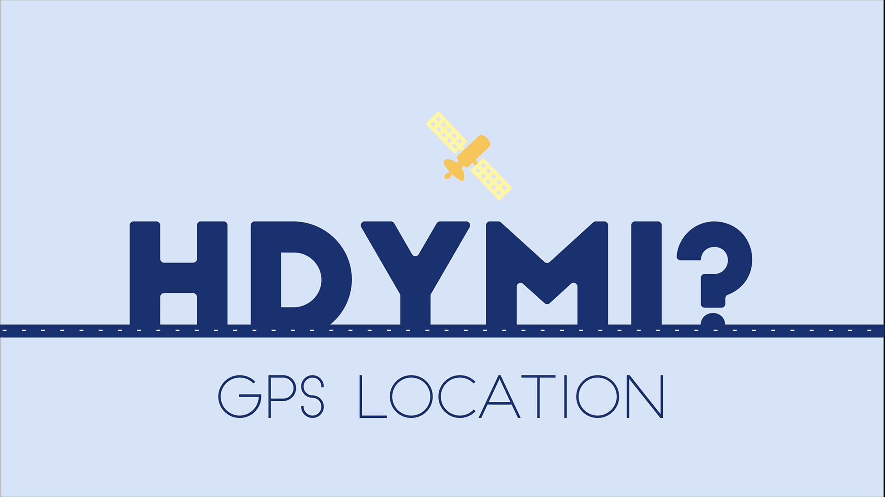
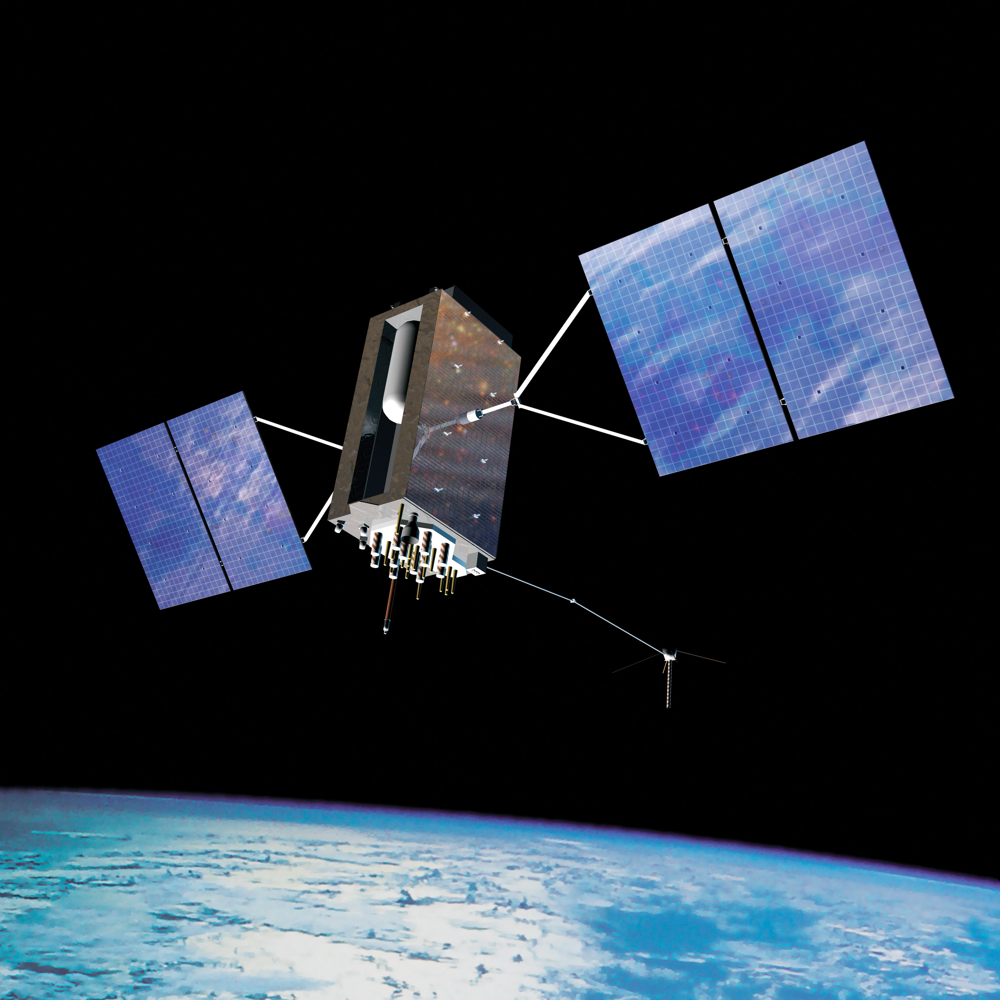
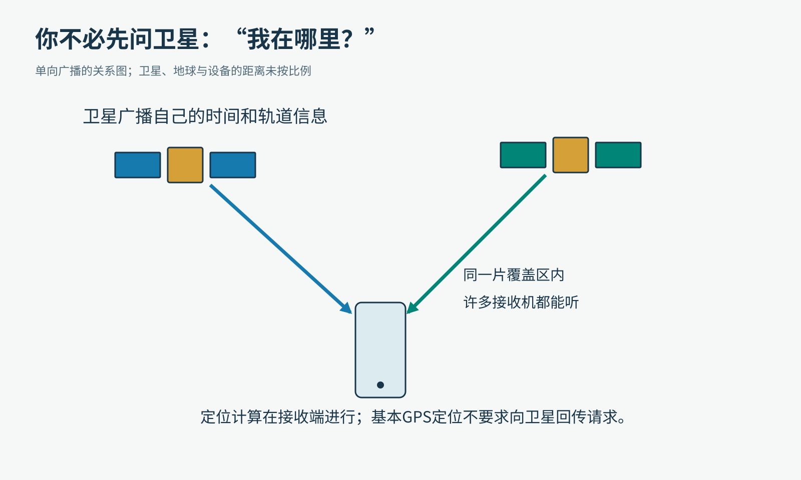
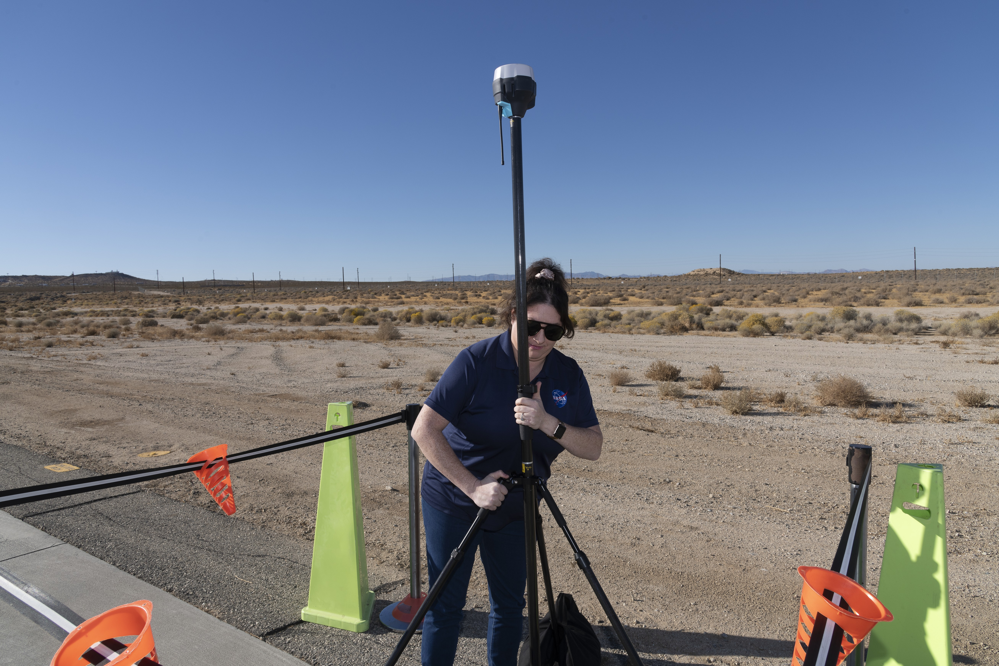
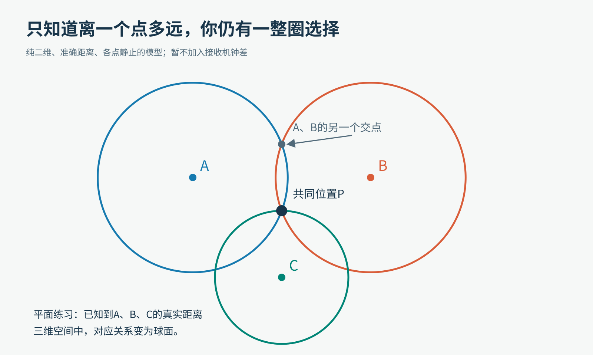
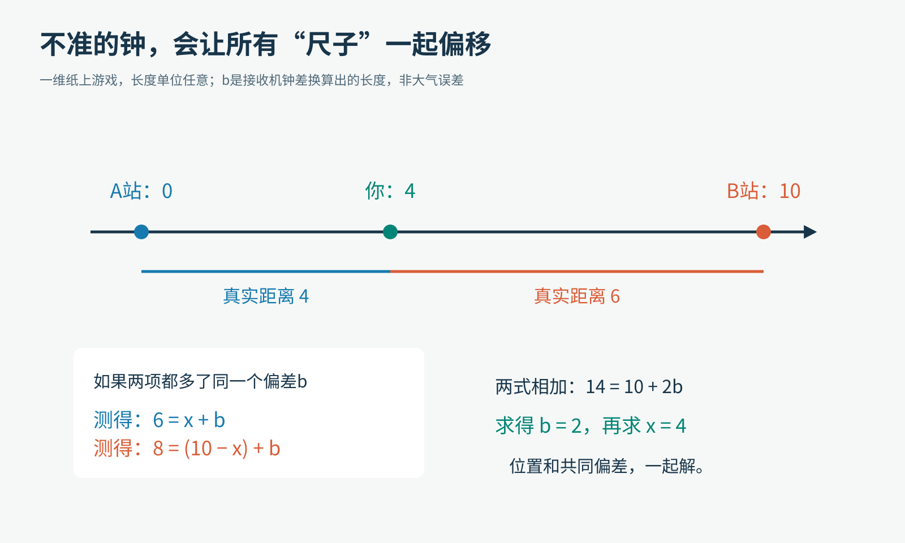
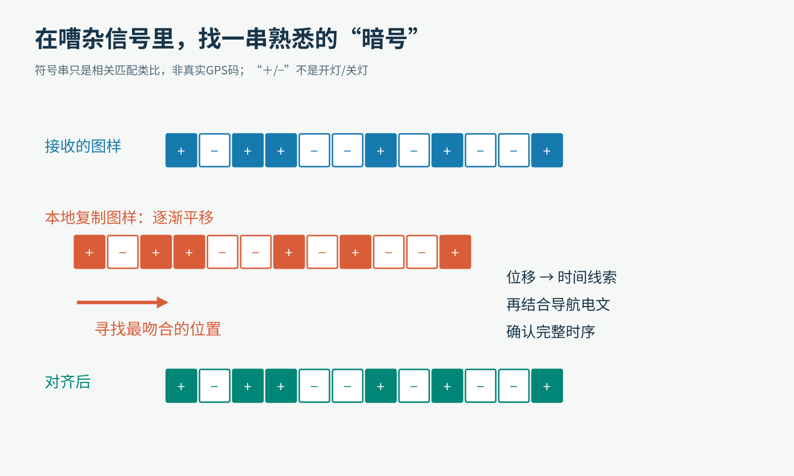
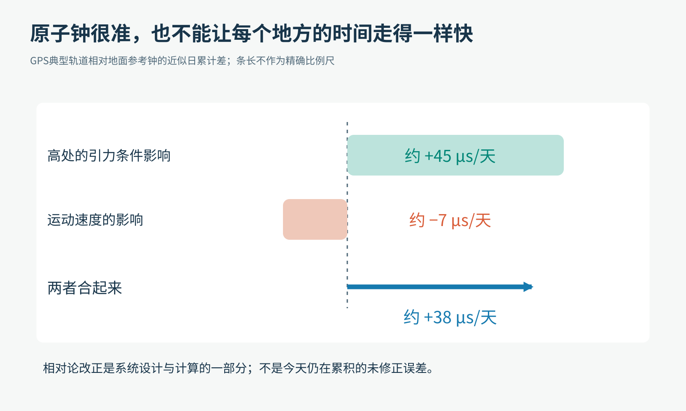
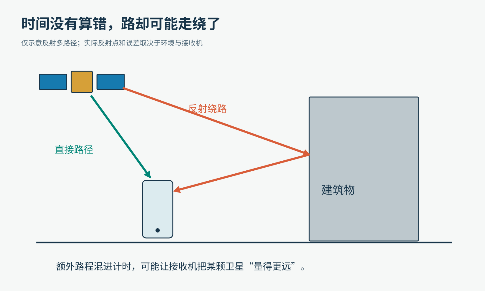

# 手机怎样从几声“报时”，算出你站在地球哪里？

你站在陌生街口，打开地图。几秒钟后，一个小蓝点出现了。

手机没有伸出两万公里长的卷尺，也没请卫星拍一张照片，再在人群里把你认出来。它做了一件更奇怪的事：认真比较几个信号里的时间。

为什么知道“几点几分”，竟然能推回“我在哪里”？

NIST“你怎样测量它？”系列的GPS定位概念动画。HDYMI是How Do You Measure It的缩写。图形串联卫星、手机和出行场景，并不表示真实轨道比例；画面中的无线图标也不意味着GPS必须依赖Wi-Fi。图片：NIST，原动画保留。

我们先把地图、路线推荐、附近商店都暂时拿掉，只留下一个问题：一台接收机，怎样知道自己的位置？

## 第一条线索：卫星一直在广播，并不等你来问

GPS的基本定位信号是单向广播。

你可以把卫星想成天上的一组“报时灯塔”。它们广播的信号让接收机获得测距所需的时间信息，以及用于计算卫星位置的轨道数据。

这里的“灯塔”发出的是无线电信号，不是肉眼可见的闪光。GPS卫星运行在离地面约20,200公里的中地球轨道上，一天绕地球约两圈。它们不是固定挂在你家楼顶上方。

GPS.gov图库提供的GPS III卫星艺术示意图。两侧展开的是太阳电池翼，中间为卫星主体。这不是在轨拍摄的照片；图中地球与卫星的位置、尺度用于表现外观，不能拿来量轨道高度。图片：United States Government / GPS.gov，公共领域教育素材。

卫星不需要知道此刻是你、同学，还是一台测量仪在听。你的设备接收广播，自己计算。

原创关系示意。箭头都从卫星指向接收端；基本定位没有“手机先发一个询问包，卫星再给它回话”的步骤。

这有一个很重要的区分：GPS接收与手机上网，是两件可以配合、但不相同的事。基础卫星定位不要求蜂窝网络把你的请求送上去。地图下载、实时路况、辅助定位数据，以及应用上传位置，则可能使用其他通信链路。

所以，“卫星没有收到你的定位请求”，不等于“所有应用都不知道你的位置”。这两个问题不能混在一起。

2024年11月7日，NASA实习研究人员Saré Culbertson在加利福尼亚州爱德华兹的阿姆斯特朗飞行研究中心调整Emlid Reach RS2+接收设备，为未来的空中出租车试验研究做准备。杆顶黑白色设备是能接收GPS等全球导航卫星系统信号的真实接收机，不是卫星。图片：NASA/Genaro Vavuris；为单图限制压缩并等比例缩小，未裁切。

手机把接收硬件做得很小；专业设备常配更适合特定测量任务的天线、安装方式和处理系统。外形不同，但“接收信号，再计算位置”这条主线相通。

## 第二条线索：信号走了多久，就是一把尺子

先假设两只钟已经对好：卫星有一只，接收机有一只。

卫星在某个时刻发出信号，接收机稍后收到。用接收时刻减去发出时刻，就得到传播时间。

距离约等于光速乘上传播时间。

这次只算单程。GPS不像回声测深，不是你发出去、碰到卫星、再弹回来，因此这里没有“除以二”。

原创数量级示意。先忽略大气与钟差，用约30万公里/秒估算；这些是计算例子，不是手机定位精度承诺。

无线电波在真空中的速度，就是光速。取约30万公里/秒，如果一次传播花了0.070秒，路程就约为21,000公里。

听上去不难，麻烦藏在精度里。

时间只差1微秒，也就是百万分之一秒，换算出来的距离就差约300米。差100纳秒，对应约30米；差1纳秒，对应约0.30米。

我们平时觉得“这只钟一天只差几秒，挺准”，放到这里就完全不够用了。

注意，300米是单项计时偏差对应的测距量级，最后算出的位置误差还与各颗卫星的方向、其他误差和算法有关，不能把它机械地当成地图蓝点必然挪动300米。

## 第三条线索：知道离你多远，还不知道你在哪

假设你在操场上，朋友A发来一条消息：“你离我五米。”

你可以站在A左边五米，也可以站在右边五米。所有满足条件的位置，画出来是一整个圆。

再知道你离B多远，就有第二个圆。两个圆通常会留下两个交点。再增加一个位置合适的C，第三条距离线索有机会把选择缩到一个位置。

原创二维几何示意。A、B两个圆有上下两个交点，C的圆经过其中的P。图中距离是准确的，暂时假定没有钟差；真实GPS的三维关系要用球面描述。

把操场换成三维空间，“离某颗卫星固定距离”的所有位置构成一个球面。几个球面相交，就能不断缩小可能的位置范围。

这类方法的核心是用距离确定位置，而不是拿量角器测三角形的角。

但如果故事讲到这里就说“三颗卫星足够了”，最值得理解的工程巧思恰好被跳过了。

因为我们开头偷偷塞了一个奢侈的假设：手机和卫星的钟，已经完美对好。

## 真正的谜题：手机没有原子钟，怎么办？

卫星上带着原子钟，地面系统还会监测轨道与钟差、更新导航信息。普通手机不能照搬整套卫星计时设备。

如果接收机的钟快了一点，它就会以为信号“多走了一会儿”。在相近的测量时刻，这个接收机钟差会给各项距离加上一个共同的偏差。

因此，刚从时间算出来的量，先叫伪距。“伪”不是说它是假数据，而是提醒你：里面除了几何距离，还混着钟差、大气传播等因素，尚不能直接拿来画准确的球。

这个问题，竟然可以和位置一起求解。

先玩一个只有一条直线的小游戏：A站在刻度0，B站在刻度10，你在两站之间。设你的位置是x，暂不考虑其他误差，只让两项测距都多出同一个长度偏差b。

如果仪器报告“离A是6，离B是8”，你能找到自己吗？

原创算例，单位任意。此处假定接收机钟快了，使两项距离都增加b；钟慢时，偏差也可能为负。

离A的真实距离是x，离B的真实距离是10−x。于是：

6＝x＋b。

8＝10−x＋b。

把两式相加，x消失了：14＝10＋2b。所以b＝2。再放回第一式，x＝4。

你不仅找到了自己的位置，还把那个“不准的钟”造成的共同偏差求了出来。

GPS做的事情比这复杂，却有相同的聪明之处：不用先把接收机的钟修到完美，才能开始定位；可以把位置和钟差一起当成未知量。

## 为什么常说“至少四颗卫星”？

在普通、无额外位置约束的三维定位中，我们需要求出三个空间坐标，再加一个接收机钟差，共四个未知量。

每颗卫星提供一个测距约束。通常至少需要四颗能有效观测、几何关系合适的卫星，才能联合求解这四个未知量。

原创计算关系示意。四颗卫星共同参与求解，不能把它理解成前三颗只管位置、第四颗专门给手机校时。

为什么还要说“几何关系合适”？你可以想象，几个人都站在几乎同一个方向看你，提供的空间线索容易重复；来自较分散方向的测量，通常能更好地区分你往哪个方向移动。

真实测量带噪声，多颗卫星算出的“球面”也很难完美交在一点。接收机会把多项观测一起处理，寻找更符合这些数据的位置与钟差，例如采用最小二乘等方法。

所以，多看见几颗卫星往往有帮助，但“数字更多”不自动等于“每颗信号都更可靠”。来自建筑反射的坏线索，不能因为数量多就变成好线索。

“至少四颗”也有范围：如果外部系统已经提供可靠高度、时间或其他约束，未知量可能减少。反过来，四颗信号很差、方向不理想，也不能保证一个好结果。

## 再往里拆一层：手机怎样认出“这是哪一刻的信号”？

卫星并不是每秒朝地面喊一声“现在整点！”，让手机拿普通秒表等着听。

GPS信号里有按规则变化的测距码。你可以把它想成一串很长、可重复生成的特殊图样。接收机知道该找什么图样，便在本地产生一个副本，前后移动，寻找与收到的图样最吻合的位置。

这叫相关匹配。

原创类比图，符号不是实际GPS码，也不代表无线电简单开关。对齐得到时间线索，还需结合导航电文与完整时序，不能把短图样的位移直接当成全部传播时间。

想象老师用节奏敲出“短、长、短、短、长……”，你手里也有同一份节奏谱。房间里有杂声，但把录到的节奏和谱子不断平移比较，仍可能找到最佳对应。

真实无线电接收当然复杂得多：要识别和跟踪信号，还要处理噪声、频率变化、码的重复，以及不同信号的结构。这个类比只帮助理解“为什么不是随便抓一个波峰就能计时”。

另外，卫星自己也在移动。接收机利用导航电文里的轨道参数，也就是星历，计算信号发出时卫星在哪里。你拿到的参照点，必须属于正确的时刻。

截至这里，蓝点背后的流水线已经出现：认出信号，形成测距观测，计算卫星位置，联合解出接收机位置与钟差，再处理各种修正。

## 时间还有一个更深的脾气：原子钟也要考虑相对论

原子钟很稳定，并不意味着“无论放在哪、怎样运动，它与地面钟都天然走得一样快”。

对GPS典型轨道而言，卫星的运动速度带来一种相对论效应：相对于地面参考钟，约每天慢7微秒。轨道高度所对应的引力势差又带来相反影响：约每天快45微秒。两者合起来，约每天快38微秒。

原创数量级图解，采用NIST给出的GPS典型轨道近似值。加号表示相对地面参考钟走快；这不是说正在工作的GPS每天留下38微秒错误不管。

这已经远远超过前面讨论的纳秒尺度，所以系统设计与计算必须把相关效应考虑进去。

有趣之处不在于喊一句“导航靠爱因斯坦”，而在于：当一项技术把时间测得足够细，平时感觉不到的物理效应，就会进入实际工程账本。

也不要拿38微秒直接乘光速，便宣布“你的手机今天会错几公里”。那是未修正时的量级提示，不是正常工作的GPS实际定位误差。

## 蓝点为什么还会飘到街对面？

时间测得细，仍不代表环境会配合。

高楼、桥梁和树木可能遮挡信号。信号还可能先碰到建筑，再绕到接收机。这叫多路径。

原创路径示意。反射路径比直接路径长，可能干扰接收机对信号时序的判断；误差大小取决于环境和设备，图中没有给出实测数值。

如果把绕路误当成直达，额外路程就可能混进“我离卫星多远”的判断。它与手机钟造成的共同偏差不同，不能指望解出一个钟差就全部消失。

电离层、对流层也会影响传播。不同频率、修正信息、更好的天线与算法，可以帮助应对部分误差，但任何技术都有适用条件。

还有一种“定位错了”，其实是地图标错了路、店名或入口。坐标计算与地图内容是不同环节，查问题时得分开看。

我们日常把卫星定位都顺口叫“GPS”。严格说，GPS是其中一个系统，北斗、Galileo等也属于全球导航卫星系统，也就是GNSS。支持多系统的接收机，可以使用不止一套卫星信号；具体支持哪些，取决于设备。

定位、导航与授时的概念插图：位置告诉你在哪，地图与路线服务帮助你去哪，准确时间又是底层测量的重要条件。图片：B. Hayes/NIST，原图未改动，依[NIST作品使用条款](https://www.nist.gov/open/license)署名使用。

## 留给探索者的两道小挑战

第一道只需要纸笔。仍用A＝0、B＝10的一维模型。假设仪器报告到A为7、到B为7，而且两项只有相同的加性偏差。你在哪里？偏差是多少？

你可以先自己写出两式，再看答案：把两项相加，14＝10＋2b，仍有b＝2；于是x＝5。报告的距离都不对，位置和偏差仍能一起求出来。

第二道是一项观察，而不是精度认证。找一处安全、开阔的地方站定，再与附近有遮挡的安全位置比较地图蓝点的稳定程度。只在停下时看屏幕，不去车道或危险边缘，不需要记录或公开自己的轨迹。

你可能看出差异，也可能看不出。因为手机往往还融合其他定位信息，地图会平滑显示，单次观察又受当时卫星分布影响。没有明显差异，不等于遮挡和反射不会影响卫星测量；出现差异，也不能只凭一次观察断言原因。

下一次那个小蓝点亮起时，你可以试着把它倒着拆开：一个坐标，来自几项距离；几项距离，来自几段传播时间；而传播时间，又来自天上与手里这些钟的共同协作。

我们以为是在问空间一个问题，最后却必须把时间听得足够清楚。

事实延伸：[NIST的GPS测量解释](https://www.nist.gov/how-do-you-measure-it/how-do-you-measure-your-location-using-gps)、[ESA Navipedia的码定位与四个未知量](https://gssc.esa.int/navipedia/index.php/Code_Based_Positioning_(SPS))、[GPS.gov的精度与误差说明](https://www.gps.gov/gps-accuracy)、[NIST的相对论计时解释](https://www.nist.gov/atomic-clocks/a-powerful-tool-for-science/putting-einstein-test)。

图片来源：[NIST定位图文](https://www.nist.gov/how-do-you-measure-it/how-do-you-measure-your-location-using-gps)（动画：NIST；概念图：B. Hayes/NIST）、[NASA/Genaro Vavuris接收机实拍](https://images.nasa.gov/details/AFRC2024-0181-10)、[GPS.gov公共领域图库](https://archive.gps.gov/multimedia/images/)（GPS III艺术图）；其余为本文原创教学图解。
