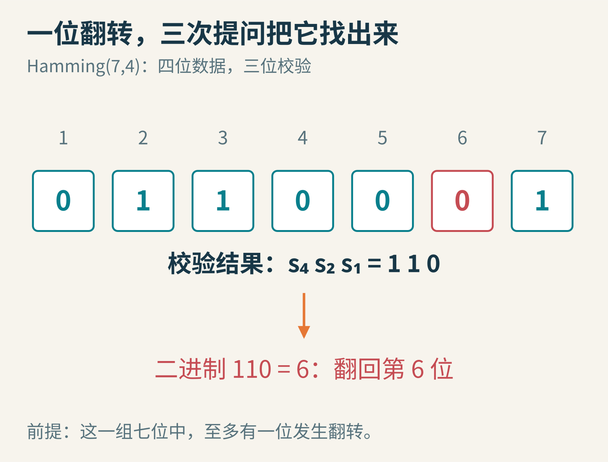
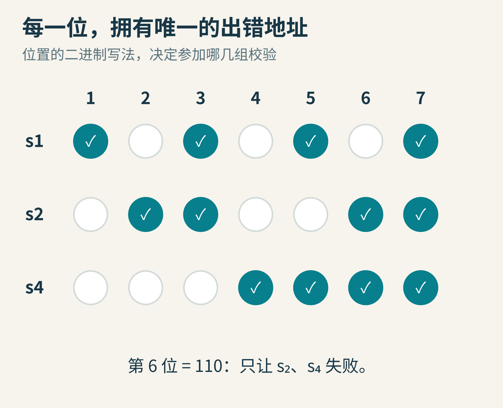
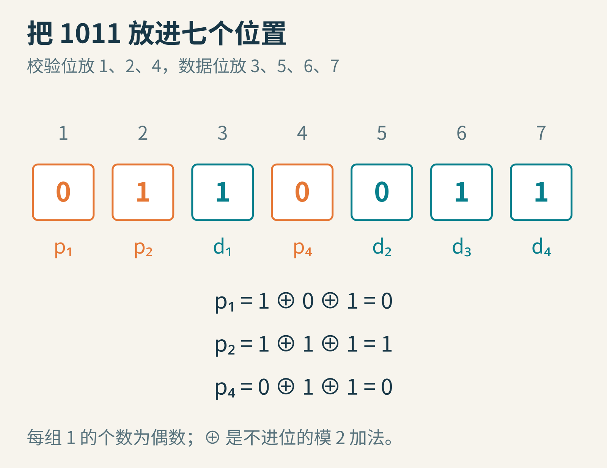
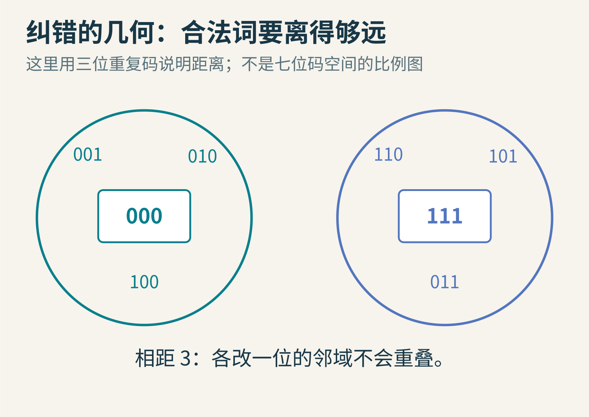
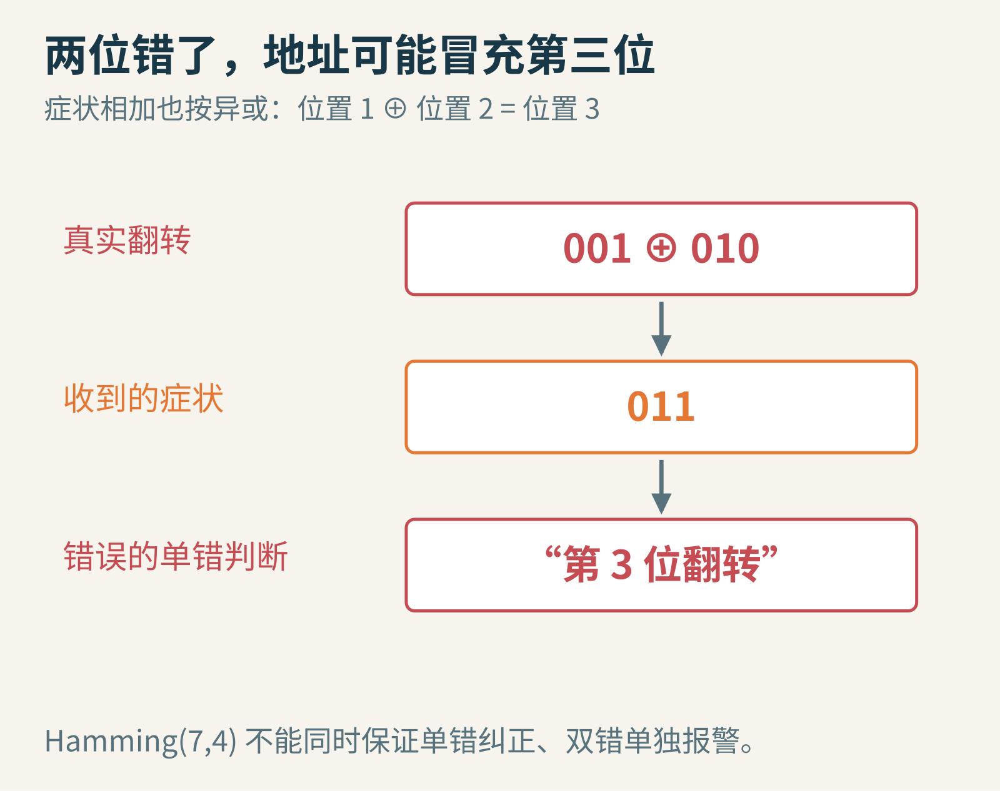
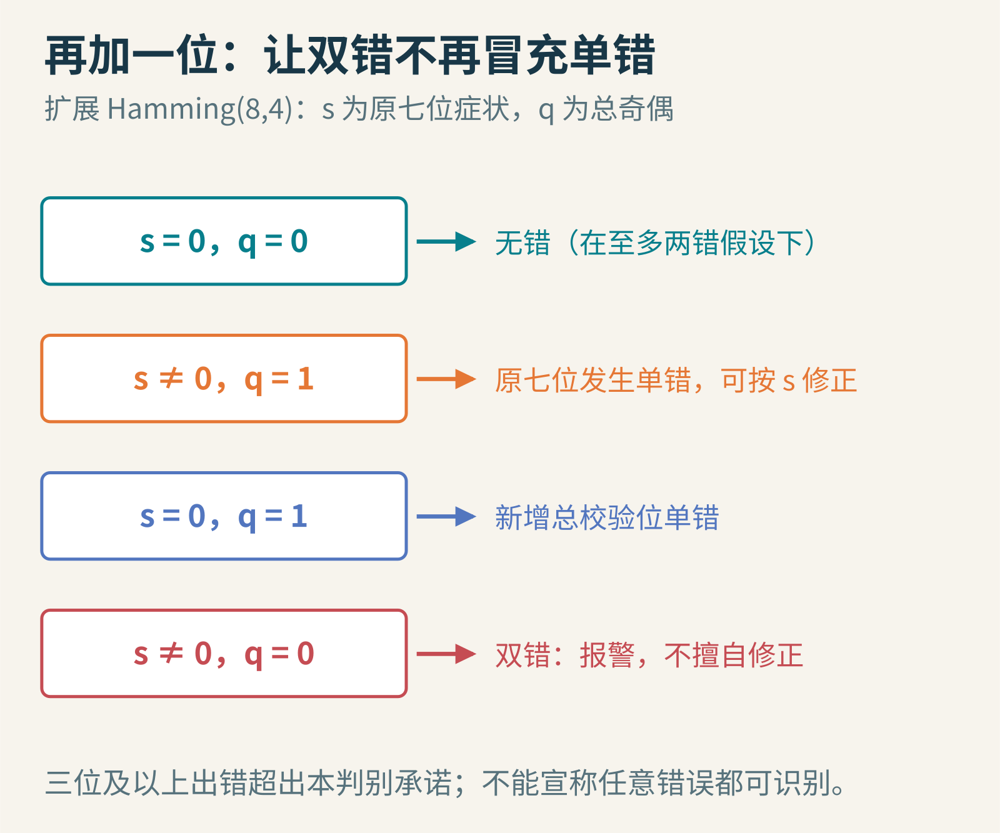

# 错了一位，机器为什么能自己找回来？跟 Hamming 做七张纸牌实验

你要把四个比特 1011 发给另一端。线路很吵，某个 1 可能被读成 0。最简单的防守，是把每一位重复三次：1 发成 111，0 发成 000。接收端多数表决，就能纠正每组三位里的一次翻转。

这很好懂，但四位内容要发十二位。有没有办法少付一点冗余，又能知道究竟哪一位错了？Richard Hamming 给出的一个经典答案是：把四位数据放进七个位置，用三道经过精心安排的奇偶校验，让每个位置留下不同的“出错地址”。

我们不从公式森林开始。准备七张纸牌，每张写一位数字，按位置 1 到 7 排开。读完这篇，你就能当着同学的面，让他偷偷翻转一张，再用三次检查找到它。



封面示意：症状 110 是二进制位置 6。这个判断有一个关键前提：七位之中至多发生一次翻转。

## 一、会报警的机器，仍可能把周末毁掉

Hamming 在贝尔实验室使用过继电器计算设备。他[1950 年论文](https://ineffectivetheory.com/edu/papers/hamming-codes-1950.pdf)的开头说明：当时 Model 5 继电器计算机已有错误检测，但夜间和周末无人值守时，检测到错误常会让计算停下。机器知道自己出错，却不能继续完成原任务，依然不是令人满意的可靠性。


图为从飞机上拍摄的新泽西州 Murray Hill 贝尔实验室场址，前景可见机翼，Ken Lund 摄于 2012 年 5 月 16 日。[原图](https://www.flickr.com/photos/kenlund/7235324892/)，[CC BY-SA 2.0](https://creativecommons.org/licenses/by-sa/2.0/)，未改动。这是后来拍摄的研究地点，不是 1950 年现场，也不代表 Hamming 当时的具体房间或设备。

他的论文《Error Detecting and Error Correcting Codes》发表于《Bell System Technical Journal》1950 年 4 月，第 29 卷第 2 期，147—160 页。[1982 年本人回顾](https://garfield.library.upenn.edu/classics1982/A1982NY35700001.pdf)还解释了研究与发表之间因专利事务造成的时间间隔。因此，把问题、构造、发表都压成“1950 年某个周末突然发明”，会把真实研究过程讲得过分整齐。

Hamming 想跨出的那一步很具体：不只发出“哪里出了事”的警报，还要用额外信息定位并修复一个有限规模的错误。原论文也提到此前 Golay 的工作；纠错码的历史并不是只有一位英雄。

Hamming 常见的贝尔实验室肖像没有查到适合本文转载的自由许可，这里不把维基百科特定页面的非自由使用理由当作通用授权。可以通过[海军研究生院的 Hamming 资料页](https://hamming.nps.edu/)认识他本人及其教学工作。

## 二、一个奇偶位，只会回答“有问题吗”

先给 1011 追加一个偶校验位。数据里有三个 1，为了让总数变成偶数，追加 1，得到 10111。任何单独一位翻转，1 的总数都会从偶数变为奇数，因此能够检测。

但检测结果只有“奇”或“偶”，它没有说第一位坏了还是第四位坏了。更麻烦的是，两位同时翻转可能让奇偶性恢复，看起来一切正常。

所以，“加校验码”不是一句足够明确的保证。你要问：检测几位错误？纠正几位错误？错误在什么单位内统计？接收端采用什么策略？我们将看到，同一组比特在不同策略下可以检测或纠正不同范围，不能把这些能力混为一谈。

数学上的异或，正好描述奇偶检查。两个比特相同，异或为 0；不同，异或为 1。多个比特异或，就是把所有 1 的数量对 2 取余。它有个很有用的特点：1⊕1=0，相同变化会互相抵消。

## 三、三道问题，给七个位置不同的地址

三次是非回答共有 2³=8 种结果。我们需要区分七种“某一位错了”，再加一种“没有错误”，正好八种。这个计数还不是构造证明，却告诉我们目标有希望。

把位置编号写成三位二进制：1 是 001，2 是 010，3 是 011，4 是 100，5 是 101，6 是 110，7 是 111。接着让最低位为 1 的位置参加第一组检查，中间位为 1 的参加第二组，最高位为 1 的参加第三组。

于是三个集合是：

- 第一组：1、3、5、7
- 第二组：2、3、6、7
- 第三组：4、5、6、7



每一列的参加模式都不同。例如位置 6 只参加第二、第三组；若只有它翻转，恰好这两组失败。

让每组的异或都应为零。接收端重做检查，把失败记为 1、通过记为 0。第一组结果叫 s₁，第二组叫 s₂，第三组叫 s₄。把它们按 s₄s₂s₁ 排成二进制，得到的整数就是“症状”或 syndrome。

注意下标 1、2、4 代表二进制权重。若按照看到的顺序把 s₁s₂s₄ 直接读成二进制，位置就可能读反。许多第一次手算纠错码的错误，不在理论，而在位序约定没有统一。

这个计数还能帮你设计更长的保护字。若有 m 位数据和 r 位定位校验，总长度是 m+r，需要区分“无错”和 m+r 个单错位置，因此至少要满足 2ʳ≥m+r+1。对四位数据，r=2 时只有四种回答，却需要区分七种状态，不够；r=3 时有八种，正好覆盖七个位置加无错。

假如保护的是 64 位数据，试 r=6：64 种回答不够区分 71 种状态；r=7 时，128 种回答足够覆盖 71 个位置加无错。可从更长的 Hamming 码中取适当的缩短构造，用七位定位校验保护这 64 位数据；再加总奇偶位，得到 72 位的单错纠正、双错检测构造。这个例子说明冗余比例随块长变化，并不是永远必须按四比特一组使用。

不过，计数不等式只给出必要容量条件。设计者仍需给每个位置不同的非零症状，规定无效症状怎样处理，并验证实际编码与解码。更大块也意味着更多比特共同暴露在同一组错误假设下，不能只算省了几个校验位就宣布更可靠。

## 四、为什么校验位偏偏放在 1、2、4？

因为 1、2、4 的二进制写法都只有一个 1。把校验位放在这些位置，每个校验位只参与自己负责的那组，计算起来不会互相打架。

将数据 1011 依次放在位置 3、5、6、7，剩下位置 1、2、4 留给 p₁、p₂、p₄。七张牌暂时是：p₁、p₂、1、p₄、0、1、1。

第一组要使 p₁⊕1⊕0⊕1=0，所以 p₁=0。第二组要求 p₂⊕1⊕1⊕1=0，所以 p₂=1。第三组要求 p₄⊕0⊕1⊕1=0，所以 p₄=0。最后编码得到 0110011。



颜色区分校验位和数据位，不代表校验位不会出错。它们同样是经由线路或存储单元保存的真实比特。

你可以重新数三组的 1：位置 1、3、5、7 是 0、1、0、1，两个 1；位置 2、3、6、7 是 1、1、1、1，四个 1；位置 4、5、6、7 是 0、0、1、1，两个 1。都为偶数。

现在请同学把第 6 位从 1 翻成 0，收到的序列变成 0110001。第一组仍通过，s₁=0；第二组失败，s₂=1；第三组失败，s₄=1。按规定顺序组合是 110，十进制为 6。把第 6 位翻回去，数据恢复。

如果坏的是第 2 位校验位呢？只有第二组失败，症状是 010，仍指向位置 2。因此这套方法不是只修“有用的数据位”，校验位本身也受到保护。

## 五、为什么这不是侥幸撞上了一个例子？

任何合法码字都使三组检查结果为零。若只有位置 j 翻转，它参加的每一组都会从通过变失败；它不参加的组不受影响。参加模式就是 j 的二进制编号，所以症状必然等于 j。这个推理对七个位置和所有合法数据都成立。

再换个几何角度。两串等长比特的 Hamming 距离，是对应位置不同的个数。例如 000 与 111 相距 3，000 与 001 相距 1。一次翻转只移动一步。

如果任意两个合法码字至少相距 3，那么各自附近“一次翻转可到达”的区域不会重叠。一个收到的串若最多错一位，只能靠近其中一个合法码字，纠正才有唯一答案。



这里用 000、111 的重复码展示距离直觉。真正 Hamming(7,4) 有 16 个合法七位码字，位于七维比特空间；平面圆只是邻域示意。

为什么恰好能装下？四位数据共有 16 种，每个合法七位码字加上七种单错结果，占八个不同接收串。16×8=128，正好等于全部七位串的数量 2⁷。Hamming(7,4) 因此是一个完美单错纠正码：全部接收串恰好被这些半径一邻域分完。

这句话既漂亮，也带来危险：每个收到的七位串都能被解释为“某个合法词加至多一错”。如果实际发生了两错，单错解码器也会自信地找到一个错误的解释。

## 六、两位错了，为什么会指向第三位？

从合法码字出发，同时翻转第 1 位和第 2 位。位置 1 给症状贡献 001，位置 2 给症状贡献 010，异或起来是 011。解码器若仍坚信只有一错，就会去翻转第 3 位。



它不仅没有修好原来的两位，还制造了第三个差异。这是超出假设后的误纠正，不能怪症状没有履行一个它从未承诺的任务。

单纯拿收到的串检查“它是否属于合法码字集合”，距离 3 的码确实能检测所有一位和两位错误。但是，若你同时要求系统对单错自动纠正、又对双错独立报警，就必须分清两类情形；Hamming(7,4) 的症状不够。所谓“能检测双错”如果不讲解码策略，极易误导。

三个位置也可能共同作弊。位置 1、2、3 的编号满足 001⊕010⊕011=000，因此三位都翻转时，原来的三组校验可能全部通过。检查通过从来不意味着宇宙向你保证没有任何错误。

## 七、再加一位，换来明确的双错警报

在原七位之外，再加一个总偶校验位，让全部八位的 1 的总数为偶数。得到扩展 Hamming(8,4)。原七位症状仍记作 s，所有八位异或结果记作 q。

在“最多两位翻转”的假设下：s=0 且 q=0 表示无错；s 非零、q=1 表示原七位有单错，可按 s 修正；s=0、q=1 表示新加的总校验位单错；s 非零、q=0 表示双错，应报警而不是按 s 擅自修。



这就是 SECDED：single-error correction、double-error detection，单错纠正、双错检测。新增那一位使最小距离从 3 增到 4。

把我们的 0110011 数一遍，已有四个 1，因此追加总校验位 0。若第 6 位单错，原症状为 6，总奇偶变奇；若第 1、2 位同时错，总奇偶仍为偶，症状却非零，便能知道不应按单错策略改第 3 位。

三位或更多翻转仍然超出这张判断表的承诺。有些会被误当作单错，有些四位错误可能落到另一个合法码字。实际 ECC 系统采用多大的保护字、怎样分布数据位、是否使用更强的码，都决定了面对芯片失效或连续突发错误时的能力。不能把“某内存带 ECC”翻译成“任意故障都修得好”。

## 八、自己验证全部 112 种单错情况

七张牌帮助建立直觉，短程序则可以穷举所有四位数据和七种翻转位置。下面的核心检查函数不需要第三方库：

```python
def syndrome(bits):
    answer = 0
    for p in (1, 2, 4):
        parity = 0
        for position, bit in enumerate(bits, start=1):
            if position & p:
                parity ^= bit
        answer += p * parity
    return answer

print(syndrome([0, 1, 1, 0, 0, 0, 1]))  # 6
```

请自己补上编码器：把四位数据放进 3、5、6、7，把三个校验位先设零，再分别计算每组数据的异或。然后枚举 0000 到 1111；对每个码字依次翻转第 1 到 7 位，检查症状是否等于翻转位置、修正后是否回到原码字。总共 16×7=112 次，本文的独立验证程序已全部检查。

进一步枚举任意两个合法码字的距离，你会得到最小值 3。再枚举双错，让单错解码器去“修”，观察它怎样走向另一个合法词。这比只看成功动画更能帮助你理解保证的边界。

## 九、冗余为什么反而能让信息更有用？

从纯传输效率看，七位只装四位新数据，显得浪费。但若不加冗余，一次错误就让结果失真甚至让整夜计算作废，省掉的三位未必真划算。冗余的作用，是把本来无法分辨的情况拉开距离。

Hamming 的办法没有让继电器从此不出错，也没有要求接收端神奇地知道原文。它改变了允许发送的比特串集合，让“合法内容”之间留出足够空隙。噪声把一个点推歪一点，接收端仍能找到回去的路。

还要记住，本文讨论的是已知长度比特块里的翻转错误；丢失整段数据、插入多余比特、把两个块的边界读错，都是不同的问题。换了信道模型，就需要重新设计同步、分块与编码，不能仅把症状计算器原样搬过去。

这是一种很广泛的工程智慧：与其假定每一个部件永远完美，不如先说明允许什么错误，再用结构让这些错误能够被识别和处理。但每次听到“自动修复”，也值得像今天一样追问一句：在怎样的错误模型里？最多几位？超出以后，它会报警、停下，还是自信地修错？

图片来源：贝尔实验室历史环境照片来源见相邻图注；其余为原创教学示意。

本文由 AI 辅助资料整理、写作与制图；七位与八位码例为教学构造，编码、症状和 112 种单错测试已经实际运行。
