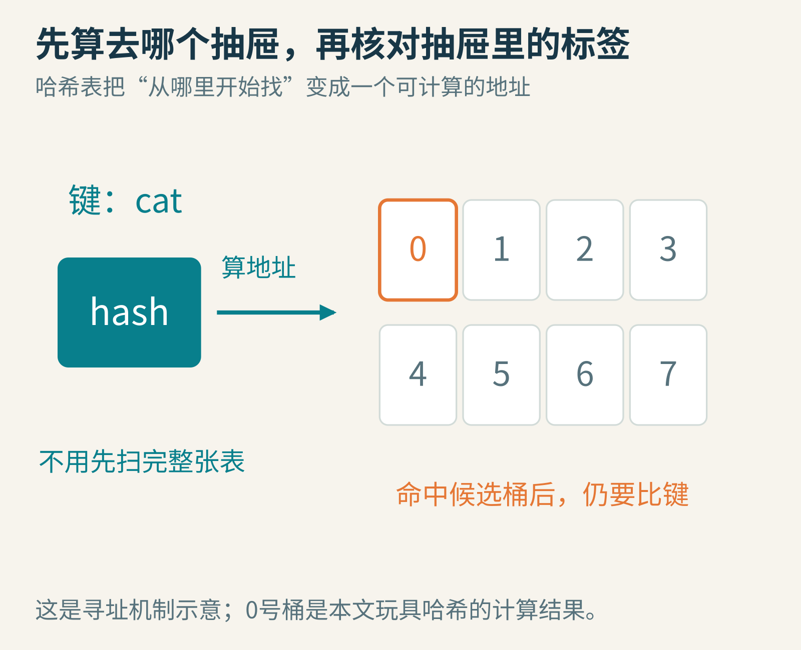
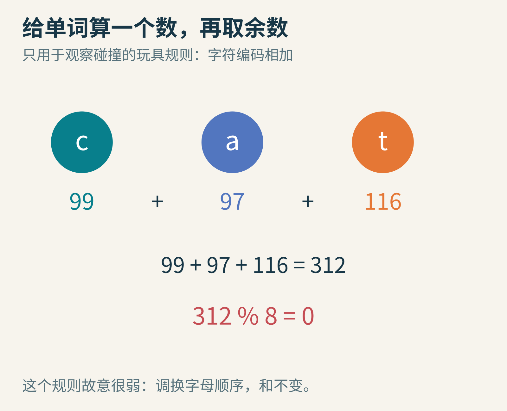
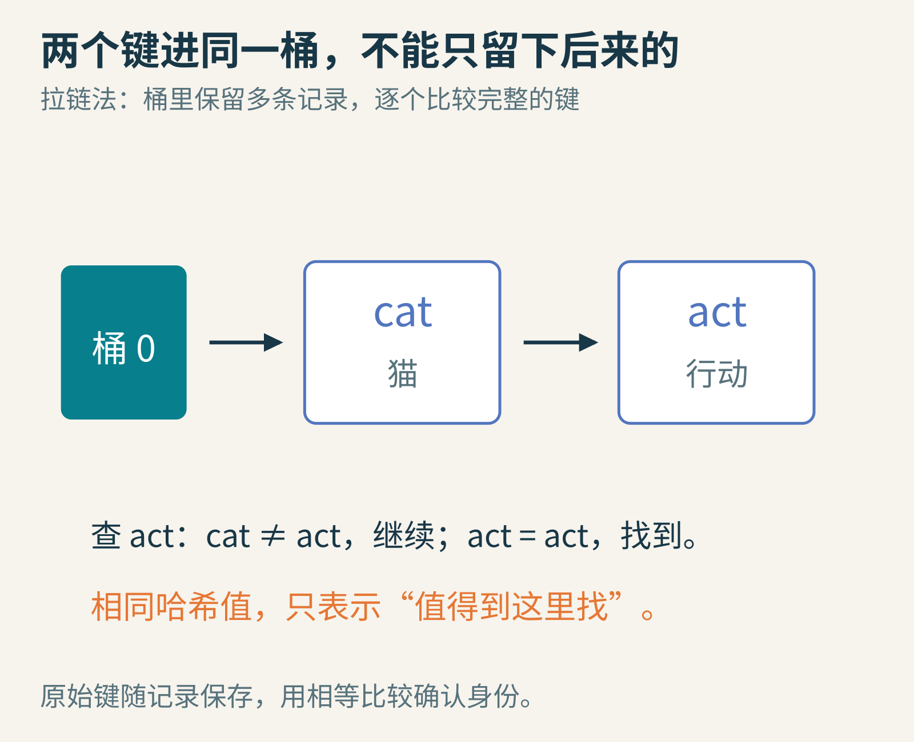
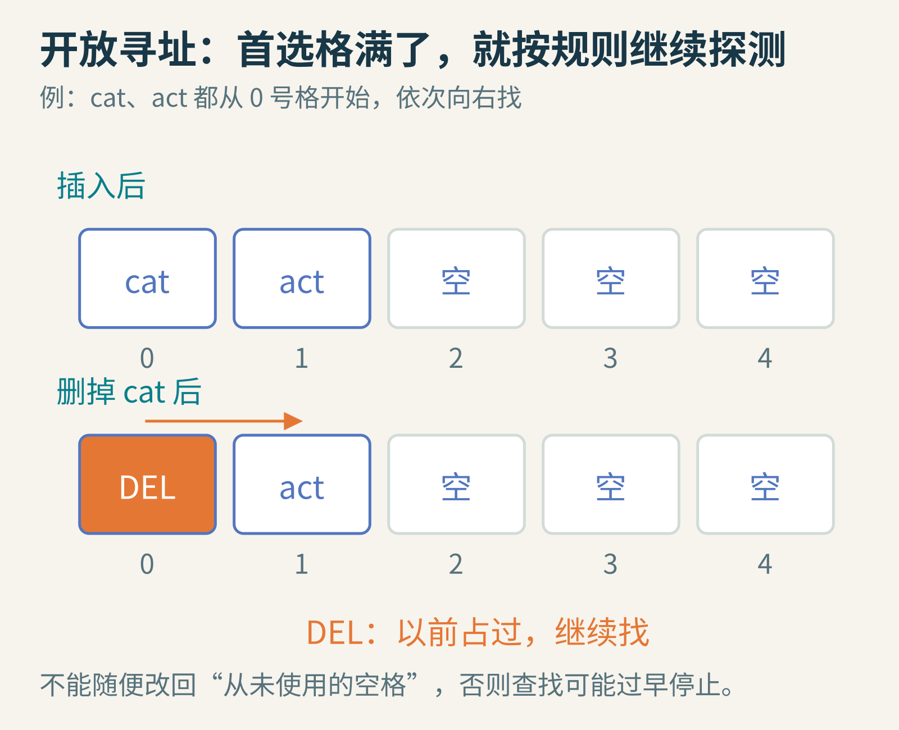
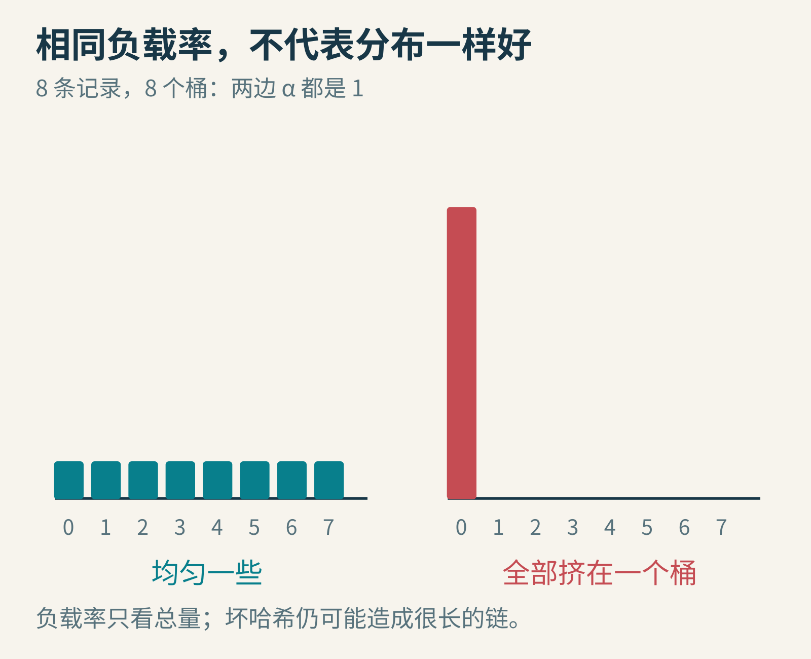
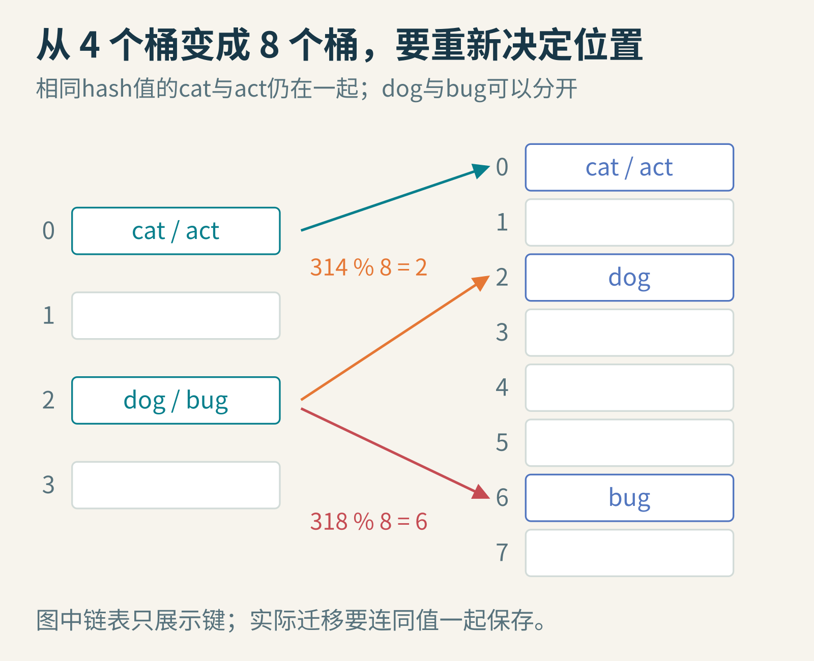
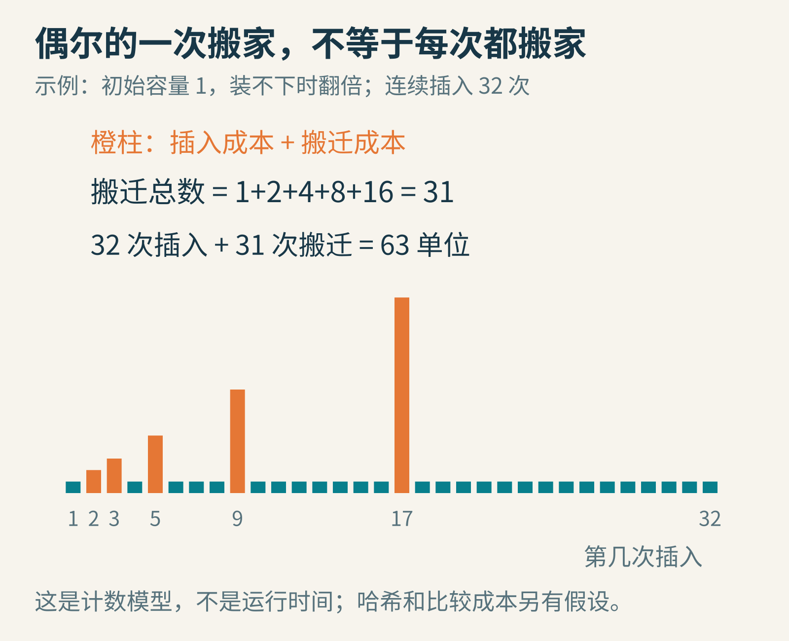

# 字典里有一百万个键，电脑为什么不用挨个看，就能找到那一个？

假设你在做一个游戏：输入道具名字，就能查到它的价格、图标和效果。起初只有十件道具，拿一个列表从头找到尾，没什么问题。后来数据越来越多，同样的查询要反复发生，挨个看就显得笨重了。

这里说的“字典”，是程序里把键映射到值的数据结构。例如，键是"healing_potion"，值是一条道具记录。它不一定像纸质词典那样按字母顺序排列。

一种常见实现叫**哈希表**。它的想法很大胆：能不能直接从键算出应该去哪里找，而不是先把全部记录看一遍？



全文图片均为原创教学示意。哈希表先缩小查找范围，找到候选位置后，仍然要核对键。

这个思路像一排有编号的抽屉。普通查找问：“我的东西在第几个抽屉？”哈希查找先按一套规则计算：“请从0号抽屉开始检查。”

现在的问题变成了：怎样计算？两件东西算出同一地址怎么办？抽屉不够了又怎么办？我们逐个把它造出来。

## 先造一个故意不聪明的哈希函数

哈希函数把键映射成一个数。为了让你可以拿纸笔验证，先采用一个特别简单的规则：把字符串各字符的编码相加。

对于英文小写字母，c、a、t的Unicode码点分别是99、97、116。因此：

h("cat")＝99＋97＋116＝312。

如果有8个桶，编号从0到7，就用312除以8的余数作为桶编号。程序里常写成312 % 8，结果是0。



“%”在这里表示取余数。这个示例规则很弱，只适合观察机制，不能作为真实项目的推荐字符串哈希。

为什么不直接开一个312号抽屉？因为真实哈希码可能来自很大的整数范围，而你的表只分配了有限空间。还需要一步把较大的数映射到实际桶范围，取余只是容易理解的一种方式。

查询cat时，再按同一规则算312，再去0号桶。只要插入和查找遵守同一套规则，键本身就能充当寻找位置的线索。

[Python官方FAQ](https://docs.python.org/3/faq/design.html#how-are-dictionaries-implemented-in-cpython)解释了CPython字典采用可扩容哈希表。但真实Python字符串的hash不是本文这个字符求和，也可能受每进程的随机化影响，不能把一次运行得到的哈希值当作永久编号。

## 第一场意外：cat和act，居然算出同一个数

a、c、t还是那三个字符，换个顺序，和当然仍是312。

cat是猫，act可以表示行动。键不同，哈希值却相同，这就是一种**碰撞**。如果0号桶只能存一个值，后来的act直接覆盖cat，字典就丢东西了。

而且换一个更聪明的哈希函数，也不能对任意数量、任意长度的键保证永不碰撞。输入可能非常多，输出范围和表的空间却有限，必须准备好相遇后的处理办法。

一种直观方案叫**拉链法**：每个桶保存一个小集合或列表。同桶的记录都留下，再逐个比较完整的键。



查act时，先比较cat，发现不相等，继续看下一条；直到完整的键相等，才返回它的值。

这就解释了为什么哈希表通常仍保存键。哈希值是一张“去哪里找”的路条，不是唯一身份证。两个哈希值相同，不足以证明两个键相同。

反方向却有一项重要约定：如果两个键按照字典使用的相等规则被认为相等，它们就必须得到相同的哈希值，否则它们可能被放进不同地方，查找行为变得不一致。[Python的数据模型文档](https://docs.python.org/3.13/reference/datamodel.html#object.__hash__)明确给出了这项契约。

因此，自己定义一个可当作键的对象时，比较相等的规则和计算哈希的规则必须协调。对象已经放进表以后，也不能随意改变会影响其相等性和哈希值的状态，否则它可能还住在旧抽屉，新的路条却把你指向别处。

## 另一条路线：不挂链，沿着空格继续找

哈希表不只有拉链法。一大类实现采用**开放寻址**：记录直接放在表的格子里。首选位置被占，就按约定的探测顺序找下一个位置。

最简单的线性探测是：0号满了看1号，1号满了看2号，到末尾就回绕。查找时也走同样路径，并核对途中键是否相等。现实实现还可以采用更复杂的探测和分组检查方法。

如果cat先占了0号，act就可能放在1号。现在删除cat，能把0号随便标成“从来没放过东西”吗？

不能。之后查act，从0号出发，一看是从未用过的空格，可能立即判定“不存在”，再也走不到1号。



DEL是教学示例里的删除标记，常被称为墓碑。它表示这个格子曾经用过，查找应继续向后。

有些实现使用删除标记，有些会搬移一段记录或重建局部结构，以维护探测规则。细节可以不同，但不能破坏“查找为何能够安全停止”的理由。[Open Data Structures的哈希表章节](https://opendatastructures.org/newhtml/ods/latex2/hashing.html)同时讲解了拉链法、线性探测和删除标记。

这里先学到一个通用经验：数据结构里的“空”有时也携带信息。随便清空一个格子，可能比留下旧数据更难发现错误。

## 一百万个键时，速度的秘密在哪里？

设有n条记录、m个桶，n÷m叫**负载因子**，常写成α。它描述平均每个桶对应多少条记录，或表的拥挤程度；不同碰撞方案对它的要求不同。

假设拉链表有一百万条记录、两百万个桶，那么α＝0.5。若哈希把键足够均匀地分散，查找时通常只需要进入一个很短的桶列表，而不是检查一百万条记录。

关键条件是“足够均匀”。一百万条记录全部挤在同一个桶里，哪怕其他桶空空荡荡，也救不了这个长队。



两边都是8条记录、8个桶，α都等于1。只看这个比值，无法发现右侧坏哈希造成的集中。

对于合适的哈希方式与受控负载，常把查找的期望时间写成O(1)。这里的1意味着：随着表里的记录数增长，期望需要检查的候选数量可以保持在常数量级。

它不表示永远只比较一次，也不表示固定耗时一纳秒。对于朴素链表桶，最坏情况下查找仍可能退化到O(n)。哈希值的计算和键比较也要花时间：如果键是一篇很长的文章，光读取字符就不能假装免费。

相比之下，一个已经排序的百万元素数组可以通过二分查找，把候选范围不断砍半，大约二十层就能定位。哈希表并不是唯一的快方法；它特别擅长的是按完整键进行精确查找。你若想找“所有以ca开头的词”，或按顺序遍历某个范围，其他数据结构可能更合适。

## 桶越来越挤，扩容为什么不能只在后面添几个空桶？

我们的初始小表有4个桶。dog的字符和是314，bug是318，二者除以4的余数都是2，于是挤在2号桶。

把桶数增加到8之后，314 % 8＝2，318 % 8＝6。现在dog应该留在2号，bug应该搬到6号。如果你只在后面添空桶，却不搬旧记录，查bug时会算出6，然后在空桶里宣布“没有”。

因此，扩容需要根据新表的规则，重新安排已有记录的位置。它不一定要求重新从字符串计算完整哈希码；实现可以复用已经保存的哈希码，但新桶位置仍须正确。



cat与act的完整玩具哈希值都等于312，扩大桶数也不能把它们分开。扩容能缓解拥挤，不能治好所有坏哈希。

什么时候扩容？没有全行业统一的负载阈值。[Java HashMap文档](https://docs.oracle.com/en/java/javase/25/docs/api/java.base/java/util/HashMap.html)解释了容量和负载因子的取舍，并为该实现给出默认值0.75。别把这个值当成所有语言、所有碰撞处理方法的自然常数。

空桶多一点通常能减少拥挤，但会消耗更多空间。扩容时还可能同时持有新旧两份表，占用临时内存。哈希表的快，是分布、额外空间和维护工作共同换来的。

## 偶尔一次很慢，为什么还能叫“平均很快”？

一次扩容可能要搬走整张表的记录，对那一次插入来说确实昂贵。假设从容量1开始，每次装不下就翻倍，连续插入32条记录，会在不同时间搬迁1、2、4、8、16条，合计31条。

把每次普通插入记成1个单位，总共32次；搬迁额外31个单位；合在一起63个单位。平均每次不到2个单位。



这张图只统计操作次数，不是毫秒曲线。橙柱包含当次插入与搬迁，绿色是没有扩容的插入；模型暂时假设哈希、分配和每次迁移的成本符合简化条件。

这种把一串操作的总成本分摊下来看的分析，叫**摊还分析**。它与“哈希是否随机地分散得好”的期望分析是两件事。常见的“期望摊还O(1)插入”，其实同时带着这两层条件。

[康奈尔大学的哈希表讲义](https://www.cs.cornell.edu/courses/cs312/2006fa/lectures/lec14.html)解释了翻倍扩容的几何级数。它也提醒我们：均摊很快，不保证每一次响应都不会出现尖峰。需要严格控制单次延迟的系统，还可能提前预留容量或采用分步迁移等设计。

## 亲手写一张会碰撞、也会搬家的小表

下面是完整Python 3代码。它没有借用Python字典来冒充自己的哈希表，而是用列表模拟桶，用自写函数插入、查找与扩容。为了让碰撞容易出现，仍用很弱的字符求和规则。

```python
def h(key):
    return sum(ord(c) for c in key)

table = [[] for _ in range(4)]
size = 0

def put(key, value):
    global table, size
    bucket = table[h(key) % len(table)]
    for i, (k, v) in enumerate(bucket):
        if k == key:
            bucket[i] = (key, value)
            return
    bucket.append((key, value))
    size += 1
    if size > 0.75 * len(table):
        old = table
        table = [[] for _ in range(2 * len(old))]
        for bucket in old:
            for k, v in bucket:
                table[h(k) % len(table)].append((k, v))

def get(key):
    for k, v in table[h(key) % len(table)]:
        if k == key:
            return v
    raise KeyError(key)

for k, v in [("cat", "猫"), ("act", "行动"),
             ("dog", "狗"), ("bug", "虫")]:
    put(k, v)
print("buckets:", len(table))
print(get("cat"), get("act"), get("bug"))
print([[k for k, v in bucket] for bucket in table])
```

实际输出桶数8，查询结果为“猫 行动 虫”；桶0里保留cat和act，桶2里是dog，桶6里是bug，其余为空。

把put("cat", "小猫")加在最后，再查cat。条目应更新，但size不应增加。再查询一个不存在的键，程序会抛出KeyError，这与“值刚好是空字符串”明确不同。

这个实现只为教学：没有删除、并发控制、完善的性能优化或安全哈希。不要把它直接用于接收不可信输入的生产服务。你还可以把h改成永远返回0，然后从头重新运行程序，观察所有键挤到一个桶里；功能仍可能正确，查找却逐渐变回从头扫到尾。

## 别先拿秒表，先数一数到底比较了几次

要观察它为什么变慢，可以在get里的每一次键比较前增加一个计数器。挑选表中第一个键、最后一个键以及一个不存在的键，分别记下比较次数。然后把数据量扩大，比较“较分散的桶”和“永远返回0”的版本。

为什么先数次数？因为几次小查询的实际耗时，还会被解释器、电脑负载和计时精度影响。比较次数更直接地对应我们刚刚分析的机制。当然，它也不是完整性能：读取很长的键、内存访问、哈希计算和扩容都还没有算进去。

最后做一个纸上实验：写十二张不同的单词卡片，给它们计算玩具哈希，先用4个杯子当桶，再改成8个。每次查询都同时核对单词拼写。你会发现，有些冲突被分开了，另一些仍然挤在一起；容量与哈希质量解决的是相关但不同的问题。

一张好哈希表的本领，就藏在这些不起眼的细节里：算地址时尽量分散，碰撞时认真核对，拥挤时及时搬家，搬家后仍遵守同一套寻找规则。看起来像“直接找到了”，其实是提前把怎样寻找这件事设计好了。

图片来源：本文原创哈希表、碰撞、扩容与操作计数示意，所有单词与规模均为教学设定；没有使用真实运行时间或产品性能截图。延伸阅读见正文链接。
