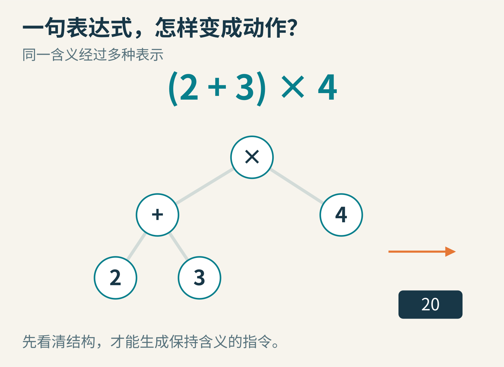
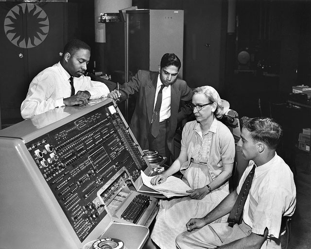
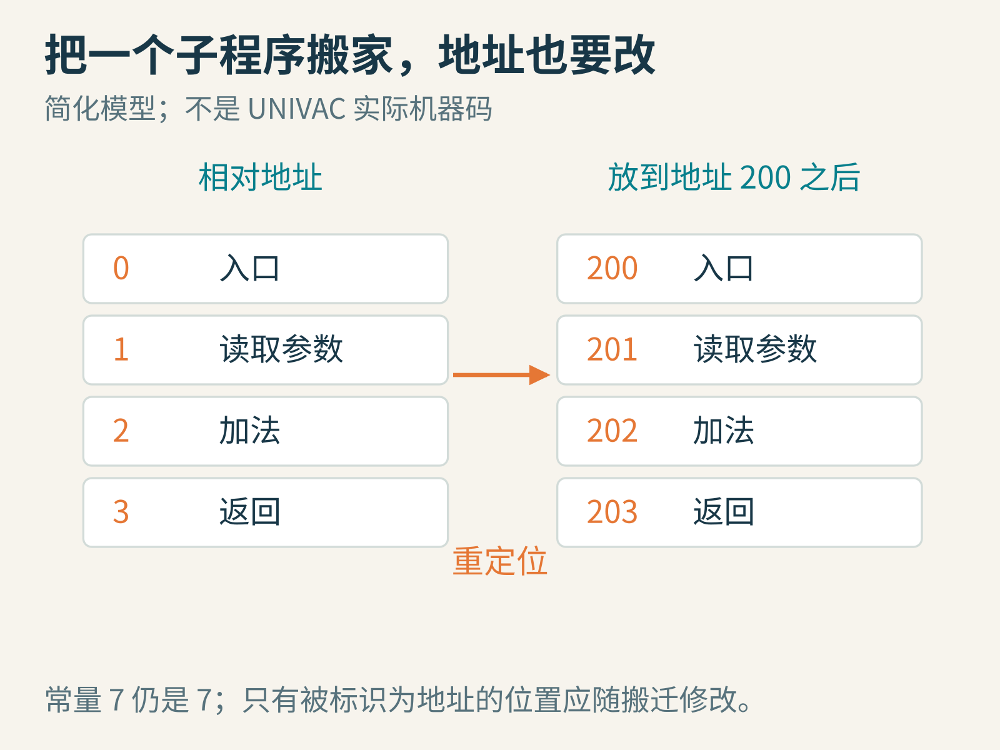
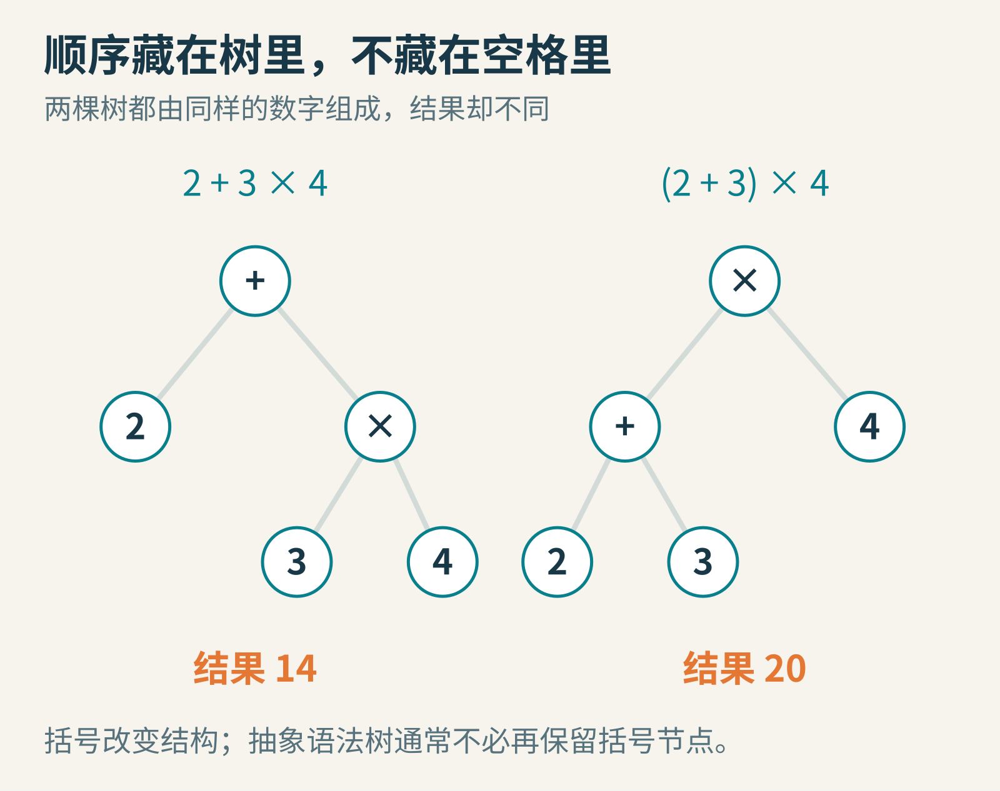
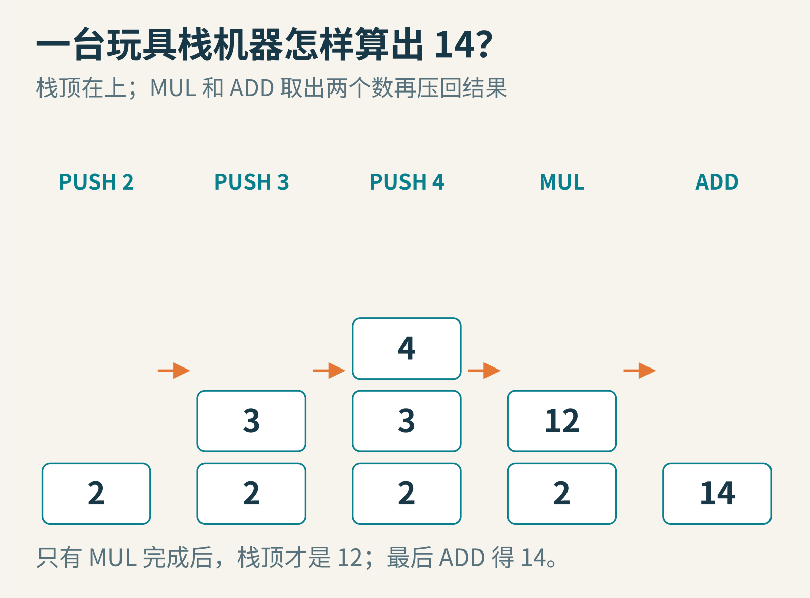
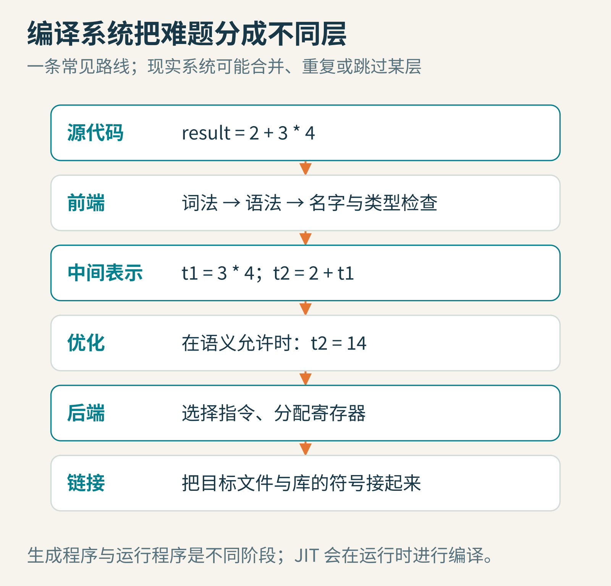

# 把指令写给谁看：从霍珀的子程序库到编译器

*原创概念图。表达式、树和机器动作可以采用不同形式，却必须保留同一个计算含义。*

在编辑器里输入 result = 2 + 3 * 4，按下运行，屏幕出现 14。这件事看起来像电脑“读懂了”算式。可内存里最初存的只是字符：r、e、s、u、l、t、等号和几个数字。处理器不会看到星号就自然联想到乘法，更不会凭生活经验知道乘法优先。

从文字到动作，中间发生了什么？我们可以造一台极小的纸上机器，把整条路走一遍。沿途再回到 1950 年代：当程序员需要反复搬运数字、修正地址时，Grace Hopper 为什么认为，这些工作也应该交给电脑？

## 先前的困难，并不只是“不好打字”

早期程序设计需要紧贴具体机器：哪种指令能做什么，数据放在哪里，跳转指向哪一处。即使一个数学步骤已经想得很清楚，把它安排成能运行的程序，仍然有大量重复而容易出错的劳动。

比如，一位同事写好了计算正弦的程序。你希望在自己的程序里使用它，不只是把纸上的几行数字抄过来就行。要把参数放到它期待的位置，找到它的入口，安排执行完后去哪里，还要处理它被放到新地址后内部地址如何改变。

这有点像把一个车间里已经调好的加工单元移入另一条生产线：零件本身会工作，但运输通道、接口和编号仍要接对。反复让人手工接线，既费时，又容易出错。

1952 年，Hopper 的《The Education of a Computer》讨论了让 UNIVAC 按照操作说明，从子程序库里选择、调整和组合程序的方法。她在开头明确感谢 Aiken 的例程库思想、Mauchly 的相关工作与建议，以及 Wilkes 的著作。这份当事人的说明，本身就提醒我们：技术通常不是从真空中突然跳出来的。[1952 年原论文](https://people.cs.umass.edu/~emery/classes/cmpsci691st/readings/PL/p243-hopper.pdf)

A-0 是这段早期编译工作的著名成果，计算机历史博物馆把它的完成列在[1952 年时间线](https://www.computerhistory.org/timeline/1952/)中。不过，当时“compiler”这个词所涵盖的工作，与今天完整的高级语言编译器并不完全相同。Hopper 描述的 Type A compiling routine 重点包括寻找子程序、安排参数与结果传送、修改地址、连接控制流程等。把它直接说成“能把任意英语翻译成机器码”，会把真正有趣的工程问题抹掉。

*文件页标 1957 年 6 月（EXIF 另写约 1960 年，年代记录有冲突）：Remington Rand UNIVAC 自动编程部门成员在控制台前。从左到右：Donald Cropper、Kalpathi C. Krishnan、Grace Hopper、Norman Rothberg。作者未详，Smithsonian Institution 藏图 SI Neg. 83-14878，经 public.resource.org 发布；[CC BY 2.0](https://creativecommons.org/licenses/by/2.0/)，未改动。采用文件历史中最初上传的完整版本，640×513 像素，未裁切或放大。*

## 从“搬一段代码”看见自动化的价值

做一个简化例子。一个子程序原本用相对编号 0、1、2、3 表示四个位置。现在把它放到内存的 200 号位置，原先指向内部位置 2 的地址，需要对应到 202。

但要小心：代码里的数字 2 不一定都是地址。它也可能是要参与计算的常量。如果把所有 2 都机械地加上 200，程序就坏了。因此，系统必须知道哪些字段代表地址，哪些只是数据。

*原创简化示意，展示重定位思想，不是 UNIVAC 的真实指令格式。常量不应因为子程序搬迁而被改写。*

Hopper 的论文专门讨论了随子程序提供的信息，包括参数、结果位置以及哪些常量不能被修改。这不是一个附带的小细节：机器想替人做机械工作，先要让规则变得明确。

沿着这条思路往前走，程序员不必每次都详细描述所有低层操作，而可以写更适合表达问题的语言。编译器负责把它转换成另一种表示。这里的“另一种”未必直接是处理器机器码，也可以是汇编、字节码、另一门语言或中间表示。

今天的编译系统已经包含许多 Hopper 当年系统没有的阶段。接下来这条教学路线展示的是现代常见原理，不是把全部阶段倒推成她一个人的发明。

## 第一关：字符要先分成词元

回到我们的表达式：result = 2 + 3 * 4。

先规定一个极小的语言：名字由字母组成，整数由数字组成，等号表示赋值，星号表示乘法，加号表示加法。空格用于分隔，除此以外不改变含义。现在，一个词法分析器就能从左向右读字符，把它们分成“词元”，也叫 token。

*原创教学示意。每个块不仅保留字符，还带着“名字”“整数”“运算符”等种类。*

result 是一个完整的名字，不是六个独立变量。数字 123 是一个整数词元，也不是三个分别参与计算的数字。词法分析器需要做这种分组，后面的阶段才能处理有意义的单位。

在这个阶段，它还不知道最终答案是 14。它甚至还没真正决定“3 和 4 应该先结合”。分词回答的是“这里有哪些材料”，不是“这些材料构成什么结构”。

如果你给语言增加小数，还需要规定点号怎样使用。1.2.3 是一个数字，还是错误？如果有注释，注释从哪里开始、在哪里结束？这些都不是电脑的常识，必须属于语言的明确规则。LLVM 官方入门教程就特意指出，它的简化词法器对某些畸形数字检查不足，教学代码不等于完整的工业实现。[词法分析教程](https://llvm.org/docs/tutorial/MyFirstLanguageFrontend/LangImpl01.html)

## 第二关：同样的材料，可以长成不同的树

2+3*4 应该是 2+(3*4)，还是 (2+3)*4？两者用到了相同的数字和运算符，但结果一个是 14，一个是 20。

我们在小学已经熟悉运算优先级。编译器却必须把这些约定变成程序中的规则：乘法比加法结合得更紧；括号可以改变结合方式；同级运算还要规定从哪边结合。例如 8-3-2 通常表示 (8-3)-2，而不是 8-(3-2)。

语法分析器根据这些规则，把词元组织成树。树的内部节点表示操作，叶子表示数字或名字，分支表示“这个操作的输入来自哪里”。

*原创教学示意。左边先乘后加得 14，右边先加后乘得 20。树的形状已经表达结合关系。*

左树最上面的操作是加法。它的左输入是 2，右输入是一整个“3 乘 4”。因此，要得到整棵树的结果，先算右边的小树，再完成最上面的加法。

这叫抽象语法树，简称 AST。为什么叫“抽象”？因为它可以丢掉对含义不再必要的表面细节。空格已经没用了；括号的作用也已体现在树形里，通常不必再专门保存一对括号节点。某些工具为了格式化或还原源码，会保留更多细节，那是另一个设计目标。

这一步也能发现结构错误：如果输入 2 + * 4，加号后面应该出现一个合法表达式，却碰到了不合规则的星号，分析器就可以报告错误。发现错误不等于修好了错误；猜用户本来想写什么，需要额外策略。

## 第三关：句子通顺，还不代表意思合法

假设把表达式改成 result = count + 3。语法上没有问题，但 count 是什么？它有没有声明？它指的是当前函数里的局部变量，还是外面那个同名变量？它的值允许和整数相加吗？

编译器通常会维护符号表，用来登记名字及其相关信息。你可以把它想象成有作用范围的名册：这个范围里，count 对应哪个定义，拥有何种类型，在哪些地方可见。

类型检查也依赖语言规则。有的语言允许把整数与小数相加并转换类型；有的语言拒绝把字符串与整数相加；还有的语言给加号定义了连接文本的作用。不存在一条脱离语言定义的万能答案。

因此，“能编译”不等于“符合你的愿望”。如果你本来想写减法，却写成合法的加法，编译器通常不会读心。它检查和实现的是你实际写下的程序含义，不是你没有写出来的意图。

LLVM 的教学语言为了简化，最初只用一种浮点类型。但即使如此，调用未知函数、参数个数不匹配、引用不存在的名字，仍然需要处理。简化类型系统并不意味着可以省掉所有语义约束。[生成中间表示的教程](https://llvm.org/docs/tutorial/MyFirstLanguageFrontend/LangImpl03.html)

## 第四关：造一台能亲手执行的小机器

现在先不研究真实 CPU。造一台只有三种指令的“栈机器”：PUSH n 把数字 n 放到栈顶；MUL 取出最上面两个数，相乘后放回；ADD 做相同的事，只是改成相加。

栈像一摞盘子，后放上去的先拿走。为了计算 2+3*4，可以生成：PUSH 2，PUSH 3，PUSH 4，MUL，ADD。

*原创教学示意。每列是执行一条指令之后的栈，栈顶在上。这套指令专为教学定义，不对应特定真实处理器。*

手算一遍：

- 放入 2，栈里只有 2。
- 放入 3，再放入 4，栈从底到顶是 2、3、4。
- MUL 取走 4 和 3，放回 12，栈里剩 2、12。
- ADD 取走 12 和 2，放回 14。

生成这些指令也有一条整齐的规则：如果看到数字叶子，就生成一条 PUSH；如果看到运算节点，先生成左子树的指令，再生成右子树的指令，最后生成这次运算。结构已经在树里，生成器只需要沿结构行动。

别因为这次只有加法、乘法，就忽略了顺序。它们交换两个输入不影响结果，减法和除法却不同。若增加 SUB，必须约定“先弹出的是右操作数，后弹出的是左操作数”，否则 8-3 会被算成 3-8。

到这里，我们已经拥有一个小编译器最核心的旅程：把字符串变成结构，再把结构变成另一套指令。它不复杂到能制作大型软件，却足够让“翻译”这件事变得看得见。

## 中间表示：为什么不一步翻到底？

真实机器的指令、寄存器和调用约定很多。如果每门语言都为每种机器重新实现所有转换，工作量会迅速变大。常见做法是在中间增加一层表示，通常简称 IR。

例如，把表达式写成两步：t1 = 3 * 4；t2 = 2 + t1。这里的 t1、t2 是临时结果，不必对应真实内存地址。前端负责把源语言的规则转换进这种表示，后端再把它变成目标机器适合执行的动作。

*原创教学示意。这是一条常见的组织方式，不是所有编译器必须遵守的单行流水线。现实系统可能有多层 IR，也可能反复分析与转换。*

中间表示还方便优化。3 和 4 在编译时已经知道，可以直接计算出 12；再与 2 相加得到 14。于是，一连串运行时计算可能简化为使用常量 14。这叫常量折叠。

但“优化”不是想到一个数学恒等式就随意替换。整数有没有溢出？浮点计算是否受舍入影响？某个函数调用会不会写文件、改变变量或抛出异常？如果把有副作用的操作删掉，即使最后一个数字相同，程序行为也可能已经改变。

所以，优化的底线是按照语言和中间表示的规则保留允许观察到的行为。它不是靠猜“用户应该不在乎”，而是靠规则、分析和保守判断。算得更快很好，但算成另一个程序就不叫成功的优化。

## 编译完，还差什么？

后端会选择目标机器指令，安排临时结果放进哪些寄存器，必要时再放到内存。如果代码调用了库里的函数，输出的目标文件还可能留着“这个符号要以后接上”的位置。链接器把不同目标文件与库中的定义接起来，并处理相应的地址关系。

这时再回看 Hopper 的子程序组合工作，会发现一个跨越年代的共同问题：让独立准备的程序部件可靠地协同工作。现代链接器当然不是把她当年的系统原样放大，但“接口必须清楚，地址必须接对”的困难始终存在。[LLVM 目标文件与链接示例](https://llvm.org/docs/tutorial/MyFirstLanguageFrontend/LangImpl08.html)

还有一个常见误区：把语言绝对分成“编译型”和“解释型”。编译和解释首先是实现策略。同一种语言可以有不同实现；一个系统也可以先把源码编译成字节码，再解释执行其中一部分，或在运行时把热点代码即时编译成机器码。JIT 就是这种“即时编译”的常用简称。

编译器本身也只是程序。第一版可以用已有机器指令、汇编或其他语言编写；等新语言及其工具足够成熟，再用新语言写自己的编译器。这种逐步建立工具的过程，能回答那个很有趣的问题：“写编译器要用编译器，那第一台从哪来？”它不要求凭空出现一个完整体系。

## 从一个表达式，继续向外探索

你可以用纸先做三组实验，再考虑写代码。

第一组，只改变括号。分别为 2+3*4、(2+3)*4、2*(3+4) 画树，再按“左子树、右子树、操作”的顺序生成栈指令。检查最终栈里是否恰好剩一个结果。

第二组，故意输入错误。把 count 改成一个从未定义的名字，删掉右括号，把两个运算符挤在一起。尝试判断每个错误应该在哪一阶段发现。错误阶段分得清，调试时就不必把所有问题都叫成“电脑不懂我”。

第三组，增加减法。用 8-3-2 检查结合性，用 8-(3-2) 检查括号，再用栈的弹出顺序检查代码生成。一个很小的功能，就能同时考验语言规则、树结构和执行约定是否一致。

回到最初那行表达式，它得到 14 并不是因为处理器理解了我们的自然语言。更准确地说，一系列由人定义的规则，把字符的分组、结构、名字和操作一步步变得明确。Hopper 那代人努力交给机器的，正是那些已经可以明确描述，却仍在耗费人力的机械工作。

当你能画出表达式的树、手算它的指令，并解释一次错误为何出现时，编译器就不再是按下“运行”按钮后的一团黑箱。它是一座可以逐层搭建、逐层检查的桥。

本文由 AI 辅助研究、撰写和制作原创教学示意；纸上语言与栈机器均为自设模型。

图片来源：[Hopper 与 UNIVAC](https://commons.wikimedia.org/wiki/File:Grace_Hopper_and_UNIVAC.jpg)；其余为本文原创教学图。
