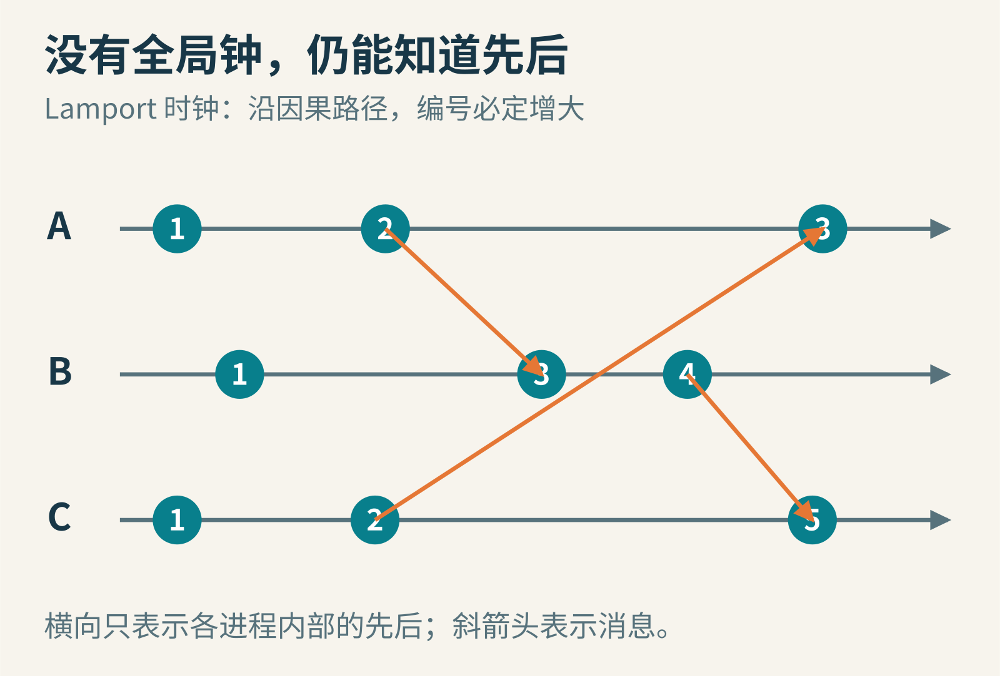
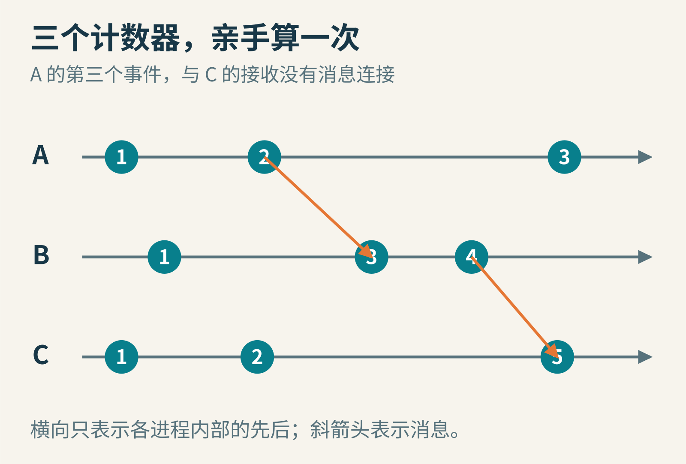
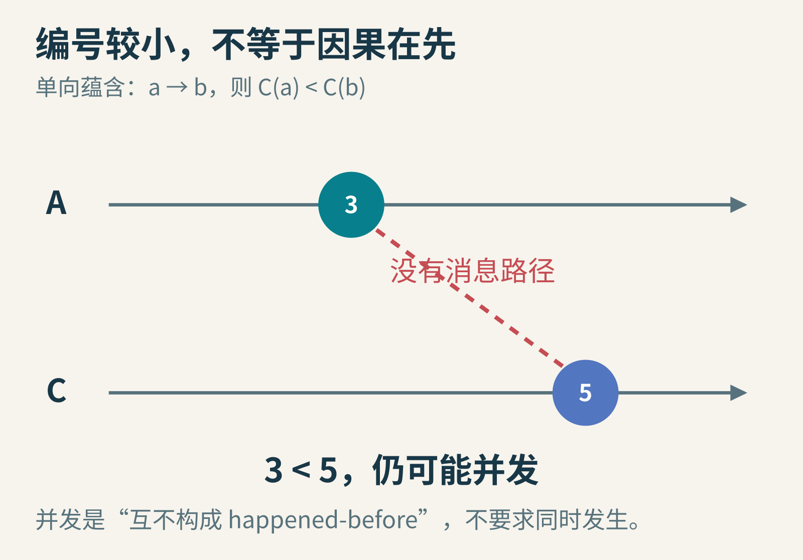
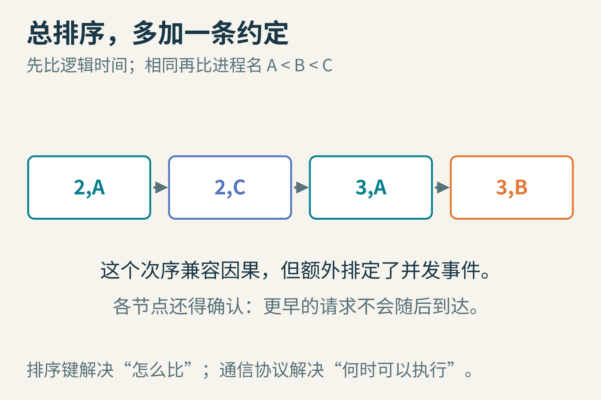
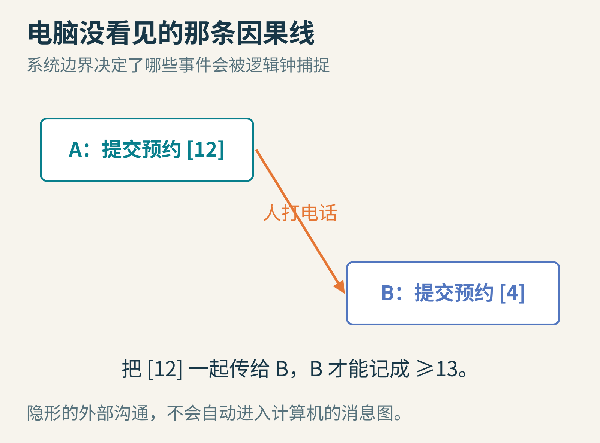

# 消息明明先发，为什么排在后面？Lamport 给分布式世界造了一种钟

你和朋友在不同城市合作写一份实验报告。你先发送“温度计坏了，刚才的数据别用”，朋友收到后回复“好，我重测”。导出聊天记录，软件却把回复排在提醒之前。

这不只是界面难看。若两个机房合作管理同一台远程望远镜，它们把“开始观测”和“释放设备”的顺序弄错，就可能让两个人同时以为自己独占设备。最直觉的补救是对准所有电脑的时钟。但即使时钟尽力同步，仍有误差、漂移、消息排队。两条相隔很近的记录，谁更早，未必能由墙上那种时间回答。

1978 年，Leslie Lamport 发表了一篇只有八页的论文。它提出另一种问法：暂且不问事件发生在几点几分，先问，一个事件的信息有没有机会流到另一个事件那里？

封面示意：每条线上事件依次发生；跨线箭头是消息。数字没有“秒”这个单位，它们只需要沿着因果方向增大。

## 一、先认识提出问题的人

Lamport 的工作常常从“大家都以为说清楚了”的地方开始。这篇论文的核心，不是造出更准的计时器，而是把“先发生”说清楚。他在[作者自述](https://www.microsoft.com/en-us/research/publication/time-clocks-ordering-events-distributed-system/)中，把起点追溯到 Paul Johnson 和 Bob Thomas 关于维护重复数据库的笔记，并提及相对论对自己理解事件顺序的帮助。这不是一个人凭空发明网络，也不能把此前的时间戳思想全部归给他。

Leslie Lamport，[本人网站原图](https://lamport.azurewebsites.net/leslie.jpg)。Lamport 曾明确允许任意用途使用其网站肖像及后来替换的新肖像；[许可记录](https://commons.wikimedia.org/wiki/File:Leslie_Lamport.jpg)。未改动。

关键贡献在于：他用可观察的事件与消息定义一种偏序，给出能尊重这种偏序的逻辑时钟，并说明怎样在它上面建立协调协议。[原论文](https://lamport.azurewebsites.net/pubs/time-clocks.pdf)发表于《Communications of the ACM》1978 年 7 月，第 21 卷第 7 期，558—565 页。发表时间、算法思想和后来获奖的时间，是三件不同的事。

## 二、只承认三种“在先”的证据

现在忘掉手机时钟。桌上摆三张纸，分别代表进程 A、B、C。每张纸从左到右记事件。这里的“进程”是一个按顺序做事的执行者；怎样划分事件要事先确定，比如把“处理收到的消息”算作一个事件。

我们只采用三条规则。

第一，同一张纸上，左边事件在右边事件之前。这是执行者自己的操作次序。

第二，发送一条消息在接收同一条消息之前。消息还没发出，不可能已经收到。

第三，如果 a 在 b 之前，b 又在 c 之前，那么 a 在 c 之前。换句话说，先后关系可以沿路径传递。

把这个关系写成 a → b，读作“a happened-before b”。注意它不是断言“a 就是 b 的唯一原因”。它说的是：在这个系统模型里，存在一条允许信息从 a 传到 b 的路径。比如先完成一次本地加法，再发送一条与加法无关的消息，这两个事件仍按进程顺序有关联。

如果既没有 a → b，也没有 b → a，我们称它们并发。并发在这里不等于“同一毫秒发生”：两个相隔一天、却没有信息联系的事件，也可以并发。这个定义故意把我们不知道的关系留白，而不是拿一张不可靠的全球日历补上。

## 三、三个计数器就能做出一套钟

让 A、B、C 各保存一个整数，开始都为零。我们采用一种方便实现的规则：

- 本地事件或发送事件发生时，自己的计数器加一，当前值就是事件时间戳
- 发送消息时，把这个时间戳装进消息
- 收到时间戳 t 的消息时，把本地计数器设为 max(本地值, t) + 1，再给接收事件编号

原论文允许更一般的递增方式。这里每次只加一，是常见而清楚的具体实现。

跟着下面的实验逐步算，别先看最后一行。

A 做一次本地准备，得到 1；随后发消息给 B，得到 2，信封上也写 2。B 在消息抵达前做过一次本地操作，计数器为 1。收到信封后，B 算 max(1,2)+1=3。B 接着给 C 发消息，于是时间戳为 4。

C 在收到消息前自己做过两件事，计数器已经是 2。它收到 B 的 4 后，跳到 max(2,4)+1=5。这样，A 的发送 2、B 的接收 3、B 的发送 4、C 的接收 5，沿信息传播方向严格增大。

A 的第三个本地事件编号为 3。它没有连到 C 的接收事件；两者尽管编号不同，仍可能并发。图中各列位置只为阅读方便，不表示统一物理时刻。

为什么要取 max？若 B 在收信前已忙到 90，直接把钟改成 3 会倒退；若 B 还停在 1，只加一到 2 又无法严格晚于发送者的 2。max 同时保护本地进度和消息带来的外部进度，再加一跨过边界。

这里藏着一个非常简洁的证明：本地边上数字增加，消息边上数字也增加，那么沿着由这些边接起来的任意路径，数字都增加。三条先后规则，恰好被两条更新规则满足。于是得到时钟条件：只要 a → b，就有 C(a) < C(b)。

## 四、最容易犯的错，是把箭头反过来

我们在上例中让 A 又做一个本地事件，编号为 3。C 后来收到 B 的消息，编号为 5。能不能说“3 小于 5，所以 A 的第三个事件导致或先于 C 的接收”？不能。

A 的第三个事件是在发给 B 的消息之后发生的。那封已经离开的信，不会事后装进 A 的新消息。若没有其他通信路径，A 的第三个事件和 C 的接收事件互不满足 happened-before。

逻辑时钟保留了因果所需的顺序，却没有保留全部因果信息。数字不相等，也不能排除并发。

这个区分像考试成绩：所有正确步骤都会提高分数，不代表分数较高就能恢复那个人做题的全部过程。一个整数把很多历史压进很少的信息，方便比较，也必然丢掉细节。

因此，拿 Lamport 时间戳画出日志顺序很有帮助；拿它单独证明“这次库存修改看到了那次更新”，证据就不够了。你可以从 C(a) ≥ C(b) 推出 a 不可能 happened-before b，却不能从 C(a) < C(b) 推出正向因果。

一个值得动笔验证的小问题是：相同数字能否出现在有因果联系的两个不同事件上？不能。若有因果路径，严格递增条件就要求数字不同。但反过来，相同数字也不意味着两台机器在某个共同物理时刻完成操作。它只表示两套本地计数规则碰巧给出了相同整数。把“相同时间戳”“同一物理时刻”“没有因果关系”分成三个概念，许多日志谜题会立刻清楚。

这种约束也告诉你如何找程序错误：若某次接收消息的时间戳不大于那条消息的发送时间戳，至少有一个实现环节违反了规定。检查消息是否携带了旧值、更新与记日志是否发生竞态，比继续争论两台电脑的时区有效得多。

## 五、并发无法分先后，为什么还要排一条队？

因为应用常常需要做决定。两个人并发预约唯一的望远镜，系统可以承认他们之间没有因果顺序，但仍得挑出一个先使用者。

做法是在时间戳后面加进程标识，例如 (2,A)、(2,C)、(3,A)、(3,B)。先比整数，整数相同再按约定 A<B<C 排列。这样任意两个不同事件都能比较，得到全序，而且所有已有因果关系都受到尊重。

“相同时间戳时 A 在 C 前”是算法约定，没有发现任何新的物理事实。换个固定的打平规则，也可以得到另一条合法顺序。

但是，给所有卡片印上排序号，与让各节点真的按同一顺序执行，是两件事。你手里目前最小的是 (5,B)，网络里还可能有一张迟到的 (2,A)。立即执行最小卡片，仍然可能乱序。

Lamport 在论文里用分布式互斥协议展示了缺的那一步。进程把请求发给所有其他进程；每个进程维护自己的请求队列，并回复确认。请求者不仅要看到自己的请求排在队首，还得收到来自每个其他进程、时间戳足够晚的消息，才能知道那些节点不会再冒出一个尚未得知的更早请求。在论文的简化版本中，点对点消息按发送顺序到达，并且最终都会送达；这一假设支持“不会再冒出”的判断。

用两个人的版本试一次：A 和 B 都在本地时间 1 请求望远镜。两者交换请求、发送更晚的确认后，两边队列都是 (1,A)、(1,B)。A 可以进入，B 要等待。A 释放时广播释放消息，两边删掉 A 的请求，B 才能进入。若你删掉“等所有确认”这一步，两边在还没收到对方请求时都可能以为自己排第一。

时钟没有独力解决互斥；时钟、请求队列、消息确认和传输假设一起解决了这个问题。

## 六、电话号码也是一条系统看不见的消息线

再给望远镜故事添一个细节：你在 A 上提交预约，拿到逻辑时间 12，然后打电话给朋友，让他在 B 上追加一个配套预约。B 没收到任何来自 A 的计算机消息，自己的钟才走到 3，于是把请求记成 4。

从人的角度，12 对应的动作显然先发生；从软件所记录的消息图看，两者可能并发。这不是 max 公式坏了，而是电话这条通信链被画在系统边界之外。

把 A 的 12 也交给朋友，并由 B 在提交时传播这一信息，软件才有证据把后续事件编号到 13 或更大。

原论文专门讨论了这种“异常行为”，并进一步研究物理时钟在额外条件下怎样约束它。逻辑钟没有宣称物理时间没有价值。预订截止日期、令牌有效期、跨地域监测都可能需要实际时间；只是你必须说明误差和系统边界，不能把一串时间数字当成无条件真相。

## 七、它解决了什么，又留下了什么？

第一，逻辑时钟不测持续时间。时间戳从 10 跳到 100，可能只是收到一条编号很大的消息，不能推断过了 90 秒，也不能据此计算网络延迟。

第二，逻辑时钟不检测故障。没有收到消息，可能对方停机，也可能线路很慢。论文中的全员参与协调，一台机器失去响应就可能让其他人等下去。这也是为什么后来的容错共识还需要更复杂的协议。

第三，生产实现得照看计数器的身份、持久化和溢出。假如程序崩溃重启后把计数器重新置零，同时复用原来进程标识，旧日志和新日志拼在一起就可能违反你的排序假设。算法图上一个小小的整数，落到工程里会连着存储格式和生命周期管理。

第四，日志排序是一种解释工具，不等于自动拿到了完整分布式快照。你看到某条记录已编号，并不表示所有节点都看到了它，更不表示它已被某个共识协议提交。

## 八、把结论变成一次亲手探索

拿三张纸和几根彩色线，做上文的 A、B、C 实验。先不填数字，只画本地先后和消息。再照规则填时间戳，检查每一条箭头是不是都从小数指向大数。最后任选两个没有路径相连的事件，尝试把它们画在不同高度：只要不破坏各条因果边，你会发现可以画出多种看起来不同、逻辑上相同的时间图。

再做三个小挑战：

1. 把 B 收到 A 的消息前的计数器改为 9。B 的接收、发送以及 C 的接收依次是多少？答案是 10、11、12。
2. A、B 两条并发请求时间戳都为 7。若把打平规则从 A<B 改成 B<A，是否破坏因果？不会，因为这两件事本来并发；但所有参与者必须使用相同规则。
3. 给 A 的第三个事件再画一条发往 C 的消息。C 何时才获得有关它的因果信息？在收到这条消息或某条携带其后续影响的消息之后，不能靠看到“3”这个整数猜出来。

你最后会得到一种很有用的阅读习惯：在分布式系统里，看到“先”，先追问是谁观察到的，信息通过哪条路传来，哪些沟通没有被记录。Lamport 的钟最重要的刻度，或许就是让我们不再把未知的顺序，假装成已知。

图片来源：[Lamport 本人网站肖像及许可记录](https://commons.wikimedia.org/wiki/File:Leslie_Lamport.jpg)；其余为原创教学示意。

本文由 AI 辅助资料整理、写作与制图；历史依据和算法假设以正文链接的一手论文及作者说明为准，图中场景与数字为教学构造。
