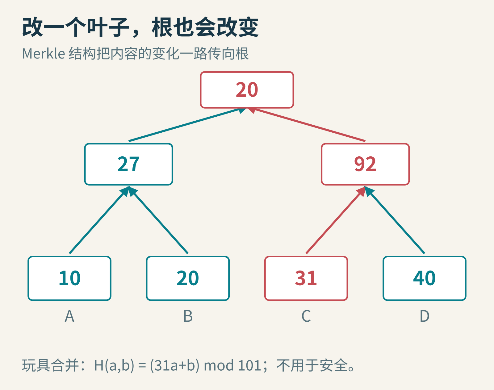
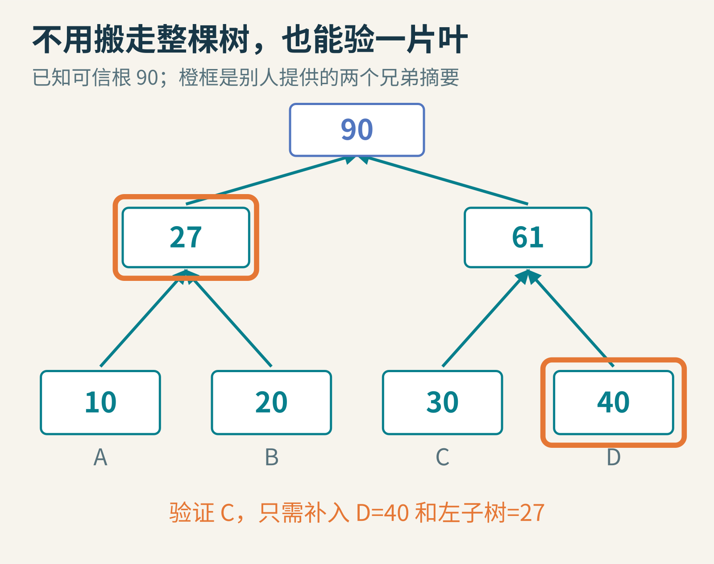
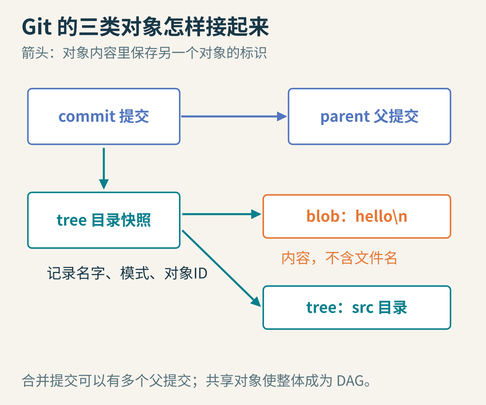
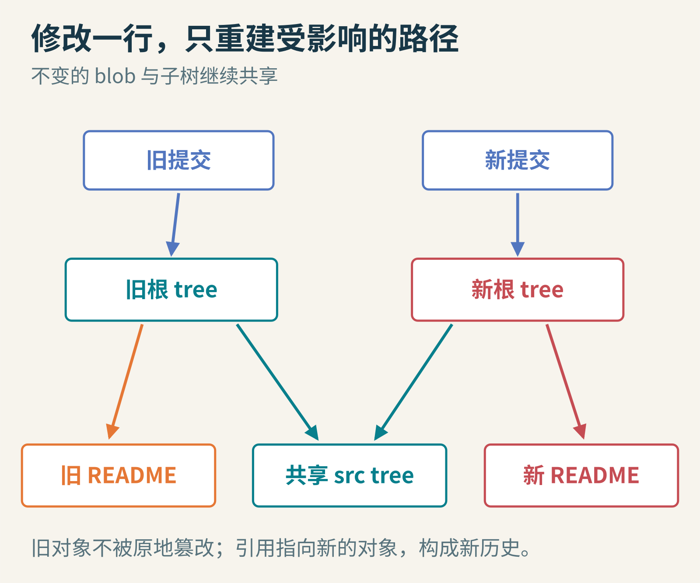
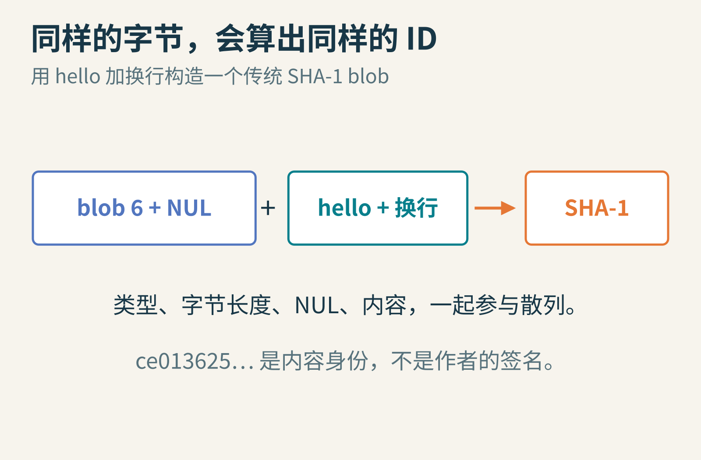

# 一个短编号，为什么能牵动整部代码历史？从 Merkle 树走进 Git

你和同学合作整理实验资料。一百个文件，分在十几个目录，每个人都保存一份。周末回来，有人说：“我只改了一行。”你该怎样判断，自己的版本和对方究竟哪里不同？

最直接的办法是逐个打开文件，从第一个字节比到最后一个字节。这能做到，却浪费。第二种办法是给每个文件算一个短摘要，只比较摘要。第三种更大胆：能不能连“文件清单的摘要”也做成一棵树，让一个根编号同时牵住整个目录？

这种结构还可以回答另一个看似不相关的问题：如果我不愿下载整份名单，只拿到其中一项，怎样检查它确实属于某个已经公布的版本？这条路把 1970 年代的密码学研究与 2005 年诞生的 Git 连到一起。



封面是可手算的玩具树：叶子从 30 改为 31，右侧父摘要从 61 变为 92，根从 90 变为 20。图中公式只是解释依赖关系，绝不能用于安全系统。

## 一、Merkle 起初关心的并不是版本管理

Ralph Merkle 是公钥密码学早期研究者之一。他 1979 年的博士论文研究保密、认证与公钥系统；在[1980 年论文《Protocols for Public Key Cryptosystems》](https://www.ralphmerkle.com/papers/Protocols.pdf)里，“树认证”用来验证公开文件中的单独条目，而不必取得整个文件。作者的[论文目录](https://ralphmerkle.com/merkleDir/papers.html)保留了这些不同年份的作品，不能把博士论文与 1980 年论文当作同一发表日期。


Ralph Merkle（中右侧，浅蓝衬衫），2007 年 Singularity Summit。摄影 David Orban，[原始照片](https://www.flickr.com/photos/davidorban/1347574959/)，[许可核验记录](https://commons.wikimedia.org/wiki/File:Ralph_Merkle.png)，[CC BY 2.0](https://creativecommons.org/licenses/by/2.0/)。此处使用原始完整照片，未裁切或调色。

假想一份很大的公开密钥目录。你只想知道“某个人的公钥”是不是目录里的正确条目，却不想下载所有人的资料。Merkle 的设计先把各项摘要成短值，再成对组合，一层层算到根。只要你已经通过可信渠道知道正确的根，别人就能给你一条很短的验证路径。

这里最不能省略的是“根已经可信”。若攻击者能同时替换条目、证明和你信任的根，他完全可以拿一棵假树自圆其说。树把大对象的完整性绑定到小根上，却没有凭空创造信任。

## 二、摘要不是压缩包，也不是身份证明

密码学散列函数接受字节串，输出固定长度摘要。同一输入，在同一种算法下总是得到同一输出；改变输入通常会使输出大幅变化。安全使用还依赖碰撞难找等性质。

“难找”不等于数学上没有碰撞。无穷多种输入挤进有限多种摘要，必然有不同输入得到相同值。工程目标是让攻击者在现实资源下难以构造危险的碰撞，而不是否认抽屉原理。

摘要也不是能解压回原文件的小盒子。只剩摘要而没有任何原文件副本，通常无法还原文件。它像核对用的指纹：能比较、能索引，不能代替内容本身。文件由谁写的、作者是否同意发布，更需要身份认证或数字签名，不能从一串散列值推出来。

## 三、先算一棵只有四片叶子的树

真正的 SHA-256 不适合用铅笔逐步算。我们暂用一个非常不安全、但容易算的合并函数：H(a,b)=(31a+b) 除以 101 的余数。左右顺序参与计算。

四片叶子的数值依次是 A=10、B=20、C=30、D=40。可把它们想成已经做完叶子摘要的四项。左父节点是 H(10,20)=330 mod 101=27；右父节点是 H(30,40)=970 mod 101=61；根是 H(27,61)=898 mod 101=90。

现在你只想验证 C。对方给你 C=30、它的兄弟 D=40，以及左半棵树的摘要 27。你先算 H(30,40)=61，再算 H(27,61)=90，和可信根比对。你不需要知道 A、B 分别是什么。



橙框是证明中提供的兄弟摘要。每一步还必须知道它在左边还是右边，否则 H(27,61) 和 H(61,27) 会被混淆。

在有 n 个叶子、形状平衡的二叉树里，这类证明通常只需对数数量的兄弟摘要。四叶树需两项，八叶树需三项，一百万级叶子的平衡树也只要大约二十层。你仍得传输想验证的条目自身，不能把“证明很短”说成“任意大小内容都不用传”。

如果 C 从 30 变成 31，右父节点变成 H(31,40)=1001 mod 101=92，根变成 H(27,92)=929 mod 101=20。左半棵树完全不用重新计算。这就是变化沿祖先路径传播的含义。

但玩具公式碰撞太容易：H(10,20) 和 H(11,90) 都是 27。它只能帮助你观察树形依赖，不能支撑“无法篡改”的安全结论。真实结构必须选用适合任务的密码学散列，并规范叶子、内部节点和序列化格式。

还要防止一种与碰撞无关的歧义。假设有人直接把孩子的可变长文字拼起来，那么“ab”和“c”拼成“abc”，“a”和“bc”也拼成“abc”。这两种结构甚至没有给散列函数不同的输入，自然不可能指望散列函数分清。解决办法不是换更长的摘要，而是定义无歧义的格式，例如固定长度子摘要、长度前缀，以及不同的节点类型标记。

叶子和内部节点也应能区分。教学实现常给叶子内容前加一个类型字节，给两份子摘要的组合加另一个类型字节，再做 SHA-256。验证方必须用相同规则；“我们都用了 SHA-256”仍不够，还要约定怎样把结构编码成字节。遇到不是二的幂数量的叶子，树形和不配对叶子的处理也必须明确，不能由双方各自猜。

这件事告诉我们，安全结构不是只挑一个响亮的密码学算法名。先把对象边界、左右顺序、树形和可信根都说清楚，散列函数才知道自己究竟在为哪一种内容作证。

## 四、从公开目录走到代码目录

Git 诞生于 2005 年，与 Linux 内核社区的协作需求有关。根据[Git 官方站点的历史介绍](https://git-scm.com/book/en/v2/Getting-Started-A-Short-History-of-Git)，此前使用的 BitKeeper 免费使用条件改变，促使社区、尤其是 Linus Torvalds 开发新的工具。速度、非线性开发和分布式协作都是设计目标。


Linus Torvalds，2002 年 12 月的肖像。来源 Linuxmag.com，经编辑 Martin Streicher 许可；摄影者未注明。[原图及许可](https://commons.wikimedia.org/wiki/File:Linus_Torvalds.jpeg)，采用 [CC BY-SA 3.0](https://creativecommons.org/licenses/by-sa/3.0/)，本次未改动。

把 Merkle 与 Torvalds 放在同一篇文章里，并不是说两个人一起开发了 Git，也不是证明 Torvalds 直接从某篇论文照搬设计。更准确的联系是结构：父对象的内容包含子对象的散列标识，于是子对象变化会牵动祖先。这种按内容寻址、用散列连接对象的组织方法，在 Git 中发展成一个有向无环图，也就是 DAG。

## 五、blob、tree、commit：三种对象，三种职责

先看最底层的 blob。它存的是文件内容，不包含文件名。同样的内容放在 README.txt 和 copy.txt 中，可以指向同一个 blob；改文件名，不必重写一份内容。

tree 保存目录条目：名字、模式和对象标识。某项可以指向 blob，也可以指向代表子目录的 tree。文件名变了，包含它的 tree 内容就变了；执行权限变了，也可能改变 tree。

commit 再往上一层，记录根 tree、父提交、作者和提交者信息、说明等。它回答“这是哪个项目快照，它接在哪些历史之后”。合并提交可以有不止一个父提交；第一次提交可以没有父提交。



箭头表示对象内容中的引用。图中的 blob 只有内容；名字和模式在 tree 中。父提交链和目录树交织起来，使整体不是简单二叉树。

这一点很容易误解：Git 的 commit 不是“只保存与上一版相比改了哪几行”的概念对象。它能标识一个完整快照，而未改变的对象可以共享。磁盘上的 packfile 可以再用差分等方法压缩对象，那是物理存储优化，和逻辑快照模型并不冲突。[官方 Git Objects 章节](https://git-scm.com/book/en/v2/Git-Internals-Git-Objects)可以逐步查看这些对象。

## 六、只改 README，哪些编号要变？

假设根目录有 README 和 src 子目录。你把 README 里一个错字改掉。新的文件内容得到新 blob 标识；根 tree 中指向 README 的那项改变，因此根 tree 标识改变；新 commit 引用新的根 tree，并把旧 commit 作为父提交，因此也得到新标识。

src 没变，所以它的 tree 和下面所有未变的 blob 都能继续共享。旧提交依然指向旧根 tree，旧根 tree 依然指向旧 README。旧世界没有被原地改坏，新世界通过新的引用长了出来。



共享的是相同对象，而不是“把旧快照中的文件偷偷换成新文件”。如果后来内容恰好改回原样，相同对象又能被引用。

这种安排让比较也能提前停止：两个 tree 的完整对象标识相同，在散列安全假设与正确对象格式下，就没有必要把该子树的每个文件再逐字节比一遍。发现根不同，才沿不同的分支继续向下查。

但不要把教学图推成一句过强的性能承诺。网络同步还要协商对方已有的对象，实际差异计算、重命名识别、打包压缩也有成本。树结构提供了利用相同性的机会，不保证所有命令都只做“对数次操作”。

## 七、算一次真的 Git 对象编号

对传统 SHA-1 格式的 Git blob，输入不是只有文件文本。Git 先把对象类型、空格、内容的字节长度和一个 NUL 字节放在前面。文本 hello 加一个换行共 6 字节，因此参与散列的是 b"blob 6\0hello\n"。



类型、长度及字节内容都属于身份计算。换行也是内容；“看起来一样”不意味着实际字节一样。

你可以用 Python 标准库验证，不必安装或初始化任何仓库：

```python
import hashlib
content = b"hello\n"
header = b"blob " + str(len(content)).encode("ascii") + b"\0"
print(hashlib.sha1(header + content).hexdigest())
```

结果应为 ce013625030ba8dba906f756967f9e9ca394464a。把换行删掉，再运行一次，摘要就不同。这里是用于理解既有 Git 格式的 SHA-1 实验，不是建议你用 SHA-1 设计新安全协议。

[Git 的散列迁移文档](https://git-scm.com/docs/hash-function-transition)解释了为什么需要走向 SHA-256，也明确说明对象身份所需的碰撞与第二原像抗性。不同对象格式的仓库会使用不同长度的标识；不能说所有 Git 编号永远都是 40 个十六进制字符，也不能把迁移设计文档中的目标自动当成所有客户端版本已完全兼容的现状。

## 八、“改历史会改编号”与“历史绝不能改”之间有多远？

如果你修改一个旧 commit 的说明，它的内容变了，标识也变了。后来提交若要改为引用这个新父提交，它们的内容和标识也会跟着变化。散列链接让改动难以在保持所有原编号不变的前提下悄悄发生。

然而分支名是可移动的引用。仓库管理员可以让某个分支改指另一个提交。若读者没有记住可信的旧提交标识、没有签名或其他审计线索，只看到新分支指针，单靠“用了 Merkle 结构”并不能得知发生过什么。

同样，散列校验能发现某些数据损坏，却不能让丢失的数据自动回来。对象能否长期保留，还涉及备份、引用可达性、回收策略和访问权限。完整性、真实性、持久性，是三种要分别落实的保证。

## 九、把一棵树拆开，看看哪个问题仍未解决

做三个小实验。第一，在玩具四叶树中交换 A 与 B，重算左父节点和根。结果左父节点为 24，根为 98。相同的元素，顺序不同，整体身份也可以不同。这提醒你，序列化规则是结构的一部分。

第二，把同一段内容想象成两个不同名字的文件。blob 是否变化？不变；tree 是否变化？会变。再把作者说明改一个标点，文件内容和根 tree 可以都不变，但 commit 会变化。

第三，请朋友给你 C、两个兄弟摘要和一个根，让你验证。然后问自己：这个根是我早已信任的，还是对方刚顺手提供的？后者只能证明一组值彼此一致，不能证明这就是你想验证的那份历史。

Merkle 结构最迷人的地方，不是把世界压成一个神秘编号，而是把“我相信一大堆内容”拆成可检查的依赖链。Git 又在这条链上放进目录、快照和父提交，让许多人能够各自工作、共享没有变化的部分，并明确地谈论“同一个版本”。当你下次看到一串长长的提交标识，可以把它想成指向整片历史的一根线，同时记得：线牵住了什么，仍要看它从哪里来。

图片来源：[David Orban 的 Merkle 照片](https://www.flickr.com/photos/davidorban/1347574959/)、[Torvalds 肖像与许可](https://commons.wikimedia.org/wiki/File:Linus_Torvalds.jpeg)；其余为原创教学示意。

本文由 AI 辅助资料整理、写作与制图；玩具算式、目录案例及机制图为教学构造，Python 示例结果已实际验证。
