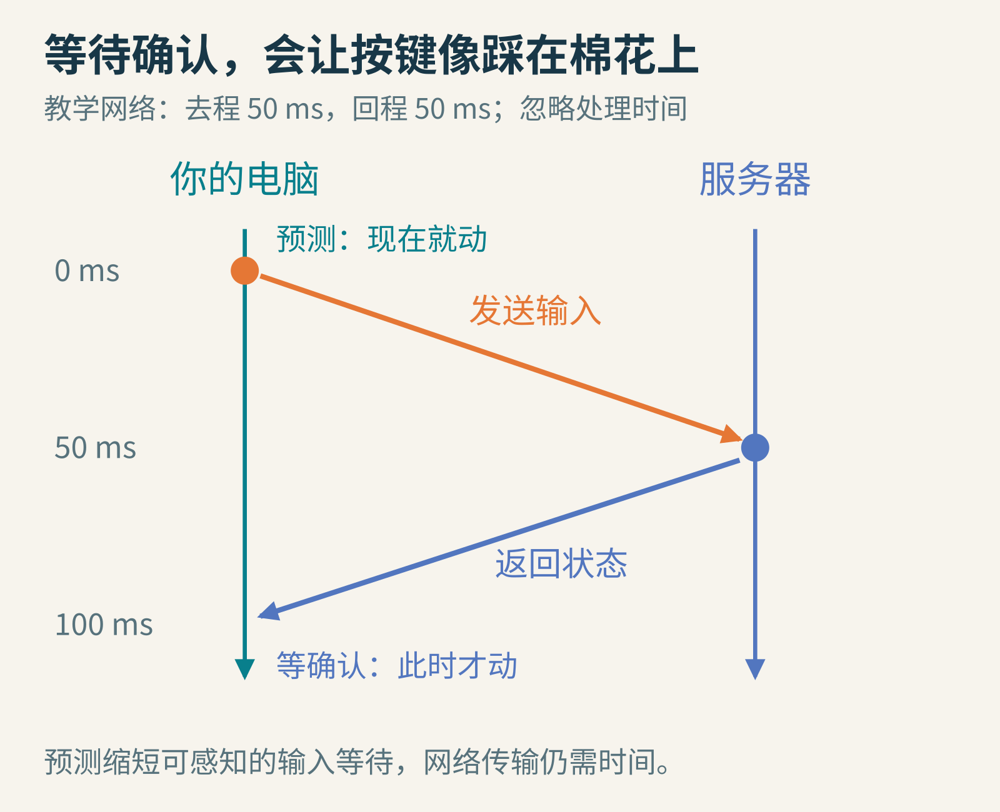
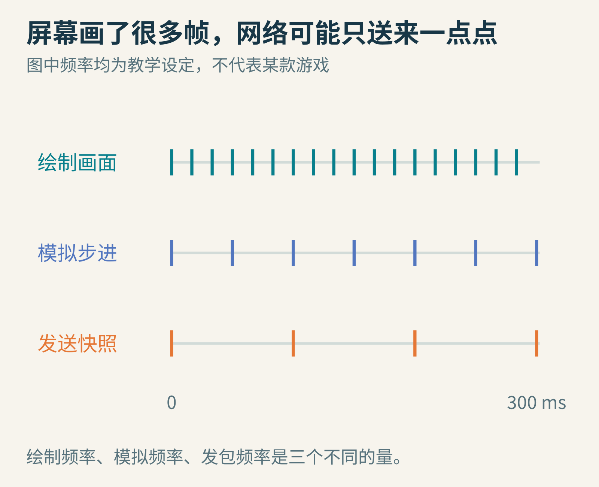
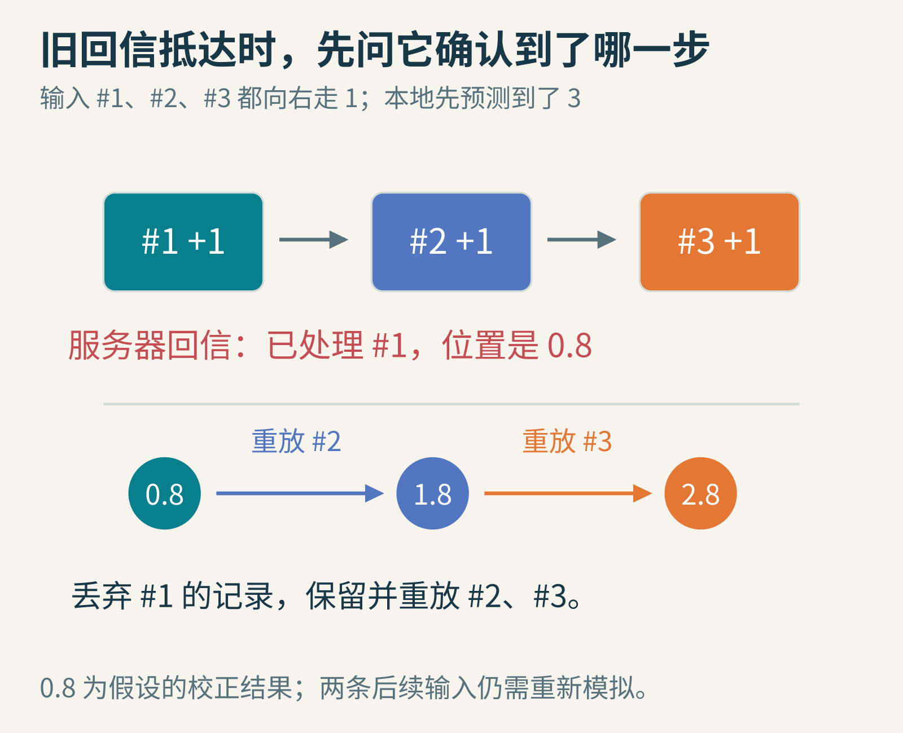
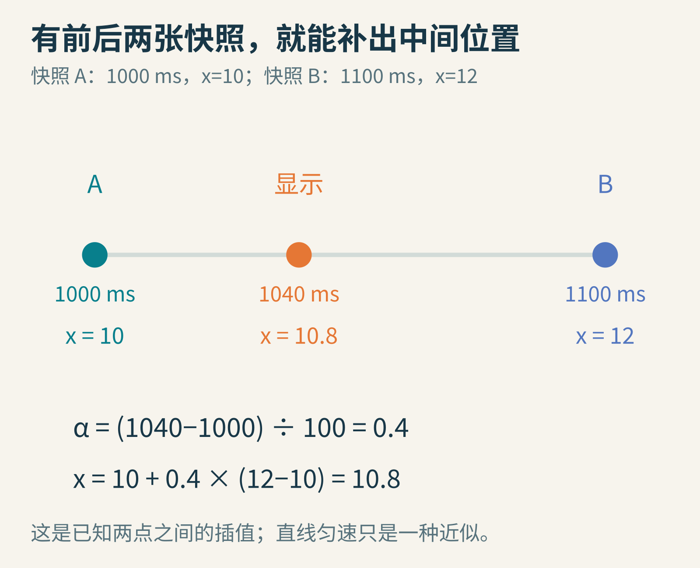
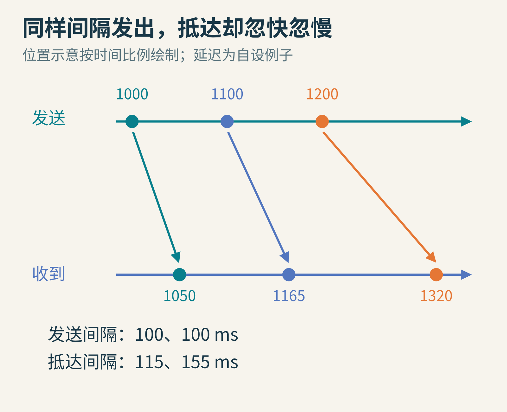
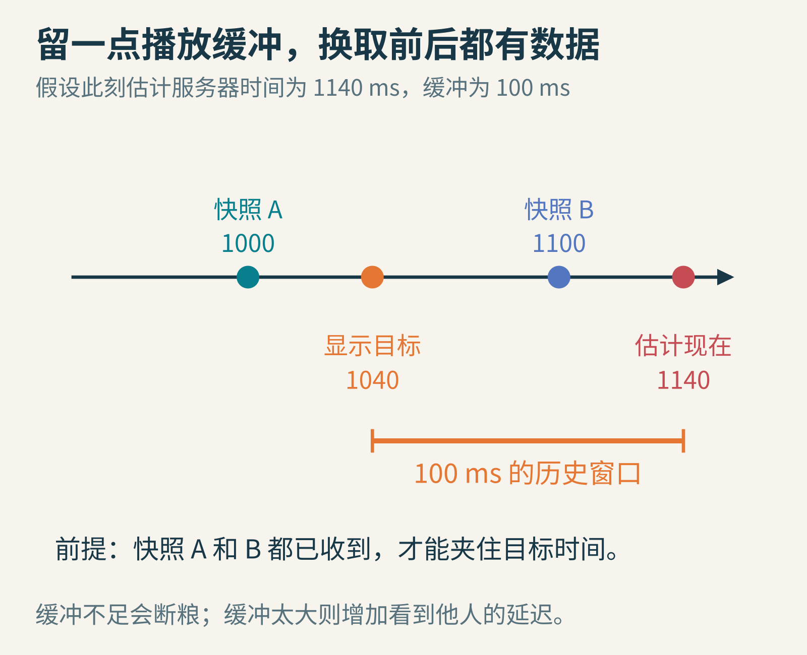
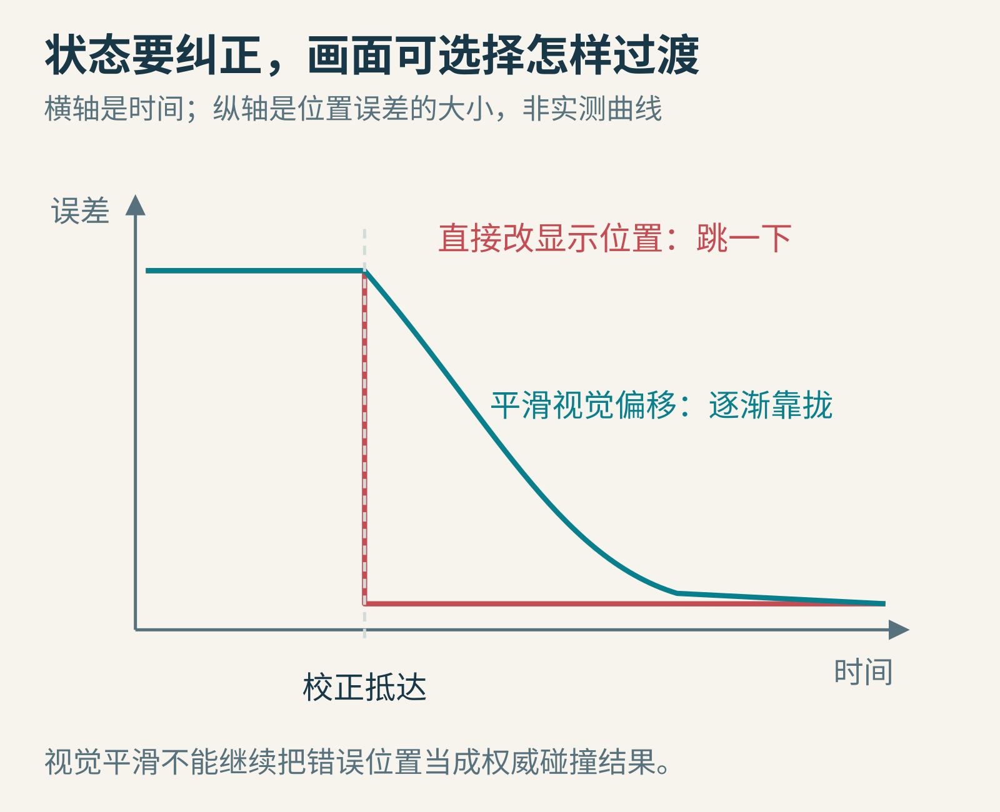

# 联机游戏里，你明明已经跑过门口，为什么突然被拉了回来？

你按住前进，角色冲出门口。下一瞬间，画面像被一根橡皮筋拽住，你又回到了门里面。队友那边也很奇怪：平时走得挺顺，偶尔却一小段一小段地瞬移。

一句“网卡了”能描述感受，却不能解释这两种现象。你的角色被拉回，可能是本地预测与服务器结果产生了差异；队友跳着走，可能是收到的状态太稀疏，或用于平滑播放的数据断了。

要理解它们，我们来造一个最小的联机游戏：两个人在一条走廊里跑，服务器负责认定最终结果。这里选用一种常见的服务器权威架构；不同游戏还会使用锁步、回滚等其他方案，并非都按本文实现。

## 第一个坏办法：每走一步，先请服务器批准

你按右键，电脑发出“我想向右走”的输入。服务器收到后检查规则，算出新位置，再把结果发回来。客户端等到回信才画出动作。

假设去程50毫秒、回程50毫秒，先忽略模拟排队和处理时间。光这一来一回，就要100毫秒。100毫秒是0.1秒，读一段文字时不长，按下按钮却迟迟没有反馈时，会很明显。



全文图片均为原创教学图。这里人为设定双向延迟相等；真实网络的去程和回程不必相等，RTT也不直接等于单程延迟。

RTT是往返时间。游戏里的“ping”常与它有关，但具体显示口径要看实现。若服务器还在等下一个模拟步才处理输入，总等待时间会进一步增加。

怎样才能马上动起来？你的电脑其实已经知道你按了右键，也知道角色的移动规则。它可以先在本地算一次，而不必坐等回信。

这叫**客户端预测**。预测的是“这条输入按游戏规则执行后会发生什么”，通常不是凭空猜玩家下一步想干什么，更不需要神经网络。

[Unity Netcode for Entities的预测说明](https://docs.unity3d.com/Packages/com.unity.netcode@1.5/manual/prediction.html)就把本地模拟输入作为减少感知延迟的一种方法。服务器仍然要处理输入并给出权威状态。客户端自己画出已经飞上天，不会因此说服服务器让它真的飞上天。

## 先分清三只节拍器，否则很容易怪错对象

屏幕可能每秒画60帧，服务器可能用另一种频率模拟世界，网络又用第三种频率发送状态。三者不是同一个开关。

假设画面每约16.7毫秒更新一次，模拟每50毫秒走一步，状态快照每100毫秒发送一次。这只是便于看图的设定，不是推荐配置。



竖线代表一次事件。多画几帧，不会凭空收到更多服务器信息；多发包，也不自动增加服务器模拟的精度。

**快照**可以先理解成一份带时间标记的状态记录，例如某个角色在某时刻的位置、朝向和速度。它不一定包含整个世界，实际系统通常会筛选、压缩，只发送相关内容。

现在你已经看出两项不同的任务：自己的输入需要尽快得到反馈，其他玩家稀疏的状态需要被画成连续运动。常见方案会分别采用预测与插值。

## 第二个坏办法：回信一到，直接把位置改成信里写的值

假设角色从0开始。你快速发出三个输入，每个都向右走1个单位。本地依次预测到1、2、3。

这时服务器的第一封回信到了：“位置是0.8。”这里假设服务器在执行第一条输入时发现了本地尚不知道的影响，因此实际只前进0.8。

如果直接把当前的3改成0.8，会出现一次夸张的倒退。但这封信可能只是第一条输入之后的状态。后两条输入，并没有因此作废。

回信必须把事情说完整：“我已经处理到第1条输入，执行后的状态是0.8。”客户端也需要给输入编号，并保存尚未确认的记录。



收到0.8后，丢弃已确认的#1，从0.8出发重新执行#2、#3，得到2.8。图中每条后续输入都假设仍能完整向右走1。

这个过程叫**服务器校正与重放**，也常称server reconciliation。可以拆成三个动作：

1. 用回信中的权威状态作为新起点。
2. 移除服务器已经确认处理的输入。
3. 按顺序重新模拟尚未确认的输入。

最终从3修正到2.8，差异只有0.2。客户端既接受了服务器的事实，也没有忘记自己后来做过的事。

[Gabriel Gambetta的预测与校正教程](https://www.gabrielgambetta.com/client-side-prediction-server-reconciliation.html)用输入序号解释了这一机制。本文的0.8、2.8及其障碍情境是另设的教学例子。

注意，“重放”不能简单理解成把两段位移加回来。真实游戏里，移动可能撞墙、踏上平台、受其他玩家推动。因此要重新运行相关模拟逻辑，必要时恢复更多状态。我们的走廊加法只是最容易计算的特例。

## 既然规则一样，为什么预测还会错？

因为本地掌握的信息可能不完整。

你这边还没收到门已经关上的消息，服务器却知道；你预测下一步能过去，服务器认为撞上了门。另一个玩家刚改变方向、移动平台的位置不同、输入处理的时刻不同，也会造成偏差。

此外，客户端与服务器若使用不同的移动代码、时间步或碰撞配置，误差可能稳定地重复出现。浮点计算与复杂物理状态也会增加一致性的难度。

所以“预测错了”不一定意味着作弊；“持续拉回”也不一定只怪带宽。要查看输入序号、权威状态对应的模拟时刻，以及相同输入是否在两端得到相容结果。

重放还有一个隐藏坑：你刚才开枪时已经播过音效，重放同一条输入时，如果又播一次，就会出现重复枪声。计算状态和播放一次性表现，需要能识别同一事件，避免每次重新模拟都重复触发。

## 队友没把未来的按键告诉你，怎么办？

对于自己，你知道刚刚按了什么；对于队友，你通常只知道他过去某时刻的状态。

一种办法是按照最近的速度继续推，例如“他刚才每秒向右跑2米，就先认为接下来还这样跑”。这叫**外推**。平稳直行时可能不错，突然转弯或撞墙时就会出错。

另一种办法更保守：稍微晚一点播放队友的运动，等手里已经有前后两份快照，再补出中间位置。这叫**插值**。

假设快照A记录：服务器时间1000毫秒，位置10；快照B记录：1100毫秒，位置12。想画1040毫秒的状态，1040已经走过这段时间的40%。

于是α＝(1040−1000)÷(1100−1000)＝0.4，位置＝10＋0.4×(12−10)＝10.8。



插值在已经知道的两个状态之间估计中间状态。它不保证真实轨迹恰好是直线；如果期间有急转弯，还需要更丰富的状态或合适的插值策略。

为什么不永远外推，这样不是更“实时”？因为你无法凭旧消息可靠知道一个人何时按下反方向键。插值拿少量显示延迟换取较稳定的连续性，外推则接受更多猜错的风险。两者适合的对象和场景不同。[实体插值教程](https://www.gabrielgambetta.com/entity-interpolation.html)进一步讨论了这种区别。

## 明明每100毫秒发一次，为什么还要留缓冲？

发送间隔整齐，不代表抵达间隔整齐。网络里的排队、路径变化和丢包，会让消息忽早忽晚。这种延迟变化叫抖动。

假设三份状态在1000、1100、1200毫秒发出，各自经历50、65、120毫秒的延迟，就在1050、1165、1320毫秒抵达。发送间隔都是100，抵达间隔却成了115和155。



所有时间都是教学设定，使用同一参考时间轴，方便直接相减。现实系统需要估计时钟关系，不能直接拿两台机器未对齐的本地时间相减。

如果来一个包就立刻跳到它的位置，中间没有包的时候角色就停着。显示自然像一段卡住的视频。

可以把快照放进一个小缓冲区。下面另换一个到达条件的例子，不沿用上图延迟。客户端估计服务器现在是1140毫秒，却选择显示1040毫秒的远端状态，留出100毫秒的历史窗口。只要1000和1100这两份状态都已经收到，就能把1040夹在中间，顺利插值。



这里100毫秒是“估计服务器现在”到“显示目标时间”的差，不是要求在收到每个包后再机械地等待100毫秒。实际实现会结合网络延迟、发送间隔与抖动选择播放时间。

[Glenn Fiedler的快照插值文章](https://gafferongames.com/post/snapshot_interpolation/)讨论了缓冲如何缓解抖动和丢包。缓冲放得太短，晚来的包会让播放“断粮”；放得太长，队友动作虽然顺了，你看到的却更旧。没有一个适合所有网络的万能数字。

若缺少夹住目标时间的后一个状态，系统必须有明确策略：短暂外推、保持当前位置、调整播放进度等。不能把α任意增大，还说自己一直在做两点之间的插值。

## 校正必须生效，画面一定要突然跳吗？

小误差可以让视觉表现平滑靠拢。例如，模拟状态立即采用校正后的结果，角色的可见模型保留一个暂时的显示偏移，再用几帧逐渐消除。

但这增加了系统复杂度。若错误很大，或者角色真的穿进了墙，缓慢“飘回去”反而更糟，可能需要立刻重置。游戏必须根据距离、状态和玩法决定策略。



曲线只表达两种显示策略，不是实测性能图。平滑处理可以隐藏一部分突变，却不能让错误碰撞或非法位置继续被当作权威结果。

这也解释了为什么“看起来顺”与“同步准确”是两件事。一个客户端完全可以把错误轨迹画得很漂亮，但游戏逻辑仍然错着。

射击判定又会多出一个时间问题：你瞄准的是屏幕里稍早的对手位置，服务器处理射击时，对手可能已经向前走了一段。有些系统会根据经过验证的时间信息回看历史碰撞状态，做延迟补偿。这与单纯把人物移动画得平滑是另一项工作，也有公平性和可回看的时间范围等约束。

## 亲手让旧回信不再毁掉新动作

这个完整Python 3程序包含两件事：重放未确认输入，以及计算快照之间的位置。所有数值都来自本文，程序没有真实联网。

```python
inputs = [(1, 1.0), (2, 1.0), (3, 1.0)]
ack, authoritative_x = 1, 0.8
pending = [(seq, dx) for seq, dx in inputs if seq > ack]
x = authoritative_x
for seq, dx in pending:
    x += dx
print("reconciled:", round(x, 3))

t0, x0 = 1000, 10.0
t1, x1 = 1100, 12.0
t = 1040
assert t0 <= t <= t1
alpha = (t - t0) / (t1 - t0)
print("interpolated:", round(x0 + alpha * (x1 - x0), 3))
```

实际运行输出分别是reconciled: 2.8和interpolated: 10.8。它验证的是这两个简化算例，不能证明真实网络下不会卡顿。

试着把确认序号改成2，同时把权威位置改成1.8，看看答案是否仍是2.8。再让第3条输入变成−1，观察重放后的结果。最后把显示时间改成1150，断言会提醒你：已经走出了两份快照的范围，需要先选择缺包策略。

如果想做纸上联机实验，请一位同学当服务器，另一位当客户端，把带序号的输入写在纸条上，故意延迟递送。先不写序号，再写序号；先只读最新位置，再重放后续动作。你会直观看见，问题的核心常常不是“有没有收到消息”，而是“收到的是哪个时刻、处理到哪一步的消息”。

联机世界里，每台电脑都活在略有不同的时间里。预测让自己的操作尽快发生，校正让分歧回到共同规则，插值让别人的过去连续地播放。偶尔那一下橡皮筋般的拉扯，正是这些时间没有完全接上的痕迹。

图片来源：本文原创网络时间线、数值图与机制示意，不是游戏截图或网络实测记录。延伸阅读见正文链接。
