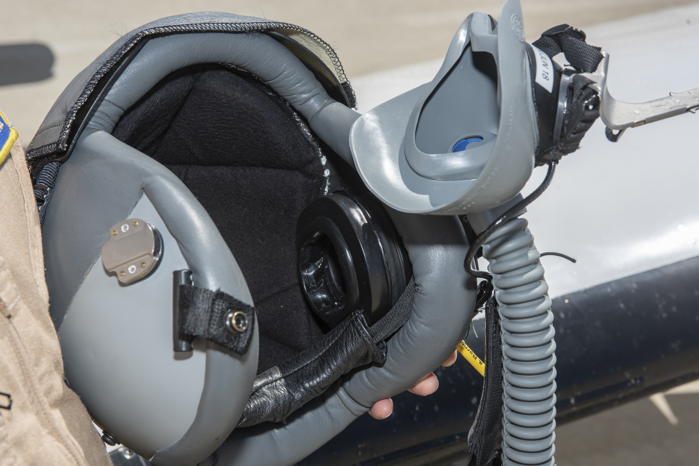
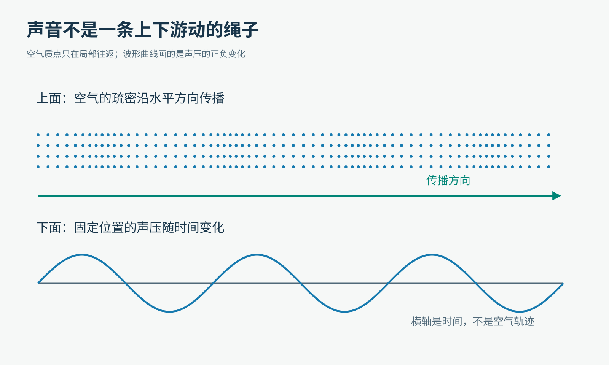
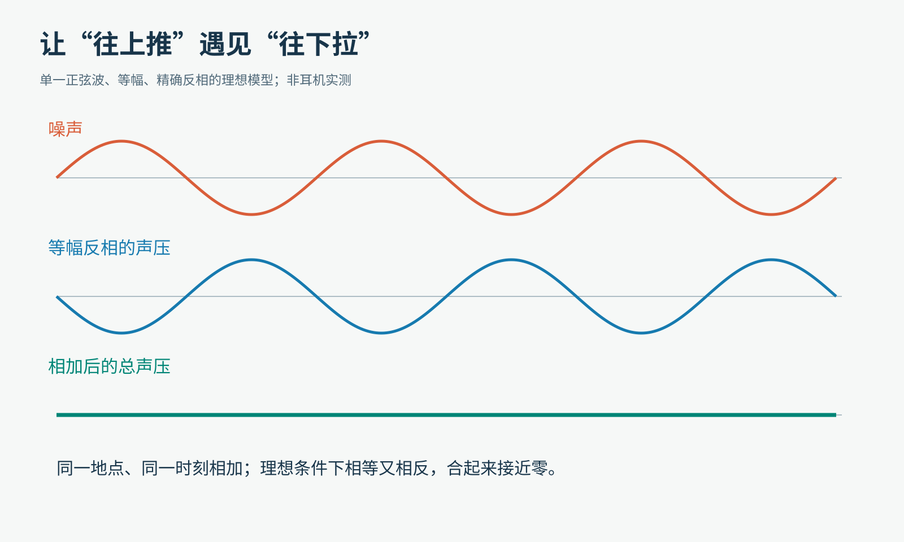
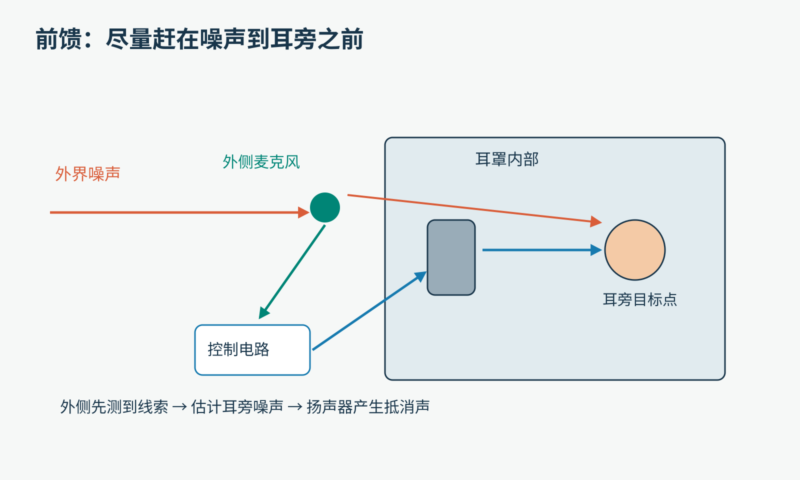
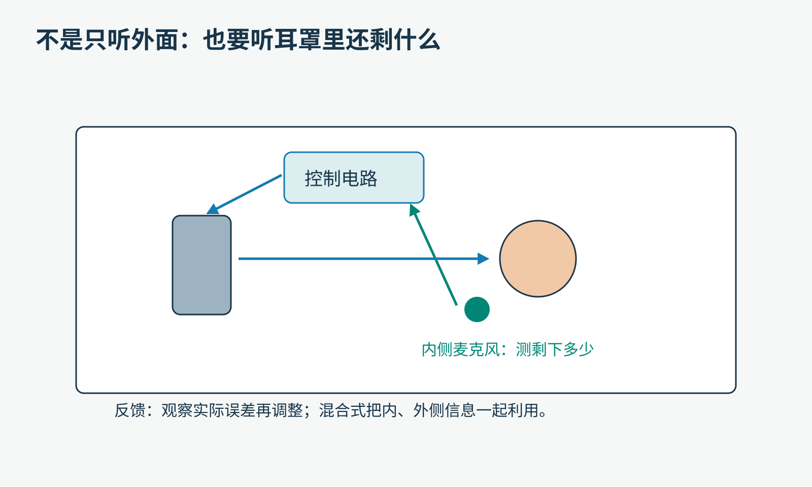
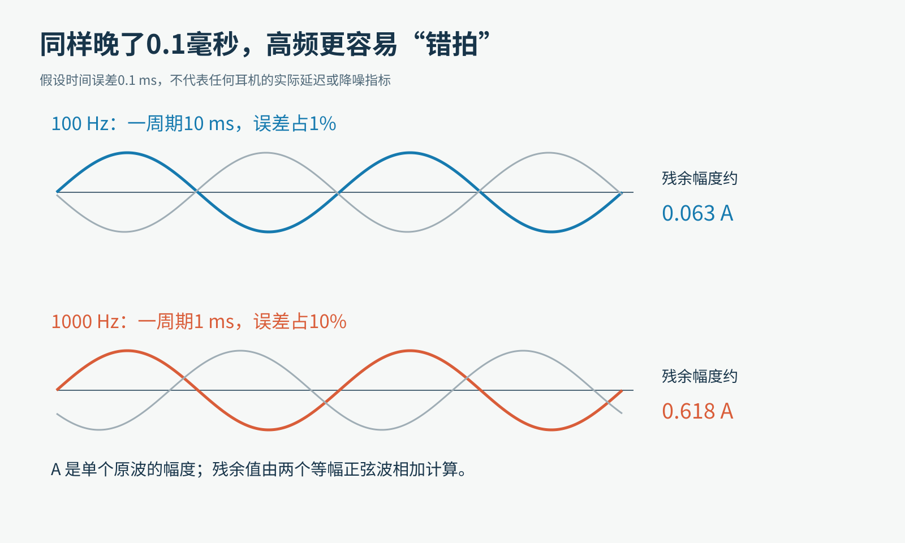
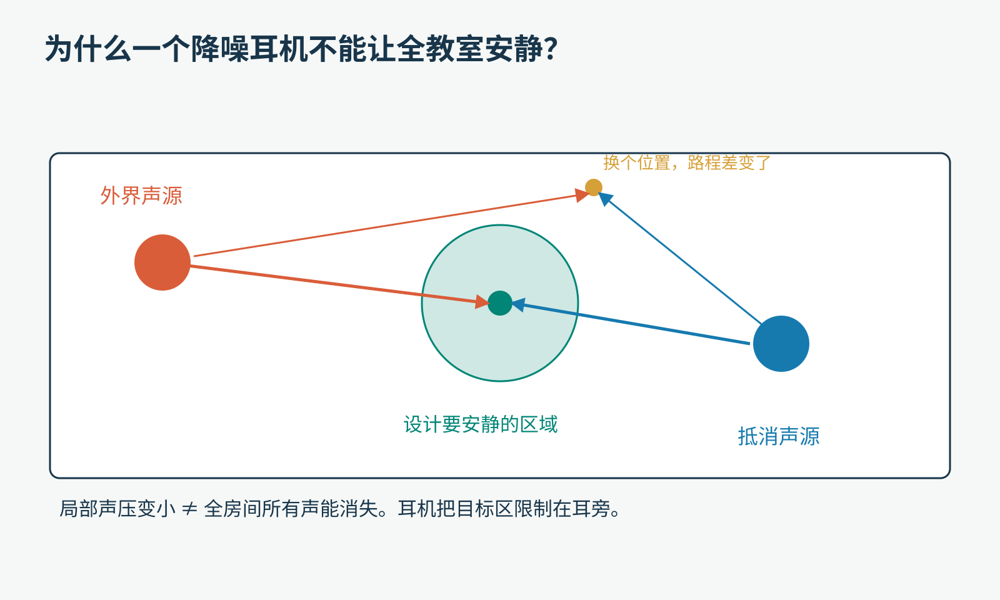
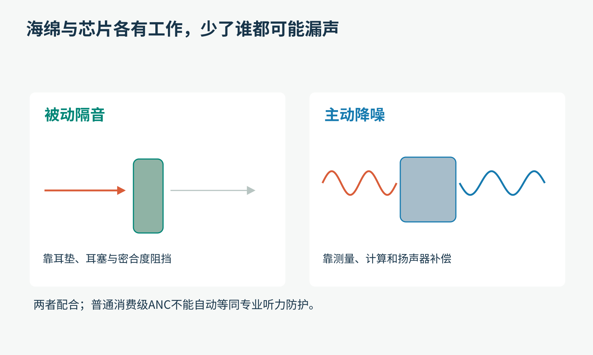

# 降噪耳机明明在发声，为什么你反而听得更安静？

把耳机戴好，不放音乐，打开降噪。

空调的低鸣忽然远了一些，车厢里连成一片的轰隆声被压下去。你旁边的同学说了一句话，却仍然能听见。

这个体验里有两个谜：

它为什么能用声音减少声音？既然能，为什么不把所有声音都消掉？

答案藏在一个很小的地方：你的耳旁。降噪耳机并没有让整节车厢停止振动，而是在这个小区域里，努力改变到达耳朵的总声压。

## 先看一套真正的设备

2018年NASA航空研究使用的主动降噪装置。头盔内侧偏右的黑色圆形部分包含降噪耳机组件。这是航空设备实拍，并非消费级耳机拆机图。摄影：NASA/Ken Ulbrich；保留原尺寸，仅为文件限制轻压缩。

“主动”这个词很重要。普通耳塞可以靠材料和密合度阻挡部分声音；主动降噪还要用电，依靠麦克风、控制电路和扬声器一起工作。

可是，给嘈杂的世界再添一个扬声器，不应该更吵吗？

我们先把“声音”拆开看。

## 声音不是一件有固定体积的东西

你往一桶水里再倒一杯水，水当然更多。声音却不能直接这样相加。

在空气中，声音表现为压力等物理量的微小振动。扬声器向前运动时，可以让附近空气稍微挤一些；向后运动时，又让它疏一些。这些变化传播出去，你的耳膜也随之振动。

画声波时，我们常画一条上下起伏的曲线。请记住：图上“上面”与“下面”，通常表示相对平均值的正负变化，不是空气真的沿着那条曲线蛇形游走。

原创教学示意。上图表示空间中的疏密；下图表示固定位置的声压随时间变化。两种图不要混读。

在同一个地点，同一时刻，一道声波让压力比平均值高一点，另一道让它低一点，这两个变化就可能部分抵消。

有点像两个人同时推一扇可以来回摆的门：如果方向相反、大小恰好合适，门可以几乎不动。这个比喻只解释“相加结果”，真实声场还涉及传播与能量交换。

## 第一个机关：不是“相反频率”，而是合适的相反变化

假设外界噪声是一道很规整的波：压力高、低、高、低，不断重复。

如果耳机在耳旁制造另一道同样快、同样大，却刚好相反的压力变化，两个相加的结果就能很小。

原创计算图。红线与蓝线频率相同、幅度相同、相位相反；绿色是同一点的相加结果。它是理想模型，不是某款耳机的测试成绩。

这里有三个关键词，可以边看图边理解：

- 频率：每秒重复多少次。
- 幅度：变化有多大。
- 相位：在这一轮起伏里，现在走到哪里。

“反相”不是把高音变成低音。假如一个100赫兹的声音，每秒起伏100次，你不能放一个1000赫兹的声音，就指望两者从头到尾互相取消。

对于这道简单正弦波，我们需要在目标位置得到同频、等幅、相反相位的声压。但真实噪声不是一条整齐的正弦曲线，可能混着许多频率，振幅还不断变化。耳机必须持续处理它们，而不是播放一段固定的“负噪声录音”。

## 第二个机关：麦克风听见的，不等于耳膜将听见的

如果任务只是把麦克风信号乘以−1，再送给扬声器，事情就轻松多了。

可麦克风和耳膜不在同一个位置。噪声从麦克风到耳旁要走一段路；耳垫会改变声音；扬声器自己也有响应；电路处理还要花时间。

所以，耳机真正要解决的是：我现在测到这个声音，等它到达目标区域时会变成什么样？扬声器应该怎样发声，才能在那里与它配合？

原创简化示意。外侧麦克风提供提前观测的线索；控制电路需要考虑声音的传播路径，不能把外侧录音直接当成耳旁噪声。

这种利用外侧测量来提前采取动作的方式，叫前馈。

但“提前”不意味着知道未来。系统只能利用已经获得的信息，以及对传播路径、噪声规律的估计。如果处理链路来不及赶上，没有任何芯片可以违反因果关系，把已经发生的声压变化重新撤回。

很多耳机还会在内侧设置麦克风，听一听耳罩里剩下什么，再进行调整。这叫反馈。

原创简化示意。内侧测到的是包含扬声器输出等成分的总结果；真实算法需要正确处理这些成分。混合式降噪会结合内、外侧信息。

前馈像“根据来球方向提前站位”，反馈像“看看实际偏差再修正”。它们都不是绝对完美，合理结合才能处理更多真实变化。

## 为什么低沉轰鸣比较容易安静下来？

请做一个节奏游戏：每十秒拍一次手，你很容易跟上；每十分之一秒拍一次，稍有迟疑就错拍。

声波的时间尺度要快得多，但道理类似。频率越高，一次起伏完成得越快，同样一点时间误差，就占去更大比例的一轮。

看一个不对应任何产品的算例：假设原本应该精确对上的抵消声，存在0.1毫秒的时间误差。

- 100赫兹的波，一周期10毫秒，这个误差占1%。
- 1000赫兹的波，一周期1毫秒，这个误差占10%。

原创计算示意。彩线为原波，灰线为带时间误差的反相波。两者等幅时，算出的残余幅度分别约为0.063A和0.618A，A为原波幅度；不能把这些数直接解释成真实耳机的降噪百分比。

时间误差之外，空间也很挑剔。高频的波长较短，换一个很小的位置，波走过的路程就可能对应明显的相位变化。耳朵形状、佩戴位置与密封情况，都会改变系统要处理的路径。

持续的低频轰鸣通常较容易被有效削弱；突然的敲击、附近的人声等更复杂。人声也并非“完全无法降噪”，只是它变化快、频率成分丰富，常会留下更明显的残余。

因此，“还听得见旁边的人说话”不一定表示降噪坏了。它也可能说明你恰好听见了系统不容易处理的部分。

## 可是，声音的能量跑哪去了？

这是一个非常好的追问。不能因为图上两条线加成了零，就宣布整个宇宙少了一份能量。

先留意范围：那条绿色直线描述的是指定地点的声压结果，不是整个房间的总能量账本。

原创示意。两个声源到目标点的路径与到旁边另一点的路径不同；在一个位置配得好，不意味着每个位置都配得好。

波相遇会改变空间中的干涉分布；在完整问题里，声源和控制系统之间的能量交换也必须考虑。一个地点声压降低，并不等于两套声源在所有空间“互相删除”。

耳机恰好利用了这个特点：它不用让整节车厢都安静，只要把目标限制在耳旁一个较小区域，几何条件就容易控制得多。

如果把一副降噪耳机放在教室中央，再把声音开大，通常不会得到“全班静音”。不同座位到声源的距离不同，反射路径也不同。要做房间级主动声控制，需要完全不同的布置和设计，难度随目标空间与频率范围变化。

## 既然能抵消，为什么音乐没有一起没了？

噪声和音乐对空气来说，没有“讨厌”和“好听”的身份标签。都是物理振动。

区别在于系统知道自己正在播放什么。音乐来自可控制的输入，外界噪声则需要测量与估计。耳机设计会把音乐通道、降噪通道和麦克风反馈一起处理，目标是减小不想要的噪声，同时保留想听的内容。

在理想的简化写法里，可以想成：耳旁的外界噪声，加上合适的抵消声，再加上音乐，最后主要留下音乐。

但真实电路不能只对内侧麦克风测到的一切盲目“取反”，否则连自己的播放内容也会卷进控制环路。声音品质、延迟、稳定性与电池消耗，都要一起设计。

这也解释了一个日常现象：不放音乐，降噪依然可以工作。减小环境噪声和播放歌曲，是相关但不相同的任务。

## 为什么轻轻挪一下耳机，效果也变了？

耳罩没有贴合、耳塞尺寸不合适，都可能让外界声音从新的缝隙进来，也改变耳机内部的声学条件。

被动隔音与主动降噪是搭档。材料和密封先挡掉一些声音，电子系统再对剩余的部分进行补偿。

原创教学示意。左边依靠结构，右边依靠测量和发声；不是两种可以互相完全替代的功能。

也不要故意用手捂住耳机的麦克风来“加强隔音”。那可能让控制系统获得错误输入，部分设备还可能出现尖叫式反馈。正常佩戴和按说明使用，比随手堵住小孔更可靠。

普通消费级降噪耳机也不能自动当作工地、机械加工等高噪声环境里的专业听力防护用品。听起来舒服些，不等于已经达到所需的防护水平。NIOSH的说明明确区分了ANC功能与具备相应降噪评级的听力保护产品。

## 现在可以做一个很小的实验

挑一个安全、安静程度适中的室内环境，只用日常风扇的低鸣或正常的轻声讲话，不额外制造大噪声。

原创实验步骤图。这里只做主观对照，不能据此给产品评出实验室等级。

第一轮，不放音乐，正常戴好耳机，比较降噪关闭与开启。

第二轮，保持座位、声源距离和佩戴状态相同，分别注意低鸣与讲话。不要一边换位置一边得出“开关造成所有变化”的结论。

你可以写下三列记录：哪一类声音、开关前后的感觉、还有哪些没控制好的条件。为了避免自己期待某个结果，如果有人帮忙切换模式且设备允许，可以先不告诉你切换顺序，最后再核对。

更进一步，在纸上画两道正弦波：先让它们完全反相，再把其中一条向右错开一点，逐点把高度相加。你会亲眼发现，理想的“零”非常挑条件。

这也正是降噪耳机有趣的地方：它做的不是向世界发出一条“安静”命令，而是在极短的时间里，反复估计、计算、发声与纠错。

你按下一个开关，听见了一点安静；耳机里面，却开始了一场非常忙碌的合奏。

事实延伸：[Sony降噪原理与使用限制](https://helpguide.sony.net/mdr/wh1000xm4/v1/en/contents/TP0002752738.html)、[ADI的混合式降噪说明](https://www.analog.com/en/signals/articles/bowers-wilkins-noise-canceling-headphones.html)、[延迟为什么重要](https://www.analog.com/en/resources/analog-dialogue/articles/adaptively-cancelling-server-fan-noise.html)、[波的叠加](https://openstax.org/books/university-physics-volume-1/pages/16-5-interference-of-waves)、[NIOSH听力保护说明](https://www.cdc.gov/niosh/noise/prevent/ppe.html)。

图片来源：航空主动降噪装置实拍，[NASA/Ken Ulbrich，2018](https://www.nasa.gov/image-article/active-noise-reduction-system-improves-cockpit-communication-2/)；其余为本文原创教学示意和理想模型计算图。
