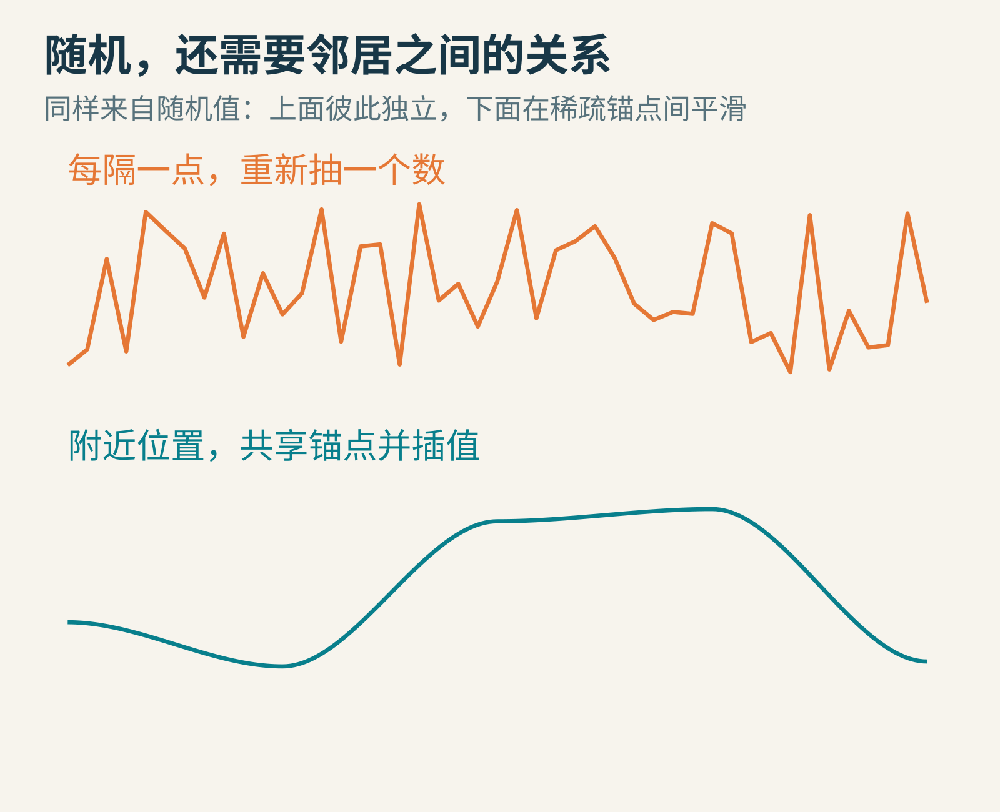
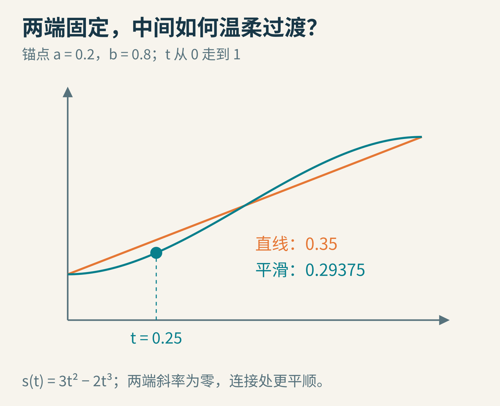
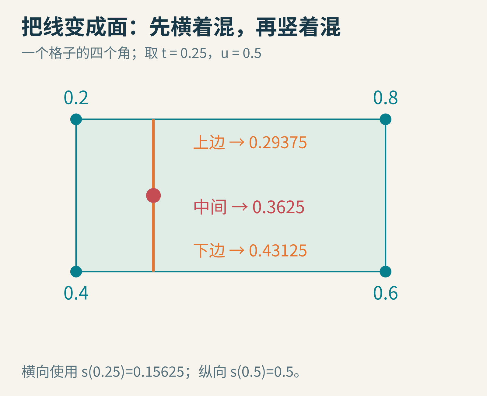
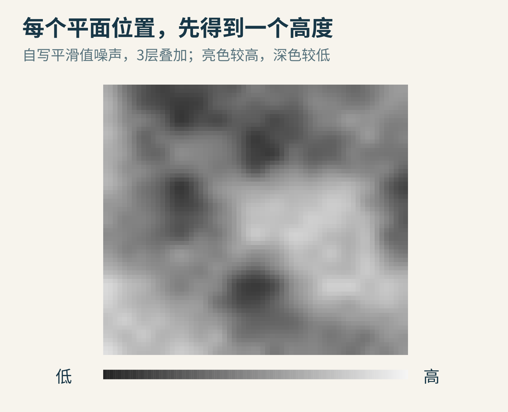
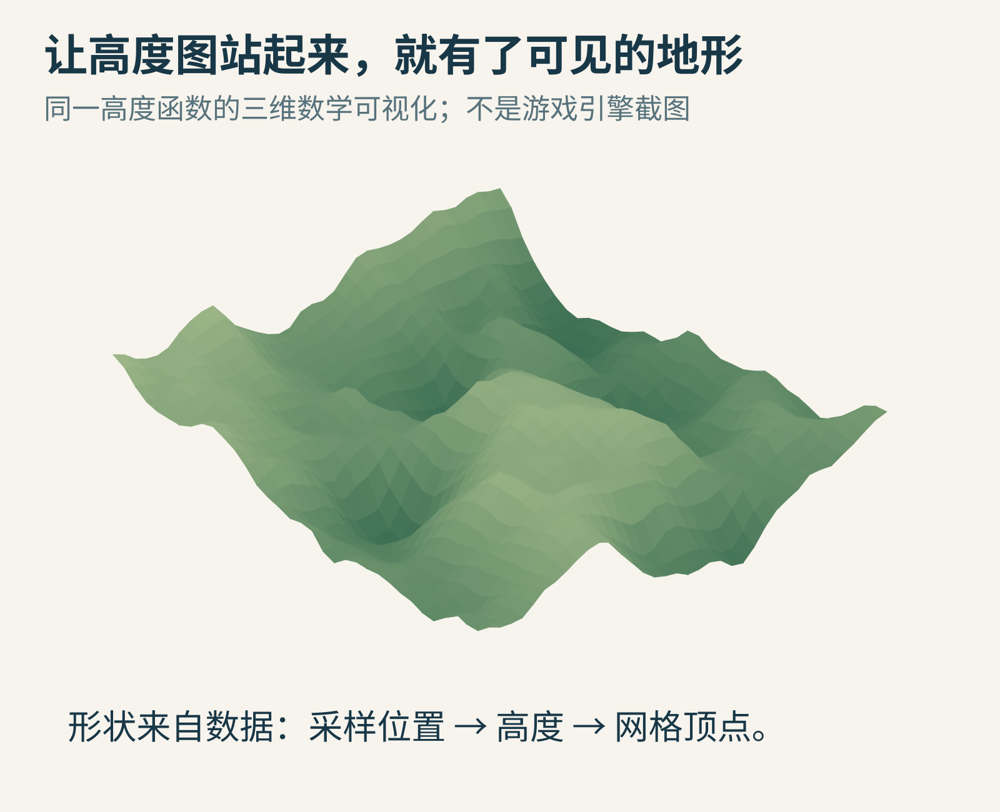
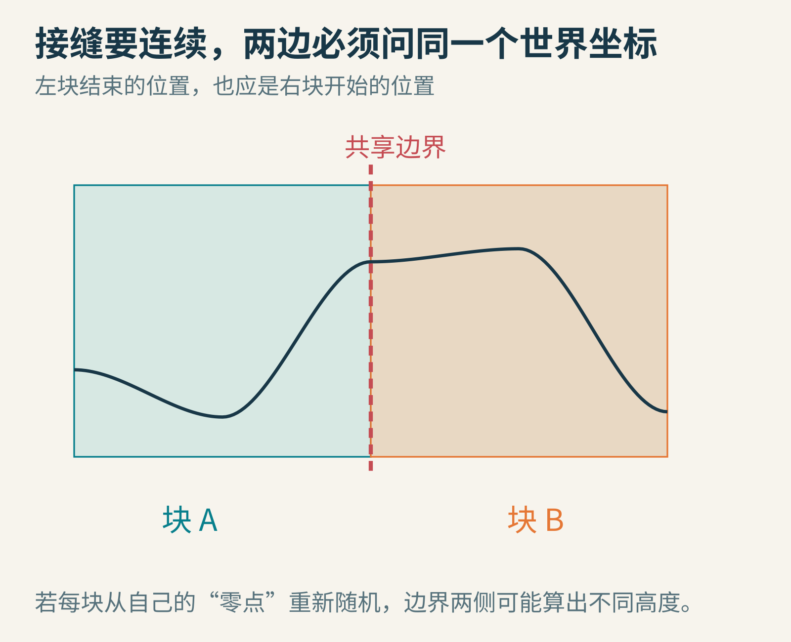
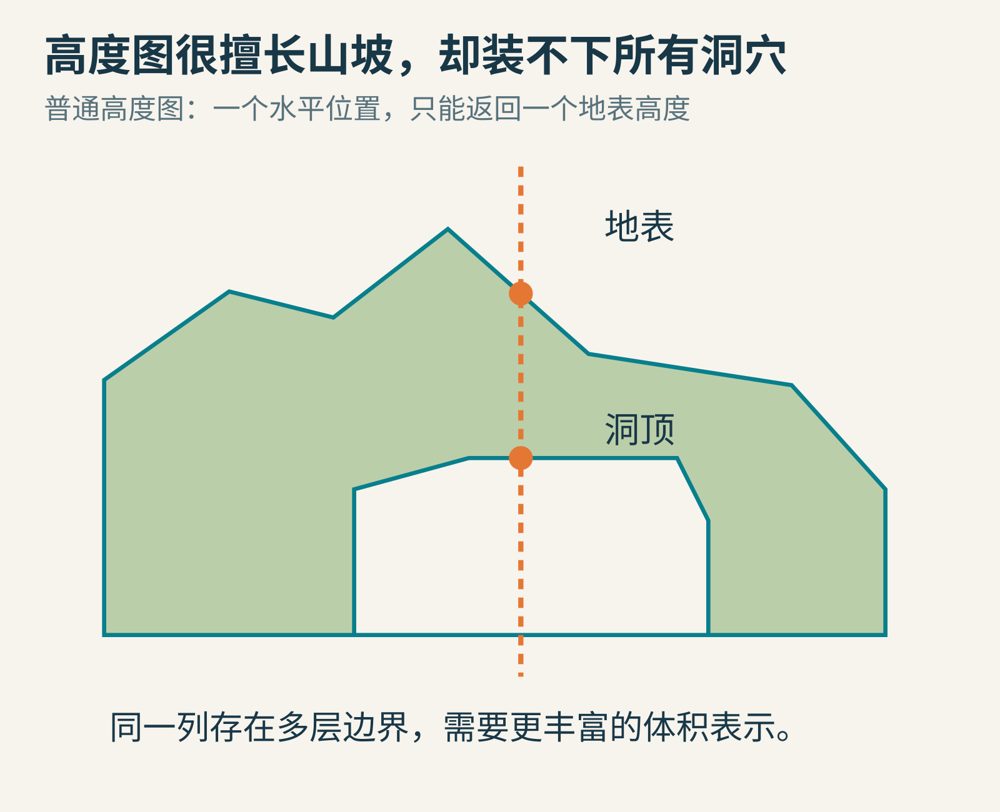

# 一串随机数，怎样长成游戏里连绵的山？

想做一张自动生成的地图，最先想到的办法很可能是：给每个位置抽一个随机高度。

你真的试了，却得到一片像碎玻璃的地面。隔壁两点毫无商量，一个突然很高，一个突然很低。它有随机性，却缺少山脉里那种“附近地势通常有关系”的感觉。

程序化地形的一个常见起点，是让随机变化在空间上保持一定连贯性。计算机图形学把这类构造出来的变化函数称为**噪声**。这里的噪声不一定指声音，也不一定是不想要的干扰；它可以是造山、画云、做纹理的原料。

我们从一条山脊线开始，逐步长出一张高度图，再让它站成三维地形。



全部配图为原创程序绘制。上下两条曲线来自不同的明确构造：上面逐点独立抽值，下面在稀疏随机锚点之间平滑插值；不是实测自然山脉。

## 先把随机放稀一点，中间的位置来商量

假设路边立着一排桩子，每根桩子随机选一个高度。我们暂时只给桩子抽签，桩子之间的位置由两端高度共同决定。

左桩高度是0.2，右桩高度是0.8。在两根桩子之间，位置比例记为t：左端t＝0，右端t＝1。

最直接的办法是直线插值：

高度＝0.2×(1−t)＋0.8×t。

当t＝0.25，高度是0.35；走到一半，高度是0.5。它已经不会逐点乱跳了，但相邻线段连接时，坡度可能突然改变，山脊会显出折角。

我们希望到每根桩子附近时，过渡逐渐放缓，再平顺地交给下一段。

## 不改变两端，只改变“走过去”的节奏

把t先送进一个平滑函数：

s(t)＝3t²−2t³。

然后用s(t)替代原来的t，进行同样的加权。左端s(0)＝0，右端s(1)＝1，所以两端高度没有变化；但这个函数在两端的斜率都为零，使相邻段的连接更平顺。

先不学微积分，也可以观察曲线：它出发时比较缓，中间比较快，接近终点时又放缓。



t＝0.25时，s(t)＝0.15625。混合高度变成0.2×0.84375＋0.8×0.15625＝0.29375。

把随机值放在格点上，再对格点间的位置插值，就是一种**值噪声**的基本思路。它与经常听到的Perlin噪声有亲缘关系，但不是同一个算法。

[Godot的FastNoiseLite文档](https://docs.godotengine.org/en/stable/classes/class_fastnoiselite.html)明确区分值噪声与Perlin噪声：前者从格点随机值插值，后者围绕随机梯度及相关点积进行构造。这里的“梯度”可以先理解为带方向的局部变化提示。

[Ken Perlin公开的改进噪声参考实现](https://cs.nyu.edu/~perlin/noise/)还使用了另一条五次平滑曲线。本文没有把自己的三次值噪声例子冒充那份实现，也没有直接执行下载的代码。

## 先跑十几行，看这条山坡能不能算出来

以下Python 3程序只生成两根桩子之间的五个高度，不需要安装库。

```python
def smooth(t):
    return t*t*(3 - 2*t)

def height(t, left=0.2, right=0.8):
    w = smooth(t)
    return left*(1-w) + right*w

for t in [0, 0.25, 0.5, 0.75, 1]:
    print(f"t={t:.2f}, height={height(t):.5f}")
```

实际执行后，高度依次是0.20000、0.29375、0.50000、0.70625、0.80000。

先把左右高度互换，看看山坡如何翻转；再让两端高度相同，检查中间是否也保持相同。最后把smooth(t)改成直接返回t，与原曲线比较。你改的是“怎样过渡”，不是两端的目标值。

这段函数只为0≤t≤1的区间设计。若直接把远处的世界坐标当成t输入，输出不会自动变成一片无限地形；还需要先找到它属于哪一格，并计算格内比例。

## 从一条线，长成一张面

地面有两个水平方向。现在，每个格子有四个角，各放一个高度。

我们设左上0.2、右上0.8、左下0.4、右下0.6。要求的位置在横向四分之一、纵向一半处。

先按横向比例，在上边算出0.29375，在下边算出0.43125。然后在这两个结果之间，沿纵向再混一次；一半的位置正好取平均，得到0.3625。



图里横向位置比例是0.25，但横向混合权重是s(0.25)＝0.15625。不要把“站在哪里”和“经过平滑函数之后的权重”混成同一个数。

对地面上许多位置重复这件事，就得到一个函数h(x,y)：输入平面坐标，返回高度。邻近位置大多共享附近格点，因此变化具有连贯性。

这里的y是地面的第二个水平方向；某些引擎把水平面写成x、z，把竖直高度叫y。字母名字可以不同，三条轴的职责必须说清楚。

## 一层很圆润，却像泡泡。怎样长出细节？

用稀疏格点生成的噪声，适合建立大范围高低起伏。可只用这一层，山可能显得过于圆滑。

我们可以再加一层格子更密、起伏更小的噪声。大层决定哪里是山，较细层在大山上堆小丘，更细层再添碎起伏。

设基本噪声是n(x,y)，我们构造：

H(x,y)＝[n(x,y)＋0.5n(2x,2y)＋0.25n(4x,4y)]÷1.75。

这里有两个旋钮：

- 输入坐标乘2，让同一段路遇到更多变化，称为提高空间频率。
- 输出乘0.5，让新增起伏的幅度更小。


这三层采用1、0.5、0.25的振幅。除以它们的总和1.75，使本例中原本处于[0,1]的噪声，叠加后仍保持在[0,1]范围内。

每层常被叫作一个octave，中文也常说倍频层。把多个尺度叠在一起，是程序化图形里很常用的办法。但不是层数越多越好：细节太密而采样太稀，反而可能出现闪烁、摩尔纹或不稳定的小结构；额外计算也有代价。

不要把“很多层噪声”直接等同于真实地质过程。河流会搬运泥沙，岩层有材质差异，侵蚀会改变坡形；这些不是简单相加就自动出现的规律。

## 高度图与三维山地，其实是同一份数据的两种读法

先把H(x,y)画成灰度图：数值低的地方较暗，数值高的地方较亮。这张图叫**高度图**，它很适合检查数据有没有接缝、重复和突变。



图中采用固定随机种子42建立格点数值表，再以三次平滑插值和三层叠加生成。种子与算法参数固定，才能复现这张教学图；灰度只表示高度。

接着，把平面网格的每个顶点抬到对应高度，再把相邻点连成三角形或四边形，就能看见地形起伏。



这里直接用同一高度函数绘制网格可视化。它不是引擎截图，没有冒充光照、碰撞、植被或侵蚀模拟的实际运行结果。

地形的颜色还可以由高度、坡度、温度或湿度等规则决定。比如高于某个阈值显示积雪，只是一条材质规则；它不会自动赋予这座山真实气候。让画面看起来像自然，与真的模拟自然，是两种不同目标。

## 为什么两块地图拼起来，会突然出现一道台阶？

游戏通常不会一次生成整个世界，而是分成许多区块。假设左块和右块共享一条边，在边界同一个位置，它们必须给出同一个高度。

如果每块都从局部(0,0)开始重新抽一套随机数，两边就可能各说各话。即使都使用同样的seed，不同坐标映射或生成顺序，也可能让它们取到不同的格点值。



更稳妥的思路，是让所有区块查询同一个世界坐标函数。边界位置相同、格点规则相同、参数相同，才能得到一致的边界值。

因此，“相同种子生成相同地图”也需要完整条件：同样算法与版本、同样参数、同样坐标约定，以及确定的随机值分配方式。只把一个seed数字贴在存档里，不能保证换了算法后地图仍一模一样。

本文图例为了可审与可重复，使用固定表和确定的采样顺序；它不是一份无限世界生产实现。正式游戏还需考虑负坐标、区块边缘、资源版本、已有玩家修改等问题。

## 只有一个高度，能装下一座山洞吗？

普通高度图每个水平位置只存一个地表高度。可山洞上面有山顶，下面有洞顶，再下面可能还有洞底。同一根竖直线会穿过多层边界。

一个数无法同时完整表达这些层。



高度图很适合连续地表。悬挑、拱桥和复杂洞穴，需要附加网格、体素占据数据、三维密度场或其他更丰富的表示。不是把二维噪声加更多层，就能突破表示方式本身的限制。

## 留给你一张小型造山任务单

用方格纸也能完成前两项：

1. 任选四个角高度，手算横向与纵向各一半的位置。再改成横向四分之一，分别比较线性和平滑权重。
2. 画一条很慢的大起伏，再在它上面加小起伏。观察“小山”是否改变了“大山在哪里”。
3. 在自己的短程序里固定同一组格点，只改频率；再恢复频率，只改振幅。每次只动一个旋钮，才容易判断它负责什么。
4. 生成左右相邻两块，逐点比较共享边界。让它们先故意使用两套独立随机表，复现裂缝，再统一世界坐标与格点规则。

造山的第一步，不是寻找一个叫“真实地形”的神奇按钮。它是把“随机”拆成可控制的关系：邻居怎么联系，变化有多快，各层影响多大，最后用什么数据结构把形状存下来。

图片来源：全部为AI辅助原创编程制图，曲线、高度图和三维视图来自本文自设算法及参数。技术参阅[Godot FastNoiseLite文档](https://docs.godotengine.org/en/stable/classes/class_fastnoiselite.html)与[Ken Perlin改进噪声参考实现](https://cs.nyu.edu/~perlin/noise/)；未复制来源图片。
