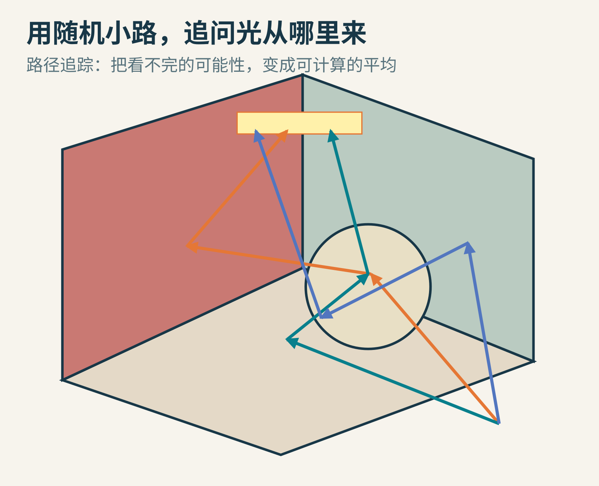
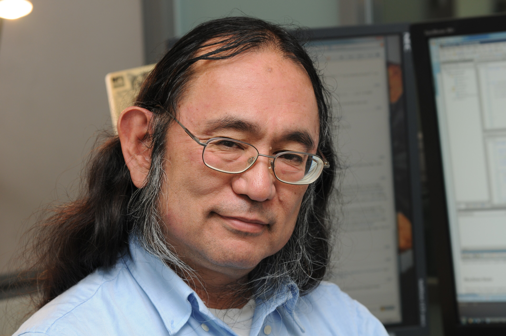
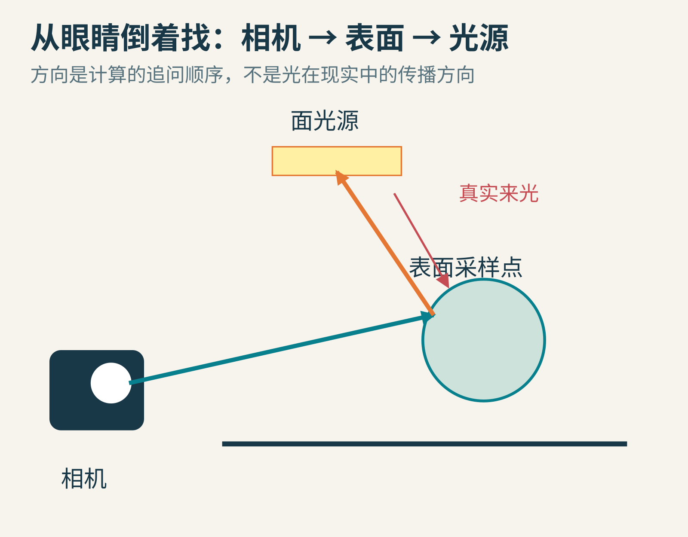
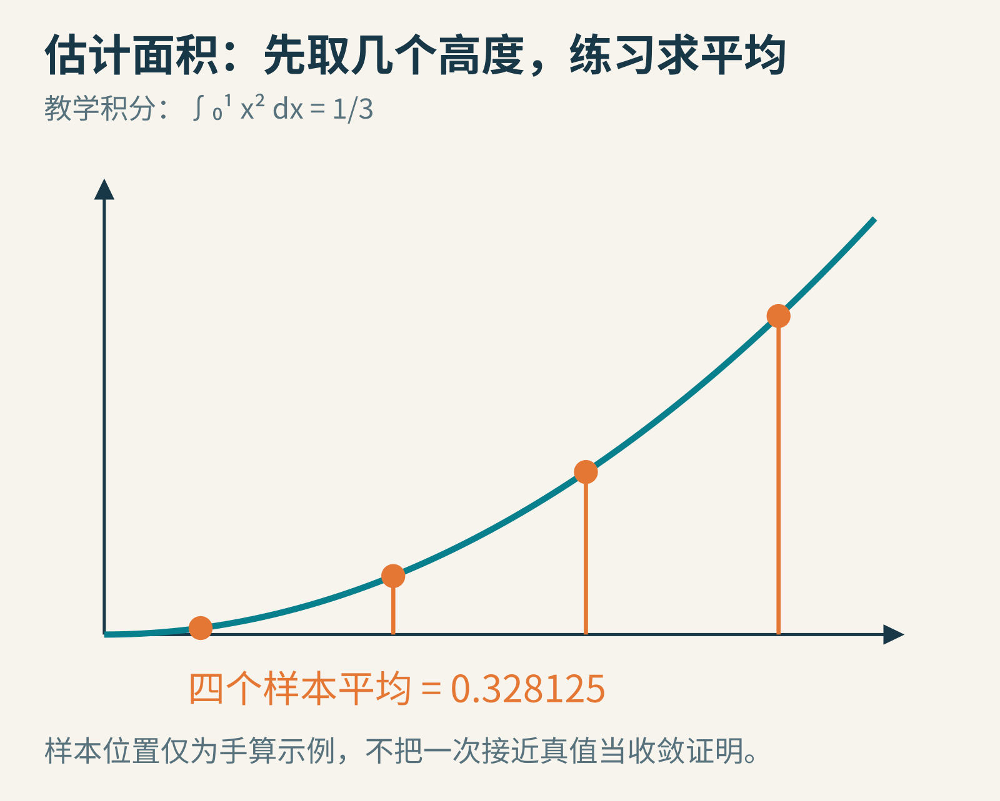
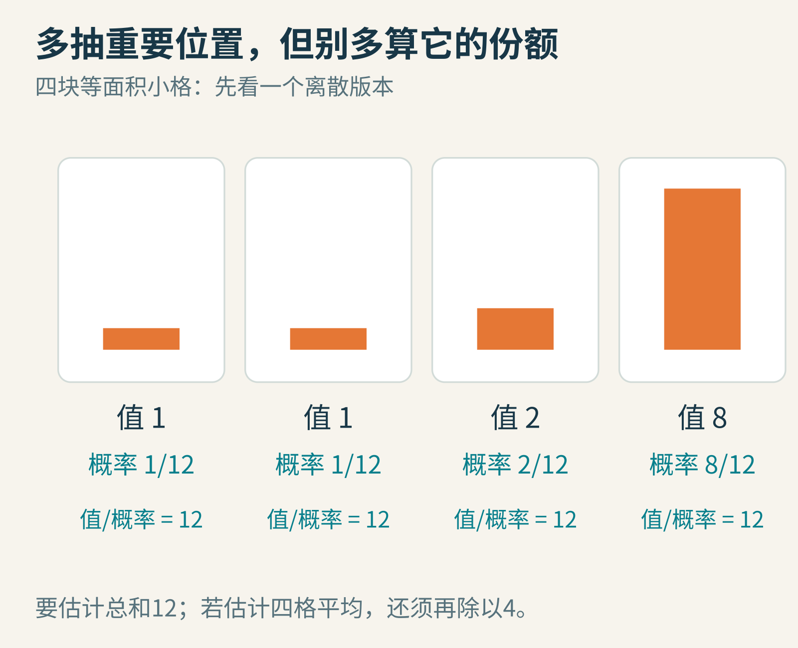
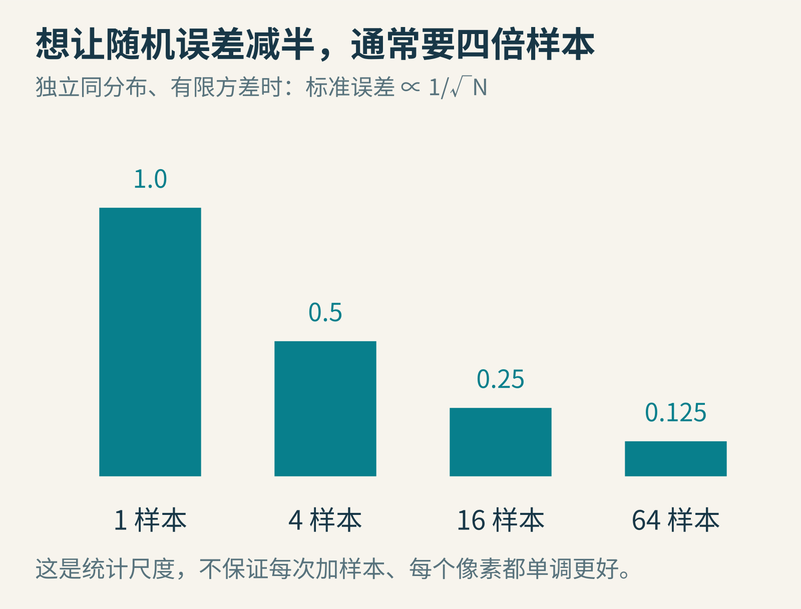
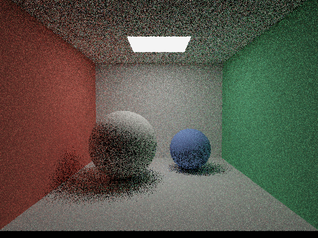
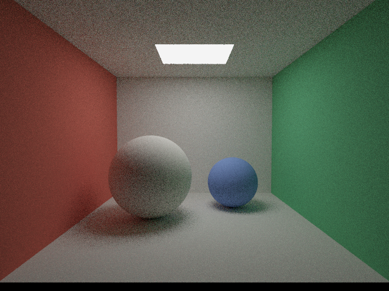
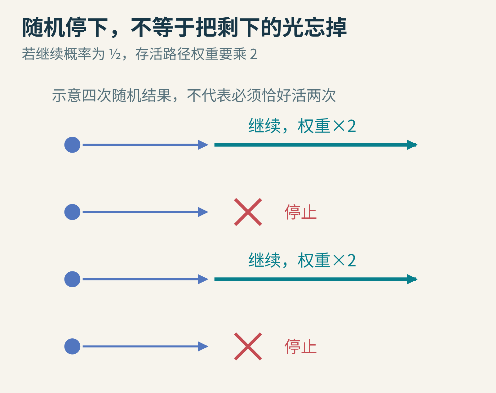

# 用随机小路追问光：路径追踪怎样把噪点变成画面

把一张白纸放到红墙旁边。只要光线条件合适，白纸靠近墙的一侧就可能带上一点红。纸没有换颜料，是光先碰到红墙，再来到纸上，最后进入你的眼睛。

电脑若只问“灯有没有直接照到这里”，就漏掉了这条绕路。而真实场景里，光还可以经过桌面、墙角、玻璃和更多表面。所有可能路径加起来，几乎没有尽头。怎样在有限时间内处理它们？

路径追踪的回答有些反直觉：不把所有路都走完，而是按规则随机选路，计算每条路的贡献，再求平均。随机并不等于随便；概率和权重，必须严丝合缝地配合。

原创概念示意，线条表示用于计算的采样路径，不是拍摄到的真实光轨。

## 一　1986 年，一条方程把许多渲染问题放到一起

James T. Kajiya 在 1986 年的论文《The Rendering Equation》中，给出适用于图形学的一种光传输积分表达，并讨论蒙特卡洛求解方法。论文开头很坦率：能量传递的思想在辐射传热研究中已有基础。这不是“一个人发明了光如何运动”。[原论文](https://www.cs.princeton.edu/courses/archive/fall06/cos526/papers/kajiya86.pdf)

照片：Derrick Coetzee（Dcoetzee），2009 年，[CC0 1.0](https://creativecommons.org/publicdomain/zero/1.0/)，[文件来源](https://commons.wikimedia.org/wiki/File:Jim_Kajiya.jpg)。这是后来的办公室照片，不是 1986 年论文发表现场。

本文用现代常见记法解释核心关系，不逐字照抄原文的多点传输量：从某个表面位置朝眼睛离开的光，等于它自己发出的光，再加上从各个方向照来、被它散射到眼睛方向的光。

一个不发光的白球，第一项是零，但第二项可能很大；灯泡表面则可能两项都有。这提醒我们，物体亮不亮，不仅取决于它叫什么颜色，还取决于周围有什么光、从哪里来，以及表面怎样改变光的方向。

## 二　为什么从相机出发，而不是从灯里追每一颗光子

灯向四面八方发光，真正进入小小相机孔径的只是一部分。如果从灯发出海量随机路径，许多计算可能永远到不了成像区域。

一种基本路径追踪器因此反过来问：这个像素沿视线首先看见哪个表面？到了那里，又可能从哪个方向收到光？再沿那个方向找下一个表面，继续追问。

原创计算顺序图。箭头“相机到表面”是算法追问方向，不表示现实中的光从眼睛射向灯；红色箭头提示真实来光。

这不是让物理时间倒流，也不是模拟每一颗量子光子。我们是在计算几何光学模型下的传输关系。对于这里讨论的普通可逆表面散射，这种从相机建立路径的方式十分有用；更复杂的介质、非互易材料等，需要更仔细的模型与算法。

一条路径可能是“相机→桌面→灯”，也可能是“相机→白纸→红墙→灯”。后者正好能解释开头的红色串染。路径的每次转向，都要乘上与材料、方向和采样方式相应的权重，不能只数“碰到了几面墙”。

## 三　先不用光，拿一条抛物线练习求平均

假设要计算 y=x² 在 x=0 到 1 之间下方的面积。学过积分的人知道答案是 1/3；没学过也没关系，我们把它当成已知真值，用来检查估计方法。

如果在这个区间均匀随机取一个位置 X，它的平方 X² 有时小、有时大。重复 N 次，把这些高度求平均。因为区间宽恰好是 1，这个平均就估计了面积。区间若宽为 b−a，还要乘上宽度。

原创手算示意。图中为便于复算使用四个等距区间中点，属于确定性中点例子；真正的随机实验由附带脚本单独执行，不能把这四点伪称为随机结果。

先手算四个高度：x=1/8、3/8、5/8、7/8，对应平方为 1/64、9/64、25/64、49/64。平均是 84/256=0.328125，与 1/3≈0.333333 比较接近。

这个小例子只帮助理解“取样后平均”，并不是随机方法有效的证明。蒙特卡洛实验会换成随机样本；在适当条件下，平均值的期望等于目标积分，样本增多时估计趋于稳定。它不是承诺任意四个点都很准。

路径追踪把这件事搬到更高维：不只随机一个横坐标，而是随机像素内的位置、光照方向、反射方向，有时还有时间、镜头位置和波长。这里的“积分”，就是把大量可能性按物理规则加起来。

## 四　抽样偏爱亮处，为什么还可以公平

如果场景里只有一小块很亮的灯，其余方向很暗，均匀乱猜容易经常猜空。我们想更常选到重要方向，这叫重要性采样。但若只提高抽中次数，不调整权重，画面就会被算亮。

先看四个等面积小格，贡献值为 1、1、2、8，总和是 12。若每格概率都是 1/4，抽到某格后用“值÷概率”估计总和，就会得到 4、4、8 或 32。把四种可能按概率平均，仍然得到 12。

若概率改为 1/12、1/12、2/12、8/12，抽到的值除以概率，每次都得到 12。这是一个理想化例子：我们事先已经知道每格贡献，才能选得如此完美；真实场景只能利用近似线索。

原创离散概率例。这里估计四格总和；若求四格平均，再除以 4。

连续情形中，对积分 ∫f(x)dx，一个样本的基本形式就是 **f(X)/p(X)**，p 是抽取位置的概率密度。它不是单个精确位置“被抽中的概率”，因为连续变量某个精确点的概率通常为零；密度要与一个范围配合才形成概率。

最关键的限制是：有贡献的地方不能永远抽不到。若 f 不为零的某片区域，p 却始终为零，你漏掉的不是噪声，而是真实能量。增加样本也救不回来。

## 五　落到表面以后，具体怎么算一次贡献

现代常见表面渲染方程，可以简写为：

**L出 = L自发 + ∫ L入 × f反射 × cosθ dω。**

L 表示沿某方向的辐亮度，它同时考虑面积、方向范围与能量传输率；f反射 是双向反射分布函数 BRDF，描述表面怎样把某方向的来光分配到出射方向；cosθ 表达斜着入射时的投影因素；dω 表示把半球上的方向逐一累加。BRDF 本身不是简单的“反射百分比”。

若随机选一个入射方向，概率密度为 p，则该方向的估计贡献包含 **L入×f反射×cosθ/p**。沿路径走到下一处表面，再应用相应规则。

对理想漫反射表面，若颜色反射率为 ρ，BRDF 为 ρ/π。若用余弦加权的半球采样，p=cosθ/π，那么两项相除后正好留下 ρ。这个抵消能让基础漫反射路径追踪写得简洁，但不是任何材质都能直接“每次乘颜色”了事。

还有一条实用捷径：到了表面，主动在灯上选一个点，检查两者之间是否有遮挡，估计直接光。本文的小渲染器就这样做，同时继续抽样后续反弹。若又把随机路径直接撞灯的贡献完整加一遍，可能重复计算同一类路径，必须用正确的计数或多重重要性采样处理。

## 六　噪点为什么会慢慢少，为什么少得不够快

想象每个像素都在重复一次估计。有的路径贡献大，有的贡献小；样本少时，各像素运气不同，于是出现颗粒。增加样本相当于让平均更稳定。

在独立同分布且方差有限等条件下，样本平均的标准误差通常按 1/√N 缩小。四倍样本，大致才能把这个误差尺度减半；十六倍样本，约缩到四分之一。

原创统计尺度图，不是某张渲染图逐像素误差的实测曲线。

这不是每一次结果都单调改善的保证。刚好抽到罕见但贡献很大的路径，单个像素甚至会暂时变得更亮、更刺眼。只看一个小样本里“结果都差不多”，也不能证明方差一定小：你可能只是一直没遇到罕见事件。

以下三张图来自本文附带的同一份原创小渲染器，没有后期添加假噪点，也没有降噪处理。原生分辨率均为 640×480，分别累计每像素 1、16、128 个相机样本。

1 样本/像素。一个相机样本仍可能产生多次相交查询与直接光采样，不能把它理解为总共只算一条直线。

16 样本/像素。材质、相机、灯、曝光映射与前图相同。

128 样本/像素。盒形房间和两个球均为自建几何，不使用第三方场景资产。此教学实现最多处理六次表面散射，存在截断偏差；不是无限次反弹的精确参考真值。

观察大球的暗侧与墙角：那里仍能收到绕过来的光。再看红墙、绿墙附近的颜色关系，会更容易理解为什么只算灯直射，无法完整解释画面。

## 七　路径不能无限走：随机停止，也有规则

最直接的做法，是超过某个反弹次数就停止。它简单，却漏掉更长路径的贡献，通常引入截断偏差。本文小渲染器为便于控制演示开销，明确采用了这个办法。

更一般的无偏路径估计，可以使用“俄罗斯轮盘赌”这一历史术语所指的随机终止技术：某一步以概率 s 继续；若继续，就把后续权重除以 s；否则停止。

原创权重示意，不涉及真实赌博。图画出一种可能结果，四条路径不保证恰好存活两条。

例如后续原本有贡献 C，继续概率为 1/2。期望值是 1/2×(2C)+1/2×0=C。单条路径可能被放大，但平均不偏离原值。正确加权能避免因随机终止本身引入偏差，仍不代表估计没有方差，也不等于所有数值实现都自动正确。[PBRT 路径追踪解释](https://pbr-book.org/4ed/Light_Transport_I_Surface_Reflection/Path_Tracing)

## 八　“物理渲染”也有模型边界

路径追踪是一类求解方法，不是一份无所不能的现实保证书。场景尺寸、灯的能量、材质数据、相机模型若不对，再多样本也可能稳定地算出一个错误场景。

普通表面几何光学模型不自动包含衍射和干涉；雾、烟需要体积散射扩展；光谱、偏振也可能需要额外表示。Kajiya 原论文就讨论了基础模型的限制，不应把“物理”二字读成“不作任何近似”。

现代实时渲染还可能结合重用历史样本、时空滤波和学习式降噪。它们能提高可用画质，却也可能带来拖影、细节损失或新的偏差。因此“像素已经很干净”与“能量估计已经非常准确”，是两个需要分别验证的结论。

## 九　亲手试着让运气更可靠

先运行 exercise.py，看均匀随机估计 ∫₀¹x²dx 的结果如何随样本量变化。换一个随机种子，结果应该不同；重复许多次，才适合讨论整体误差趋势。

再试四格实验：均匀选格与按贡献大小选格，都用值除以采样概率。比较两者的均值和波动。最后故意不除概率，看看这个“多抽亮处”的捷径如何使估计偏离目标。

若电脑有 Python、NumPy 和 Pillow，还可以运行 render_demo.py 重建三张图。改大顶灯，观察软阴影；把红墙改成灰色，观察间接串色；把最大深度设为一，观察只保留第一处表面的直接光后，画面失去了什么。参数改动应单独标注，不能把不同场景的差异当作采样算法的提升。

路径追踪最有魅力的地方，是把无穷多可能路线转成可管理的统计问题。**我们不必每条路都走过，但必须知道自己为什么选这条路，以及它应该代表多少尚未走过的路。**

本文由 AI 辅助研究与撰写；所有机制图、例题与演示渲染代码均为本次原创，演示图由代码实际计算，未使用 AI 生成照片或伪造实验噪声。

图片来源：[Kajiya 真实照片](https://commons.wikimedia.org/wiki/File:Jim_Kajiya.jpg)。其余为原创机制图及注明参数的计算渲染。进一步阅读：[蒙特卡洛基础](https://pbr-book.org/4ed/Monte_Carlo_Integration/Monte_Carlo_Basics)、[简单路径追踪器](https://pbr-book.org/4ed/Light_Transport_I_Surface_Reflection/A_Simple_Path_Tracer)。
