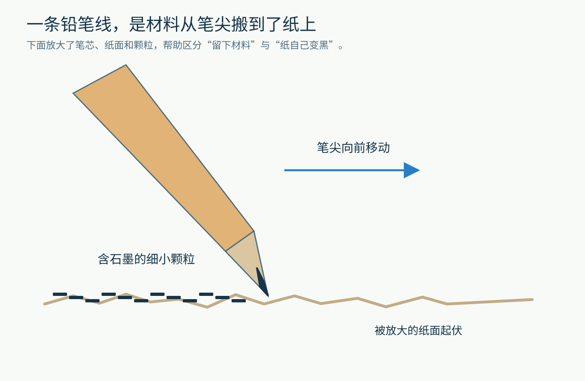
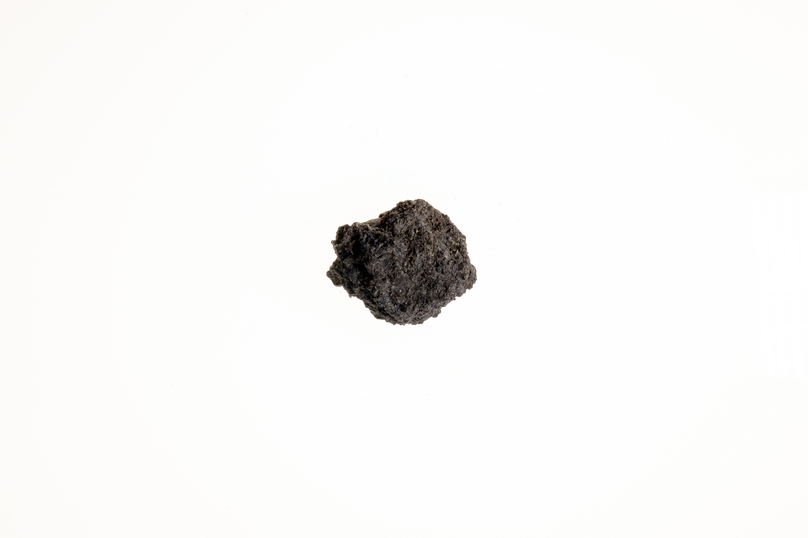
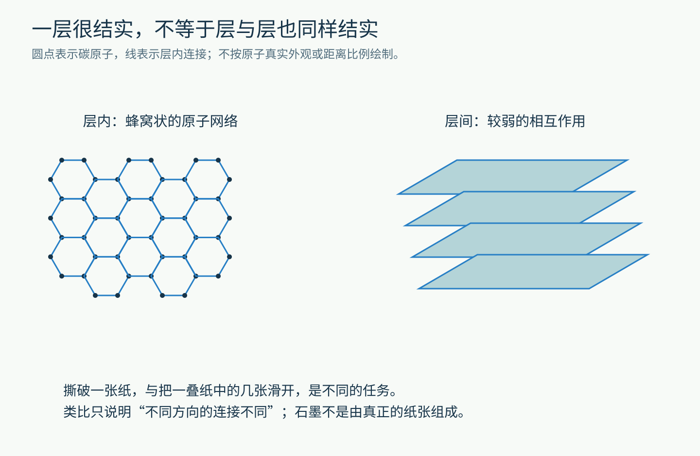
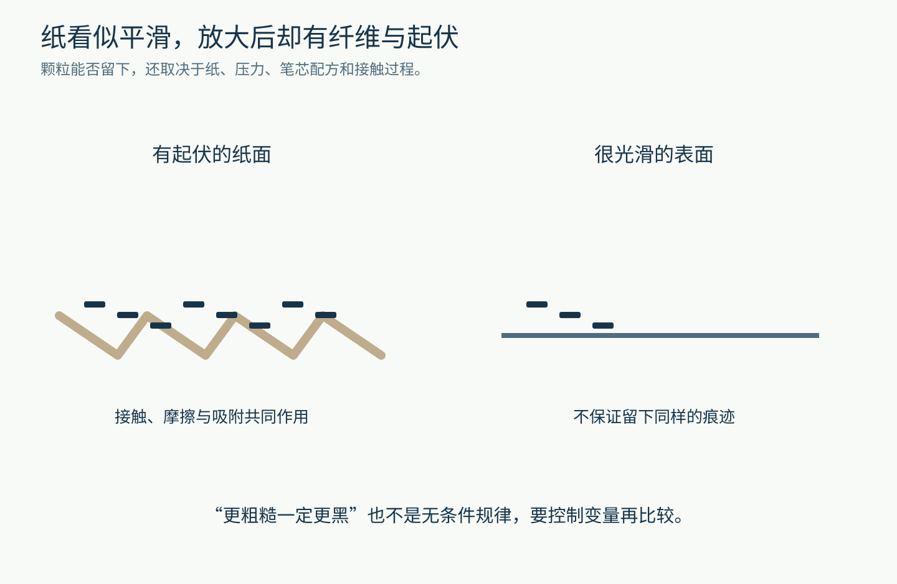
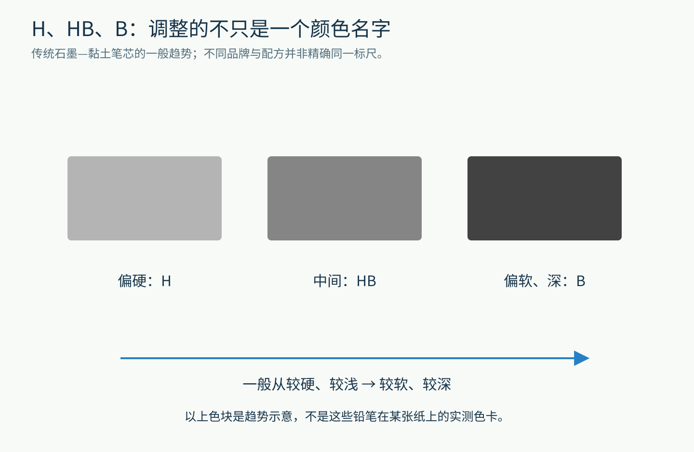
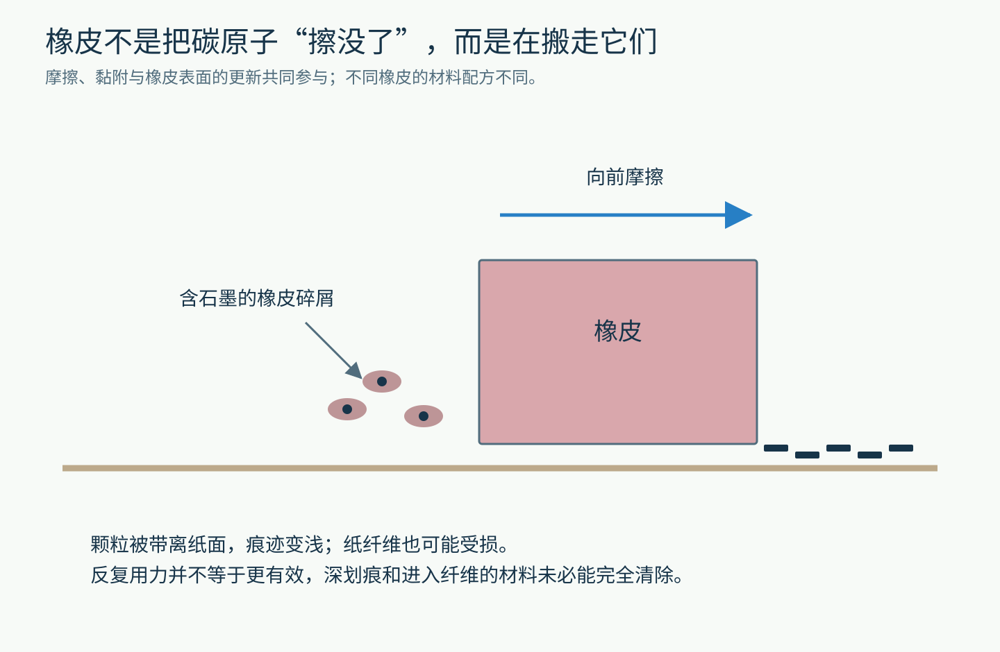
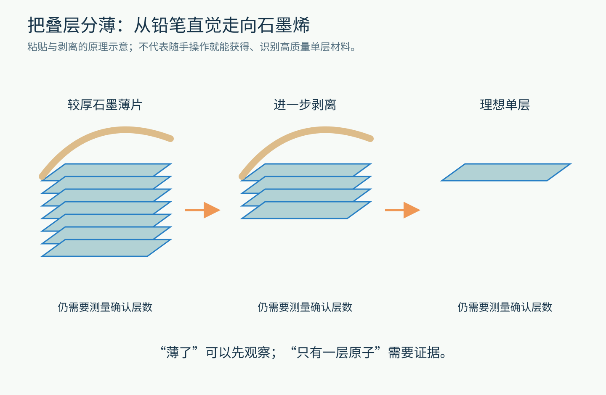
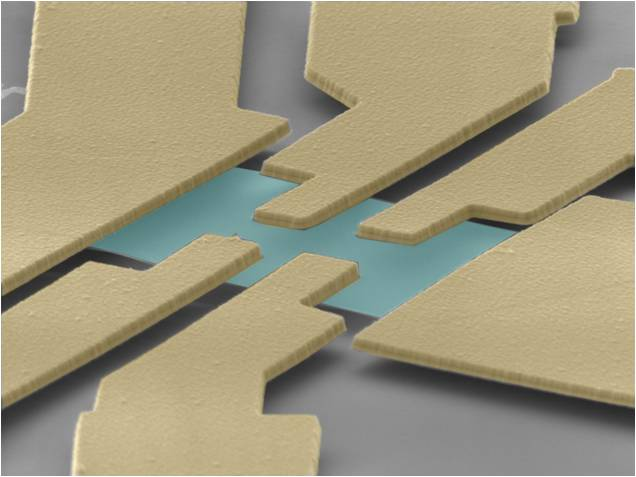
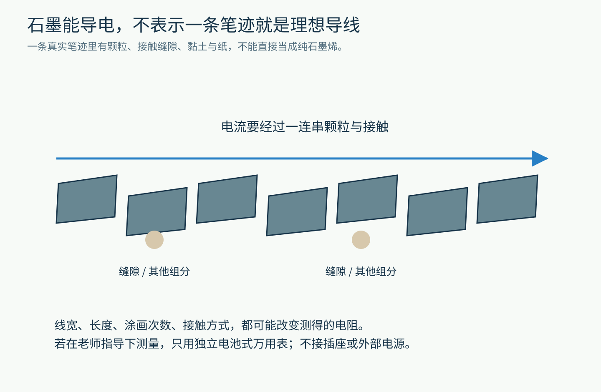
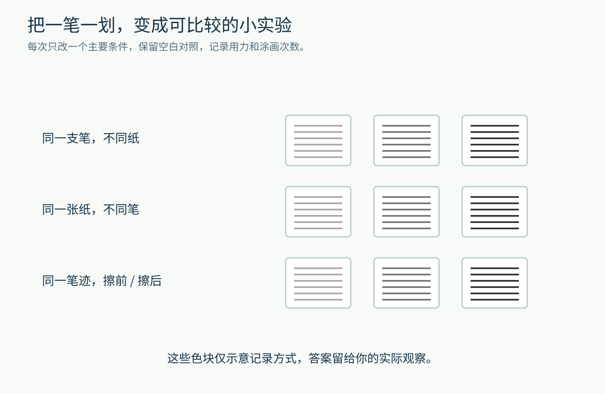

# 铅笔写下一个字时，到底把什么留在了纸上？

拿一支铅笔，在纸上写一个“我”。

笔尖变短了一点点，纸上多了一条灰黑色的线。用橡皮擦几下，字淡了，旁边多出一些脏脏的碎屑。

这里没有加热，没有电源，也没有看得见的液体。可材料已经连续搬了两次家：先从笔尖到纸上，再从纸上到橡皮碎屑里。

如果把镜头一直推近，一次普通的书写，能带我们走进原子层、表面摩擦和电子运动的世界。先别急着背“石墨是层状结构”，我们从一个更具体的问题开始：**纸为什么会变黑？**

图1｜原创教学示意。笔尖向右移动，痕迹留在经过的纸面上；颗粒、笔尖和纸面起伏经过夸张放大，不代表实际比例。

## 先找出那团黑色材料

虽然叫“铅笔”，普通石墨铅笔的笔芯并不是一根金属铅条。它的主要着色材料是石墨，一种由碳组成的材料。

石墨也不只存在于文具盒里。下面这块灰黑色的矿物，就是美国地质调查局展示的石墨实物。

图2｜石墨实物。来源：USGS。保留原图全画面；它展示的是矿物，不是一整根加工好的铅笔芯。

不过，把这块石头直接削成细棒，并不是现代木杆铅笔的通常做法。

以传统石墨—黏土笔芯为例，制造时会把石墨、黏土等按配方混合，成形、干燥、烧制，并可能用蜡等材料进一步处理。黏土帮助调整硬度，配方和加工也影响书写手感。外面的木杆，则负责保护容易折断的细芯，并让手握得舒服。

这已经给出了第一个重要线索：**我们写下的痕迹，通常是含石墨的材料，不是一层完美、纯净、连续的碳薄膜。**

美国化学会的铅笔科普与制造商 STAEDTLER 的材料说明，都把石墨和黏土配比列为理解笔芯软硬的关键。不过，“材料是什么”还没有回答“它为什么能被磨下来”。要解释这一点，需要把石墨再放大许多倍。

## 碳原子搭成了很结实的“地板”，楼层之间却容易错开

想象一摞纸。

要把其中一张纸从中间撕开，你得破坏纸本身。要让上面几张相对下面几张滑动，做的却是另一件事。两种动作遇到的阻力，不必一样大。

石墨也有这种“不同方向，连接方式不同”的特点，但它当然不是真的由纸组成。

在石墨的一层内部，碳原子排列成蜂窝状网络，原子之间有牢固的化学键。很多这样的原子层叠起来，构成石墨；层与层之间的相互作用，比层内的连接弱得多。

图3｜原创结构示意。左边是层内连接，右边是多层堆叠。原子用圆点表示，层间距离被显著放大；图中的蓝色不是石墨的真实颜色。

因此，笔尖受到摩擦和压力时，并不需要先把每一个碳原子从邻居身边单独拔出来。材料可以沿着较容易滑移、分离的方向，以薄片和颗粒等形式转移。

这里藏着一个很有用的材料学观念：**“牢不牢”不能总用一个词说完，还要问沿哪个方向、以什么方式受力。**

一层内部结实，和很多层之间容易滑开，可以同时成立。正是这种结构上的差别，让石墨有了我们熟悉的书写表现。

但如果只讲到这里，故事还缺一半：从笔尖离开的材料，为什么愿意留在纸上？

## 纸不是光滑的停车场

把一张白纸放在桌上，看上去平平整整。如果观察更小的尺度，它却是纤维交织、带有起伏的表面。

笔尖压着纸移动时，真正接触的区域并不是一个完美平面。局部起伏会参与摩擦，含石墨的小颗粒被转移，并通过接触、嵌留和表面之间的吸附作用留在纸上。许多细小颗粒聚在一起，我们就看见一条灰黑色的线。

图4｜原创概念对比。颗粒数量仅帮助理解接触差异，不是实验统计；表面的粗糙度、材质、压力和笔芯配方会共同影响结果。

你可以先做一个预测：同一支铅笔，在普通书写纸和一张非常光滑的包装纸上，留下的线会一样吗？

很多时候不会。你可能感到一种纸“咬笔”，另一种纸“打滑”；线条深浅和连续程度也可能不同。

不过，别把这个经验立刻升级成“纸越粗糙，字就一定越黑”。如果表面起伏太大，笔尖只碰到凸起，痕迹也可能变得不连续。纸张涂层、纤维、用力大小，都可能改变结果。

科学解释的好处，不是让我们用一句话包办所有情况，而是告诉我们：**下一次比较时，应该留意哪些条件。**

## 同样写一个字，为什么 2B 常常比 2H 深？

现在看看笔杆上的字母：H、HB、B。

在常见的石墨铅笔分级中，H 指向偏硬的一侧，B 指向偏软、较黑的一侧，HB 位于中间附近。相同系列里，H 前的数字越大，通常越硬；B 前的数字越大，通常越软、越容易留下深色痕迹。

对于传统石墨—黏土配方，一般来说，黏土比例较高，笔芯较硬；石墨比例较高，笔芯较软，更容易把材料留在纸上。

图5｜原创趋势图。色块不是实测色卡，也不表示不同品牌的同一标号完全相同；实际笔迹还取决于纸张、压力和涂画次数。

这就能解释一种熟悉的体验：用偏软的笔画阴影，手不必压得特别重，就能铺出较深的灰；用偏硬的笔画细线，笔尖往往更耐磨一些，但用力过大也可能在纸上压出沟痕。

注意这里的因果关系。不是“B 这个字母让颜色变黑”，而是**配方和结构改变了材料转移的方式，标号概括了常见的使用表现。**

如果你想比较两支笔，尽量用同一张纸、接近的力度和相同的涂画次数。否则，拿一支轻轻划一下，再用另一支来回涂十遍，比较到的就不只是笔芯的差别了。

## 橡皮把字擦掉以后，碳去了哪里？

再看开头的第二次搬家。

橡皮擦过笔迹时，摩擦让它与纸面上的颗粒充分接触。橡皮材料能够黏附一部分石墨颗粒，把它们带离纸面；有些橡皮在摩擦中还会产生碎屑，新的表面不断参与接触。

于是，原本分布在纸上的灰黑色材料，转移到橡皮或橡皮碎屑里。你看到的脏碎屑，就是这次搬运留下的证据之一。

图6｜原创机制示意。橡皮向右移动，身后较干净；颗粒和碎屑不按比例绘制。不同橡皮的配方、磨耗和清除效果会有差别。

所以，“擦掉”不等于碳原子凭空消失，也不等于橡皮把黑色变成了白色。主要发生的是材料位置和分布的改变。

那为什么越用力擦，有时反而越糟？

因为纸也在承受摩擦。已经压进纤维、留在沟痕里的材料，不一定容易清除；过度摩擦还可能让纸面起毛，甚至破损。擦不干净时，问题不一定是“橡皮力气不够”。

这也说明，铅笔痕和许多墨水痕迹不能按同一种方式处理。墨水中的着色成分可能渗入纸纤维，而铅笔书写主要把含石墨的颗粒留在表面附近。材料待的位置不同，清除它所需要的办法也就不同。

## 如果把那些层一直分薄，会走到哪里？

现在来追问一个稍微大胆的问题：既然石墨有很多层，能不能只留下其中一层？

可以。单层碳原子组成的这种蜂窝状材料，叫石墨烯。

2004 年，曼彻斯特大学的研究人员利用胶带机械剥离石墨等步骤，获得并研究了极薄的碳层。这个历史故事之所以让人惊讶，是因为起点包含很普通的工具，终点却触及只有一个原子层厚的材料。

图7｜原创原理示意。胶带形状与层数仅用于说明“逐步变薄”；不是复现完整实验流程，也不是任何一次剥离的测量结果。

但别把故事听成：“我在纸上写了字，所以我已经制造并确认了一张高质量石墨烯。”

从“材料变薄”走到“确认只有一层”，中间隔着测量。薄片需要转移到合适的表面，研究人员要寻找、辨认它，并用适当的方法确认层数和性质。普通笔迹里还混有不同厚度的颗粒、其他笔芯组分和纸纤维，情况复杂得多。

这是一个很值得带走的区别：**做出一个可能的候选物，和证明它是什么，是两项不同的工作。**

图8｜NIST 石墨烯研究项目页展示的器件图。它帮助认识薄片与研究器件的联系，不是铅笔痕，也不是 2004 年实验的现场照片；图中的颜色不能直接当作宏观材料的真实颜色。来源：NIST。

## 这条黑线，还能让电通过吗？

石墨可以导电。这和它内部电子的状态有关：并不是所有电子都只能牢牢停在一对原子之间，有些电子能够参与沿碳层的电荷运动。

听到这里，你可能想把铅笔线当成一根电线。

先慢一步。一条纸上的笔迹，并不是连续、致密的理想石墨材料。电荷要经过许多颗粒，也要跨过颗粒之间的接触部位；黏土、缝隙、线条是否连续，都可能带来额外阻碍。

图9｜原创结构示意。真实颗粒形状和接触关系更复杂；箭头表示沿笔迹测量时关心的整体方向，不表示电流能无阻碍地跨过所有缝隙。

于是，同一种铅笔，画长一些、宽一些、反复涂几遍，测到的电阻都可能改变。换一张纸、改变测量探针的接触位置，也可能影响读数。

这不是实验“坏掉了”，恰恰说明：**我们测到的，是整个材料与接触结构共同产生的结果。**

如果学校有条件，可以在老师指导下，用独立电池供电的万用表比较笔迹的电阻。只按仪表的电阻测量方法接触纸上笔迹，不连接插座或其他外部电源。没有仪表也完全没关系，下面三个观察已经足够展开一场小探索。

## 给一张纸安排三个问题

准备现有的铅笔、橡皮和几张普通纸就行，不需要专门买一套工具。若只有一支笔，可以跳过第二项。

**问题一：换纸，痕迹怎样变？**

用同一支笔，在两种纸上各画几条线。尽量保持相同方向、长度和涂画次数，记录阻力感、颜色和是否断续。别只写“好写”或“不好写”，试着说明自己具体看到了什么。

**问题二：换笔，变化来自哪里？**

若有不同软硬的铅笔，在同一张纸上比较。先轻画，再各自多涂几遍。你观察到的是标号趋势，还是用力和涂画次数盖过了标号的影响？

**问题三：擦掉以后，留下什么证据？**

画两块接近的阴影，留一块不擦作对照，另一块轻轻擦几次。看看纸面、橡皮表面和碎屑。记录字迹变浅的同时，纸是否起毛。不要为了追求“彻底干净”一直猛擦。

图10｜原创记录思路图。色块只示意可以比较的样本，不是预先给出的实验答案。实际观察应由你自己记录。

实验后正常清理桌面、洗手即可，不要故意磨制或吹散笔芯粉末，也不用把材料放进嘴里。

最后，把你的解释和最初的想法对照一下。

纸上的字并不是纸突然“学会了变黑”。它来自笔芯的成分、碳层的结构、纸面的起伏，以及接触时发生的材料转移。橡皮再把其中一部分搬走，让这场变化变得可逆一些。

你每写下一个字，都在进行一次很小的材料加工。下一次笔尖划过纸面时，也许可以想想：那些看不见的细小薄片，正在怎样离开原来的位置，又为什么停在了这里？

图片来源：[USGS 石墨实物](https://www.usgs.gov/media/images/graphite-lump-2)；[NIST 石墨烯项目](https://www.nist.gov/programs-projects/graphene)，[NIST 图像使用说明](https://www.nist.gov/open/license)。其余为本文原创教学示意。
