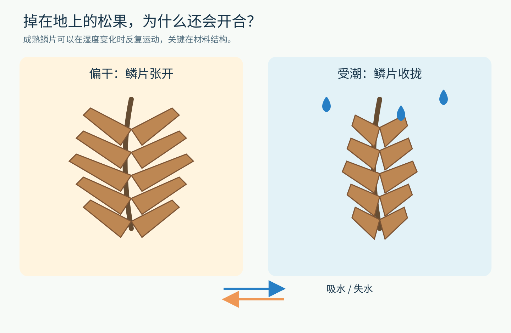
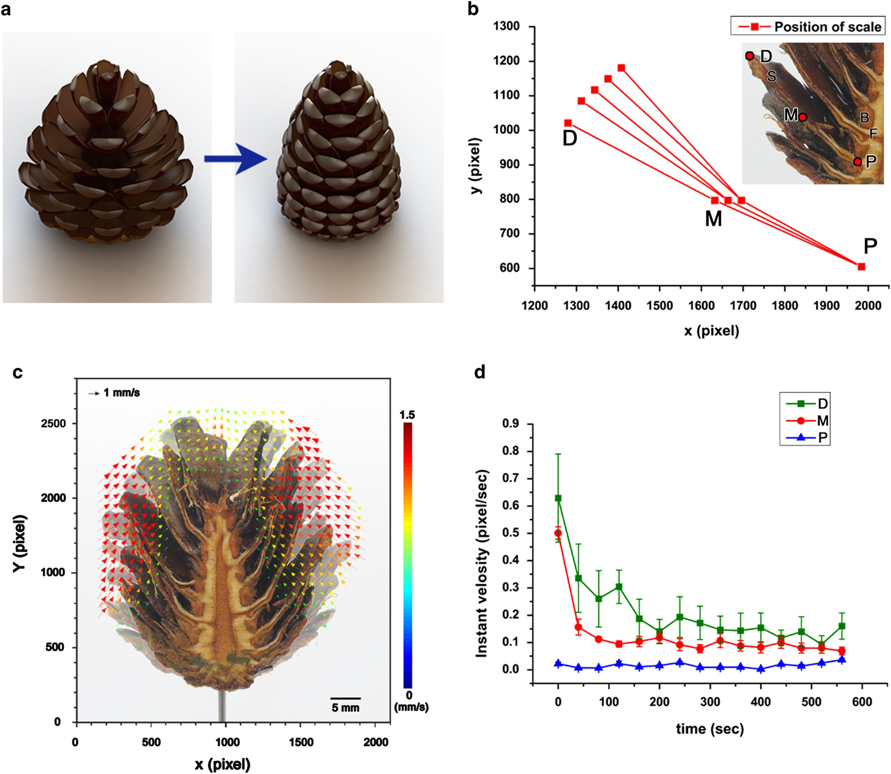
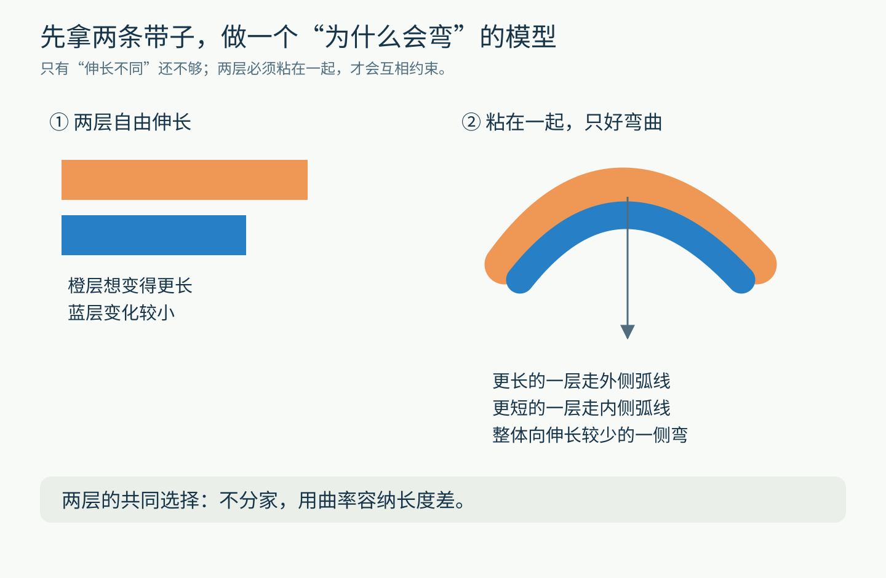
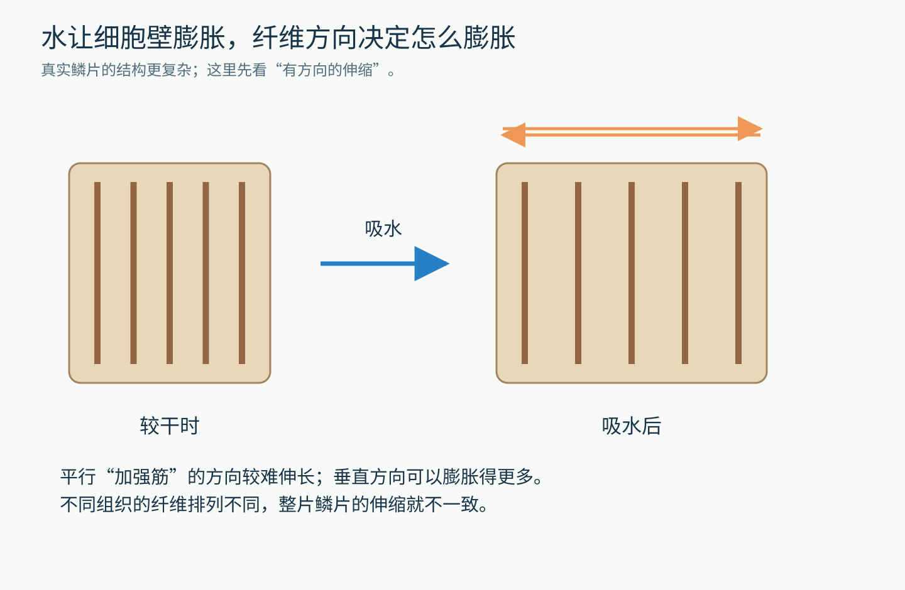
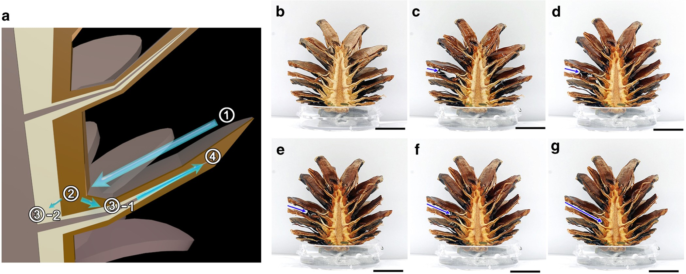
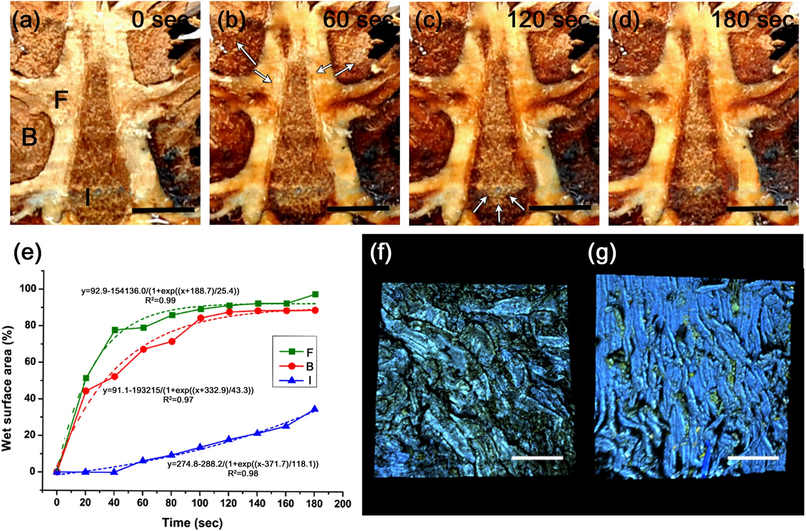
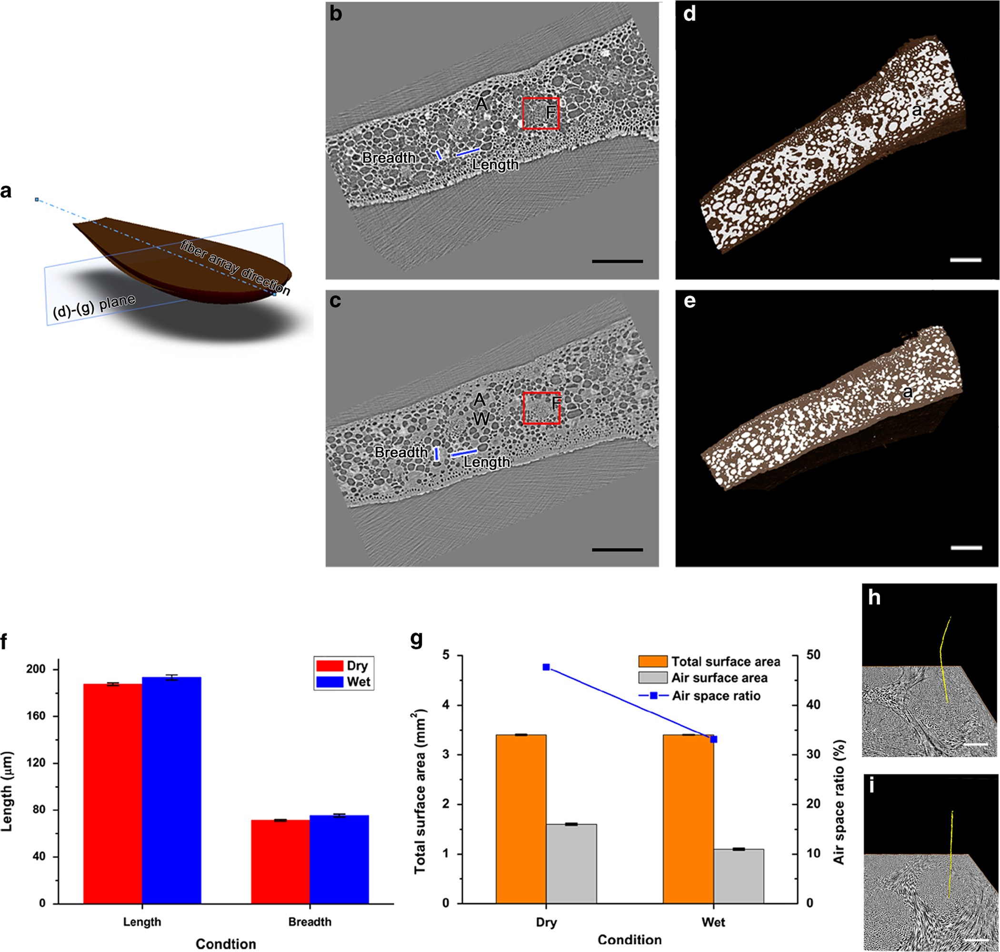
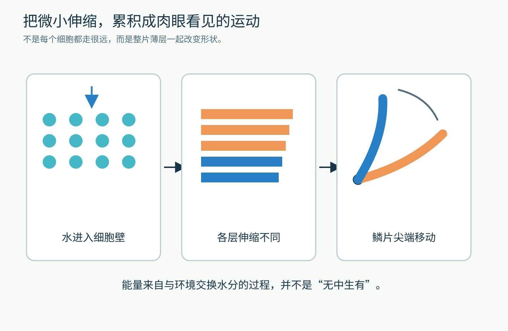
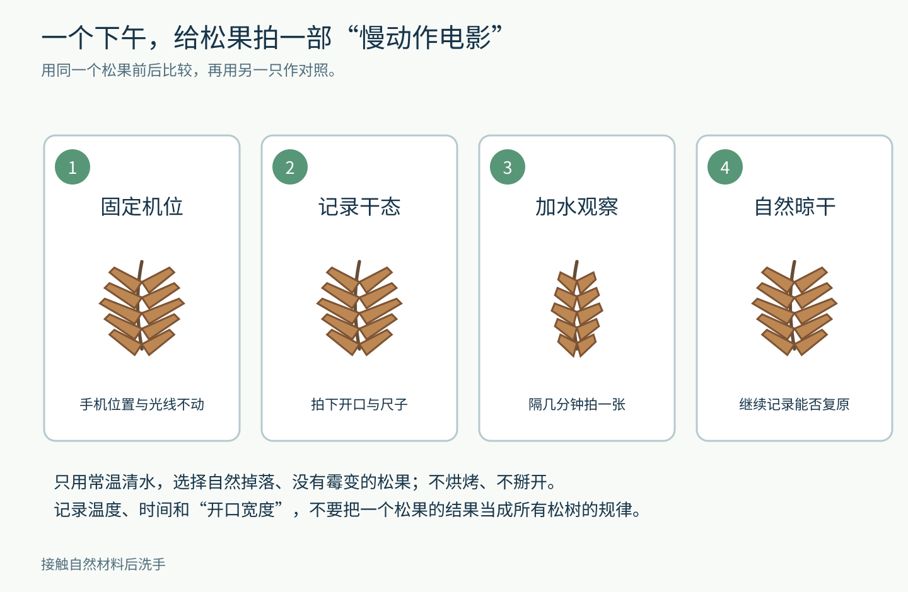

# 掉在地上的松果，为什么还会“看天气”？

捡起一只干燥、张开的松果，把它放进水里，隔一会儿再看：原本翘起来的鳞片，可能正在慢慢合拢。

把它取出，自然晾干，鳞片又能逐渐打开。

这件事最有意思的地方，不是松果会动，而是推动它的鳞片组织在成熟时已经是死细胞。没有肌肉，没有神经，也不需要一块电池。一个离开树枝的结构，仍然能把环境变化转换成动作。

它究竟在“感觉”什么？

图1｜开合与水分有关。这里画的是常见的湿度响应行为；不同松树的球果并不都按同一种方式释放种子。原创教学示意。

先给出一条可以沿着走的线索：**水进入材料，材料沿不同方向伸缩；几种伸缩不同的材料长在一起，就会弯。**

这篇文章要拆开的，就是这条短短的因果链。

## “会动”一定意味着“还活着”吗？

风能吹动落叶，但这里有一个区别：松果不是被一股水流推着关起来。把成熟鳞片从球果上分离出来，它仍然可以随着环境湿度变化而弯曲。

1997年，研究者在《Nature》发表的[“How pine cones open”](https://www.nature.com/articles/37745)描述了辐射松球果的这种被动运动：干燥时鳞片张开，潮湿时闭合，关键在鳞片和细胞壁的结构。

“被动”并不等于毫无变化，而是说，这种动作不依赖活细胞持续执行一连串代谢指令。它更接近木门受潮后变紧、纸张遇水后变形。材料本身的性质，已经参与了控制。

当然，松果不是随便一团木头。它的结构让变形大致朝着有用的方向发生。

2015年，Song等人进一步研究水在松果中的行走路线。他们把样品剖开，让摄影机追踪鳞片不同位置的移动。下面这张图中，别急着看曲线，先看左侧标出的鳞片，再比较不同时间的位置。

图2｜2015年研究原图。a是作者的结构示意；b、c包含样品影像和运动追踪；d是速度分析。尖端比靠近根部的部位移动得明显。它们记录的是特定样品和实验条件，并非所有松果的统一时间表。

你可以用一本书来体会这一点：把书页的一端固定住，轻轻弯曲整张纸，固定端几乎不动，远端却能移开很大一段距离。**看起来很大的尖端动作，不要求每一小块材料都平移很远。**

## 先做一个思想实验：两条带子意见不一致，会怎样？

拿两条一样长的带子，把它们叠在一起。

现在假设：遇水后，橙色带子想长到12厘米，蓝色带子只想长到10厘米。这是为了理解而设定的数字，不是松果的实测值。

如果它们互不相干，事情很容易：各长各的。

可是，假如两条带子牢牢粘在一起，从头到尾都不能分开呢？橙色带子没法直直地多伸出两厘米；蓝色带子也不愿被强行拉长那么多。结果之一，就是它们共同弯曲。

弯起来以后，外侧的路较长，内侧的路较短。橙色带子走外侧，蓝色带子走内侧，长度上的矛盾就有了缓解办法。

图3｜双层材料为什么会弯：两层的伸缩差异，加上彼此粘连的约束，一起产生曲率。原创模型，不是鳞片的解剖图。

这个模型已经给了我们三个可以检验的判断。

第一，如果两层遇水后伸长得完全一样，它们更可能一起变长，而不会因为这项差异产生同样的弯曲。

第二，如果两层没有连接，它们可以各自伸长，也不必带着对方弯。

第三，如果把哪一层放在外侧、哪一层放在内侧调换，弯曲方向也可能反过来。

于是，一个看似“谁来发出关门命令”的问题，变成了三个材料问题：谁更容易吸水？谁更容易伸长？它们怎样连在一起？

## 水进去了，为什么不是四面八方一样地涨大？

想象一张有许多平行加强筋的薄片。沿着加强筋拉，可能很难拉长；朝垂直方向拉，则可能容易一些。

植物细胞壁也不是均匀的胶团。细胞壁中的纤维有方向，水分变化造成的尺寸变化，因此可以具有明显的方向性。

研究中常用“各向异性”描述这件事。把术语拆开，就是：**从不同方向看，它的性质不一样。**

这和一张纸很好撕，却不容易从所有方向都同样整齐地撕开，有相通的材料直觉。不过，纸张的具体纤维排列和松果鳞片不同，不能把两个系统直接当成一个。

图4｜平行纤维相当于有方向的约束。图中只抽取“方向影响变形”这一层意思，没有按比例画真实细胞。

松果鳞片内的不同组织，细胞壁结构和纤维方向不一样，对水分的响应也不一样。它们又共同组成一片鳞片，不能完全各自行动，局部的膨胀与收缩就能转化成整片弯曲。

到这里，可以把“松果认识天气”换成更准确的一句话：**环境中的水分变化，直接改变了鳞片材料的尺寸和形状。**

它没有先把湿度变成一个数字，再命令电动机转动。传感、响应和运动，在很大程度上合在同一个结构里。

## 还有一关：雨水怎样找到会动的地方？

如果只说“遇水会膨胀”，还漏掉一个很实际的问题。

一滴水落到松果上，不会瞬间、均匀地出现在每个细胞壁里。它要沿着表面流动，接触到某些组织，再继续向内部传播。

2015年的研究，特意盯住了这段旅程。研究者观察到，在他们的样品中，鳞片表面的倾斜形状可以把水滴引向更靠近中央的区域；水随后进入不同组织，传播速度也不完全一样。

图5｜先看b到g中的水滴位置，再看蓝色箭头，就能跟着水走一遍。a是作者对水分路径的概括示意；下面的照片提供具体观察。

这时可以把松果想成一个同时具有“导水路线”和“变形部件”的结构。

假如外表能够吸水，但水很难到达关键组织，动作可能很慢。假如会膨胀的组织存在，却被一个太刚硬的外壳限制住，也未必能产生明显开合。一个功能，往往是几层结构协作的结果。

研究者还把内侧结构放到浅水中，观察水分别沿哪些部位向上传播。论文图中B、F、I指向不同组织区域：可以先把它们当作三条相邻的“路”，不必一开始就背住名称。

图6｜同样接触水，不同区域变湿的过程仍然不同。a到d是连续观察，e是对湿润面积变化的整理，f、g是微观结构影像。观察“路长什么样”和“水走得怎样”，比只看一张前后对比更能解释机制。

这里也有一个重要边界：剖开样品、让底部接触水，是研究者为了看清过程设置的实验。它揭示了材料和水分路径的关系，不能直接当作野外每场雨中每只完整松果的实时录像。

## 看不见的内部变化，怎样变成证据？

外面能看到鳞片合拢，里面发生了什么？

研究者用X射线断层成像，比较较干和较湿状态下的内部结构。你可以把它理解成：在不把每一层都实体切开的情况下，查看材料内部的切面，再重建空间结构。

这次最值得看的不是“仪器有多高级”，而是实验问题变得更明确了：水进入后，哪些区域发生变化？空隙和组织的形态有什么不同？

图7｜a说明观察方向；b、c比较干湿切面；d、e以及h、i展示三维结构变化。颜色和灰度来自作者的成像与标记处理，不能把白色、黄色直接理解为肉眼下的真实颜色。

这几张研究图连起来，形成了一条证据链：

能看见的开合 → 水走过的路线 → 不同组织的吸水差异 → 内部结构变化。

它不要求我们把每根曲线都算一遍，却提醒我们：一个解释要站得住，最好不只拍到“开始”和“结束”，还要找到中间的环节。

图8｜把前面的发现重新连起来。这是教学整理图，箭头代表机制关系，不代表本次另做了一套测量。

## 为什么干时开、湿时关，对种子可能有用？

对于这里讨论的这类球果，干燥时打开，可以让种子有机会离开鳞片之间的空间；潮湿时合拢，则减少在不利条件下释放。

但不要把这句话读成“松果知道未来天气”，也不要把它扩大成所有针叶树的唯一策略。[有些松树会长时间保存闭合球果](https://research.fs.usda.gov/feis/species-reviews/pinconl)，其开启还与树脂、温度甚至火灾条件有关。不同物种有不同的释放方式。

我们这次研究的是一个更小、也更清楚的问题：**一部分成熟球果的开合，怎样由湿度响应材料驱动。**

材料结构与生态作用相互关联，不等于自然界每一个细节都只有一种目的。科学解释越往前走，越需要把适用对象说清楚。

## 可以自己观察，但别把一只松果当成全部答案

选择自然掉落、没有霉变的成熟松果。先拍下它的干燥状态，旁边放一把尺子，并固定手机的位置。

用常温清水使它湿润，隔几分钟拍一次。随后取出自然晾干，继续观察。不要用烤箱、明火或高温加速；不要采集受保护区域里的植物，也不必拆坏松果。

图9｜这是可执行的观察方案，尚未在这里替你完成实验。松果种类、初始含水量、室内温湿度都会影响结果，接触自然材料后洗手。

比“它真的合上了”更进一步，你可以记录三个量：经过多久、同一处开口多宽、环境是否发生了明显变化。

如果有两只外形接近的松果，让其中一只保持原状作对照，但也要记住：两只天然样品并不完全相同。最有说服力的一项观察，往往仍然是同一只松果在湿润与干燥过程中的连续记录。

假如它没有明显变化，不必立刻判定理论错了。先列出可能原因：物种不同、球果状态不同、表面有覆盖物、时间不够，或者原本就已经很湿。下一次只改变一个条件，才更容易知道影响来自哪里。

最后，试着问一个工程问题：如果要做一扇遇潮自动收拢的小窗，我们到底需要复制松果的什么？

未必需要把整只松果复制出来。也许只需要两种吸湿伸缩不同、能够牢固连接的材料，再加上合适的厚度和方向。

一只松果最精彩的地方，可能正在这里：它让“控制动作”不再只是芯片和电动机的问题，也可以成为一个**把物理规律安排进材料**的问题。

图片来源：[Song等，Journey of water in pine cones（2015），图1—4](https://www.nature.com/articles/srep09963)，[CC BY 4.0](https://creativecommons.org/licenses/by/4.0/)，原图未改；其余为原创教学示意。
