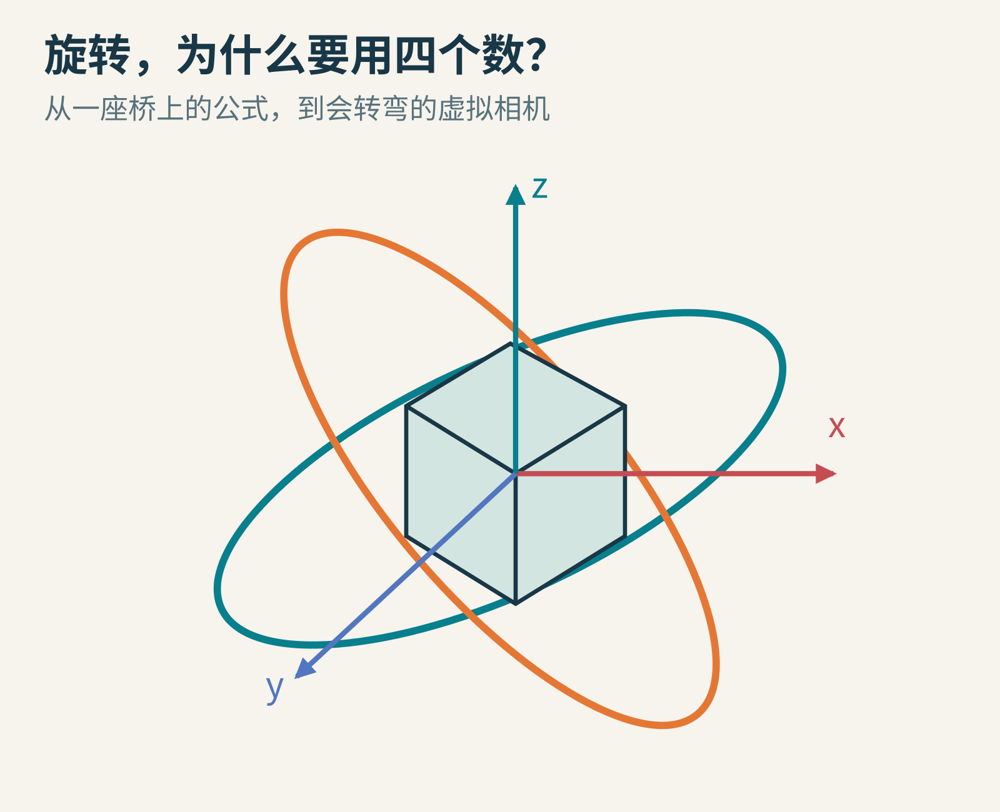
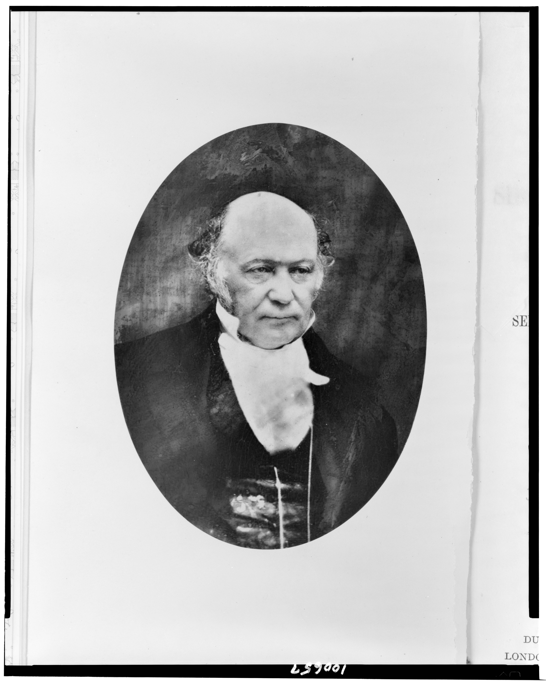
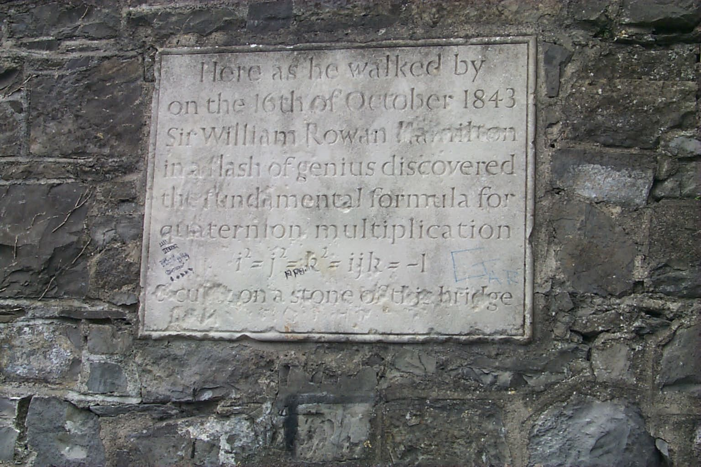
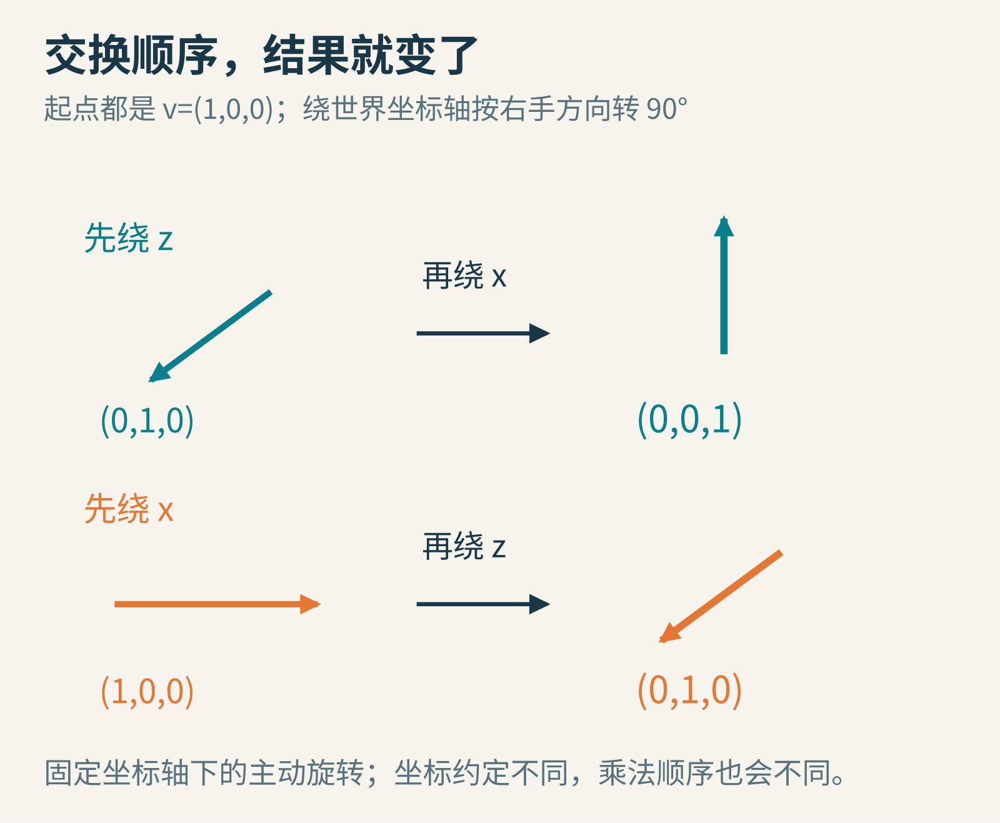
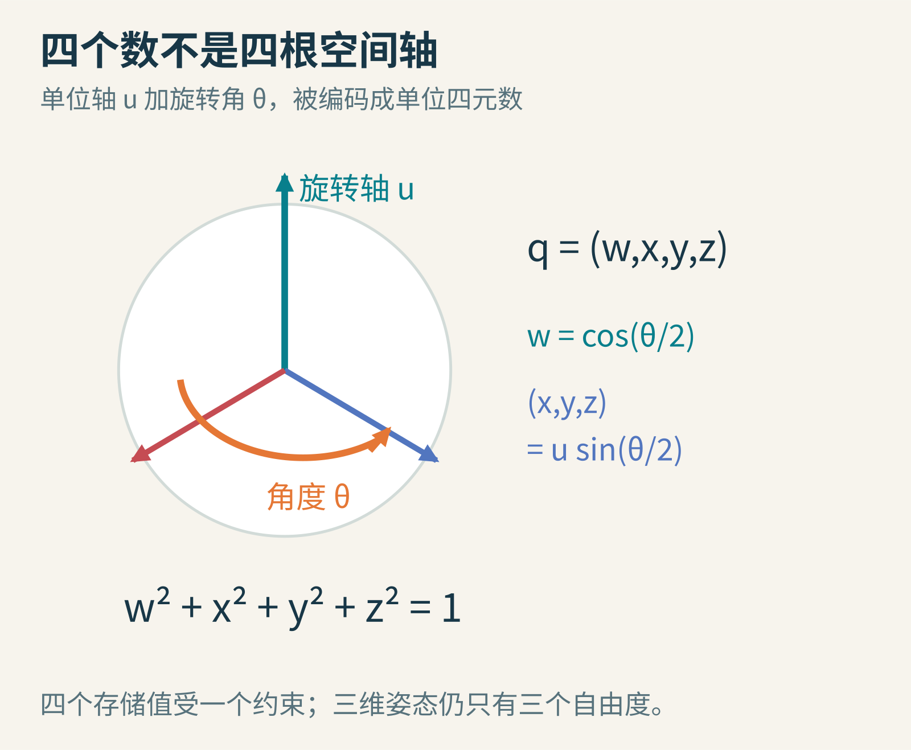
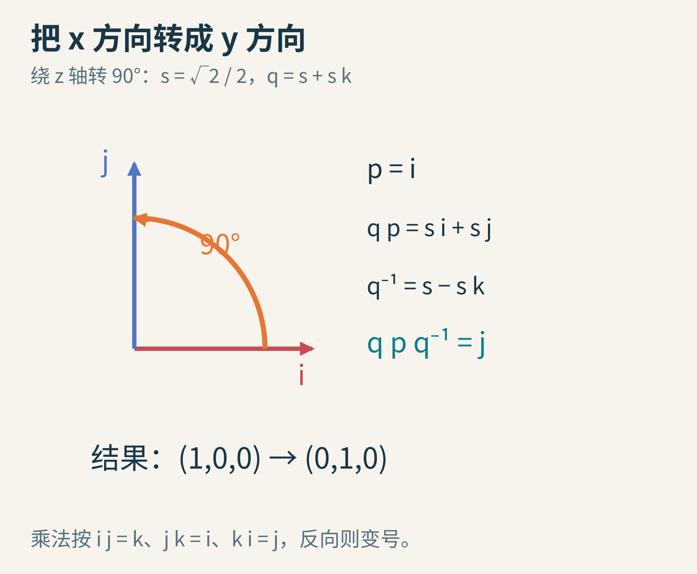
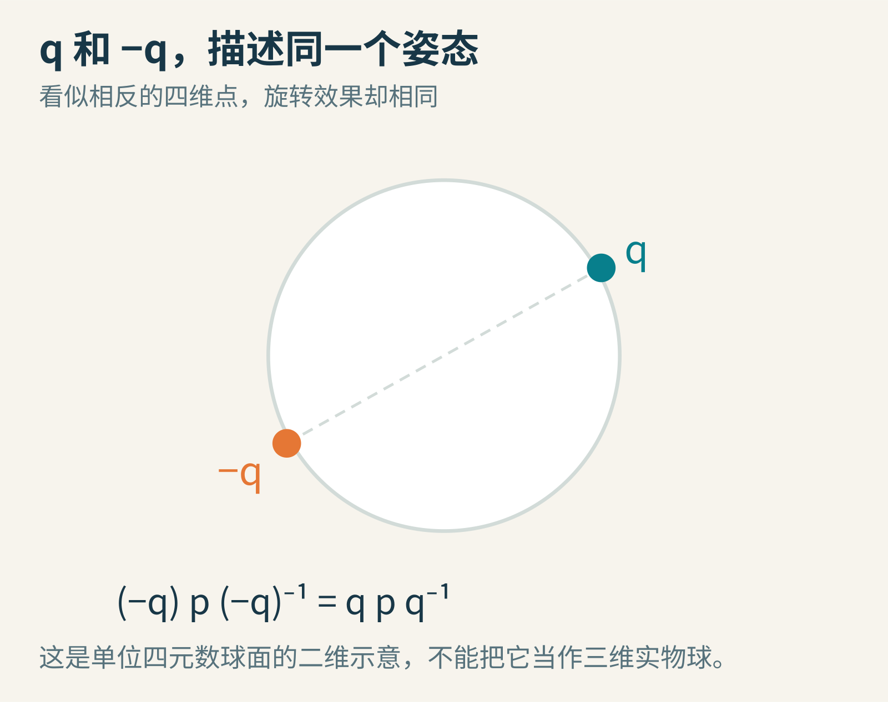
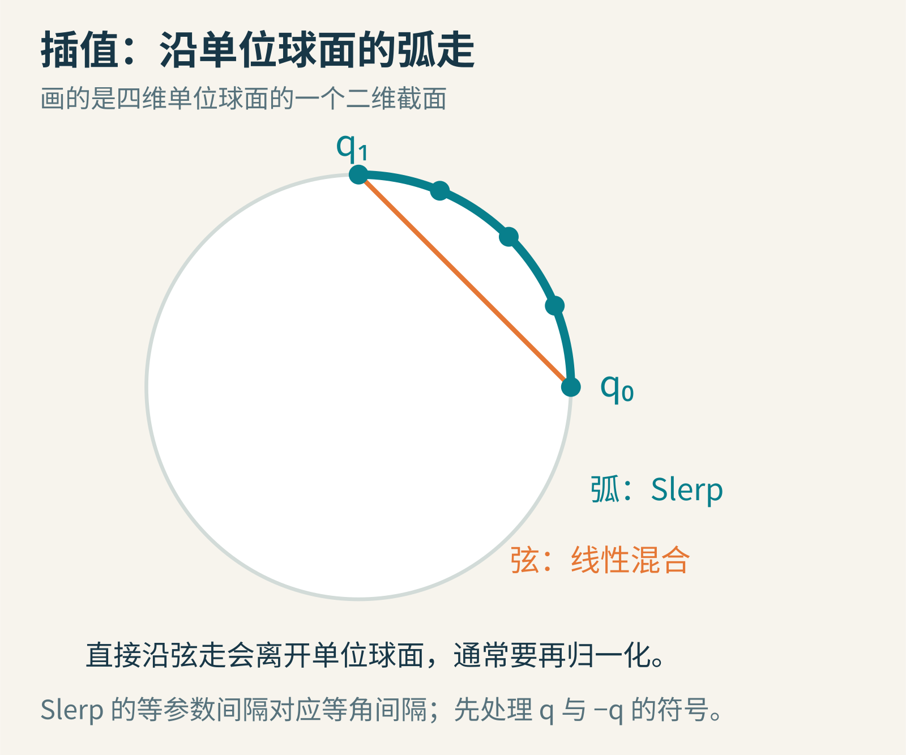

# 旋转为什么要用四个数：从一座桥到虚拟相机

拿起一本书，让封面朝上。先把书向前翻，再在桌面方向转动。恢复原状，把两步交换，你会得到一样的姿态吗？

三维旋转有一点脾气：顺序会改变结果。程序里让飞船掉头、让相机绕着物体走、让机器人转动手腕，都绕不开它。你也许见过一个叫 Quaternion 的东西，里面放着四个数。奇怪，世界明明是三维的，为什么多出来一个？

别急着背公式。我们从“旋转到底是什么”开始，一步步走到一个可以亲手算完的例子。

原创空间概念图。环表示旋转主题，不是四元数四维空间的精确投影。

## 一　1843 年的桥，不是游戏数学的开机画面

威廉·罗文·哈密顿长期思考，能否把平面复数的运算扩展到空间。1843 年 10 月 17 日，他写信给 John T. Graves，说明自己前一天想到的一套四元数规则。[这封信](https://www.maths.tcd.ie/pub/HistMath/People/Hamilton/QLetter/QLetter.html)不仅记下答案，也保留了尝试三项表达式、发现困难、引入第四个分量的思路。

哈密顿历史肖像：美国国会图书馆藏，1885 年书籍卷首印图，据 1857 年照片制作；公有领域。[原件记录](https://www.loc.gov/pictures/item/90713420/)。不是 1843 年发现当日的照片。

后来他回忆，在都柏林皇家运河旁的桥上，把关键关系刻在石头上：i²=j²=k²=ijk=−1。今天桥边有纪念牌，但纪念牌当然不是他当年亲手刻下的那块原始文字。

照片：Wisher，2005 年，作者释入公有领域；[来源与许可声明](https://commons.wikimedia.org/wiki/File:Broom_bridge_plaque.jpg)。牌上的“灵光一现”是一种纪念写法，不能代替长期探索的完整历史。

哈密顿不是为了将来的游戏动画发明四元数。一个多世纪后，已有科学与工程应用；1985 年 Ken Shoemake 的[论文](https://doi.org/10.1145/325165.325242)则系统讨论了如何用四元数曲线产生平滑旋转动画。这是重要推广与方法发展，不等于他首次发现了四元数或首次把它用于所有计算机旋转。

## 二　位置能直接相加，旋转为什么不行

向东走一步，再向北走一步，最终位置与先北后东相同。因为这里的方向固定，我们只是把两个位移向量相加。

旋转却不一样。取一根沿 x 轴的箭头 v=(1,0,0)，使用固定的世界坐标轴，并按右手规则取正方向。

第一种顺序：先绕 z 轴转 90°，箭头变成 (0,1,0)；再绕 x 轴转 90°，变成 (0,0,1)。

第二种顺序：先绕 x 轴转 90°。箭头本来就在这根轴上，所以方向不变；再绕 z 轴转 90°，最终是 (0,1,0)。

原创逐步计算示意。本文统一使用右手坐标系、主动旋转和固定世界轴；图中箭头为方向提示，不是透视测量图。

两个答案不同。这叫“不交换”：做 A 再做 B，不等于做 B 再做 A。它不是程序的坏脾气，而是三维几何本来的性质。任何旋转表示法，都必须尊重这一点。

## 三　三个角很好懂，但不是一张无缝的地图

一个自然办法是用三个角描述朝向，例如偏航、俯仰、滚转。它们通常叫欧拉角，不过轴的选择、先后顺序，以及绕世界轴还是物体当前轴，都必须说明。不同软件里同名的三个角，未必表示相同的操作。

这种方法很适合人调界面：向左多少度，抬头多少度，一目了然。但在某些姿态，两个用于描述旋转的轴会重合，两个参数的局部作用变得无法独立区分，这就是常说的万向节锁。

它不意味着一架真实飞船忽然失去了物理旋转能力，而是这套坐标描述在某处出现退化。就像地球北极点附近，经度不再像赤道上那么好用。球面没有坏，描述方法遇到了特殊位置。

另一个难题是插值。假设物体从 350° 转到 10°，直接把数字取平均得到 180°，往往不是你希望的短路程。更复杂的三轴组合，问题还不止跨过零点。我们需要适合姿态之间连续移动的表示方式。

## 四　先找一根轴，再说明转多少

对围绕原点的三维刚体旋转，可以用“一根轴加一个角度”描述：轴上的点不动，其余点绕轴转动。这里讨论的是不含平移、不含镜像的旋转；如果物体要绕别处的支点转，还需要配合平移。

把轴写成长度为 1 的向量 u=(ux,uy,uz)，把转角叫 θ。我们用四个数打包它：

**q = (w,x,y,z) = (cos(θ/2), ux sin(θ/2), uy sin(θ/2), uz sin(θ/2))。**

原创示意。轴方向占三个坐标，但它的长度已经限定为 1，不是三个独立自由度。

四个数并不是四根空间轴。w 是一个标量，后面三个数合起来是向量部分。由于轴的长度为 1，并且 sin²+cos²=1，四个分量满足：

**w²+x²+y²+z²=1。**

这叫单位四元数。“单位”说的是它在四维表示空间中的长度为 1，不是把物体缩放到某个单位。

现在回答开头的问题：四个存储值受一个约束，仍然只承载三个连续自由度。多存一个数，让我们避开欧拉角那种局部坐标退化，并方便地组合与插值。它是表示上的选择，不是三维旋转突然多了一个自由度。

## 五　i、j、k 到底该怎样乘

把 q=(w,x,y,z) 也写成 w+xi+yj+zk。i、j、k 是三个代数基符号；它们的平方都是 −1。不同基之间有：

- ij=k，jk=i，ki=j。
- 把顺序反过来，符号变负：ji=−k，kj=−i，ik=−j。

普通数与它们的乘法照常进行，展开括号也照常进行。唯一需要特别警惕的是，不能为了方便随意交换两个因子的位置。

比如 (1+i)(1+j)=1+i+j+k，而 (1+j)(1+i)=1+i+j−k。那一个不同的符号，就是这种代数能够记住旋转顺序的重要原因。

若习惯向量运算，也可以把四元数写成 (w,a)。两个四元数相乘为 (wv−a·b，wb+va+a×b)，其中另一个是 (v,b)。这里的点积产生标量，叉积让顺序的信息留在向量部分。初学者完全可以先用上面的乘法表，不必同时掌握两种记法。

## 六　亲手完成一次 90° 旋转

我们要把 x 方向的单位箭头转到 y 方向，也就是绕 z 轴正转 90°。轴 u=(0,0,1)，半角是 45°。设 s=√2/2，那么：

**q=(s,0,0,s)=s+sk。**

把待旋转向量 (1,0,0) 放进一个“实部为零”的四元数 p=i。本文约定旋转公式为：

**p′=q p q⁻¹。**

对单位四元数，逆 q⁻¹ 很好求：标量部分不变，向量部分全部变号。这里就是 s−sk。有些资料采用反向的夹乘或不同坐标约定，不能把两套公式的部件混着用。

原创手算图。图上的 q⁻¹ 是单位四元数的逆；一般非零四元数还需除以模长平方。

开始算第一步：(s+sk)i=si+s(ki)=si+sj。

再乘右边：(si+sj)(s−sk)=s²i−s²ik+s²j−s²jk。根据 ik=−j、jk=i，得到 s²i+s²j+s²j−s²i=2s²j=j。

实部仍然是零，向量部分就是 (0,1,0)。这次旋转算完了。

半角为什么出现？从这个夹乘例子可以看到，旋转效果来自左右两次乘法的共同作用。更一般地，把 cos(θ/2) 与 sin(θ/2) 代进去展开，会出现 cos²−sin²=cosθ 和 2sin cos=sinθ。半角不是记忆口诀，而是这套代数产生正确全角旋转的方式。

## 七　两张不同的号码牌，可以指向同一个姿态

把 q 的四个数全部变号，会发生什么？代入旋转公式：

**(−q)p(−q)⁻¹=q p q⁻¹。**

两处负号抵消，旋转效果完全相同。因此 q 和 −q 表示同一个三维姿态。这常被称为单位四元数对旋转的“双覆盖”。

原创二维示意。真实单位四元数位于四维空间的三维球面 S³ 上；本图只帮助理解相反点对应的关系。

这件事很实用。假如一段动画的连续两个姿态，导出时恰好选成相反号的表示，简单按数字插值可能绕远路，甚至在相反端点的中间得到全零。全零无法归一化，也不能表示单位旋转。

通常做最短路径姿态插值时，会先检查两个单位四元数的点积。如果小于零，就把其中一个整体变号，再插值。请留意“通常”和“最短路径”：如果动画明确要求飞船转两圈，单靠两个端点姿态，本来就记不住中间应转几圈。那些圈数必须通过额外的动画路径或中间关键帧表达。

## 八　Slerp：沿着弧走，而不是穿过球内部

两个单位四元数可以看成单位球面上的两点。直接对四个分量做线性混合，路线是一条弦，途中一般离开单位球面。把结果再归一化，能够得到有效姿态，但匀速改变混合参数时，转动速度通常不是恒定的。

Slerp 是球面线性插值。它沿合适的大圆弧移动，让参数均匀变化时，两个端点间的角度也均匀变化。

原创示意。这里画的是球面大圆所在平面的截面；弧上圆点代表等参数间隔。

设两单位四元数点积为 cosΩ，选好符号后，一种常见公式是：

**Slerp(q₀,q₁,t) = sin((1−t)Ω)/sinΩ · q₀ + sin(tΩ)/sinΩ · q₁。**

Ω 是四元数球面上的夹角，对相应最短相对旋转，它是三维转角的一半。当两点非常接近，sinΩ 也很小，程序通常改用归一化线性插值等稳定分支；点积还要防范浮点误差超出反余弦定义域。

Slerp 也不是万能的“动画自然化按钮”。把许多段 Slerp 首尾相接，姿态可以连续，但角速度方向未必在接点平滑。Shoemake 的论文不止给出两点间插值，还进一步讨论球面样条，正是为了更丰富的连续运动。

## 九　一个不必画四维空间的插值检查

四维球面难以想象，但可以挑一个简单情况验证。起始姿态不旋转，四元数是 q₀=(1,0,0,0)；终点绕 z 轴转九十度，是 q₁=(√2/2,0,0,√2/2)。两者的点积为 √2/2，所以球面夹角为四十五度。

取路径中点，Slerp 得到 q=(cos22.5°，0，0，sin22.5°)。注意表示里的半角是二十二点五度，对应物体实际转了四十五度，正好走了一半。这说明“球面上的角”和“物体转动的角”不可混用。

如果对同一对端点做线性混合，再归一化，中点也会碰巧得到同样的方向。这并不证明两种方法完全相同。试取四分之一处，归一化线性混合约对应二十一点六度，而匀速 Slerp 应对应二十二点五度。路线可以相同，走过路线的速度仍然不同。理解这个细节，有助于在速度要求、计算开销和可接受误差之间做真正的工程选择。

## 十　把公式带回程序之前，先做三个小实验

第一，把刚才的 90° 改成 180°。此时 q=(0,0,0,1)=k，试算 k i (−k)，应得到 −i。再改成 360°，q=(−1,0,0,0)，姿态应回到原样。

第二，自己分别计算“先绕 x 再绕 z”和“先绕 z 再绕 x”。在本文的主动旋转约定下，若先用 q₁，再用 q₂，合成写为 q₂q₁，右边的先作用。将它与第二节的箭头实验核对。

第三，用附带的 exercise.py，累积一千次小角度旋转，检查所存四元数的模长误差。再看每步归一化后有什么变化。脚本旋转向量时使用完整的逆，因此不要预设向量长度一定会明显漂移。浮点计算仍有舍入误差，四元数不会自动消灭所有数值问题。

工程里还要检查库的分量排列：有的用 (w,x,y,z)，有的用 (x,y,z,w)；矩阵行列习惯、左右手系、局部轴与世界轴也必须一致。最可靠的起点，不是复制一大段代码，而是让“绕 z 轴 90°把 x 转成 y”这个最小测试先通过。

四元数并没有让旋转变成普通加法。它做的是更聪明的事：**把旋转本来的顺序关系与几何结构，装进一套可以组合、计算和插值的语言里。**

## 继续追根究底

- 哈密顿致 Graves 的信，写于 1843 年 10 月 17 日，后来发表于 1844 年。[原文转录](https://www.maths.tcd.ie/pub/HistMath/People/Hamilton/QLetter/QLetter.html)
- 都柏林圣三一学院整理的[四元数史料入口](https://www.maths.tcd.ie/pub/HistMath/People/Hamilton/Quaternions.html)，含桥上经历的后期书信出处。
- Ken Shoemake，1985，Animating Rotation with Quaternion Curves，pp.245–254。[论文记录](https://doi.org/10.1145/325165.325242)。原文的旋转作用约定须与本文分开辨认。

本文由 AI 辅助研究与撰写；演算、实验脚本与机制图为本次原创，已用公开原始书信和论文核对。未用 AI 生成人物或历史现场照片。

图片来源：[哈密顿肖像](https://commons.wikimedia.org/wiki/File:Sir_William_Rowan_Hamilton,_head-and-shoulders_portrait,_facing_slightly_right_LCCN90713420.jpg)、[桥边纪念牌](https://commons.wikimedia.org/wiki/File:Broom_bridge_plaque.jpg)。其余配图为本次原创教学图。
