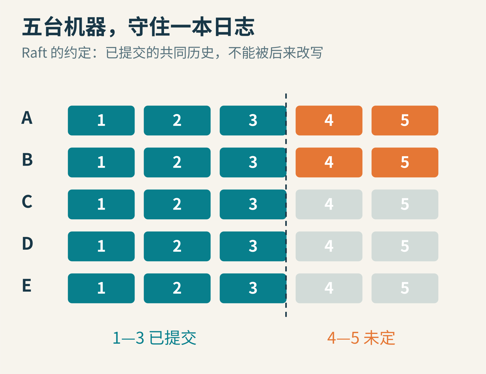
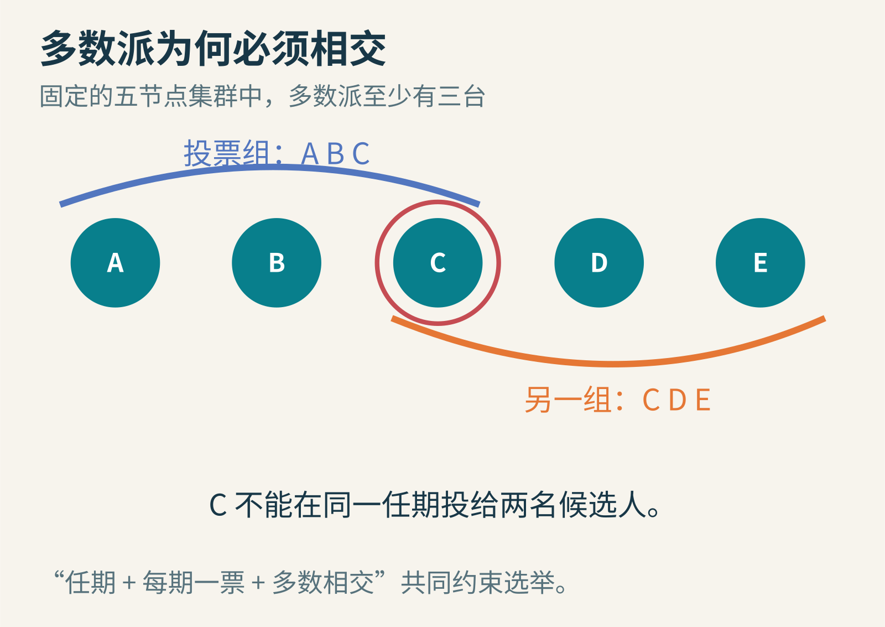
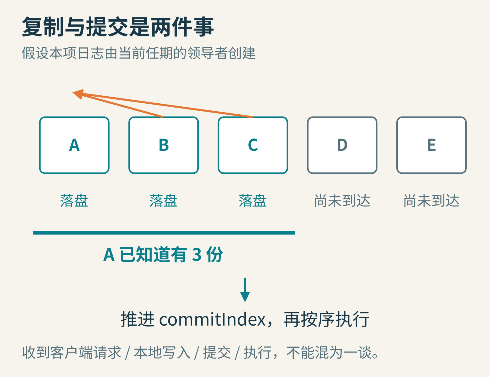
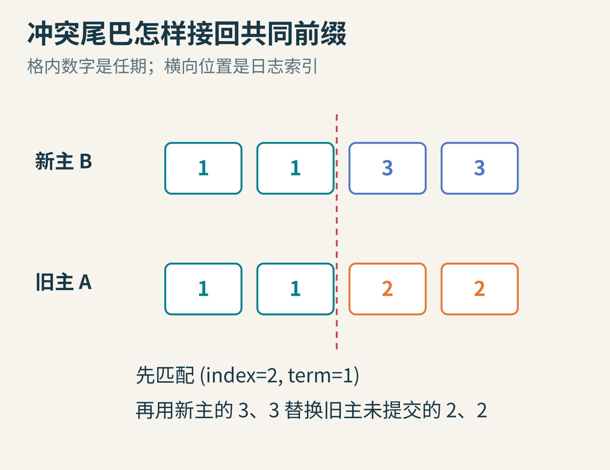
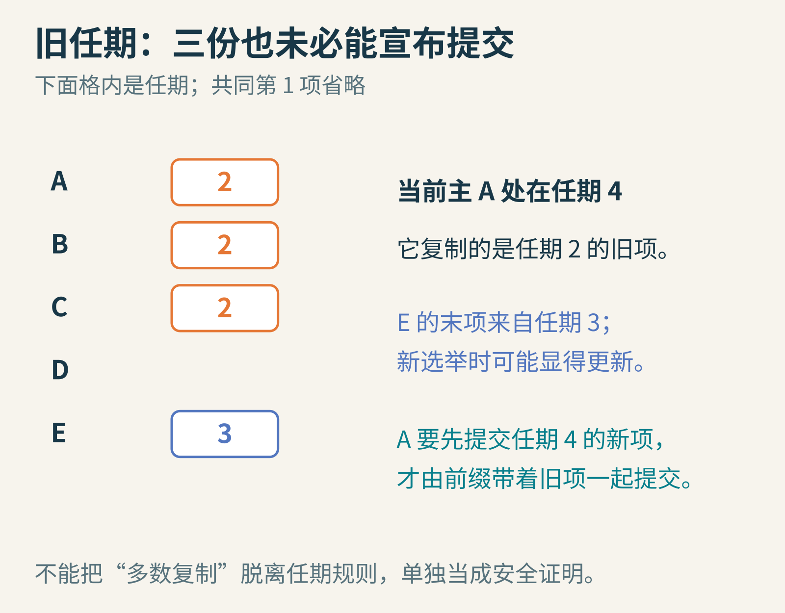
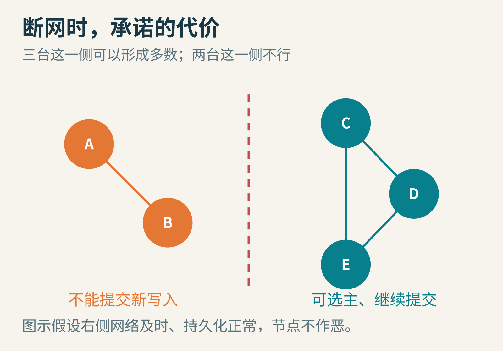

# 五台机器怎样守住同一本账？Raft 的难题藏在“多数同意”之后

学校社团做了一个器材借用系统。为了避免一台电脑坏掉就丢失借用记录，你把记录复制到五台服务器 A、B、C、D、E。乍看问题已经解决：五份备份，总该很安全。

麻烦马上出现。有人同时从两个入口借走最后一台相机；一条“归还相机”的消息先到了 C，却还没到 A；A 断网后，B 接管服务，过一会儿 A 又回来了，手里还拿着自己写过、别人没见过的记录。

五份文件不是一本共同的账。真正要建立的是：即使机器停机、重启、消息晚到，大家也不会把同一个位置当作两条不同的、已经确认的历史。Raft 就是为管理这种复制日志设计的共识算法。

封面示意：绿色是共同的已提交前缀，橙色是还没有定下来的尾部。Raft 允许暂时不同，但不能让不同命令都成为同一位置的已执行事实。

## 一、“容易理解”为什么成了研究目标？

Diego Ongaro 与 John Ousterhout 在斯坦福大学研究 Raft 时，并非第一次遇见共识。Paxos 等工作已经建立了重要基础。两位作者想探索的是：能否把协议的结构安排得更容易理解，便于人们正确实现和扩展？

他们把问题拆成选领导者、复制日志、保证安全性等部分，尽量缩小会出现的状态组合。论文《In Search of an Understandable Consensus Algorithm》发表于 2014 年 USENIX ATC；[扩展版](https://raft.github.io/raft.pdf)标注 2014 年 5 月 20 日。作者还做了教学实验，但“更容易理解”不等于读过一幅投票动画就能写出正确数据库。

John Ousterhout 随 Tcl/Tk 分发的早期位图肖像，作者标为 John Ousterhout；[原图与许可](https://commons.wikimedia.org/wiki/File:Ouster_face.png)。保留原始 108×144 像素，不将它放大假装高清；[许可全文随包保留](ousterhout-image-license.txt)。Ongaro 可见于[本人页面](https://ongardie.net/)和[2016 年斯坦福讲座介绍](https://web.stanford.edu/class/ee380/Abstracts/161102.html)，其讲座头像受站点转载限制，本篇仅提供链接。

真实服务器并不是抽象圆点：它们有独立的存储、线路与故障。图为 2015 年维基媒体基金会位于美国得克萨斯州 Carrollton 的服务器画面，作者 Wikimedia Foundation，[原图](https://commons.wikimedia.org/wiki/File:Wikimedia_Foundation_servers_-_CyrusOne_(Carrollton,_Texas)_(43).jpg)，[CC BY-SA 3.0](https://creativecommons.org/licenses/by-sa/3.0/)，未改动。此图只展示硬件环境，不表示画面中的系统运行 Raft。

## 二、先让每台机器按同一份菜谱做事

社团系统可以看作一个确定性状态机。起始状态是“相机可借”。输入“借给小林”，状态变为“小林持有”；再输入“归还”，又变为“可借”。只要起点相同、输入命令相同且次序相同，各副本就会得到相同结果。

“确定性”很重要。如果命令执行到一半，某台服务器自己掷骰子、读取未记录的当地时间，其他副本可能得到不同结果。共识能协调输入历史，不能替你消除应用里没有被约束的随机行为。

日志给每条命令一个从 1 开始递增的索引。例如第 1 项是“登记相机”，第 2 项是“借给小林”，第 3 项是“归还”。每项还记录它由哪个任期的领导者创建。索引回答“排在哪里”，任期回答“来自哪一届领导者”，两者不能混用。

暂时写在日志里还不够。只有确认安全的条目才叫已提交，状态机按索引依次执行已提交条目。未提交尾部可能被替换，已经提交的历史必须保住。

## 三、投票的核心不是热闹，而是交集

先假定五台服务器的成员名单固定。它们只会停机、恢复或遇到网络问题，不会伪造日志、撒谎投票；磁盘上应持久化的数据确实能够保存。Raft 不以抵抗拜占庭恶意节点为目标。

一台服务器平时是跟随者，收到领导者的周期性心跳就继续跟随。等了足够久仍没等到合格通信，它会增加自己的任期号，变成候选者，投自己一票，再向其他节点请求投票。任期是逻辑编号，不是固定长度的几分钟。

在同一任期，每台服务器最多投给一个候选者。五台中的多数是三台。任何两组三台必然相交：假如 A、B、C 已选出一个领导者，另一个候选者想靠 C、D、E 获胜，就必须让 C 在同一任期改投第二个人，而规则禁止这样做。

多数相交提供了传递约束的接点。但它不是完整安全证明；后面还必须保证这个接点记得日志，并且认真检查候选人的历史。

投票和任期信息必须在回复前持久化。否则 C 投给甲之后断电，重启忘记自己投过，又投给乙，纸面上的“每期一票”就落空了。

如果两个候选者同时发起选举，选票可能分散，谁也达不到三票。Raft 采用随机化选举超时，降低下一轮再次撞车的概率。它不保证每次都一轮成功，也不把“超时”当作旧领导者已经死亡的证明。旧领导者可能只是被网络隔开；新任期消息传来时，它才发现自己应当退位。

## 四、一条借用命令怎样变成共同历史？

假设 A 是第 4 任期领导者。客户端提出“借给小林”，A 把它作为第 8 项写入本地日志，条目的任期也是 4，然后并行发给 B、C、D、E。

B、C 存好并回复成功；D 很慢，E 暂时停机。此时 A 知道包括自己在内已有三份。由于第 8 项来自当前任期，满足相关检查后，A 可以把提交位置推进到 8，按顺序执行至第 8 项，再把结果返回客户端。后续复制消息携带提交位置，让跟随者也知道该执行到哪里。

当前任期条目获得多数复制，是这里的提交依据。慢节点不必挡住全部进度，但领导者仍会继续重试，把落后的日志补齐。

留意四个动作：收到请求、写入日志、确定提交、状态机执行。它们不是同一个瞬间。B 已经存好第 8 项，可能暂时还不知道它提交了；A 已经执行成功，客户端却可能因网络中断没收到回复。把这些状态全叫作“写成功”，就会在故障恢复时说不清楚究竟保证了什么。

## 五、旧领导者带着自己的尾巴回来怎么办？

把日志缩短，方便在纸上模拟。大家曾经共同拥有两项，任期都是 1。A 在任期 2 又写了两项，但只在自己和某个少数副本上留下记录，尚未提交。随后 A 断网。

B 在更高任期合法当选，拥有共同的前两项。它新增第三、四项，任期都是 3。A 回来以后，会出现两条尾巴：B 的日志是 1、1、3、3，A 的日志是 1、1、2、2。数字是各项任期，不是命令内容。

复制请求会带上新内容之前一项的索引与任期，检查共同前缀。确认匹配后，跟随者用领导者的条目替换冲突的未提交尾部。

具体说，领导者发送 AppendEntries 时带着 prevLogIndex 和 prevLogTerm。若跟随者在那个位置没有同任期条目，就拒绝；领导者逐步回退查找，直到找到能接上的前缀。遇到同一索引、不同任期的冲突，跟随者删除冲突项及其之后的条目，再追加领导者提供的内容。

不是“领导者随便删除任何旧数据”。当选规则必须保证，新领导者本来就拥有所有已经提交的条目。否则这套尾巴修复机制会把真历史也抹掉。

这就引出投票的另一道关卡：候选者的日志至少要和投票者一样新。比较方式是先看最后一项的任期，任期相同才比较最后索引。末项来自任期 5 的短日志，可能比末项来自任期 4 的长日志更新。因此“日志最多的人必胜”是错误口诀。

## 六、最危险的误解：三份副本永远等于已提交

现在做一个略绕、却值得耐心走完的实验。这也是[原论文第 5.4 节](https://raft.github.io/raft.pdf)强调的边界。

仍然五台机器，都有共同的第 1 项。任期 2，A 把第 2 项 X 写到自己和 B 上，只有两份，未提交。A 暂时失联。任期 3，E 获得 C、D、E 的票，当选后在自己的第 2 项写入 Y，任期为 3，但同样没有形成多数。

随后 E 失联，A 回来并在任期 4 当选。它能得到 A、B、C 的票：C 当时只有旧的共同前缀。A 把自己的 X 再复制给 C，于是 X 已在 A、B、C 三台上。

能宣布 X 已提交了吗？先别急。如果 A 再次停机，E 回来发起任期 5 选举，它的末项任期是 3，而 B、C 的末项任期还是 2。E 可能从 B、C、D、E 中拿到多数票，再用 Y 覆盖 X。多数交集确实存在，却没有自动阻止这个结果。

关键限制：领导者不能仅靠数副本，直接宣布旧任期条目已提交。图中省略了共同的第一项。

Raft 的解决办法是：只对当前任期的条目使用“多数复制即可推进提交”的判断。A 在任期 4 需要再追加并多数复制一条任期 4 的新项，例如空操作。这样后面的新项被提交，前面的 X 也因共同前缀一并提交。那个带着任期 3 末项的 E，就无法再绕过持有任期 4 新项的多数交集获胜。

这不是额外的仪式，而是在选举比较规则和提交规则之间补上严密连接。理解这一段，你已经比只记住“Raft 就是少数服从多数”更接近真正的协议。

## 七、网断成两半，哪一边可以继续？

五台机器裂成 A、B 与 C、D、E 两组，组间消息过不去。三台一侧，在足够及时的通信和正常持久化条件下，可以选主并继续提交。两台一侧即便还保留一个自认为有效的旧领导者，也无法为新写入凑够多数。

少数侧暂时不能确认新写入，是守住同一本账的代价。恢复连接后，它要接受更高任期，并修复未提交尾部。

有人可能建议把少数侧门槛临时降为两票。这相当于未经协议更改成员名单；两边都能做决定，就可能产生不能兼容的已确认历史。扩容也不能随手把“五台多数三票”换成“七台多数四票”。论文提供联合共识，让过渡期的决定同时满足旧配置与新配置各自的多数；成员变更本身也进入日志。

安全性与可用性要分别讨论。任意长的消息延迟不该让 Raft 执行两种互相矛盾的已提交命令，但它完全可能让系统迟迟选不出稳定领导者。算法无法在网络永远不通时变出响应。

## 八、共识之后，应用还有两道功课

第一是重试。假设“借给小林”已提交并执行，但回复丢失，客户端重发。若系统把它当新请求再做一次，可能重复扣库存。通常要给客户端请求稳定的唯一编号，并把去重信息和执行结果作为状态机状态的一部分。Raft 让副本对日志一致，不自动保证现实世界的付款、发信等副作用只发生一次。

第二是读取。旧领导者被隔离后可能仍愿意回答“相机可借”，而多数侧已经借出。想要线性一致的读取，不能只因为某台机器自称领导者就相信它；新任期的领导者先提交一条本任期条目（常用空操作），以确定提交边界；随后用与多数节点的心跳往返确认自己仍有领导权，并确保本地状态已应用到相应提交位置。使用租约的设计还会引入时钟假设。

日志也不能无限增长。快照可以保存已经执行过的状态以及对应的最后索引、任期等元数据，再丢弃被覆盖的旧日志。快照不是随手压缩文件：若状态、位置和持久化次序对不上，重启仍会出错。

## 九、用五张纸，检验一条承诺

你不必先写 RPC 框架。五张纸分别记 currentTerm、votedFor、日志、commitIndex；用小纸条模拟消息。每次回复投票或复制成功前，先把需要持久保存的内容写牢。暂停某张纸，就是停机；把消息放在桌边不递过去，就是延迟。

试三个问题：

1. 五台改成四台，多数是多少？还是三台。因此四台不能比三台多容忍一台不可用节点，两者都只能在剩余多数可通信时继续。
2. 同时存在两个自认为是领导者的节点，是否立即违反 Raft？不一定，它们可能处在不同任期；重要的是旧节点不能继续单方面制造新的已提交历史。
3. 把上文旧任期实验中的 X 当作提前提交，接着模拟 E 当选，会出现什么？你将亲手构造出同一日志位置的承诺冲突。这正是那条“当前任期”限制不能删的原因。

Raft 的美并不在于多数票听起来民主，而在于一条条小规则如何接力：持久化让承诺不随断电遗忘，多数交集让前后两次决定有见证人，日志新旧检查让见证人拒绝遗失历史的候选者，当前任期提交规则让这些证据真正扣在一起。守住一本共同的账，靠的不是机器数量，而是每一步承诺都有来路。

原论文对照：[16 幅原图与规则框图册](source-figures.md)，保留原图注，便于继续追到作者的完整论证。

图片来源：[Ousterhout 肖像及 Tcl/Tk 许可](https://commons.wikimedia.org/wiki/File:Ouster_face.png)；[Wikimedia Foundation 服务器原图](https://commons.wikimedia.org/wiki/File:Wikimedia_Foundation_servers_-_CyrusOne_(Carrollton,_Texas)_(43).jpg)；其余为原创教学示意。

本文由 AI 辅助资料整理、写作与制图；五节点器材借用场景为教学构造，协议边界依据 Ongaro 与 Ousterhout 的论文。
