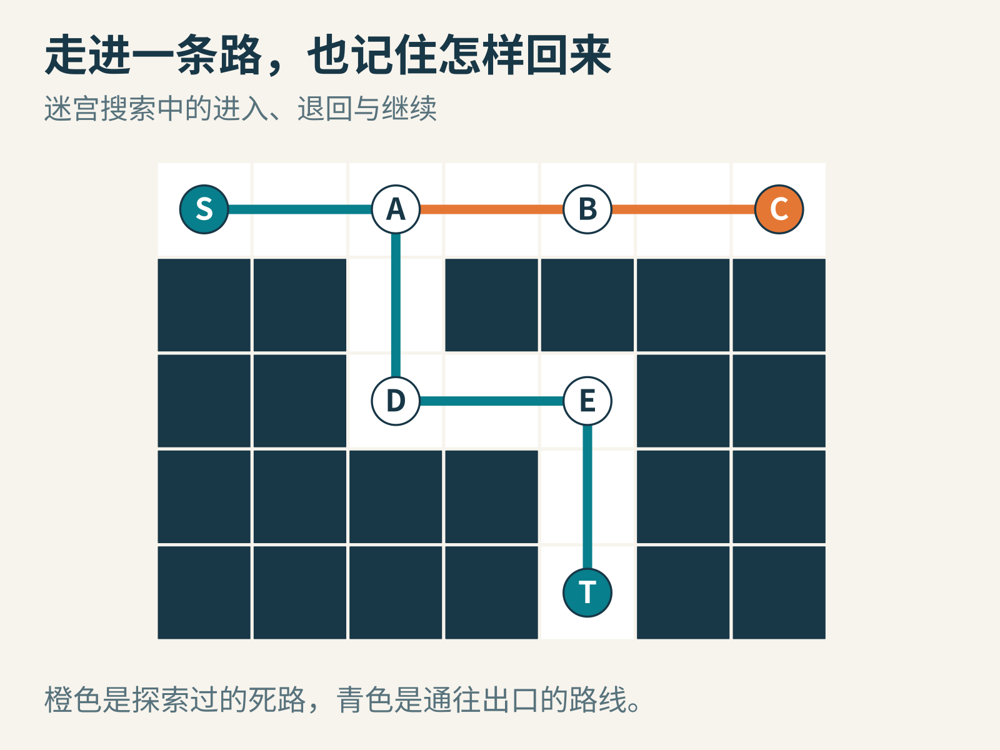
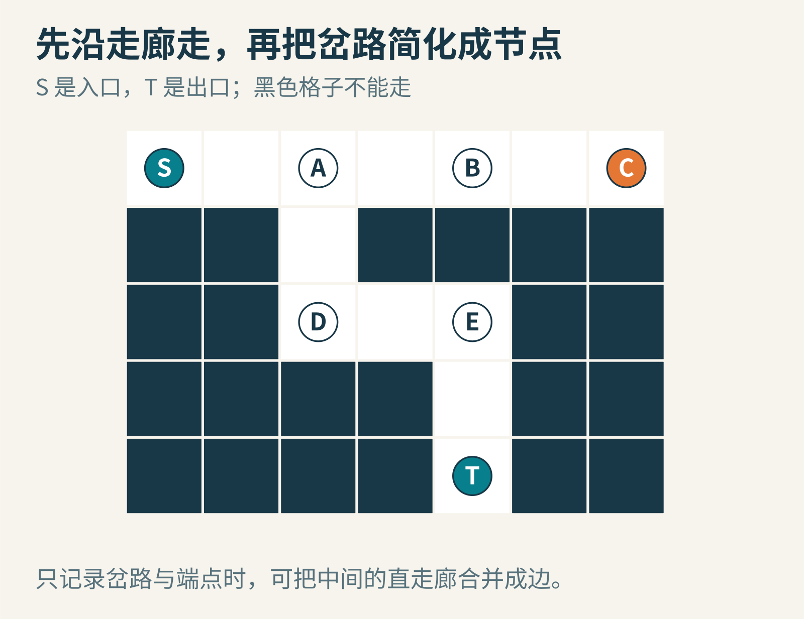
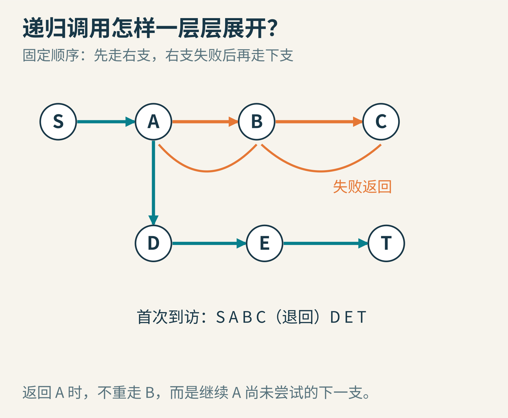
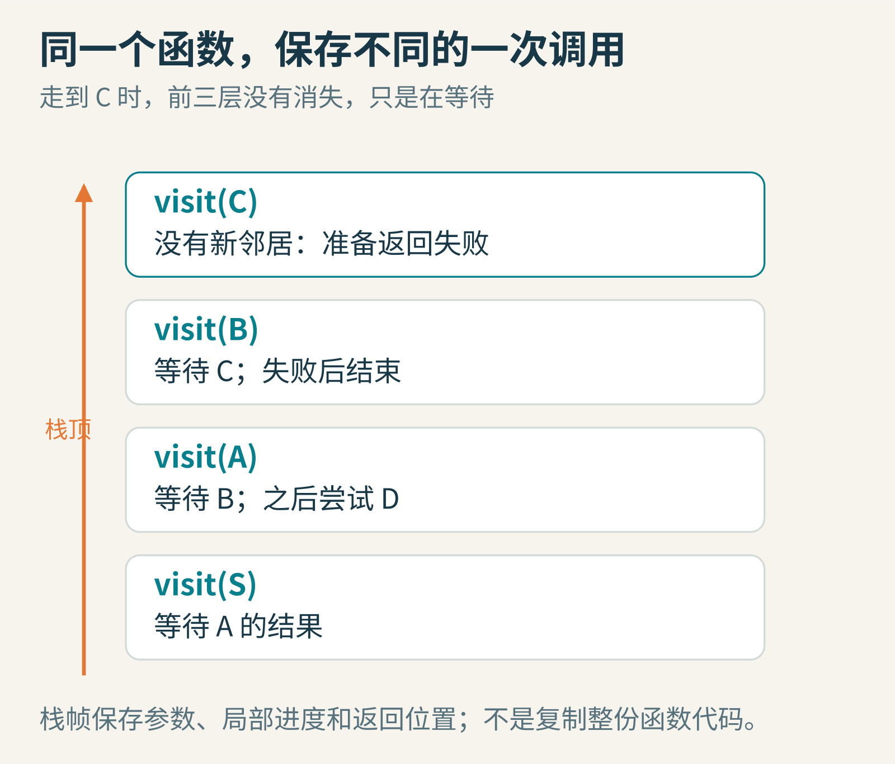
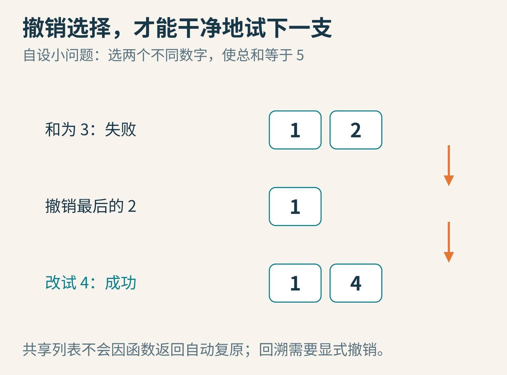
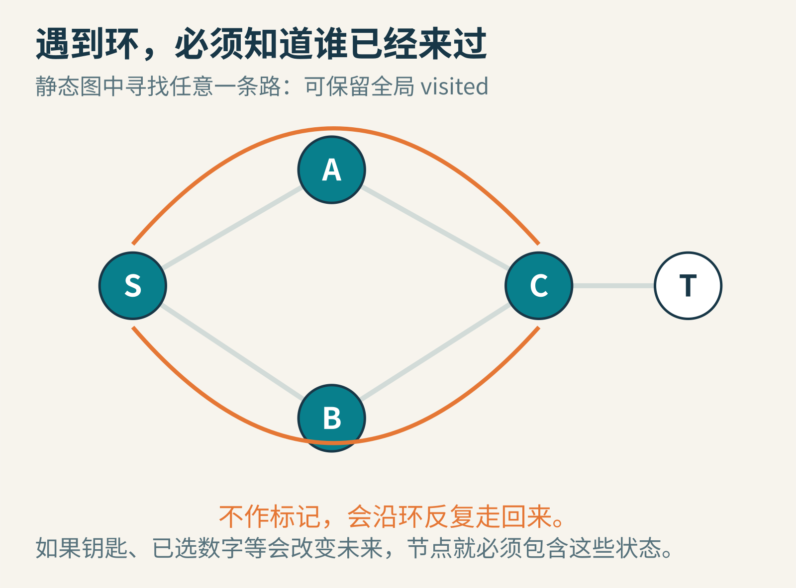
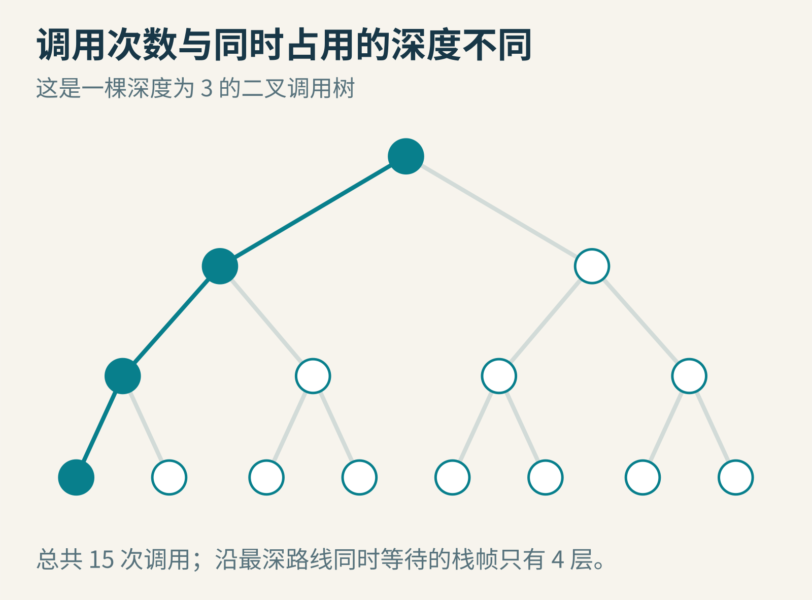

# 迷宫里的回头路：递归和回溯为什么不是同一件事



*原创教学概念图。青线通往出口，橙线是探索后退回的死路；迷宫为自设。*

你站在迷宫的岔路口。右边看起来像出口，于是走进去，拐过几个弯，却发现前面封死了。你只好退回来，试另一条路。

这个动作对人很普通，对程序却提出了三个问题：回来的是哪个岔路口？哪条路已经试过？接下来应该从哪里继续？如果只保存“当前所在位置”，这三件事都可能丢掉。

递归和回溯常一起出现在迷宫程序里，因此容易被当作同一个词。其实，递归是一种组织计算的方法：一个函数在执行中直接或间接调用自己。回溯是一种探索选择的方法：试一个选择，继续推进，不合适时撤销，再试别的。它们可以合作，但谁也不等于谁。

## 把一个大问题，交给同样的小问题

先问一个很具体的问题：“从眼前这个位置，还能不能走到出口？”

如果眼前就是出口，答案已经有了。如果不是，就查看它能到达的相邻位置。只要有一个相邻位置能通向出口，当前的位置也能通向出口。

这个说法里，原问题悄悄再次出现了：要知道“从这里能否到出口”，我们去问“从邻居那里能否到出口”。问题的形式相同，只是参数换了。这样的结构很适合递归。

不过，仅仅“再次问自己”还不够。还需要停止条件，以及保证不永远兜圈的办法。否则，两个相邻格子就可以彼此不停询问：你能出去吗？先问问你能出去吗？



*原创自设迷宫。只允许沿白格上下左右移动。为了手算，可以把直走廊合并为边，只保留 S、A、B、C、D、E、T 这些节点。*

把图压缩后，关系很简单：S 连到 A；A 一边通向 B，再到死端 C，另一边通向 D，再经 E 到出口 T。我们约定先试 A 的右支，再试下支。这个选择顺序是程序的规则，和哪条路更短没有直接关系。

## 从 S 到 C：没有谁被“忘掉”

从 S 开始，程序调用 visit(S)。它发现 A 可以去，于是调用 visit(A)，并暂时等着 A 的答案。

visit(A) 先试 B，又调用 visit(B)。B 接着试 C，于是调用 visit(C)。到 C 后，没有可继续探索的新邻居，也不是出口，C 返回“失败”。

现在注意：返回 C 的调用者 B，不是重新从 S 开始。B 知道它刚刚在等待 C。B 也没有别的路可试，于是返回失败。控制权回到 A，A 记得右边的 B 已经试过，这才转去 D。



*原创教学示意。节点表示一次到访的地点；图中橙色弧线表示失败结果沿调用关系返回。这里展示首次到访关系，略去了对已访问邻居的调用及其立即失败返回；也不是格子坐标图。*

随后 D 去 E，E 去 T。T 发现自己就是出口，返回成功。成功逐层传回 E、D、A、S。最终路线是 S→A→D→E→T；B 和 C 虽然探索过，却不属于答案。

递归并不要求你一次想象所有层。你可以先写清楚一层的契约：“visit(v) 要回答从 v 出发能否成功，并按照约定维护路径。”只要这一层正确处理邻居返回的结果，很多复杂的执行顺序就能从同一条规则里产生。

## 调用栈：一张张写着“回来后继续什么”的便条

每次调用，都需要保存属于这一次调用的信息：参数 v 是谁，邻居已经试到哪个，局部变量是什么，以及回来后从哪条指令继续。这些信息常被组织成一个栈帧。

栈采用“后进先出”。最后放上去的便条，最先取下来。C 是最后开始的调用，因此先结束；B 随后继续，直到结束才回到 A。这种嵌套次序，正好适合栈。



*原创教学示意，展示走到 C 时的逻辑调用状态。真实编译器可能优化保存方式，但每次调用必须能正确保留所需的状态。*

一个非常重要的区别是：函数的代码只需要存在一份，每次执行却可以有不同的状态。四层 visit 不是把整个程序复印四遍，而是同一套规则同时有四个尚未完成的执行实例。

这也是递归实现曾经遇到的实际困难。如果每个子程序只有一块固定的私有工作区，第二次进入同一个子程序，就可能覆盖第一次尚未用完的临时结果。函数名可以重复调用，不代表工作空间天然会分开。

1960 年，Dijkstra 在《Recursive Programming》中系统讨论了用栈组织参数、局部变量、中间结果和返回信息的方法，并联系 ALGOL 60 的实现。他在文中也引用已有的栈式表达式处理工作，并感谢合作研究者。这是一段递归走进实用语言实现的历史，不是“递归思想由一个人在 1960 年首次发明”的故事。[原论文](https://ics.uci.edu/~jajones/INF102-S18/readings/07_dijkstra.pdf)


*Edsger W. Dijkstra。摄影：Hamilton Richards；采用得克萨斯大学档案页的同一作品原件，本文未改动；[CC BY-SA 3.0](https://creativecommons.org/licenses/by-sa/3.0/)。照片不是 1960 年论文写作现场。*

## 回溯多做的一件事：把改动撤销

目前我们只讨论了控制权怎样回来。但很多程序还会修改共享的数据，例如把“当前路径”保存在同一个列表里。

去 B 时，路径可能是 [S,A,B]；去 C 后，变成 [S,A,B,C]。C 失败返回，如果列表里的 C 没被删掉，B 接下来看到的就仍是一条包含死端的路径。再去 D 时，答案甚至可能错误地长成 [S,A,B,C,D]。

所以，失败退回时，需要撤销“把当前节点加入路径”的动作。函数调用栈会帮你保存局部执行位置，但不会自动帮你撤销对共享列表、棋盘或文件的所有修改。



*原创教学示意。选择两个不同数字，使总和为 5。试过 [1,2] 后，要撤销 2，再试 [1,4]；直接追加 4 会变成另一个问题。*

可以把常见回溯过程记成四个动作：检查这个选择是否允许，作出选择，递归探索，失败或探索完后撤销选择。

这里的“撤销”可以有不同实现。你可以原地修改，再明确恢复；也可以给下一层传入一份新状态，让原状态保持不变。前者常节省复制成本，但容易漏撤销；后者直观，却可能使用更多时间和内存。选择哪一种，要看状态有多大，以及程序最需要什么。

## 一段可以对照纸图阅读的程序

下面的 Python 示例搜索压缩后的静态图。它寻找任意一条通路，不保证最短。邻居列表的排列顺序，就是试路顺序。

```python
graph = {
    'S': ['A'],
    'A': ['B', 'D', 'S'],
    'B': ['C', 'A'],
    'C': ['B'],
    'D': ['E', 'A'],
    'E': ['T', 'D'],
    'T': ['E'],
}
visited = set()
path = []

def visit(v):
    if v in visited:
        return False
    visited.add(v)
    path.append(v)
    if v == 'T':
        return True
    for neighbor in graph[v]:
        if visit(neighbor):
            return True
    path.pop()  # 这条支路失败，撤销当前路径中的 v
    return False

found = visit('S')
print(found, path)
# True ['S', 'A', 'D', 'E', 'T']
```

成功时为什么没有 pop？因为这个版本只要第一条答案，返回成功时故意把成功路线留在 path 里，再立即逐层退出。失败的分支则必须清掉自己的路径部分。

如果要重复运行，要重新建立 visited 和 path。上次搜索留下的记录不属于下一次全新的搜索。很多初学者的程序“第一次对、第二次错”，并不是递归失灵，而是把上次的共享状态带了进去。

## visited 和当前路径，不能随便混用

visited 记录“搜索已经发现过哪些节点”，path 记录“眼下这一条尝试路线”。它们回答不同的问题。

对有限的静态图，如果目的只是找到一条从起点到出口的路，发现过的节点可以保留全局标记。因为来到同一节点后，允许的后续道路还是同一批；不必为了另一个到达方式再完整探索一次。



*原创教学示意。环会让朴素递归重复进入同一状态；已访问标记用来打断重复探索。*

但如果你想列出所有不重复经过节点的路线，情况就变了。节点 C 在一条路线中出现过，不代表它不能出现在另一条合法路线里。通常要用“是否在当前路径上”的集合，进入时加入，离开时移除。全局永久封锁 C，可能把其他答案一起封掉。

再想一层：如果迷宫里有钥匙呢？“在房间 C，有钥匙”和“在房间 C，没有钥匙”，不是同一个搜索状态。只用房间编号作 visited 的键，就可能在第一次无钥匙到达时把 C 标为访问过，后来带钥匙再来也不允许探索，从而漏掉出口。

解决办法不是干脆删除 visited，而是把节点定义完整，例如用“位置与钥匙集合”共同表示状态。哪些数据会影响未来合法行动，哪些数据就可能需要进入状态。这比背诵“回溯一定要清除 visited”或“一定不能清除”有用得多。

## 为什么它能结束，又会在哪里变慢？

递归不是一种自动保证结束的魔法。阶乘的递归可以让非负整数 n 每次减 1，最终到 0；静态图搜索则可以让每个有限节点最多首次进入一次。两者都能指出一个具体理由，说明计算不会无限持续。

如果图有 V 个节点、E 条边，采用合适的邻接表示与全局 visited，完整深度优先遍历的基本工作量是 O(V+E)：每个节点处理一次，每条邻接关系检查有限次数。这里的“O”描述规模增长的趋势，不是某次程序运行了多少毫秒。

可是，枚举所有可能路线可能非常昂贵。一层若有 2 个选择，往下 20 层就可能形成约一百万个叶子候选。递归写得短，不会把必须探索的组合数量变少。回溯的剪枝可以排除已经不可能成功的分支，但最坏情况仍可能很大。



*原创教学示意。完整二叉树深度按边数计为 3，总计 15 次调用；深度优先执行时，一条根到叶路径上最多同时存在 4 层调用。*

还要区分“总调用次数”和“最大栈深度”。它们不是同一个资源。一棵很宽的树可能总工作量巨大，却只有几十层栈；一条极长的走廊则可能分支很少，却让递归调用叠得很深，超过运行环境的限制。

这时可以用显式栈改写为循环，把“节点和下一个邻居位置”等信息自己保存起来。这样并没有消除需要记忆的状态，只是改变了状态由谁管理。也不能承诺改成循环以后，任何规模都不会耗尽内存。

## 深度优先找得到，不等于找得最好

我们的程序先把一条分支走深，因此叫深度优先搜索。它返回的第一条通路，受邻居顺序影响。把右支放在前面与把下支放在前面，可能得到不同答案。

如果你想找等代价网格中的最少步数，按层推进的广度优先搜索通常更合适。如果不同路段代价不同，又要最小总代价，就需要符合条件的加权最短路方法。回溯也能通过穷举比较来求最佳答案，但“有办法求”与“高效求”是两回事。

递归还可以完全不做回溯。计算目录大小时，每个子目录都需要处理，不是试错后撤销；合并排序把数据拆成两半再合并，也没有失败支路。反过来，回溯也可以用循环和显式栈实现，不必在源码里出现函数调用自己。

把这几条关系分清，会让你读代码时更准确：递归描述组织方式，深度优先描述访问次序，回溯描述尝试与恢复，剪枝描述哪些候选无需再搜。它们经常同台，但扮演不同角色。

## 三个可以继续追的问题

先把示例中 A 的邻居顺序改成 D、B、S。预测 C 是否还会被访问，再运行检查。你改变的是搜索顺序，图本身并没有改变。

再把 D 到 E 的路删掉。程序应该返回 False，而且 path 最终为空。试着故意删掉 path.pop()，观察失败路线怎样残留。这个错误能直接展示“返回”和“撤销”的区别。

最后，为图增加一条 B→E 的双向路。现在有多条通路。如果目标改成列举所有简单路径，哪些全局标记需要变成路径局部标记？找到出口之后应该立刻结束，还是记录一份当前路径的副本再继续？

递归最让人紧张的地方，往往是觉得自己必须同时跟踪很多个“自己”。其实，你需要的是清楚的一层规则、一份不丢失的等待记录，以及一套能把状态恢复原样的约定。当这些都成立，迷宫里的回头路就不再是迷失，而是算法知道自己下一步该做什么的证据。

本文由 AI 辅助研究、撰写与制图；迷宫、图和程序示例均为原创教学材料。

图片来源：[Dijkstra 摄影作品及许可](https://commons.wikimedia.org/wiki/File:Edsger_Wybe_Dijkstra.jpg)、[档案原件所在页](https://www.cs.utexas.edu/~EWD/welcome.html)；其余为本文原创教学图。
