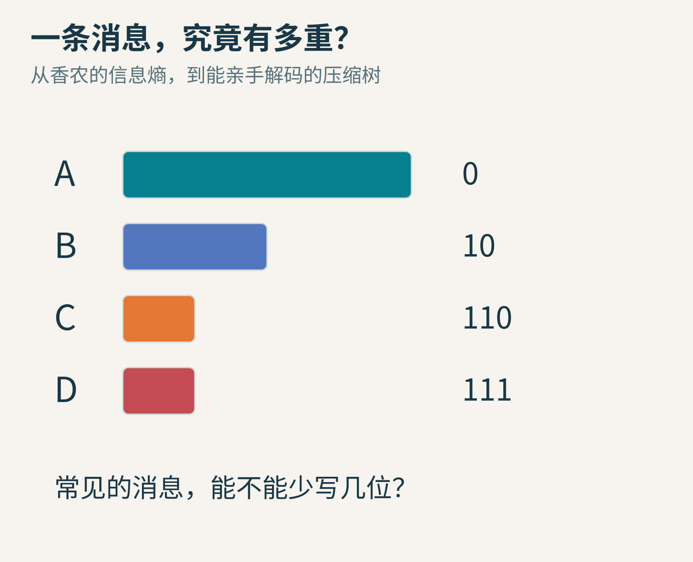
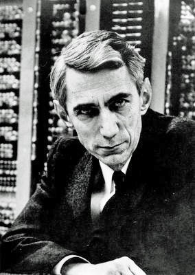
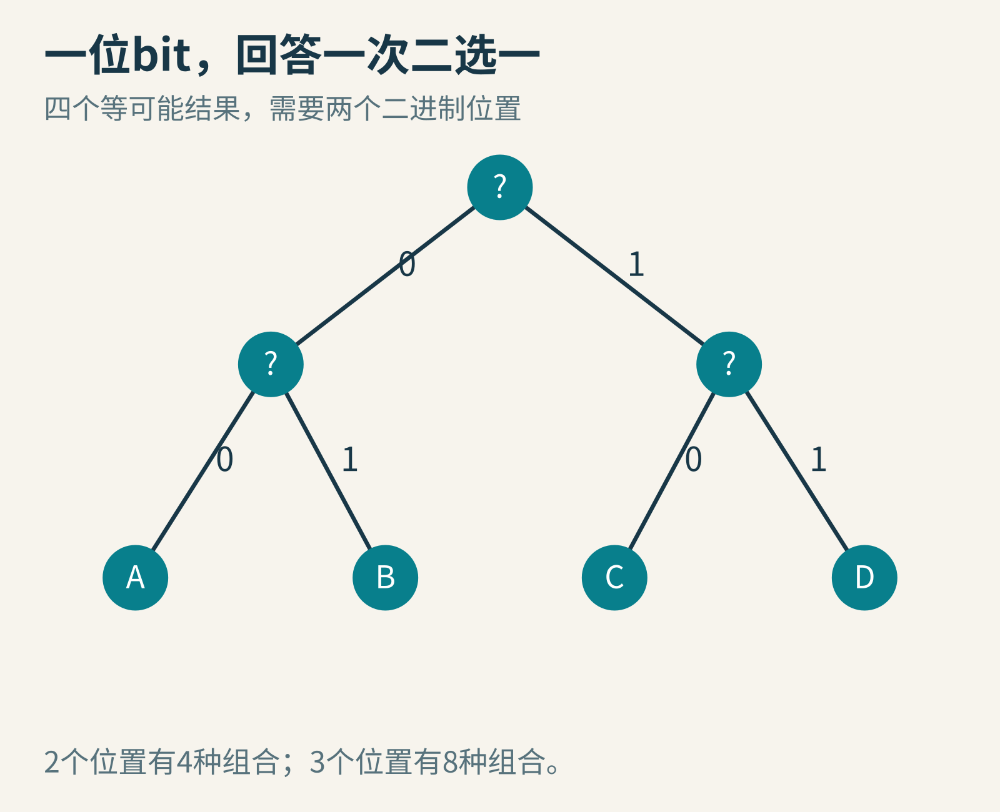
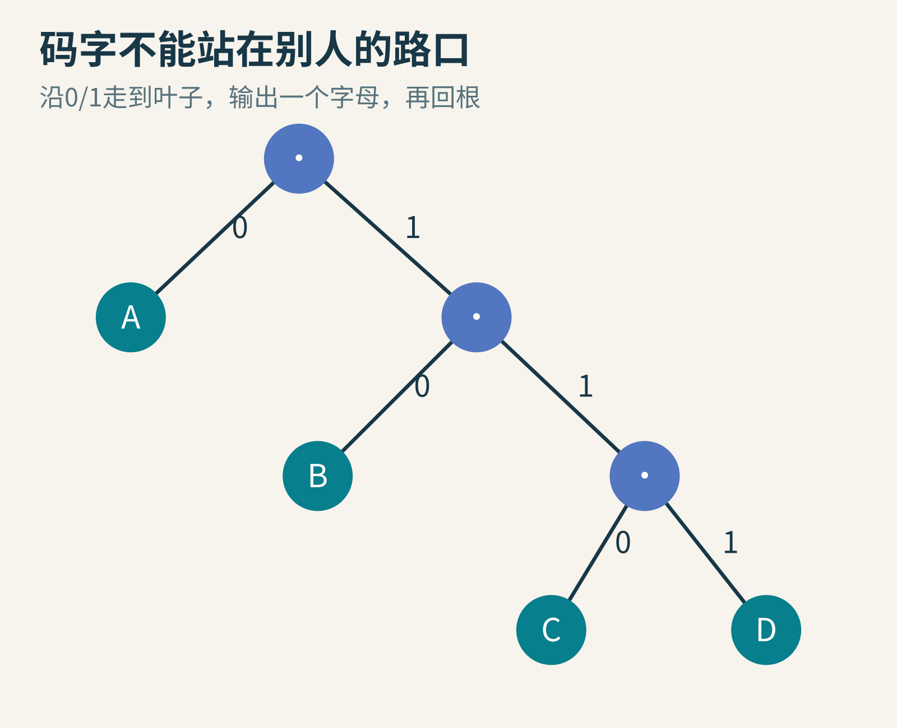
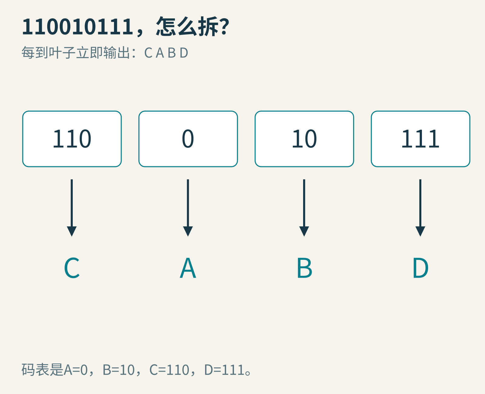
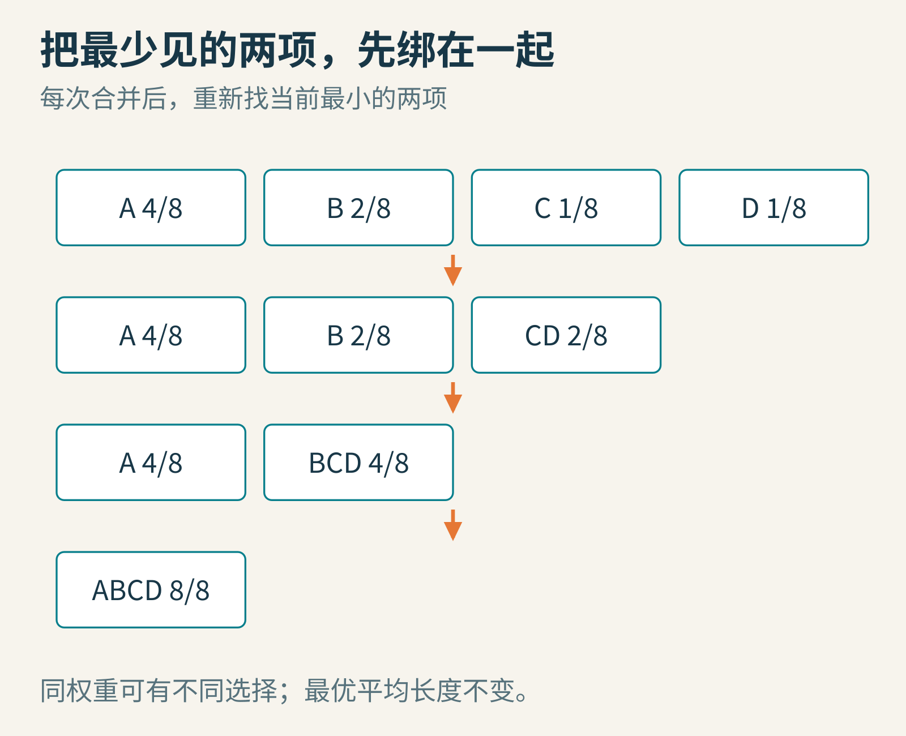
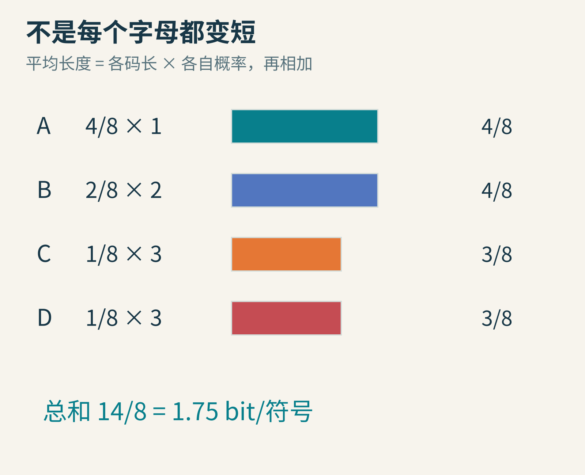
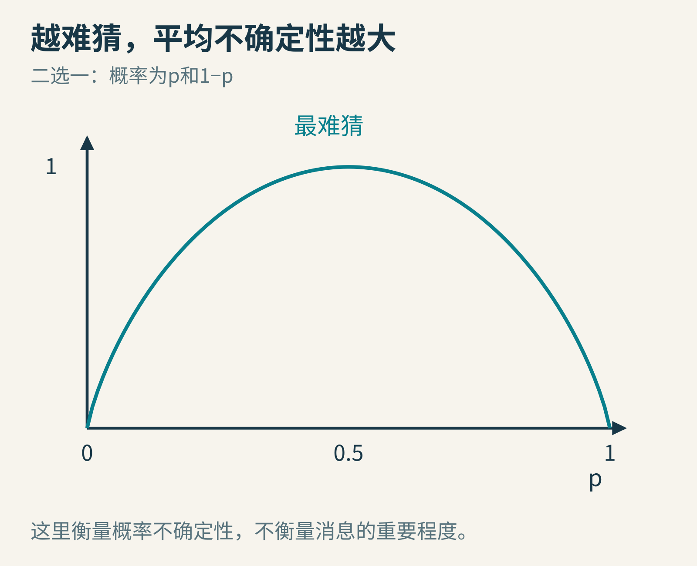
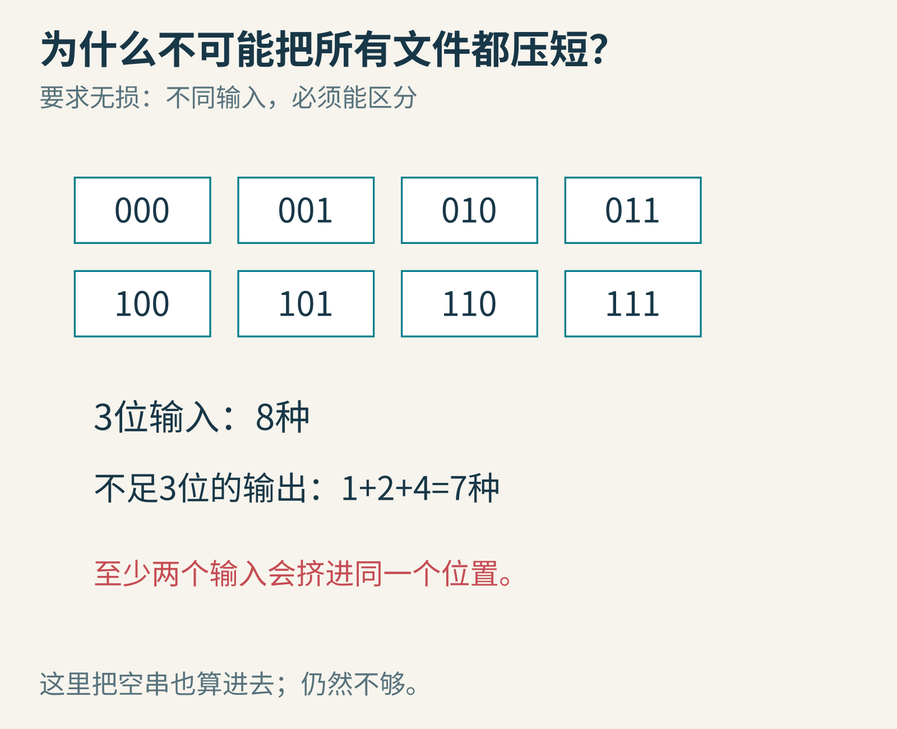

# 一条消息究竟有多重？从香农的信息熵，走到一棵压缩树

你把一份文件压缩，体积变小了；再压缩一次，却几乎没变化。既然电脑这么擅长找规律，为什么不能一直压，最后把整部电影塞进一个字节？

要回答这个问题，我们不必从复杂软件开始。只需要四个字母、一棵树，以及一个看似奇怪的问题：收到消息以前，你有多难猜中它？

1948年，克劳德·香农发表《通信的数学理论》，把消息的选择、编码与通信能力放进同一个数学框架。今天我们只打开其中一扇门：无损压缩。沿着这扇门走进去，你会发现“信息量”与“字数多不多”“内容重不重要”，并不是同一回事。

## 一、一个聪明的转弯：先不问消息是什么意思

图1：克劳德·香农，Konrad Jacobs 摄；Commons记录的权利人为MFO，[CC BY-SA 2.0 DE](https://creativecommons.org/licenses/by-sa/2.0/de/)，并有VRT授权记录。采用现存284×400完整文件，不放大冒充高清；该版本已有黑白调整与水印移除。摄影日期未核实，文件页2015年日期不当作拍摄日期。[文件与许可](https://commons.wikimedia.org/wiki/File:ClaudeShannon_MFO3807.jpg)

想象你在设计一根通信线路。它可能传天气、棋谱、小说，也可能传传感器数据。你要解决的基础问题是：发送者选中的那条消息，怎样在接收端准确重建？

消息对人的意义当然重要，但同样的二进制序列，无论代表生日祝福还是游戏坐标，线路传输时都要处理那些符号。香农把“如何可靠区分可能消息”单独提出来研究。这种抽象，让同一套数学能服务不同内容。[1948年原论文，导言](https://people.math.harvard.edu/~ctm/home/text/others/shannon/entropy/entropy.pdf)

历史上，这不是凭空出现的灵感。原论文开头明确引用奈奎斯特与哈特利的早期通信研究；“bit”这个词也在文中归功于约翰·图基的建议。科学突破往往不是一个人从零创造全部词汇，而是把已有问题与新观点组合成更强的框架。

注意，我们接下来计算的信息量，不是在给新闻价值、情感深度或知识质量打分。一串随机数字可能很难压缩，却不因此比一首诗更值得读。

## 二、一位bit，究竟能替你排除多少可能？

假设朋友从A、B、C、D中等可能选一个，让你猜。你可以问只能回答“是/否”的问题。

第一问：“是A或B吗？”

如果是，第二问区分A和B；如果不是，第二问区分C和D。两问就够。把两个答案写成0和1，可以约定A=00、B=01、C=10、D=11。

图2：两个二进制位置提供四种不同组合。它不是某个真实通信设备的电路图，而是“区分可能性”的教学模型。

一位能表示2种组合，两位4种，三位8种。一般来说，n位有2的n次方种组合。所以从N个等可能结果中区分一个，需要的理想尺度是log₂N。这里的对数不是额外的魔法，只是在反过来问：“2要乘自己多少次，才得到N？”

当N=8时，答案3很直观。N不是2的整数次幂时，理想尺度可能不是整数，而一次实际写出的码字位数必须是整数。以后把多个符号一起编码，才会看见这个差别怎样被摊薄。

不过，真实消息往往并不等可能。游戏角色大多数时间在普通移动，偶尔才释放大招；文本里某些字母比另一些常见。给每一种情况同样长的编码，可能浪费机会。

## 三、给常客短票，给稀客长票

我们造一个只会输出A、B、C、D的玩具信源，假设每次独立抽取，概率分别是：

- A：1/2
- B：1/4
- C：1/8
- D：1/8

这些是教学假设，不是真实语料统计。

固定长度编码每个字母都用2位。我们想试一套不等长的编码：A=0，B=10，C=110，D=111。

你也许立刻发现，C和D比原来还长了！这没关系。压缩目标不是让每一个符号都变短，而是让常出现的短码带来的节省，超过少出现的长码带来的开销。

但在算省多少之前，还要过一道更重要的关：接收者能拆开它吗？

假如希望立刻解码，却约定A=0、B=01，看到01时，开头的0究竟已经是A，还是B的一部分？如果还允许别的码字，连串消息可能产生歧义。短不等于好，能唯一还原才是无损编码的底线。

我们的新码表有一个好性质：任何码字都不是另一码字的开头。它叫前缀码。可以把码表画成一棵树：走左分支读0，走右分支读1，字母只放在叶子上，不放在半路的岔口。

图3：读到一个叶子，就确定一个字母。前缀码是一种方便立即解码的方案；并不是所有可唯一解码的编码都必须是前缀码。

## 四、真的解一次，不要只相信这棵树

现在收到110010111。

从根出发：1、1、0，来到C，输出C，回根。

下一位是0，来到A，输出A，回根。

接着1、0，来到B。

最后1、1、1，来到D。

得到CABD。

图4：码字边界由树决定，不需要在每个字母之间额外放逗号。

这里我们偷偷用了一个前提：接收者知道码表，而且知道消息在哪里结束。真实文件还要保存或约定码表、长度、格式版本等信息。若最后一个字节没用满，还可能有填充位。只计算正文编码位数，不代表已经算完文件的全部大小。

这也是为什么压缩几个字符时，输出反而可能变大。格式头的固定开销，可能比省下的几位更大。不要拿一段很短的数据就断言某种编码原理失效。

## 五、这棵树怎样长出来？霍夫曼的合并法

1952年，戴维·霍夫曼发表构造最小冗余编码的方法。我们把它限制在二进制、给定符号概率、每个符号对应一个前缀码字的情形，就得到熟悉的霍夫曼编码。[原论文](https://compression.ru/download/articles/huff/huffman_1952_minimum-redundancy-codes.pdf)

做法像整理一串小树：每次挑当前权重最小的两项，合并成一个新节点，权重等于两项之和；放回去，重新挑最小的两项，直到只剩一棵树。

把概率写成八分之几，我们的列表是A:4、B:2、C:1、D:1。

第一步，合并C和D，得到CD:2。现在列表是A:4、B:2、CD:2。

第二步，合并B和CD，得到BCD:4。现在是A:4、BCD:4。

第三步，把最后两项合并。沿分支分配0、1，便可以得到刚才的码表。

图5：权重相等时，可能有多个合法选择；左右分支标0还是1也可以交换。码字未必唯一，最优平均长度可以相同。

为什么先合并最小的两项？直觉是，把不常见的符号放得深一些，额外的一层对平均长度影响较小。更严谨的证明可以从一棵最优树出发：最深处有一对兄弟叶子，通过交换可把两个最小权重安排在那里而不增加成本；把它们收缩成一个父节点，剩下的又是同类的更小问题。

这一步值得慢慢想。贪心算法不能只凭“眼前看起来划算”就正确。霍夫曼方法的力量在于，这个局部合并有交换论证作支撑。

它的最优性也有明确范围：给定符号权重与二进制前缀编码条件，最小化平均码长。它不等于“任何压缩任务的全局最好算法”。真实数据的上下文、重复片段和符号分组，都可能提供这个单符号码表没利用的规律。

## 六、信息熵：把每种意外的代价平均起来

先不背公式，直接算账。

A占一半，花1位；B占四分之一，花2位；C、D各占八分之一，各花3位。平均每个符号用：

1/2×1 + 1/4×2 + 1/8×3 + 1/8×3 = 1.75位。

固定编码是2位，于是仅就符号编码部分，平均少了0.25位，也就是12.5%。

图6：平均值允许是小数，不表示某一个物理码字真的只有1.75个二进制位置。

为什么这些码长恰好是1、2、3、3？因为对应概率是1/2、1/4、1/8、1/8，而−log₂p分别就是1、2、3、3。

把每种结果的−log₂p按它发生的概率p加权，就得到熵：H=−Σp log₂p。Σ只是“把所有项加起来”的简写。对这里的独立同分布玩具信源，H=1.75 bit/符号。

这个例子选得特别整齐，概率都是2的负整数次幂，霍夫曼码刚好达到熵。换一组概率，单个符号的整数码长往往不能如此贴合。把多个符号联合编码，平均到每个符号上的额外开销可以变小；但码表与计算工作也可能变复杂。

在相应信源与编码假设下，熵描述的是长期平均意义上的极限尺度，不是保证“每一个文件都能压到恰好H乘长度”。短文件、异常序列、概率估计错误、格式开销，都必须另外考虑。

图7：二选一时，五五开最难猜；如果某个结果确定发生，选择的不确定性为0。零熵不等于现实文件无需任何元数据。

还可以做一个思想实验：一串独立公平硬币的结果，和“010101……”这种固定交替序列，0与1的比例都可能各一半。但是后者知道起点和长度后几乎就能推出来。只数单个符号频率，会漏掉顺序规律。更细的模型必须考虑上下文或联合概率；不能把每符号频率算出的熵机械地当作所有数据的真实极限。

## 七、为什么不能把任何文件都越压越小？

现在用一个完全不依赖具体算法的计数证明。

所有3位二进制串一共有8个。长度不足3位的串有多少？空串1个，1位串2个，2位串4个，总共7个。

如果压缩程序想把8种输入全都变成这7种更短输出，至少有两种输入会得到同一个输出。解压器面对它时，就不知道原来是哪一个。无损还原失败。

图8：抽屉原理。这里已经把长度为0的空串也算进去了，仍然装不下。

同理，n位串有2ⁿ个，而长度小于n的串总数是2ⁿ−1。因此不存在把所有n位输入都严格缩短、又能无损还原的通用映射。

有效压缩做的是选择性交易：让常见、符合某些规律的数据变短，允许另外一些数据不变或变长。所谓“随机数据难压”，在这里可以变成明确的计数限制，而不只是软件不够聪明。

已经压得很好的文件，剩下的可利用规律少，再压一次经常只有额外开销。某个文件偶尔能继续缩短，不推翻这个论证；论证排除的是“对所有输入都成功”的保证。

## 八、把它变成你自己的实验

同目录exercise.py会验证码表前缀性质、CABD的编码与解码、平均码长和熵，还会检查恰好包含4个A、2个B、1个C、1个D的序列：编码部分14位，固定编码16位。

注意，它输出的是逻辑位串，不是一个完整压缩文件格式。Python字符串里的字符“0”也不等于内存里只占一个bit。实验的目的，是核对算法关系，不是宣称实测节省了多少系统内存。

你可以继续探索：

1. 把A的概率改成0.9，其余三项合计0.1。自己合并一棵霍夫曼树，比较平均码长与熵。
2. 给每个文件假设24位固定头部。使用原来的概率模型，至少多长时，平均节省0.25位/符号才足以抵消这个头部？先列不等式，注意“平均”不保证每个样本。
3. 把输入改成固定交替ABABAB。单字符编码遗漏了什么规律？设计一个包含“起始字母+长度”的专用格式，再说明它为什么不适用于任意文本。
4. 用纸写出全部8个3位串，尝试给它们分配不同的更短串。亲自撞一次“第八个无处可放”的墙。

压缩并不是把信息神秘地蒸发。它是用更贴合可能性结构的表达，替换原来浪费空间的表达。香农让我们能问极限在哪里，霍夫曼给了我们一种能亲手搭出来的好办法；而那棵小树，让抽象的信息终于变得可以一步一步走过去。

---

本文为AI辅助研究、写作与原创图示制作；所有概率与例子均为教学设定，未声称运行商业压缩器或实测硬件性能。史料、素材权利与取舍详见[sources.md](sources.md)。

图片来源：[香农真实肖像](https://commons.wikimedia.org/wiki/File:ClaudeShannon_MFO3807.jpg)；其余为本文原创教学图。
