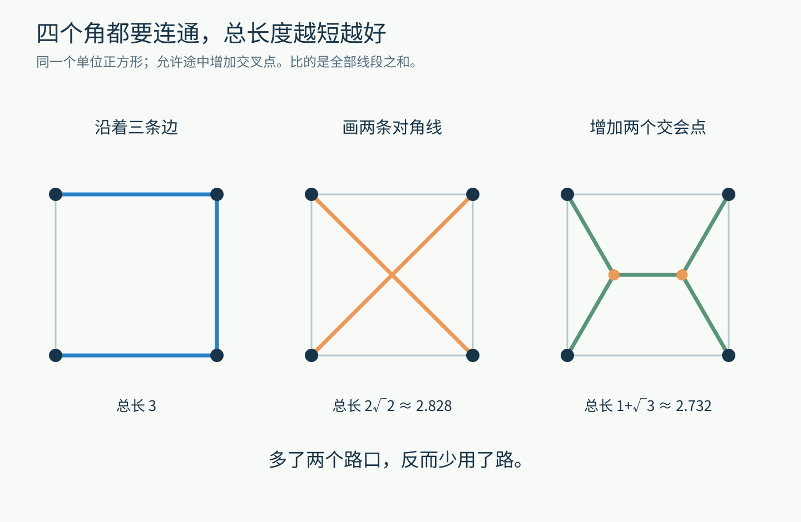
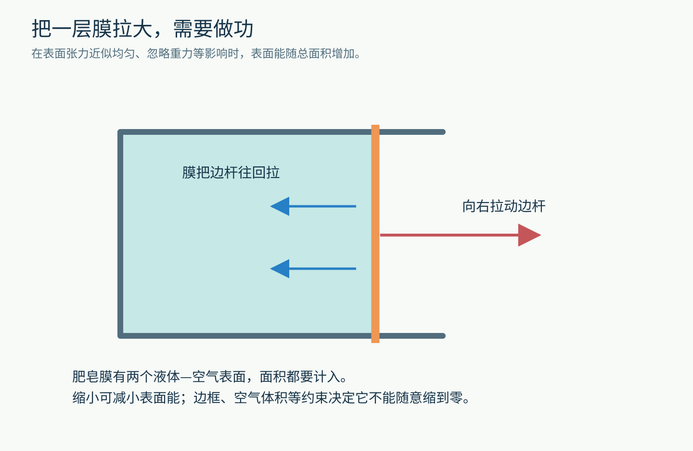
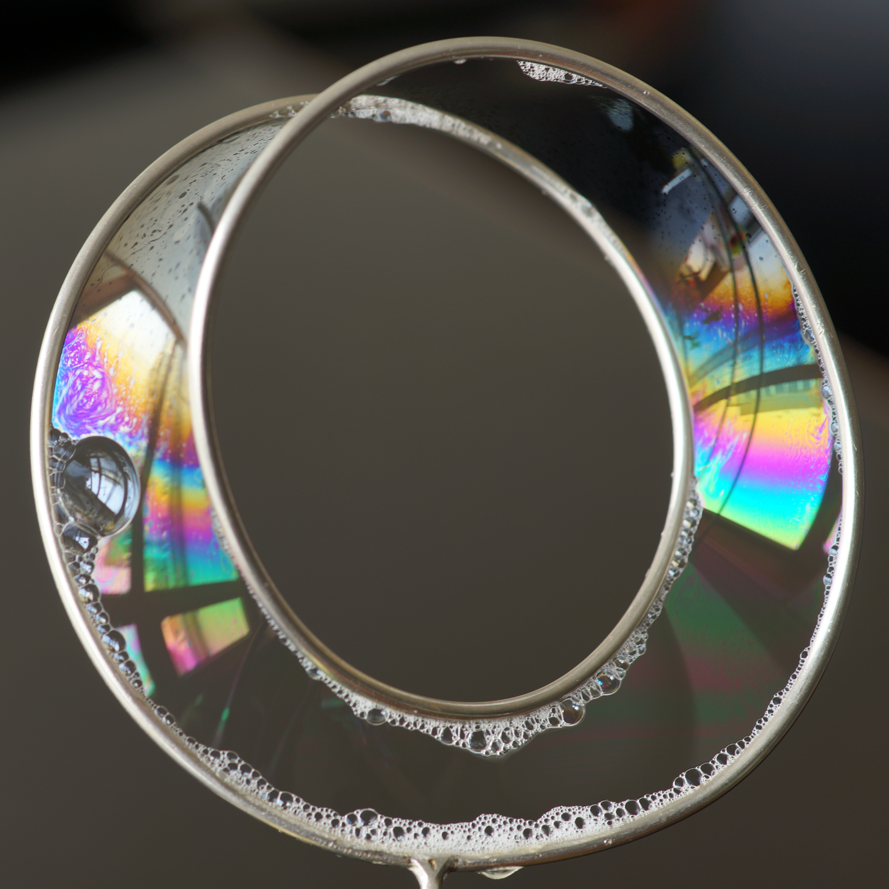
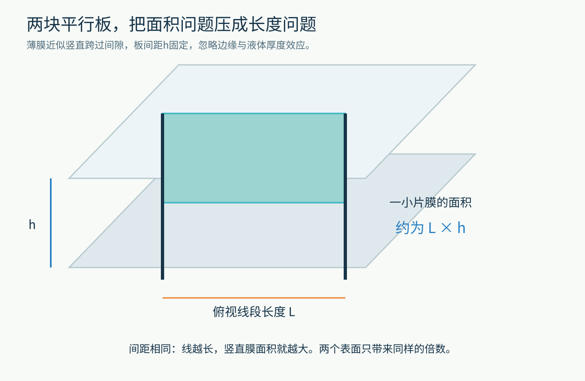
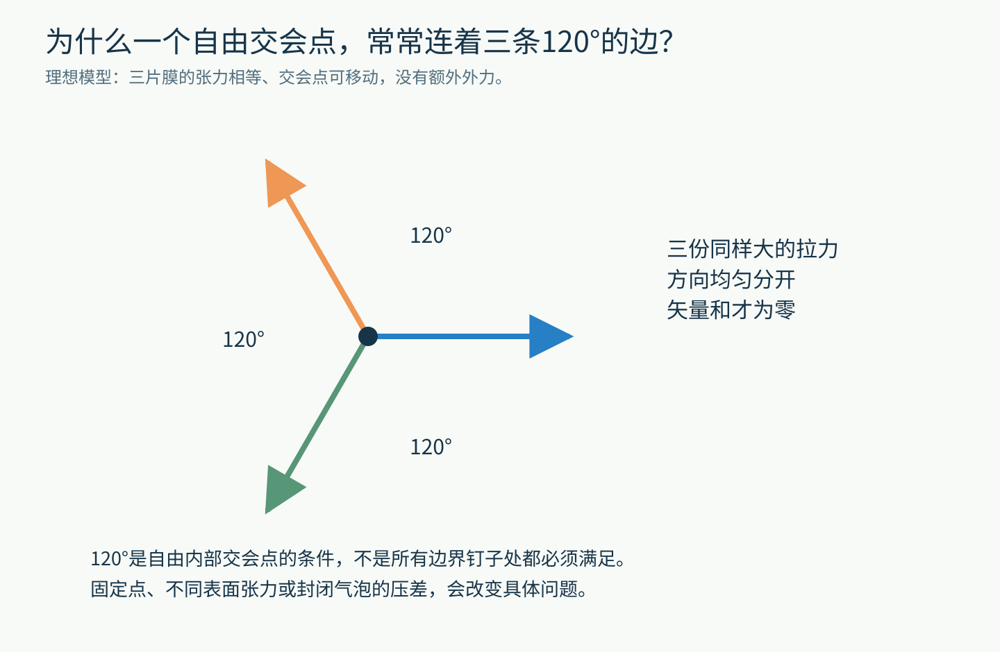
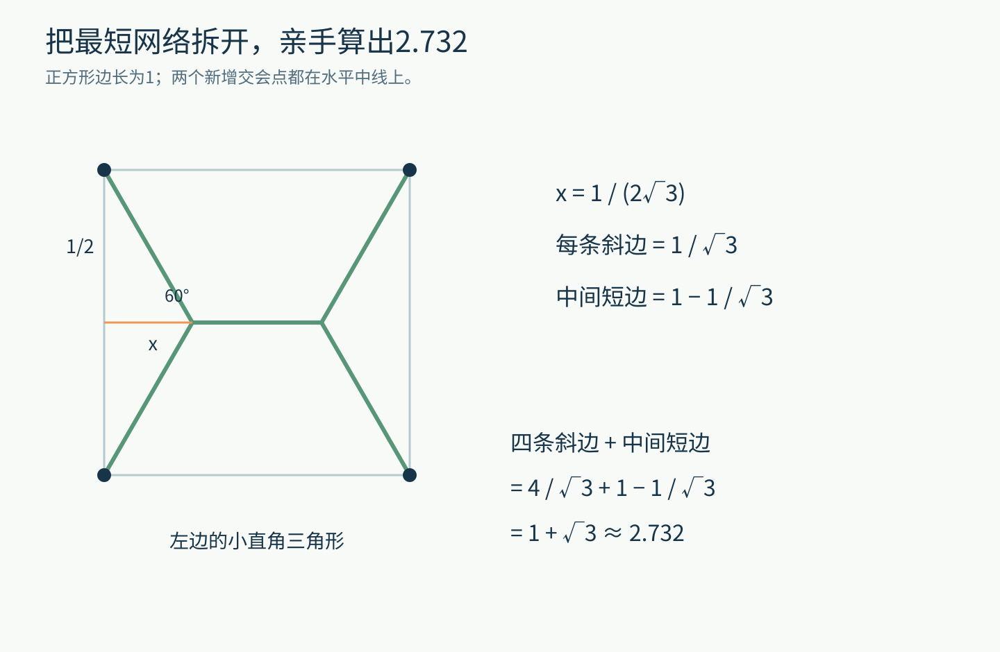
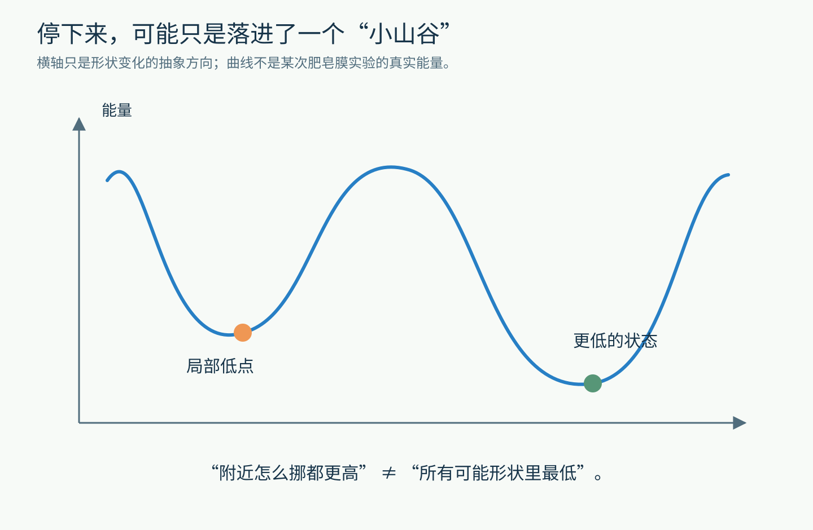
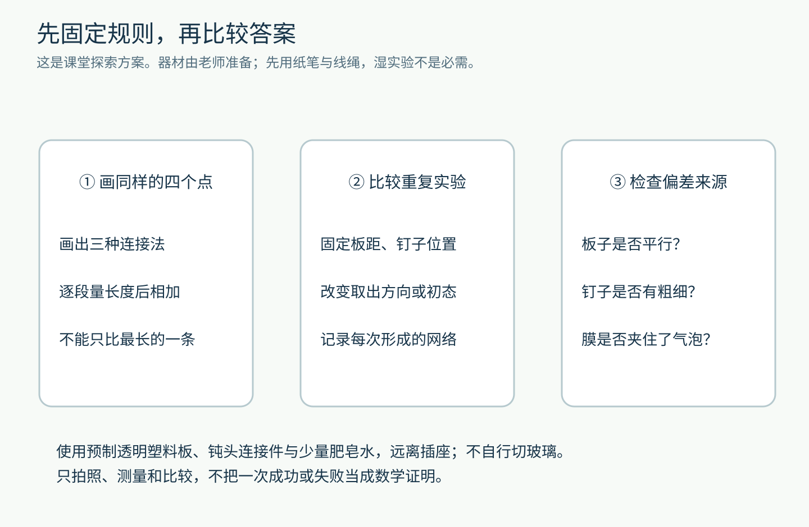

# 肥皂水不会做几何题，怎么能画出一张更省材料的路网？

先来一道允许你画在草稿纸上的题。

四个村庄，恰好位于一个正方形的四个角。要修一些路，让任意两个村庄都能沿路走到。路可以在途中交会，也可以新建路口。没有山，没有河，不考虑车辆拥堵。

只有一个目标：所有路段加起来，越短越好。

沿正方形的三条边修路，很容易想到。画一个大大的“×”，似乎更聪明。但还有一种方案：在中间加两个路口，让整张路网变成横着的双“Y”。

**新增路口，反而能省下道路。**

更奇妙的是，你可以把这个问题交给两块透明板、几根固定柱和一点肥皂水。肥皂膜有时会自己形成这样的网络。

它当然没有读过几何教材。它在做另一件事，而我们恰好把那件事设计成了一个数学问题。

图1｜原创等比例几何图。三种方案都能连通四角；浅灰线只标正方形边界，不计入路网。此时先看形状，后面会一步步算长度。

## 先分清：我们在省哪一种“路”？

如果从左上角去右下角，直接走对角线最短。

可这道题并不是只替某一个旅客省脚力，而是替施工者省材料：把建成的所有道路各算一次，再相加。

这两个目标可能给出不同答案。

一张总长度较短的网络，未必让每一对村庄之间的旅程都最短。也未必最抗灾：如果没有备用路线，某一段断掉就可能把村庄隔开。

我们先把现实里这些重要问题暂时放下，只研究一个清楚的小问题：**在平面上连通指定的点，并允许添加中间交会点，怎样使总长度最小？**

这类问题叫斯坦纳树问题。名字先知道就好；比名字更重要的是，允许添加新路口，确实会改变答案。

接下来，把地图放到一边，看看肥皂膜想做什么。

## 一层膜，看起来很轻，其实一直在拉

用塑料环蘸出一层肥皂膜，它不会随意垂成一团。膜与边界之间存在拉力，这与表面张力有关。

你可以把“增加表面积”想成一项需要付出能量的操作。对于表面张力近似均匀、其他影响较小的薄膜，面积增加，表面能也会增加。

如果有一个能滑动的边杆，把它向外拉，让膜变大，就需要做功。膜则把边杆往回拉。

图2｜原创力学示意。蓝色箭头表示膜对边杆的回拉，红箭头表示外力。膜有两个液体—空气表面，计算总表面能时两个都要考虑。

于是，在边界条件允许的范围内，膜倾向于减小表面能。若表面张力相同，减小面积就成了重要的方向。

为什么它没有干脆缩成一个点？因为它还得满足约束：挂在边框上，或者包住一定体积的空气。约束像题目里的已知条件，不能随便删掉。

这也解释了为什么同样的肥皂水，放到不同形状的框架里，会出现不同形状的膜。

图3｜Atractor拍摄的真实肥皂膜作品《Minimal Möbius》，来自IMAGINARY。它展示膜如何跨过扭曲边界，不是四村路网实验的照片。CC BY-SA 4.0；仅将原PNG转为同尺寸JPEG以满足文件限制，完整画面保留。

不过，眼前仍有一个不小的缺口：膜想减小的是面积，我们想减小的是道路长度。它们不是同一个量，怎么才能接上？

## 一个巧妙的装置：把面积“翻译”成长度

准备两块相互平行、间距固定的透明板。用几根垂直于板面的细柱把它们连接起来，柱的位置对应地图上的村庄。

将装置浸入肥皂液再取出，板之间可能留下连接这些柱子的薄膜。

从侧面看，每一段膜像一堵极薄的墙，跨过两块板之间的空隙；从上面看，这堵墙就像一条线。

图4｜原创装置剖示。膜近似竖直、板间距为h时，一段俯视长度为L的膜，单侧面积约为L×h。为便于看清，板距与柱粗均夸大；这是原理示意，不是实物照片。

想象一排高度相同的广告牌。每块广告牌的面积，等于它的宽度乘以同一个高度。把所有面积加起来，就等于“所有宽度之和”乘以那个固定高度。

这里完全类似。

板间距都一样，所以总膜面积与俯视的总线长成比例。两个表面带来一个相同的倍数，不会改变哪种连接法更省。

于是，我们完成了一次物理翻译：

指定点的位置，交给固定柱；要求保持连通，交给跨在柱间的膜；想要少用道路，就让它对应少用膜面积。

**肥皂膜没有理解“村庄”或“道路”。它只是按自己的物理规律变化，而装置把这种变化变成了可观察的几何答案。**

当然，这个翻译有条件：板要近似平行，膜的张力要较均匀，柱不能粗到无法近似成点，还要避免夹住多余的封闭气泡。条件变化，解的就可能是另一道题。

## 为什么路口常常是120度？

在双“Y”路网里，每一个新路口，都有三条边伸出去。

把这个路口想象成一个可以自由移动的小环，三个人用一样大的力沿三条边拉它。

如果三个方向都挤在右边，小环当然会向右跑。如果左边两股力的合力刚好与右边一股平衡，它才可能停下来。

三股同样大的拉力，要在平面上互相平衡，一个对称的安排就是彼此相隔120度。

图5｜原创矢量示意。三根箭头长度相等，方向两两相差120度，相加为零。这里讨论的是理想条件下可自由移动的内部交会点，不是固定柱处的任意夹角。

这不是肥皂膜对“120”有什么特殊偏爱，而是相等张力平衡留下的几何结果。

再问一步：四条边在一个十字路口相交，看起来也能左右、上下平衡，为什么它未必最好？

因为“合力为零”只说明在那一刻不往某个方向加速，不能单独证明这个状态稳定，更不能证明它用的材料最少。

正方形里的“×”就提供了一个提示：把一个四岔口拆成两个三岔口，中间加一小段连接，整体反而可以变短。平衡、稳定、全局最优，是需要分开检查的三件事。

## 现在算一次：多出来的路口到底省了多少？

把正方形边长设为1。

沿三条边走，总长度就是3。

一条对角线长度为√2，两条合起来为2√2，约2.828。比3短了一点。

双“Y”呢？它共有四条同样长的斜边，以及中间一条短横线。

图6｜原创几何计算图。左边的橙线只是辅助线，不是新增道路。左上小直角三角形的竖边为1/2，横边记为x，路口处的锐角为60度。

如果学过三角函数，可以这样算：小三角形中，tan 60°=√3，所以x=(1/2)/√3，也就是1/(2√3)。

由勾股定理，每条斜边的长度为√[x²+(1/2)²]=1/√3。

两个路口离左右边界各有一个x，因此中间横线长1−2x，也就是1−1/√3。

把它们相加：四条斜边，加上中间短边，得到1+√3，约2.732。

若还没学三角函数，也完全能先画一个边长10厘米的正方形，按图画出三种网络，用尺子逐段量，再相加。你应该能看到大约30厘米、28.3厘米和27.3厘米的差别。测量不会给出严格证明，但能帮助你发现值得证明的关系。

相较沿三条边的方案，理想双“Y”节省约8.9%的总长度。这个数字只属于当前正方形、平面、无障碍、允许新增路口的模型，不是所有真实道路都能省下8.9%。

## 可别急着宣布：一盆肥皂水打败了所有计算机

现在最容易讲出一个很动听、也很危险的故事：只要把任意地图变成固定柱，蘸一下肥皂水，就能瞬间得到最短路网。

真实实验没有给我们这样的保证。

一个系统可能停在局部低点：往附近挪一点，能量都增加，所以它很稳定；但远处还有一种完全不同的连接方式，能量更低。

图7｜原创能量地形类比。曲线不是某次实验测量，只说明“附近不能再降低”和“所有可能状态里最低”并不相同。

就像一颗小球滚进山谷，会停在谷底。但这不说明整片山地只有一个山谷，更不说明它自动找到了海拔最低的那个。

在2008年的六柱肥皂膜研究中，研究者实际观察到了多种稳定构型，包括不是全局最短的网络。柱子的直径、装置取出液体的方式，都可能影响形成哪一种形状。

因此，一次实验得到一张漂亮网络，只能说“物理系统找到了这个状态”。要判断它是不是最短，还得比较其他候选方案，分析边界条件，必要时用数学证明或计算来核查。

这并没有让实验失去价值。恰恰相反，它让我们看见了优化问题最重要的一道分界：**把答案变好，和保证已经最好，不是一回事。**

## 一次真正值得做的课堂探索

你可以把任务分成两级。

第一级只用纸、线绳和尺子。画同样的四个点，比较三条边、两条对角线和双“Y”。再把正方形拉成长方形，看看你熟悉的对称性还剩多少。

第二级在老师指导下，用预制透明塑料板、钝头连接件和少量肥皂水做平行板演示。不要自行切割玻璃，也不要把湿装置放在插座或电子设备旁边。

图8｜原创观察清单。固定位置与板距，改变一种条件，重复记录，才能分清差异来自哪里。

与其只等一次“标准答案”出现，不如把每次出现的形状都画下来：有几处三岔口？是否有膜直接连接两根柱？有没有夹住气泡？改变取出方向，出现频率会变吗？

如果结果不一致，不要立即把不同的那次删掉。先检查装置，再问它是不是落进了不同的稳定状态。

这比拍一张“肥皂膜会数学”的照片更有收获：你在研究一个物理系统到底能做什么，以及它在哪些条件下做不到。

最后再回看开头的四个村庄。你已经不只是知道双“Y”比较短，还能把这件事拆成四步：明确比较总长度，利用表面能驱动变化，用固定板距把面积转成长度，再检查平衡与最优之间的区别。

一层薄得几乎看不见的膜，就这样把几何、力学和算法连接起来了。

图片来源：[Atractor，《Minimal Möbius》，IMAGINARY ICM 2026作品页](https://www.imaginary.org/gallery/icm-2026)，[CC BY-SA 4.0](https://creativecommons.org/licenses/by-sa/4.0/)，格式轻压缩，完整画面保留；其余为原创教学示意。

延伸阅读：[新南威尔士大学：肥皂膜、表面张力与最小形状](https://www.animations.physics.unsw.edu.au/jw/light/soap-bubbles.htm)；[Dutta、Khastgir、Roy：六柱肥皂膜中的斯坦纳树与生成树，2008](https://arxiv.org/abs/0806.1340)；[CS Unplugged：斯坦纳树活动](https://classic.csunplugged.org/activities/steiner-trees/)。
