# 阳光明明没有“重量”，怎么能推着一艘飞船走？

伸手晒太阳，最明显的感觉是热。我们通常不会觉得，有什么东西正在把手往后推。

可是，工程师真的给航天器装上了巨大的“帆”，想靠照在上面的光改变航线。

它不是太阳能板带动螺旋桨。太空里没有足够的空气供螺旋桨使用。太阳帆更直接：**让光碰到帆，再反射出去，帆本身就能受到推力。**

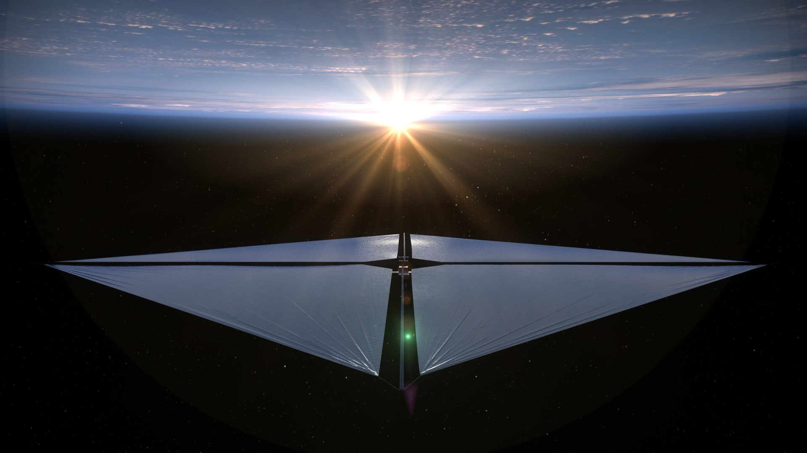

图1｜NASA的ACS3太阳帆概念图，画的是预想中的结构与空间环境，不是在轨实拍。ACS3是一项检验轻型可展开支撑结构的航天技术试验。

接下来，我们先不背火箭方程。只从三个问题出发：光怎样“推”？这么小的力有什么用？帆又如何转弯？

## 第一道坎：没有静止质量，不等于没有动量

一颗球打在手上，你会感到冲击。球被接住之前在运动，接住以后运动状态改变，这个变化与手受到的作用力相对应。

光不能完全当成小球，但有一个相关的物理量可以沿用：动量。光带有能量，也带有动量。对于光，能量与动量之间的关系不同于慢速运动的普通物体，不能因为光子的静止质量为零，就把它的动量也当成零。

要看懂帆，先抓住“前后有什么变化”。

如果一束光被吸收，它原有的动量要在整个系统中重新分配。如果光被镜面反射，传播方向改变，动量同样改变。与这个变化对应，镜面会受到作用力。

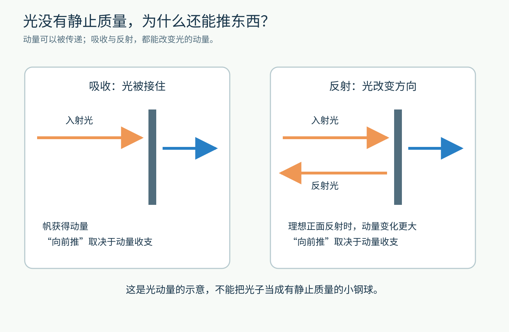

图2｜比较入射前与离开后的光动量。理想情况下，正面反射比完全吸收能传递更多法向动量。图中箭头用于说明方向，未按真实光子的尺度绘制。

一个简单的类比是：你在带轮子的车上接住球，会受到一下推动；把来球朝相反方向弹回去，通常需要让球的动量改变更多，车受到的反作用也更明显。

类比到这里就够了。光子的能量和动量遵循光的规律，不能继续把它想成“非常轻、但仍有静止质量的钢球”。

工程上也能用电磁波的场来计算同一件事。光子图像与电磁波图像不是两个互相竞争的推进器，而是理解光与物质相互作用的不同语言。

## 为什么手上感觉不到？因为力真的很小

靠近地球绕太阳运行的距离，正对阳光的理想反射帆，每平方米受到的光压推力约为百万分之九牛顿。这个数量级可以从[NASA收录的太阳帆技术研究](https://www.nasa.gov/wp-content/uploads/2019/04/niac_2011_phasei_swartzlander_spacecraftroverhybrids_tagged.pdf)中的理想反射模型看出来。

“百万分之九”不太容易想象。我们换成一个自己能检查的教学例子。

假设帆是边长10米的正方形，面积就是100平方米。让它正对阳光，并暂时按理想镜面计算：

- 每平方米约0.000009牛顿
- 100平方米合起来，约0.0009牛顿
- 这相当于地球上一个约0.09克物体受到的重力大小

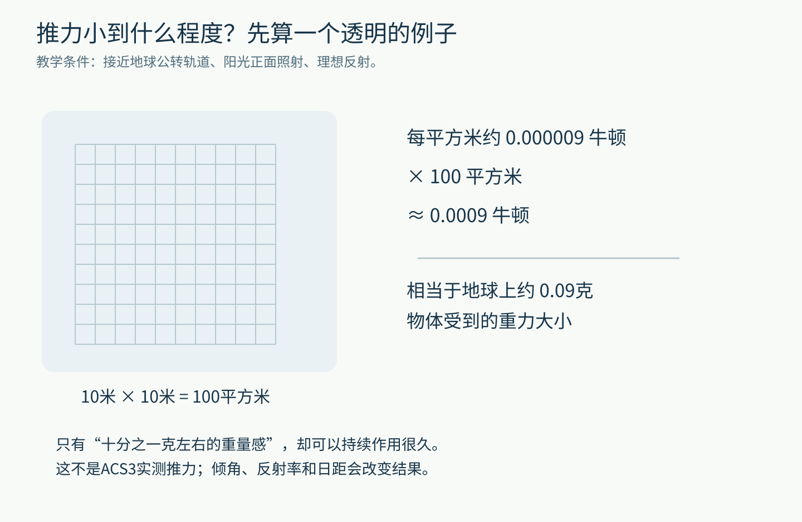

图3｜这个假想例子用来建立数量级直觉，不是ACS3的实测推力。这里的“0.09克”只是把力换成容易体会的重量感，并不意味着太空里多了一颗小砝码。

真实帆的反射率不是百分之百，照射角会变化，离太阳的距离也会变化，推力当然不能永远直接套用这个数。

但它已经解释了为什么晒太阳时不容易感觉到被推动：与重力、支撑力、空气扰动等日常作用相比，光压太微弱了。

## 小到这样，为什么还值得造一艘飞船？

因为改变速度，要看力作用了多久。

继续沿用刚才的假想帆，再假设帆、支架、电子设备等全部加起来是100千克。按照“加速度等于力除以质量”，这个推力每秒能让速度增加约0.000009米/秒。

一秒钟当然几乎看不出来。

可如果方向与大小都保持不变，持续一天，额外速度会累积到约0.78米/秒；持续30天，约23米/秒。

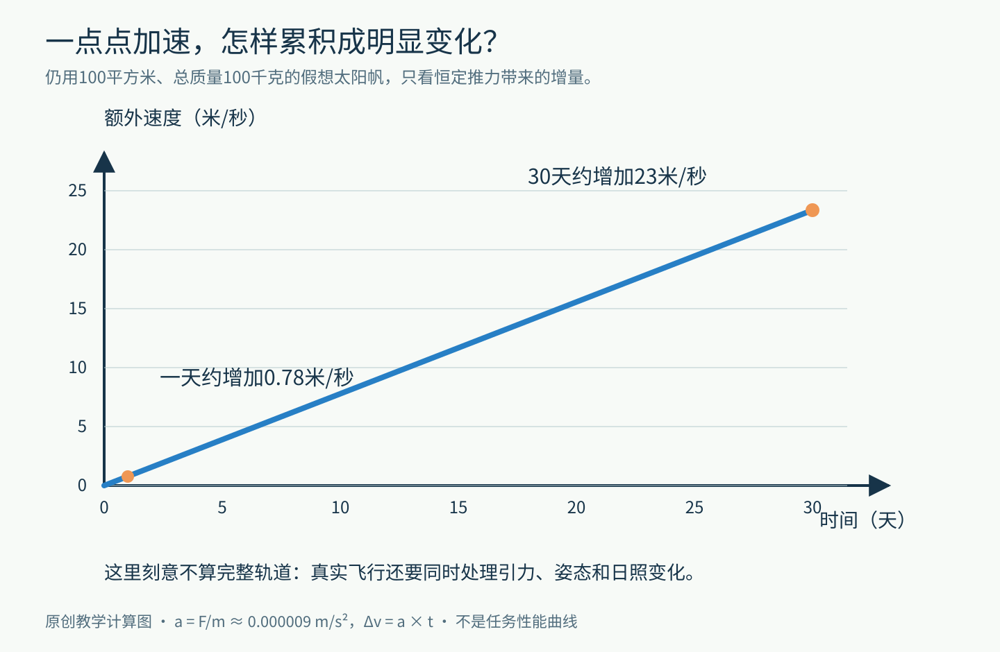

图4｜原创教学计算。为单独看清累积效果，这里没有求解真实轨道，也没有加入遮挡、姿态变化和光照强弱变化。

这个计算不是在承诺“某个太阳帆30天一定跑多快”。真正的轨道中，引力一直存在，航天器也不会沿着固定直线一路加速。它告诉我们的是：**微小而持续的作用，与短暂看不到效果，并不矛盾。**

太阳帆还减少了一个负担：产生主要光压推力时，不必持续喷出自带的推进剂。提供入射光的是太阳，离开的光又带走新的动量，整个动量收支仍然成立。

所以它不是“没有反作用物的免费发动机”，更不是能量凭空出现。

## 它已经是实物，还是只有漂亮插画？

2010年，日本的IKAROS展开了太阳帆。下面这张照片来自它释放出去的小型分离相机。

2010年7月9日，JAXA[公布确认光压加速的结果](https://www.jaxa.jp/press/2010/07/20100709_ikaros_e.html)，报告当时由太阳光压产生的推力为1.12毫牛顿，即0.00112牛顿。

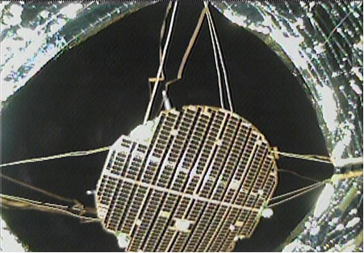

图5｜IKAROS的真实在轨影像，由分离相机于2010年6月19日拍摄，JAXA于6月28日公布。原公开文件像素有限，保留原文件，没有放大后冒称高清。图片：JAXA。

照片能回答“帆是否展开、长什么样”，却不能独自证明那一点推力有多大。推力结论还要结合航天器的精密轨道测定。

这正是科学图像中一个值得养成的习惯：**看见实物，不等于照片证明了关于它的每一句话。**

再往后，NASA的ACS3试验把重点放在另一项难题上：怎样从一个很小的航天器里，放出足够轻、足够大的支撑结构。

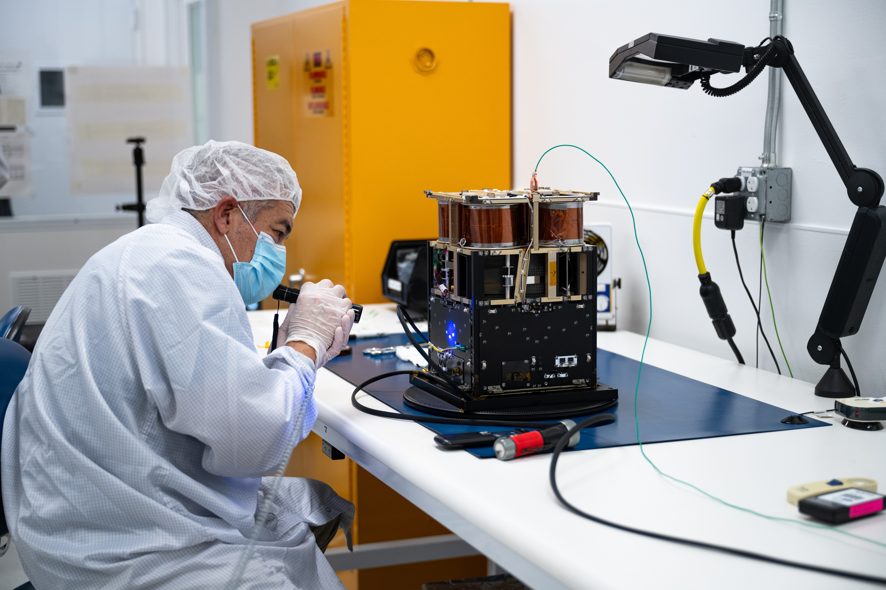

图6｜NASA工程师Mariano Perez在地面检查ACS3航天器。小盒子里要装下展开后约80平方米的帆，这张真实照片提供了与人的尺度对比。摄影：NASA/Brandon Torres。

## 帆为什么不只能被推得越来越远？

看一面斜着放的镜子。光从左边来，反射后未必原路返回。

既然出射光的方向变了，光的动量变化方向也跟着变；帆受到的推力，便不一定与入射光完全同向。在理想镜面模型中，推力沿帆面的法线，也就是垂直于帆面的方向。

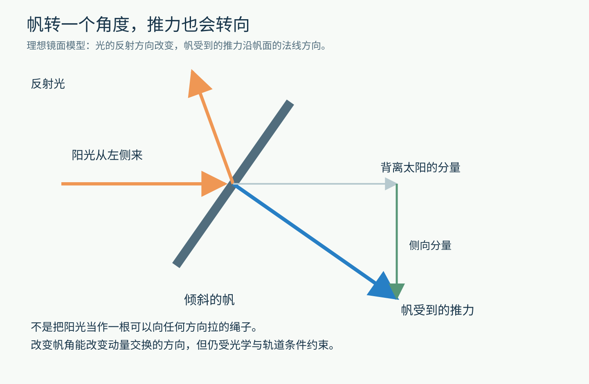

图7｜斜着受光时，帆的推力可以分成背离太阳和侧向两部分。图为理想镜面教学模型，真实帆还要计入吸收、非理想反射等影响。

你可能会接着问：有侧向分量可以理解，可推力仍然有向外的分量，航天器怎么可能往太阳方向走？

诀窍是：航天器原本就在绕太阳运动。

把地球公转想成在不断向前的同时，被太阳引力拉弯路线。太阳帆要改变的，不只是此刻离太阳的距离，还包括绕行的速度，以及轨道的能量和角动量。

如果恰当地安排帆的朝向，让推力有一部分逆着航天器的绕行方向，它就能逐步给这种绕行“减速”。在适当的轨道控制下，航天器可以转入更靠近太阳的轨道。

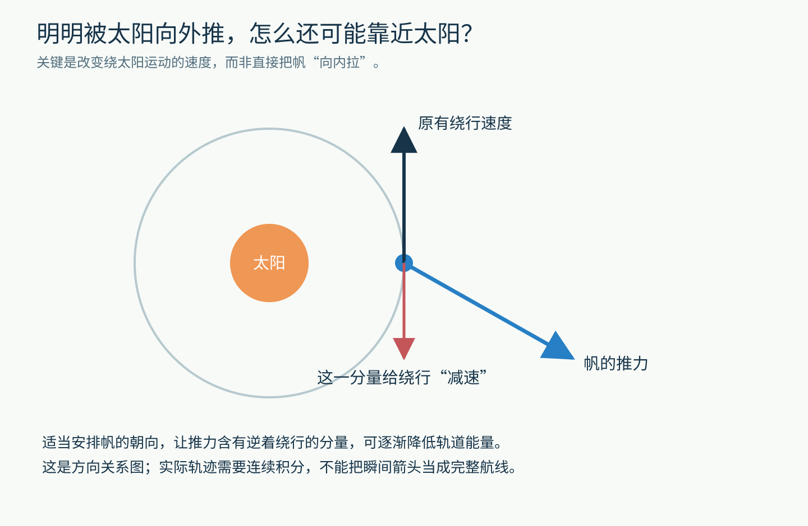

图8｜这个示意只画某一瞬间的方向关系，不是一张已经算好的飞行轨迹。向内转移需要连续控制与轨道计算，不能把“减速”简单理解为立刻直线掉向太阳。

太空航行中，“朝哪里用力”与“最后飞到哪里”之间，隔着一整套轨道动力学。这也是它迷人的地方：直觉可以带你开门，接下来的路需要计算。

## 真正困难的部分，有时不是那条公式

给太阳帆增加面积，看起来能接住更多光。

但帆不是一张没有重量、不会撕裂的数学平面。薄膜有质量，支架有质量，收纳机构也有质量。面积增大时，这些负担可能一起增加。

因此，工程师不能只问“帆有多大”，还要问“这些光要推动多重的整个系统”。

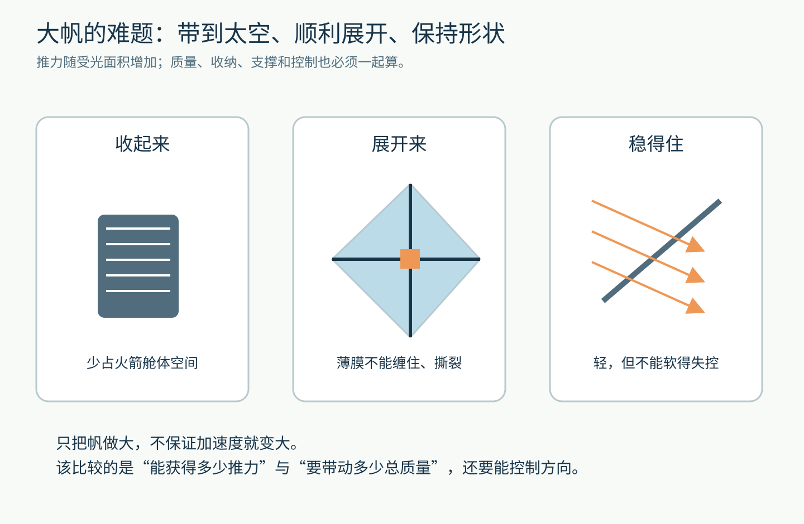

图9｜收纳、展开、刚度与控制相互牵制。原创工程关系示意，不代表某一任务的精确装配图。

ACS3测试的复合材料支撑杆，可以被压扁、卷起，展开后又形成支撑形状。NASA在2024年4月的[任务介绍](https://www.nasa.gov/general/nasa-next-generation-solar-sail-boom-technology-ready-for-launch/)中，把它描述为类似卷尺的紧凑收纳方式。

但“能够展开”与“展开后可稳定按计划航行”，仍然是两个不同的验收问题。

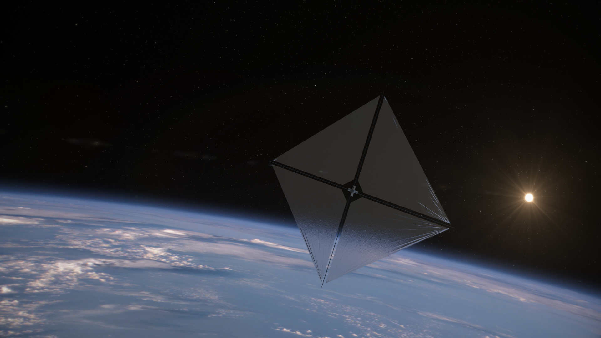

图10｜NASA的受光航行概念图。它有助于辨认飞船、帆面和阳光的关系；它不是某次轨道调整已经成功的实测记录。

2024年8月29日，NASA宣布ACS3的帆和支撑杆成功展开。到2024年10月22日的一次[任务更新](https://www.nasa.gov/blogs/smallsatellites/2024/10/22/update-on-nasas-advanced-composite-solar-sail-system/)，团队仍在研究一根支撑杆的轻微弯曲，并处理姿态与供电条件。

下面是那次更新公开的真实机载相机图。

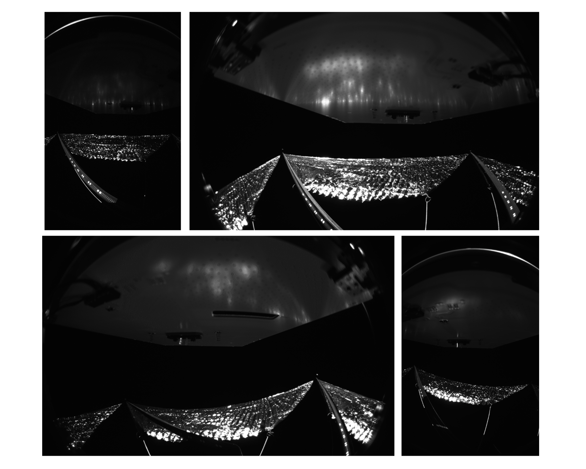

图11｜2024年10月公布的四个机载视角。广角镜头会让本来呈直角的结构和矩形太阳能板产生视觉畸变；不能把图里每一条弯曲都当成真实损伤。NASA在当时的说明中特别讨论了左下视图一根支撑杆的弯曲。

这里引用的是明确日期的工程案例，不把2024年的准备计划写成今天已经全部实现的能力。

一个能在纸上成立的推进方法，要经过材料、机构、测量、姿态控制和供电等环节，才可能变成可靠任务。原理美，工程也一样值得细看。

## 太阳帆最容易被误会的四件事

第一，它主要利用的是光的辐射压力。名称相近的“太阳风”是太阳吹出的带电粒子流，不是普通反射式太阳帆的主要推力来源。

第二，太阳帆通常仍需要火箭先把它送到适合工作的太空环境。刚才那点微小推力，无法把一艘普通航天器从地面直接顶起来。

第三，离太阳更远，单位面积得到的阳光通常更弱。把距离加倍，理想情况下单位面积光照约变成四分之一。帆越往外走，就越需要认真面对这个变化。

第四，收起帆或停止产生推力，不意味着航天器立刻停住。它原本就有速度，还会受引力影响继续运动；推进系统改变运动状态，并不负责每一秒都“托着它前进”。

最后留一道不用航天软件也能想的问题：在刚才100平方米、100千克的假想例子里，如果面积和总质量都增加一倍，加速度会变成几倍？

按照同样照射和反射条件，推力翻倍，质量也翻倍，加速度不变。

因此，“更大”本身不是答案。太阳帆真正利用的，是很小但可以持续的光压，以及把面积、质量、时间和方向安排在一起的能力。

你下一次晒到太阳时，可以多想一件事：那束让皮肤变暖的光，也在交换动量。只是到了足够轻、足够大、足够耐心的航天器上，这件微小的事才显出另一种用途。

图片来源：[NASA ACS3任务介绍](https://www.nasa.gov/general/nasa-next-generation-solar-sail-boom-technology-ready-for-launch/)（概念图：NASA/Aero Animation/Ben Schweighart；地面照片：NASA/Brandon Torres，保留画面与像素尺寸，为文件限额压缩）、[NASA机载图](https://www.nasa.gov/blogs/smallsatellites/2024/10/22/update-on-nasas-advanced-composite-solar-sail-system/)、[JAXA IKAROS相机图](https://www.jaxa.jp/press/2010/06/20100628_ikaros_e.html)（Courtesy of JAXA，未改动）；其余为原创教学示意。
