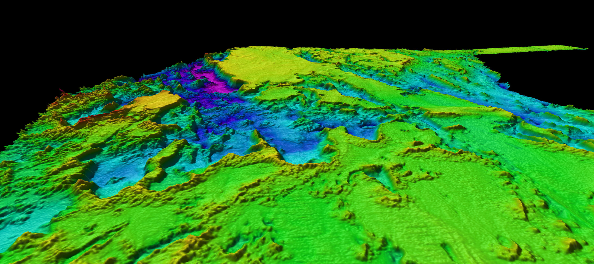
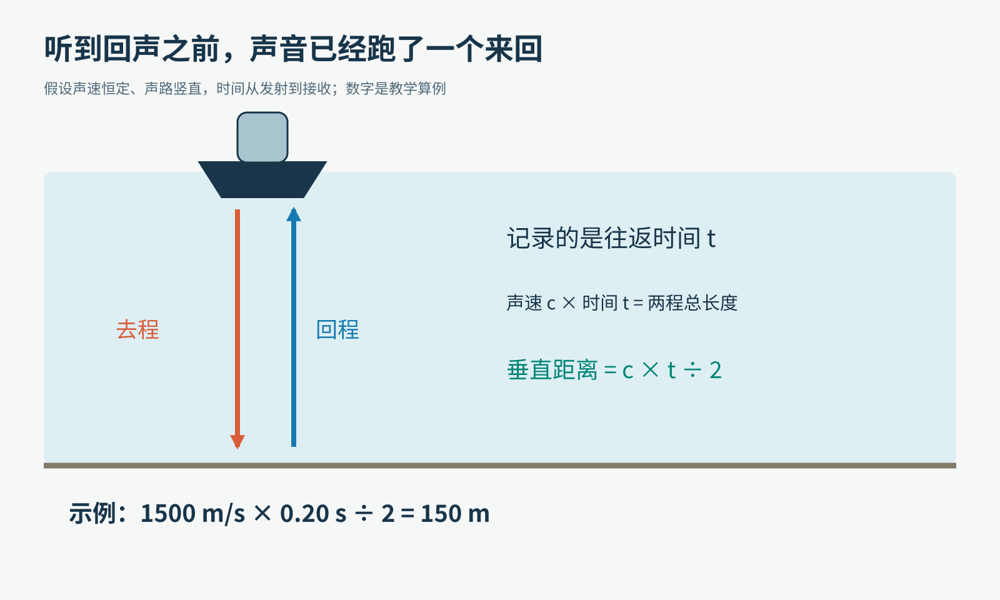
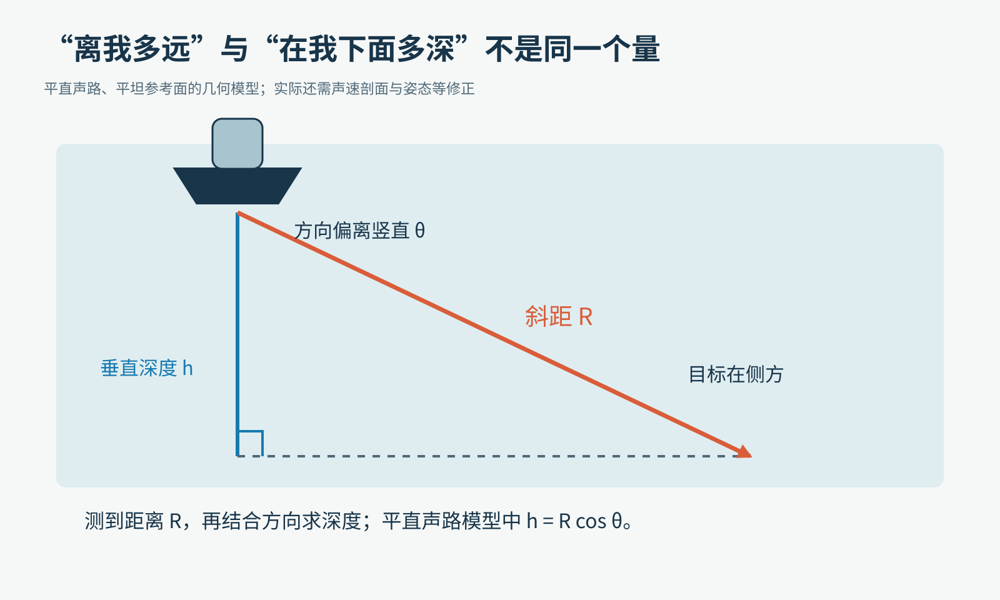
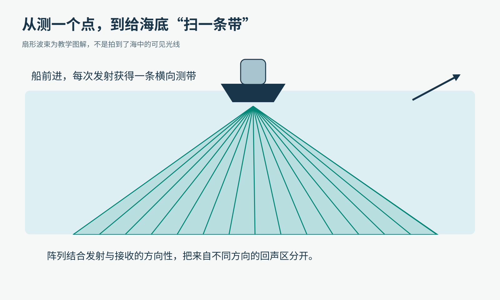
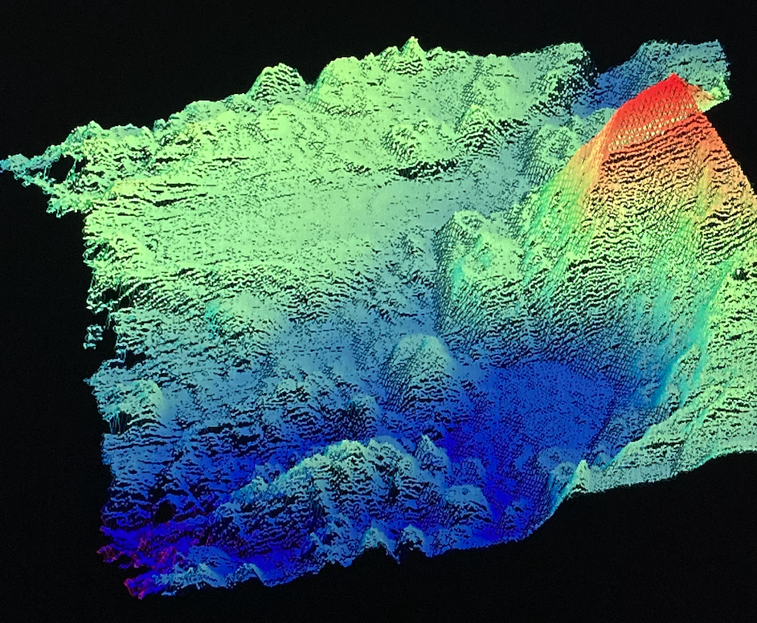
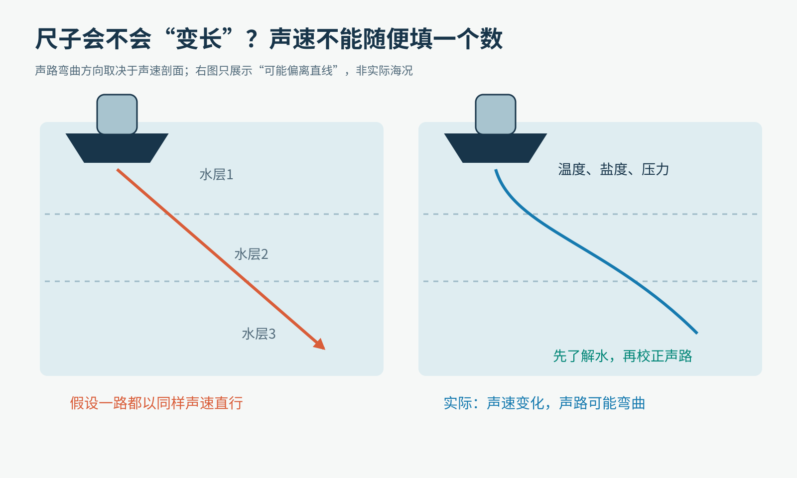
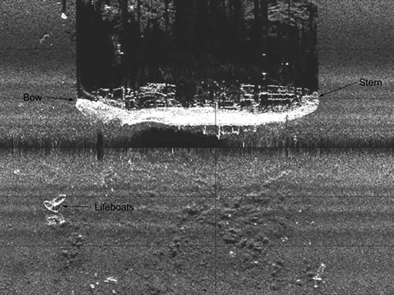
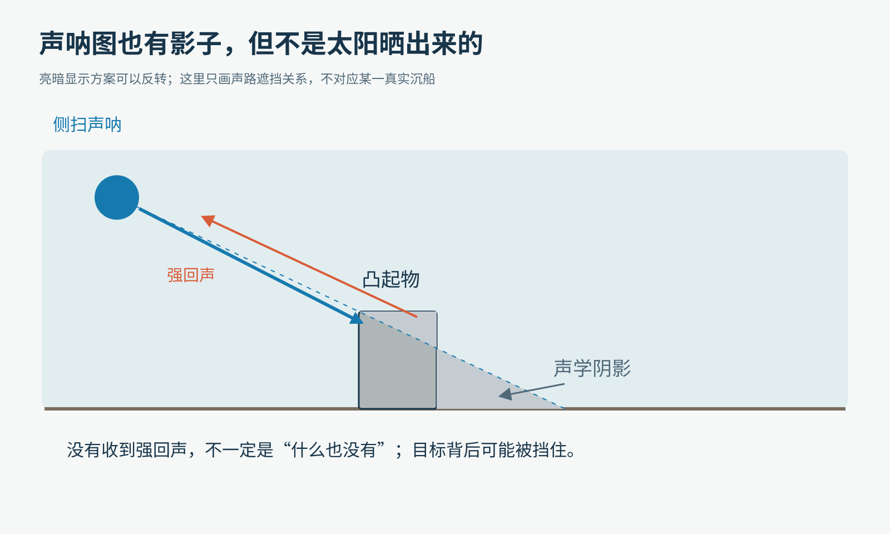
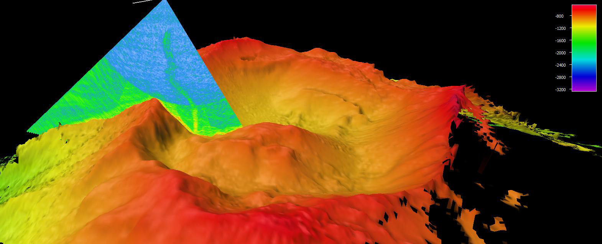

# 不把海水抽干，我们怎样“看见”海底的山、沟和沉船？

这张图像一片被涂成彩虹的山地。它不是潜水员举着相机，在海底拍下的全景照片。

2019年“Windows to the Deep”航次在美国东南部近海采集的多波束测深数据可视化。颜色和立体显示用于表达地形，不是海底的真实颜色。图片：NOAA Ocean Exploration，Windows to the Deep 2019。

图里那些看起来很扎实的山坡与沟谷，最初可能只是计算机里的一串记录：某个时刻发出声音，过了一会儿，在某个方向收到了回声。

从一声“滴”，到一张海底地图，中间究竟发生了什么？

我们来扮演一支刚出港的测量队。今天先不找宝藏，只完成一个朴素的任务：知道船底下是什么，离船有多远。

## 第一步：选一种能走进水里的“探路信使”

在晴天，光能让你看清很远的山。到了水下，光会被吸收、散射，浑浊水体尤其麻烦。用于普通雷达的电磁波，也不适合直接照搬来大范围观察海底。

声音却能在水中传播得很远，具体能走多远仍取决于频率、环境和系统。于是，工程师让声波出发，再接住它带回来的信息。

这就是声呐，SONAR，名称来自Sound Navigation and Ranging。

声呐并不只有会发出“滴滴”声的一类。主动声呐自己发信号、收回声；被动声呐则听环境里已经存在的声音。我们今天做测深和成像，主要讨论主动声呐。

NOAA“奥基阿诺斯探索者”号船底的EM 304换能器，来自2021年测试航次资料。照片是在船舶可从下方接近时拍摄，展示贴近船底的真实设备。图片：Charlie Wilkins、David Blessing、Michael Peperato；2021 EM 304 Sea Acceptance Testing and Mapping Shakedown。

这种负责把电信号变成声振动、或把收到的声振动变回电信号的器件，叫换能器。它不是水下手电筒，但你可以先把它想成能在水里工作的“发声器＋耳朵”。不同系统的发射、接收部分怎样组合，会有差别。

## 第二步：先量时间，别急着说深度

假设我们把声波竖直朝下发射。它走到平坦海底，被反射回来。

如果知道它跑得多快，再测出跑了多久，不就能算出路程吗？

对。这就是你熟悉的：路程＝速度×时间。

但注意，设备记录的是往返时间。

原创教学示意。假设声速恒定、声路竖直；图中的150米是按给定条件算出的例子，不是某次真实海上测量。

取一个便于计算的海水声速近似值：1500米/秒。如果回声在0.20秒后回来，那么声音共跑了300米。海底离换能器的垂直距离，则是300÷2＝150米。

这个“÷2”不是公式规定的装饰。它是在提醒我们：你只想知道单程距离，却给来回两程都计了时。

如果忘记除以二，海底在你的地图上会突然深一倍。再昂贵的设备，也救不了这个最简单的理解错误。

还有一个小细节：这里测到的是换能器到海底的距离。若想得到相对于海面或某个海图基准的水深，还要考虑换能器装在船上多深、海面变化等因素。

## 第三步：听见“多远”，不等于知道“在哪儿”

有人在雾里告诉你：“那棵树离你十米。”你能立即指出树在哪吗？

不能。它可能在左边、右边，也可能在身后。

一段往返时间提供的是距离信息。声呐还需要方向信息，才能把回声放到合适的位置。

特别是向侧面发出的波，走的是斜路。斜着量出来的距离，不能直接当垂直水深。

原创几何示意。先忽略声路弯曲和船体运动；在这个模型里，垂直深度等于斜距乘上与竖直方向夹角的余弦。

不用三角函数也能明白：把一根斜放的梯子缓缓竖起来，梯子长度没变，顶端能到达的高度却变了。距离加上方向，才能确定位置关系。

所以，一台只给出“回声过了多久”的设备，与一台能把周围目标准确放进地图的设备，中间还隔着一大段工程。

## 第四步：船走一次，只测一条细线，太慢了

最直观的办法，是船底下一个位置一个位置地测。船向前走，测出一条剖面线。

但如果想给一大片海域画地图，只画一条线，线与线之间就可能漏掉山包、礁石或沉船。

多波束声呐把测量扩展成横向的一条带：一次发射、接收过程中，获取多个方向的回声信息；船再向前走，把一条条测带拼起来。

原创教学示意。海里并没有这些肉眼可见的彩色细线；它们用来表示不同方向的测量。

这里的“多条波束”，不要想成几十个小喇叭像激光笔一样各指一处。许多系统利用阵列的发射、接收方向性，以及不同传感器间细微的时间或相位关系，区分回声来自哪边。

你有两只耳朵，声音到达两边的细微差别能帮助判断方向。声呐阵列把这种空间信息变成可以计算、校准的测量工具，当然原理和算法要复杂得多。

这样，我们得到的不再只是“150米深”，而是一组带着位置的点。

多波束测点的点云可视化，图片来自NOAA的多波束声呐技术页。每个可见点帮助构成地形；本文不根据这张未给出完整坐标与标尺的图推断具体海域或尺寸。

把足够多的点放在合适坐标里，再经过处理，就能生成文章开头那样的地形图。

可见，彩色山坡不是机器一眼“看见”的成品，而是从测量记录中逐步重建的结果。

## 第五步：船还在摇，水也不是同一锅水

我们的入门算式太干净了：船稳稳停着，水里声速处处相同，声音沿直线去，又沿直线回来。

真实海上没有这么配合。

船会升沉、横摇、纵摇和转向。如果设备以为自己正对着下方，实际上船身已经倾斜，回声对应的位置就可能放错。定位与姿态信息必须和声呐数据在时间上对齐。

另一个问题更不直观：海水中的声速不是永远等于1500米/秒。温度、盐度与压力都会影响它；不同深度的水层，声速还可能不同。

原创教学示意。右图只表示声路可能偏离直线；具体朝哪边弯、弯多少，必须由真实声速剖面计算，不能按这张示意图套用。

因此，测量队会测温度等海洋环境数据，或直接测声速，建立从表层到深处的声速剖面，再修正声路。

这里“剖面”可以理解成一张随深度变化的说明书：每往下走一段，传播条件变成什么样。

来算一个误差。如果真实情况与假设相差1%的有效声速，在简单直线、相同计时条件下，推回的距离也会出现约1%的比例误差。对150米距离，这就是约1.5米。真实分层海水还会影响方向，错误就不只是整个结果乘一个系数。

这就是为什么海洋测量不能只配一只好秒表，还得先了解声波要经过的那一片水。

## 第六步：测深图与侧扫“照片”，看的不是同一件事

现在把任务换成找一艘沉船。只知道每个位置多深可能还不够，我们还想看到轮廓、凸起和周围的散落物。

侧扫声呐很擅长提供这类线索。它向两侧扫查，常利用回波强弱组织成图像。设备可以装在船体上，也可以放在拖曳体或自主水下航行器上，靠近海底工作。

2001年由HUGIN 3000自主水下航行器采集的Robert E. Lee客货轮侧扫声呐图。Bow为船首，Stern为船尾，Lifeboats为救生艇。图片：NOAA。这是声学数据图像，不是光学照片；采用官方标注的最大版本，未放大伪造细节。

读这种图，最需要忍住的一种冲动是：把亮和暗直接当成深和浅。

回波强弱会受到材料、粗糙程度、入射角、距离和遮挡等因素影响。较硬的目标常产生较强回声，但“亮一点”不自动等于“更高”或“离我更近”。不同显示方案还可以把明暗反过来。

更有趣的是，声呐也有“影子”。

原创声路示意，不对应上图沉船的精确尺寸。目标挡住声音，后方一片区域就可能缺少回声，形成声学阴影。

如果一块石头挡住声波，它后面的海床可能没被这次声波照到。回声少，不代表那里有一个深坑，也不代表那里什么都没有。

目标与阴影放在一起，能帮助判断形状和相对高度。但普通侧扫影像不能被直接当成完整精确的水深图，因此常需要与多波束测深等数据配合。

这非常像侦探工作：一条线索不够，多种测量之间能相互支持，解释才更可靠。

## 第七步：海底上方的水，也会回话

声波不一定非得撞上海底才回来。鱼群、气泡等水柱中的目标，也可能产生明显回波。

2017年美属萨摩亚航次在Vailulu’u海山获取的多波束数据可视化。竖起的扇形切片里能看到气泡羽流线索，底部是海山地形。图片：NOAA Ocean Exploration，2017 American Samoa。颜色是数据编码，不是气泡在发绿光。

所以，收到一个“提前回来的回声”，不要立刻宣布海底突然抬高了。它也可能来自水里的目标、不同传播路径，或其他干扰。

测量工作中，采到数据和解释数据是两步。还要考虑质量控制、异常点、交叉测线与其他观测的核对。

一张平滑漂亮的地图，并不能单凭漂亮证明每个位置都测得同样准确。

## 两个边界：为什么不把频率越调越高、扫得越宽越好？

频率、分辨率与探测范围之间存在取舍。较高频的声学系统常能表现更小尺度的细节，但在水中的吸收损耗等因素也可能限制有效范围。

此外，同样角宽的波束，走得越远，覆盖的海底区域通常越大。一个很小的目标，就可能与附近环境的回声混在一起。

这就是为什么想看精细结构时，常让声呐靠近目标，例如装到水下航行器上，而不是只坐在海面上无限放大图像。

扫得更宽也不是免费午餐。边缘波束往往声路更长、入射更斜，对环境修正和几何误差更加敏感。把地图涂满，与把地图测准，是两个要求。

## 最后，轮到你当一次“海底重建员”

不用往水里发声，也可以做一个安全的纸上实验。

请同学在纸上画一条起伏的“海底剖面”，藏在另一张纸后面。他只告诉你五个等间距位置的深度，你把这些点画出来并连线。

然后让他再给你五个新位置的深度，观察你的“海底”怎样变化。最后揭开原图：你之前漏掉了什么？两条曲线在哪些地方都能穿过那几个已知点，却长得不一样？

这个游戏没有模拟声速或真实声呐硬件，但它抓住了重建问题的核心：有限的测量，并不自动等于完整的世界。

再做一道计时题：假设声速仍取1500米/秒，竖直回声在0.08秒后到达，换能器到平坦海底的距离是多少？

答案是60米。若你算出120米，就去图里把去程和回程再走一遍。

从此再看海底地图，你也许会多看到一层东西：那些彩色山坡背后，有声音的往返、船的姿态、水的温盐变化，还有人们不断核对“这条回声到底说明了什么”的耐心。

事实延伸：[NOAA声呐入门](https://oceanexplorer.noaa.gov/technology/sonar/)、[多波束测深](https://oceanexplorer.noaa.gov/technology/sonar-multibeam/)、[侧扫声呐](https://oceanexplorer.noaa.gov/technology/sonar-side-scan/)、[温度剖面与声速校正](https://oceanexplorer.noaa.gov/technology/xbts/)。

图片来源：[NOAA Ocean Exploration多波束技术页](https://oceanexplorer.noaa.gov/technology/sonar-multibeam/)（地形、点云、2017气泡数据）、[NOAA声呐页](https://oceanexplorer.noaa.gov/technology/sonar/)（2001年沉船）、[Charlie Wilkins、David Blessing、Michael Peperato的EM 304设备照片](https://oceanexplorer.noaa.gov/multimedia/okeanos-explorations-ex2101-features-em304-media-transducer1/)；其余为本文原创教学示意。
