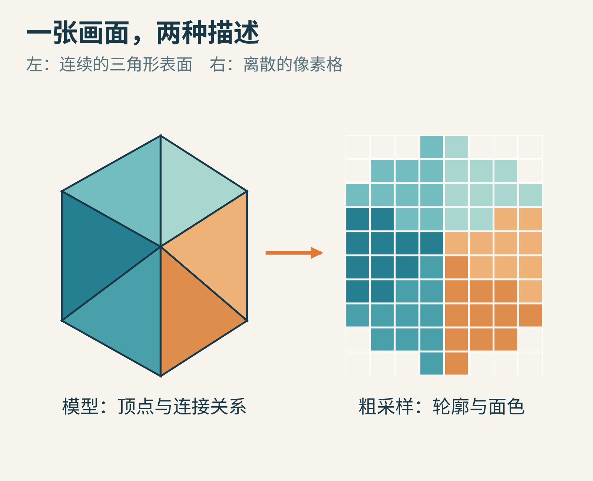
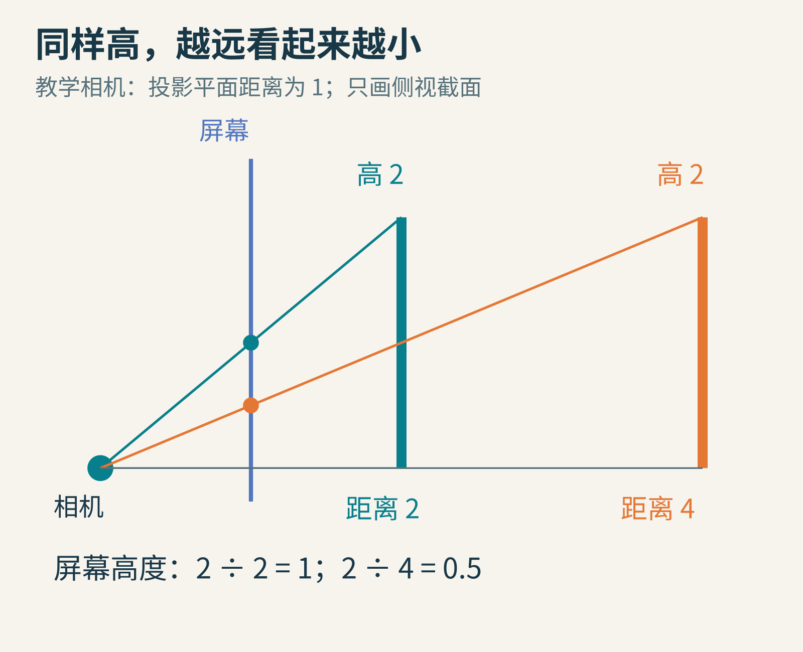
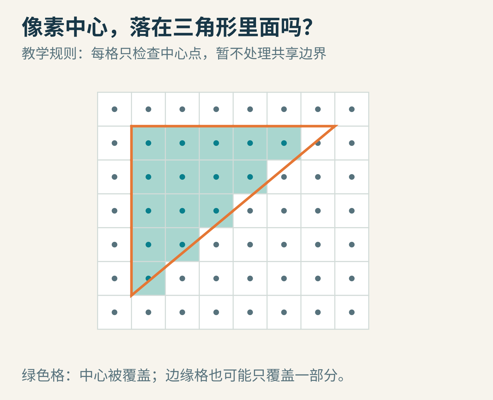
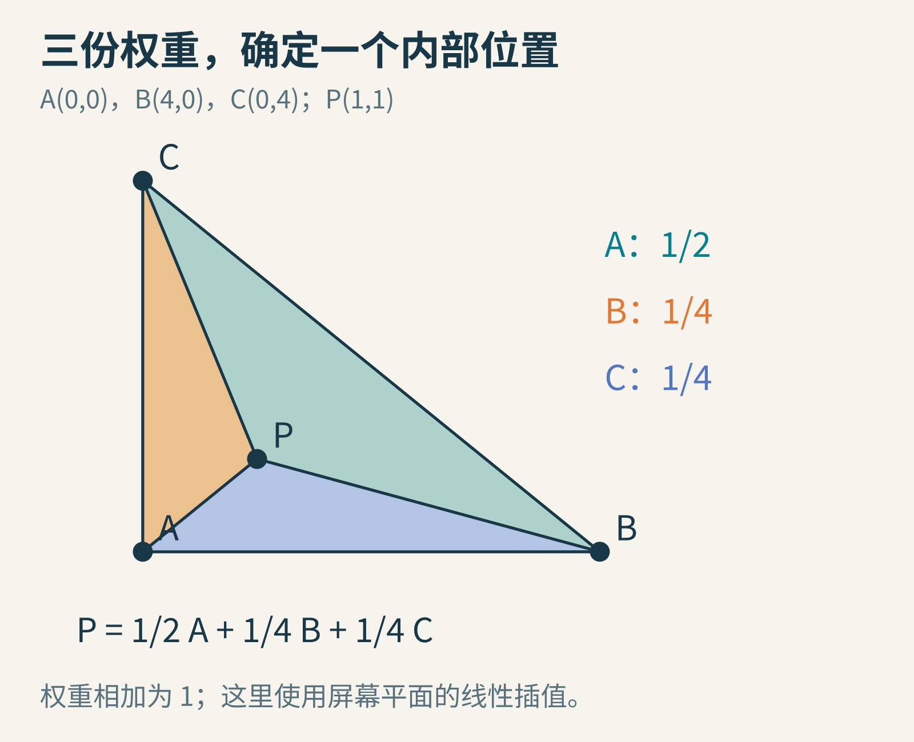
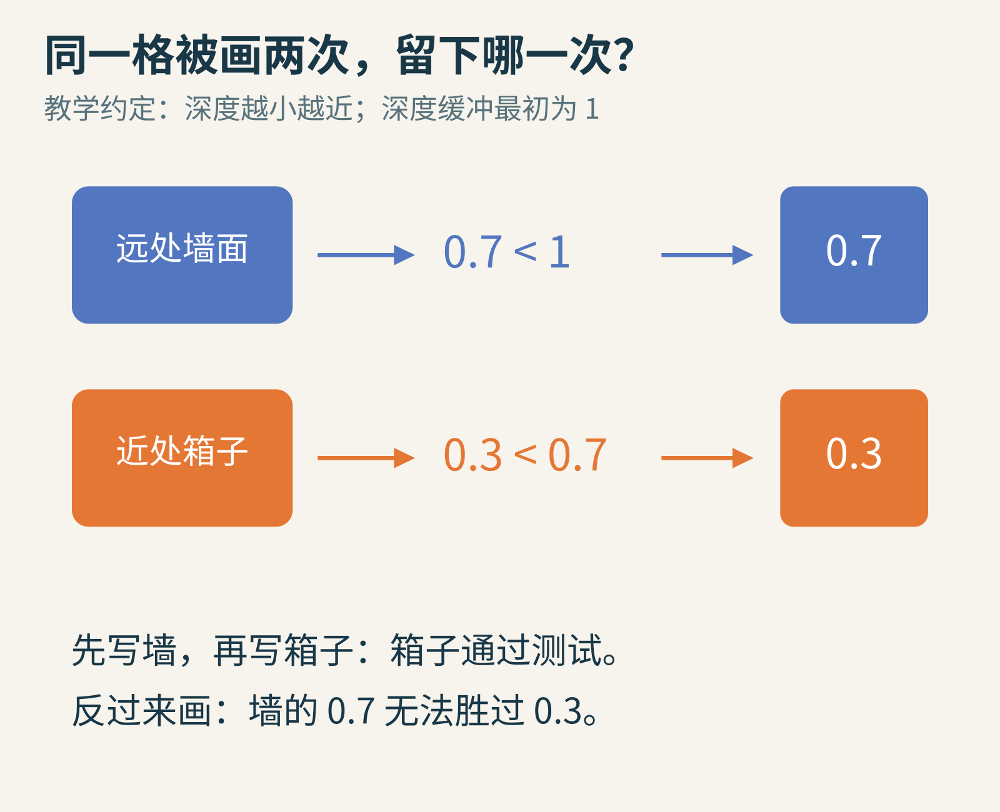
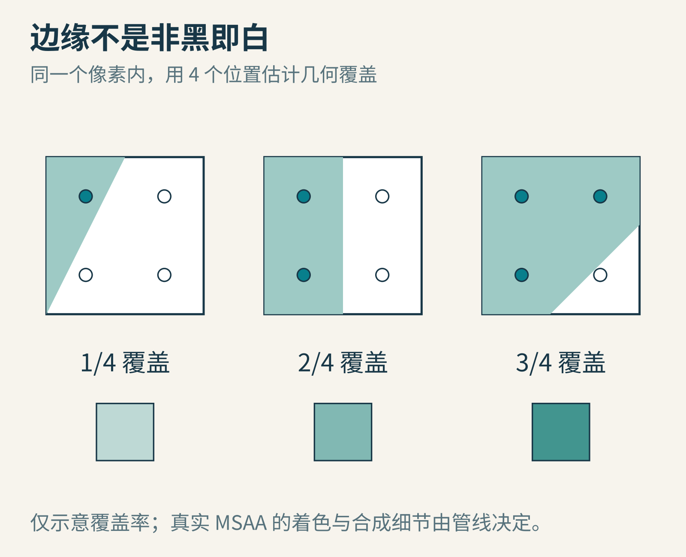
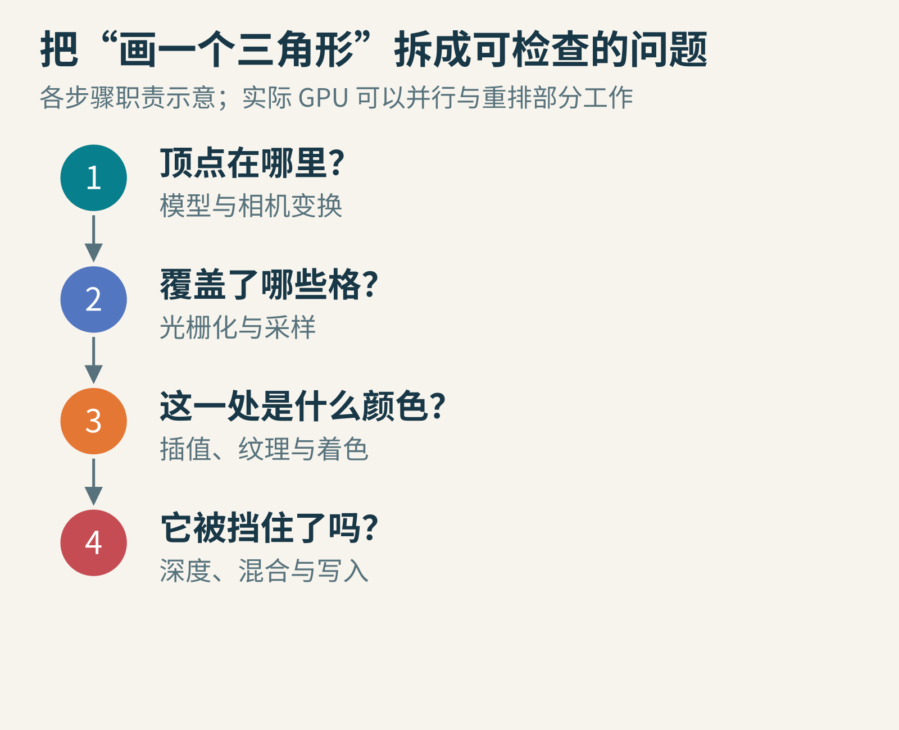

# 游戏里的一只箱子，怎样变成屏幕上的几千个像素？

在游戏编辑器里放下一只箱子，按下运行。屏幕上很快就有了它：近处的边很清楚，远处的墙被挡住，斜边可能还带一点锯齿。

可电脑里并没有一只会发光的小箱子。它得到的，往往是顶点坐标、三角形怎样连接、表面材质，以及相机的位置。显示器要的却是另一种答案：这一格显示什么颜色，下一格呢？

把连续的形状变成离散格子上的图像，是**光栅化**要解决的问题。我们今天给自己造一条小小的绘图流水线，不追求做出完整引擎，先把这两个世界接起来。



原创教学示意。左侧表示由三角形组成的表面，右侧按相同轮廓和面色，对每格中心做粗采样；不是某款游戏的截图。

## 先别上色：箱子的角，应该出现在屏幕哪里？

假设你把一张透明玻璃放在眼前，在玻璃上描出箱子的轮廓。每一个被描出的点，都来自一条从眼睛出发、穿过玻璃、到达箱子表面的视线。

游戏相机也能采用类似的几何关系。为了容易算，我们让相机在原点，朝前看，把屏幕放在距离为1的位置。空间中一个点的横向位置记为x，向前的距离记为z，那么它在屏幕上的横向位置是x÷z。这里要求点在相机前方，而且没有加入真实镜头的畸变。

分母解释了“近大远小”：同样高2个单位的竖杆，距离2时，投影高1；距离4时，投影高0.5。



光线与屏幕的交点决定投影位置。图中距离与高度是教学设定，用于推导比例关系。

完整图形管线还会处理模型自身的平移旋转、相机变换、视野之外的裁剪，再把投影坐标换成屏幕坐标。先把这些步骤理解成“换一种坐标描述同一个位置”就够了。它们尚未回答哪一格该亮。

现在，假设一个三角形已经被转换到屏幕平面。接下来的问题终于很具体：它盖住哪些格子？

## 一个三角形，可以变成许多次“在里面吗”

拿方格纸画一个三角形。最朴素的规则是：看每格的中心，如果中心在三角形内，就把这一格涂上颜色。

边缘格会出现有趣的情况：三角形明明蹭到了这个格子，可中心在外面，于是这格没有被涂上。隔壁格子只有大半被覆盖，中心却在里面，于是整格被涂上。



橙色线是连续边界，绿色格的中心位于内部。格子被部分覆盖，与中心被覆盖，是两个不同的问题。

如何让程序判断“里面”？可以沿三条有方向的边，分别判断点在边的哪一侧。对于按同一方向排列的三个顶点，如果测试点位于三条边一致的内侧，它就在三角形内。

实际图形接口还必须约定边界如何归属。两个三角形拼成一个正方形时，共享的那条斜边不能因为含糊的规则，变成一道漏光的裂缝或重复处理的边。[Vulkan的光栅化规范](https://docs.vulkan.org/spec/latest/chapters/primsrast.html)详细规定了覆盖、采样与三角形相关规则。本文的方格纸模型只保留中心测试的直觉，不尝试复刻所有硬件规则。

这里产生的候选记录通常称为**片元**。它带着位置、深度以及后续着色需要的属性。片元和最终屏幕像素不能简单画等号：同一像素位置可能先后收到多个片元，某些片元会被丢弃，多重采样时一个像素里还会有多个采样位置。

## 三个角有颜色，中间怎么办？

设三角形的三个顶点是A(0,0)、B(4,0)、C(0,4)。我们挑内部点P(1,1)。

它可以写成：

P＝0.5×A＋0.25×B＋0.25×C。

先验算横坐标：0.5×0＋0.25×4＋0.25×0＝1。纵坐标也得到1。三份权重相加恰好等于1。

这三份数叫**重心坐标**。先不被名字吓住：它们就是“这个内部点由三个角各贡献多少”这一问题的一种答案。



三个子三角形的面积比例，也能给出对应对面顶点的权重。P更靠近A，因此A的权重更大。

假设A带红色、B带绿色、C带蓝色；用0到1的三个分量表示颜色。按照同样权重混合，P得到(0.5,0.25,0.25)。这是一个偏红的颜色。本文只计算颜色分量的线性教学模型，不展开显示器编码和色彩空间。

更有用的是，顶点携带的可以不只是颜色，也可以是纹理坐标。**纹理**可以先想成贴在表面上的一张图片；纹理坐标回答“表面的这一处，去图片哪里取颜色”。着色器再把这些信息与光照、材质等结合，算出候选颜色。

但别马上把上面的线性加权抄给所有三维属性。透视投影改变了空间比例；对倾斜表面上的纹理，直接按屏幕距离平均，可能使图案看起来变形。常见图形管线提供透视校正插值，涉及投影前的齐次坐标w。我们这一步的简单计算，限定在屏幕平面线性插值，或没有透视差异的情况。

## 墙和箱子都抢这一个像素，谁赢？

想象你先画远处的墙，再画近处箱子。如果谁后画谁盖住前者，刚好能得到正确结果。

但把顺序反过来呢？墙就会把箱子擦掉。复杂场景里还有互相穿插的几何体，只按“整个物体离相机多远”排序也不够。

一种常见办法是给每个采样位置另备一本小账，记录目前留下来的深度，叫**深度缓冲**。

在我们的教学约定里，深度越小越近，初始值是1。墙送来0.7，比1小，先留下。箱子送来0.3，比0.7小，替换墙。如果先画箱子，墙后来的0.7就无法通过测试。



这里使用“小值更近”的约定。真实项目也可能采用反向深度，不能把0.3与0.7的含义脱离比较规则单独背下来。

对于采用一致测试规则的不透明表面，这能大幅减轻绘制顺序的麻烦。可玻璃还需要把前后颜色混合，不能靠“只留下最近那一层”解释全部效果。相距非常近的表面，也可能因有限深度精度出现闪烁，通常叫深度冲突。

深度测试、混合和颜色写入的正式语义，可以在[Vulkan片元操作规范](https://docs.vulkan.org/spec/latest/chapters/fragops.html)中继续查。真实GPU可能提前执行符合条件的深度测试，以免给最终会被挡住的片元做昂贵着色；教学顺序不是硬件每一步执行时刻的承诺。

## 为什么斜线像楼梯？多问几次，会好一点吗？

回到方格纸。只问一次“中心在里面吗”，答案只有是或否。三角形边缘慢慢移动时，有些格子会突然从全空变成全满，轮廓于是像在跳。

一种思路是在每个像素里选多个采样位置。假设有4个位置，其中1个在内部，覆盖率就是1/4；3个在内部，就是3/4。边缘的合成结果便有机会出现过渡。



这是几何覆盖率示意。MSAA是多重采样抗锯齿的一种常见机制；它并不等于把所有材质计算完整执行四遍，也不自动解决纹理、透明材质和时间变化带来的所有锯齿。

注意它解决的问题范围：我们更细地观察了三角形怎样穿过像素。若表面本身贴着非常密集的条纹，或画面快速运动，仍需要别的采样与抗锯齿处理。

## 你已经能写一个小型“纸上光栅器”

下面这个Python 3程序不依赖图形库。它检查8×8方格的中心，并把落入A(0,0)、B(6,0)、C(0,6)三角形的格子画成井号。

```python
for row in range(7, -1, -1):
    line = ""
    for col in range(8):
        x, y = col + 0.5, row + 0.5
        inside = x >= 0 and y >= 0 and x + y <= 6
        line += "#" if inside else "."
    print(line)
```

这段教学代码已用Python实际执行，输出是：

```text
........
........
#.......
##......
###.....
####....
#####...
######..
```

程序按从高到低的y输出行，因此三角形在文本里朝左下展开。这里把恰好落在斜边上的中心算作内部；它没有实现用于拼接三角形的统一边归属规则。

可以做三轮实验：

1. 把6换成5.5，再换成5.4。哪些格子会突然消失？这就是采样阈值的跳变。
2. 把每格一个中心改成四个偏移点，数内部点的数量，用“·、░、▒、▓、█”中的不同符号表示0到4个。现在边缘如何变化？终端对字符的显示宽度可能不同，不影响覆盖率计算。
3. 再加一个三角形，给它不同深度。为每格保存“当前颜色和深度”，交换两个三角形的处理顺序，看看不透明区域是否仍然一致。



把整条流程分开之后，错误也有了位置：轮廓错，先看变换与覆盖；纹理歪，检查坐标与插值；遮挡错，检查深度状态；边缘跳，检查采样。

下一次看到游戏里一个箱子时，可以试着把它拆成这些问题。显示器最后只亮出了颜色，但颜色背后，是许多次精确而局部的几何判断。

图片来源：本文全部配图为原创教学示意，由公开图形管线原理与文中明确设定的几何算例绘制；不是引擎截图或性能测试结果。技术参阅[Khronos Vulkan光栅化规范](https://docs.vulkan.org/spec/latest/chapters/primsrast.html)与[片元操作规范](https://docs.vulkan.org/spec/latest/chapters/fragops.html)。
