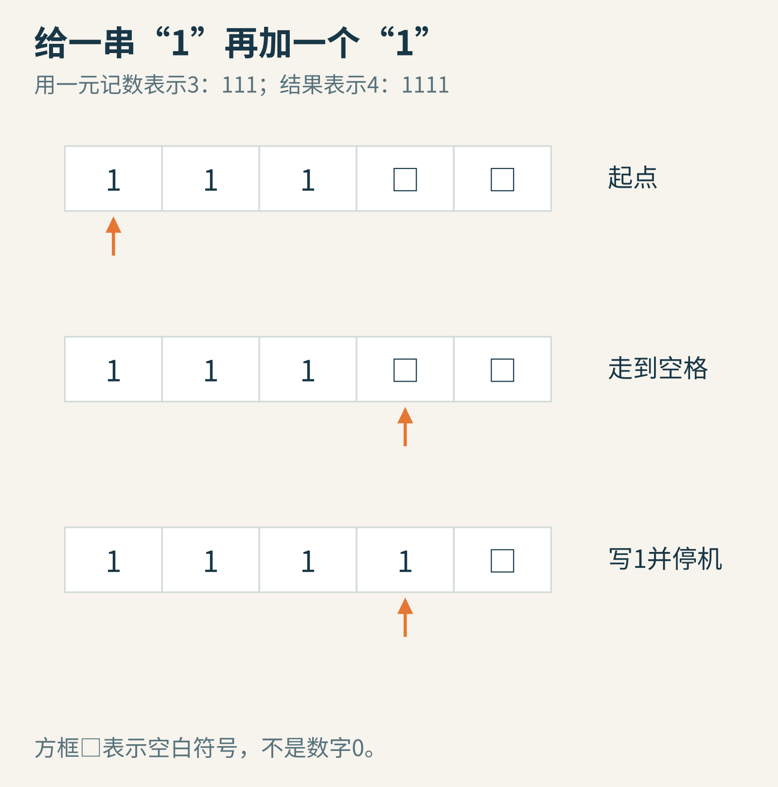
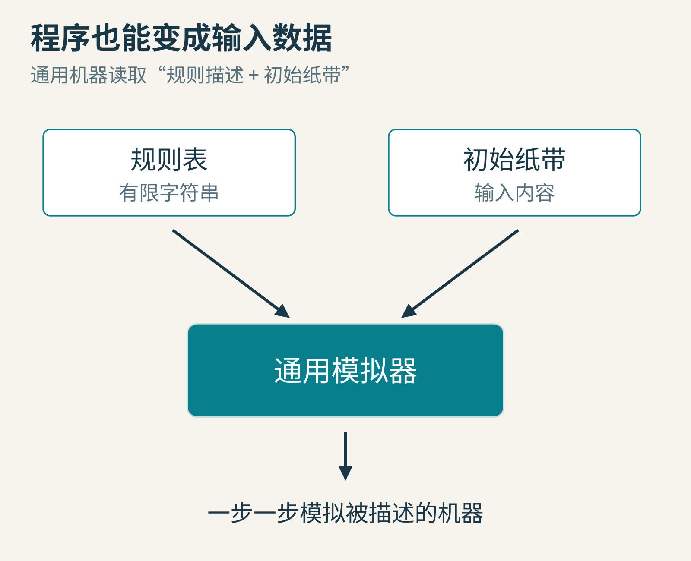
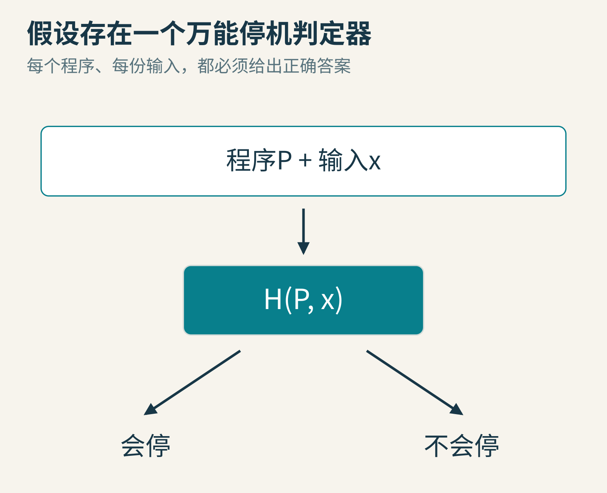
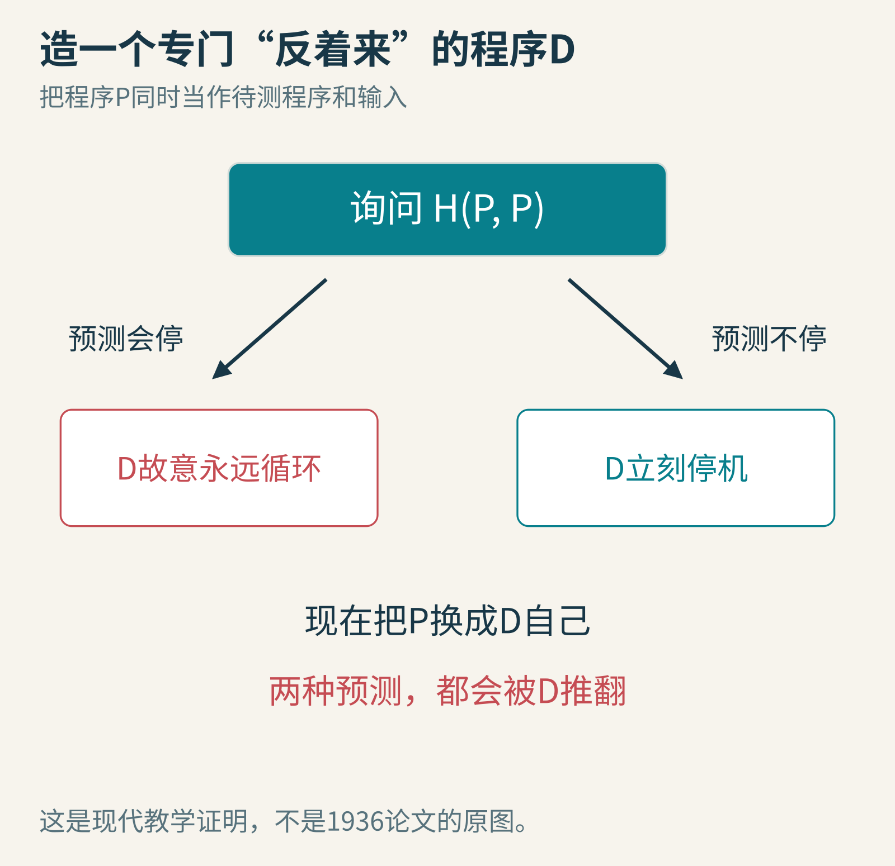

# 一条纸带，能算多远？图灵机与一个无法万能回答的问题

假如有人递给你一个程序，说：“帮我看看，它最后会不会停下来。”

简单的程序很好判断。打印一句“你好”就结束，当然会停；无条件重复同一条指令，当然不会停。但如果程序有循环、有输入，还会生成另一个程序呢？能不能做出一个完美工具，接受任意程序与输入，总能在有限时间内给出正确答案？

这个问题没有被电脑跑得不够快卡住。它触到了“算法能做什么”的边界。

要走到那里，我们先不谈现代处理器，而是做一台笨得可爱的机器：它只有一条纸带，每次只能看一格，写一个符号，移动一小步。

## 一、1936年的问题，不是怎样制造更快的笔记本

图1：阿兰·图灵约16岁时的护照肖像，档案来源为剑桥大学国王学院AMT/K/7/4；Commons将年代记为1928–1929，摄影者可能是Arthur Reginald Chaffin，身份并未完全确定。采用675×919完整Commons版本，已有历史灰度、亮度及裁边调整，本文未再加工。[文件页](https://commons.wikimedia.org/wiki/File:Alan_Turing_Aged_16.jpg)

图灵的《论可计算数及其在判定问题上的应用》首页记载：1936年5月28日收到，11月12日宣读。论文关注的是，哪些数与问题能够用有限、明确的步骤处理，而不是教人装配一台商用电脑。[原论文](https://www.cs.virginia.edu/~robins/Turing_Paper_1936.pdf)

当时，“计算”还可以指人拿着纸笔按规则工作。图灵试图把这件事抽象到足够简单：人能看到有限的一小块纸面，记住有限的状态，按规则写写改改。把这些动作形式化，才能严肃地讨论“所有这样的计算方法”。

阿隆佐·丘奇在同一时期通过另一种形式化路线得到重要的不可解结论。图灵原论文明确讨论丘奇的有效可计算性，并在附录说明两种形式化之间的关系。这里的历史不是“一台机器由一个人突然发明，从此所有理论齐备”，而是数学家们从不同方向追问同一个深问题。

## 二、一台机器，只需要三样东西

第一样，是一条划分成格子的纸带。每格写一个符号，例如1或空白□。纸带按模型约定可以继续向外延伸，不事先设置固定长度上限。

第二样，是读写头。它每次只看当前格，可以改写该格，然后向左或向右移动。我们也可以在教学模型里允许不移动，或者用额外状态模拟这个动作；这些常见变体不改变本文要讨论的计算能力边界。

第三样，是有限的内部状态和一张有限规则表。规则根据“当前状态、当前符号”决定“写什么、往哪走、切换到什么状态”。

图2：本文采用现代教学版本的图灵机。它是抽象模型，不是1936年真实设备照片，也不是原论文排版的复刻。

不要把状态想成神秘的意识。它像电梯控制器上的“上行、下行、开门”，只是有限个标签。规则表里没有“遇到困难就灵活处理”，每一种允许的动作都要写清楚。

但这里有一个重要区别：内部状态数量有限，不表示整个计算只有有限信息。纸带可以保存越来越多的中间结果。若只留下有限状态、却没有可扩展的存储，就会得到能力不同的模型。

## 三、亲手写一个会停机的小程序

为了不让二进制进位分散注意力，我们先用一元记数：1表示一，11表示二，111表示三。这个表示很浪费空间，却适合看清机器动作。

输入是连续的三个1，右边空白。读写头从第一个1开始，内部状态叫SCAN。

规则只有两条：

- 在SCAN状态读到1：仍写1，向右移动，继续SCAN。
- 在SCAN状态读到空白□：写1，进入HALT状态，不再执行。

图3：第1、2、3步依次越过三个1，第4步在空白处写1并停机。中间图省略了两个相似扫描画面，不表示机器一步跳过三格。

结果是1111，即四。这个机器完成了“一元数加一”。

为什么它一定会停？不是因为我们试了111这一个例子，而是因为输入假设为有限长的连续1。每次读到1就向右一格；有限个1之后一定会读到空白，于是停机。如果输入不满足约定，例如纸带上出现规则没定义的符号，就要另外规定拒绝或报错，不能默默说原证明仍然适用。

这已经是一种程序正确性推理：说明输入条件，再找出每一步的规律，最后解释为何必然到达终点。

## 四、为什么一条这么笨的纸带值得研究？

你可能会说，真正的程序有变量、数组、函数、栈，纸带怎么装得下？

关键不在于纸带看起来像不像电脑，而在于这些结构能否被编码。可以用不同符号划分区域，在纸带上写下数值、标记当前位置，把复杂指令拆成很多小步。这样通常很慢，却可以保留计算结果的含义。

这里讨论的是“原则上能不能算”，不是“以多少帧每秒运行”。计算能力与计算效率是两个问题。一个模型能模拟另一个模型，不代表模拟没有巨大成本。

图灵进一步提出通用机器：把另一台机器的规则描述也写成符号串，让一台固定的机器读取它，再逐步模拟那台机器。于是，程序不再只是机器外面的一张说明纸，也可以作为机器处理的数据。

图4：程序作为数据。图中的模块是解释关系，不宣称它就是现代CPU的实际电路布局。

这一步非常深。文字编辑器把源码当文字处理，编译器把程序翻译为另一种表示，调试器分析程序状态，它们都能帮助你直觉理解“程序本身可以成为输入”。但现代这些工具的具体架构，不应直接说成1936年论文已经逐一设计好了。

还有一条常被说过头的判断：丘奇—图灵论题把直觉上的有效计算，与形式模型能够计算的范围联系起来。它不是关于“任何物理过程必然都能被普通电脑高效模拟”的已证定理，也不是说自然界只有一条纸带。

## 五、先把万能检查器的承诺说清楚

现在假设存在一个程序H。输入是程序P和输入x，输出是“P在x上会停”或“P在x上不会停”。

为了配得上“万能”，H必须满足三个条件：

1. 对每一个合法程序P和每一份合法输入x都适用。
2. H自己总能在有限时间内给出答案。
3. 答案永远正确。

图5：这三个条件必须同时成立。允许永远不回答，就不再是我们假设的判定器。

“把P跑一遍，看看它停不停”不能满足承诺。如果P停了，你确实知道它会停；如果它一直没停，你不知道是永远不停，还是还需要再等一会儿。

也不能偷偷加一个超时规则：“运行一小时还没结束，就判断不会停。”一个程序完全可以先计数很久，然后正常结束。阈值再大，也只是一段有限等待。

## 六、造一个专门跟预测反着来的程序

接下来是现代教材常用的对角线证明。请先接受“程序可以被编码成字符串，所以也可以作为自己的输入”，不要把自我输入想成电脑必须有自我意识。

利用假想的H，我们构造一个新程序D，输入为程序描述P。

D先询问H：“P拿到P自己的描述作为输入，会不会停？”

- 如果H说会停，D就故意进入无限循环。
- 如果H说不会停，D就立刻停机。

图6：D的构造只使用我们假设已经存在的H，再加上简单的条件分支、停机与循环。

现在问：D拿到D自己的描述作为输入，会怎样？

如果H(D,D)预测会停，按D的定义，它就无限循环。预测错了。

如果H(D,D)预测不会停，按D的定义，它就立刻停机。预测又错了。

只有两种答案，两种都冲突。矛盾来自哪里？来自我们一开始假设那个满足全部承诺的H存在。因此，不存在这样一个对所有程序与输入都正确、并且总能结束的算法。

注意，这不是把D真的跑到宇宙尽头才得出的观察，也不是说“我想不出H，所以H不存在”。它是一个条件推理：如果H存在，就能用它构造D；而D迫使H违背自己的承诺。

## 七、历史上必须说准确的一处

常见说法是“图灵1936年证明了停机问题不可判定”。作为宽泛的历史归属可以理解，但如果你去翻原论文，不会看到刚才这套现代术语与同样写法的证明。

图灵当时研究的包括circle-free问题：机器是否会持续打印无限多个指定类别的数字符号。一个机器可能一直运转，却不再打印这些数字，因此“不断运转”与原论文的“circle-free”不能简单画等号。原文还证明了与符号打印相关的问题不可判定。

Hamkins与Nenu关于这段历史的研究特别区分了这些问题，并解释符号打印问题与现代停机问题之间可以有效转换。[作者研究说明](https://jdh.hamkins.org/turing-halting-problem/)

所以本文采用的表述是：图灵建立了计算模型、通用机器与不可判定性的重要基础；我们借用现代停机问题及现代对角线证明来理解这条边界。它不是1936年论文原段落的中文翻译。

对学生来说，这个区分很有价值。学懂今天的概念，并不意味着可以把今天的术语原封不动塞回历史人物的嘴里。

## 八、既然没有万能工具，程序分析还有用吗？

非常有用。被否定的是那三个条件同时成立的全能承诺，不是对每一个具体程序的分析。

我们已经证明了一元加一程序会停。对于一个从正整数n开始、每步减1直到0的循环，也能指出一个非负整数度量，每次严格变小，所以不能无限下降。

某些系统的完整状态空间确实有限。如果确定性的系统在继续运行前，完整状态再次重复，那么以后的路径会重复；但“完整状态”必须包含所有影响未来的信息，不能只看某个变量或屏幕画面。大型系统的状态数还可能极其庞大，理论上有限不意味着实际容易穷举。

图7：超时是工程上的资源决定，不是一般性的不可终止证明。

实际检查器还可以选择：只分析某类受限程序；给出可靠的部分结论；遇到无法证明的情形返回“未知”；或者做测试、设置资源上限。每一种方案都可以很有价值，只要把承诺写清楚。

图8：边界不是让工程师放弃，而是帮助他们选择诚实的保证。

本文也没有证明“所有程序问题都无法判断”“所有人工智能都不可靠”或“人脑必然超越机器”。这些都不是刚才那段证明的结论。一个严谨结果的力量，来自明确的适用范围，而不是被无限扩大。

## 九、你可以亲手做的三次探索

同目录exercise.py实现一元加一的有限规则表，分别测试0、1、3、8。0用空白纸带表示。它记录每一步的状态、位置与符号，最后检查结果是否多了一个1，以及步数是否等于输入长度加1。

这个模拟器带有最大步数保护，防止教学实验无意中一直运行。超出限制时，它只报告“达到观察上限”，绝不会冒充“已经证明不会停”。

你可以继续做：

1. 把遇到空白时的规则改成“保持空白、向右、继续SCAN”。为什么这个版本不会停？给出关于每一步的理由，而不是只展示运行一分钟的截图。
2. 设计一台一元减一机器。你需要决定0输入如何处理，还要说明读写头最终停在哪里。
3. 把无限循环程序与一个先计数一百万次再结束的程序交给超时检查器。它们在短观察窗口里为什么可能得到相同报告？

最后，用你自己的话重讲D的两种分支。如果能够指出“万能H”的哪一条承诺被迫失败，你就已经越过了这篇文章最抽象的一道门。

一条纸带的意义，不在于它是世界上最方便的电脑。它让“按规则计算”变得足够清楚，也让我们第一次能精确地问：哪些困难来自机器还不够好，哪些边界来自问题本身？

---

本文为AI辅助研究、写作与原创图示制作。机器图为教学模型，没有伪造历史实物；例程仅验证小型规则机，不声称解决一般停机问题。完整史料、权利与模型约定见[sources.md](sources.md)。

图片来源：[图灵历史肖像](https://commons.wikimedia.org/wiki/File:Alan_Turing_Aged_16.jpg)；其余为本文原创教学图。
