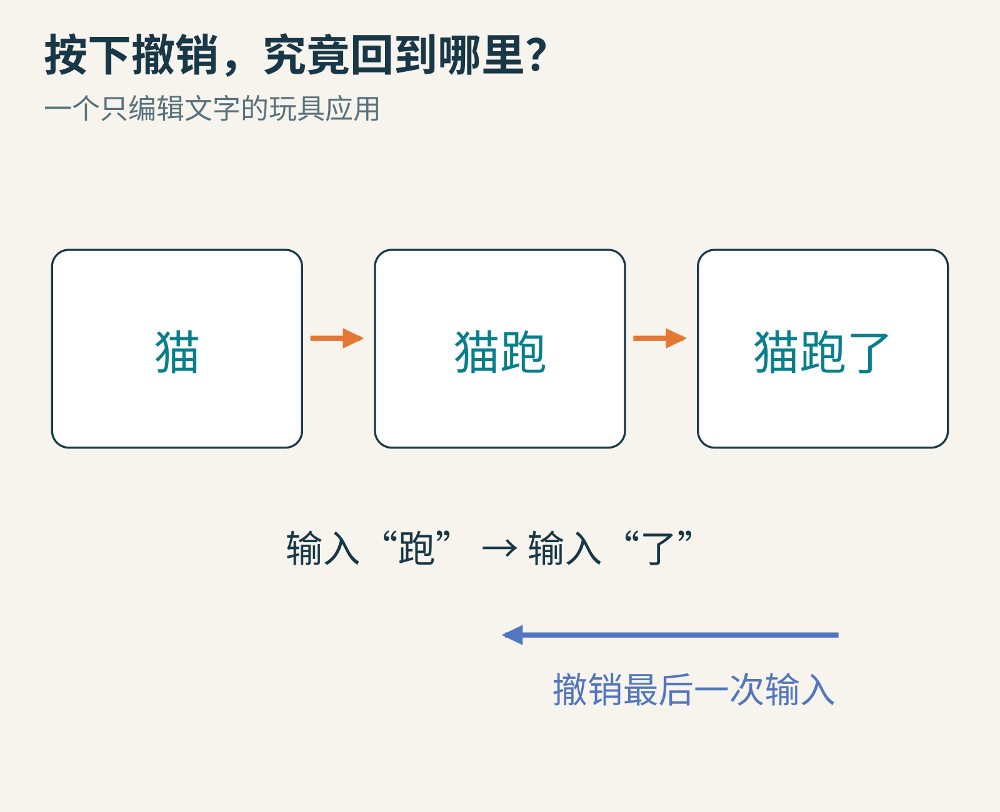
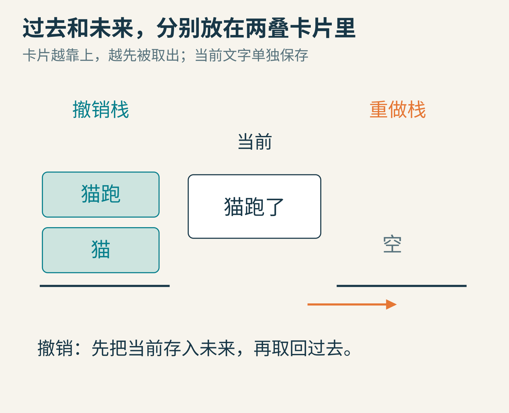
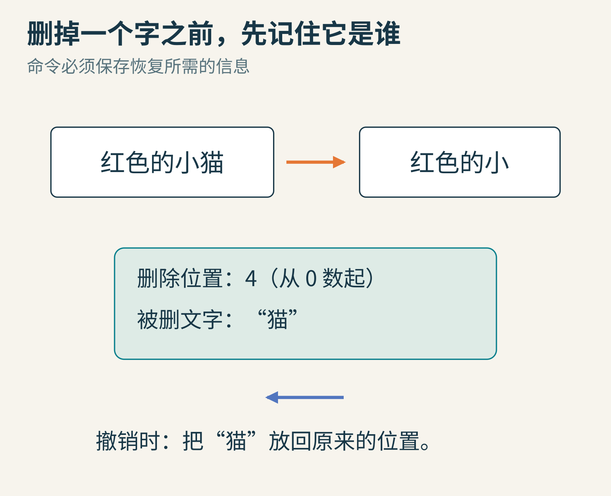
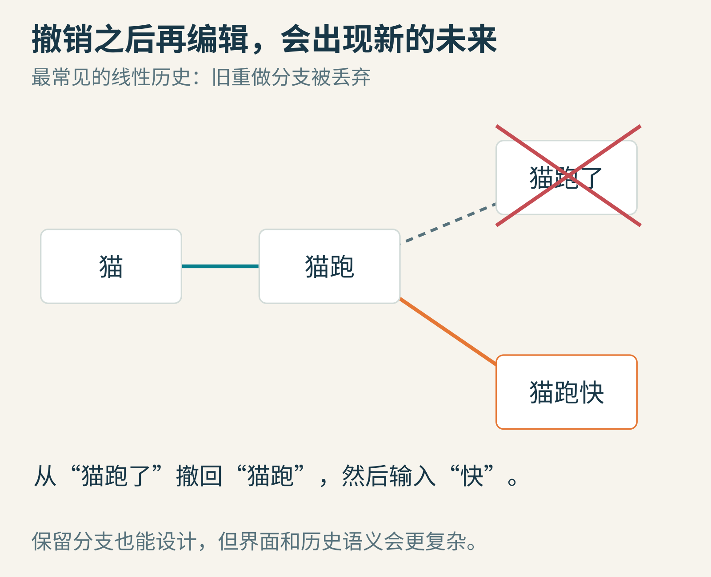
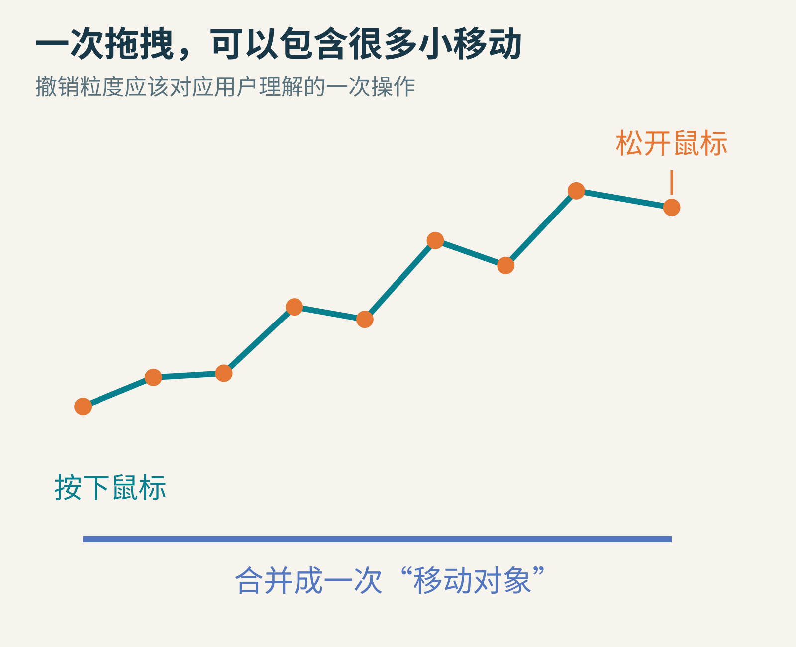
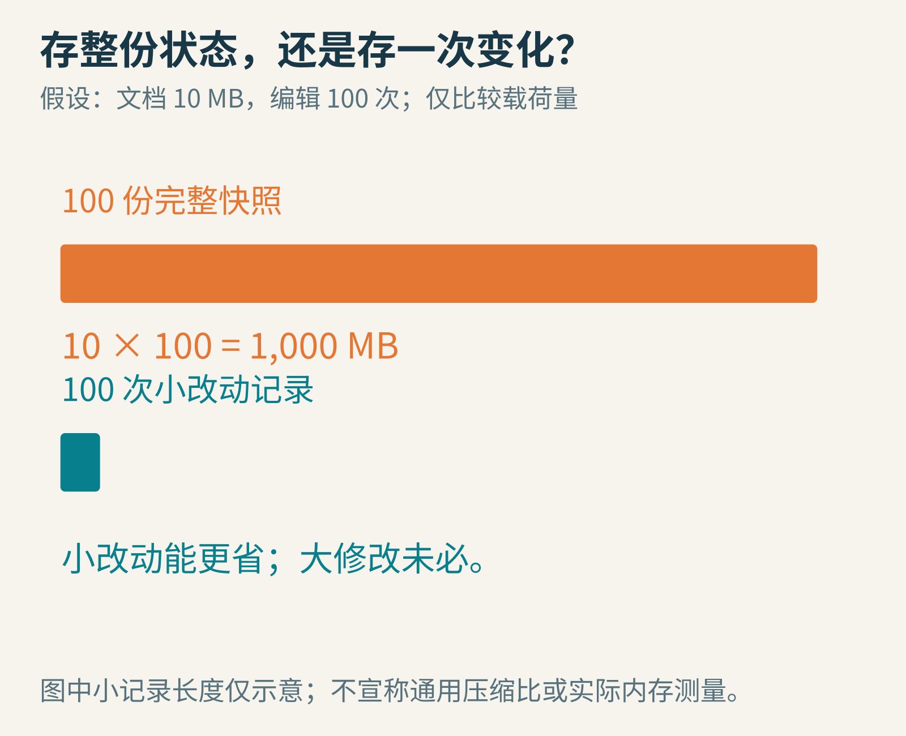

# 按一下Ctrl＋Z，程序怎样把“过去”找回来？

在关卡编辑器里，你刚把一座桥拖到合适的位置，手一滑，又把它拉到了山里。按一下撤销，桥回去了。

从屏幕上看，像是时间倒流。可电脑做的事情更加具体：它保留了足够的信息，知道怎样恢复某个较早的状态。

这道问题不仅属于文字编辑器。画画软件、建模工具、游戏关卡编辑器，都需要决定“什么算一次操作”“该保存哪些旧信息”“撤销之后再编辑，会发生什么”。我们先造一个只有几个字的小编辑器。



原创状态示意。本文所有界面式图形都是教学卡片，不是某款软件的真实界面。

## 最容易想到的办法：每次编辑前，拍一张快照

当前文字是“猫”。你输入“跑”之前，先把旧文字“猫”存起来；接着文字变成“猫跑”。再输入“了”之前，存下“猫跑”。

现在需要撤销最后一步，就把最近存下来的“猫跑”拿回来。再撤销，拿回“猫”。

这叠“最后放进去、最先拿出来”的记录，就是**栈**。把它想成一叠卡片比背缩写更容易：顶上那张，总是下一张被取走的卡。

可撤销之后，你又后悔了，想重做刚才删掉的“了”。如果我们只是用旧内容覆盖新内容，新内容就丢了。

因此，再放一叠卡片，保存已经撤销、但可能重新做一遍的未来。



撤销前，先把当前状态移入重做栈，再从撤销栈取回上一状态。重做时交换这两个方向。

三个角色就位了：当前状态、撤销栈、重做栈。这里用的是完整状态快照；稍后再看为什么真实应用还会记录“做了什么”。

## 一个能跑的小编辑器，先把动作关系弄明白

以下代码只处理不可变的Python字符串。每次edit直接给出整个新文本，让例子聚焦历史机制，而不是键盘输入和光标管理。

```python
text = "猫"
past = []
future = []

def edit(new_text):
    global text
    past.append(text)
    text = new_text
    future.clear()

def undo():
    global text
    if past:
        future.append(text)
        text = past.pop()

def redo():
    global text
    if future:
        past.append(text)
        text = future.pop()

edit("猫跑")
edit("猫跑了")
print(text)
undo()
print(text)
redo()
print(text)
undo()
edit("猫跑快")
redo()
print(text)
```

这段教学程序已实际执行，四行输出为：

```text
猫跑了
猫跑
猫跑了
猫跑快
```

最后一次redo为什么没把“了”带回来？先记下这个问题。关键藏在edit里的future.clear()。

也请注意，真实文档往往由可变对象组成。仅仅把同一个对象引用放进历史，随后继续修改它，可能导致每张“快照”指向同一个不断变化的对象。字符串例子避开了这个坑；复杂状态需要独立副本、不可变数据结构或其他可靠的历史表示。

## 文档很大时，能不能只记“这一次改了什么”？

假设一个文档的快照载荷是10MB，记录100份独立完整副本，就有1000MB载荷，还没计算历史对象等额外开销。这只是透明的算术例子，并不是某款软件真实内存占用。

如果这100次编辑每次只移动一座桥一小段，反复保存整个世界就显得笨重。另一种思路是把每次编辑做成一个**命令对象**。

例如“移动桥”命令保存：桥的稳定标识、旧位置、新位置。

- 执行或重做：把桥设为新位置。
- 撤销：把桥设回旧位置。

命令有恢复所需的信息，历史栈则负责按正确顺序调用它。[Qt的撤销框架概述](https://doc.qt.io/qt-6/qundo.html)就是这种命令模式的实际应用：命令知道如何应用改变，也知道如何撤销它。



删除“红色的小猫”中的“猫”，只记住“删了一个字”不够。需要保留被删文字和恢复位置；图中索引从0开始，因此“猫”的位置是4。

这也解释了为什么“反着算一下”并不总是足够。把一个图层合并掉、把一段文字替换掉、把一张图缩小，都可能丢失信息。没有保存被丢掉的内容，原操作通常无法仅凭结果倒推。

即使移动看起来可以用“减去刚才的位移”撤销，保存旧位置也常常更明确：复杂约束或浮点舍入可能让来回加减不完全回到原值。

## 撤销之后再编辑，旧的未来放在哪里？

我们按顺序得到了：

“猫”→“猫跑”→“猫跑了”。

撤销一次回到“猫跑”，再输入“快”，出现了一条新路线：“猫跑”→“猫跑快”。

这时候，“猫跑了”仍然是一个曾经存在过的状态，但它已经不是当前路线的下一步。



最常见的线性撤销设计，会在新编辑时清空重做分支。上面的代码采用的就是这个约定。[QUndoStack的push说明](https://doc.qt.io/qt-6/qundostack.html#push)也明确处理了已有被撤销命令时，再推入新命令的情况。

为什么不把所有分支都留着？当然可以。只是用户接下来就需要选择“重做到哪条未来”，界面也要展示树状或分支历史。那是另一种产品设计，不是普通重做按钮天然应该承担的含义。

所以，redo不是“把我做过的任意事情重新做一遍”，而是沿着当前保留的历史继续前进。

## 鼠标移动了300次，撤销也要按300次吗？

拖动一座桥时，系统可能收到许多位置更新。如果每个更新都独立进入历史，用户按一次撤销，桥也许只退回一个像素。

从输入事件看，每个变化都真实发生过；从用户意图看，这些变化共同组成了一次“把桥拖到那里”。两种粒度不一样。



一种设计是在按下鼠标时记录起点，拖动期间持续更新画面，松开时形成一个命令，保存最初位置和最终位置。中间可以有很多绘制更新，历史里只留一次可撤销动作。

文字输入也类似。连续输入一个词，可以合并成较大的编辑单元；移动光标、切换输入位置或执行其他操作时，则可能需要切开。怎么划分，取决于编辑器希望用户如何理解历史。

另一种相关机制是**组合命令**：用户按一次“添加带标题的标记”，内部可能先建立形状，再填入文字，再设置颜色。撤销时，这几步作为一个整体倒回去。Qt文档分别讨论了命令压缩和命令宏；它们都帮助历史对齐操作意图，但实现方式不完全一样。

## 快照和命令，谁更好？

先看代价从哪里来。

完整快照容易理解，恢复动作也直接，但大型状态可能占用很多空间。命令只保存变化，局部编辑时常常更省；可复杂操作的撤销实现也更容易遗漏细节。



图中的小记录长度仅表示“可能更少”，没有给出通用压缩比。一次整张图片重绘，也可能产生很大的变化记录。

混合方案也合理：每隔一段历史保存一个检查点，中间保留命令或差量。恢复某个位置时，从合适检查点出发，再应用剩余变化。不过，这会增加索引、重放和故障恢复的复杂度。

无论采用哪种方案，都要问：撤销改变的是不是完整状态？移动桥的同时，选中状态、连接关系、脚本属性、相关资源是否也改变了？哪些需要恢复，哪些应当保持，是编辑器设计的一部分。

如果对象已经被删除又重建，单纯保存一个旧内存地址也可能失效。命令应当可靠地识别它要修改的对象，并清楚定义对象生命周期。

## “保存”与“撤销”，是两条不同的轴

你可以把当前历史位置标为“已保存”。之后又编辑，文档变脏；撤销回那个保存位置，文档可能重新变成干净状态。Qt称这类机制为clean state。

但保存文件，不自动等于把整个撤销历史也写进了文件。关闭再打开后能不能继续撤销，需要软件额外设计持久化历史，不能从“保存成功”推断出来。

历史也不是无限资源。应用可能设置上限、合并命令、清掉较早的记录。一旦旧状态所需信息已被丢弃，就无法只靠当前状态凭空还原。

## 外部世界，没有通用的Ctrl＋Z

在本地把文字恢复，和收回已经发送的消息，是不同问题。对方可能已经读过；服务器可能已经处理了请求。即使界面提供“撤回”，其效果与限制也来自相应服务的协议。

多人协作又多一层难题：你撤销自己的输入时，不能随手把别人的新编辑也覆盖掉。单人快照栈没有足够的信息解决操作之间的并发关系。


从这里可以看到一个很实用的边界：撤销功能是在某个明确的状态范围内，设计恢复规则。它不能保证逆转任意外部后果。

## 给这台小小时间机器加三项测试

不妨直接修改本文代码，完成三个挑战：

1. 连续undo十次。程序是否安全停在最早状态？再连续redo十次，是否停在最新保留状态？
2. 撤销两步之后新写一段文字。检查future是否为空，以及redo是否保持当前文字不变。
3. 把字符串换成一个含位置列表的字典，故意只存引用，再修改位置。观察历史为何一起变化，然后用明确的复制策略修复。

如果还想再进一步，可以写一个“移动点”的命令，保存old_position和new_position。让一组命令先全部执行，再逆序全部撤销，检查最终状态是否与最初完全一致。

真正可靠的撤销，不靠记住按钮叫什么。它靠的是一个朴素的问题：我现在保留的信息，是否足够把这次变化准确地恢复回去？

图片来源：全部为原创状态、历史分支与动作示意。技术参阅[Qt Undo Framework](https://doc.qt.io/qt-6/qundo.html)、[QUndoStack](https://doc.qt.io/qt-6/qundostack.html)；文中快照程序为自写并已执行的教学例子。
