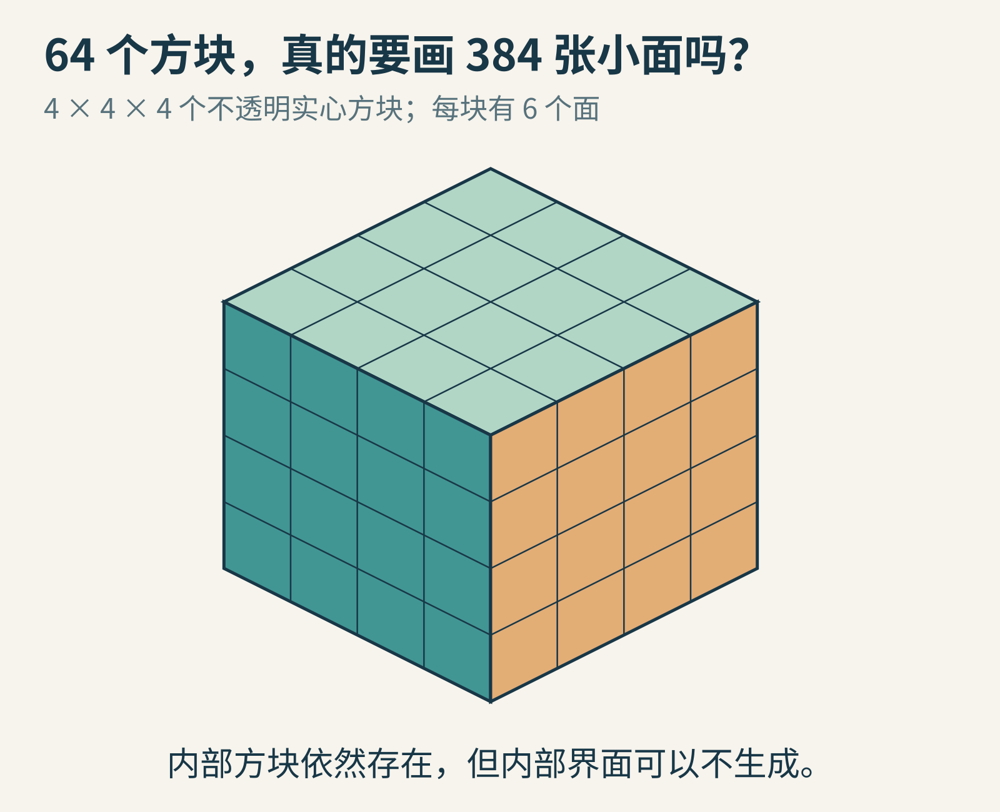
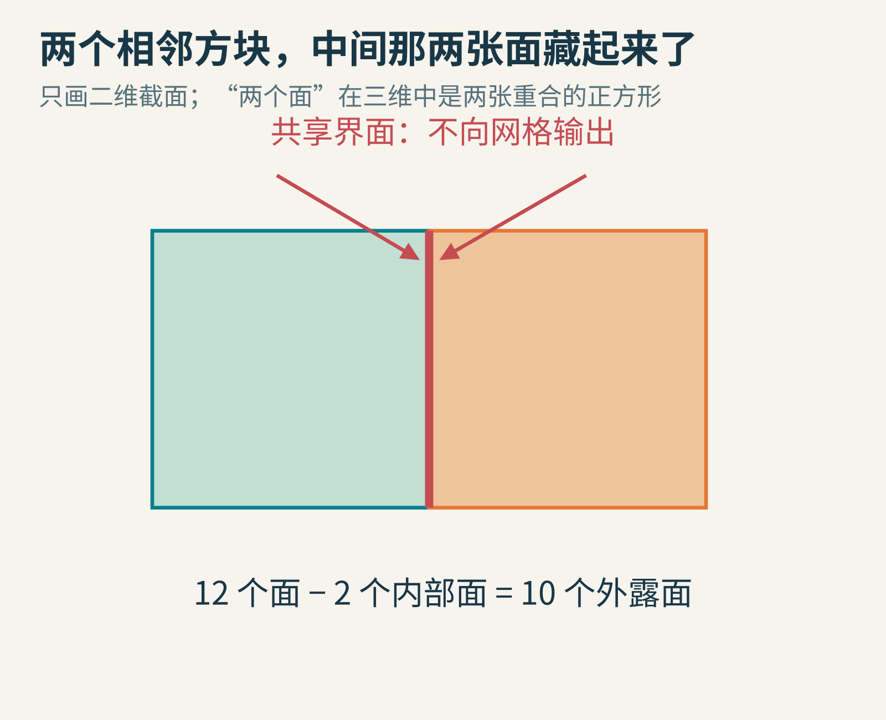
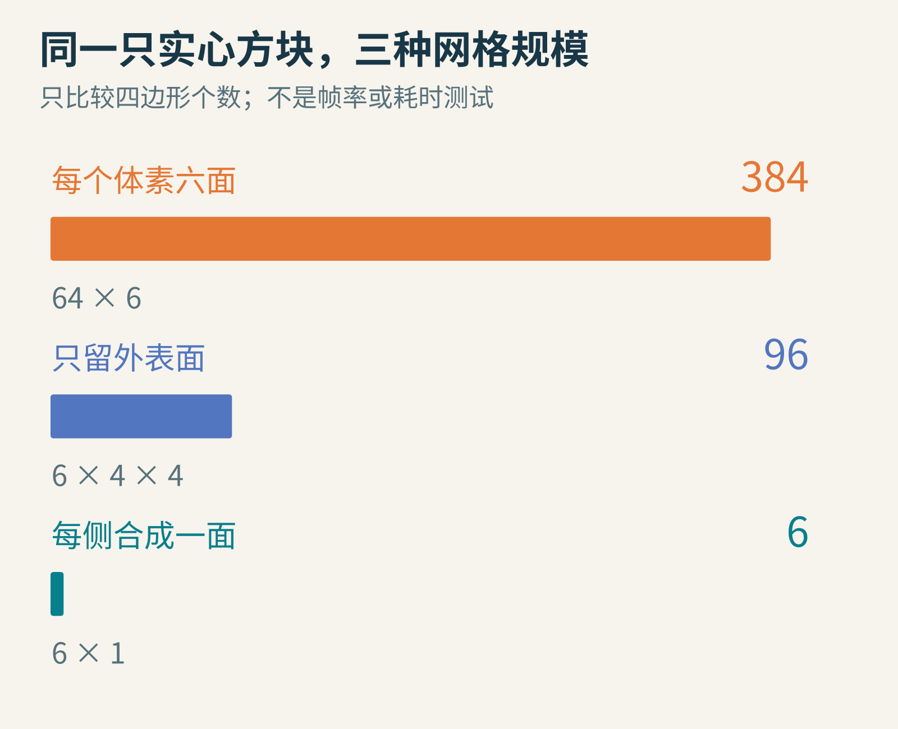
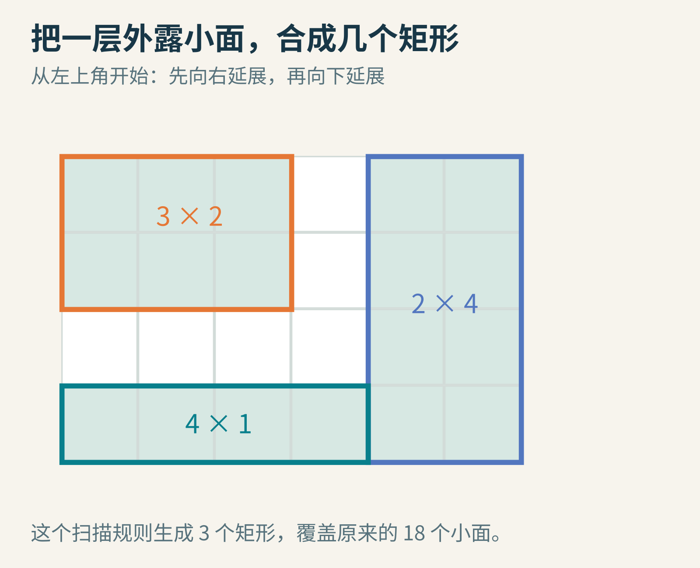
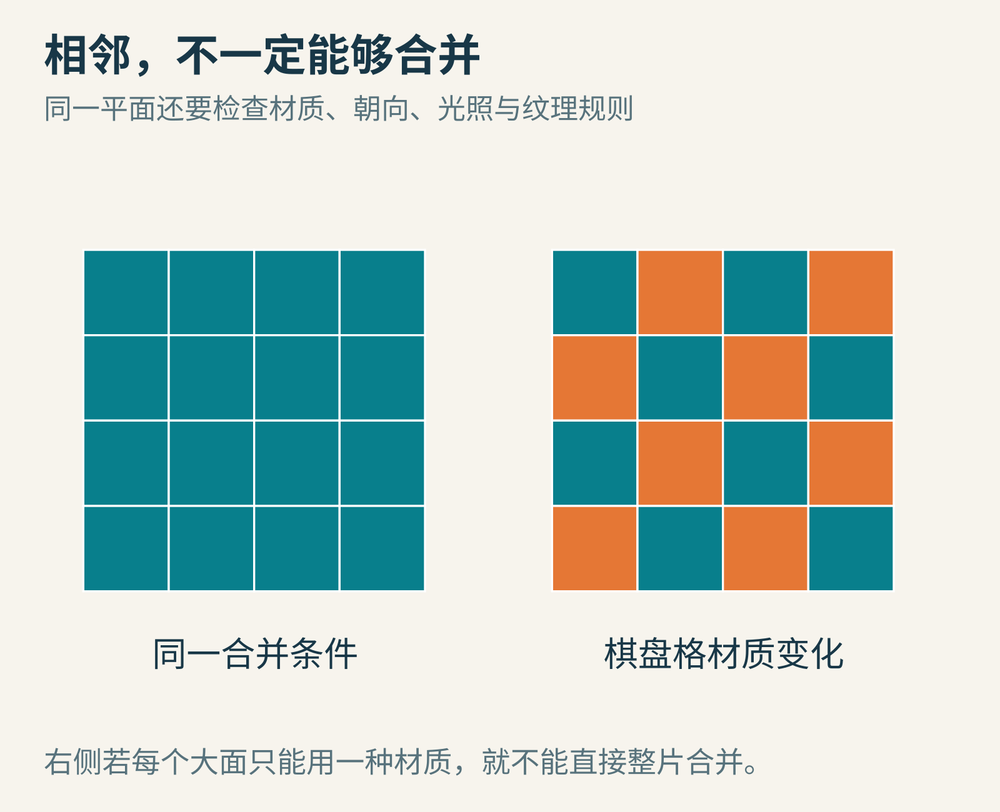
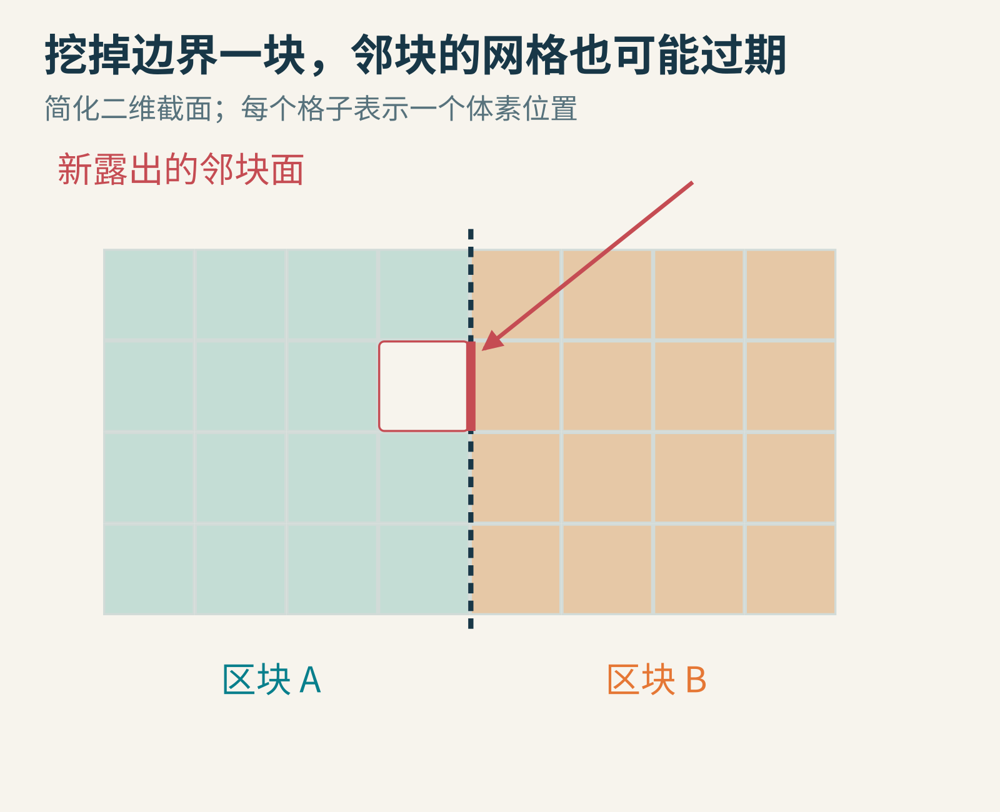
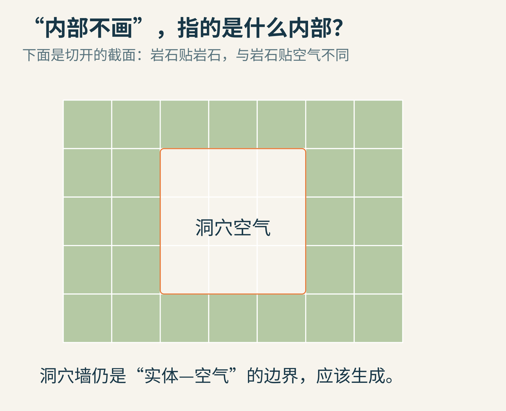
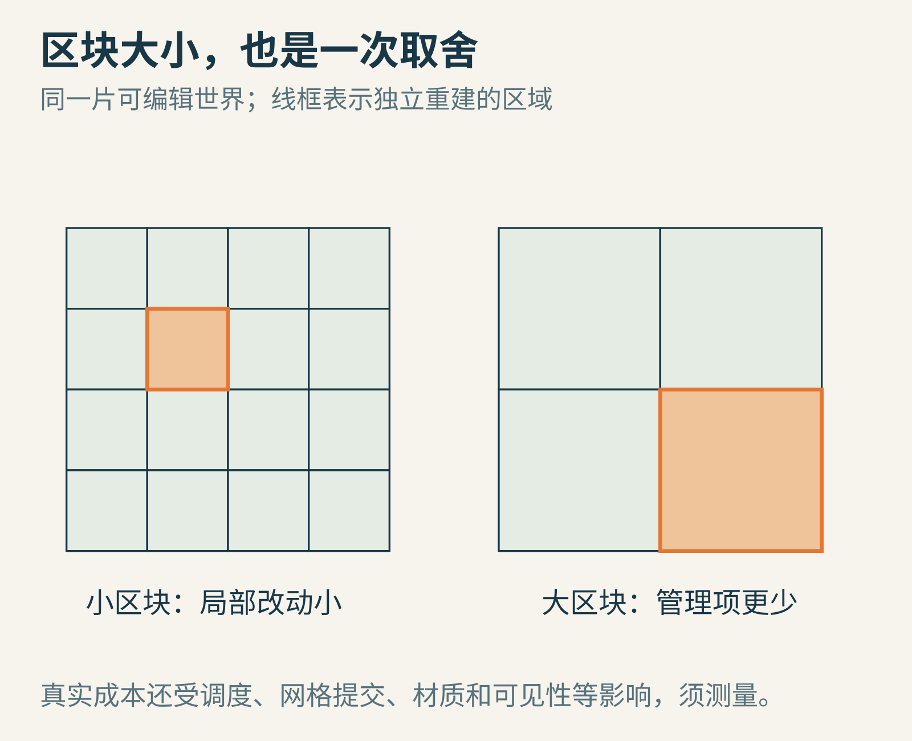

# 一座方块山有几百万块石头，为什么不必把每一块都画出来？

在方块世界里挖洞时，你会看到一个很有意思的现象：地底下还没有露面的石头，确实存在。挖掉前面一块，后面的墙就出现了。

那么，游戏是不是每一帧都把整座山内部的每一块石头画出来，只是最后被挡住了？

未必。对于一种常见的体素网格生成方案，世界里有哪些方块，与这一帧提交哪些可见表面，是两份不同的数据。

**体素**可以先想成三维空间里的格子。格子里记录空气、石头、泥土或其他状态；网格则把需要呈现的边界整理成能交给图形管线的面。我们从一只4×4×4的实心方块开始，看怎样省去不必要的表面工作。



原创几何示意。共有64个单位方块；图中只展示朝向读者的三侧，计数时包含完整六侧。

## 第一种办法：每块石头，都生成一只完整小立方体

一个立方体有6个正方形面。64块石头，每块都贡献6面：

64×6＝384个四边形。

如果每个四边形拆成两个三角形，就是768个三角形。这个算法很容易写，也很适合当参照：遍历每个实心格子，把它的六面全部输出。

问题在于，大多数面夹在石头与石头之间。玩家无论从外面哪里看，都看不到这些界面。

就像用砖砌墙：墙体内部两块砖贴在一起的面，不需要对着观众画出来。记录那两块砖存在，和为贴合面生成绘制几何，不是同一件事。

## 先问邻居：这一面的外面，也是石头吗？

对每个实心格子，依次看上、下、左、右、前、后六个邻居。如果相邻位置也是同类不透明实体，这个内部面就可以跳过；如果邻居是空气，才生成一张面。

这里先采用只有“实心”与“空气”的二值世界。玻璃、水和不同透明度的材质，需要另外制定边界规则，不能直接套用这个最简判断。



两只独立立方体原本有12个面。贴在一起之后，中间两张面不再暴露，外表只剩10面。

对4×4×4的完整实心块，外面有6个大侧面，每侧是4×4个小方格。因此只保留表面后：

6×4×4＝96个四边形，也就是192个三角形。

这一步常被称为内部面剔除或表面提取的一种简单形式。它不需要先知道相机在哪儿，只依赖实体与空气的关系。

作者Mikola Lysenko的[0fps体素网格文章](https://0fps.net/2012/06/30/meshing-in-a-minecraft-game/)系统讨论了从逐体素生成、内部面剔除到更紧凑网格的思路。本文用自己的4×4×4例子推导，不把该文的演示数字当成我们的性能测试。

## 一排贴在一起的小面，能不能合成一张大面？

现在看方块的一侧：16张小面在同一个平面，朝向相同，材质也相同。视觉上，它们本来就拼成一个大正方形。

在允许合并的条件下，可以直接用一个大四边形表示这一侧。完整实心块六侧各一张，就剩6个四边形、12个三角形。



图中比较的是生成的几何面数量。384降到6，并不意味着游戏帧率提高64倍；像素填充、着色、提交、内存和其他系统仍在花时间。

这件事尤其有启发：世界没有变空，石头也没有消失。我们只换了一种更紧凑的表面描述。

玩家挖掉其中一块后，底层体素数据会改变，受影响的表面再重新生成。网格像是世界数据的一份可更新的绘图摘要，不能反过来用“只剩六张面”推断世界只存了六块东西。

## 凹凸不平的表面，怎样自动拼矩形？

完整大方块好合并，真实地形却有台阶、缺口、不同材质。可以先把某个方向、某一层的外露面，画成二维小方格图。

有面记1，没有面记0。然后从左上角扫描，找到一个还没处理的1，尽可能向右伸长，再在条件允许时向下扩展成矩形；把覆盖的格子标为已处理，再继续找下一个。

这种每一步先选当前合适大片区域的办法，通常叫**贪心网格合并**。贪心不意味着随便做，它仍有明确的扫描顺序和合并规则。



先合并左上3×2区域，再合并右侧2×4区域，最后处理左下4×1区域。面积6＋8＋4＝18，所有原小面恰好覆盖一次。

注意，同一张形状用不同扫描次序，可能产生不同矩形划分。一个容易实现的贪心方案，不自动等于“全世界最少矩形”的最优解。它的价值往往是质量与生成成本之间的实际平衡。

推广到三维时，可以分别处理不同面朝向与切片，使用同样的二维合并思想。你不需要让一个大立方体从各个方向一起膨胀。

## 为什么材质一换，大面就不能随意合并了？

想象一面墙由石头和草地组成棋盘格。若一个四边形只允许一种材质，把整面墙合成一张面，就会丢掉棋盘格信息。

即使材质相同，也要检查纹理坐标。原来每块石头重复一张纹理，合成大面后如果把整张图片只铺一次，图案就会被拉长。你节省了几何，却悄悄改变了视觉效果。



如果渲染方案能在一个大面内表达多个材质或纹理规则，可以设计更复杂的合并。但这需要保留信息的其他方法，不是忽略差异就能成立。

顶点光照、环境遮蔽、法线朝向、透明规则，也可能成为合并条件。[0fps后续讨论](https://0fps.net/2012/07/07/meshing-minecraft-part-2/)补充了多种块类型、不同面方向及相关网格问题。

因此，实际算法通常给每张候选面一个“合并键”：只有需要保留的属性相容，才并在一起。怎样定义相容，取决于渲染器，而不是只看两个方格挨得近不近。

## 挖一块石头，为什么旁边区块也要重画？

巨大世界常被分成区块，分别存数据、生成网格和上传到图形系统。这样修改一点地形时，不必重建整个世界。

可区块边界会带来一个小陷阱。假设你删除A区块最右边的一块石头，紧挨着它的B区块石头，现在露出了一张新的左面。

如果只更新A的网格，B的新面还不存在，玩家就可能看到洞或错误边界。



图中红线表示新露出的邻块面。区块只是管理边界，几何相邻关系不会在这里自动停止。

一种基本做法是：修改时把本区块标记为需要重建；若修改位置影响了边界邻居，也把相应邻块标记。另一种做法会读取一圈邻区数据来决定边界面的生成，但邻接数据变化后，仍要通知相关缓存失效。

当远处区块尚未加载时，“不知道邻居”也不等于“邻居一定是空气”。你可以暂时画边界，等数据到来再更新，也可以采用别的占位规则；关键是把临时状态与确定的地形状态分开。

## 地底下的山洞，是“内部面”吗？

听到“山内部不用画”，很容易误删洞穴。

真正该剔除的是“实体贴着实体”的界面。洞穴的墙面，一侧是岩石，另一侧是空气，仍然是需要生成的表面。即使它在整座山的内部，也不属于两块石头之间的隐藏面。



这里展示切面，橙线是岩石与洞穴空气的边界。实际能否从当前相机看见，还可以由其他可见性方法继续判断。

这也让三种经常混在一起的操作分开了：

- 内部面剔除：实体另一侧仍是实体，不生成这个面。
- 背面剔除：已经生成的面背对相机，图形管线可能不绘制。
- 遮挡判断：面朝着相机，却被别的物体挡住，可能跳过部分工作。

它们回答的是不同问题，可以共同存在。不能用其中一项，替代另外两项的全部职责。

## 用一个小程序，数出真正露在外面的面

下面的Python 3代码只使用坐标集合，不依赖引擎。每个三元组是一块石头，六个方向是它的邻居。

```python
blocks = {(x, y, z)
          for x in range(4)
          for y in range(4)
          for z in range(4)}
directions = [(1, 0, 0), (-1, 0, 0),
              (0, 1, 0), (0, -1, 0),
              (0, 0, 1), (0, 0, -1)]

def exposed_faces(cells):
    return sum((x+dx, y+dy, z+dz) not in cells
               for x, y, z in cells
               for dx, dy, dz in directions)

print(len(blocks) * 6)
print(exposed_faces(blocks))
blocks.remove((1, 1, 1))
print(exposed_faces(blocks))
```

实际输出为384、96、102。

最后为什么增加6？因为(1,1,1)原本完全埋在4×4×4实体内部。删掉它并没有移除任何原来的外露面，却使六个相邻方块各露出一面，形成一个封闭的小空腔。

试着改为删除角落(0,0,0)。先算再运行：原来的三个外露面消失，三个邻居各新增一面，所以外露面总数仍是96。相同的“删除一块”，影响取决于邻接关系。

## 区块越小，一定越快吗？

小区块的优点是修改时影响范围小，也方便按距离和可见性管理。代价是区块数量多，调度、对象管理与绘制提交可能增加。

大区块减少管理项，却可能让一次小修改触发更大范围重建。异步生成能减少主线程停顿，但还要处理“旧任务完成时，地形已经再次变化”的过期结果。



图只说明影响范围，不提供通用最优尺寸。游戏的修改频率、地形复杂度、材质数量和目标设备都会改变答案。

你可以给自己的实验记录三项：体素数、生成的面数、实际重建耗时。前两项解释数据结构，最后一项才接近运行成本。不要拿面数的下降比例，直接当作帧率提升。

一座方块山的秘诀，并不是让电脑忘记里面有什么。它是让数据完整地记住世界，同时只把当前需要表达的边界，组织成合适的绘图形状。

图片来源：全部为AI辅助原创几何与网格示意，计数来自本文自设4×4×4算例及实际执行的Python程序。技术参阅[0fps网格生成原文](https://0fps.net/2012/06/30/meshing-in-a-minecraft-game/)与[后续讨论](https://0fps.net/2012/07/07/meshing-minecraft-part-2/)；未复制来源插图，也未声称展示商业游戏内部实现。
