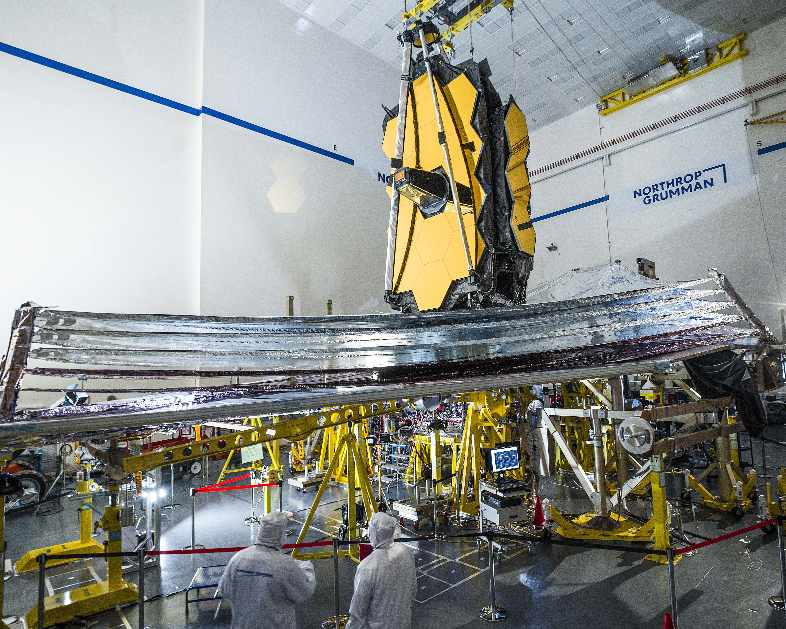
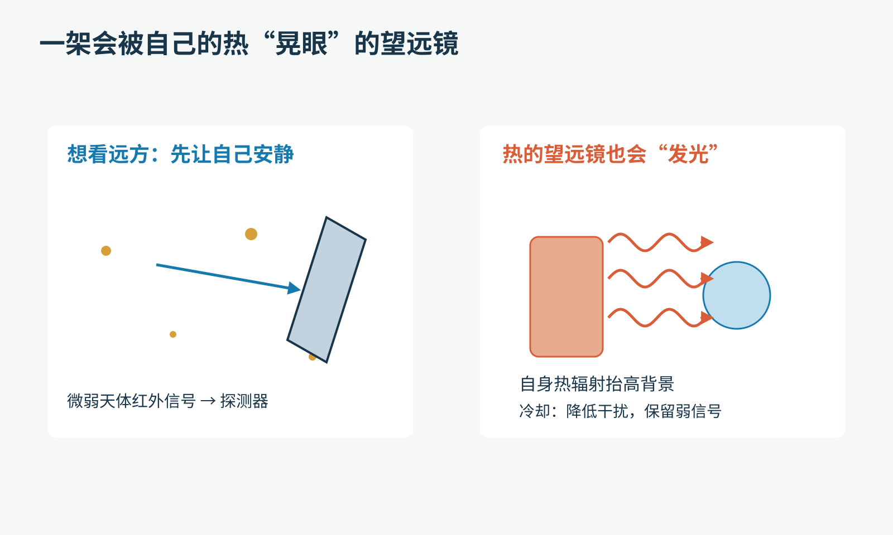
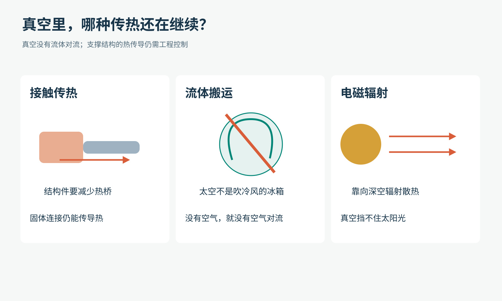
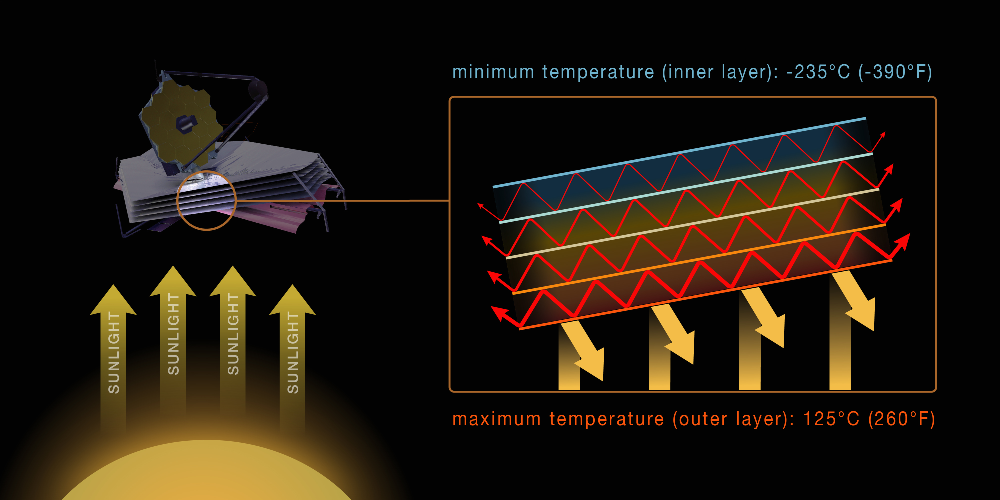
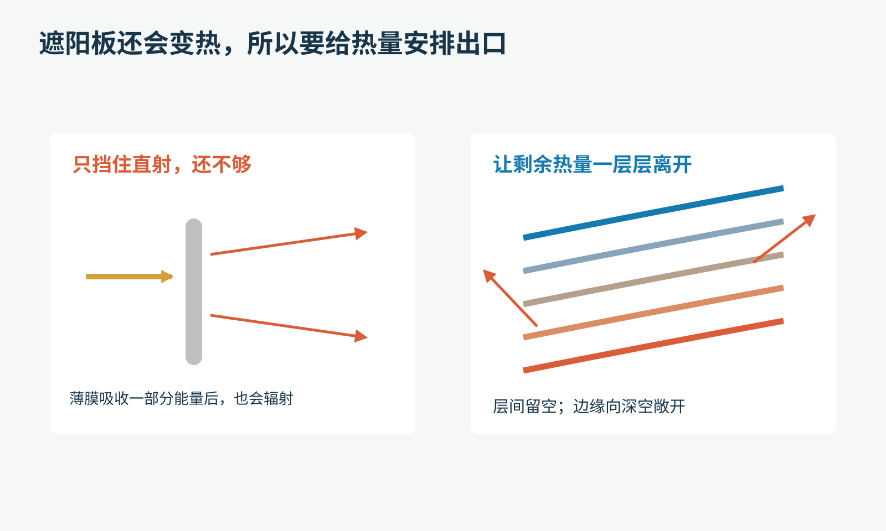
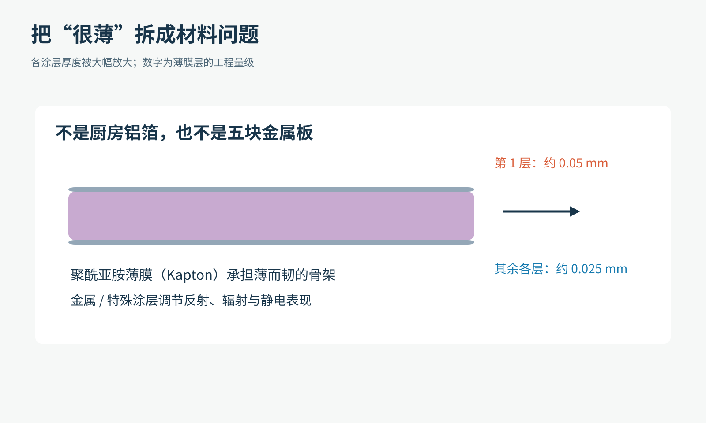
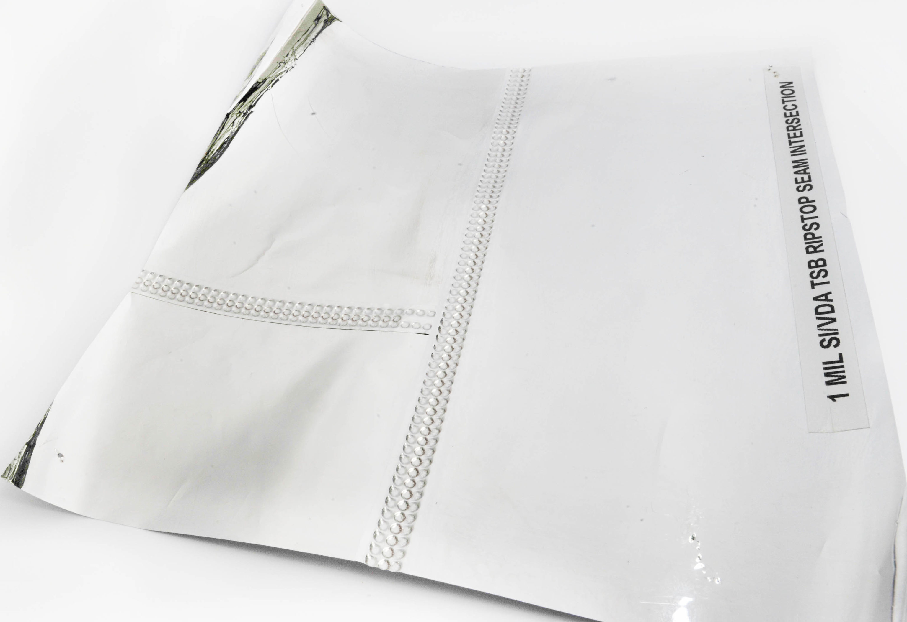
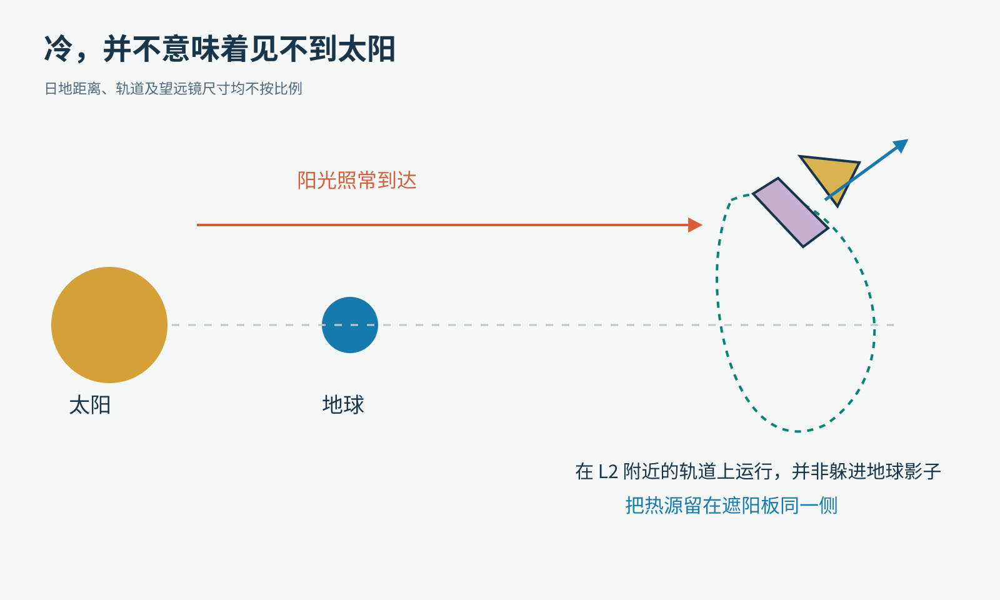
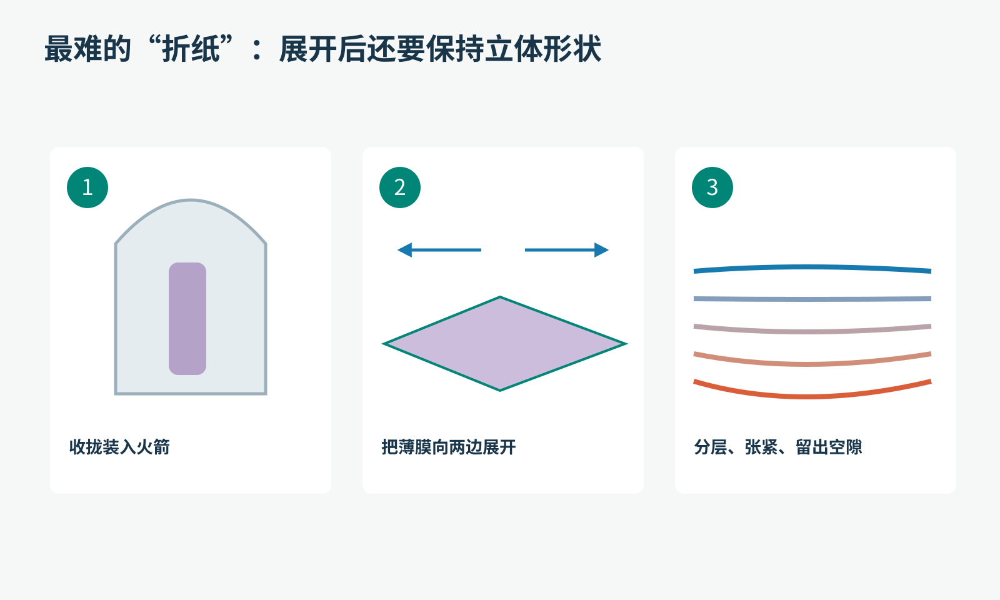

# 五层比头发还薄的“毯子”，怎样让韦布望远镜冷下来？

先看这张照片。金色的镜子下面，铺着一大片银白色、带点紫色的东西。它不像你想象中的航天器：没有厚厚的装甲，倒像有人在洁净室里支起了一张过分讲究的风筝。

这是2020年12月在美国加州雷东多海滩进行的最后一次地面展开测试，不能把它当作太空现场照片。摄影：NASA/Chris Gunn，[CC BY 2.0](https://creativecommons.org/licenses/by/2.0/)；保留完整画面，仅作满足文件限制的尺寸适配与轻压缩。

这张“风筝”是詹姆斯·韦布空间望远镜的遮阳板，展开后大约长21米、宽14米。更奇怪的是：如此重要的隔热结构，最外面一层薄膜只有约0.05毫米厚，其余各层约0.025毫米。

如果有人请你设计一堵隔热墙，你可能先想：加厚！再加厚！

工程师却选择：做薄，分成五层，把层与层分开，再把边缘敞开。

这是怎么回事？要理解它，先别急着背“反射”“真空”“辐射”这些词。我们得先问一个看似不相关的问题：望远镜为什么怕自己太热？

## 1. 先解决一个意外问题：别让望远镜看见自己

你拿手机拍夜空，旁边有人把手电筒照进镜头，即使手机没有损坏，暗星也可能淹没在亮光里。

韦布面对的麻烦更隐蔽：手电筒可能就是它自己。

温暖的物体会发出热辐射，其中包含人眼看不见的红外光。你的手、书桌、仪器外壳，都可能成为红外背景的一部分。韦布主要研究红外波段；如果它的镜面和仪器太暖，来自自身的辐射就会干扰微弱的天体信号。

原创教学示意。左边是想测的微弱信号；右边是需要压低的背景。红外光并不只来自温暖物体，图中突出的是冷却要解决的热背景问题。

这就像在教室里录一声很轻的耳语：先把旁边嗡嗡响的风扇关小，比单纯把麦克风音量调大更有用。

低温还有另一个好处。材料会随温度变化而伸缩；一架依靠精密对准工作的望远镜，也希望环境尽量稳定。

注意，这里有两件事：一是温度低，二是温度变化小。不是越冷越好就完事，更不是把所有零件冻到同一个读数。

## 2. 太空很空，为什么不自动把它冻冷？

在地球上，把热汤放在桌上，空气会参与把热量带走。到了太空，没有一阵“宇宙冷风”不断吹过镜子。

物体交换热量主要有三条路：

- 接触传热：热量沿材料传过去。比如金属勺的另一端也会变热。
- 流体搬运：空气或水运动时把热量带走，也就是对流。
- 电磁辐射：物体发出或吸收电磁波，不必接触，也不需要空气。

原创教学示意。真空消除了空气对流，却不消除辐射；连接冷热部分的结构件，也仍可能成为热传导的通道。

太阳隔着大片近乎真空的空间，照样能把地球晒热。原因就在第三条路。

因此，韦布要冷下来，必须同时做两件事：少接收不想要的能量，让自身的热量能以辐射方式离开。

想象一个漏水的水桶。温度不是桶里的水量，但“进出平衡”的思路很像：如果进来的热功率始终大于出去的，温度就会上升；温度升高后，辐射散热也会变化，直到接近新的平衡。工程师不能只堵一边，还得安排另一边的出口。

## 3. 挡住太阳之后，遮阳板自己怎么办？

撑伞站在太阳下，你立刻进入阴影。可伞布不会凭空变成冰，它仍会吸收部分阳光，升温，再向周围辐射能量。

只放一块遮阳板，确实能挡住直射。但热的遮阳板自己也可能面对望远镜“发光”。

所以，问题从“太阳能不能直接照到镜子”，变成了“镜子究竟看见哪些温暖表面”。

2021年发布的官方设计剖面示意，非实拍；图上的冷热极值不能视为整块薄膜的均匀温度或实时读数。观察右侧：五层并没有压成一张厚毯子，层间留有空隙，热量可以从边缘辐射离开。图片：STScI、NASA、ESA、CSA。

第一层迎着太阳，接收最多的外来能量；它会反射一部分，也吸收一部分，再以热辐射方式放出能量。后面的层继续减少传向冷侧的热量。

这里最容易产生的误解是：红色箭头代表热像水一样沿薄膜流出去。实际情况更复杂。图中的箭头主要是在帮我们理解辐射交换的路线，不是一股能看见的“热气”。

层与层在大片膜面上不接触，能避免把它们变成一条连续的固体传热通道。真空也不会像空气那样在层间形成对流。剩下的辐射传热，则继续靠表面的光学性质和几何形状来控制。

原创教学示意。重点不是“堆得多”，而是每一层的温度、朝向、反射和辐射，以及它与其他表面之间能互相“看见”多少。

你可以把它想成五道有出口的检查站。前一道没拦下的热，到了下一道仍有机会被导向外部。这个比喻只帮助理解逐级削减；真实的热辐射会在表面间反复交换，不是每份能量都乖乖按单行道走。

## 4. 为什么这些薄膜不干脆贴在一起？

拿五张纸紧紧压在一起，与把五张纸间隔开，纸的总量一样，热传递的边界却不同。

贴在一起，会增加接触传热；分开之后，大面积膜面之间的固体接触被切断。对韦布来说，薄膜之间的真空间隙正是设计的一部分。

还要再进一步：五层的形状并不完全一样。面向太阳的第一层最大，相对较平；靠近望远镜的第五层较小、较弯。它们在中部靠近，向边缘逐渐分开，让热量有更合适的路径向外辐射。

这解释了为什么“展开”还不够。薄膜必须被张紧，保持经过设计的三维形状；如果皱成一团或相互贴住，原本安排好的视线、间距和排热方式都会变化。

也别把第五层理解成一块处处同温的冰板。实际薄膜不同位置的温度可以不同，望远镜各部件也不相同。网上常见的“热侧多少度、冷侧多少度”，可能混合了模型极值、某个部件的测量值和示意图上的代表值。理解机制，不必先把它们误拼成一个恒定温差。

## 5. 薄到这个程度，材料在忙什么？

这些薄膜的基底是聚酰亚胺材料Kapton。它负责在很薄的情况下提供可用的机械性能和温度适应性；表面的铝等涂层，则参与控制反射和热辐射。

面对太阳的前两层还采用特殊的硅涂层。这也是某些照片里出现紫粉色的原因之一。涂层不只是“刷亮一点”，还要考虑在空间环境里的稳定性，以及避免表面积累静电。

原创教学示意。为了看清结构，厚度被大幅放大；不能根据图中宽窄估算真实比例。

这里藏着一个很有意思的材料问题：

“反射太阳光的能力强”，和“把自身热量辐射出去的能力强”，是不是同一回事？

不是简单的同义词。材料对不同波长的光，可以表现得很不一样。太阳照来的能量分布，与低温物体自身的热辐射分布也不同。选择材料和涂层时，需要考虑相应波段的吸收、反射与发射，而不能只凭人眼看见的颜色判断隔热性能。

这也是为什么厨房铝箔能提供一些直觉，却不能直接代替航天薄膜。机械强度、涂层、折叠、静电和长期空间环境，都是另一本厚厚的工程题册。

## 6. 为什么刚好五层，不是四层或十层？

如果多一层可以继续隔热，那么把层数加到一百，不就更好吗？

它确实可能改善某些热学表现，但每多一层，都需要材料、支撑、折叠空间和部署控制，也增加重量与潜在故障点。

韦布项目曾比较过从两层到七层的设计。五层是所需冷却能力、余量、重量与复杂性之间的折中；它不是自然界规定的“隔热最佳数字”。

第五层还为真实世界的不完美留出余量，例如微小孔洞、局部损伤等。我们常把工程理解成“计算出理想答案”，而好的工程还要问：如果现实没有那么理想，系统能不能继续工作？

Kapton薄膜上的止裂接缝实物。图片：NASA。这样的结构用于限制裂口扩展，不是用来把微流星体弹回去。

一张薄膜被扎了一个小洞，不等于整张立刻报废；但如果裂口一路撕开，麻烦就大了。韦布用加强结构和止裂分区，尽量让损伤停留在局部。

像把一场可能连锁扩散的问题，拆成较小、较可控的范围。这种思路在船舱、建筑防火和软件系统里也能遇到，不过具体实现当然不同。

## 7. 它是不是一直躲在地球的影子里？

如果只看“很冷”这个结果，很容易猜：韦布是不是躲在地球背后，完全晒不到太阳？

并不是。它在距离地球约150万千米、日地L2附近的轨道上运行。它依靠自身遮阳板维持冷侧，而不是长期藏在地球阴影中。

原创位置示意，不按比例。图中望远镜被夸大；它围绕L2附近区域运行，并不是固定挂在一枚看不见的钉子上。

这类轨道与姿态设计，使太阳、地球和月球可以被安排在遮阳板的热侧。望远镜改变观测方向，也必须服从遮阳和热环境的限制。

所以，它不能想朝哪儿就立刻朝哪儿。你读到“某目标什么时候能被韦布观察”，背后不仅有天文学，也有一张必须正确举着的巨大遮阳板。

## 8. 太空里最难的一次“晾床单”

这么大的结构不可能完全展开后塞进火箭。发射时，薄膜要折起并固定；入轨途中再按顺序打开支撑、伸展、分层和张紧。

原创简化流程图，不表示完整部署指令。关键是最后一步：得到稳定的分层几何结构，而不只是把面积铺开。

2022年1月4日，韦布完成五层遮阳板的张紧部署。这不是一张自动弹开的露营垫：多组机构、滑轮、绳索和电机需要配合，地面团队还得逐步确认状态。

想一个小挑战：如果你在地球上反复练习展开，薄膜会受重力向下垂；到了失重环境，形状又不同。于是，工程师既要测试材料和机构，也要用模型分析它们在实际环境中的表现。地面试验和计算不是谁代替谁，而是相互检验。

## 9. 它把整架望远镜都冷到接近绝对零度了吗？

还没有这么简单。

遮阳、结构隔热和向深空辐射，让望远镜与近红外仪器获得几十开尔文量级的低温环境。开尔文是温度单位，0 K对应绝对零度；40 K大约是零下233摄氏度。

但中红外仪器MIRI还需要更低的探测器工作温度，低于7 K。为此，它配备了电力驱动的低温制冷系统，继续把热量搬走。

原创教学示意。五层遮阳板承担关键的被动热控制；MIRI的更低温要求由专门制冷系统继续完成。

这像给一间很怕热的房间先做遮阳和隔热，再让专用空调处理最后的冷却任务。遮阳板不需要像冰块一样不断消耗自身来“提供冷”，但它也不是一台能无限降低温度的魔法冰箱。

## 10. 留给你的两道工程题

第一题：如果把五层薄膜的边缘全部封死，形成一个密闭的“大枕头”，会更好吗？

先别急着说“封得严就不漏热”。想想本来的设计想让什么东西从哪里离开。对于韦布这套几何结构，边缘正是辐射排热设计的重要部分；随手封住，可能破坏原有热交换路径。结论不能从“更厚、更密”直接推出。

第二题：如果想亲手比较“接触”和“间隔”，可以怎样做？

用两块相同的温热物体、同样的材料和温度计，在安全温度下比较贴合与留缝的覆盖方式，是一个起点。保持光照、面积、起始温度和测量位置尽量一致，每隔相同时间记录温度。不要用明火、热得烫手的金属或密闭加热容器。

但请在记录最后加上一句话：这个实验在空气中，存在对流，也有支架传热，不能直接证明韦布在真空里的冷却效果。

能指出模型与真实系统哪里不同，本身就是非常重要的科学能力。

回过头看那张薄薄的“风筝”，最值得惊讶的不是五层材料有多神奇，而是每一层、每一道缝、每一个朝向都参与回答同一个问题：

想听见宇宙极轻的声音，怎样先让望远镜自己的热安静下来？

事实延伸：[韦布遮阳板结构与材料](https://science.nasa.gov/mission/webb/webbs-sunshield/)、[冷却机制](https://science.nasa.gov/mission/webb/science-overview/science-explainers/how-does-webb-stay-cold/)、[2022年部署记录](https://www.nasa.gov/news-release/sunshield-successfully-deploys-on-nasas-next-flagship-telescope/)、[MIRI低温制冷](https://science.nasa.gov/mission/webb/cryocooler/)。

图片来源：展开测试照片，[NASA/Chris Gunn，原图](https://www.flickr.com/photos/nasawebbtelescope/50733595786/)；官方剖面图，[STScI、NASA、ESA、CSA](https://science.nasa.gov/asset/webb/cross-section-of-webbs-five-layer-sunshield/)；止裂薄膜实物，[NASA](https://science.nasa.gov/mission/webb/webbs-sunshield/)。其余为本文原创教学示意，不代表机构审阅或背书。
