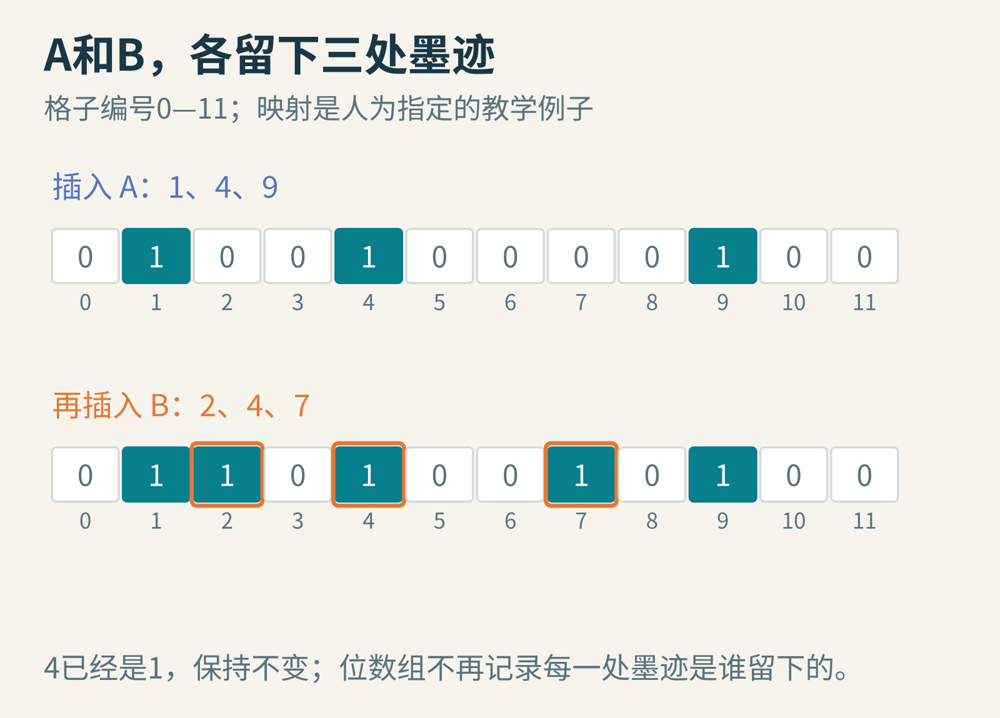
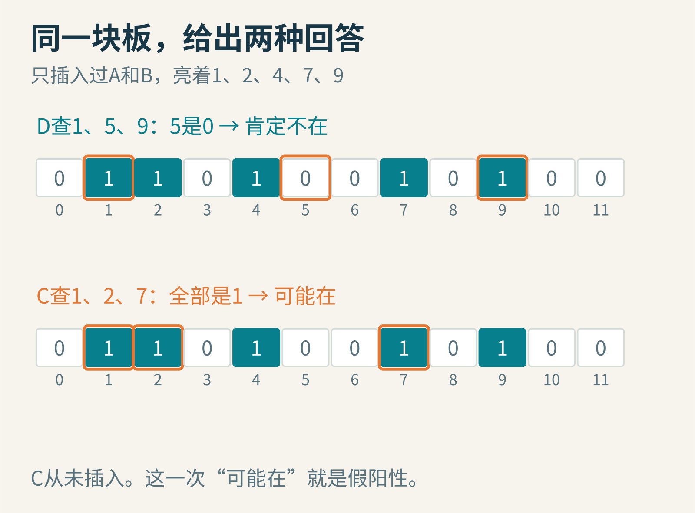
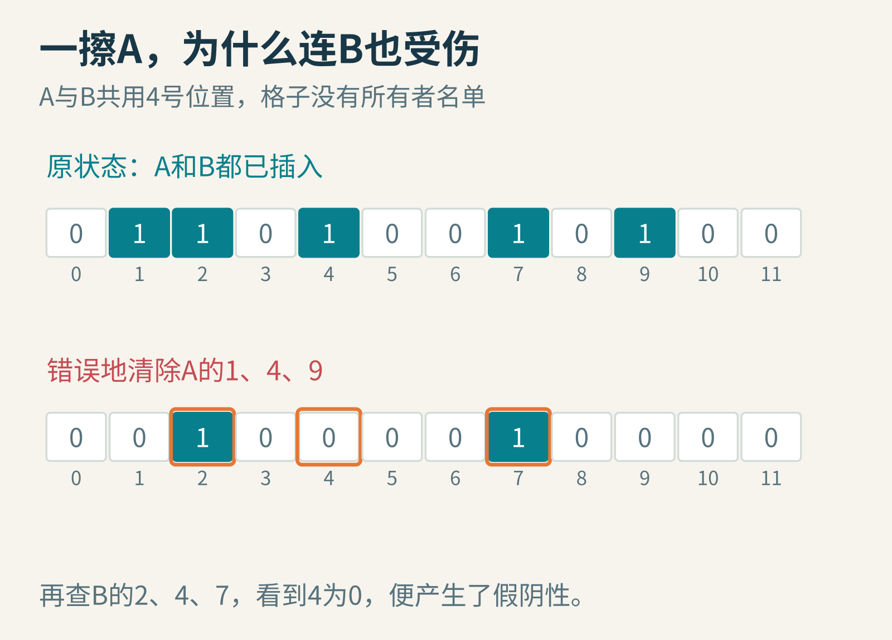
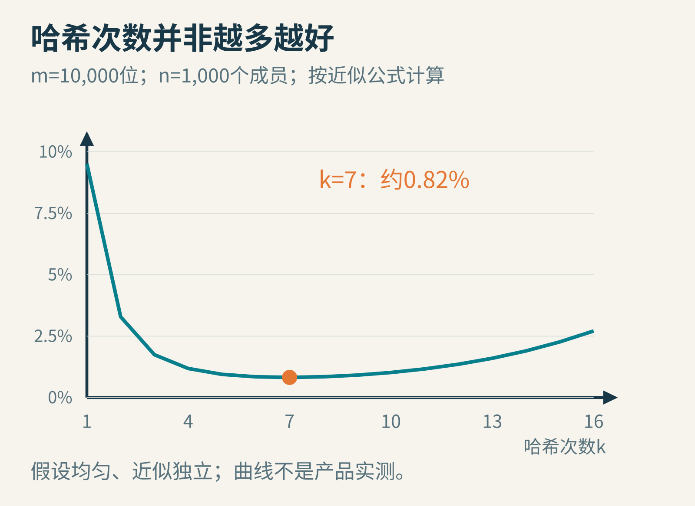

# 它不记住名单，却能说“你肯定不在”：Bloom过滤器的巧妙偏心

设想一座图书馆有一千万本书。有人来问一个书名是否存在，系统每次都去磁盘里的完整目录查找。很多询问最终只得到“没有”，却同样付出了读取目录的成本。

如果门口能放一块很小的板子，先挡掉大多数无效询问，就省事了。但板子装不下全部书名。

Bloom过滤器接受了一个有意思的交换：不承诺每次都能确认“有”，却努力保证，回答“没有”时不会冤枉已经登记的成员。

它的两种回答是“肯定不在”和“可能在”。后者需要继续查完整目录。这个有意不对称的接口，是整个设计的关键。


图1：过滤器负责排除，真实数据负责确认。被过滤器放行，不等于书已经找到。

## 把书名拆成几处墨迹

准备12个小格，每格只有0或1，起初全为0。再准备三种固定的映射规则，把一个名字映射到三个格子编号。这样的映射通常由哈希函数完成。

为了看清步骤，先用一张人为指定的教学映射表，不把它冒充优秀的哈希函数：

- A对应1、4、9
- B对应2、4、7
- C对应1、2、7
- D对应1、5、9

插入A，就把1、4、9号格设为1。插入B，再把2、4、7设为1。4号格早已是1，保持不变即可。现在亮着的格子是1、2、4、7、9。


图2：格子只记录“有人来过”，不记录是谁。A与B可以留下重叠墨迹。

查询一个名字时，用同样的三种规则找到它的格子。只要有一格仍为0，就能立即回答“不在”。因为如果它确实插入过，这三个位置早就都应被设成1。

所以查询D时看到5号格为0，可以排除。这里的逻辑不是“看起来不像”，而是“插入D必然留下的证据缺了一块”。

## 三个位置都亮了，为什么还不能说“有”

C对应1、2、7。三个格子都亮着，可我们根本没插入C。

1号格来自A，2、7号格来自B。别人的墨迹恰好拼成了C需要的形状。这叫假阳性：一个不存在的成员，被过滤器判断成“可能存在”。


图3：D缺少必需的墨迹，可以排除；C的墨迹齐全，却可能只是其他成员合力留下的巧合。

相反，对于已经插入的A，它需要的位置始终都是1，后来插入其他成员也不会把这些1抹去。因此，标准的只插入Bloom过滤器没有这种意义上的假阴性。

这个保证有前提：插入和查询使用同一套哈希规则、相同的位数组，已经插入的数据没有因为并发写入丢失、损坏、错误删除或不同步而消失。算法性质不能替坏掉的实现兜底。

## 为什么不能顺手把A的格子清零

删掉A时，把1、4、9清零似乎很自然。但4也是B需要的格子。一清零，再查询仍然存在的B，就会错误地回答“不在”。


图4：共享格子没有保留所有者信息。把一个成员的墨迹擦掉，可能顺带擦掉别人的证据。

计数型Bloom过滤器把每个位换成小计数器，插入时加、合法删除时减，能够支持相应的删除操作。不过计数器要占更多空间，也要处理溢出、重复插入和错误删除。尤其不能因为某个元素被判断“可能在”，就凭空删除它：假阳性对应的元素可能从未插入过。

一种省空间的数据结构没有免费获得完整集合的全部能力。标准Bloom过滤器既不能列出原始成员，也不能恢复书名，更不是加密后的名单。

## 墨迹多到什么程度，门口的板子会失灵

设位数组有m个位，插入n个不同元素，每个元素使用k次哈希。假设这些位置近似均匀、独立，某个位一次没有被选中的概率是1−1/m。

经过kn次选择，这个位仍为0的概率大约是：

(1−1/m)^(kn) ≈ e^(−kn/m)。

所以一个位置已经为1的概率约为1−e^(−kn/m)。如果一次不在集合里的查询检查k个位置，常用的假阳性率近似就是：

p ≈ (1−e^(−kn/m))^k。

这是用于设计的近似式，不是对所有小位数组、任意相关哈希函数或任意输入分布都成立的精确承诺。


图5：插入越多，空格越少。若几乎全是1，过滤器几乎对谁都说“可能在”，正确性没有自动崩掉，筛选价值却接近消失。

哈希次数k也不是越多越好。多查一个位置，似乎更严格；但每次插入也会多涂一个位置，让板子更快变满。两种作用拉扯，在这个近似模型下，较优的k约为(m/n)×ln2。

举个具体预算：用10,000个位保存1,000个成员，选k=7，近似假阳性率约0.82%。位数组本身约1,250字节，还没有算对象、对齐和其他实现开销。


图6：教学模型设m=10,000、n=1,000。曲线由公式计算，低谷在k约7附近；这不是某个数据库的实测性能。

## 1%的误判，不等于99%的“可能有”都是真的

这是概率里一个很值得停一下的地方。

假设一万次查询里，只有十次真的在名单中。过滤器不会漏掉这十次；其余9,990次如果有约1%假阳性，就会再放进大约100次。

最后110次“可能在”里，真正存在的只有约10次。过滤器并没有违背1%的假阳性率，因为那个比例的分母是“不在集合的查询”，不是所有被放行的查询。


图7：假阳性率和“放行之后有多大概率真存在”是两回事。后者还依赖查询里真正成员的比例。

这也说明为什么它适合当第一道筛选，而不适合单独作处罚、封禁或其他需要确认事实的依据。系统应回到真正的数据再查一次。

## 从印刷排版的例外词，到存储系统

Burton H. Bloom在1970年的[原始论文](https://www.cs.princeton.edu/courses/archive/spr05/cos598E/bib/p422-bloom.pdf)里，讨论了空间、排除时间和允许误判之间的交换。其中一个应用场景是英文断词：多数词可按简单规则处理，少数例外词则需要查较慢的资料。

如果小型内存结构能够迅速排除“肯定不是例外词”的情况，就不用每个词都访问较慢的存储。出现假阳性时，再查真正的例外表；多走了一步，却没有因此输出错误的词。

今天，这个结构可以用来判断某个磁盘文件中是否可能包含键，减少没必要的读取。它节省的是后续工作，不是把真实数据变成了可有可无的东西。对于大多数查询本来就存在的负载，或者后续查询非常便宜的负载，过滤器的收益可能很有限。

## 用十几行程序，看见那个“可能”

下面完整复现前面的12格教学例子，已在Python 3中运行。哈希位置使用明确给定的表，因此它演示的是位数组逻辑，不是哈希质量。

```python
places = {"A": [1, 4, 9], "B": [2, 4, 7],
          "C": [1, 2, 7], "D": [1, 5, 9]}
bits = [0] * 12
for name in ["A", "B"]:
    for i in places[name]:
        bits[i] = 1

def might_contain(name):
    return all(bits[i] for i in places[name])

for name in ["A", "B", "C", "D"]:
    print(name, might_contain(name))
```

输出依次是A True、B True、C True、D False。C的True恰好展示了假阳性。把A的三个位置清零，再查B，会看到错误删除造成的问题。

还可以继续问：若把位数翻倍而成员数不变，公式给出的误判率怎样变化？若把整个数组直接传给另一台机器，两台机器需要事先约定哪些参数？若两个过滤器采用完全相同的m、k和哈希规则，按位或能否表示两组成员的并集？

最后一个问题的答案是可以，但合并后的误判率通常会升高。因为更多信息共用同一块板子，墨迹又变密了。

Bloom过滤器的精彩之处，在于它没有执着于回答一个自己装不下的问题。它重新设计了问题的边界：把“确认有”留给完整资料，把“迅速排除不可能”做得极其节省。

延伸阅读：[RocksDB的Bloom过滤器说明](https://github.com/facebook/rocksdb/wiki/RocksDB-Bloom-Filter)。图片来源：图1—7为原创教学示意与公式计算图；其中的书名代号、位数组和查询数量均为教学构造。
