# 天空里没有总指挥，一群鸟为什么能一起转弯？

假设你在做一个游戏：黄昏，玩家走过湖边，一群鸟从芦苇里飞起来。

给一只鸟画飞行路线并不难。给一百只鸟各画一条路线，也不是做不到。真正棘手的是下一秒：玩家往鸟群中间跑，几只鸟躲开，队伍裂成两半，又在前方重新汇合。你没有提前画过这段动画。

我们要造的不是一段反复播放的录像，而是一群会对眼前局面作出反应的个体。问题于是变成：每只鸟至少要知道什么？

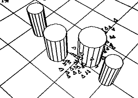

图中是 Craig Reynolds 在 1986 年制作的早期模拟，柱子会改变鸟群的路径。这是计算机动画，不是真实鸟群的观测录像。

Reynolds 把这种模拟个体叫作 boid。他在 1986 年建立模型，1987 年在 SIGGRAPH 发表《Flocks, Herds, and Schools: A Distributed Behavioral Model》。这两个年份分别对应模型制作和论文发表，不是两次互相矛盾的“发明时间”。[原论文信息](https://www.red3d.com/cwr/papers/1987/boids.html)

它提出的关键转变是：不必先画完整群体的轨迹，可以先写每个个体如何转向，让群体轨迹在运行中出现。下面不用一百只鸟起步，先把镜头推近到三只。

## 先别问整群飞向哪里，问 A 下一步怎么动

这是我们自己的二维教学场景。三只鸟的位置是 A=(0,0)、B=(2,0)、C=(0,2)。A 的速度是 (1,0)，B 是 (0,1)，C 是 (1,1)。位置与速度使用统一的教学单位，图上的箭头表示速度方向，长度帮助表示快慢。

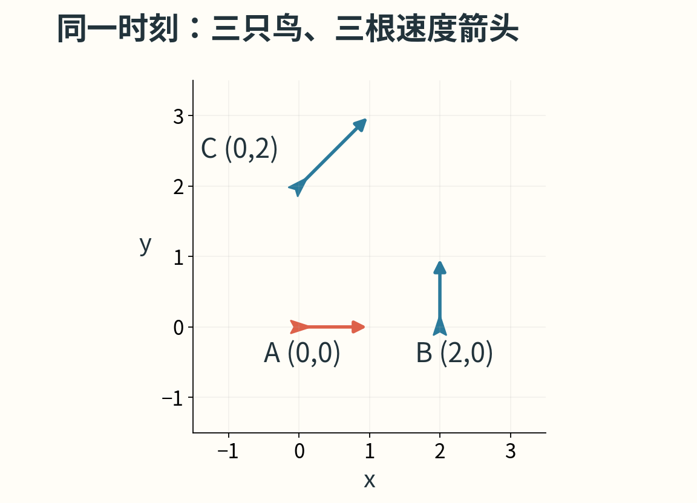

坐标并不是装饰：A 右边有 B，上边有 C；A 正朝右飞，B 正朝上飞，C 朝右上飞。后面所有计算都围绕这一张图。

如果 A 只保持原速度，它完全不理会同伴。如果 A 直接复制 B 的速度，又为什么偏偏听 B 的？最合理的起点是让附近的同伴共同影响它。

“附近”很重要。原模型用距离和视角限制影响范围。为了方便手算，我们暂时省去视角，使用半径 2.2 的圆；B、C 都在圆内。远处 D 即使存在，也不参加 A 这一步的决定。[作者的模型说明](https://www.red3d.com/cwr/boids/)

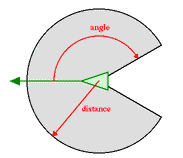

作者原图中的灰色扇形是会影响它的范围，背后的白色缺口不参与。

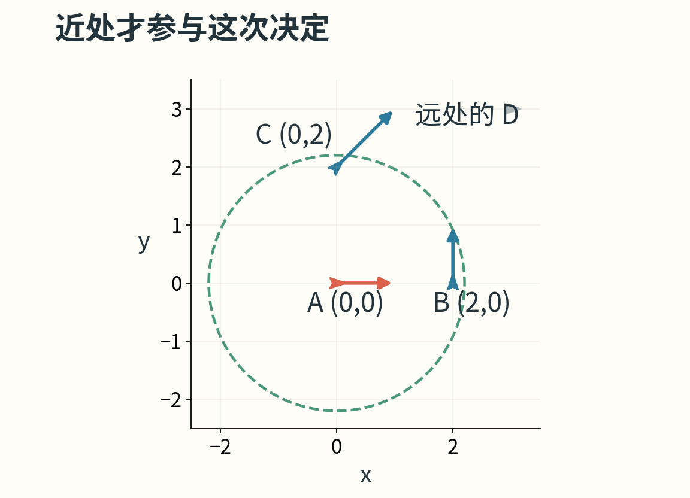

这个简化有什么代价？A 也会受身后近邻影响。它便于理解和实现，却不等于每个版本的 Boids 都使用全周视野。邻域形状是模型选择，不是一个不可更改的常数。

## 第一条建议：别挤在一起

想象 A 离 B 越来越近。如果系统只有“跟大家一起飞”，它们可能叠在同一个位置。我们需要一条向外推的建议，称为分离。

从 B 指向 A 的向量是 A−B=(-2,0)。从 C 指向 A 是 (0,-2)。让近邻的影响更大，一种常见的教学写法是把每个向量除以距离平方，再相加。

B 距离 A 为 2，因此它贡献 (-2,0)/4=(-0.5,0)；C 贡献 (0,-0.5)。两者合起来，分离建议 S=(-0.5,-0.5)。A 应该向左下修正。

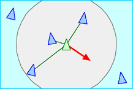

原图表现的是局部避让，不是给整个鸟群加一股统一的风。

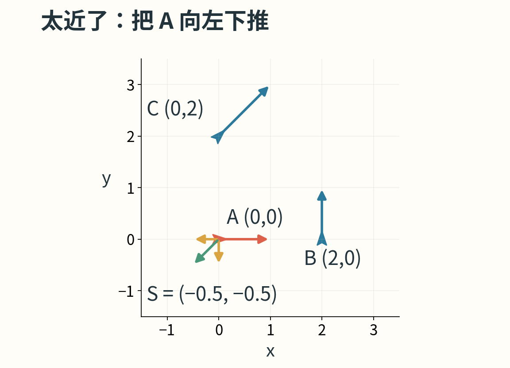

注意这里说的是“修正”，不是立即把 A 的速度设成左下。A 原本向右飞，它有自己的运动状态；邻居改变的是接下来怎么转。

除以距离平方之后，向量本身的长度还含有一个距离因子，所以单个邻居贡献的大小与距离成反比。不要把这句公式直接说成“力一定按距离平方衰减”。更重要的是：这只是我们选的一种规则，不是鸟类肌肉的物理定律。

## 第二条建议：看看大家朝哪儿走

分离能让个体不那么拥挤，却没有回答为什么队伍会一起转向。两只鸟即使保持安全距离，也可能一个向东、一个向西，越飞越散。

于是 A 再看 B、C 的速度。平均值是：

( (0,1) + (1,1) ) / 2 = (0.5,1)。

这是同伴当前的平均速度。A 自己是 (1,0)，要靠近这个平均值，速度修正应为：

A_align = (0.5,1) − (1,0) = (−0.5,1)。

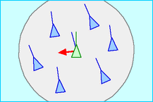

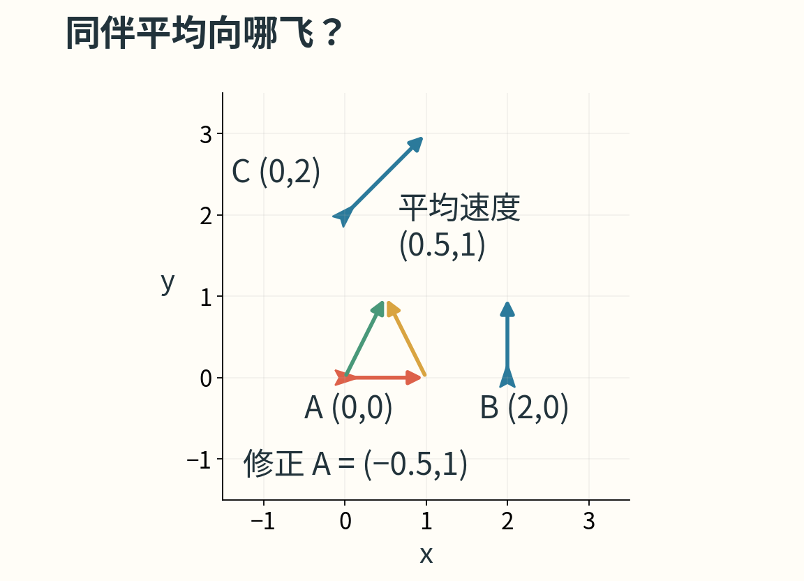

绿色箭头是目标平均速度，黄色箭头从自己的速度终点指向目标终点。对齐修正不是“把两只鸟的位置取平均”；它处理的是速度。

这一点可以用一个小反例记住：B、C 恰好对向等速飞行时，平均速度可能是零。我们的简化规则会让 A 减速，而不是凭空决定向左还是向右。这是选用“平均速度”所带来的行为。另一些实现平均单位朝向，再单独控制速度，结果会不同。

## 第三条建议：别掉队

如果所有鸟的速度终于一样，它们是不是就自动成为紧密的一群？不会。

两队相隔很远的鸟即使都向东飞，也可以永远保持很远的距离。对齐照管朝向，聚合照管位置。

B、C 的平均位置是 (1,1)。从 A=(0,0) 指向这个局部中心的向量就是 C_cohesion=(1,1)。它给 A 一条往右上靠近的建议。

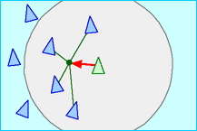

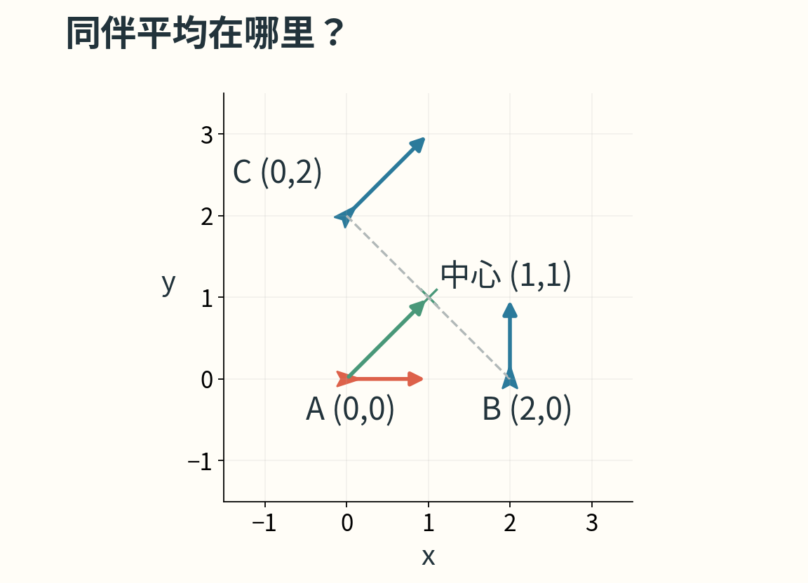

这时有一个很有意思的冲突：分离叫 A 向左下，聚合叫 A 向右上。它们不是写错了。就像并排行走的人既不想撞肩，也不想落下，同一个个体需要在不同要求之间折中。

而且这个中心是 A 的邻居中心，不是整个世界所有鸟的中心。处在鸟群不同地方的个体，会算出不同的中心。

## 三条建议吵起来，最后听谁的？

我们给三项乘上权重，再相加。为了把过程算到底，这次选择分离 1.5、对齐 0.4、聚合 0.2：

加速度 a = 1.5S + 0.4A_align + 0.2C_cohesion。

把刚才的数代进去：

- 分离贡献：(-0.75,-0.75)
- 对齐贡献：(-0.2,0.4)
- 聚合贡献：(0.2,0.2)
- 相加得到：a=(-0.75,-0.15)

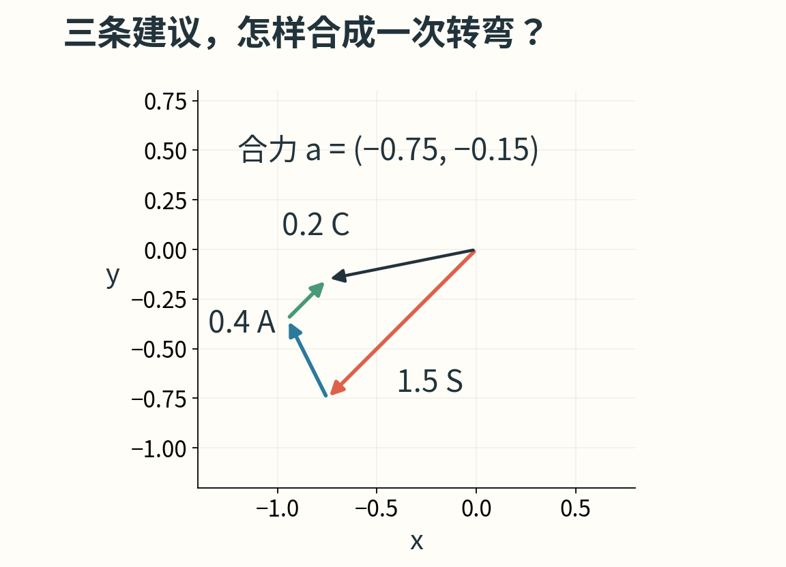

图上沿红、蓝、绿箭头依次走，最后落到的位置，就是黑色合成箭头的终点。分离在这一次占上风，A 要稍微向左下调整速度。

这是教学用的加权求和版本。原论文对行为协调、优先级和有限的加速度预算有更丰富的讨论；不能把这一个公式当成 1987 年程序的逐字复刻。工程中尤其要警惕：强烈的“去目标点”与“躲开障碍”可能在加权后相互抵消，留下一个危险的折中。

接下来让时间走 0.2 个单位。用新加速度更新速度，再用新速度更新位置：

新速度 = (1,0) + (-0.75,-0.15)×0.2 = (0.85,-0.03)。

新位置 = (0,0) + (0.85,-0.03)×0.2 = (0.17,-0.006)。

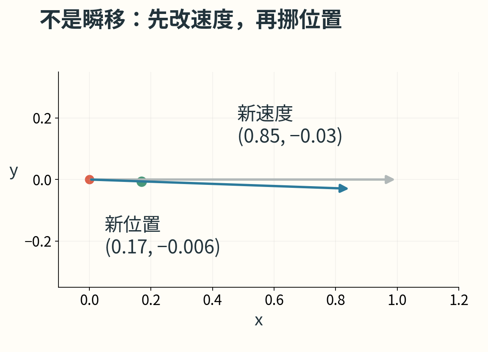

它仍在向右飞，只是慢了一点，并略向下偏。规则没有要求它瞬间掉头。把“期望方向”“速度变化”“位置变化”分开，运动才不会变成一连串传送。

实际实现通常还限制最高速度和最大加速度。否则极近的邻居会产生巨大的分离项，或者一个巨大时间步直接把个体推过障碍。

## 把这一小步交给电脑

下面这段 Python 3 代码只需标准库。它计算的就是上面的 A，没有藏着随机数，也没有换成另一组场景。

```python
from math import dist

p = [(0., 0.), (2., 0.), (0., 2.)]
v = [(1., 0.), (0., 1.), (1., 1.)]
i = 0
neighbors = [j for j in range(len(p))
             if j != i and 0 < dist(p[i], p[j]) < 2.2]

def mean(values):
    return tuple(sum(x[k] for x in values) / len(values)
                 for k in (0, 1))

s = tuple(sum((p[i][k] - p[j][k]) / dist(p[i], p[j])**2
              for j in neighbors) for k in (0, 1))
avg_v = mean([v[j] for j in neighbors])
avg_p = mean([p[j] for j in neighbors])
a = tuple(1.5*s[k] + .4*(avg_v[k]-v[i][k])
          + .2*(avg_p[k]-p[i][k]) for k in (0, 1))
nv = tuple(v[i][k] + a[k]*.2 for k in (0, 1))
np = tuple(p[i][k] + nv[k]*.2 for k in (0, 1))
print("加速度", tuple(round(x, 6) for x in a))
print("新速度", tuple(round(x, 6) for x in nv))
print("新位置", tuple(round(x, 6) for x in np))
```

本地执行结果是：加速度 (-0.75,-0.15)，新速度 (0.85,-0.03)，新位置 (0.17,-0.006)。这个小实验验证算术和这一种更新顺序，不验证真实鸟类行为。

上面的代码特意使用一个已经有邻居的输入。如果扩成通用函数，空邻居时要返回零修正；完全重合时还要专门处理，不能除以零。一个工程常见做法是给分母设下限，或给重合个体指定确定的分开方向。选择哪一种，会影响极端情形下的画面。

## 一百只鸟，谁先更新？

现在可以让每只鸟都重复上述步骤。但如果程序先移动 A，再计算 B，B 看见的 A 已是新位置；轮到 C 时，它又看见更多更新后的状态。

这样一来，数组排列顺序就偷偷加入了规则。把鸟的编号换一下，动画可能跟着改变。

我们用双缓冲：先冻结这一帧的位置和速度，所有个体都从旧状态作出决定；新状态写到另一份数组，全部算完再一起交换。

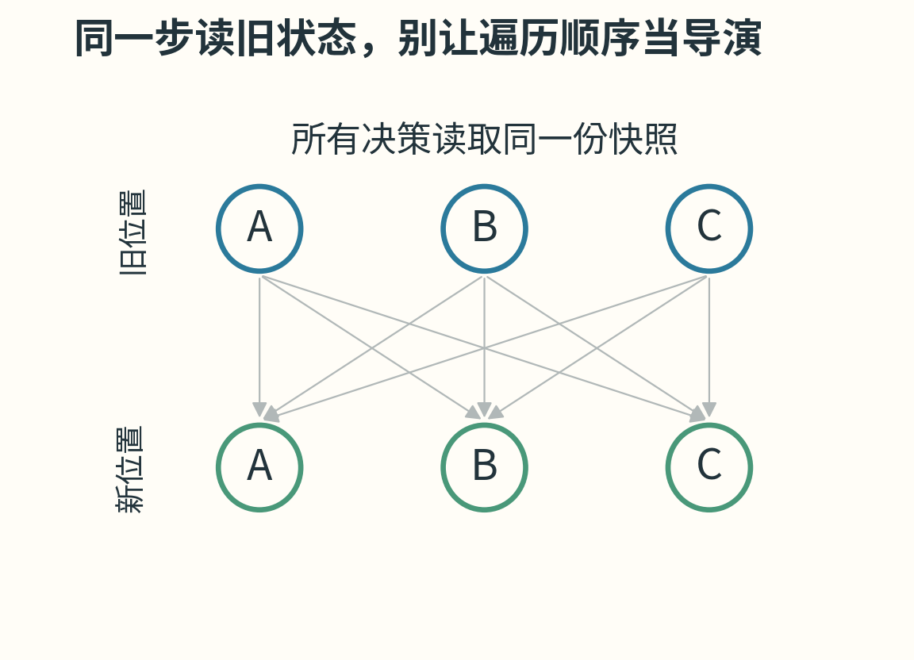

图中的连线表示“可以读取”，并不表示每只鸟必须影响所有同伴。邻域筛选仍然存在。

下面四张图来自同一次真正运行的二维教学模拟：100 个个体、固定随机种子 12、步长 0.1、环绕边界；使用分离、对齐和聚合，并限制加速度与速度。它与前面的三鸟手算同属一个规则家族，但参数为了群体演示另行设置。完整实验见随文的 [模拟程序](examples/simulate.py)。

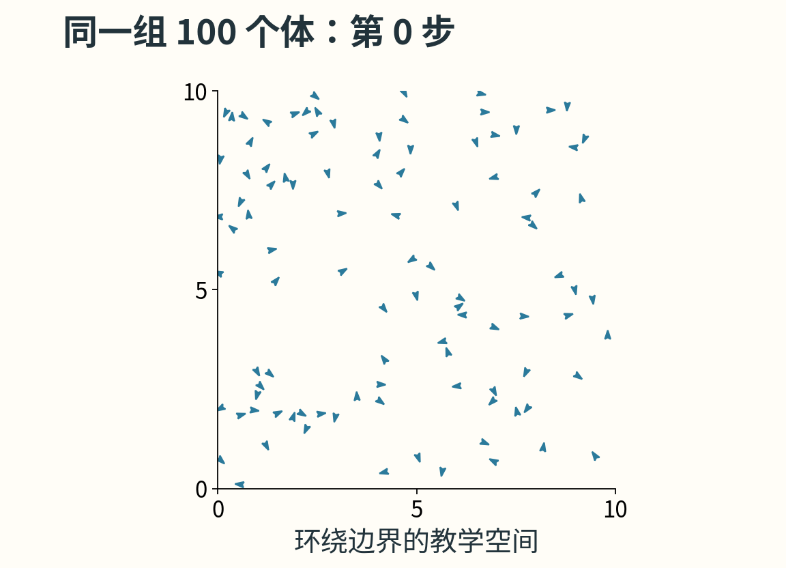

第 0 步，方向分散。三角形尖端表示朝向，不是某个中央调度器画出的队形。

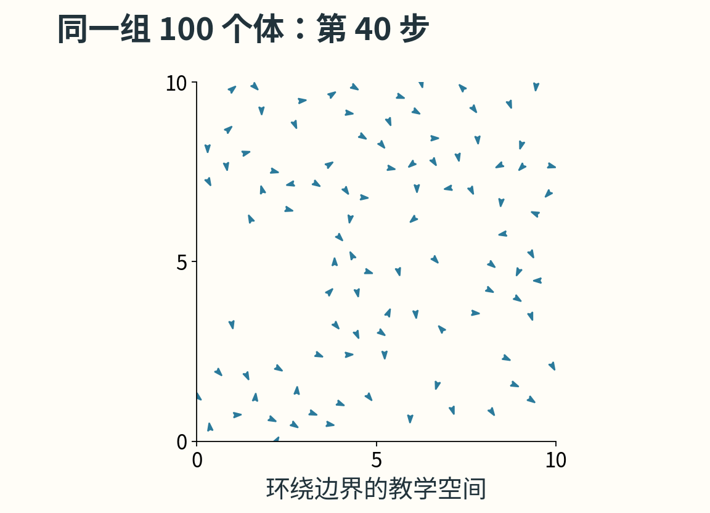

第 40 步，附近个体开始相互影响。注意局部小队伍，不必急着在整幅图里寻找一支“完美大鸟群”。

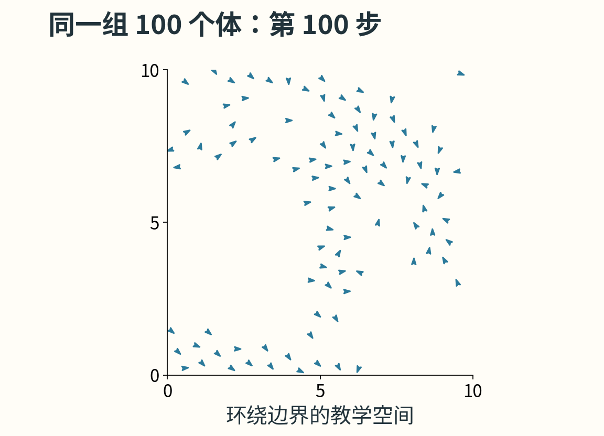

第 100 步，局部结构继续改变。有些相近个体聚在一起，有些仍在边缘。

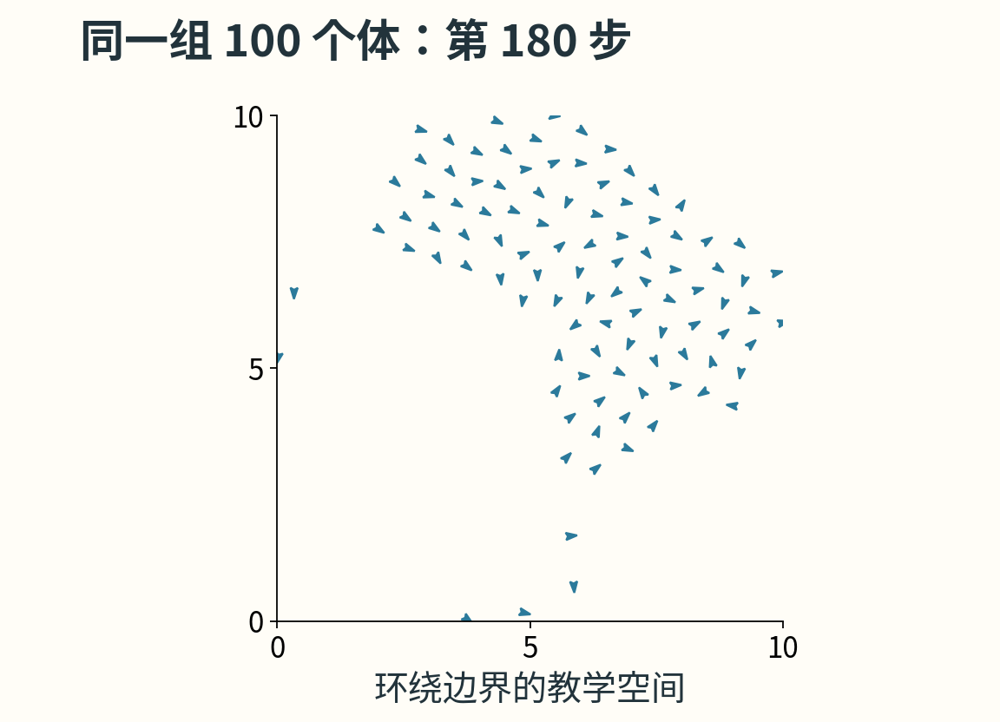

第 180 步。这一次模拟展示的是局部规则可以产生群体结构，不是证明任何初始条件都会收敛成同一队形。你更换随机种子、感知半径或权重，完全可以得到分散、拥挤、绕圈和震荡。

“涌现”在这里不意味着多出来一种神秘力量。新出现的是群体层面可见的模式，而每一步仍能追溯到个体的读取、计算和移动。

## 最费时间的，可能不是那三条公式

一百只鸟，每只检查另外九十九只，约是一万次配对判断。一万只鸟照做，约是一亿次。即使大多数最后被判定为“太远了”，你仍然付了检查费用。

如果规则只关心附近，可以先把空间分格子。格边长取感知半径时，二维情况下检查自己所在格及周围八格，再做精确距离判断，就不会漏掉半径内的邻居。

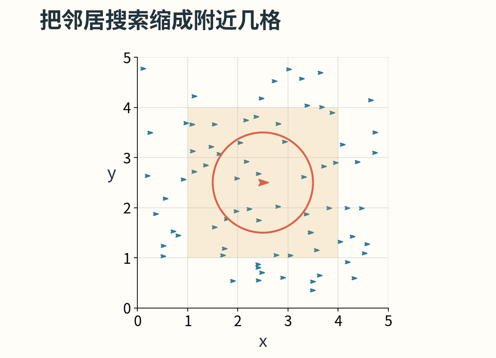

红圈是真正邻域，浅黄色九宫格是候选范围。两者不是一回事：格子里找到的个体还要经过距离测试。

在密度受控、每格人数不太大的情况下，这能显著减少检查。可如果所有鸟都挤在同一个格子里，最坏情况仍接近两两比较。空间划分提供加速机会，不是自动赠送一个对所有输入都成立的线性复杂度保证。

还有一个常见的小坑。我们的世界左右相连，x=0.3 的鸟与 x=9.7 的鸟，穿过边界只差 0.6。若用普通坐标差却得到 9.4，边缘就会出现一道看不见的“社交隔离墙”。

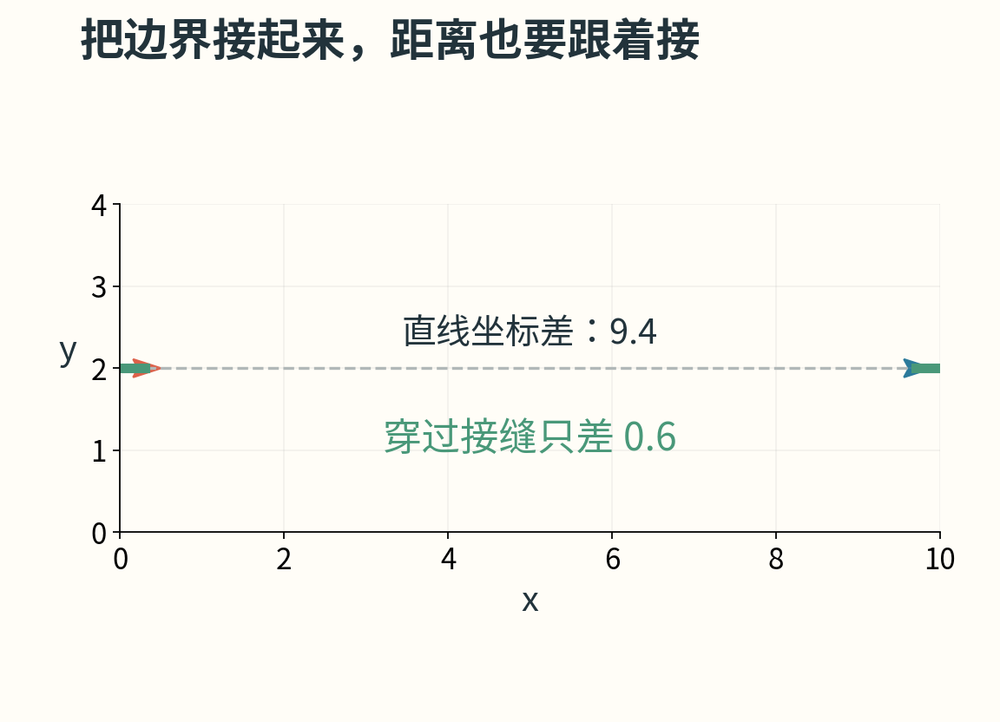

不仅距离要使用最短环绕差值，指向邻居的方向、聚合的位移也要一致处理。不能只把飞出屏幕的坐标取模，其他计算照旧。

## 有了鸟群，不等于有了不会撞墙的鸟

分离主要处理同伴之间的拥挤。柱子、墙壁、玩家和目的地还需要额外规则。

如果等到鸟离墙很近才往外推，有限转弯能力可能来不及救它。作者的早期实验包含预测式障碍回避：关注接下来可能撞上什么，而不只是此刻距离什么最近。

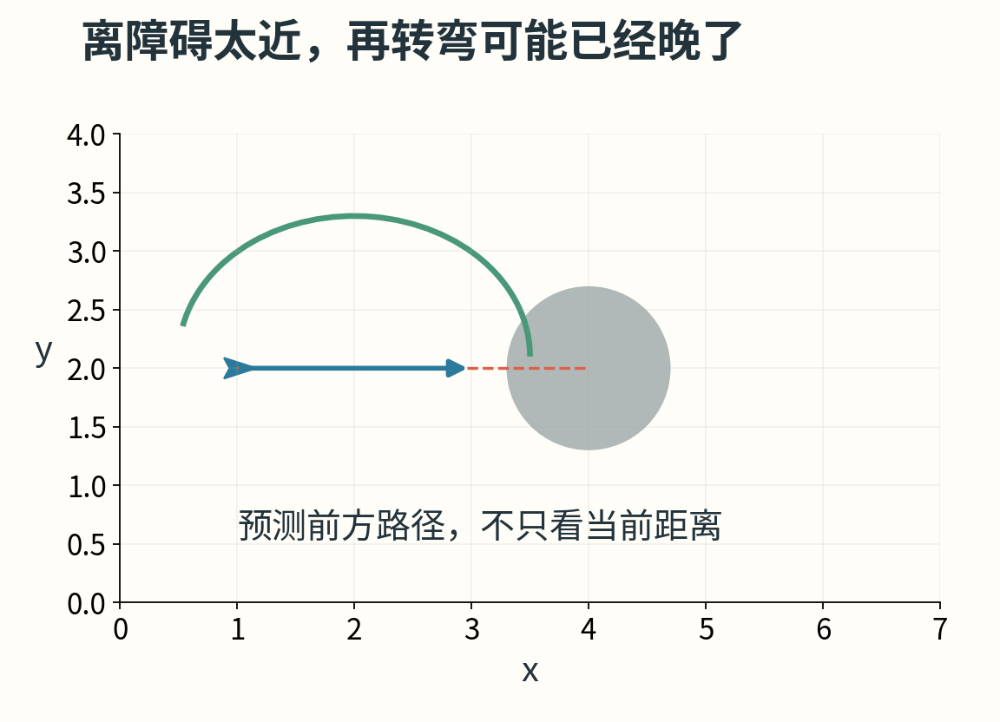

这张图是路径关系示意，不是经过动力学求解的安全轨迹。真正需要碰撞安全保证的系统，还必须有相应的碰撞检测、约束或规划方法，不能因为画面看起来顺畅就默认安全。

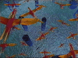

这张原图来自 1987 年短片《Stanley and Stella in: Breaking the Ice》。它提醒我们 Boids 的一个重要用途：用可调的局部行为帮助动画工作，而不是宣称三条规则已经解释了所有真实动物的集体运动。

最后留一个可以亲手验证的问题：把分离权重设为零，其他条件保持不变。先猜鸟群会变得更松散，还是更容易挤在一起，再运行模拟比较。接着把聚合权重设为零，观察得到的是不是同一种变化。

当你能区分“位置靠近”“速度一致”和“避免拥挤”，你就不再只是记住三个英文名。你已经有了一套能自己改条件、预测结果、发现边界的群体运动模型。

图片来源：六张历史图与规则原图均来自 Craig Reynolds 的 [Boids 页面](https://www.red3d.com/cwr/boids/)，保留作者提供的原始 GIF，不属于本文原创内容的 CC BY 4.0 授权。其余图为本文原创教学示意或注明参数的模拟结果。
