# 画一条直线，为什么只要加减法？从绘图仪走到 Bresenham 的误差账本

拿一张方格纸，在左下角点一个点，再在右上方点另一个点。用尺子连起来，很容易。

现在加一条古怪的规则：你的笔每次只能从一个格点移到相邻格点。不能停在半格，不能让横坐标只增加0.3。你仍然要尽量沿着刚才那条直线走。

问题忽然变了。直线没有变，机器能够执行的动作变了。

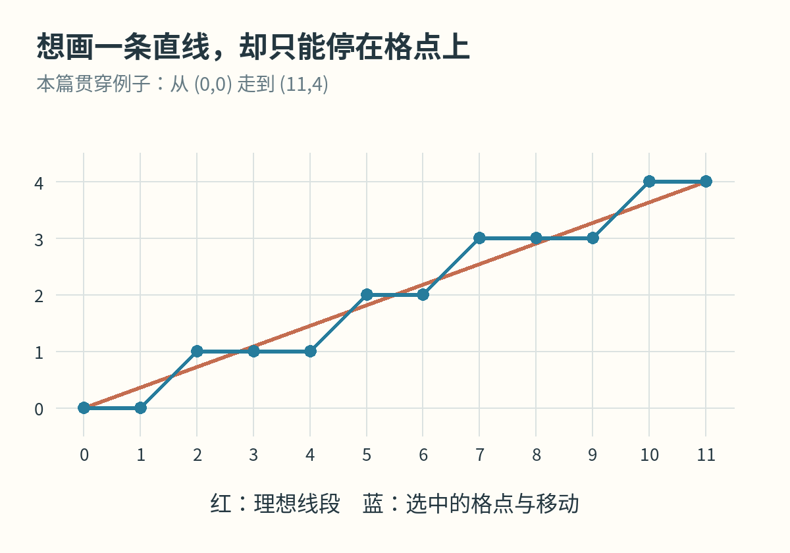

图里的两个端点是(0,0)和(11,4)。橙色是理想线段，蓝色是我们最终要解释的离散路径。本文的坐标、轨迹和后续实验均是自设教学例子。

一个直觉办法是：每向右一格，重新算一次直线的高度，再挑最近的格点。可以，但有一个更有趣的问题：**已经知道上一步选了哪里，能不能只记住一点点信息，就决定下一步？**

Bresenham画线算法给出的答案，是一笔不断更新、但不会悄悄扔掉的误差账。

## 先看看，它曾经真的要推动什么

这件事并非最初就发生在今天的游戏显卡里。Bresenham在NIST收录的一段2001年回忆中说，1962年夏天，他在IBM圣何塞的计算实验室里，已经让这套方法投入使用。设备包括IBM 1401，以及经1407打字机控制台连接的CalComp绘图仪。这是作者多年后的回忆，不能当成当天的实验日志。[作者回忆与算法条目](https://xlinux.nist.gov/dads/HTML/bresenham.html)

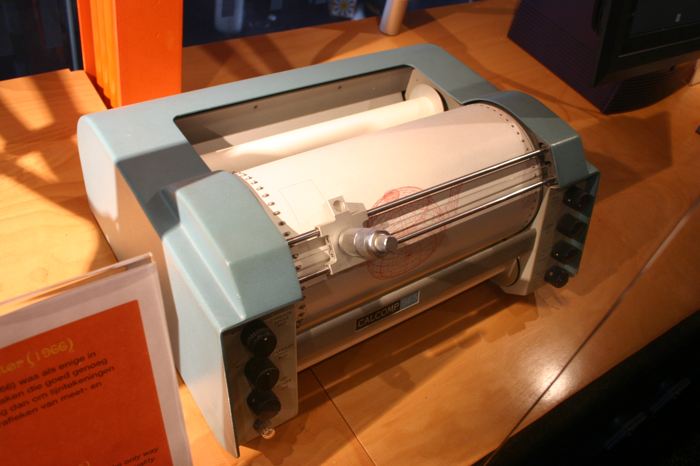

照片：Ryan Somma，CC BY-SA 2.0，来自[原文件页](https://commons.wikimedia.org/wiki/File:Calcomp_565_drum_plotter.jpg)，原图3072×2048，未裁切或修改。文件页将展品描述为约1966年的CalComp 565，摄影日期未知；这不是Bresenham在1962年的工作现场。图片继续遵循[自身许可](https://creativecommons.org/licenses/by-sa/2.0/)，不改为正文的CC BY 4.0。

看照片中横贯纸面的金属导杆：笔架可以沿它移动。另一个方向来自滚筒带动纸张。笔向左或向右，纸向前或向后，两路运动合在一起，才能在纸上留下二维轨迹。提起笔，是移动位置；放下笔，才会画线。

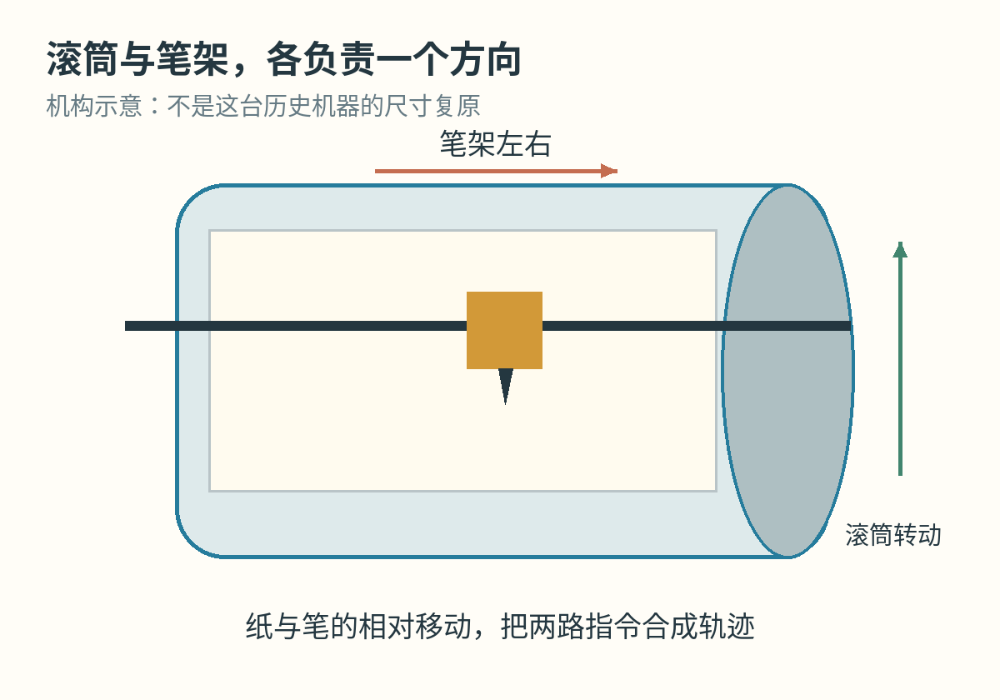

这是帮助理解动作的机构示意，不是设备尺寸图，也没有模拟它的惯性、摩擦与控制电路。

1965年的原论文讨论一种能响应指令、在网格上向八个相邻位置移动的数字绘图仪。这里的“数字”指离散控制方式，纸上的墨迹当然仍然是连续的。后来把相似规则用于屏幕，任务会变成选出哪些像素：不要把一支笔走过的折线，与一排发亮的小方块说成同一件物理过程。[1965年原论文](https://www.cse.iitb.ac.in/~paragc/files/bresenham_line.pdf)

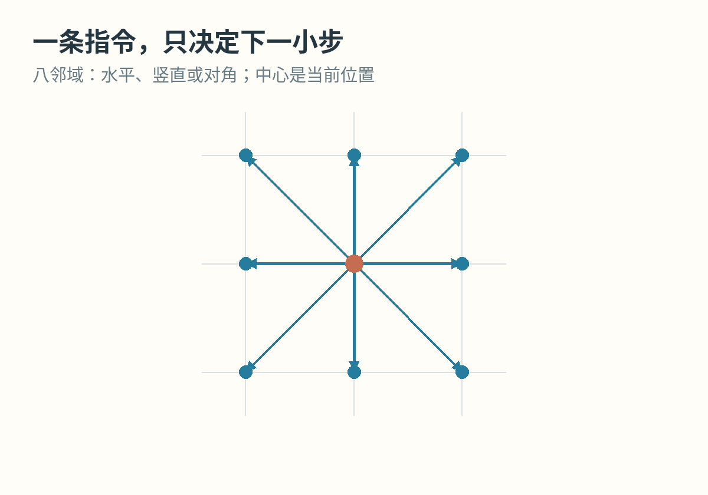

八个方向，已经足够写出很多轨迹。但动作库越简单，选择每一步的算法就越重要。

## 把大问题缩成两个按钮

先只处理一种容易想象的线：从左下向右上，而且横向走得比纵向多。

我们的例子向右走11格、向上走4格。把这两个总变化叫作dx和dy：dx=11，dy=4。这里的d来自“变化量”，不是另一个神秘坐标。

因为每向右一格，理想高度只增加4/11格，不到一格，所以每次只需在两个候选动作里挑一个：

- E，向右：x增加1，y不变。
- NE，向右上：x增加1，y也增加1。

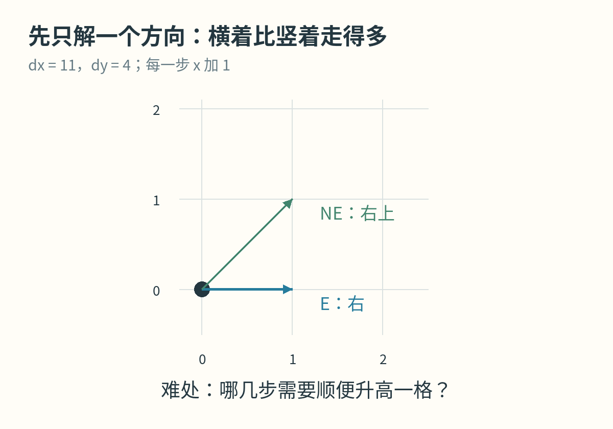

我们不需要先决定整条路径。只要反复回答：**这一小步，要不要顺便升高一格？**

“总共向上四次”还不足以确定好路径。如果把四次升高全部拖到最后，终点虽然对，中间却会远离那条直线。

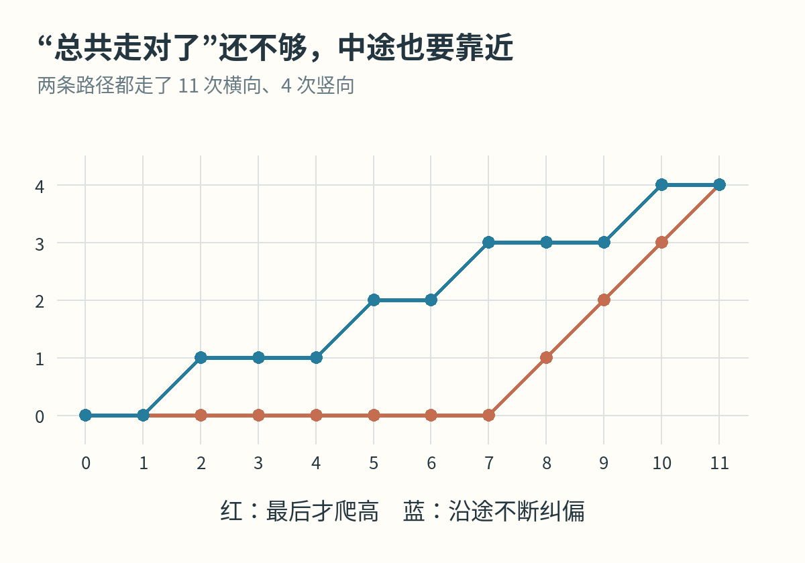

所以，这不是一道只检查最终总数的题。每一列都要选一个合适的位置。

## 先用最笨、最清楚的办法算两步

经过原点的理想直线，高度是：y=4x/11。

来到x=1这一列，理想高度是4/11，约0.364。两个候选格点的高度分别是0和1。0离它更近，所以第一步只向右，来到(1,0)。

来到x=2这一列，理想高度是8/11，约0.727。这次1更近，所以第二步向右上，来到(2,1)。

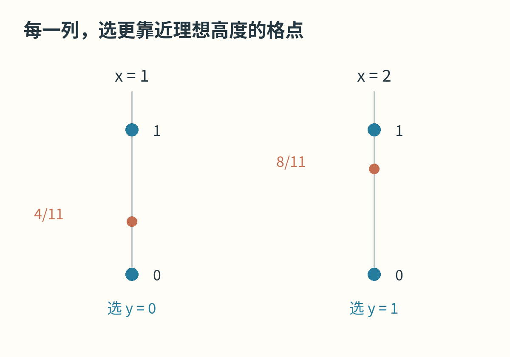

到这里没有任何技巧，只是在做“选最近的整数”。这个笨办法很有价值：稍后换成高效程序时，我们知道它必须保留哪一个判断。

但每一步真的需要算出0.364、0.727这些小数吗？

## 中点替我们省掉了两次比较

假设当前已经在(x,y)。下一列的两个候选位置是(x+1,y)与(x+1,y+1)。它们之间的中点高度，恰好是y+1/2。

如果直线在这一列的高度低于中点，选下面；高于中点，选上面。恰好压中点时一样近，必须另订平局规则。本文先规定：在这个向右上、较平缓的方向里，平局选上面。

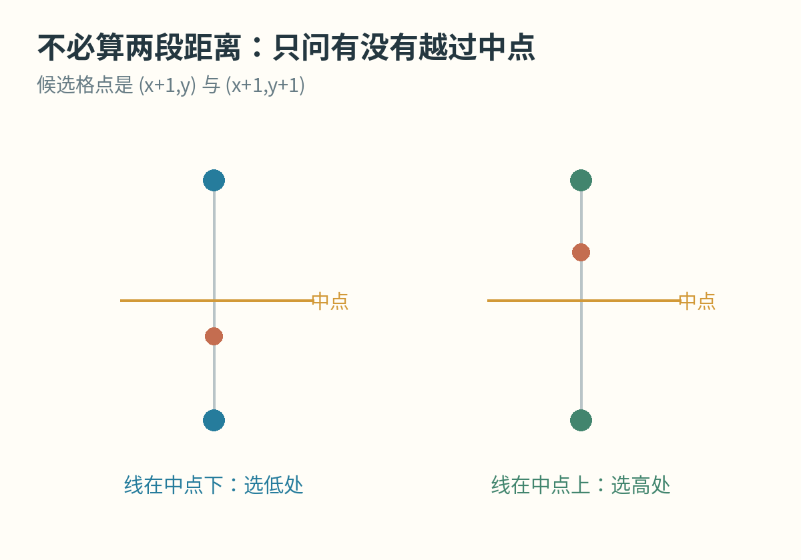

我们因此只需判断下面这个差的正负：

理想高度 − 中点高度 = dy×(x+1)/dx − (y+1/2)。

差小于0，向右；差大于或等于0，向右上。

目前还有除法和半格。可我们根本不需要差的精确大小，只需要它的正负。既然dx是正数，把整个差乘上2dx，正负不会改变。

乘完得到一个整数：

**D = 2dy(x+1) − 2dx·y − dx。**

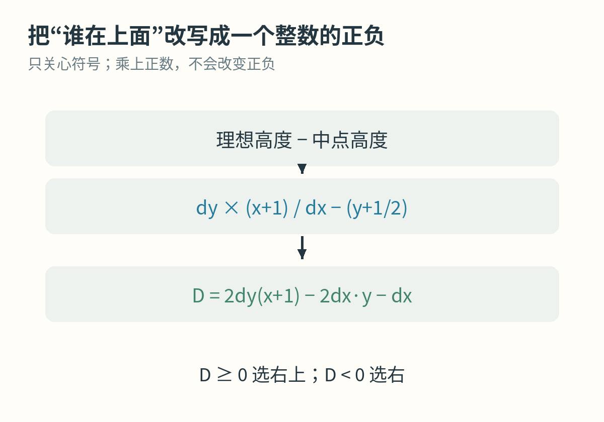

D叫“判别量”就够了：它是一张写着“下一列应该选谁”的小纸条。它不是当前像素与直线的距离，也不是任何时候都能直接读成误差有多少格。

初始在(0,0)，于是D=2×4−11=−3。负数告诉我们，第一步向右。这与刚才的小数计算完全一致。

## 真正省事的地方：下一张纸条不用从头算

看一眼D的式子，只有x和y会在行走时变化。dx=11、dy=4是整条线的固定条件。

如果只向右，x增加1，y没变。式子中只有2dy(x+1)多出一份2dy。因此，新的D等于旧的D加2dy，也就是加8。

如果向右上，x和y都增加1。除了增加2dy，还要减去2dx。因此，新的D等于旧的D加8再减22，也就是减14。

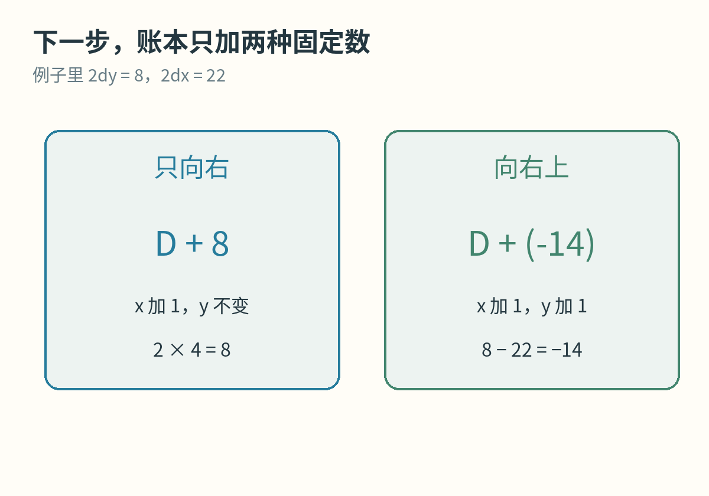

一长串坐标计算，现在变成了两条很短的规则：

- D<0：向右，然后D加8。
- D≥0：向右上，然后D减14。

这里要特别留意顺序：**先用旧D决定这一步，再更新D，让它服务于下一步。** 如果先把8加进去再判断，却仍用同一个初始值，就换了算法。

这是一种常见的算法改造：先写出每次都重新计算也正确的定义，再利用相邻状态只差一点点，把重算变成增量更新。快，并不是因为放弃了判断，而是因为不再重复已经隐含在旧状态里的工作。

## 跟着这本账，走完十一小步

第一步，D=−3，选E，到(1,0)。新的D=−3+8=5。

第二步，D=5，选NE，到(2,1)。新的D=5−14=−9。

第三步，D=−9，选E，到(3,1)。新的D=−1。

第四步，D=−1，仍然选E，到(4,1)。新的D=7。

第五步，D=7，才再次升高，到(5,2)。新的D=−7。

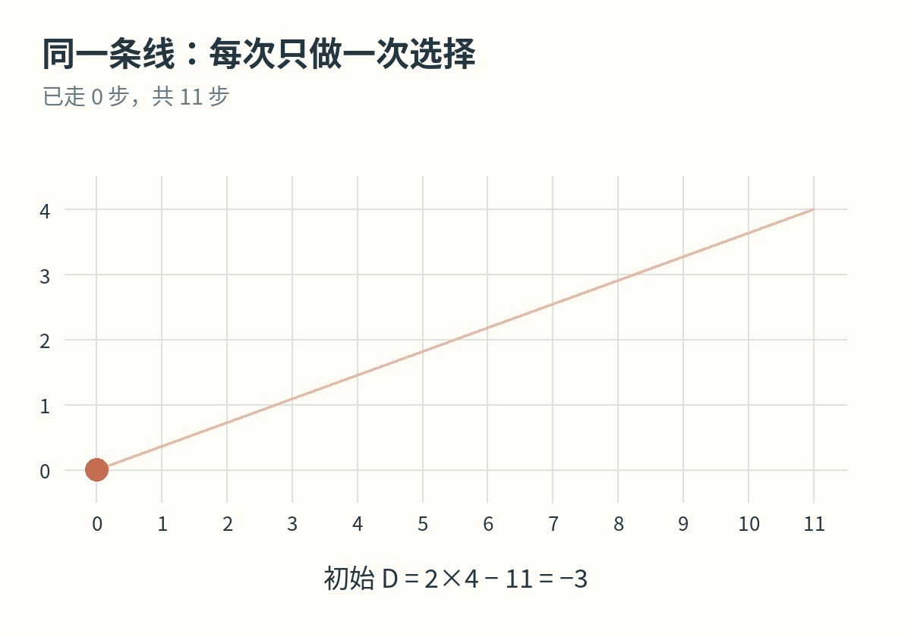

这段动画由本文程序生成，展示12个状态：起点加11次移动。它不是历史绘图仪的录像。

走完后的格点是：

(0,0)、(1,0)、(2,1)、(3,1)、(4,1)、(5,2)、(6,2)、(7,3)、(8,3)、(9,3)、(10,4)、(11,4)。

你可以挑最可疑的一个检查。例如在x=4时，理想高度是16/11，约1.455，所以还应该选1。下一列x=5，高度是20/11，约1.818，才该选2。算法没有因为“该平均分配四次升高”就机械地每隔同样步数上升；它一直在跟踪这条具体直线。

## 误差为什么没有越滚越大

现在把每一列选中的整数高度，减去那一列的理想高度。得到的差有时正、有时负。

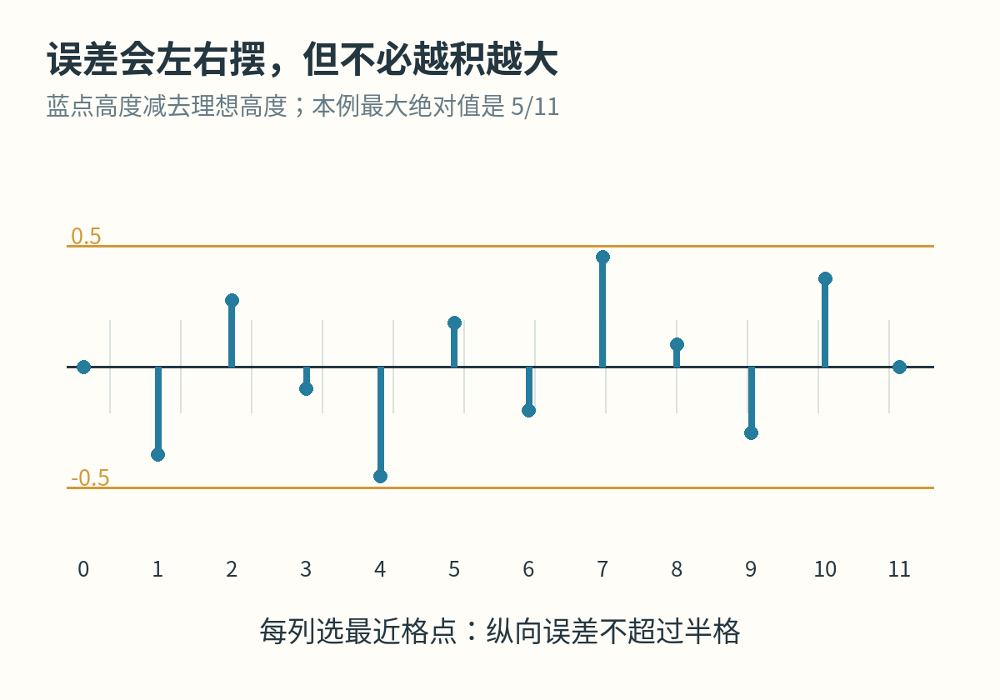

只要按照上述最近格点规则选择，纵向误差就不会超过半格。本例的最大绝对值是5/11，小于1/2。半格不是通过运行很多次碰巧观察出来的经验：任意一个实数，至少有一个最近整数与它相差不超过1/2。我们做的，是用整数递推保留这个选择。

有人会进一步问：比较的是竖直方向距离，可“离一条斜线多近”通常说的是垂直距离，这两者会不会选出不同答案？

对同一条斜率为m的直线，一个点的垂直距离，等于它的纵向误差绝对值除以sqrt(1+m²)。比较同一列的两个候选点时，这个除数完全相同，所以排序不会颠倒。

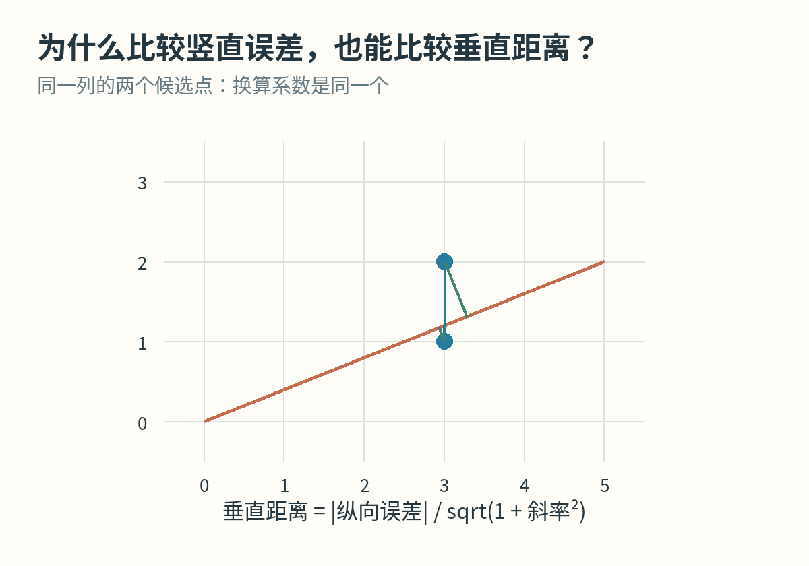

这项结论有明确语境：在当前每列二选一的模型里，它们会做出同一个选择。它没有自动证明所有“好看”的标准都相同。线条的粗细、亮度、端点样式、穿过了哪些方格，都还没放进我们的合同。

## 线很陡，或者朝反方向走呢

从(0,0)画到(4,11)，如果仍然坚持每一列只选一点，总共只有五列，很难形成一条连续的细线。

解决办法不是把算法彻底换掉，而是让走得更多的那一维当“主轴”。这一次每一行前进一步，再判断横向要不要多走一格。实现上可以先交换x和y，运行熟悉的规则，输出时再交换回来。

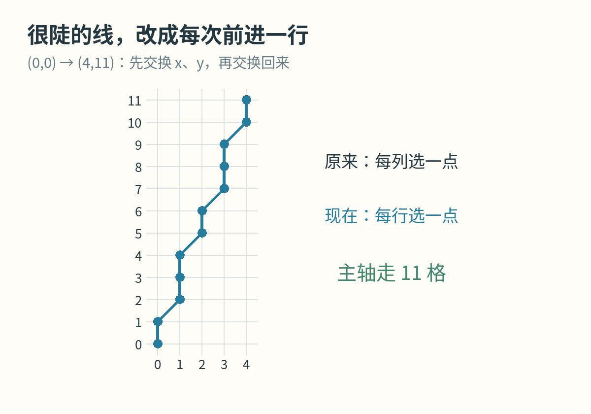

如果线向下，次要方向就用−1而不是+1。如果线从右往左，我们还可以先统一端点的主轴顺序，再把输出序列倒过来。

原论文也处理了八个方向区域，不过本文代码采用更便于阅读的坐标变换组织方式，不是当年IBM 1401程序的逐句移植。

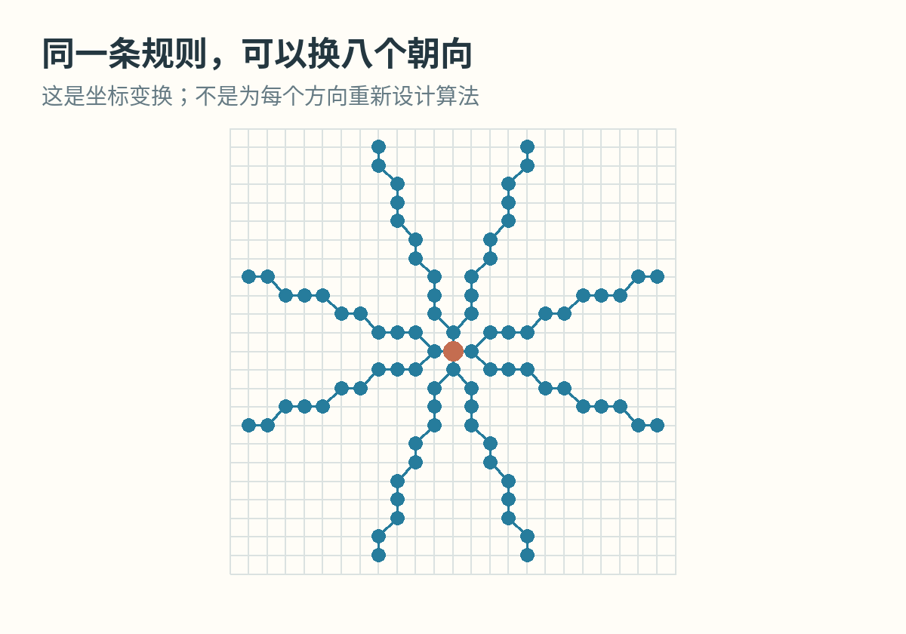

还有四个非常值得写进测试的情形：水平线、竖直线、45度斜线，以及起点和终点完全相同。最后一种应当输出一个点，而不是除以零或进入无限循环。

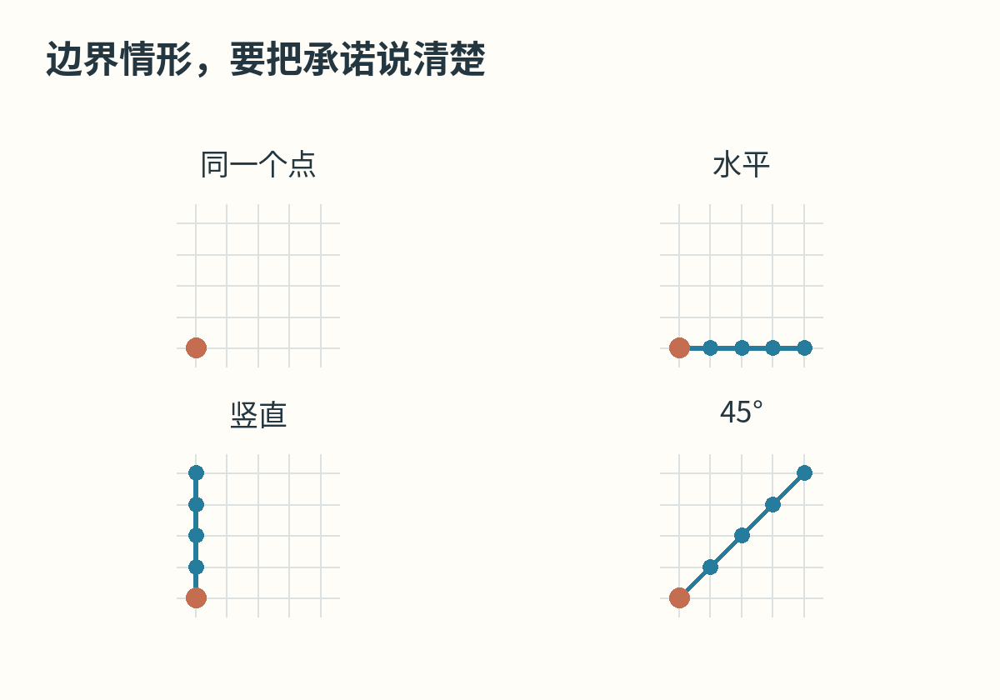

## 那个看似无关紧要的等号，可能改变反向结果

把例子缩成(0,0)到(2,1)。中间一列x=1，理想高度正好是1/2，两个整数高度一样近。

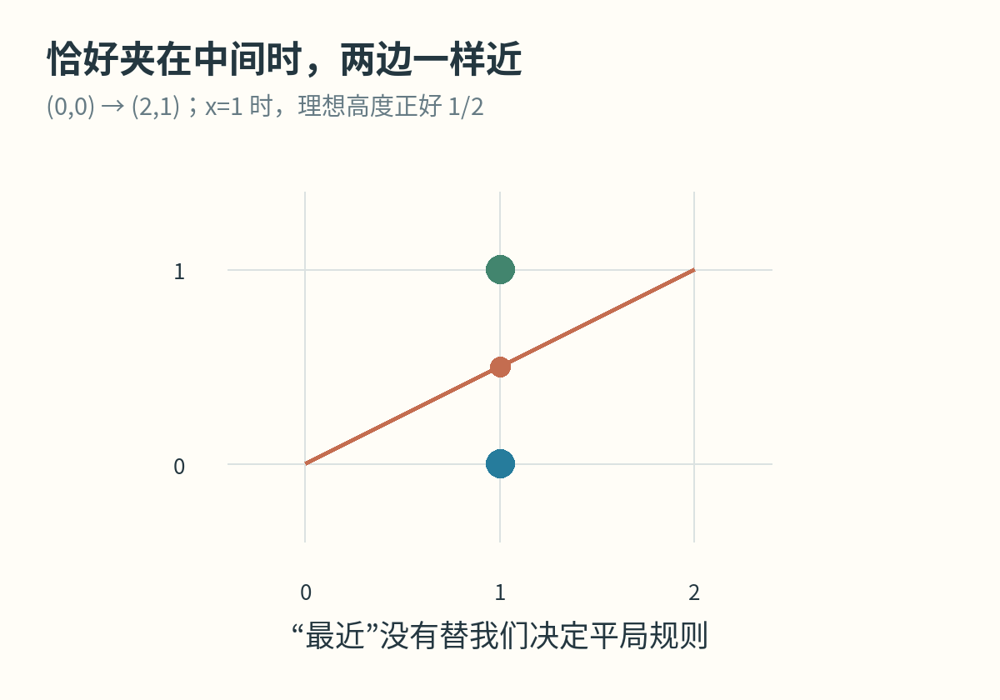

如果从起点向终点走时，一遇平局就“朝终点多升一格”，正向会选(1,1)。反过来从(2,1)走向(0,0)，同样的局部口号却可能选(1,0)。

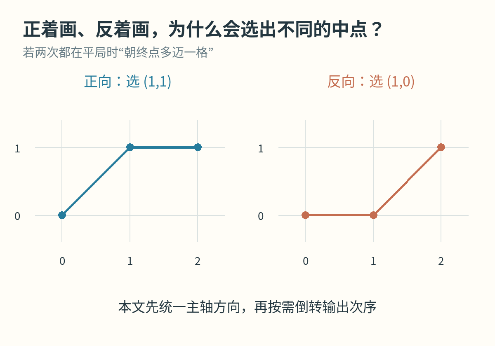

两条路径都符合“最近”的要求，却不是同一组格点。如果游戏希望“A能看见B”和“B能看见A”使用完全相同的代表格，这种差异就值得注意。不过，后面我们还会看到：代表格本身未必是正确的视线判定。

本文选择一种明确的约定：先交换陡线的坐标，再把主轴端点统一为从小到大；所有平局都在这个统一方向里解决。最后还原坐标，并根据原始输入顺序决定要不要倒转列表。

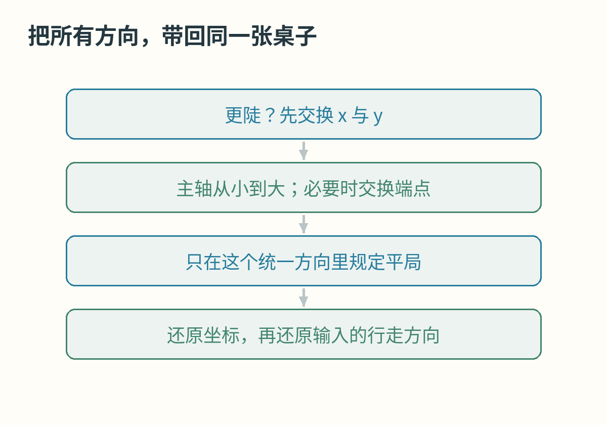

这样一来，输入端点互换，得到的恰好是原列表的逆序。它是一种接口承诺，不是世间所有画线API都必须采用的唯一样式。Bresenham后来专门讨论过增量画线中的歧义；NIST条目列出了这篇1987年论文，提醒我们“一个算法名字”并不会自动规定全部边界。[条目中的实现歧义提示](https://xlinux.nist.gov/dads/HTML/bresenham.html)

## 一份可以运行、也可以逐行检查的程序

下面的程序只接受整数格点，输出从起点到终点的格点列表；它不直接操纵设备，也不依赖绘图库。先读懂前面的浅斜线，再看这些分支，就会发现新增工作主要是统一坐标。

```python
def line_points(x0, y0, x1, y1):
    coords = (x0, y0, x1, y1)
    if not all(isinstance(v, int) for v in coords):
        raise TypeError("需要整数格点")
    steep = abs(y1 - y0) > abs(x1 - x0)
    if steep:
        x0, y0, x1, y1 = y0, x0, y1, x1
    reversed_input = x0 > x1
    if reversed_input:
        x0, x1, y0, y1 = x1, x0, y1, y0
    dx, dy = x1 - x0, abs(y1 - y0)
    sy = 1 if y1 >= y0 else -1
    d = 2 * dy - dx
    y = y0
    points = []
    for x in range(x0, x1 + 1):
        points.append((y, x) if steep else (x, y))
        if x == x1:
            break
        if d >= 0:
            y += sy
            d -= 2 * dx
        d += 2 * dy
    return points[::-1] if reversed_input else points
```

想看每步D的变化，可以运行[完整实验文件](examples/line_experiment.py)。文件还使用Python的Fraction精确分数，按“每列重新计算理想高度并取最近整数”的定义，独立生成参照结果，和整数递推比较。

在横纵坐标都取−4到4的格点中，共有81个可能端点。我们实际检查了81×81=6561组有序端点对：输出与精确分数参照一致，首尾正确，相邻点最多各移动一格，没有重复点，而且交换端点后列表严格倒转。这是已执行的有限测试，不是用枚举代替所有整数输入的数学证明。

主循环的次数是max(|dx|,|dy|)+1，与需要输出的格点数成正比。上面的列表当然也占相应空间；如果逐点交给调用者处理，算法自身只需保留少量状态。不要把“状态少”误写成这份返回整个列表的函数使用常数总空间。

## 选格点、查障碍与抗锯齿，不是同一个任务

如果一个格子里有墙，理想线段擦过它，但它的中心不是最近代表点，Bresenham的细线列表可能不包含这个格子。

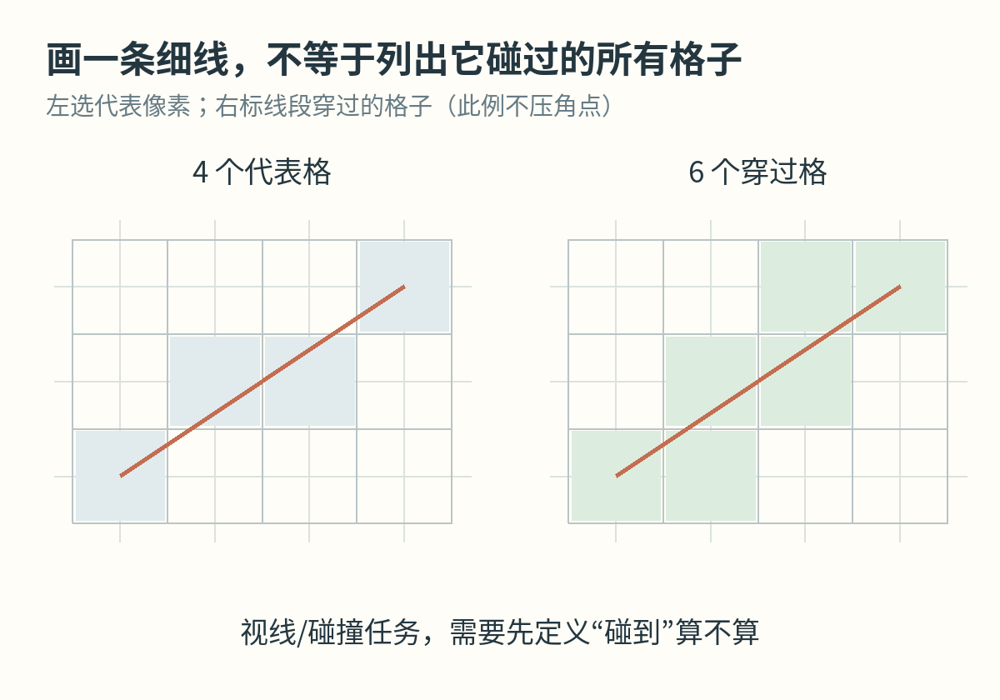

图中线段从(0,0)到(3,2)，把整数位置视为方格中心。左边选四个代表格；右边还包括线段穿过的两个邻格。需要列出全部经过格子的任务，常称为supercover，但连“恰好压住角点算几个格子”都需要约定。

因此，不能直接把一个画线函数当作所有网格视线、碰撞或射线遍历的答案。先问业务究竟要检查中心采样，还是任何相交，再选择算法。

类似地，选出一像素宽的路径，也不意味着边缘已经平滑。

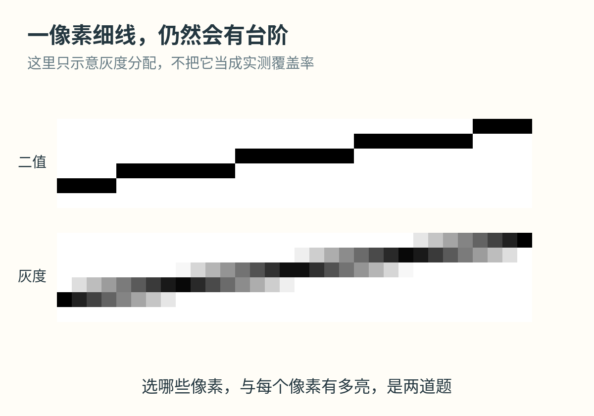

上图只用简化灰度权重展示区别，不是历史设备实测，也不等同于某一图形API的覆盖率规范。抗锯齿还要决定像素有多亮，可能涉及覆盖、滤波、多重采样等方法。今天的GPU画线还会规定裁剪、线宽、端点和其他规则；本文没有声称这些实现都原封不动地运行这段代码。

如果输入端点本来是小数，先四舍五入到整数，已经把几何线段改掉了。它或许适合你的编辑器吸附规则，却不是一个无代价的预处理。

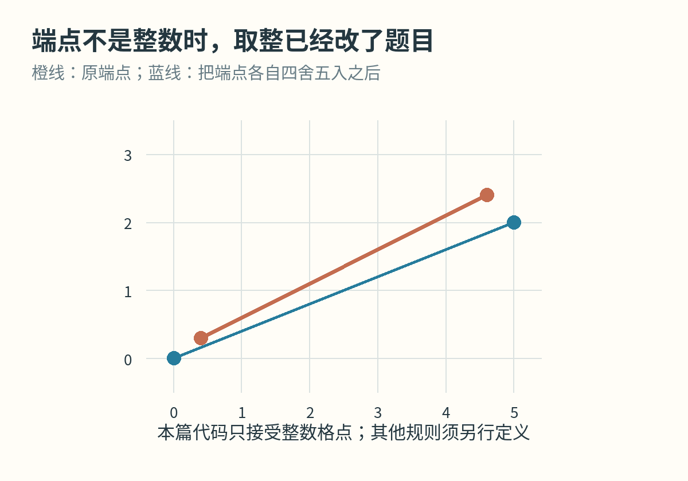

再往上游看：想画圆，先用一些短线段近似圆，这个取样是否足够密也是另一道题。Bresenham能把给定线段的离散选择做好，却不能替上游猜出它没有收到的弧线。

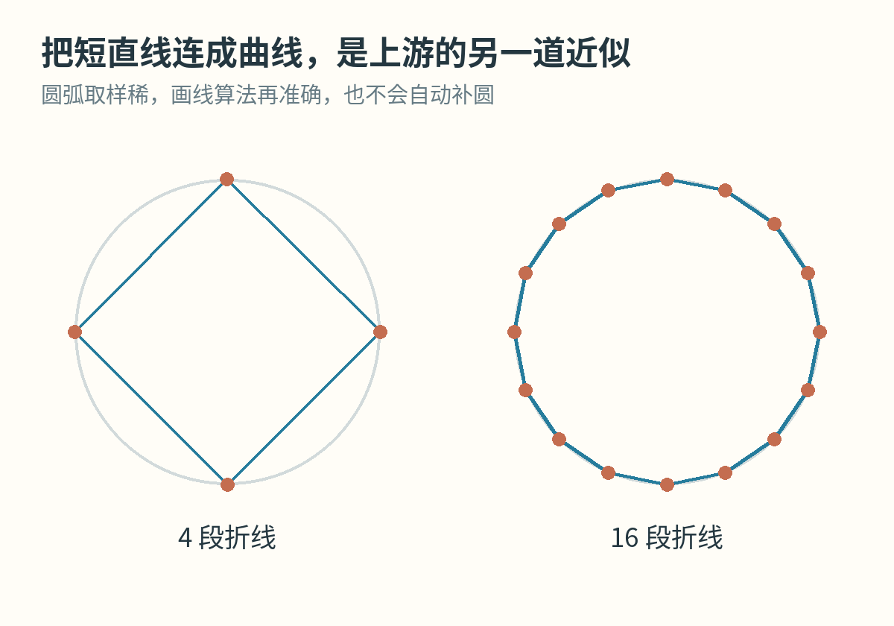

## 回到那台机器，再把问题带回方格纸

1965年论文报告：其IBM 1401程序控制IBM 1627绘图仪，使用333个磁芯存储位置，相邻增量之间平均计算时间约1.5毫秒。这些数说明当时的工程背景，不是今天Python、GPU或任意绘图仪的性能预测。原文还比较了另一种已有算法，也感谢了同事的建议；没有必要把一段真实工作讲成一个人突然看穿所有图形学。

今天CPU已经能很快地做乘除法，DDA等办法也可以增量更新小数，不能简单说“其他方法每一步都必须重新除一次”。Bresenham最值得带走的，是更一般的思想：**如果最终只需要一个离散选择，就先找出决定选择的不变量，再让它在相邻步骤之间继续工作。**

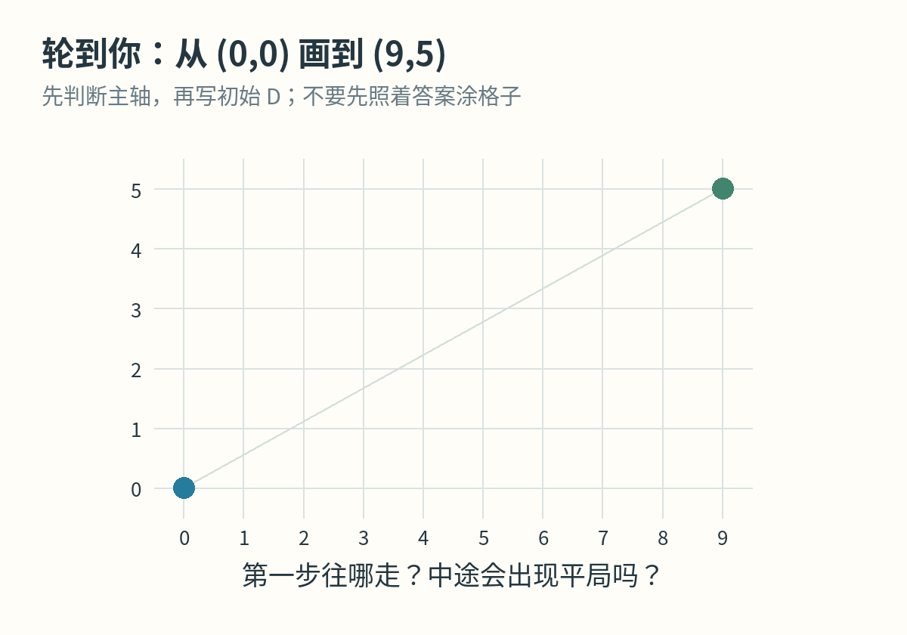

最后，试着从(0,0)走到(9,5)。先算初始D，再写出两种更新量，只走前三步。你应该得到：初始D=1；右移更新加10，右上更新减8；前三个新点是(1,1)、(2,1)、(3,2)。

继续追问：中途会出现恰好半格的平局吗？把终点换成(8,4)又会怎样？你可以先在纸上猜，再让完整实验检查答案。对9与5这个例子，整数列上的高度5x/9不可能等于某个整数加1/2；对8与4，奇数列就会碰到平局。

一条直线最终留下的，并不只是几个蓝点。还有一份很小、很明确的账本：过去的偏差没有被忘记，下一步的选择也不必从零开始。

图片、算法版本与原始文献范围见[来源说明](sources.md)。本文使用AI辅助研究、撰写和原创教学图制作；历史照片、数学示意、程序结果已分别注明。
