# 不让它变长，为什么一张网就会垂成布？

给游戏角色加一件披风，最容易想到的办法，是把布做成一张小弹簧网：每个交点有质量，线段像弹簧，重力往下拉，弹簧把相邻的点拉回来。

可试着把弹簧调软，披风可能被自己的重量拉成长条；把弹簧调得很硬，计算又可能开始剧烈抖动。你本来只是想让一块布垂下来，却像是在调一整套容易闹脾气的机械装置。

有没有另一条路？

比如先让所有点往前走一步。发现某条边被拉长了，就把两端移回合适的位置；发现点穿进了障碍物，就把它推到外面。不是等错误产生很大的反作用力，而是直接纠正位置。

这正是**基于位置的动力学**（Position Based Dynamics，简称 PBD）的一条核心思路。它不是取消重力，也不是“物理定律不重要”，而是换了一个地方处理约束：先预测运动，再修正几何关系。

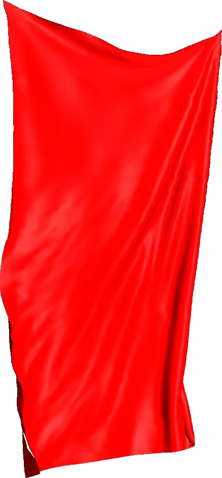

这是 Ten Minute Physics 布料教程中的模拟画面，保留了源文件里的布料像素与透明轮廓。褶皱看起来复杂，但我们接下来先不处理整件披风，只研究一条被拉长的边。

## 一块布，最难改变的是什么？

拿起一块普通的非弹性织物，弯它通常很容易，把它沿某些方向大幅拉长则困难得多。布可以折叠、垂落、起皱，却不必同时把每一根纱线都拉长很多。

这提示了一种适合实时动画的近似：**允许网格弯曲，尽量保住相邻点之间的距离。**

注意“近似”二字。真实织物有经纬方向差异、剪切、摩擦、伸长和复杂材料行为。弹力布与硬帆布也不会拥有相同响应。我们现在要理解的是一种可控的游戏模拟，不是在建立适用于所有布料的材料实验室。

下面是原教程用来表达直觉的图。横轴 force 表示力，纵轴 elongation 表示伸长；红线强调的是一种“不容易明显拉长”的近似对象。

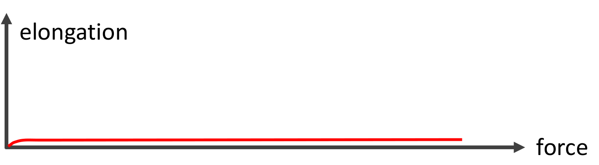

这是一张教学趋势示意，不带材料测量单位，也不是所有织物的真实应力—应变曲线。它告诉我们作者希望优先控制哪种视觉错误：布像橡皮糖一样越拉越长。

在简单的弹簧模拟里，弹簧越硬，拉长一点点就会产生越大的力。若每一步跨得太大，显式更新可能来不及稳定地处理这种快速变化，出现过冲甚至发散。

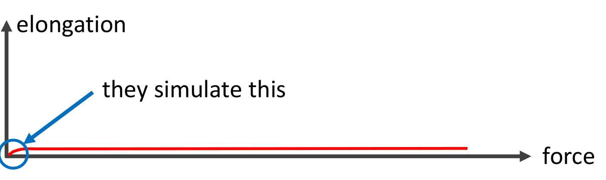

蓝色箭头指向作者不希望过度模拟的伸长响应。这里不是说“所有按力计算的方法都会爆炸”：更合适的积分方法、更小的时间步和其他数值技术都能处理刚性问题。我们只是想探索另一种对游戏程序员很有吸引力的选择：既然目标是别把距离拉坏，能不能直接修距离？

## 先让两个点重新相距 1

设 A、B 是布网格中相邻的两个点。它们原来的间距是 1，先把这个长度记下来，称为**静止长度**。

一次运动预测之后，A 位于 0，B 位于 1.4。它们之间多出了 0.4。

如果两个点质量相同，也都能自由移动，最自然的修正是各承担一半：A 往右移 0.2，B 往左移 0.2。

修正之后，位置变成 0.2 和 1.2，两点间距重新等于 1。

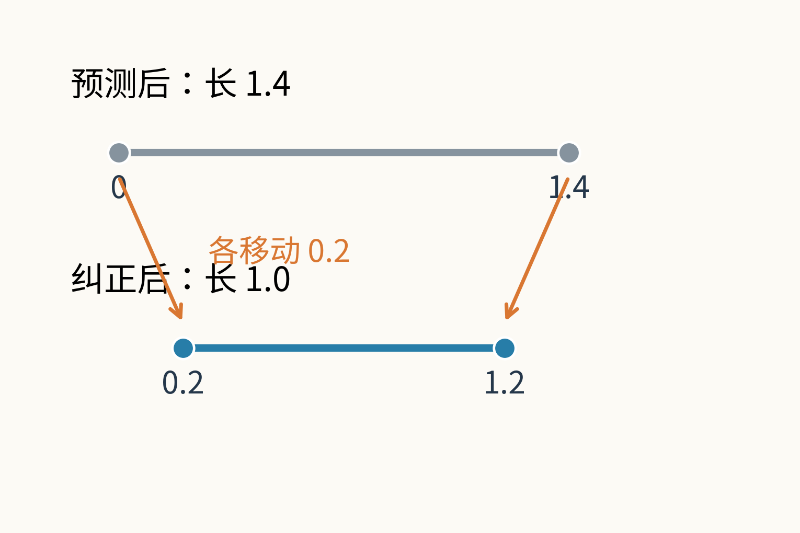

上下两行表示修正前后，不是两根同时存在的线。灰色为预测位置，蓝色为修正位置，橙色箭头连接同一个点的前后状态。数字都沿同一条一维坐标轴计算。

这里做的事情，就叫满足一个**距离约束**。约束不是一种神秘的力，而是一句我们要求状态遵守的话：“这两个点应该相距 1。”

如果预测结果违反了这句话，就移动点，让它重新成立。这样的修正也常被称为**投影**：从一个不符合条件的位置配置，走回满足条件的配置。

“投影”不只是把影子投到墙上。在这里，它表示把一个不合法的状态调整到允许的集合中。对这两个自由点而言，沿它们的连线各移动一半，就能用很直观的方式恢复距离。

如果原来的距离只有 0.6，同样的思路也适用。两点需要往外分开，而不是继续拉近。

这与只会限制最大长度的绳子模型不同。本文这一条约束要求距离等于静止长度，所以拉得过长要缩短，挤得过短也要撑开。

## 把一端钉住，不能再各挪一半

披风总得有地方挂在角色身上。假如 A 是固定点，它就不能为了迁就 B 而移动。

仍然从 A = 0、B = 1.4 开始。这次只能让 B 一个人承担全部修正，回到 1.0。

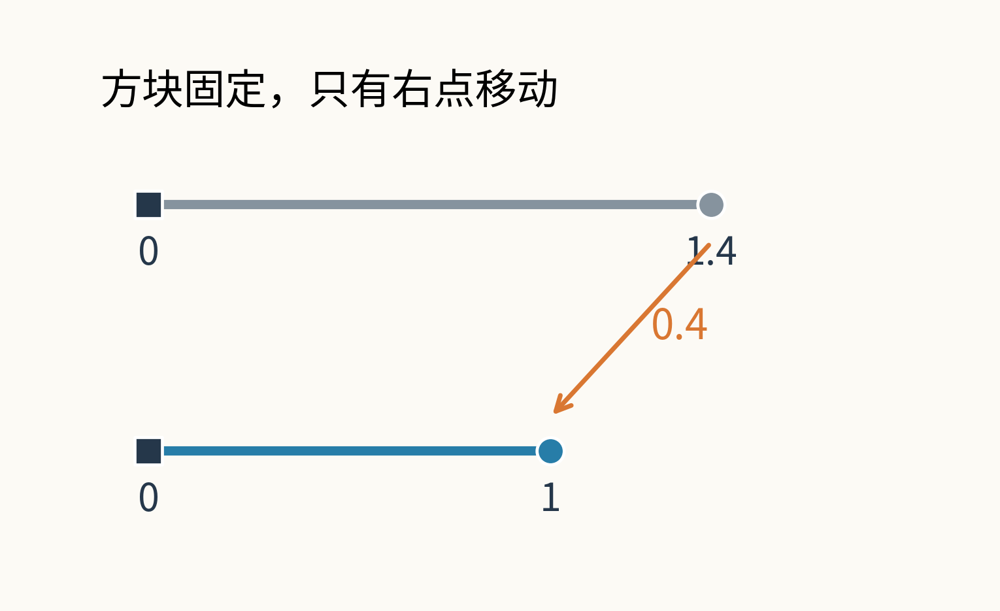

黑色方块表示固定点，圆点表示可移动点。两幅图里的 A 位置完全相同。

这一步看似小，却决定了“钉住一角”和“整块布往下掉”是不是同一个系统。如果程序仍然把修正平均分给两端，再随手把固定点拉回去，就可能给其他约束留下新的误差。

更统一的办法，是给每个点一个**逆质量**：质量的倒数。质量越大，逆质量越小，在同一次位置修正里分到的移动量也越少。

固定点的逆质量设成 0。它表示“这个点在求解中不能动”，不是说真实物体有零质量。

举一个稍微不对称的例子。A 的质量为 1，B 的质量为 2，逆质量分别为 1 和 0.5。多出的 0.4 按 1 : 0.5 分配，A 移动约 0.267，B 移动约 0.133。

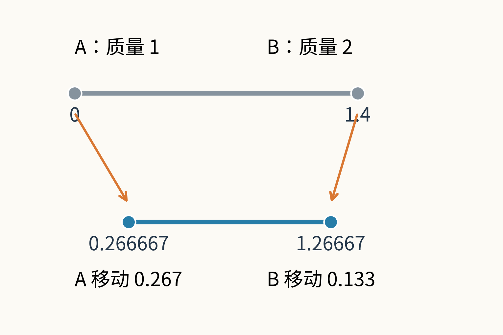

较轻的 A 多挪一些，较重的 B 少挪一些。总共修正的长度仍然是 0.4。图中小数为展示而四舍五入，计算使用未舍入值。

这不是随便找一个看起来好看的比例。在两点孤立、没有固定端的这个约束里，按逆质量分配修正还能保持它们的质心位置不变。它把“谁更容易被推动”的物理含义，留在了几何修正里。

## 点不在一条水平线上，又该往哪里挪？

现在让 A = (0,0)，B = (1.2,0.9)。两点之间的长度是 1.5，目标仍然是 1。

不能简单地把两个点的 x 坐标各减一点，因为它们还在竖直方向错开。修正应该沿着 AB 的方向进行。

从 A 指向 B 的位移是 (1.2,0.9)。除以长度 1.5，得到一个长度为 1 的方向：(0.8,0.6)。

多出的长度是 0.5。两点等质量，所以每端沿这个方向移动 0.25。A 加上 (0.2,0.15)，B 减去同样的量。

最后得到 A′ = (0.2,0.15)，B′ = (1.0,0.75)。新位移是 (0.8,0.6)，长度恰好为 1。

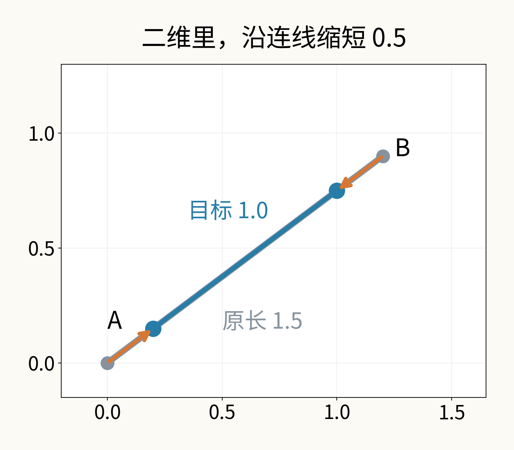

橙色箭头的方向相反，蓝色线段的长度变成 1。这个操作没有要求线段最终水平或竖直，只要求它别被拉长。

推广到三维也不需要改变思路。位移多了一个 z 分量，但还是先求方向，再沿方向分配多余或不足的长度。

至此，我们有了一个很小的工具：给定两个点、它们的逆质量和目标距离，就能做一次局部修正。整张布的复杂性，还藏在“局部”两个字后面。

## 修好这一边，为什么另一边又坏了？

把例子扩成三个点 A、B、C，排在一条直线上。A 固定在 0；AB、BC 的目标长度都等于 1。

预测之后的位置是：0、1.4、2.8。两条边都被拉长了。

先修 AB。因为 A 固定，只能把 B 拉回 1。此时位置变成 0、1、2.8，AB 已经正确，可 BC 反而变成了 1.8。

再修 BC。B 和 C 都能移动，各承担 0.4。得到 0、1.4、2.4。

BC 现在正确了，AB 却又回到了 1.4！

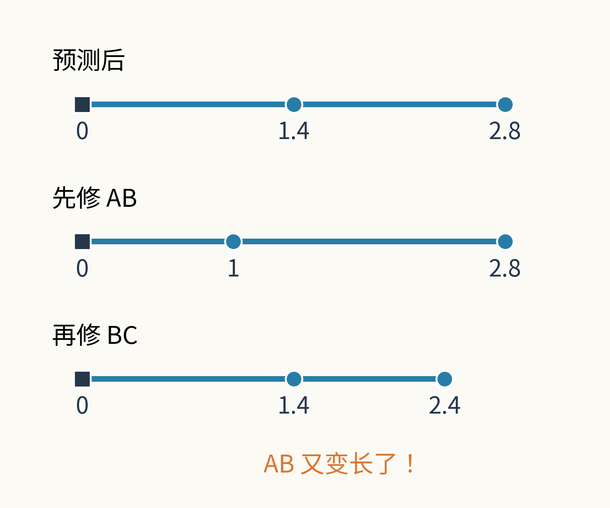

一条边的右端点，也是另一条边的左端点。它们并不是互不相干的两道题。

这就是从两个点走向整张布时真正的转折：**满足一条约束，可能破坏刚刚满足的另一条。**

我们可以试着建立一个大方程组，一次求出所有位置；也可以先采用更容易实现的办法：再来一轮。

第二轮仍然先修 AB，再修 BC。结果变成 0、1.2、2.2。

第三轮是 0、1.1、2.1。第八轮，B 已经来到 1.003125，C 来到 2.003125。

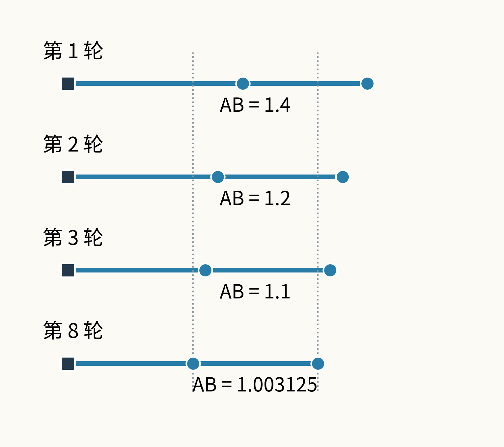

竖向虚线标出 B = 1、C = 2 的目标位置。每轮都处理同样的两条边，本例中 AB 的剩余误差逐渐减半。

这种反复处理局部条件的方法叫作**迭代求解**。常见的一种顺序是刚改完一个点，就让后面的约束使用它的新位置。误差通过共享点，逐步传到整个系统。

不过，别把这个例子中的“减半”背成普遍规律。它来自这里特定的三点、一维、固定端和处理顺序。复杂布网格、碰撞和其他非线性约束，不保证按照相同速度收敛；有些互相矛盾的要求，甚至根本不可能同时满足。

例如把两端固定在相距 3 的位置，却要求连接它们的两段长度都等于 1。无论中间点放在哪里，总长度 2 都不够跨过距离 3。迭代再多，也不能修好一个几何上无解的任务。

## 先亲手跑这根链，不急着写整件披风

下面是完整的一维教学程序。它只做约束修正，不包含重力、渲染或完整布料模拟；这段代码已在本地实际执行。

```python
x = [0.0, 1.4, 2.8]
w = [0.0, 1.0, 1.0]  # A 固定，B、C 等质量
edges = [(0, 1), (1, 2)]

def project(a, b, rest=1.0):
    delta = x[b] - x[a]
    length = abs(delta)
    total_weight = w[a] + w[b]
    if total_weight == 0 or length == 0:
        return  # 重合点的方向退化，本例不会遇到
    direction = delta / length
    correction = (length - rest) * direction / total_weight
    x[a] += w[a] * correction
    x[b] -= w[b] * correction

for step in range(1, 9):
    for a, b in edges:
        project(a, b)
    if step in (1, 2, 3, 8):
        print(step, [round(v, 6) for v in x])
```

实际输出：

```text
1 [0.0, 1.4, 2.4]
2 [0.0, 1.2, 2.2]
3 [0.0, 1.1, 2.1]
8 [0.0, 1.003125, 2.003125]
```

最值得盯住的不是 Python 语法，而是两个事实：A 的逆质量为 0，所以它不动；B 被两条边共同使用，所以第二次修正能改变第一次的结果。

当两个点完全重合、目标长度又不为 0 时，长度误差仍然存在，但仅凭当前两点位置无法决定该往哪个方向分开。这段最小程序选择跳过以避免除零。正式模拟需要自己的退化处理，不能把这行 return 当作问题已经解决。

## 可这些点为什么会动起来？

到目前为止，我们只修正一张静态照片。要变成动画，还需要回答下一帧的位置从哪里来。

一种常见的 PBD 步骤是：

1. 根据重力等外部作用，更新点的速度。
2. 用速度预测下一时刻的位置。
3. 反复修正距离、固定点和碰撞等约束。
4. 根据修正后的实际位移，重新计算速度。

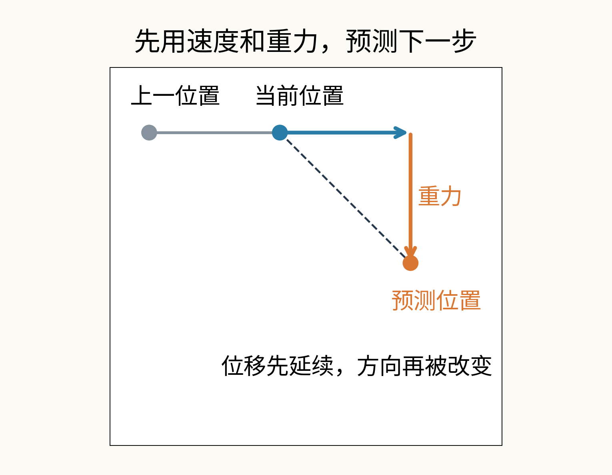

这张图只演示预测阶段：教学步长取 1，当前位置是 (1,2)，速度是 (1,0)，加速度是 (0,−1)。先更新速度再预测，会得到 (2,1)。这是便于手算的数字，不是推荐游戏使用一秒的物理步长。

第四步很容易漏掉。假设某个点预测要穿过墙，但约束把它留在墙边。如果仍然保留原先那股穿墙的速度，下一步又会猛烈地钻进去。

根据“最终位置减去上一步位置，再除以时间步”更新速度，能让速度与这次真正接受的位置变化保持一致。摩擦、反弹和阻尼还可能需要额外处理，不能只凭这一条公式就宣称所有碰撞行为正确。

早期游戏物理中还有一种常见表示：保存当前位置和上一步位置，用两者的差隐含表示运动，再加入加速度。它与这里的思路关系紧密，但我们不需要同时实现两套状态表示才能理解核心。

关键区别在于：**预测告诉点想往哪里去，约束告诉它哪些位置关系不能随便破坏。** 两部分缺一不可。只做约束、没有预测，一张已经满足条件的网格不会凭空飘起来。

## 从一根链，织成一张网

给每个网格顶点存一个位置和速度，再给每条网格边存一个静止长度。刚才的两点修正函数，就可以沿着整张网循环执行。

下面这张原创教学网格有 13 × 13 = 169 个点，每个小格拆成两个三角形，一共 288 个三角形。橙色点是准备固定的两个角。

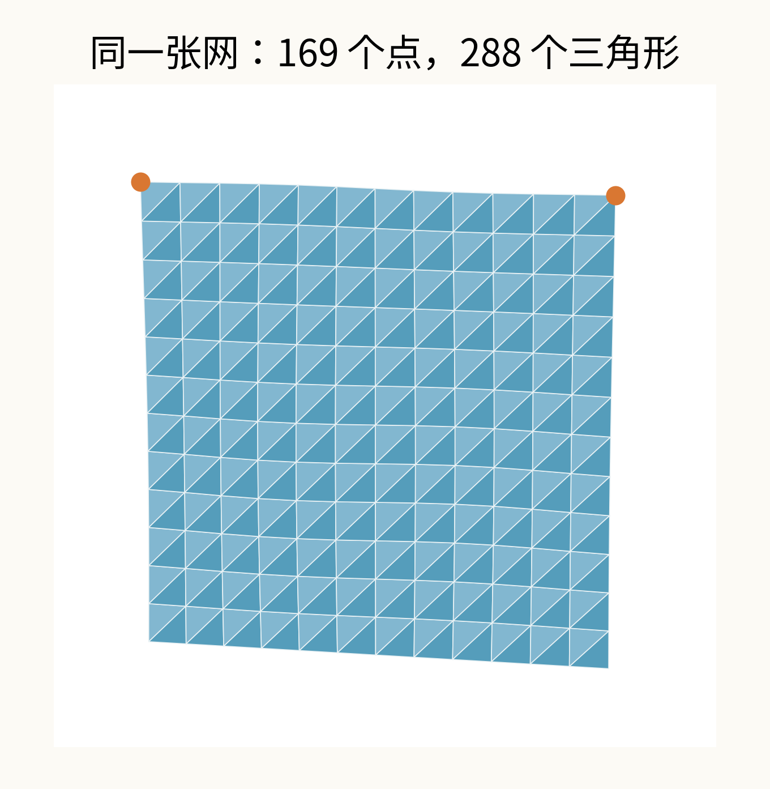

白线是网格边，不是真实织物的一根根纱线。这个模型把连续布面离散成有限的点、边和三角形。

只用横竖线还会出现一个问题：一个四边形可以保持四条边都不变，却从正方形歪成菱形。这叫剪切形变。

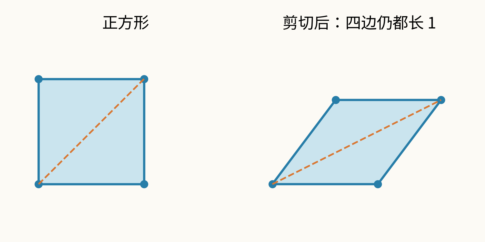

虚线是对角线。两幅图四条实边长度相同，对角线却变长了。如果把对角线也约束住，这种自由剪切就会受限制。

把小格三角化，是构建这类简单模型的一种办法。但不同边连接方式、刚度与弯曲模型，会给布不同的偏向和手感；不能以为任意一张三角网都自动代表同一种织物。

我们把教学网格的上面两角各向内收 0.7 个长度单位，然后固定在那里。其他点在重力和一个弱侧向加速度下运动，反复修正 456 条唯一网格边的长度。三秒后得到下面的形状。

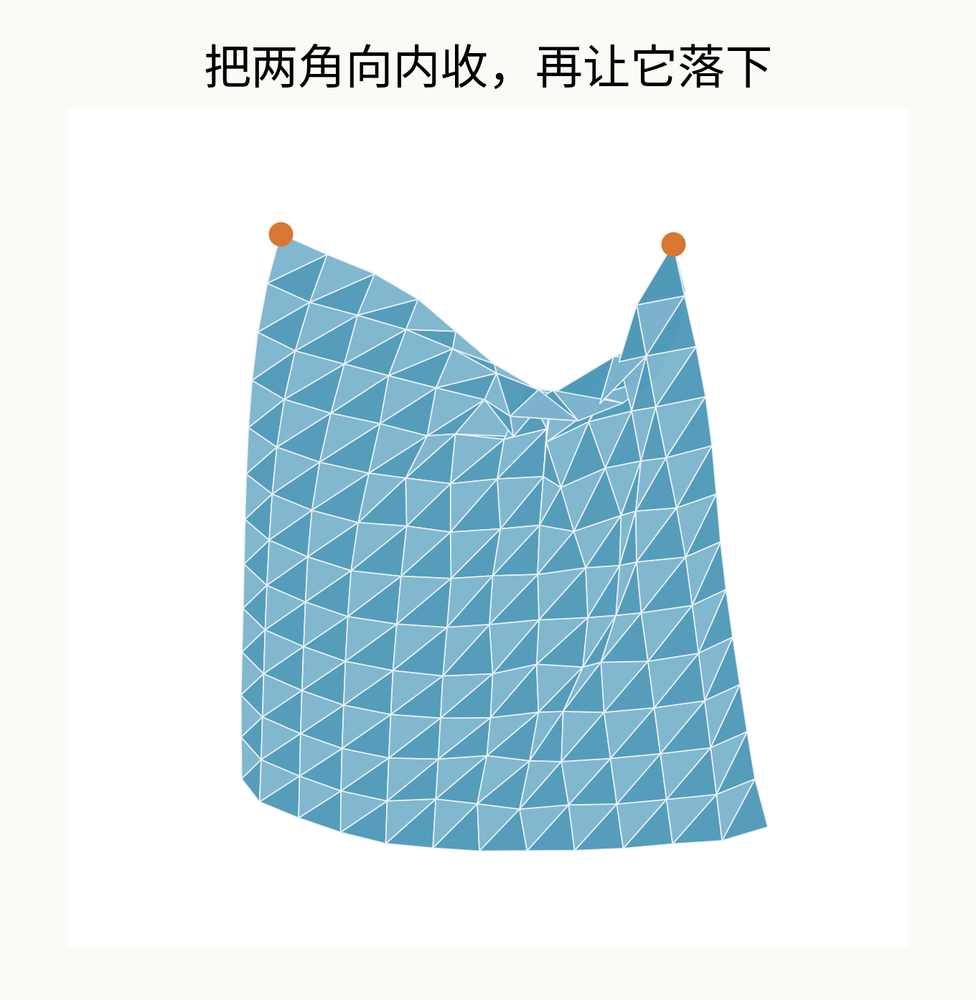

这是本文本地运行的简化模拟，不是商业引擎截图，也不是原教程代码的复现。初始宽度和高度均为 4，步长 1/60 秒，每步 10 轮约束；模型没有自碰撞，也没有独立弯曲约束。

两角靠近后，整块网不能只在原来的平面里缩小，因为边长被尽量保住。它于是通过折叠、起皱等方式重新安排空间位置。布的整体外形变了，许多局部距离却仍接近原值。

这就是开头那个看似反直觉的问题的答案：**不让边随意变长，并不等于不让整块布改变形状。** 它仍然可以在三维空间里弯曲。

“尽量”也必须保留。有限轮数没有把所有长度误差精确清零，画面中的褶皱还可能相互穿过。它展示的是机制，不是对真实材料的精确预测。

## 保住三角形，仍然没规定它们怎么折

如果一个三角形的三条边长度都固定，它的形状就固定了。但相邻的两个三角形，还可以沿公共边像书页一样转动。

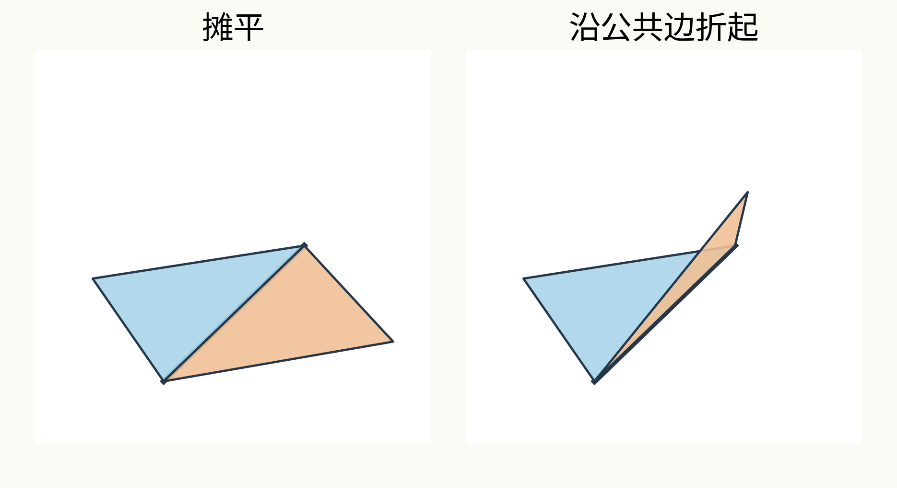

左边摊平，右边折起。蓝色、橙色两个三角形各自没有变形，改变的是它们之间的夹角。

这也解释了为什么“距离约束已经足够多”仍然不能决定布的全部手感。若折叠完全没有阻力，网格容易显得过于柔软或皱得过碎。厚帆布与薄绸缎的差别，不能只靠边长决定。

需要再添加对**弯曲**的控制。例如限制相邻三角形之间的角度变化，或者采用较便宜的近似，把两片三角形中不共享的两个顶点之间，再加一条带柔顺性的距离约束。

下面保留原教程的几何对象图：p₁、p₂ 是公共边的端点，p₃、p₄ 位于两侧。

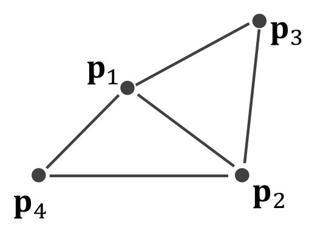

再看两种办法的对照：左图红线连接 p₃ 与 p₄，右图红弧表示两片面的夹角。

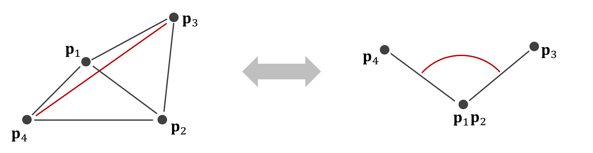

左边便宜、实现直接，但在接近平坦时可能比较弱；右边更直接地控制折角，却需要更复杂的计算。这是原教程讨论的取舍，不是说二者在任何模型里都等价。

这时回头看“布只会弯”的口号，就应该把它理解成教学重点：先抓住某些实时布料中最明显的行为差异。它不是在否认织物会拉伸、剪切或发生其他变形。

## 原来还得找出哪两片三角形是邻居

如果要添加弯曲约束，程序必须先知道哪两个三角形共享一条边。

原教程给了一个很适合动手的小办法。下面有两个三角形，共享由顶点 1、2 构成的边。红色数字是三角形编号；边旁的 0 到 5 是把每个三角形的三条边依次编号的结果。

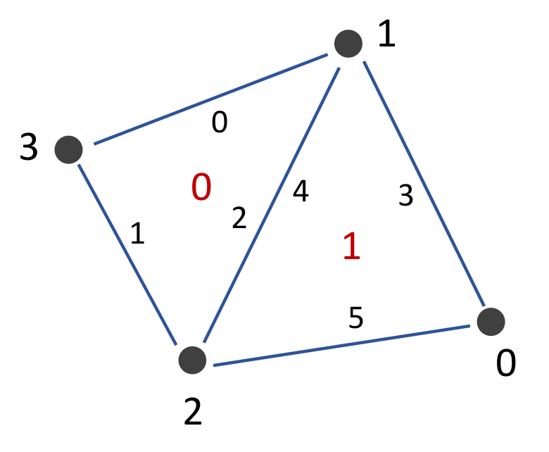

把每条边记录为“较小端点编号、较大端点编号、这条边自己的编号”。这样，(1,2) 和反向写下的 (2,1) 会被统一成同一个键。

再按前两个数字排序，相同端点对就会靠到一起。它们分别来自哪两个三角形，也就容易找到了。

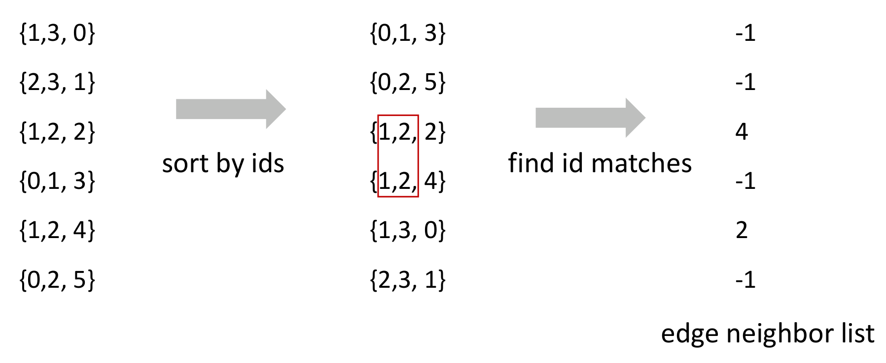

红框里的两项都有端点 1、2，但边自身编号分别为 2 和 4。所以在右侧邻接列表中，边 2 找到邻居 4，边 4 找到邻居 2；其余边没有配对，在这个例子里记为 −1。

这段小算法与布料的力学公式无关，却决定了数据能不能被正确交给求解器。模型里的“共享一条边”，到了程序里就需要变成可以查找、去重和配对的记录。

如果同一条边被超过两个三角形共享，那就不是这里假设的普通内部边了。处理非流形网格或损坏输入，需要另作规则，不能偷偷选两个就当全部正常。

## 布穿进球里，能不能也这样修？

可以先从最简单的情况开始：一个点落进了球形障碍物。

知道球心和半径之后，沿着从球心指向这个点的方向，把它移到球表面。相当于满足一句新的约束：“这个点到球心的距离，不能小于球半径。”

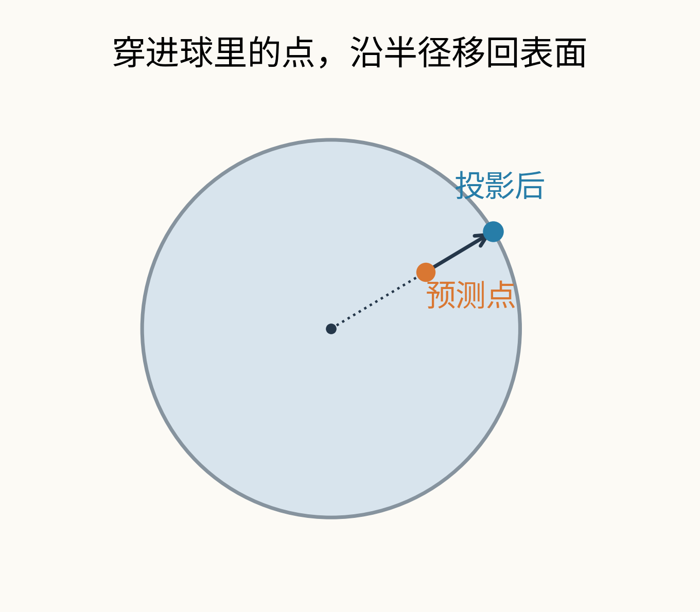

橙点是预测位置，蓝点是投影后的位置。图中画的是球的二维截面，箭头指向距离条件允许的边界。

但布网格里的点彼此相连。把一个点推出球，可能又拉长了它和邻居之间的边。因此碰撞约束和距离约束也会互相影响，需要在同一求解过程里反复协调。

更麻烦的是：**所有顶点都在球外，不代表整块布都在球外。**

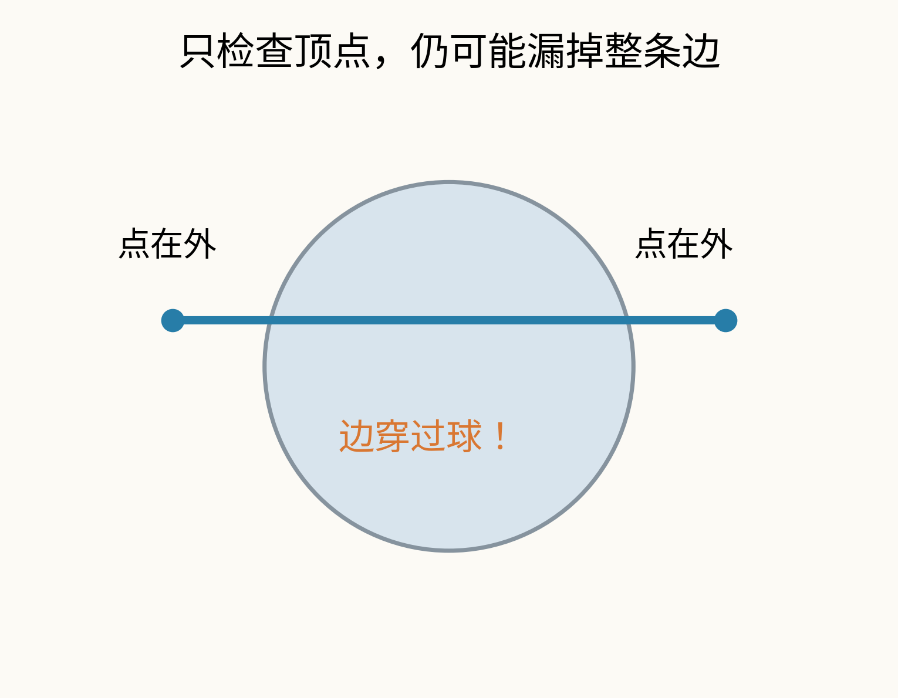

这两个蓝点都通过了“点是否在球外”的检查，中间的线段却穿过球。如果只检查顶点，就会漏掉边、面与障碍物的相交。

布还可能和自己碰撞。两片三角形能否相互穿过、怎样判断厚度、如何处理接触与摩擦，都是额外的问题。单纯增加距离约束的迭代次数，并不会凭空替你检测这些碰撞。

这也说明为什么一个二十行的点约束演示，不能被称为完整的布料引擎。它解释了一个核心部件，但引擎还需要碰撞检测、接触处理、稳定的时间推进和大量边界条件。

## 为什么多算几轮，布就“变硬”了？

再回到容易测量的链条。把 9 个点竖着串起来，8 段的静止长度都为 1，固定最上端，让其余点受重力作用。

理想情况下，伸直后的总长度应为 8。我们保持质量、重力、步长和阻尼都不变，只修改每个时间步处理约束的轮数。

下面是本文本地教学模拟在相同运行时长之后的结果。

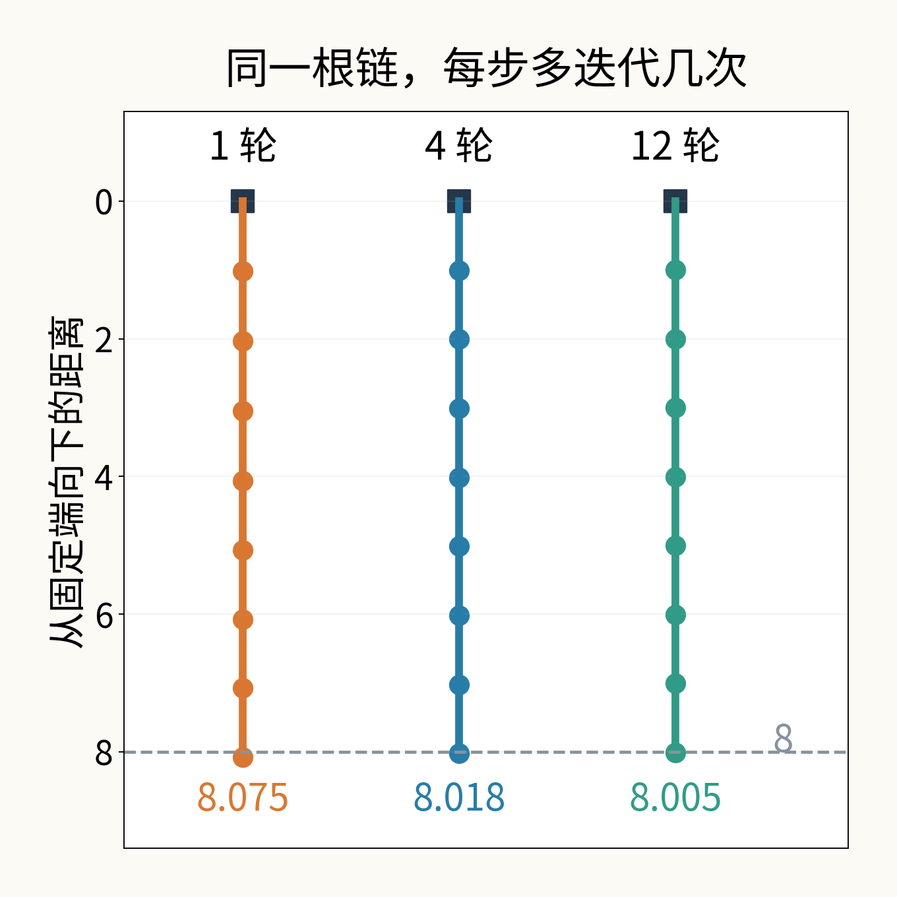

三根链使用同一把长度尺。虚线是静止总长 8；端点分别约在 8.075、8.018、8.005。差别确实不大，所以不要靠偷偷改变各自坐标轴来把它画大。

如果只想看误差，可以另画一张图，把“超出 8 的那一小段”单独取出来。

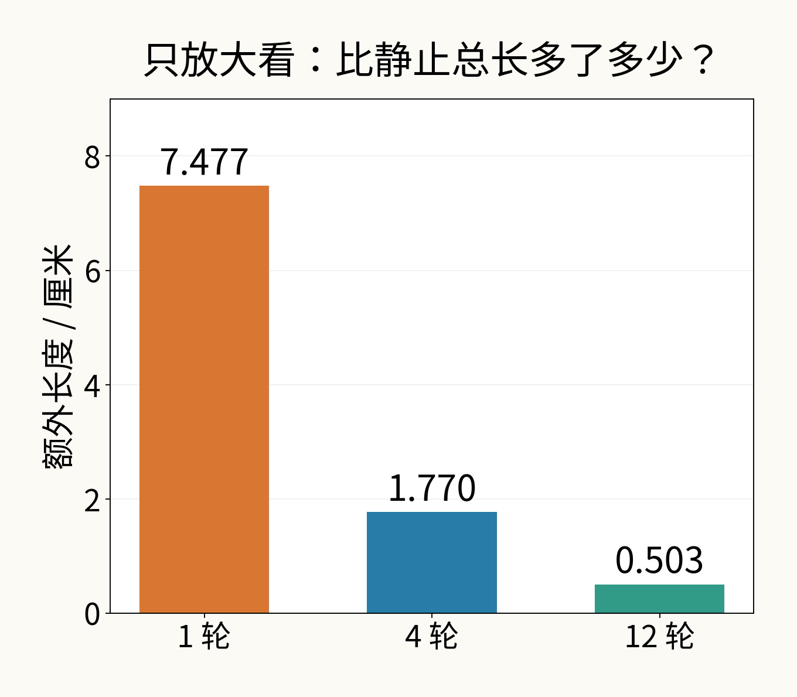

本例规定一个长度单位为 1 米，因此额外长度约为 7.477、1.770、0.503 厘米。三根柱子共用零点和同一尺度；图里比较的是额外伸长，不是整根链的长度。

为什么轮数会改变伸长？每一步重力都在制造新的预测误差。如果来不及把误差传播、修正到足够小，链就会在外力持续作用下维持一部分残余误差。少算几轮，看上去便像材料变软了。

然而我们没有改材料，只是改了计算预算。这是一种**数值上的柔软**，不能直接当成准确的物理柔顺性。

这组数字来自固定的简化模型：步长 1/60 秒、运行 360 步、重力加速度 9.81 米/秒²，每步速度乘以 0.98 作为教学阻尼。它们不是“PBD 默认误差”，更不是所有游戏引擎都会出现的测量值。

后来的 **XPBD**，也就是扩展的基于位置动力学，一个重要目标就是把材料的柔顺性更明确地放入模型，减轻原始 PBD 中刚度随时间步和迭代数变化的问题。它引入额外的约束状态与柔顺性参数，而不是只用“这次修回来百分之几”描述软硬。

这仍不表示可以随意使用巨大时间步，或者只迭代一次就保证所有复杂接触准确。材料参数更有意义，与所有数值误差都消失，是两回事。[XPBD 原论文](https://matthias-research.github.io/pages/publications/XPBD.pdf)值得在理解本文的小例子后继续读。

## 游戏为什么愿意接受这种“先犯错，再纠正”？

2001 年的《Advanced Character Physics》介绍了已经用于《杀手：代号 47》的粒子与约束方法，讨论布、植物、刚体和角色的运动。它强调交互应用对速度、稳定与可信外观的要求。

2006 年的《Position Based Dynamics》则把直接操纵位置的思路整理成更一般的模拟框架。它们与后来 XPBD 的关系，是一段持续改进的工程历史，不能压成“某一天一个人发明了游戏物理”。

这里也不宜把“可信”理解成随意作弊。玩家可能不检查能量守恒的每个小数位，却能立刻发现披风无限拉长、穿过身体或在静止时疯狂抖动。一个方法是否有用，取决于它是否用可承受的成本控制了真正重要的错误。

位置约束的吸引力，恰恰在于很多设计要求都能写得很直接：

这一点跟着肩膀走；这条边别拉长太多；这片面不要随意折成一团；这个接触点不能留在障碍物内部。

但要求之间会打架，预算又是有限的。工程师的工作不只是写下约束，还要了解顺序、时间步、碰撞模型与停止条件会留下什么误差。

## 留一根可以继续拆的小链条

先回到上面的三点代码，只改一个地方：把处理顺序从 AB、BC 换成 BC、AB。

不要立刻运行，先预测第一轮的结果。最后修正的是哪条边？它是否会看起来“特别正确”？另一条边的误差留在哪里？

接着再试两件事：

- 把 B 的质量改成 C 的两倍，也就是把 B 的逆质量改成 0.5。中间点会怎样分担修正？
- 把 C 也固定在 2.8，却仍要求两段长度都为 1。程序不断修正时，为什么无法让所有要求同时成立？

这些改动很小，却能区分三种不同的问题：局部修正是否正确、求解是否已经充分、模型是否根本无解。

当你能把这三件事分开，一张会动的布就不再只是“物理引擎算出来的”。你能沿着点的位置，追踪它如何被预测、被邻居拉回、又怎样把误差传给下一条边。

复杂的褶皱仍然会出现，但你已经知道，最先需要看懂的，可能只是那根从 1.4 被拉回 1 的线。

参考阅读：[Thomas Jakobsen：Advanced Character Physics](https://www.cs.cmu.edu/afs/cs/academic/class/15462-s13/www/lec_slides/Jakobsen.pdf)、[Müller 等：Position Based Dynamics](https://matthias-research.github.io/pages/publications/posBasedDyn.pdf)、[Macklin、Müller、Chentanez：XPBD](https://matthias-research.github.io/pages/publications/XPBD.pdf)、[Ten Minute Physics：布料模拟教程](https://matthias-research.github.io/pages/tenMinutePhysics/index.html)。

图片来源：红色布料与六组英文原图来自 Matthias Müller / Ten Minute Physics 的 [第14讲讲义](https://matthias-research.github.io/pages/tenMinutePhysics/14-cloth.pdf)，按原始图元无损提取或保留矢量并裁去周围正文，未改变图内数据；其余图为本文原创教学示意或明确标注的本地简化模拟。
