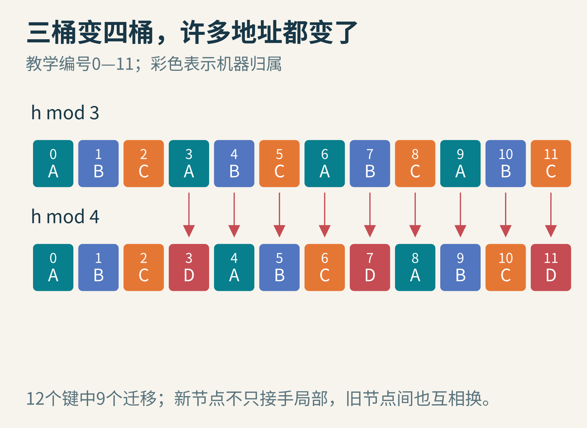
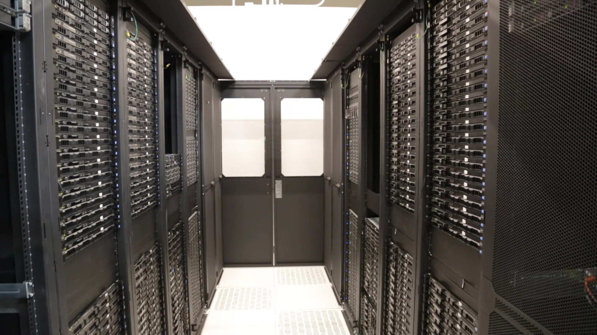
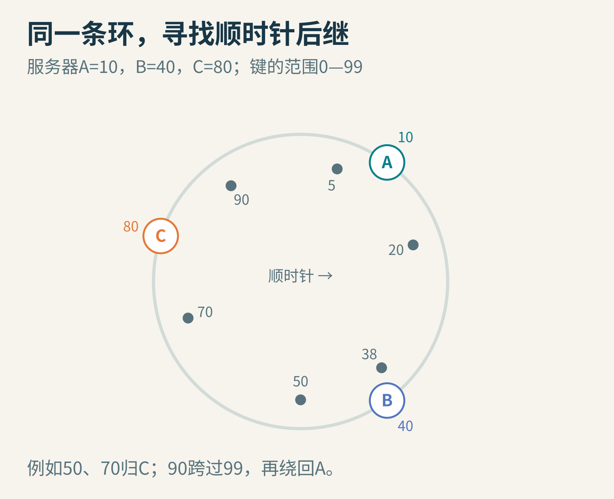
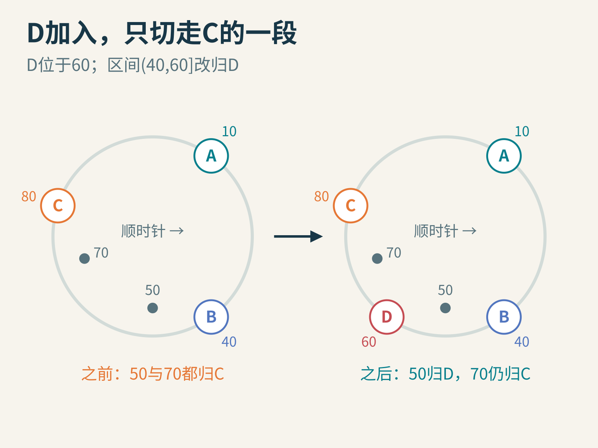
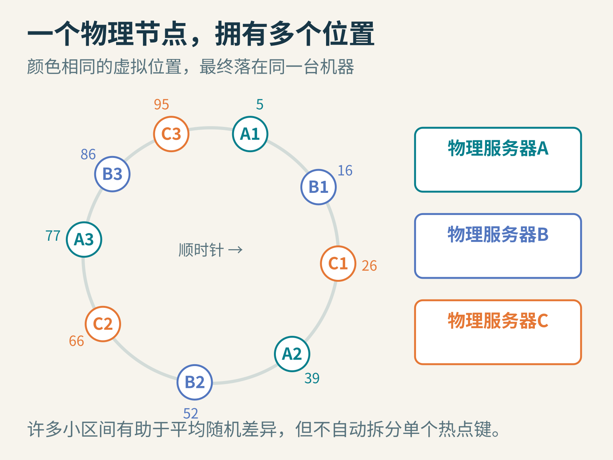
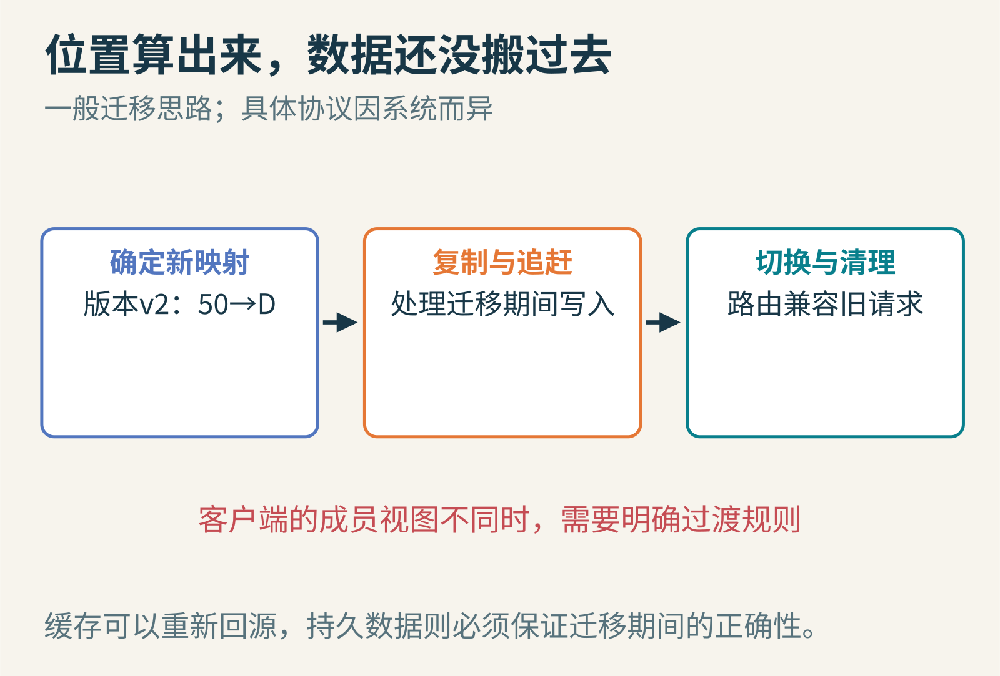
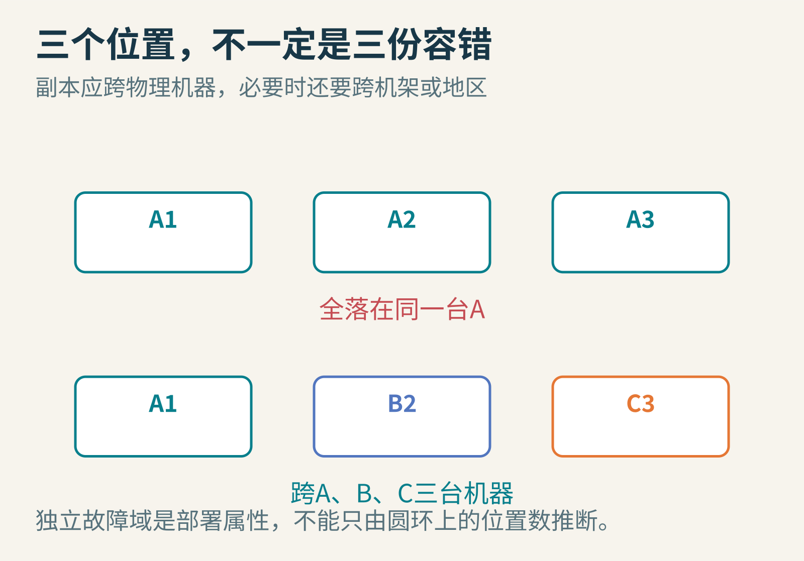

# 多加一台服务器，为什么数据要搬家？一致性哈希把“大洗牌”缩成一段圆弧

三台缓存服务器分担一批图片。为了让同一张图片每次都能找到相同的机器，系统先把图片编号变成一个整数h，再计算h除以3的余数：0号去A，1号去B，2号去C。

这个办法很好理解，也容易实现。直到业务增长，需要增加第四台服务器。

把公式改成h mod 4之后，原来分配到A的图片，可能突然属于B、C或新来的D。多数缓存内容不是真的丢了，却被新的查找规则留在“错误的位置”。请求找不到缓存，便集中涌向后端重新读取。

这不是机器增加得不够快，而是地址规则变化得太剧烈。


图1：教学编号0—11从模3改为模4时，12个编号中有9个改变归属。这个75%属于本例，不是任意编号集合都必然达到的精确比例。

## 想要的不是永远不搬，而是只搬必要的部分

增加一台机器，当然希望它分到工作。不搬任何东西，新机器就无法发挥作用。

理想的变化是：新机器接过一部分数据，其他原有机器之间尽量不互相倒腾。减少搬迁，可以降低传输量，保留更多缓存命中，也让扩容过渡更容易控制。

一致性哈希就是围绕这种“成员变化时，映射尽量稳定”的目标设计的。它的名字里的“一致性”，说的是哈希映射的一类性质，并不意味着多个副本已经达成强一致，或读到的数据一定最新。


图2：Wikimedia Foundation位于美国得克萨斯州Carrollton的服务器，2015年。这里用来认识实际服务器环境，并不表示照片中的系统采用本文算法。

## 把编号空间首尾接起来

现在换一种画法。假设哈希值暂时只有0到99，99之后又回到0，组成一只圆环。

服务器也计算哈希位置：A在10，B在40，C在80。每个数据键也落在环上。从键的位置顺时针走，遇到的第一台服务器负责它。

于是：

- 键5向前遇到A
- 键20、38遇到B
- 键50、70遇到C
- 键90绕过99，再遇到A

真实系统的哈希空间远大于100；小圆环只是让方向和区间能看清。


图3：顺时针的第一台服务器是归属节点。环是抽象的编号空间，不是机房地理位置，也不表示网络真的连接成圆形。

同一套成员列表、同一种哈希函数和同样的查找规则，会得到相同的结果。任何需要路由请求的参与者，都必须遵守这些约定；同名“哈希”并不足以保证兼容。

## 新机器只接过自己前面的一段

把D放在60。原来从40之后到80这一段都由C负责，现在在60处分成两段：40之后到60交给D，60之后到80仍归C。

前面的六个键里，只有50从C移到D。5、20、38、70、90全部不动。


图4：新增节点只截取其前驱到自身的一段区间。本例发生变化的是键50；没有把整个圆环重新编号。

删除节点则反过来。如果B离开，它负责的区间交给顺时针后继C，其他区间不变。如果是在已经加入D的环上删除B，接手者就会是D。后继取决于当时的成员集合，不能把字母顺序当成规则。

这种性质来自空间边界的局部移动。模N分桶则不同，除数N一变，几乎每个商和余数都有可能重算。

在理想化、均匀分布、等容量且分配足够平衡的模型下，从N台增加到N+1台，新增节点平均接过约1/(N+1)的数据。但一个只有少量随机位置的环，可能明显不均衡；“大约搬这么多”不是任意真实环的保证。

## 一台机器只放一个点，为什么还不够

假设A、B、C意外落在10、11、12。A负责从12之后绕回10的大段空间，另外两台只分到很窄的一截。哈希函数可以让位置均匀随机，却不能让仅仅三个随机点恰好均匀排队。

解决办法之一是虚拟节点：让一台物理服务器在环上拥有多个位置。例如A#1、A#2、A#3最终都指向真实的A。每台机器承担许多分散的小区间，随机的大起大落通常会被平均掉。


图5：不同位置可以属于同一台物理机器。更多位置有助于平衡，但会增加路由元数据和管理成本。

能力较强的机器可以配置更多虚拟节点，承担更多份额。不过虚拟节点不是免费、自动、绝对均衡的承诺。数量、哈希质量、机器差异和数据大小都会影响效果。

还有一类失衡更顽固：一个键突然变得极热。即使每台服务器分到的键数几乎一样，单个热门视频仍可能让它所在机器过载。把其他键分得再平均，也不会把这一个键的请求自动拆开。

热点复制、请求合并、分层缓存等措施，解决的是另一层问题。1997年的[Karger等人原论文](https://people.csail.mit.edu/karger/Papers/web.pdf)同时研究一致性哈希与随机树式缓存协议，正是因为“稳定地放在哪里”和“怎样抵御热点流量”并不是同一件事。

## 找到位置，只是搬家的第一步

上面的圆环是一个放置函数。它可以回答“按这个成员版本，键50该归谁”，却没有自动把键50的数据从C复制到D。

如果是缓存，D找不到数据时，可以回源重新加载，但这会消耗后端容量；若是持久化数据库，就必须安排迁移、复制、路由切换和旧数据清理。不同系统的步骤不同，不能只画一张环便宣告扩容完成。

更麻烦的是，两个客户端可能暂时看到不同版本的成员列表。一个仍向C发请求，另一个已经向D发请求。系统需要明确的配置传播、版本、重定向或过渡协议，决定怎样处理这种时间差。


图6：映射告诉系统目标位置；复制数据、切换读写与处理旧请求仍需要单独设计。图示为通用教学步骤，不是某个数据库的上线操作手册。

如果做多副本存储，也不能简单地“沿环取接下来三个位置”就完事，因为多个虚拟节点可能属于同一物理服务器。还要考虑机架、电源域或地区等故障相关性。三个副本放在同一台机器上，不能承受那台机器故障。


图7：选择副本时，需要跨真实故障域。颜色表示物理服务器身份，而不是圆环位置数量。

## 把整条规则写成一个小函数

下面代码使用已经给定的位置，不测量真实网络，也不生成服务器哈希。它只展示“有序位置中找第一个不小于键的位置，越界则绕回”的步骤，已在Python 3中运行。

```python
from bisect import bisect_left

def owner(h, nodes):
    positions = [position for position, name in nodes]
    i = bisect_left(positions, h) % len(nodes)
    return nodes[i][1]

before = [(10, "A"), (40, "B"), (80, "C")]
after = [(10, "A"), (40, "B"), (60, "D"), (80, "C")]
for h in [5, 20, 38, 50, 70, 90]:
    print(h, owner(h, before), owner(h, after))
```

输出中的50是C D，其他五个键前后相同。函数假定节点表非空、位置已排序且不重复；真实实现还须处理空集、位置冲突、版本与错误输入。

这里每次临时创建positions，成本是线性的；用二分查找并不能抹掉这一成本。实践中通常缓存有序位置表，成员变化时更新它，才能让单次定位主要承担二分查找的成本。这也是读短代码时值得追问的地方：复杂度究竟算了哪一部分？

## 历史的重点，是需求变了

1997年，David Karger、Eric Lehman、Tom Leighton、Matthew Levine、Daniel Lewin与Rina Panigrahy发表相关论文。背景是Web访问热点、分布式缓存与参与机器看到的信息不完全一致。它不是为某个今天的数据库产品量身定制的名词，而是一个会迁移到许多系统中的抽象工具。

可以把这篇文章的圆环剪成纸条，试三个实验：把D从60移到85；删除A；给每台机器增加第二个虚拟位置。每次先圈出会改变归属的区间，再逐个移动键。

你会看到，一致性哈希没有让变化消失。它把变化的影响收束到局部，让“增加一名成员”不必自动等于“重新安排所有人”。

延伸阅读：[Dynamo论文第4.2节：哈希环与虚拟节点](https://www.allthingsdistributed.com/files/amazon-dynamo-sosp2007.pdf)、[原作者1997年讲稿目录](https://people.csail.mit.edu/karger/Talks/Hash/index.htm)。图片来源：图1、3—7为原创教学示意；[服务器原图](https://commons.wikimedia.org/wiki/File:Wikimedia_Foundation_servers_-_CyrusOne_(Carrollton,_Texas)_(43).jpg)，Wikimedia Foundation，[CC BY-SA 3.0](https://creativecommons.org/licenses/by-sa/3.0/)，未修改。
