# 不会乘法的机器，怎样算出 sin 30°？CORDIC 用一串小转弯回答

假设你要造一台很朴素的计算器。它擅长加减，也能把二进制数字向左或向右移动几位。可是，乘法电路很贵，你还想按一下按钮就得到正弦、余弦。

这不是说现实机器完全不能乘。我们是在给设计出一道约束题：**如果主要计算只靠加减与移位，能不能逼近三角函数？**

答案藏在转动一支箭头的过程中。把长度为1的箭头，从水平位置转到30°，它的横坐标就是cos 30°，纵坐标就是sin 30°。

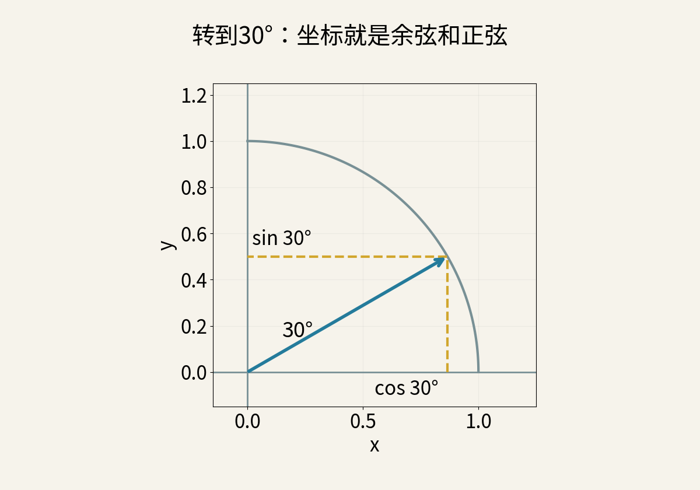

问题于是变成：没有现成的sin与cos，怎样把箭头转到那个角度？总不能先调用正弦函数，再用它来解释正弦函数怎样算。

## 先认识那台“坐标旋转数字计算机”

1959年，Jack E. Volder发表《The CORDIC Trigonometric Computing Technique》。CORDIC来自 **COordinate Rotation DIgital Computer**，意思就是坐标旋转数字计算机。

论文描述的目标是实时机载计算，特别是导航关系中的坐标旋转与直角坐标、极坐标转换。它写到的专用算术结构包括三个移位寄存器、三个加减器，以及相应连接。[原论文](https://www.ece.ucdavis.edu/~vojin/CLASSES/EPFL/Papers/3-Volder_CORDIC.pdf)

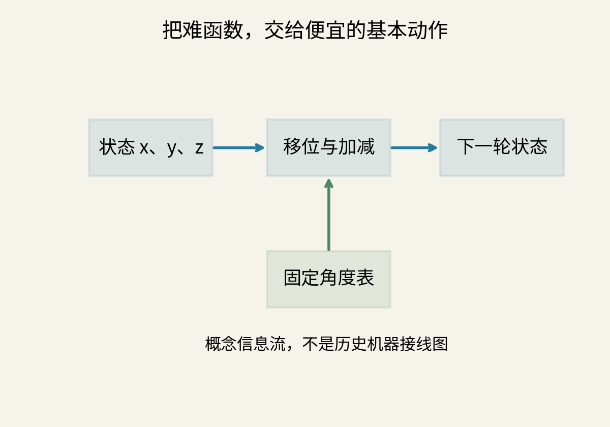

上图是解释信息流的原创概念图，不是原机器接线图。它想传达的是一种设计态度：先观察硬件容易做什么，再把数学任务拆成这些动作。

我们下面讲圆周旋转模式的二进制教学版。CORDIC后来有不同进制、不同函数和不同硬件组织；并不是所有冠以这个名字的实现，都逐字执行同一份代码。

## 普通旋转公式，先暴露了难处

一个点(x,y)逆时针转过α，坐标会变成：

x新＝x cos α−y sin α

y新＝y cos α＋x sin α。

为什么会这样？可以分别旋转原来的水平分量和竖直分量，再把两支箭头相加。我们既能看出旋转保持长度，也看出了困难：公式里有乘法，还有我们正想求的三角函数。

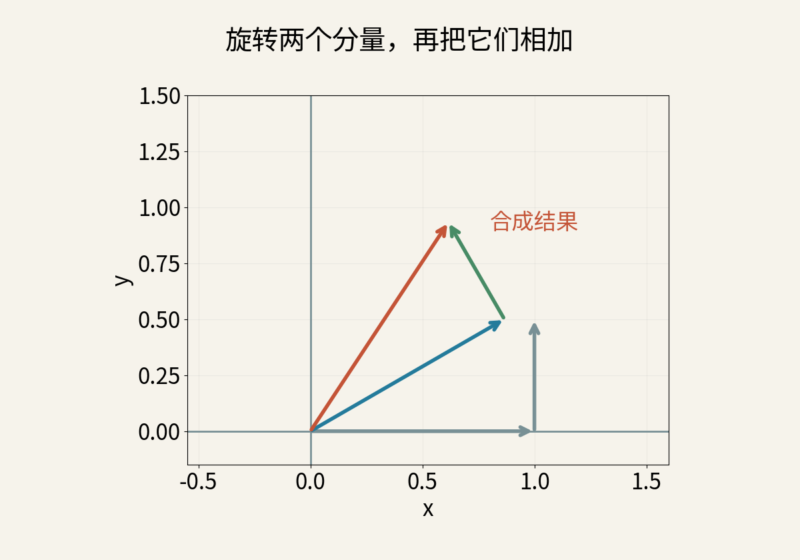

把cos α先提到外面，里面就出现tan α：

x新＝cos α × (x−y tan α)

y新＝cos α × (y＋x tan α)。

现在挑一些特别的角度，让tan α恰好等于1、1/2、1/4、1/8……。乘这些数，就能用二进制移位实现。

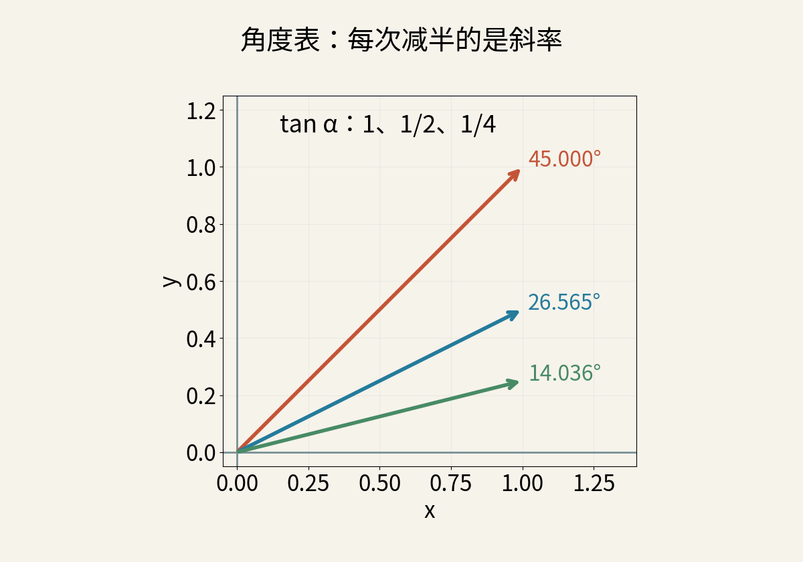

这些角度依次约为45°、26.565°、14.036°、7.125°。注意：**角度本身不是每次减半，减半的是正切值。**越到后面，小角度才越来越接近按一半缩小。

## 右移一位，为什么能替代某些乘法？

对非负整数，二进制右移一位就是丢掉最低位，相当于除以2并向下取整。例如二进制1100表示12，右移一位得到0110，也就是6；再右移一位得到0011，也就是3。

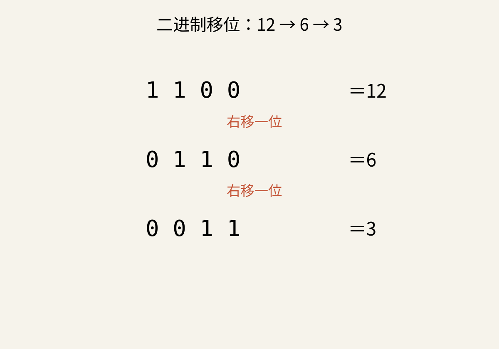

如果用固定数量的小数位表示实数，移位也能实现按2的幂缩放，但会丢掉低位精度。负数如何移位、舍入怎样处理，必须服从具体语言与硬件的定义，不能把它当成无限精度的除法。

为了先看清几何，我们暂时用普通小数计算这些二分之一、四分之一。后面再回来算精度的账。

## 先欠下一笔长度债，只把方向转对

暂时拿掉外面的cos α，每一步采用：

x新＝x−d×y×2的负i次方

y新＝y＋d×x×2的负i次方。

i从0开始，d只能是+1或−1，决定往哪边转。d为+1表示逆时针，为−1表示顺时针。

这两个式子会转对角度，但同时把长度放大。我们先记住这笔债，稍后统一还。先看看，它怎样一步步逼近30°。

## 第一步：转45°，转过头也没关系

初始箭头是(x,y)=(1,0)，目标还剩30°。第一步i=0，2的负0次方等于1。我们选择逆时针，得到：

x新＝1−0＝1，y新＝0＋1＝1。

箭头方向变成45°。目标残差，也就是“还需要转多少”，从30°变成−15°。负号告诉我们，下一步要往回转。

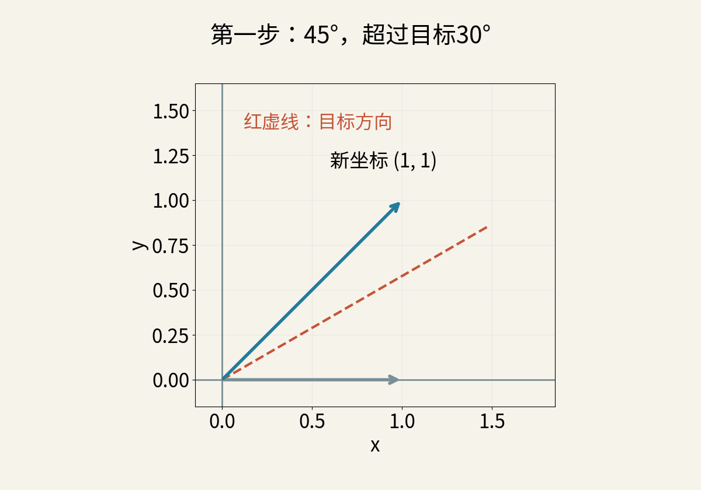

长度从1变成根号2，确实变长了。这不是画图错误，而是暂时省去cos因子的代价。

## 第二步：向回转26.565°

现在i=1，使用1/2。残差为负，所以d=−1。把上一步的旧x、旧y代进去：

x新＝1＋1/2＝1.5

y新＝1−1/2＝0.5。

箭头方向约为18.435°，残差变成约+11.565°。我们回得稍微多了，下一步再向上补。

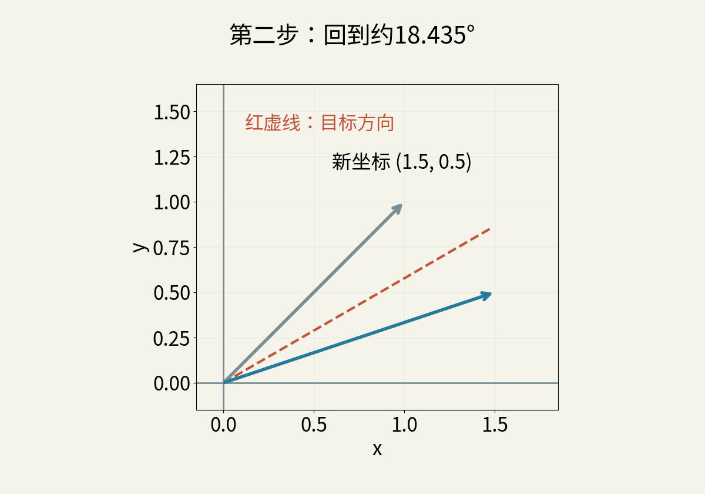

这里有个特别容易写错的地方：计算y新时，用的是旧x=1，而不是刚刚更新的1.5。两条更新必须同时理解，否则连几何变换本身都变了。

## 第三步：再补14.036°

i=2，使用1/4，残差为正，选择d=+1：

x新＝1.5−0.5/4＝1.375

y新＝0.5＋1.5/4＝0.875。

方向约32.471°，残差约−2.471°。接下来往回转7.125°，再向前转3.576°……每一步都先看残差符号，再从角度表取出本轮允许的小转弯。

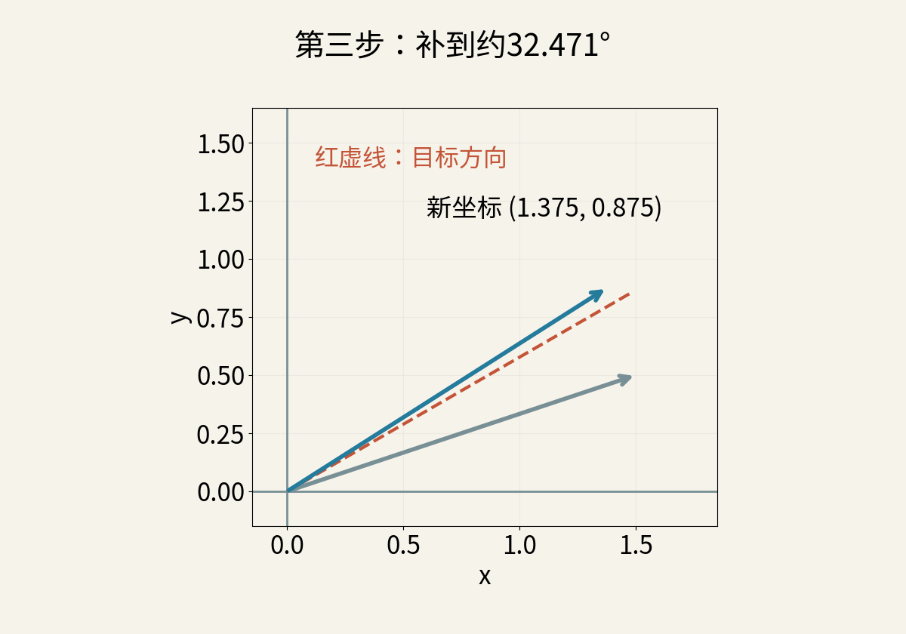

这个过程像用越来越细的刻度修正方向。它不要求每一步都比上一步更接近目标。例如第四步的角度误差会暂时变大；重要的是可用的修正角度逐渐缩小，过程在规定范围内能够收敛。

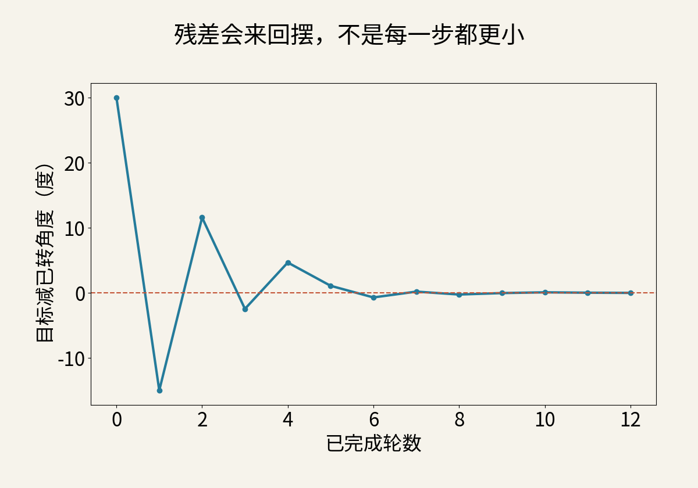

不要把“最后越来越准”误读为“每一步都更准”。后者是一个看起来顺眼、实际上不成立的额外承诺。

## 长度债怎么还？好消息是，它提前就能算好

每一步省掉cos α，长度就乘上1/cos α。因为tan α=2的负i次方，这个放大倍数等于根号下(1＋2的负2i次方)。

第一步乘根号2，第二步乘根号1.25，第三步乘根号1.0625。做N步，总放大倍数G_N就是把这些因子相乘。

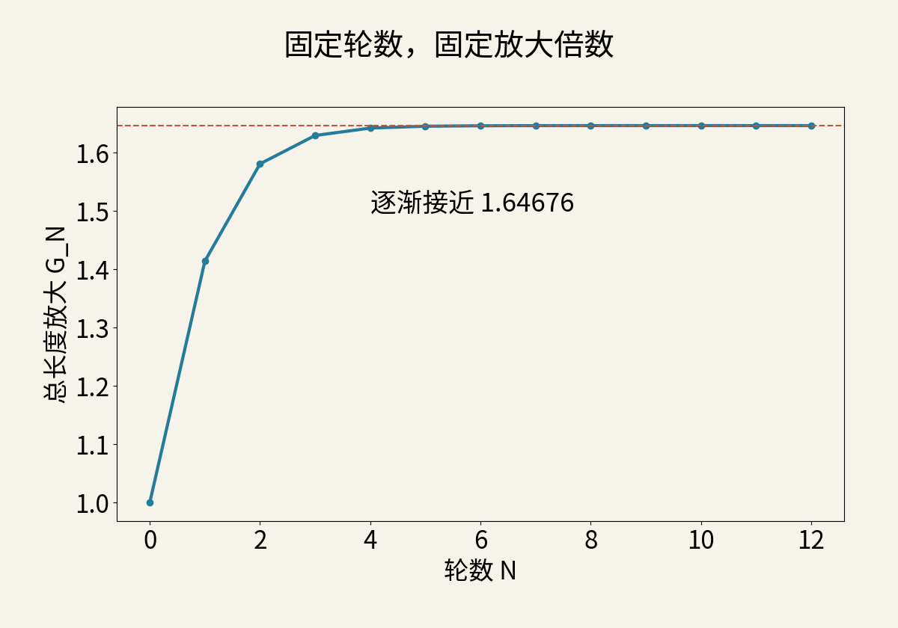

关键是：往左转还是往右转，都乘同一个正的长度因子。只要执行相同轮数、每轮都按这个规则旋转，G_N与目标角度无关。

因此可以预先算出倒数K_N=1/G_N，把初始x设为K_N，初始y设为0。经过N轮放大后，长度恰好回到约1。轮数较多时，K_N接近0.607252935。

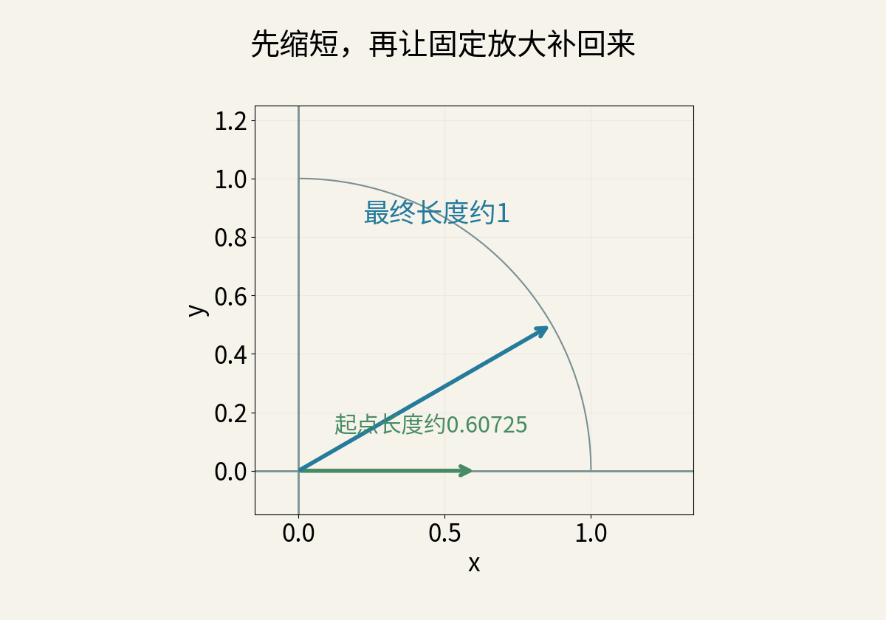

这样末尾的x、y就分别近似余弦和正弦，不必每轮都做一次昂贵的长度校正。也可以最后统一缩放，但成本和数值策略会不同。

注意，有些资料把K用来表示放大倍数，有些用来表示其倒数。只记住字母和0.607还不够，必须先问：这里是在放大，还是在补偿？

## 那张角度表，是否又偷偷调用了三角函数？

表里确实放着atan(1)、atan(1/2)、atan(1/4)等常数。atan是反正切：输入斜率，输出对应角度。

但这些常数不随每次输入变化，可以在设计阶段高精度算好，固化到只读存储器里。运行时只取表、加减、移位，和“每次输入30°都先调用正弦”不是一回事。

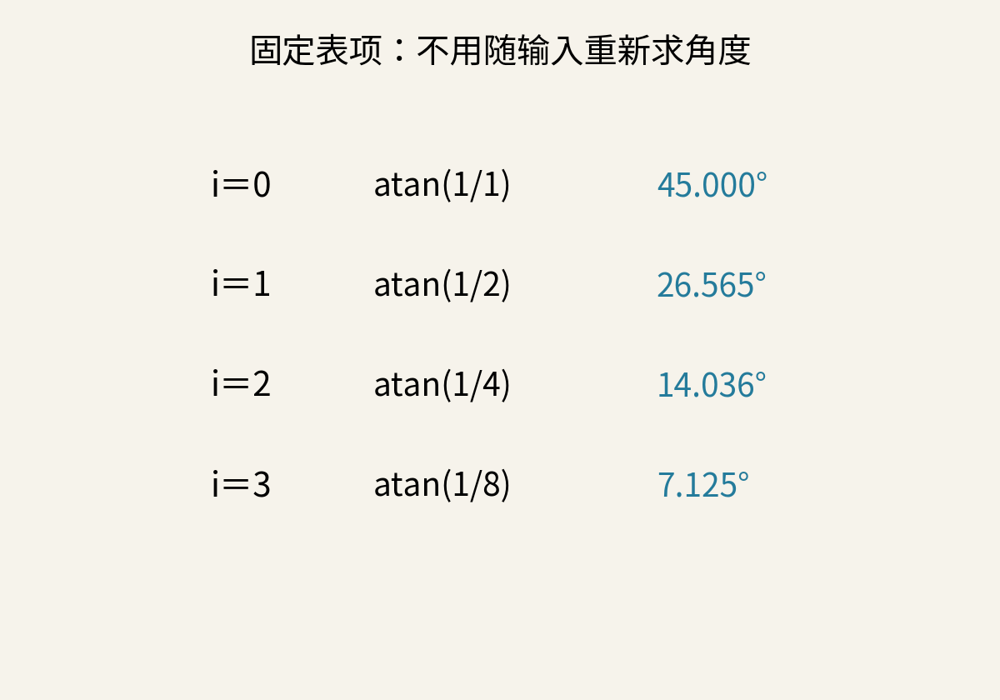

下面的教学代码为了便于核对，用math.atan生成表、用math.sqrt计算补偿常数；这些是准备工作。代码本身使用浮点乘法展示数学关系，**不是一份声称完全没有乘法指令的硬件实现**。

```python
import math

N = 20
angles = [math.atan(2.0**-i) for i in range(N)]
K = math.prod(1 / math.sqrt(1 + 2.0**(-2*i))
              for i in range(N))
x, y = K, 0.0
z = math.radians(30)
for i, angle in enumerate(angles):
    d = 1 if z >= 0 else -1
    shift = 2.0**-i
    old_x, old_y = x, y
    x = old_x - d * old_y * shift
    y = old_y + d * old_x * shift
    z -= d * angle
print(f"cos≈{x:.9f}, sin≈{y:.9f}")
print(f"剩余角度≈{math.degrees(z):.9f}度")
```

代码已经实际执行。20轮得到cos约0.866024794、sin约0.500001056。目标正弦0.5，误差约0.000001056；有限轮数没有理由恰好停在数学真值上。

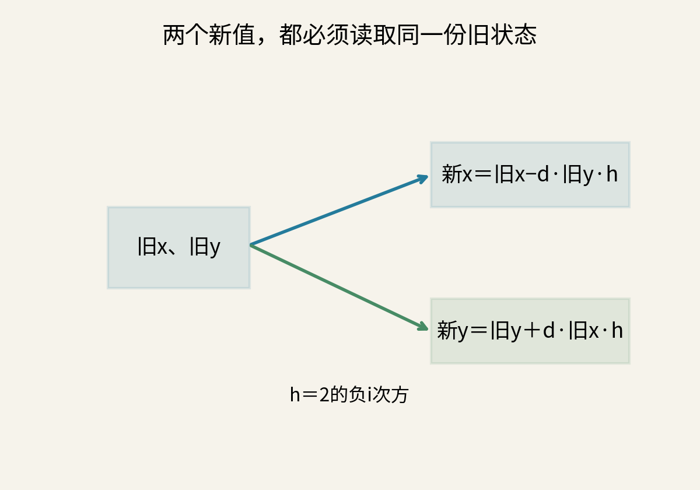

## 多转几次，精度就能无限增加吗？

在无限精度数学里，可以继续细分角度；在固定宽度寄存器里，数字会被量化到一格一格的刻度上。

假设只保留8位二进制小数，一格就是1/256。比这个刻度更小的变化，可能被舍入吞掉。寄存器还要留出足够的整数范围，防止中间坐标放大时溢出。

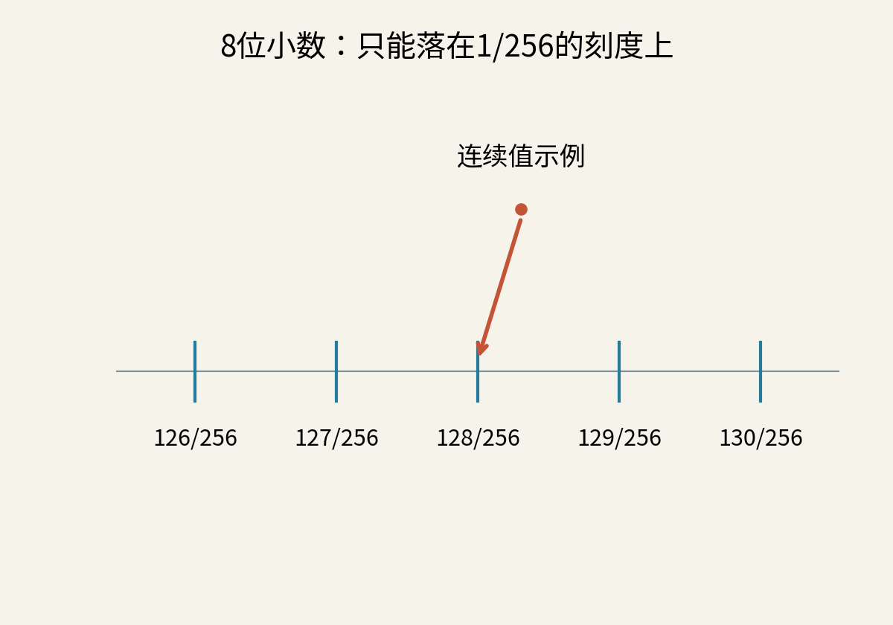

下面的图来自本文实际运行的浮点教学实验，比较不同轮数对30°的正弦误差。它说明轮数影响误差，却不代表某款芯片的测量结果，更没有把浮点曲线冒充定点精度曲线。

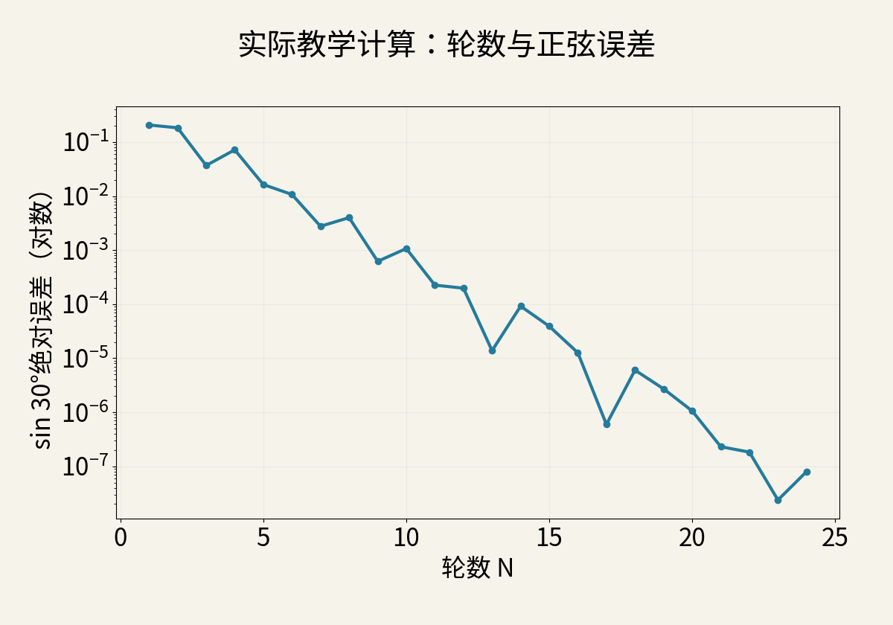

真实硬件还要一起选择坐标位宽、角度表位宽、舍入方式、补偿精度与迭代次数。ST的CORDIC应用说明也把输入格式、参数范围和精度设置作为接口的一部分，而不是只给一个sin按钮。[ST应用说明AN5325](https://www.st.com/resource/en/application_note/an5325-how-to-use-the-cordic-to-perform-mathematical-functions-on-stm32-mcus-stmicroelectronics.pdf)

## 任意角度都能直接塞进这20轮吗？

不能。基础圆周旋转有自己的收敛范围，工程上通常先做角度归约，把输入转到容易处理的象限或区间，再恢复符号和坐标关系。本篇短代码只演示30°，没有实现完整归约。

例如120°可以看成90°＋30°。先用30°得到(c,s)，再转90°，坐标变成(−s,c)，所以cos 120°=−0.5，sin 120°约0.866。

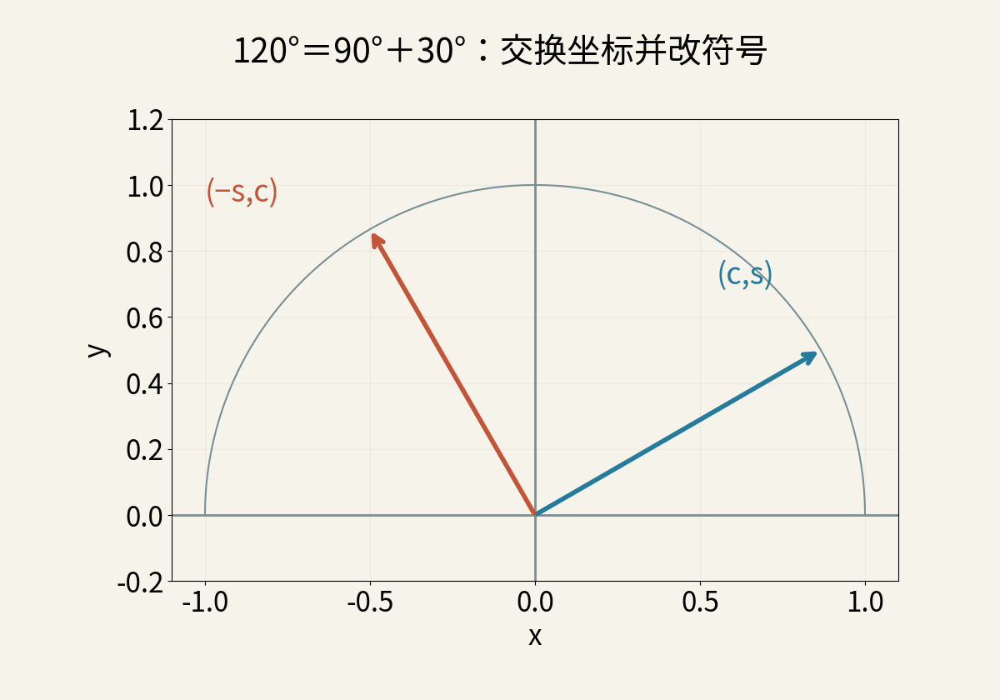

这一次90°变换只需要交换坐标与改符号。它也提醒我们，角度以度、弧度还是“π对应满量程整数”输入，是接口约定，不能把三种单位混着传。

## 把问题倒过来，还能测一支箭头的方向

刚才我们知道目标角度，逐步把箭头转过去，这叫旋转模式。

如果一开始给定向量(3,4)，反过来控制旋转方向，让y逐渐接近0，并累计转过的角度，就能求它原来的方向；经过正确的长度补偿，也能得到长度5。这通常叫向量模式。

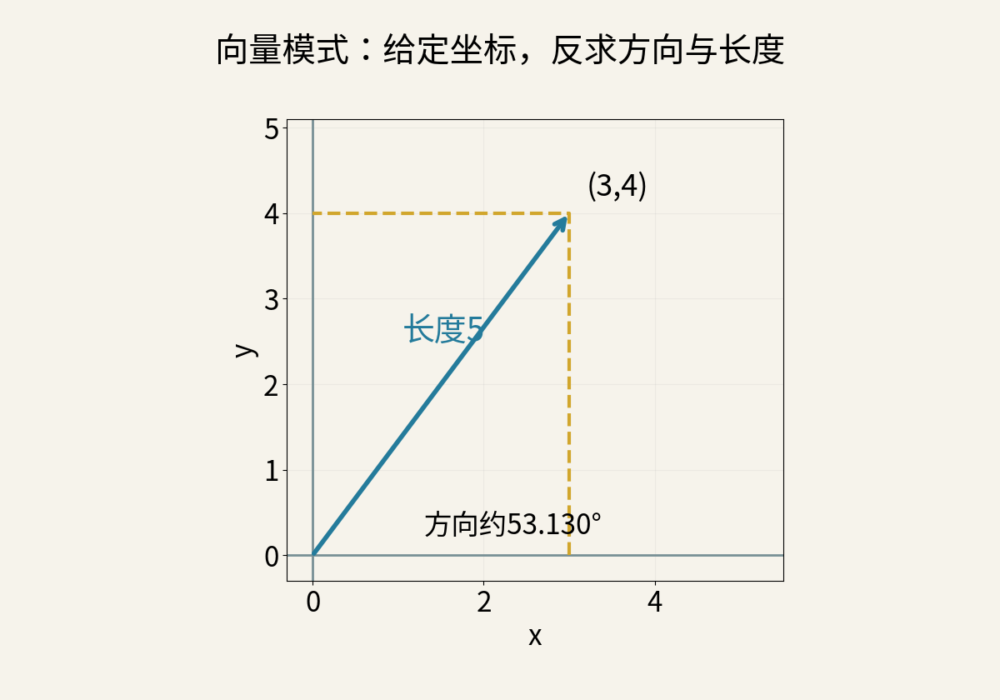

但方向选择规则变了，输入象限也要处理；不能把旋转模式的残差判断原封不动抄过去。双曲函数模式更有另外的细节，包括某些重复迭代要求，也不在本文圆周推导的承诺里。

## 到了口袋计算器里，思想还在，细节已经变了

1972年HP-35让三角函数进入手持科学计算器。工程师David S. Cochran在当年《Hewlett-Packard Journal》的文章中，讨论了为何选择迭代的伪除法、伪乘法方法，并引用Volder与Meggitt的工作。

特别值得看的是，他描述的正弦过程使用1、0.1、0.01等十进制尺度，带有重复减角与计数。因此不能说HP-35执行的就是我们上面这段20轮二进制循环。[1972年原文](https://www.hp.com/hpinfo/abouthp/histnfacts/museum/personalsystems/0023/other/0023hpjournal03.pdf)

想观察真实按键和外形，可以看[Seth Morabito拍摄的HP-35实物照片及许可](https://commons.wikimedia.org/wiki/File:HP_35_Calculator.jpg)。这是一张2007年的设备照片，不是1972年发布现场影像。

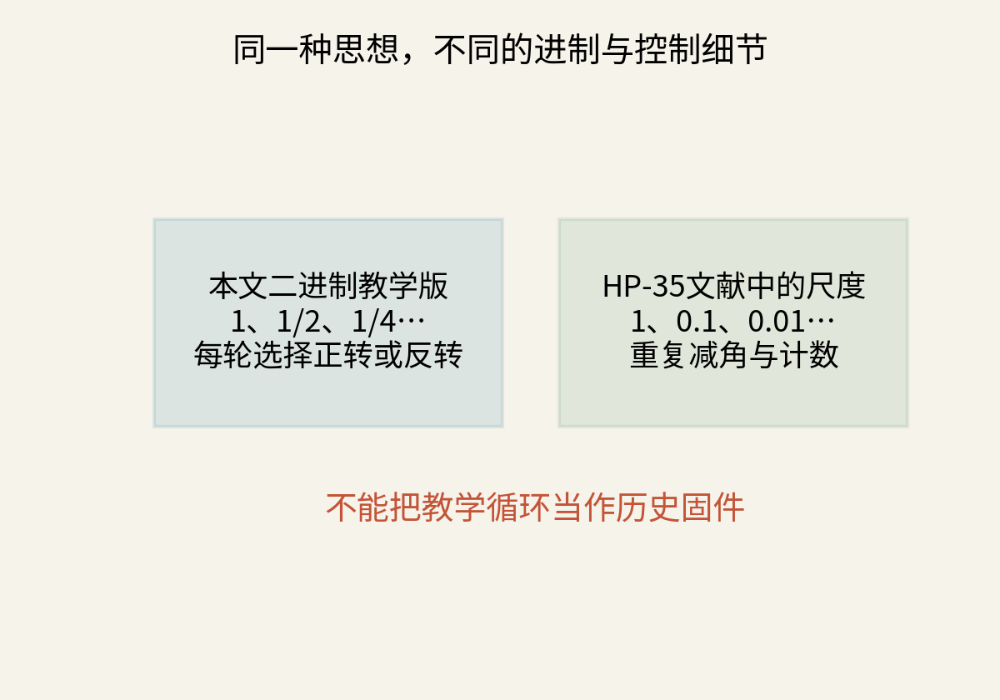

今天的CPU可能有很快的乘法器，数学库也会采用多项式、查表与范围归约等组合方法；CORDIC在某些专用硬件里依然有价值，却不是“所有机器上永远最快”的万能结论。

它真正漂亮的地方是：一台机器原本擅长的加减和移位，经过对几何结构的重新安排，竟然能够逐步回答三角函数的问题。

最后试试把N改成4、8、12，先预测方向会怎样摆动，再查看误差。也可以故意把y更新里的old_x换成新x，看看“只省一个临时变量”怎样破坏整个旋转。你会发现，算法的奥妙既在宏观的数学想法里，也在两个赋值语句之间。

图片来源：18幅原创概念图、精确坐标示意与实际浮点教学实验图。真实设备照片仅链接原站；历史论文与现代接口出处见正文及sources.md。
