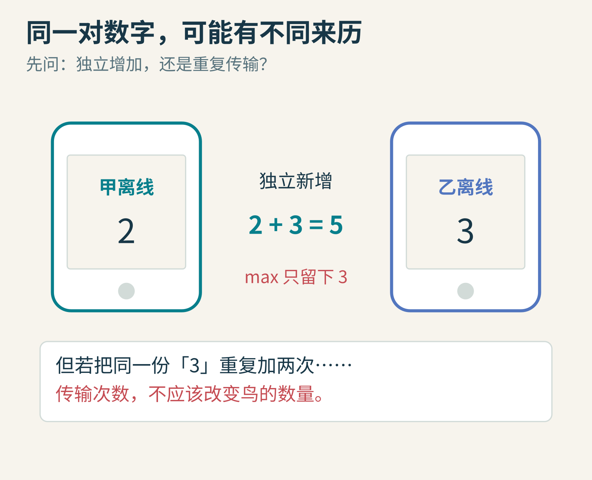
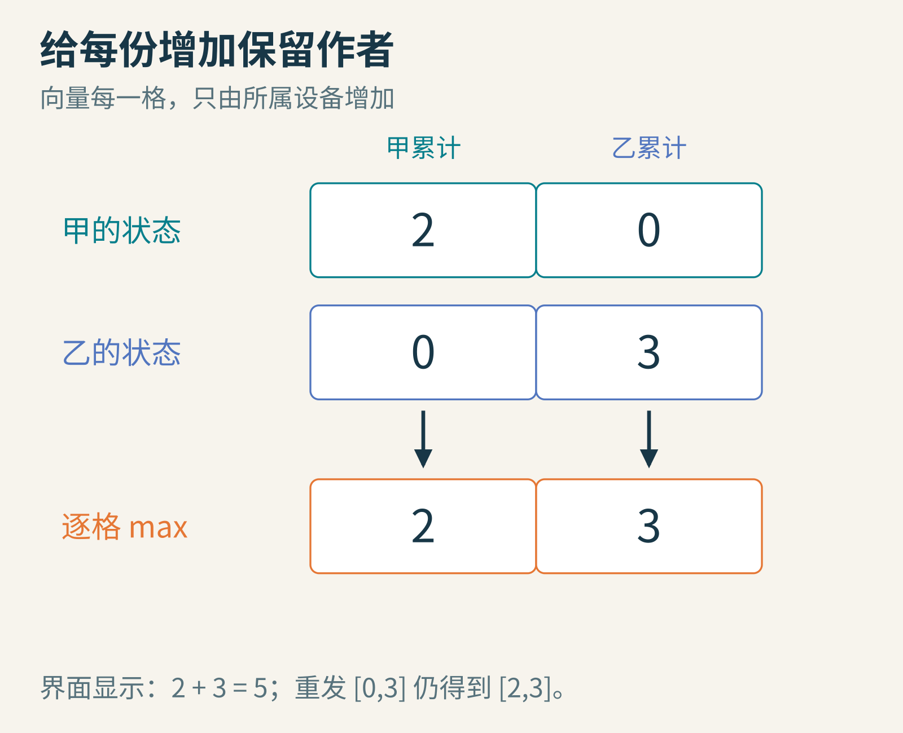
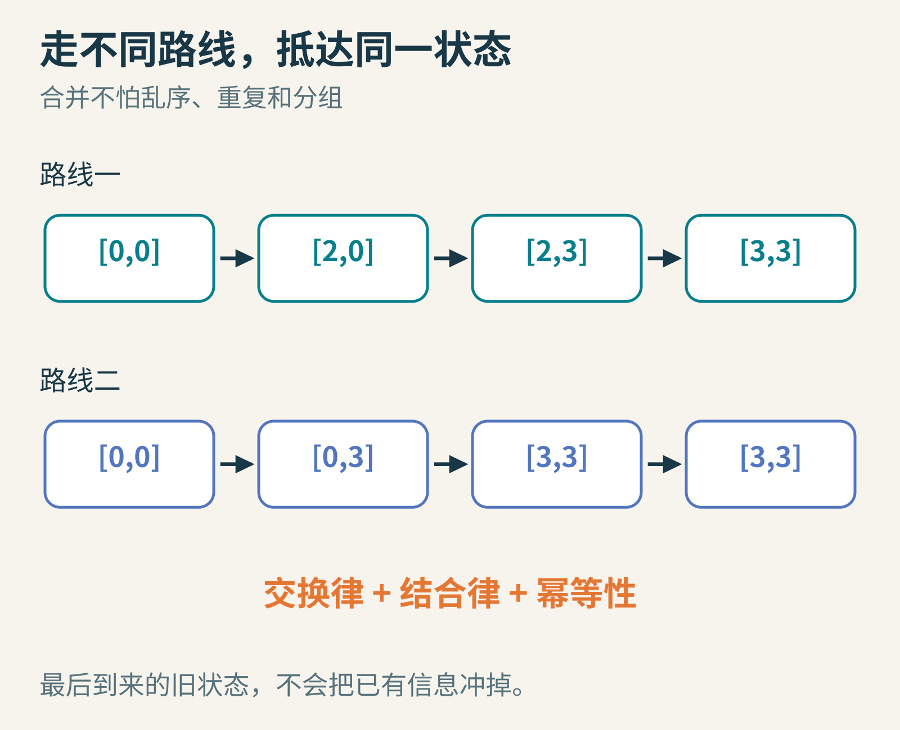
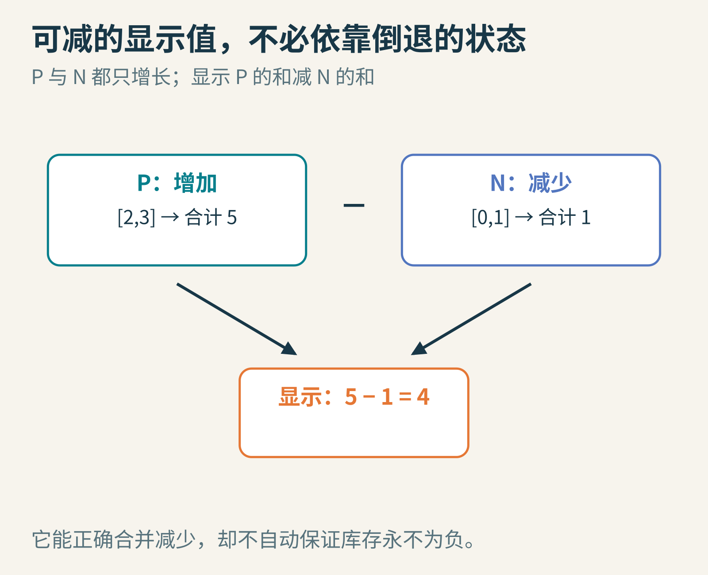
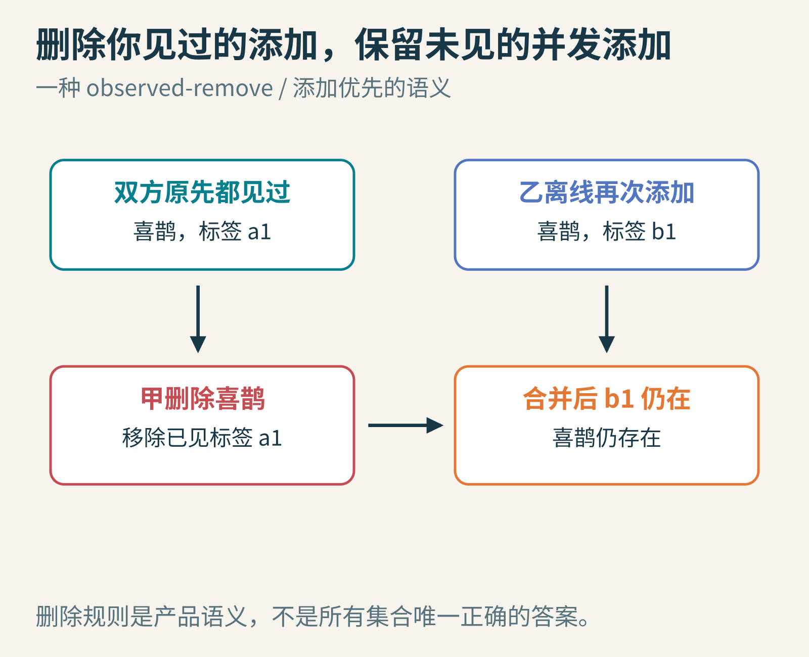
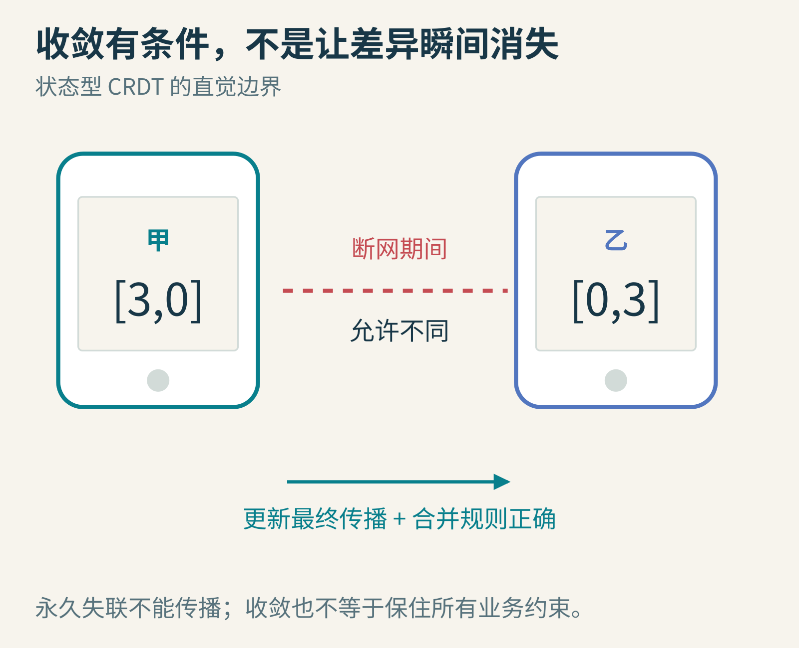

# 两部手机都离线时，谁的修改算数？CRDT 把争论藏进数据结构

两位同学一起记录校园里发现的鸟。早晨，两人的手机都显示“今天看到了 0 只”；走进没有信号的树林后，甲记录了 2 只，乙记录了 3 只。

晚上重新联网，该显示多少？很自然：5。但服务器收到的可能只是两个数字：2 和 3。取最大的数会丢掉甲的记录；直接相加，遇到网络重发又可能把同一批鸟算两遍。

问题不是加法太难，而是数字把来历丢掉了。



图1：本文构造的离线计数场景。两个数字分别代表独立新增时，应该相加；代表同一更新的两次传输时，却不能相加。

## 1. 别只记录“有多少”，还要记录“谁增加了多少”

先定一条规则：每部设备有一个稳定且不重复的身份。甲只能增加甲那一格，乙只能增加乙那一格。每部手机都保存两个分量，顺序固定为“甲、乙”。

初始状态是 `[0,0]`。甲看见两只鸟，变成 `[2,0]`；乙看见三只，变成 `[0,3]`。这里的数字是该设备自创建以来累计增加的数量，不是最近一个消息包的增量。

同步时，不把两个总数相加，而对每个位置取较大值：

`merge([2,0],[0,3]) = [max(2,0),max(0,3)] = [2,3]`

界面再把各分量相加，显示 5。



图2：同一个设备的计数只会增加。因此，同一格里较大的数，已经包含较小的数所代表的那些增加。

这一步解决了重发。甲又收到一遍乙的旧状态 `[0,3]`，与 `[2,3]` 合并，结果仍是 `[2,3]`。没有凭空多出三只鸟。

但这个结构并不自动识别现实中的同一只鸟。两人若同时看到了同一只麻雀，它仍可能被业务层记录两次。它解决的是更新的合并语义，不替应用判断“这两个观察是不是同一个事件”。

## 2. 为什么消息乱序也没关系？

甲后来又发现一只，状态变成 `[3,3]`。网络可能先送来新状态，再送来旧状态 `[2,0]`。逐格取最大值，不会让计数倒退。

这个合并函数有三个重要性质：

- 交换顺序没关系：`merge(a,b) = merge(b,a)`。
- 先合并哪两个没关系：`merge(merge(a,b),c) = merge(a,merge(b,c))`。
- 相同内容合并两次，等于一次：`merge(a,a) = a`。

数学上，它们叫交换律、结合律和幂等性。听起来很抽象，放进不可靠网络就很实用：消息可以乱序、分批、重复，合并仍能抵达相同结果。



图3：两条路线都抵达 `[3,3]`。图中箭头表示收到状态后的合并，不表示网络一定按这个顺序发送。

这就是一种 G-Counter，意为只增长的计数器。它属于状态型 CRDT。CRDT 常译为“无冲突复制数据类型”。“无冲突”是说数据结构预先规定了可收敛的合并规则，不是说人类意图永远不会冲突。

## 3. 看起来增长的不一定是屏幕上的数字

“只能加，不能减，有什么用？”

可以保存两个只增长计数器：P 记录增加，N 记录减少。界面显示 `sum(P)-sum(N)`。甲增加两次，乙增加三次又撤销一次，那么：

`P=[2,3]，N=[0,1]，显示值=5-1=4`。

同步时，分别对 P 和 N 逐格取最大。两个内部状态都向前增长，显示值却可以上升或下降。这就是 PN-Counter 的基本思路。



图4：撤销在这里被定义为新增一次“减少”，并不是抹掉历史。应用还必须决定谁有权撤销、撤销的是什么。

因此，“单调”说的是内部状态所包含的信息，不是界面数字必须越来越大。

这也暴露一个边界。假设仓库只剩 1 件商品，两部离线设备各卖出 1 件，最终计数能正确收敛到“卖了 2 件”，却没有防止超卖。收敛和“库存永不为负”是两种要求。若后一条不可违反，就可能需要协调、预先划分可销售额度，或采用专门的受限计数设计。

## 4. 一段可以亲手打乱顺序的代码

下面只演示两个固定身份的状态合并，没有网络、持久化或身份分配。本文实际运行了这些断言。

```python
from itertools import permutations

def merge(a, b):
    return tuple(max(x, y) for x, y in zip(a, b))

messages = [(2, 0), (0, 3), (3, 0), (0, 3)]
results = set()
for order in permutations(messages):
    state = (0, 0)
    for message in order:
        state = merge(state, message)
    results.add(state)

assert results == {(3, 3)}
assert merge((3, 3), (3, 3)) == (3, 3)
print(results)  # {(3, 3)}
```

为什么重复消息出现在列表里？因为“理想网络永不重复”的测试，恰好跳过了这个结构最值得理解的能力。

代码中的 `zip` 假定两个向量长度一致；真实系统不能让多出的分量被悄悄截断。设备很多或不断加入时，通常要设计身份到计数的映射、压缩与回收机制，而不是无限扩展一个简单列表。

## 5. 集合也能这样合并吗？

只允许增加的集合很容易：取并集。甲记录 `{麻雀,喜鹊}`，乙记录 `{燕子,喜鹊}`，合并成 `{麻雀,喜鹊,燕子}`。并集同样具有前面三种性质。

删除却会逼你回答一个业务问题：甲删掉“喜鹊”时，乙恰好再次加入“喜鹊”，最后应该保留还是删除？

一种常见思路是给每次添加发一个独特标签。删除操作只删除自己已经观察到的那些添加标签。没有见过的并发添加可以保留下来，这叫 observed-remove 思路，对应一种添加优先语义。



图5：甲删除的是已经见过的标签 a1。乙离线新增的 b1 没被这次删除观察到，合并后仍使“喜鹊”存在。这里只展示语义，不是完整的存储回收算法。

换一种应用，你也许更希望删除优先。没有一个名字叫 CRDT 的按钮，能替所有产品决定哪种规则符合用户预期。必须先定义操作的含义，再选择可实现该含义的数据结构。

## 6. 它到底保证了什么？

[Shapiro、Preguiça、Baquero 和 Zawirski 的2011年论文](https://perso.lip6.fr/Marc.Shapiro/papers/2011/CRDTs_SSS-2011.pdf)系统讨论了这一类可收敛复制结构，以及状态型、操作型的充分条件。这是一条由多个研究者推进的路线，不是某个聊天应用突然发明的同步技巧。

对本文这种状态型设计，可把每个状态看作“已经知道了哪些更新”。本地更新只增加信息；合并取双方信息的上界。只要有效更新最终能传播到各副本，拥有同样更新信息的副本就会收敛。



图6：短暂断网可以延迟一致，永久断网则不能凭空传播信息。收敛条件不会使网络失联自动消失。

这里有几个不能省略的条件：设备身份不能冲突；同一身份的计数不能从备份恢复成旧值后当作新生命继续使用；合并消息不能被恶意伪造；传播机制必须真的持续工作。操作型 CRDT 则往往有不同的消息可靠性、顺序或去重条件，不能把本文的“重复状态无害”直接套到任意操作消息上。

它也不等于强一致读写。断网期间，两人看到不同结果是允许的。若业务要求每次写入立刻获得全局唯一顺序，问题已经超出了这篇文章选择的契约。

## 留给你的小实验

1. 加入丙设备，把代码改成三个分量。让一份很旧的状态最后到达，结果会倒退吗？
2. 把 `max` 改成加法，重复同一条消息。哪一步开始重复计数？
3. 合作待办清单中，“删除任务”和“修改任务文字”并发发生，你希望用户看到什么？先写清产品规则，再讨论数据结构。

CRDT 最值得学的，不只是“不加锁也能同步”。更重要的习惯是：当合并总出问题时，先检查数据是否保留了足够的信息，以及你是否真的定义了“正确的合并”是什么。

图片来源：图1—6为本文原创教学示意，设备、鸟类记录、标签与数字均为构造例子。
