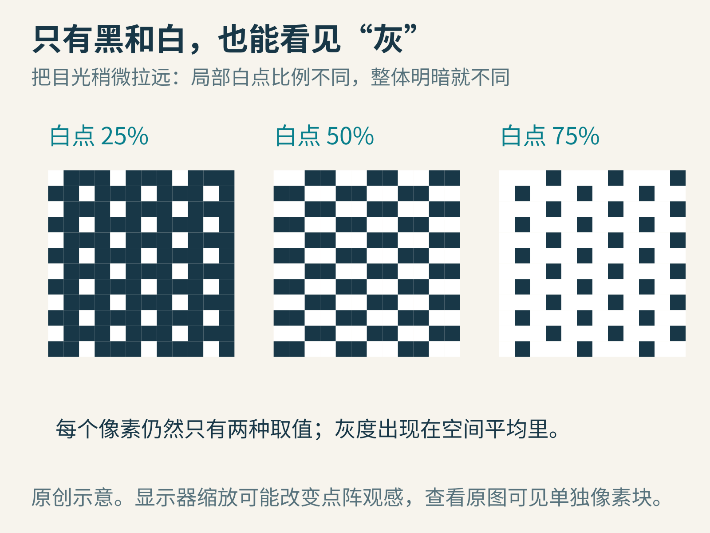
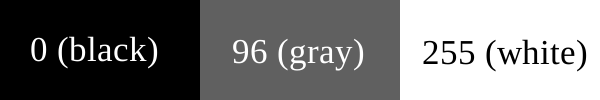
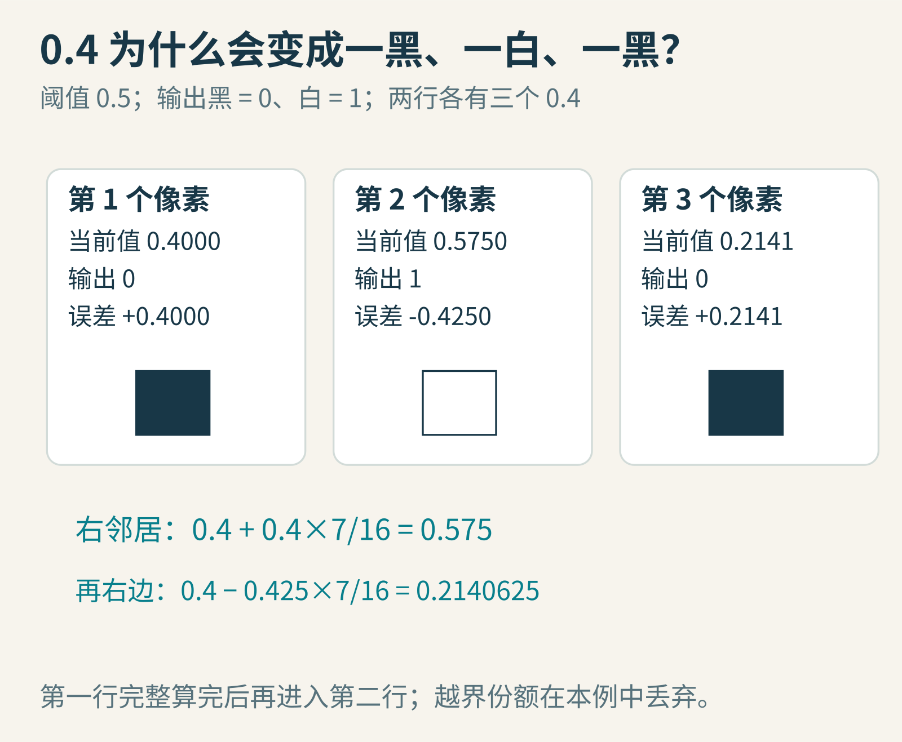
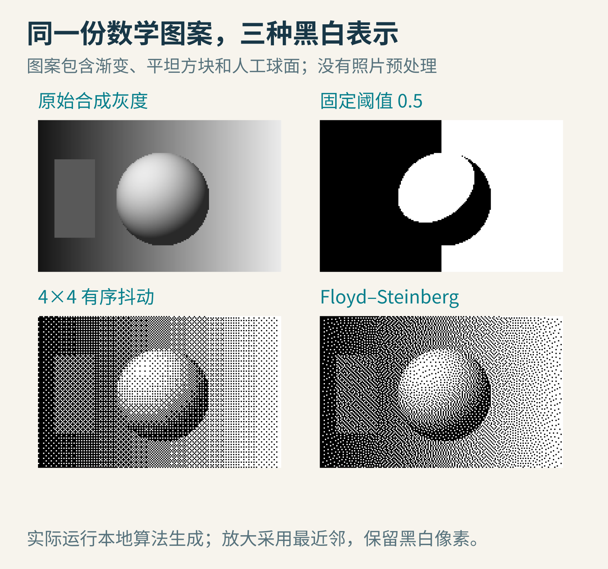
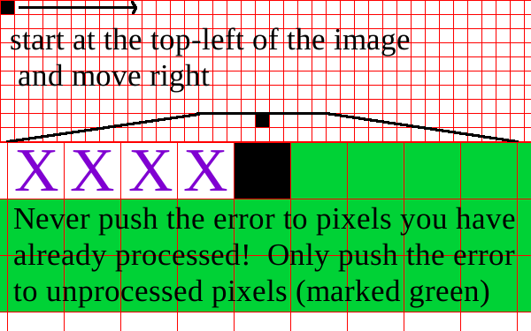
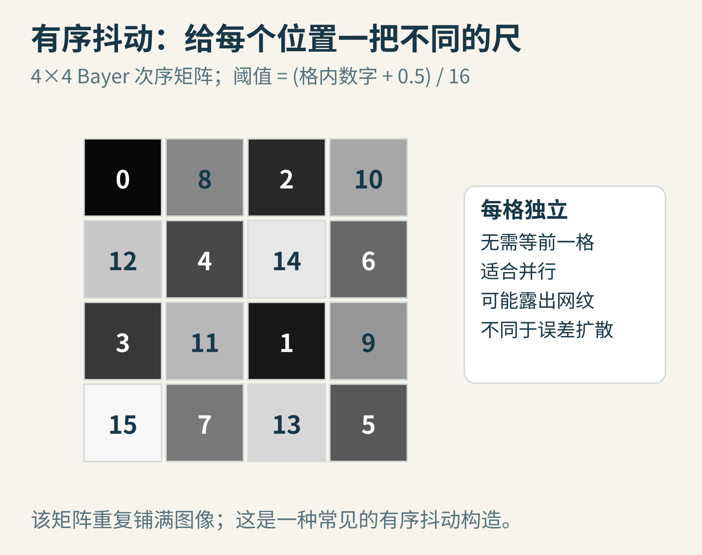

# 只有黑白两色，为什么还能看见灰？把误差分给邻居的抖动术

给你一张只能显示黑和白的屏幕，要求画出一片灰色的天空。没有灰色像素，也不许偷偷增加颜色，该怎么办？

如果把所有深于中灰的像素变黑、其余变白，天空可能一半漆黑、一半雪白，中间出现一条生硬的分界。渐变没了，球体的明暗也像被剪刀剪过。

另一种办法是：**让一小片区域里白点的比例，代表那片区域的亮度。**

像素本身仍是黑白的，远看却会出现灰。抖动，dithering，就利用了这种“局部取值有限，但空间排列可以传达更多层次”的机会。下面我们亲手追踪一笔被舍掉的误差，看它怎样改变后面的像素。

## 先分清：单个像素的颜色，和一片区域的平均

假设黑为0、白为1。一个4×4小方块共有16个像素，若其中8个白、8个黑，数值平均是0.5。4个白的平均是0.25，12个白的平均是0.75。

只要观察距离、显示密度和图案尺度合适，人眼不会把每个点都当成独立物体，而会感受到局部明暗。



图1：这里只改变白点比例，没有增加第三种像素取值。放大看是点，缩小看是灰。

这句话也带着限制：黑白点的数值平均，不必然等于真实显示器上的感知亮度。屏幕传递函数、点扩散、打印墨水覆盖与观看距离都会起作用。我们先研究算法的线性数值模型，稍后再回到这些工程细节。

在8位灰度图中，还常用0至255表示这些数值。下图的灰色格是96，约等于归一化后的0.376；它只是帮助认清数值范围，不是后文0.4小实验的输入。



图A：Tanner Helland的原文教学图，原尺寸使用，未修改；[CC BY-SA 4.0](https://creativecommons.org/licenses/by-sa/4.0/)。

## 最简单的失败：每个像素独自做决定

设原图三个相邻像素都是0.4，阈值取0.5。逐像素二值化会把三个都变成0，得到全黑。原来总共有1.2份亮度，现在全部舍掉。

如果一整块区域都恰好是0.4，局部阈值会让整块变黑。每个像素各自选择最近的黑或白，单点误差看起来不大；合起来却产生系统性的明暗损失。

换句话说，**每个像素局部最合理的选择，未必产生整体最好看的图像。**

我们希望它们能交流：前面那个像素少画了一点亮度，后面的像素知道这件事，适当地多画回来。

## 误差扩散：这笔账别悄悄抹掉

处理一个像素时，先拿当前值，选一个可显示的输出值，再计算：

`误差 e = 当前值 − 输出值`

若当前值0.4变成黑0，e=+0.4，说明输出偏暗，后面应该补一点亮。若当前值0.575变成白1，e=−0.425，说明输出偏亮，后面应该适当变暗。

正负号很重要。误差扩散不是总给邻居加亮，而是在补偿本次量化的方向。

Robert W. Floyd与Louis Steinberg提出的经典误差扩散方法，在从左到右、从上到下扫描时，将误差分给四个尚未处理的邻居：

- 右：7/16
- 左下：3/16
- 正下：5/16
- 右下：1/16


图2：权重和为1。左下方在空间上靠左，却属于下一行，因此尚未处理，不违反扫描顺序。

权重并不是说明这四个邻居的原始颜色，而是说明：当前量化误差的多少份额，要加进各邻居的工作缓冲区。

这项方法的经典出版记录是1976年的《An Adaptive Algorithm for Spatial Greyscale》。它面对的是有限显示能力下怎样保留灰度层次的问题。今天常见的照片“复古滤镜”只是它的一种视觉用途，不是原理本身。

## 用六个0.4，把第一行算完

造一张两行三列的小图，六个像素最初都是0.4。我们依次扫描，越界的误差份额直接丢弃。这个边界规则是本例的选择，要明确写出来。

第一个像素：

- 当前值0.4，小于0.5，输出黑0。
- 误差+0.4。
- 右边收到 `0.4×7/16=0.175`，从0.4变成0.575。
- 正下收到0.125，右下收到0.025。
- 左下越界，原本属于它的0.075不再分配。

第二个像素已经不是原来的0.4，而是0.575：

- 输出白1。
- 误差 `0.575−1=−0.425`。
- 右边收到 `−0.425×7/16=−0.1859375`。
- 因而第三个像素从0.4变为0.2140625。

第三个像素输出黑0，产生正误差0.2140625，再按规则传给仍在图内的下一行邻居。



图3：输出变为黑、白、黑。决定第二个像素颜色的，是已经累计前面误差的0.575，而不是原始0.4。

继续算第二行，得到的当前值依次约为0.4453125、0.5271484、0.2334595，因此仍然输出黑、白、黑。这些数已经用本地代码核对。

六个输出里两个白，总亮度2，输入总亮度2.4，并不完全相同。这是一个非常小的图，边缘很多，而本例丢弃了越界误差。**权重和为1，不等于任意有限图像在任意边界规则下都严格保留总亮度。**

在更大图像里，我们通常关心局部平均和视觉质量，但仍要知道边界处理影响了什么。

## 真正运行一次，别拿滤镜截图冒充解释

下面的比较图使用同一份原创数学图案：背景从左向右渐亮，中间有一个按简单光照公式生成的球面，左侧还有一块固定灰度的小方块。

原始数据为192×120个灰度样本。我们实际运行了固定阈值、4×4有序抖动和Floyd–Steinberg误差扩散。为了看清像素，图中用最近邻方式放大，没有给抖动结果额外模糊，也没有针对某种算法单独调整对比度。



图4：这是可重复生成的教学实验，不是照片处理前后对比。四幅图的输入来自同一份数值数据。

先看背景：固定阈值把渐变压成一道边界；两种抖动通过白点密度保留了更多明暗变化。

再看球体：抖动并没有恢复一种额外颜色，而是以细碎黑白纹理帮助你辨认球面的亮暗。最后看固定灰色方块：有序抖动的规则网纹更容易显露，误差扩散的纹理分布不同，也可能出现方向性或近似虫纹的结构。

不要把这张图解读为“误差扩散在任何场景都优于有序抖动”。如果你的目标是稳定的像素美术网纹、逐像素独立计算，或在着色器里快速产生特定风格，有序方法反而可能更合适。

## 一个最小实现，以及三处容易写错的地方

```python
def floyd_steinberg(gray):
    work = [row[:] for row in gray]  # 浮点数，范围约为0到1
    h, w = len(work), len(work[0])
    out = [[0.0] * w for _ in range(h)]
    weights = [(1, 0, 7), (-1, 1, 3), (0, 1, 5), (1, 1, 1)]
    for y in range(h):
        for x in range(w):
            old = work[y][x]
            new = 1.0 if old >= 0.5 else 0.0
            out[y][x] = new
            error = old - new
            for dx, dy, weight in weights:
                nx, ny = x + dx, y + dy
                if 0 <= nx < w and 0 <= ny < h:
                    work[ny][nx] += error * weight / 16
    return out
```

第一，不要直接用无符号8位数组承接负误差。负数溢出、截断和逐步取整，都会改变传播。教学版采用浮点工作缓冲区；输出才只有0和1。

第二，不要刚加一次误差就不加说明地把中间值钳到0至1。这会丢弃一部分误差，变成另一个算法变体。本文工作区保留累计值，最终量化仍输出合法黑白值。

第三，不要把“每行从左到右”的权重原样用在反向扫描行。如果采用蛇形扫描，反向那一行需要镜像扩散方向。否则误差可能被加到已经输出的像素上，破坏因果顺序。



图B：Tanner Helland用绿色标出尚未处理的位置，紫色叉号表示已经处理的像素。它强调扫描顺序；不是Floyd–Steinberg四个权重的精确核图。原尺寸使用、未修改，CC BY-SA 4.0。

上面代码是教学实现，假定输入为非空、矩形二维数组。它没有处理颜色管理、透明度、超大图像、设备校准或并行执行，不能直接当作完整图片产品的质量承诺。

## 有序抖动为什么不用等前一个像素

误差扩散有依赖：后面的像素要等前面的误差送来。有序抖动走另一条路：预先给不同位置不同阈值，每个像素独立比较。

下图是常见4×4 Bayer次序矩阵。把每个数字加0.5再除以16，得到位于0至1之间的16个不同阈值，然后重复铺满图像。



图5：同一个0.4灰度，落在不同格子时会面对不同阈值，因此有的变黑、有的变白。

例如阈值小于等于0.4的格子会输出白，其他输出黑。随着灰度增加，更多格子被点亮。因此一块区域能通过固定空间顺序呈现不同平均亮度。

它无需读邻居输出，也无需维护向前传播的误差，容易并行。代价是重复图案可能看得出来，尤其在大片平滑区域。误差扩散则把每次具体舍入结果纳入后续计算，能更灵活地调整局部点分布，但扫描顺序也会留下自己的痕迹。

## 黑白之外：彩色、游戏与显示设备

如果输出允许16种颜色，量化步骤不再是“比0.5大吗”，而是从调色板中找一个合适颜色。误差也从一个标量变成一个颜色向量。

但是“最近颜色”的距离怎样定义，会影响结果。在RGB数值里最接近，不保证在人眼看来最接近。还需要考虑输入是线性光值还是经过非线性编码的值，以及透明像素的颜色怎样处理。

游戏中有时会把抖动用于透明覆盖、渐隐和风格化明暗；打印和低色数显示则有不同的设备限制。这些方法可以共享“用空间分布表示有限取值之间层次”的思想，但实现目标并不相同，不能把Floyd–Steinberg直接当作所有抖动的同义词。


图6：抖动把大块量化结构变成更细的纹理；它并不是把所有意义上的误差都变小。

对于视频或游戏实时画面，还有时间问题。一帧里好看的点阵，下一帧稍微改变时可能重新排列，看起来像闪烁。运动、抗锯齿、缩放与压缩也会改变点阵的观感。图像在编辑器里清楚，不代表经过社交平台缩放后仍完全一样。

最后，别忘了像素误差指标的陷阱。原值0.4若输出黑，单点平方误差0.16；若为了区域平均而偶尔输出白，那个点的平方误差0.36，反而更大。但整个区域的平均明暗可能更准确，人眼也更容易看出渐变。评价“好”之前，要说清楚关心单点数值、局部平均、结构还是观看感受。

## 你可以继续做的三个小实验

1. 把六个输入0.4改成0.6，仍用相同边界规则，手算第一行。误差的正负次序怎样变化？
2. 对一张大块恒定0.4灰度图，统计输出白点比例。再分别只看内部区域和整张图，观察边缘的影响。
3. 把扫描顺序改为蛇形，并正确镜像权重。放大比较平坦区域的纹理，看看“算法的行走方式”有没有留下痕迹。

抖动里最漂亮的思想，是没有假装一次舍入没有损失。它承认每个像素能力有限，然后把欠下的账带给未来的邻居。

图片来源：六张机制图、矩阵与灰度比较为本文原创；比较图由文中算法实际运行生成。另两张教学图来自[Tanner Helland原文](https://tannerhelland.com/2012/12/28/dithering-eleven-algorithms-source-code.html)，CC BY-SA 4.0，未修改。延伸阅读：[Tanner Helland的实现讲解](https://tannerhelland.com/2012/12/28/dithering-eleven-algorithms-source-code.html)、[Pillow的图像转换接口](https://pillow.readthedocs.io/en/stable/reference/Image.html)、[经典论文书目信息](https://isgwww.cs.uni-magdeburg.de/~stefans/npr/entry-Floyd-1976-AAS.html)。
