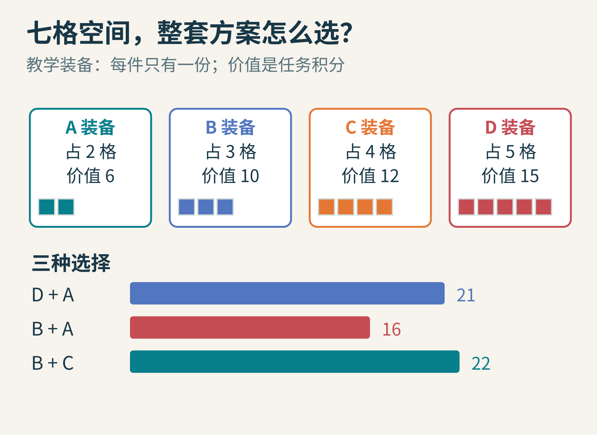
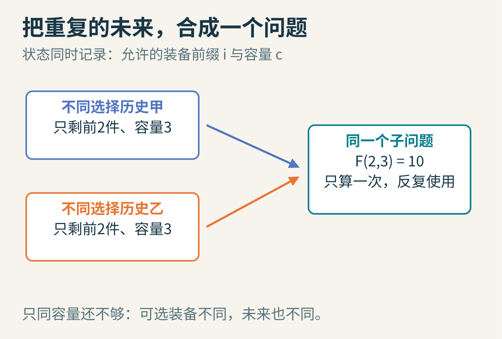
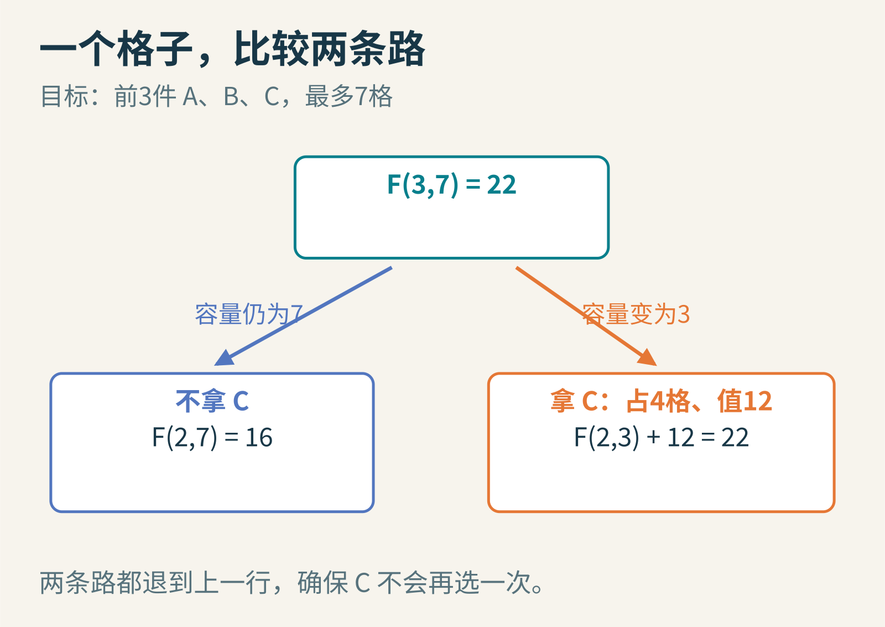
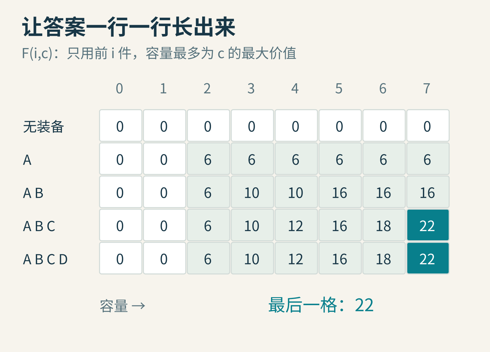
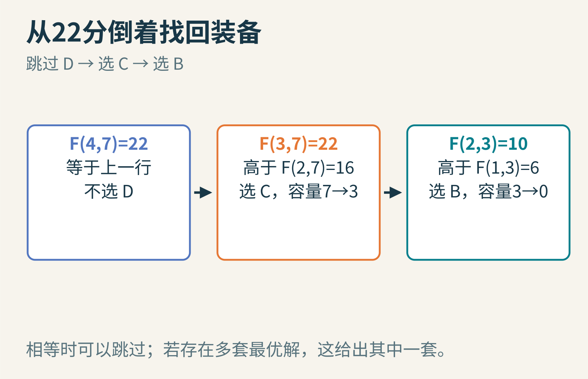
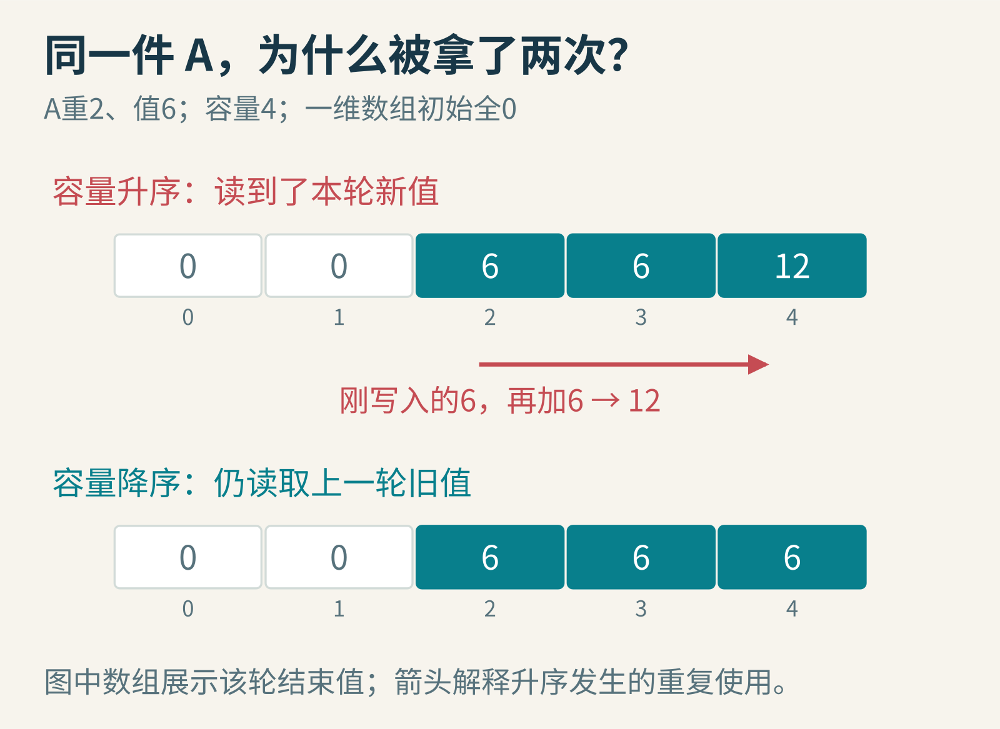

# 背包只剩七格：动态规划怎样把“所有可能”折成一张表

一次探险还没出发，难题先出现在背包里。

假设游戏给你四件装备：A 占两格，价值 6；B 占三格，价值 10；C 占四格，价值 12；D 占五格，价值 15。每件只有一份，背包最多装七格。这里的“价值”是我们为教学设定的任务积分，不是装备价格。

挑单件最值钱的 D，再塞进 A，得到 21。按每格价值先挑 B，再挑 A，只得到 16。但 B 和 C 恰好装满七格，价值却是 22。

为什么两种听起来聪明的挑法都输了？因为一件装备值不值得拿，取决于它占掉空间之后，还给其他装备留下了什么机会。


图1：比较的是整套方案。单件价值和单位空间价值，都不自动保证整套最优。

## 先允许自己笨一点：拿，还是不拿

对 A，可以拿，也可以不拿；到 B 时，又有两种选择。继续往下，四件装备有 2×2×2×2，也就是 16 种子集。检查每种总重量，丢掉超重的，再选价值最大的，当然能找出答案。

这叫枚举。问题不在于它不聪明，而在于分支会越来越多：增加一件装备，选择数就再翻一倍。面对几十件、上百件装备，许多时间花在了相似的工作上。

不过，“相似”必须说清楚。两个分支都剩三格空间，并不一定是同一个问题。如果一个分支还能选 B，另一个已经用过 B，它们的未来就不同。

所以我们同时记两件事：还允许使用哪些装备，以及还剩多少容量。只要这两件事相同，过去是怎样走到这里的，就不影响后面能取得的最高价值。


图2：状态是一份“够用的记忆”。容量相同但可选装备不同，不能合并；两者都相同，才可以共用答案。

这就是动态规划的重要起点：先找到一个能描述未来的状态，再让同一个状态只求解一次。表格是常见工具，真正被保存的是已经解决的小问题。

## 让一个格子只回答一个问题

定义 F(i,c)：只从前 i 件装备里挑，容量最多为 c 时，能得到的最大价值。

例如 F(2,5) 的意思是：只许用 A、B，空间最多五格。答案是 16，因为两件正好放下。F(2,4) 则是 10，因为 A、B 不能一起装，单选 B 更好。

请留意“最多”二字。F(2,4)=10 并不要求一定装满四格；只装三格也可以。若题目改成“必须恰好装满”，初始状态与不可行状态的表示都要改变。

现在考虑第 i 件装备，重量 w，价值 v。一套最优方案只能处于两种情况之一：

- 没拿它：价值就是 F(i−1,c)
- 拿了它：先给它腾出 w 格，剩余部分最多做到 F(i−1,c−w)，加上它本身的 v

因此，在 c≥w 时：

F(i,c)=max(F(i−1,c), F(i−1,c−w)+v)。

如果 c<w，第二条路根本走不通，只保留第一条。两条路都只问“前 i−1 件”的答案，因此同一件不会被重复拿。


图3：计算 F(3,7) 时，比较“不拿 C 的16”和“拿 C 后的10+12”。箭头指向已经算过的格子。

这里为什么敢把剩余部分换成最优答案？假如某个拿了 C 的方案，剩余三格不是 A、B 所能达到的最好结果，那就把那部分换成更好的，整个方案也会更好。原方案便不可能最优。这种“最优方案的剩余部分也要最优”的结构，叫最优子结构。

它不是一句万能口令。如果装备之间有额外关系，例如 A 和 C 一起携带会触发奖励，状态必须记住足够的信息；仍用这张只记录容量的表，可能就漏算奖励。

## 看着答案从空背包长出来

没有任何装备时，各种容量的最高价值都是 0。这是第零行。接着加入 A，容量不到两格仍为 0，达到两格后便可以得到 6。

第二行允许使用 A、B。容量三格时选 B，得到 10；容量五格时 A、B 都能拿，得到 16。第三行加入 C，容量七格时，刚才的两条路比较出 22。第四行加入 D，最好的结果仍是 22。


图4：横轴是容量，纵轴是允许使用的装备前缀。每一行都利用上一行；最后一格给出22。

表里一共五行、八列，包括“没有装备”和“容量为零”的边界。看起来比检查16种组合还繁琐，是因为小例子刻意把过程完整摊开了。装备数增加后，收益才明显：若有 n 件装备、整数容量 W，这种写法只需处理大约 nW 个状态，每个状态比较两种情况。

但“比枚举好”不等于“任何规模都快”。容量 W 如果是十亿，表同样会大得无法接受。计算机写出十亿这个数只需约30个二进制位，而表却要为十亿个容量留位置。因此 O(nW) 常被称为伪多项式时间：它对数值大小是多项式，对数字的编码长度未必是。

## 22 分很好，但究竟带了哪两件

表给出了分数，还没给装备清单。我们可以从右下角往回看。

F(4,7) 与 F(3,7) 都是22，说明不拿 D 就已经能达到最优值。接着，F(3,7)=22，而 F(2,7)=16；不拿 C 不够，所以把 C 放进背包，容量从7减到3。

再看 F(2,3)=10，而 F(1,3)=6，因此 B 也要拿。容量减到0，结束。选出的就是 B、C。


图5：回溯时，行数持续减少；只有决定拿当前装备，容量才会向左移动。相等时可能有多套最优解，本例选择跳过当前装备。

下面是完整的教学程序。它在 Python 3 中执行过，输出最高价值与其中一套最优选择；没有测量性能，也不代表某款游戏的实际背包实现。

```python
items = [("A", 2, 6), ("B", 3, 10),
         ("C", 4, 12), ("D", 5, 15)]
W = 7
f = [[0] * (W + 1) for _ in range(len(items) + 1)]
for i, (_, w, v) in enumerate(items, 1):
    for c in range(W + 1):
        f[i][c] = f[i - 1][c]
        if c >= w:
            f[i][c] = max(f[i][c], f[i - 1][c - w] + v)

picked, c = [], W
for i in range(len(items), 0, -1):
    if f[i][c] != f[i - 1][c]:
        name, w, _ = items[i - 1]
        picked.append(name)
        c -= w
print(f[-1][W], list(reversed(picked)))
```

输出是 22 ['B', 'C']。主循环负责求最优值，最后的倒序循环把选择恢复出来。这里假定容量与重量是非负整数，并采用每件最多一份的 0/1 背包模型。

## 少存一行，为什么会改变题目

观察依赖箭头：当前行只需要上一行。所以如果只求分数，可以把二维表缩成一个数组。

但容量必须倒着走。假设只有一件 A，重2、价值6，容量4。如果从小到大更新，先把容量2写成6，之后计算容量4时，又读取这个刚刚写好的6，再加一次A的价值，于是得到12。程序等于允许 A 拿两次了。

从大到小更新时，计算容量4读取的容量2仍是处理 A 之前的旧值0，结果就是6。一个循环方向，保存了“上一行”和“这一行”的时间边界。


图6：一维优化省掉的是存储空间，不能省掉“每件物品只使用一次”的逻辑。箭头读到新值还是旧值，会让0/1背包变成另一道题。

这里还有一个交换：压成一维后，恢复具体方案不再像刚才那样直接。你可以保存额外决策信息，或用更精巧的重建方法。节约空间往往会让其他部分付出代价。

## 从多阶段决策，到日常程序里的“小问题档案”

动态规划的历史不始于游戏背包。Richard Bellman 在20世纪50年代推动了多阶段决策的数学理论；他1954年的[《动态规划理论》](https://www.ams.org/journals/bull/1954-60-06/S0002-9904-1954-09848-8/S0002-9904-1954-09848-8.pdf)是这一领域的早期文献之一。这里的 programming 有规划、安排的含义，不能只按今天“写程序”的意思理解。

背包是一个紧凑的训练场。编辑距离把“前缀与前缀”当作状态，序列比对比较已经走过的两段序列，资源调度则可能记录时间、库存和机器状态。它们外表很不一样，却都在问：未来真正依赖过去的哪些信息？

一旦把无关历史忘掉，把有关信息留下，许多看似不同的路径便能汇入同一个小问题。这比背下一条转移公式更有迁移价值。

## 把题目轻轻改一下

可以从三个小实验继续：

1. 把容量从7改为8。先猜答案，再运行程序，观察最优装备组合是否改变。
2. 允许每件装备拿任意多份。试着解释为什么容量升序现在反而有用，而不是只改一个循环凑答案。
3. 增加规则“A与C一起拿，额外加10分”。找一个例子说明原来的状态不够，再想想该多记录哪一件事。

动态规划的乐趣，就在这些小小的改题里：表格看似安静，每个坐标却都在声明“哪些过去可以忘记，哪些过去必须记住”。

延伸阅读：[MIT 0/1背包课程笔记](https://ocw.mit.edu/courses/6-006-introduction-to-algorithms-fall-2011/resources/mit6_006f11_rec21/)、[MIT 关于伪多项式时间的讨论](https://ocw.mit.edu/courses/6-006-introduction-to-algorithms-spring-2020/7232b0ff982f501556118a8552654762_MIT6_006S20_r19.pdf)。图片来源：图1—6为本文原创教学示意，装备、数字与配色均为教学构造。
