# 游戏里十万颗子弹，CPU 为什么可能忙着搬不需要的数据？

假设你正在做一款游戏。场景里有子弹、敌人、宝箱和火花。下一帧要做一件很普通的事：让会动的东西，根据速度更新位置。

子弹会动，敌人会动，火花会动，宝箱暂时不动。你可以让每个对象各自执行更新函数，这是一种完全能工作的设计。

但对象越来越多之后，有两个不同的问题可能同时出现：新角色需要拼接已有能力；一次批量更新只想读很少几个字段，CPU 却不断接触整块对象数据。

ECS 常常一起讨论这两个问题。它全名是 Entity Component System，通常译为实体、组件、系统。比起记三个单词，更值得问的是：它怎样让“谁拥有数据”和“这轮要做什么”分开？而这种分开，又如何给内存布局留下新的选择？

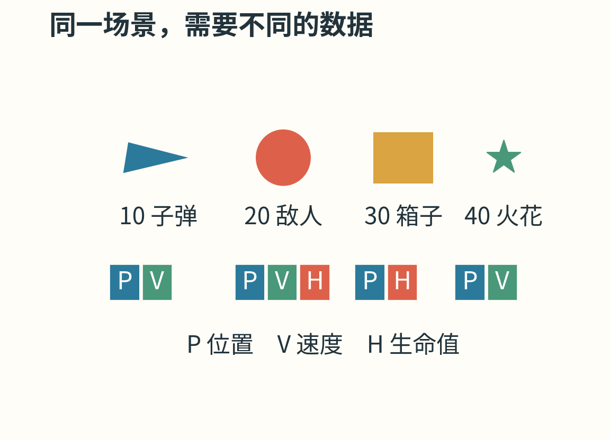

这是本文持续使用的小场景：10 是子弹，20 是敌人，30 是箱子，40 是火花。P 表示位置，V 表示速度，H 表示生命值。这些数字是身份编号，不是内存地址。

## 先让“会不会移动”摆脱角色名字

设想先建立一棵类继承树：GameObject 下面有 Enemy、Bullet、Chest、Spark。随后出现会移动的箱子、不会移动的炮塔、可以受伤的火花，新组合不断加入。

继承仍然有合适的用途，但如果每项能力都必须在继承树里找一个共同父类，树就可能被这些交叉组合拉扯。

ECS 换了一个组织问题的方法：实体代表“这是同一个东西”；组件保存某类数据；系统根据需要的数据选择实体，并批量处理。

移动系统可以只提出一个要求：找出同时具有 P 和 V 的实体。它不必先问这些实体属于子弹、敌人还是火花。

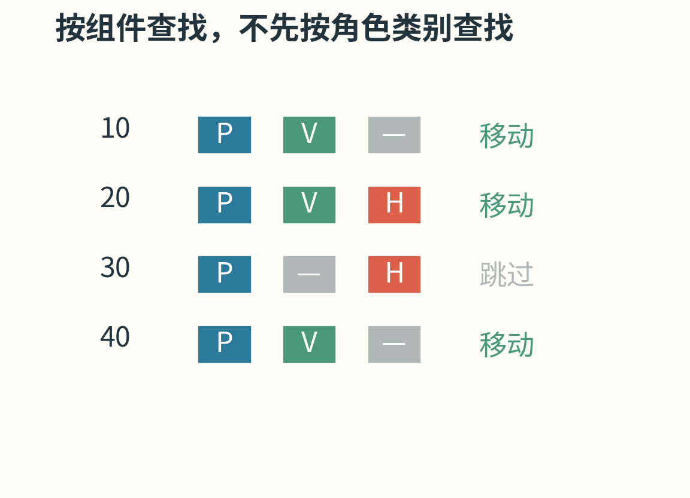

10、20、40 都满足，30 缺少 V，所以不参加。这还不是内存优化，只是把选择规则表达清楚了。

注意，“没有速度组件”和“有一个零速度组件”不是同一件事。两者这一帧都可能不移动，但前者不进入这个查询，后者会进入，只是算出的位移为零。

## 把同一组数据真的算一遍

让时间前进 0.5 秒。子弹的位置是 (0,0)，速度是 (2,0)；敌人位置 (2,1)，速度 (0,2)；火花位置 (3,3)，速度 (-1,1)。箱子在 (5,0)，没有速度组件。

规则仍是最熟悉的那个：新位置=旧位置+速度×时间。

结果分别为子弹 (1,0)、敌人 (2,2)、火花 (2.5,3.5)。箱子保持 (5,0)。

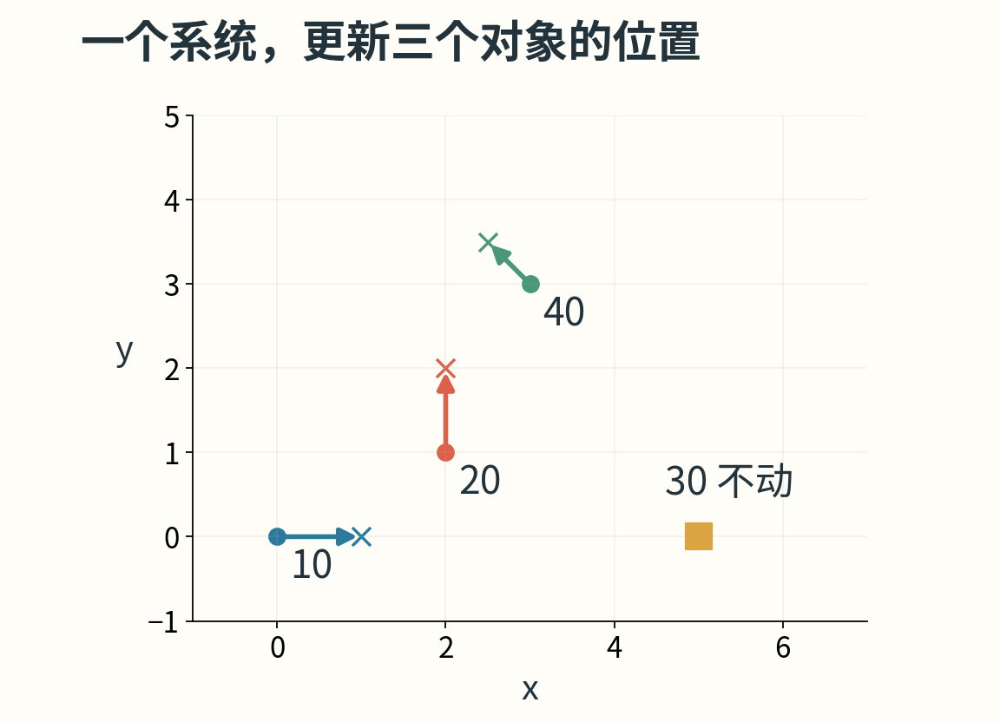

圆点是旧位置，箭头指向新位置，叉号是更新后的终点。三个不同“角色”共用一条位置更新规则。

下面这段 Python 3 是语义演示。字典代表不同组件的存储，键是实体编号；它让我们看清查询和更新，不用先安装游戏引擎。

```python
pos = {10: (0., 0.), 20: (2., 1.),
       30: (5., 0.), 40: (3., 3.)}
vel = {10: (2., 0.), 20: (0., 2.), 40: (-1., 1.)}
health = {20: 100, 30: 50}

for entity in sorted(pos.keys() & vel.keys()):
    x, y = pos[entity]
    vx, vy = vel[entity]
    pos[entity] = (x + vx*.5, y + vy*.5)
print(pos)
```

本地实际运行得到上面的四个位置。交集筛选说明“哪些实体参与”，但 Python 字典并没有因此变成连续的高性能组件数组。这段实验不测引擎性能，也不能用来证明 ECS 比对象设计快。

## 功能拆开之后，数据未必已经排好

假设某个游戏对象有位置、速度、生命值、外观设置等许多字段。移动系统只用前两个，却可能为了访问一个对象，把附近的其他数据也带进缓存。

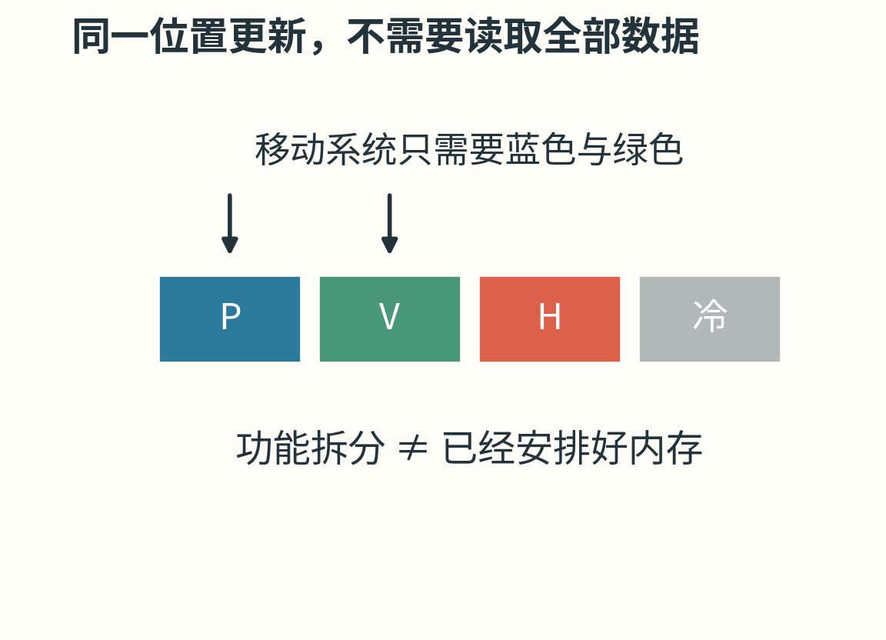

CPU 访问内存时，缓存通常以一小段连续字节为单位管理数据，这个单位叫缓存行。你要其中几个字节，相关缓存行可能整体被带到缓存中。

这里不把某款处理器当作普遍标准，而是明确搭一个计算例：假定缓存行 64 字节，每个对象也恰好占对齐的 64 字节，其中位置 8、速度 8、其他本轮不用的数据 48 字节。我们连续更新八个对象，开始时相关数据不在缓存里。

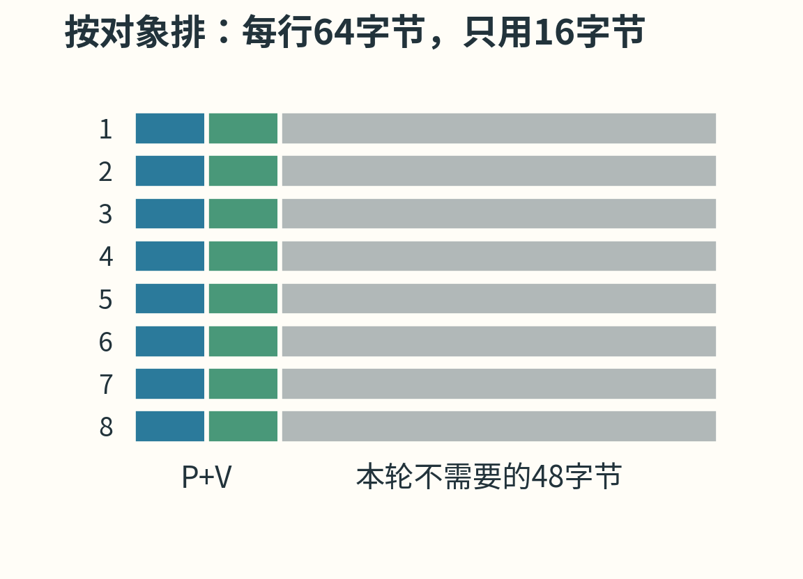

每一长行是一个对象，也是本例的一条缓存行。蓝绿两段合计 16 字节才是移动所需。为了读取八组位置和速度，访问范围跨过八条缓存行，总共涉及 512 字节；有效读取的数据只有 128 字节。

这叫结构体数组式布局，常简称 AoS：一个对象的数据放在一起，再把很多对象排起来。它不等于“使用面向对象语言就一定如此”，也不等于“布局一定不好”。如果一轮计算正好要用整个对象，它就可能很合适。

## 换一种排列，让每次搬来的东西更有用

把八个位置连续存放，再把八个速度连续存放。每个位置 8 字节，八个刚好 64；速度同样如此。

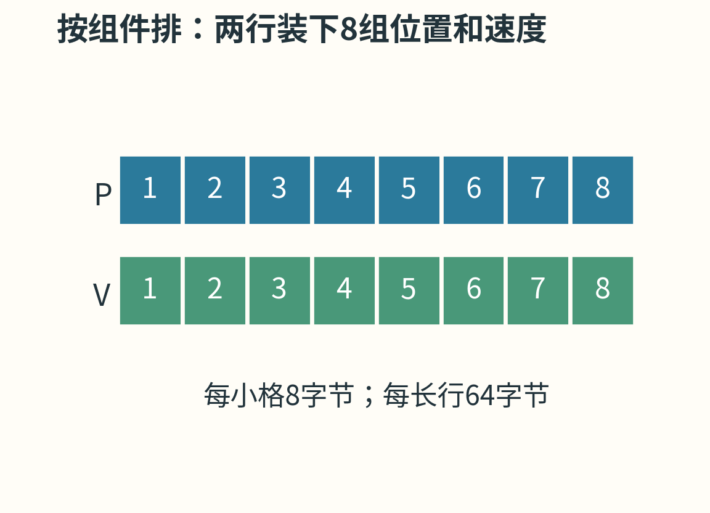

现在一次移动扫描只触及两条缓存行，合计 128 字节。计算公式没有变，对象数量没有变，改变的是相关数据在内存中相隔多远。

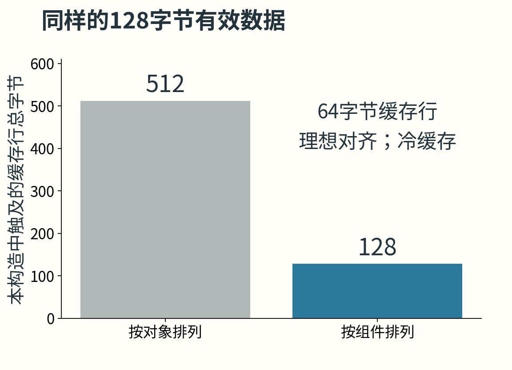

这幅图比较的是理想对齐条件下，读取时触及的不同缓存行总字节。它不是CPU耗时，也没有统计位置写回、预取、已有缓存、地址翻译、并发访问或者其他系统的后续读取。不能把 512/128=4 直接翻译为“帧率四倍”。

随文 [实验程序](examples/experiment.py) 也按这些假定地址进行集合计数，得到八行与两行。计数程序验证的是布局示例的算术，不是在电脑上实际测量缓存未命中。

把同类字段或者组件集中存放，通常被称为数组式组织，常与 SoA 一起讨论。不过还要再细一层：一个 Position 组件里可以包含 x、y 两个字段；Position 数组可能仍然按 x0,y0,x1,y1 排列，而不是把全部 x 再拆成一条数组。

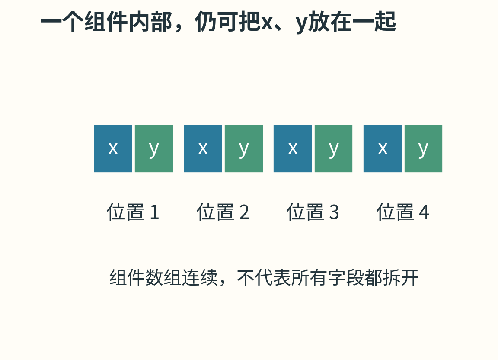

所以，“采用 ECS”“按组件类型聚在一起”“把每个数值字段拆成独立数组”不是同一句话。设计模式、组件存储、字段布局各有自己的选择。

## 不同实体缺少不同组件，怎么排成整齐数组？

回到四个实体。子弹和火花都拥有 P+V，敌人拥有 P+V+H，箱子拥有 P+H。

一种实现办法是按“组件类型组合”分组。这种组合常叫 archetype。它不是“敌人类型”或者“箱子类型”，而是当前组件集合的身份。

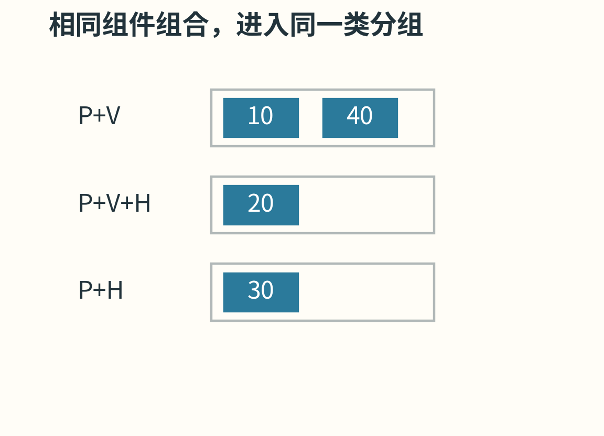

P+V 组里有 10、40。移动查询需要 P 和 V，所以可以处理 P+V 组以及 P+V+H 组，跳过 P+H 组。只要查组的组成，就能先排除整批不匹配的实体，不必把每个实体的角色名字检查一遍。

组内部可以把实体编号、位置、速度分别放成并排的数组。同一行索引对应同一个实体。

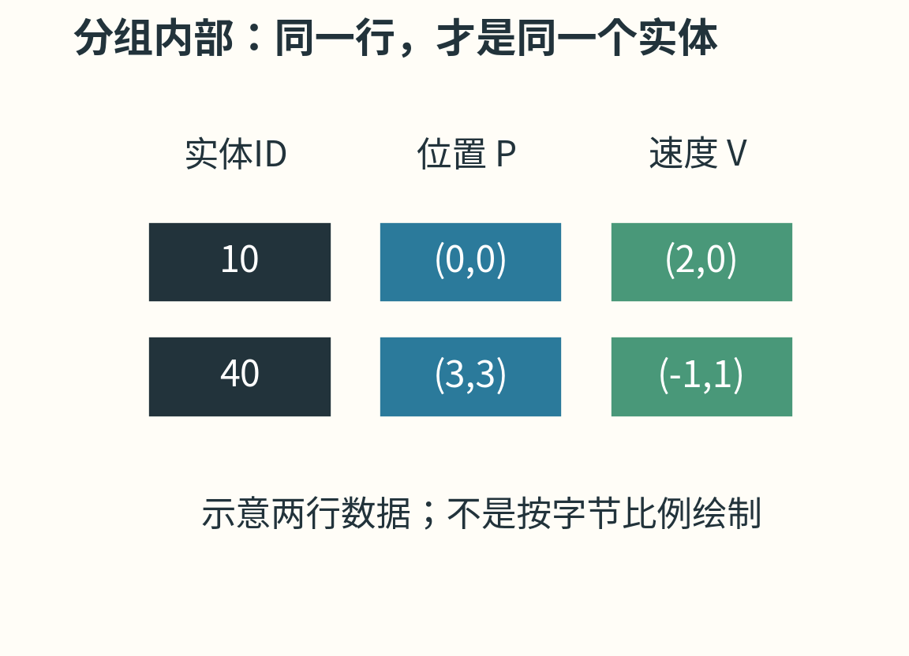

这里数组第 0 行是实体 10，第 1 行是实体 40。行号与实体编号是两回事。位置和速度按行配对，不能因为各自存得连续，就忘记它们还需要指向同一个实体。

## 看一个明确版本的真实实现

Unity 的 Entities 是一个 ECS 实现。这里专门对照 Entities 1.0.16 文档，不把它当成所有版本和所有引擎的统一规定。

该文档描述：相同 archetype 的数据放进 16 KiB 的 chunk；chunk 内有各组件类型的数组以及实体编号数组。组件越大，同一块里通常能容纳的实体越少，具体还要考虑布局等开销。[Unity 1.0.16 的 archetype 说明](https://docs.unity3d.com/Packages/com.unity.entities@1.0/manual/concepts-archetypes.html)

[查看 Unity 官方 Archetypes 窗口原图](https://docs.unity3d.com/Packages/com.unity.entities@1.0/manual/editor-archetypes-window.html)

链接中是该版本官方文档的真实编辑器截图。它让开发者查看各分组使用的块和分配、未使用内存。截图中的数字属于官方示例项目，不是本文四实体场景的测量值；小字可打开原图查看。

实际引擎还有共享组件、缓冲组件等特殊情况。前面的平行数组图是为理解普通组件关系而做的简化，不是逐字节复刻整个 Unity 世界。

再看另一种选择：Bevy ECS 0.16.1 文档同时支持 Table 和 SparseSet 两种组件存储。Table 是默认选项，面向高效连续迭代；SparseSet 则侧重组件增加、移除的便利。具体快慢仍然要看访问模式。[Bevy ECS 0.16.1 官方包说明](https://docs.rs/crate/bevy_ecs/0.16.1)

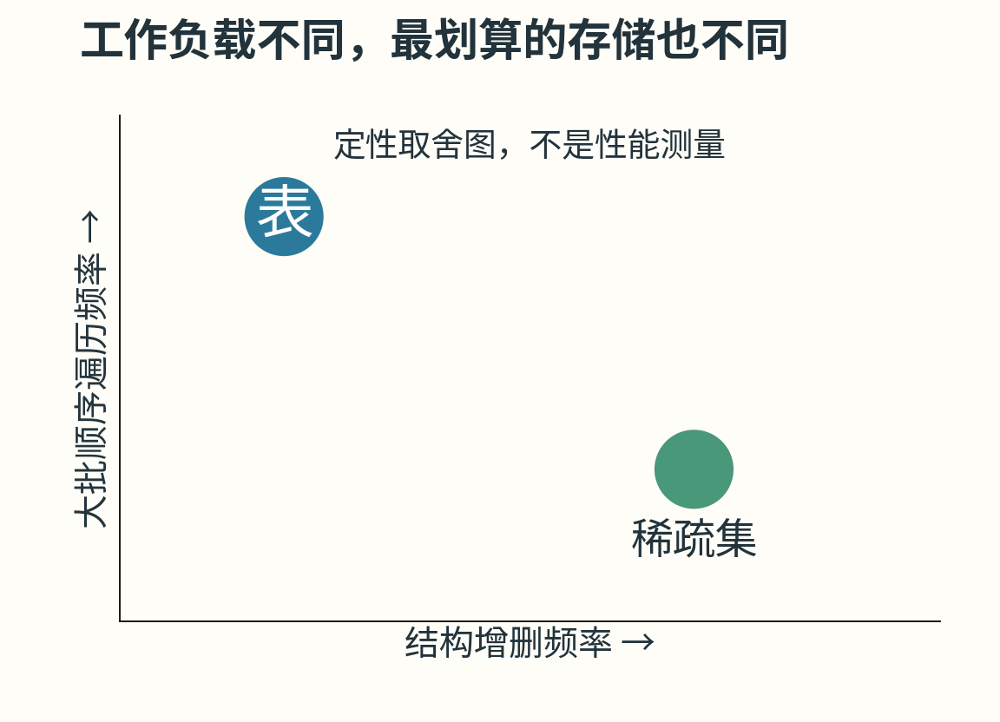

这是一幅定性取舍图，没有给出跑分。它的用途是提醒我们：一个引擎可以在同一套 ECS 语义下支持不同存储，而不是找到一种布局就能让所有操作同时最便宜。

## 箱子忽然会移动，代价藏在哪里？

给实体 30 加上 V，它从 P+H 变成 P+V+H。查询结果会改变，存储也可能要改变。

在上述 Unity 1.0.16 的分组组织里，这种添加组件会让实体迁移到匹配新 archetype 的 chunk。如果目标块不存在，还要分配新块。[结构变化说明](https://docs.unity3d.com/Packages/com.unity.entities@1.0/manual/concepts-structural-changes.html)

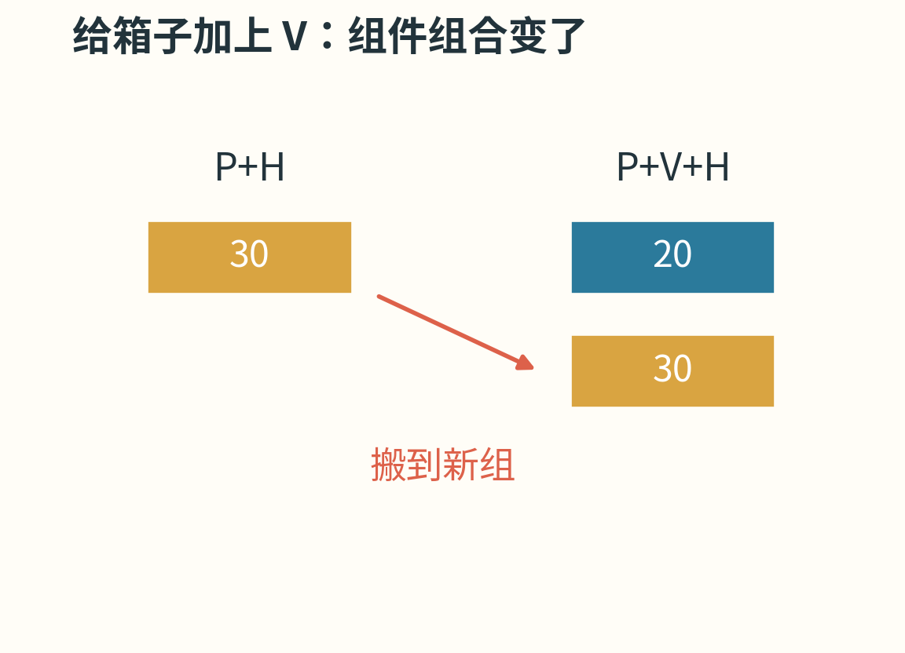

箱子的身份仍然是 30，位置和生命值仍然属于它；改变的是存放它们的地点。

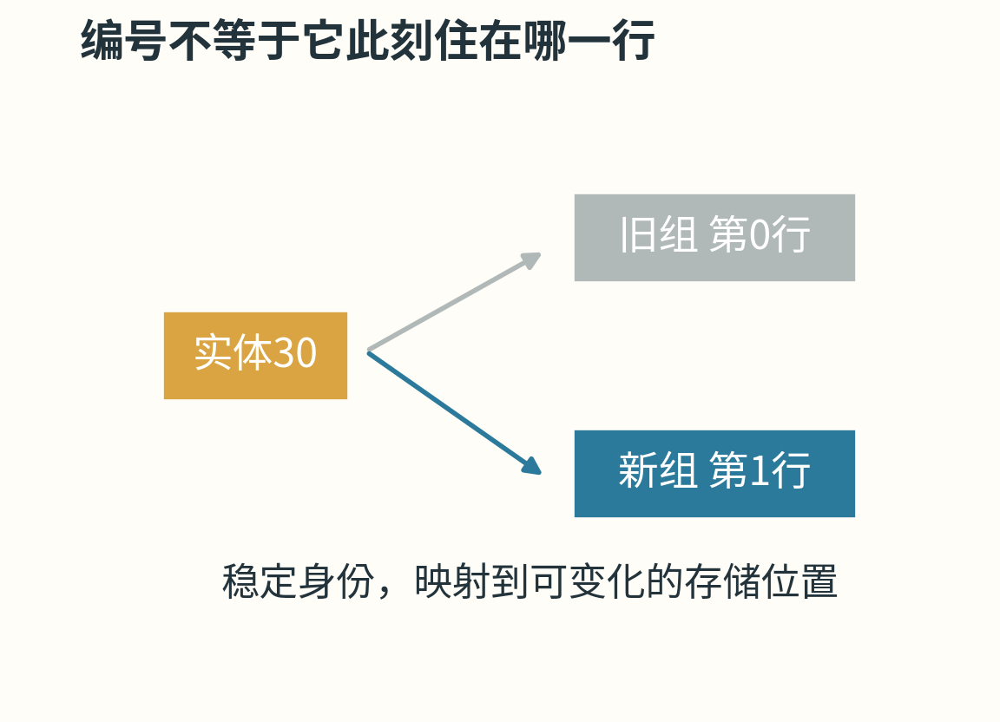

这就是为什么不该把实体编号当成一个永久有效的组件裸指针。结构变化之后，以前指向组件数据的直接引用可能失效；要遵守具体引擎的引用有效期规则。

密集数组还会遇到删除造成的空洞。在 Unity 的这种块组织里，删除一行之后，最后一个实体可以搬来填空。假设组里暂时有 10、40、50，删去 10，50 可以从最后一行移到第 0 行。

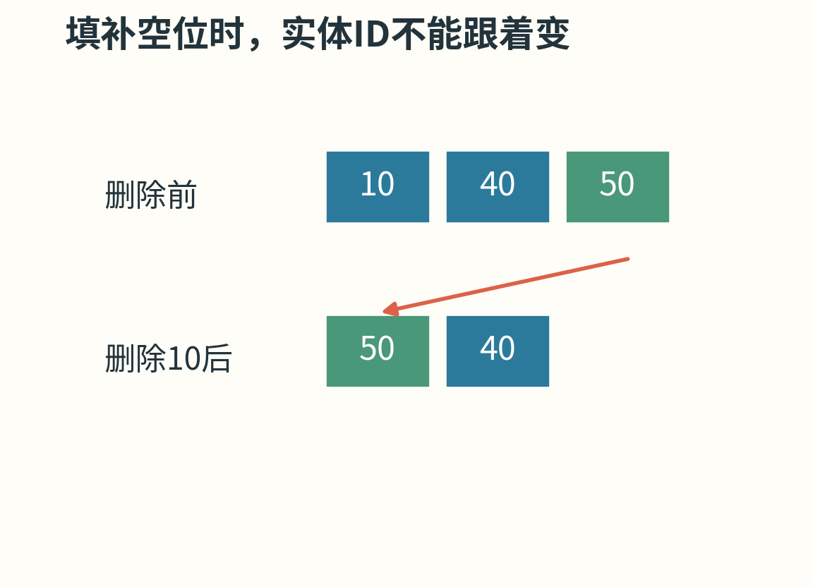

这里为了展示填洞，明确新增了实体 50。它搬了行，但不能变成实体 10。系统需要同步更新实体到存储位置的映射；依赖“遍历顺序永远等于出生顺序”的代码也会出问题。

## 为什么经常要先记命令，晚一点再执行？

如果移动系统正在逐行遍历，你中途增删组件，刚才的位置、数组长度甚至分组都可能改变。

一种解决办法是先记下“给实体 30 加 V”这样的命令，等合适的同步点集中执行。Unity 1.0.16 的 Entity Command Buffer 就支持延迟记录和回放结构变化。

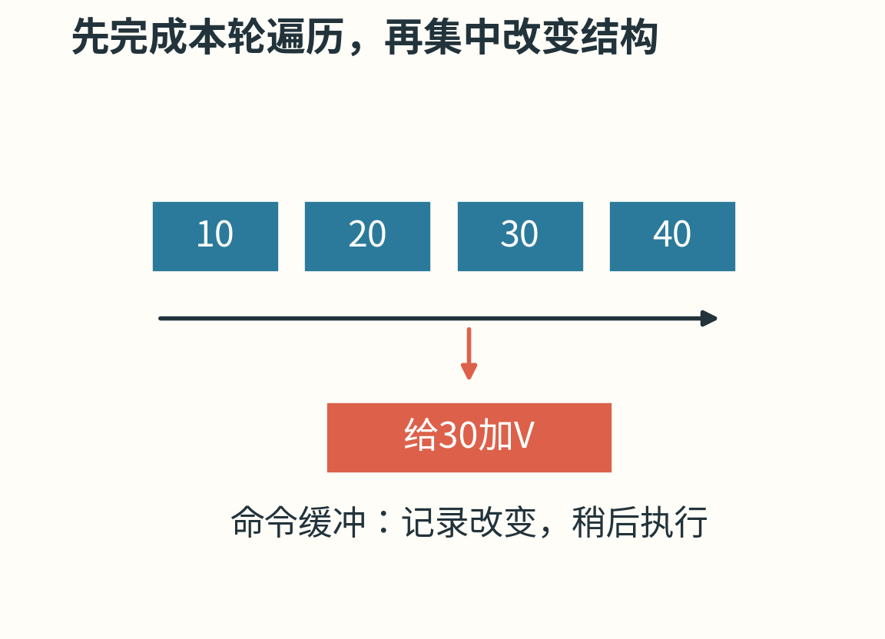

这不会让迁移成本凭空消失。它把改变的时机变得明确，并能减少零散的同步。它也意味着一条刚记录的命令，未必立刻对当前查询可见；什么时候回放，是程序语义的一部分。

如果某个标记每帧翻来覆去，频繁添加删除组件未必最划算。可能更适合修改一个普通值，或者使用引擎提供的可启用组件机制。判断依据应该是这个变化有多频繁、查询如何使用它，而不是“组件越多越现代”。

## 系统拆开了，就能随便多线程吗？

移动系统写 P，扣血系统写 H，二者可能没有数据冲突，可以有并行机会。

但碰撞检测如果读取 P，就要考虑它应当看移动前还是移动后的位置。两个系统即使没有共享对象方法，也可能共享同一批组件数据。

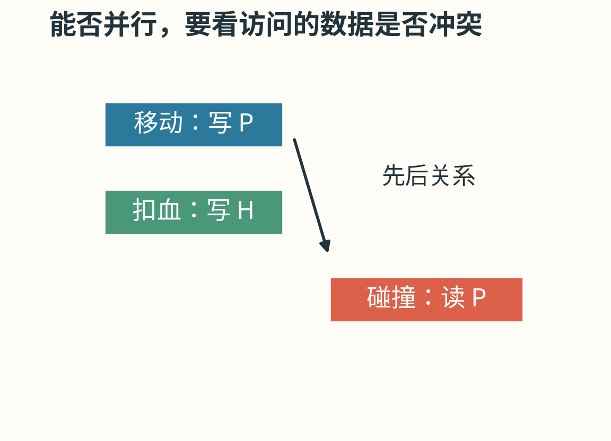

Bevy ECS 0.16.1 会利用系统声明的数据访问决定哪些系统可以安全并行；需要固定执行语义时，开发者仍然应该声明先后依赖。没有访问冲突，不代表所有执行顺序都符合游戏设计。

到这里，可以把开头两个问题重新分开回答。

组件组合让“同一种能力由哪些对象拥有”更容易表达；围绕查询安排紧凑的数据，则可能减少无关读取、改善批量迭代。这两件事相互帮助，但互不自动保证。

如果场景只有几十个对象，热点在复杂脚本、物理求解或者GPU上，改成 ECS 未必解决问题。如果你每帧只处理少量实体却频繁改组件组合，迁移和查询维护也可能比连续扫描的收益更醒目。

最后做一个小改动：给箱子增加 V=(0,0)。它的位置会变吗？它会进入移动查询吗？如果再把 V 改成 (2,0)，这次是改普通值，还是改组件集合？

能把这三个问题分开，你就已经越过了“ECS 是一种更快的写法”这个口号。真正值得设计的是：每轮工作需要什么数据，这些数据在哪里，以及改变组织时要付出什么。

图片来源：正文16张图均为原创教学示意。Unity官方界面仅链接原文查看，其[文档许可](https://docs.unity3d.com/Manual/TermsOfUse.html)含非商业与禁止改作限制，未作为本文图片再分发。
