# 不逐条检查边，怎么知道两个形状撞上了？GJK 把问题搬到原点旁边

假设你在做一个摆放积木的游戏。玩家拖着一块歪歪斜斜的石头，想塞进另一块石头旁边。它们随时会平移、旋转，外形也不一定是圆或正方形。

如果每换一对形状，就写一套“这个角有没有进到那个边里面”的专用判断，代码很快会长满分支。有没有一种办法，只向每个形状问一个相同的问题，就能逐步判断它们是否相交？

**GJK**就是这样一类几何算法。它最初解决两个凸形状之间的距离问题，也有只回答“相交或分离”的版本。它的特别之处是：不用先列出两物体之间的所有边面关系，而是按需要寻找少量关键点。

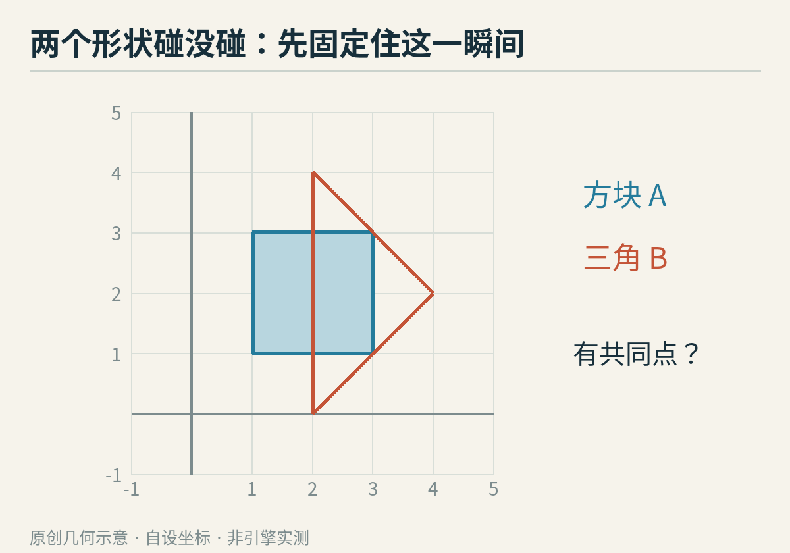

本文先把时间按暂停键，只研究这个瞬间的几何关系。高速物体会不会在两帧之间穿墙，是另一个需要连续检测的问题。

## 第一份合同：形状必须是凸的

用橡皮筋箍住一个形状。如果橡皮筋不会跨过凹进去的缺口，而是可以贴着外边界围住它，它大致就符合我们今天要的“凸”的直觉。

更准确的定义是：在形状中任取两个点，连接它们的整条线段都留在形状里。圆、实心三角形和实心长方形是凸的；月牙和U形通常不是。

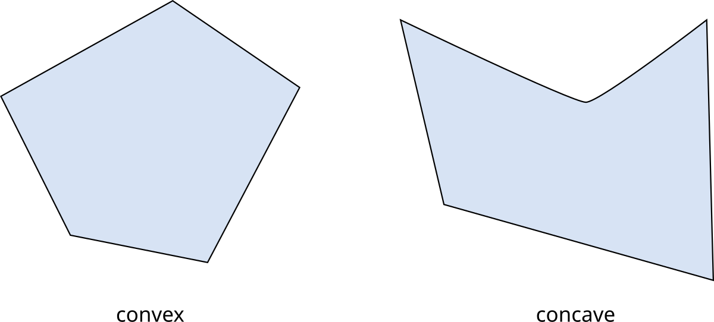

Box2D文档原始矢量图的PNG兼容版，原SVG随稿保留。这里的“实心”也很重要：边界围起来之后，里面的点算属于形状。

为什么先签这份合同？因为后面我们会用少量点围成线段、三角形，并相信这些中间部分仍属于形状。没有凸性，几何推理就可能跨进原本不存在的材料里。

1988年，Elmer Gilbert、Daniel Johnson与S. Sathiya Keerthi发表了一篇关于三维物体距离的论文。论文开头的场景包括机器人、计算机辅助设计，以及障碍物之间的路径规划：知道“已经撞上”有用，知道“还差多远”也同样重要。今天常说的GJK，名字来自三位作者的姓氏。[原论文](https://graphics.stanford.edu/courses/cs448b-00-winter/papers/gilbert.pdf)

这篇文章不重演一套1988年的完整程序。我们用二维自设算例，把它最有启发性的几何转换和查询方式拆开。

## 先做一件看起来无关的事：把点相减

把蓝色方块叫A，顶点按顺序是(1,1)、(3,1)、(3,3)、(1,3)。红色三角形叫B，顶点是(2,0)、(4,2)、(2,4)。所有长度都用同一种教学单位。

从A中取一个点a=(3,1)，再从B中取一个点b=(2,0)。相减得到：

a−b＝(3−2，1−0)＝(1,1)。

这个结果可以看成从b指向a的一支位移箭头：向右走1，向上走1。

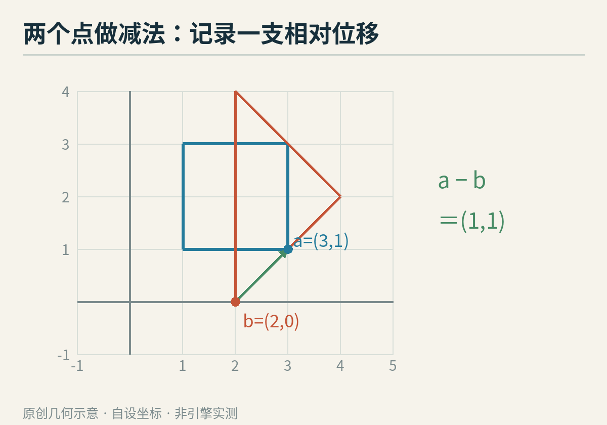

现在不只取这一对，而是让a遍历A中的所有点，b遍历B中的所有点，把所有可能的a−b收集起来。它们形成一个新形状，叫**闵可夫斯基差**，记作A−B，也可看成A与“反向的B”的闵可夫斯基和。

注意，这个减法不是把B从A身上挖掉。它收集的是两边点之间所有可能的相对位移。

对当前两个凸多边形，可以先列出4×3＝12组顶点差，再取这些点的凸包。下面的绿色区域就是结果；重复点只画在同一个位置。

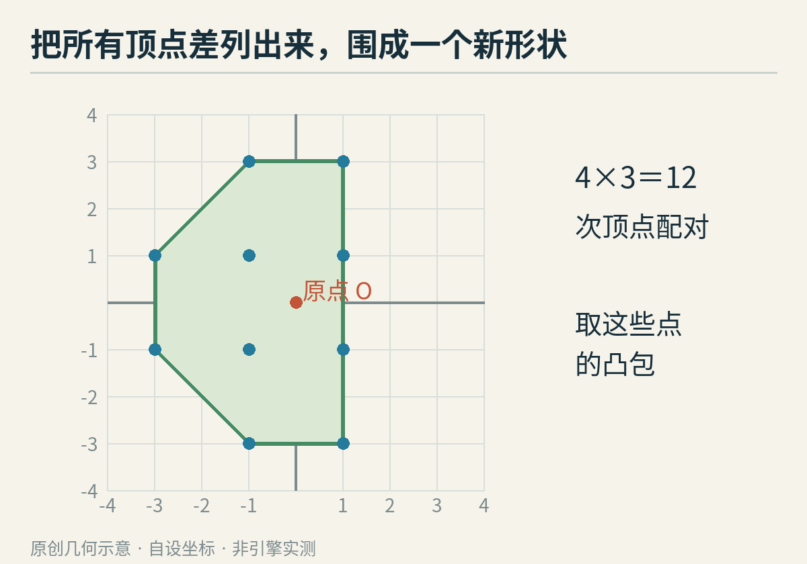

“凸包”可以想成用一根绷紧的橡皮筋围住所有点，连同里面一起留下。我们把完整的新形状画出来，是为了建立直觉。GJK的聪明之处，恰恰在于运行时通常不必先把它完整造出来。

## 撞没撞，为什么会与原点有关？

假如两个形状有一个共同点q。因为q既在A中，也在B中，我们可以从两边各选一次q。它们相减，得到q−q＝(0,0)。因此A−B一定包含原点。

反过来，如果A−B里出现了原点，就表示存在一对点a、b满足a−b＝0。那只能是a＝b：两形状共享同一个点。

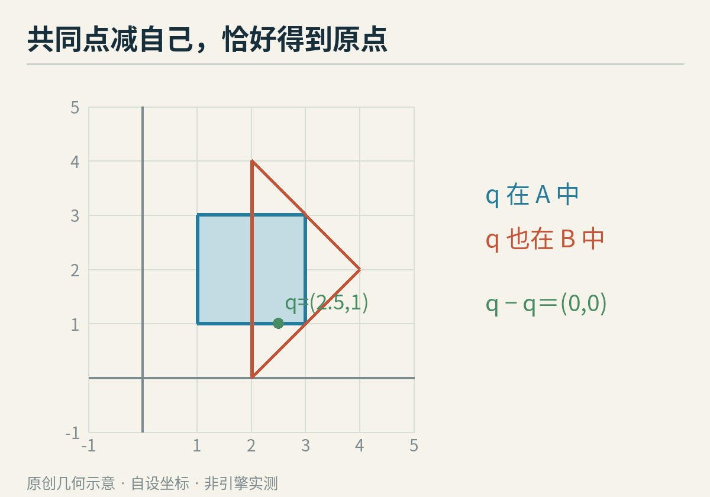

这两个方向合起来，得到一个干净的等价关系：

**A与B相交，当且仅当A−B包含原点。**

这里把恰好接触也算“相交”。某个引擎要不要把轻微接触当成碰撞事件、采用多大容差，是随后需要定义的工程语义。

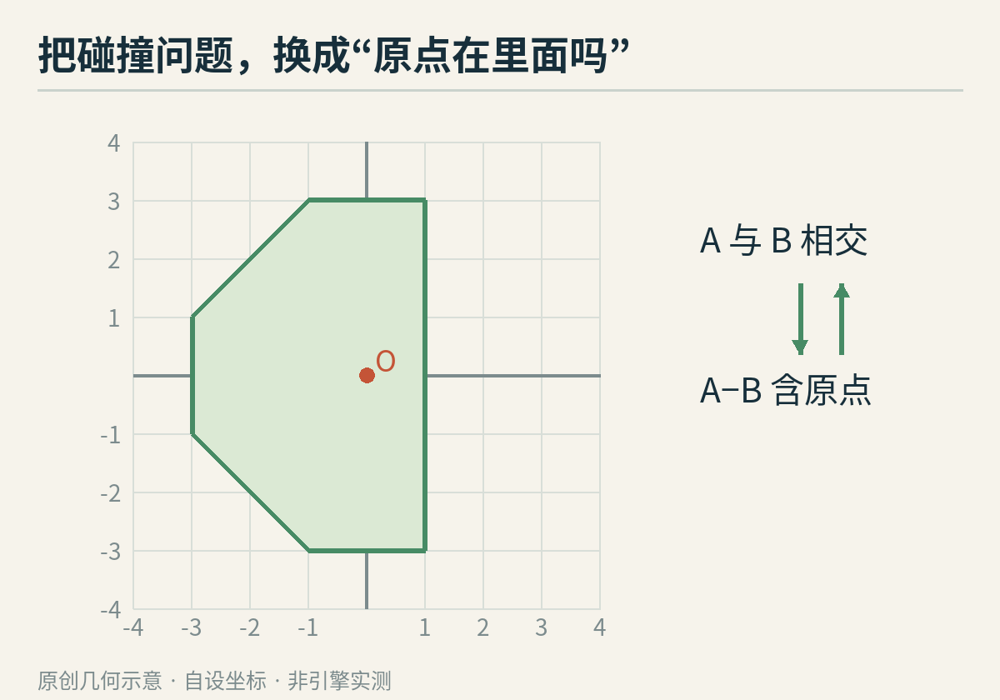

原本有两个会移动的形状，现在变成一个新形状与一个固定原点之间的问题。下一步，我们要想办法只窥见新形状的一小部分，就作出可靠判断。

## 只问一个问题：沿这个方向，谁站得最远？

给定一个方向d，找形状沿这个方向投影最远的点。这个点叫**支持点**；返回它的操作叫支持映射。

先用d=(1,1)举例。对任意点(x,y)，计算点积x×1＋y×1，也就是x＋y。方块四角得到2、4、6、4，最大值6出现在(3,3)。所以(3,3)是这个方向上的支持点。

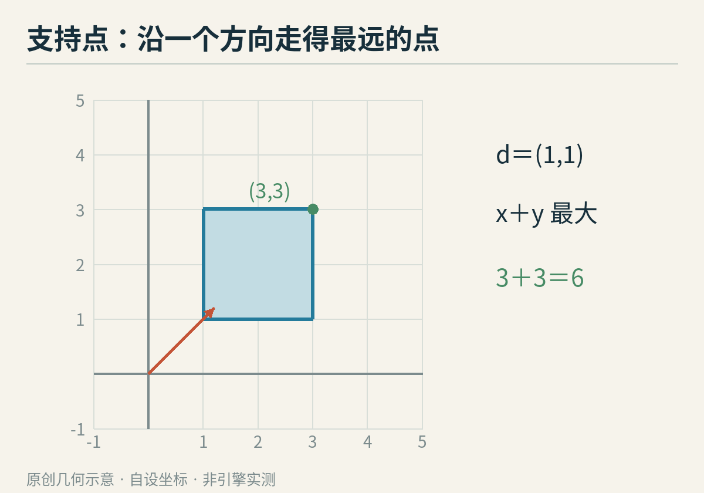

方向不需要先归一化，因为把同一个方向乘上正数，不会改变谁的点积最大。若一整条边同样远，支持点可以不唯一；实现要有稳定的平局处理，但不需要为了平局编出一个不存在的顶点。

关键来了：A−B在方向d上的支持点，可以分别从A和B查询：

support(A−B, d)＝support(A, d) − support(B, −d)。

为什么B要反方向？因为(a−b)·d＝a·d−b·d。想让差最大，就让A这一项尽量大，让B这一项尽量小。让b·d最小，与让b·(−d)最大是一回事。

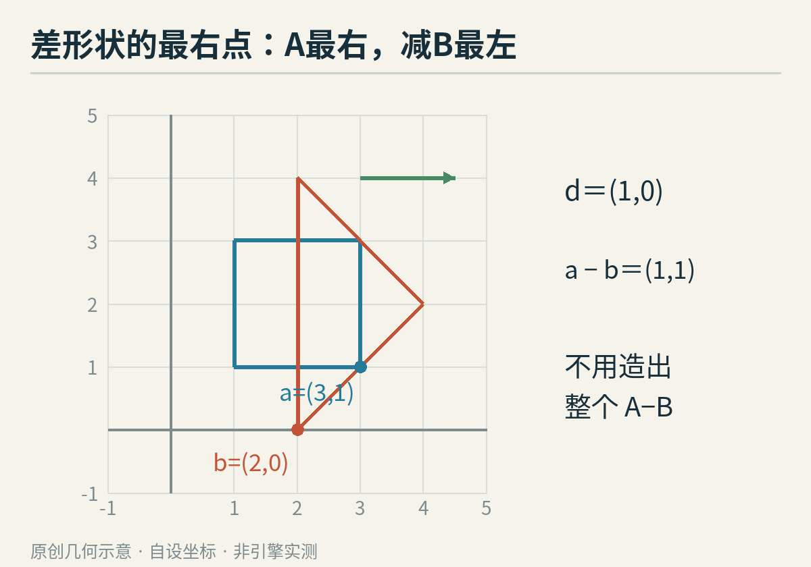

于是我们不用先计算12组顶点差。想知道差形状某个方向的最外侧，查询A一次、B一次，再相减即可。对于更复杂的凸形状，支持映射也可能直接通过公式给出，例如圆沿方向d的最远点就在圆心加上该方向的半径位移处。

GJK依赖的是这种查询能力，不要求所有输入都长得像同一种三角网格。

## 手里只留一小把点，能看出什么？

在平面上，一个点、两个点连成的线段、三个不共线点围成的三角形，都是这里可能用到的**单纯形**。名字稍微正式，内容却都是熟悉的小图形。

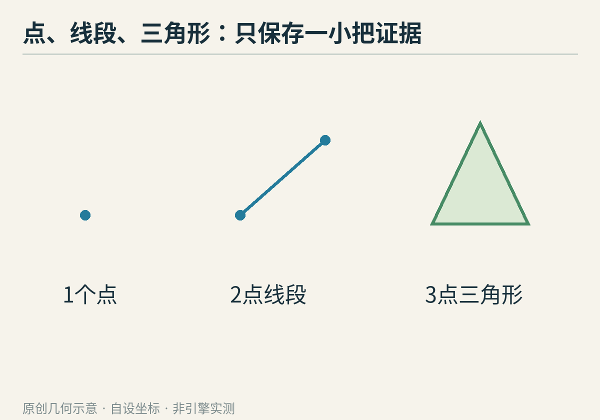

GJK不断做两件事：朝一个值得探索的方向拿到新支持点；再从手头的点里，保留对“接近或包住原点”有用的部分。

为什么保留的点可以当证据？因为每个支持点都在凸形状A−B上，连接它们的线段和三角形也在A−B里。如果某个小三角形已经包住原点，就不用继续画完整边界了：大形状当然也包住原点。

反过来，小三角形尚未包住原点，不意味着大形状也没有。此时我们要继续提问，而不是过早宣布“没撞”。

## 第一次：向右看看

从方向d=(1,0)开始。A的最右侧有两个顶点，这里约定平局时选输入顺序较早的(3,1)；B的最左侧也有两个顶点，我们选(2,0)。相减得到w1=(1,1)。

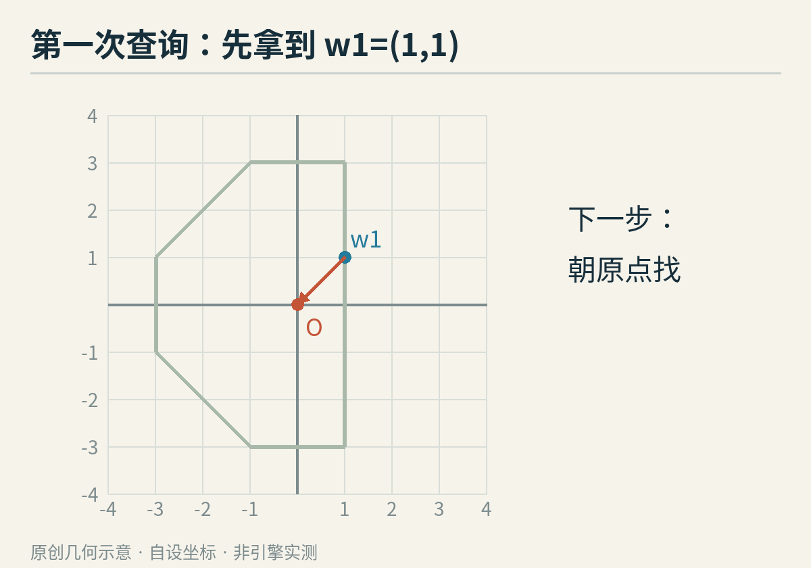

单凭这一个点，我们当然没法证明原点在大形状里。下一步朝它的反方向d=(−1,−1)查询，等于从w1朝原点所在方向探索。

这次A给出(1,1)，B沿相反方向(1,1)给出(4,2)。相减得到w2=(−3,−1)。两个点连成线段。

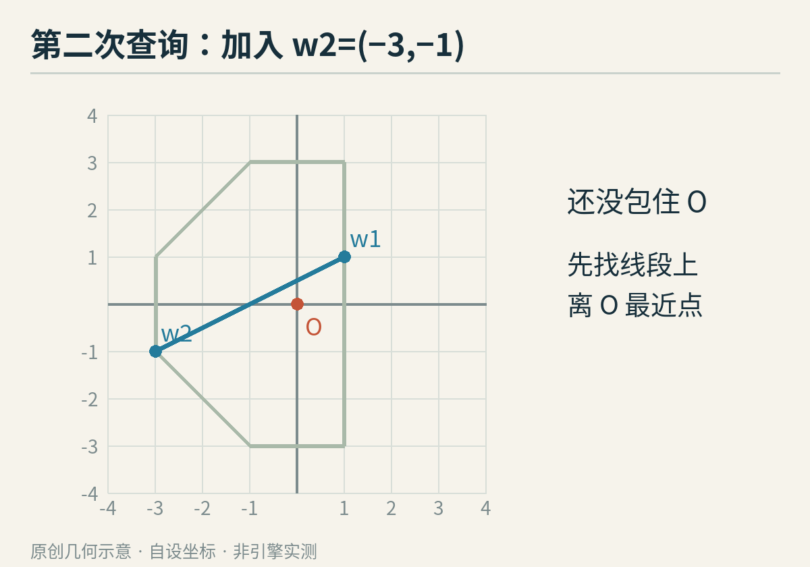

线段从原点旁边经过，但没有正好穿过原点。该往哪一侧扩展？先找线段上离原点最近的点q，再朝q到原点的方向查。

## 第二次转向，不靠猜，靠最近点

线段可以写成w1＋t(w2−w1)，其中t从0到1。t＝0在w1，t＝1在w2，中间数表示沿线段走了多少比例。

对当前坐标，w2−w1＝(−4,−2)。把原点投影到这条直线上，得到t＝0.3，因此：

q＝(1,1)＋0.3×(−4,−2)＝(−0.2,0.4)。

如果想自己核对投影，计算t＝−w1·(w2−w1)÷|w2−w1|²，分子为6，分母为20。一般情况下还要把结果夹在0到1之间，因为最近点也可能就是某个端点。

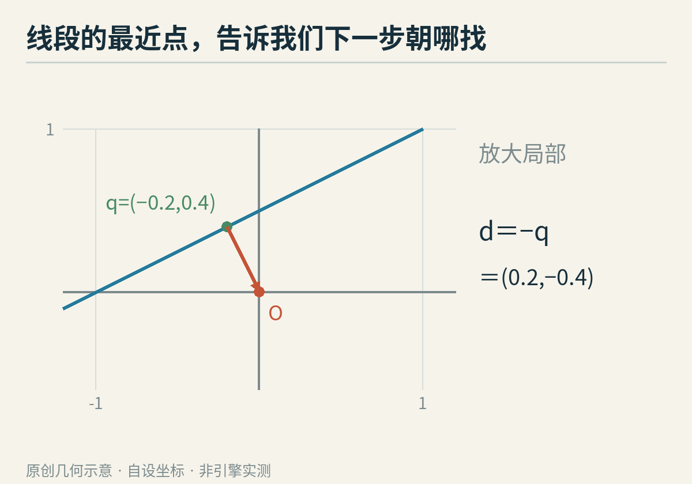

从q指向原点的方向是−q＝(0.2,−0.4)。现在第三次调用支持映射：A给出(3,1)，B沿反方向给出(2,4)，得到w3=(1,−3)。

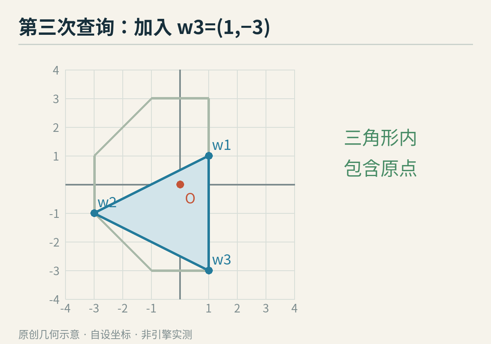

我们拿到的三角形顶点是(1,1)、(−3,−1)、(1,−3)。原点在里面。为了不只依赖眼睛，我们再给出一个可算的证据。

把这三个点分别乘5/8、1/4、1/8再相加：横坐标是5/8−3/4＋1/8＝0；纵坐标是5/8−1/4−3/8＝0。三个权重都非负，而且相加等于1，因此这是三角形内部的一个点。

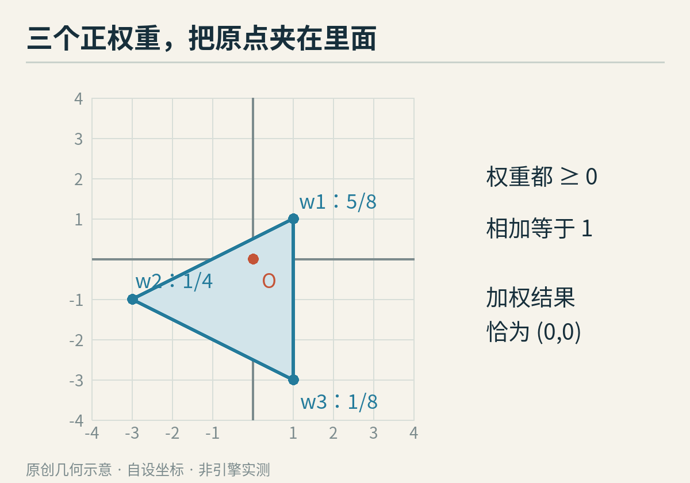

这种权重也叫重心坐标。它在这里承担的不是装饰性公式，而是一张“原点确实被包住了”的收据。

## 还能顺便找回一个共同点

别把每个差值来自哪两个原始点忘掉。

w1来自A的(3,1)与B的(2,0)；w2来自(1,1)与(4,2)；w3来自(3,1)与(2,4)。把刚才同样的5/8、1/4、1/8权重分别用于A侧和B侧，两边都得到(2.5,1)。

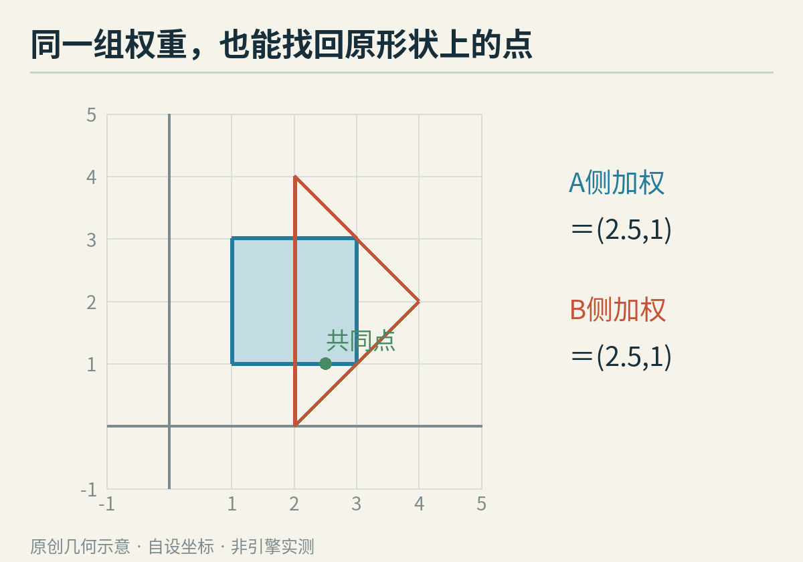

这说明我们没有只在一张抽象差形状里兜圈子：查询时保留原始点对，就能把结果带回真实的两个形状。

在距离版本中，类似的权重还能用于恢复两侧最近点，通常称为见证点。具体实现仍需可靠的最近特征子算法，并非“随便选三个点平均一下”就行。[Box2D的距离查询接口](https://box2d.org/documentation/group__distance.html)就把形状最近点、距离与单纯形缓存作为实际几何功能提供。

## 没撞的时候，怎样有把握地说“不”？

把B整体向右挪5个单位，其他都不变。A−B会整体向左挪5个单位。

再朝右查询支持点。它的横坐标最多只有−4：连新形状最右边的点，都还在原点左边。于是整块差形状都不可能包含原点。

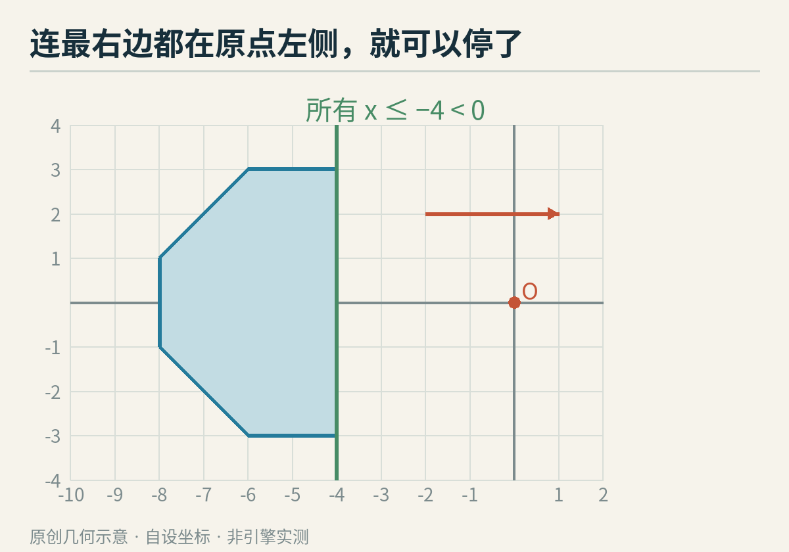

推广到方向d，如果支持点w满足w·d<0，就表示整个差形状在d方向上的最远投影仍小于0，而原点投影恰好是0。中间存在分开的空间，我们有了一个明确的分离证据。

这里特意写严格小于零。w·d＝0可能对应边界接触，不能在本文“接触也算相交”的约定下，粗暴地一律判成没撞。

还有一种常见情形：加进新点后，原点仍在三角形外侧。此时最近的特征可能是一条边，也可能是一个顶点。算法丢掉暂时无用的点，只留这个特征，再朝原点继续查。这样它才是在逐步修正搜索，而不是拿到三个点就停止。

## GJK的三个结果，别混成一个开关

第一种问题是“当前相交吗”。第二种是“当前距离是多少”。第三种则是“已经穿进去多深、该沿哪个方向分开”。它们有关，却不是同一个输出。

对向右平移后的算例，两个形状之间最短距离为4。A的右边与B的左边之间存在许多长度为4的水平连接线，选其中一对最近点即可。

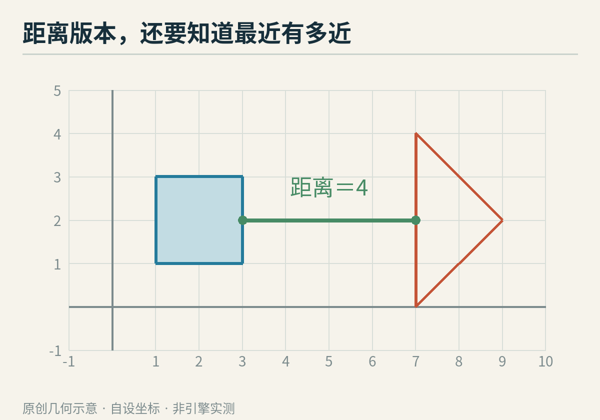

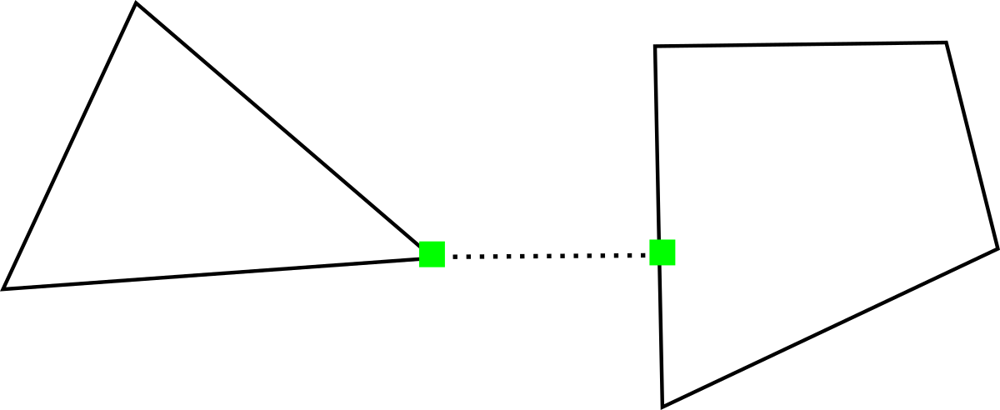

官方图展示的也是形状之间的几何距离；它不是对本文自设坐标的实测输出。

原始GJK是一种距离方法。布尔版本可以更早停在“相交/分离”的证据上；想获得穿透深度和法线，则常见做法是接上EPA等其他算法。比如dyn4j的GJK实现明确把穿透信息交给后续求解器。接触点生成、摩擦和碰撞后的运动响应，还在更后面。[dyn4j实现说明](https://github.com/dyn4j/dyn4j/blob/master/src/main/java/org/dyn4j/collision/narrowphase/Gjk.java)

因此，“GJK返回相交”不能直接翻译成“把角色往左推两厘米”，更不能翻译成“这一整帧不会穿墙”。

## 哪些地方最容易把教学算法写坏？

先看凹形状。把一个小球放进U形的凹洞，球可能完全没碰到U形材料。可是只查询外侧支持点，会看到U形的凸包；凹洞被填平后，小球就落进了“材料”里。

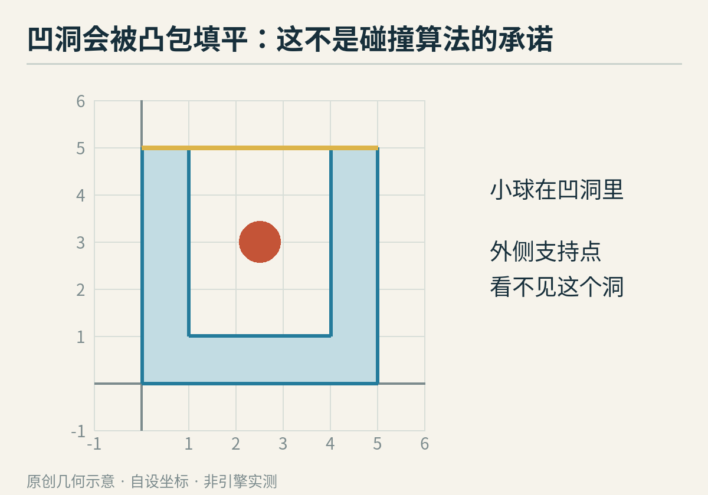

解决办法可能是把凹物体拆成多个凸部分，或选适合该几何表示的其他算法。不能把任何一串顶点扔进支持函数，就把结果当作任意凹形状的精确检测。

再看数值。三个点几乎共线、两个支持点几乎重合、物体刚好接触时，浮点误差会影响“在哪一侧”“是否进步了”的判断。实际实现需要定义容差、重复支持点、无进展停止条件与迭代上限，并报告适当状态；不是把上限调到很大就得到数学保证。

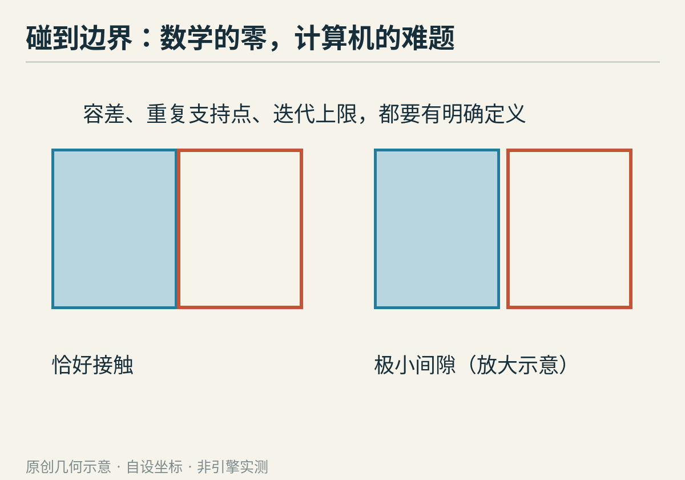

最后还有坐标空间：两边支持点必须放在同一个空间里相减。一个还是物体局部坐标、另一个已经是世界坐标，得到的差形状没有我们刚才证明的含义。

这些细节解释了为什么工业实现往往比白板上的几行伪代码长。它们不是可有可无的“优化”，而是在维护算法成立的前提。

## 亲手复核三次查询

下面的Python 3代码只用标准库，已实际执行。它复核本篇固定算例里的支持点、点对与原点证据；为了保持短小，三个方向按手算结果给定，**它不是能处理任意输入的完整GJK实现**。

```python
A = [(1, 1), (3, 1), (3, 3), (1, 3)]
B = [(2, 0), (4, 2), (2, 4)]

def dot(p, d):
    return p[0]*d[0] + p[1]*d[1]

def support(points, d):
    return max(points, key=lambda p: dot(p, d))

W = []
for d in [(1, 0), (-1, -1), (.2, -.4)]:
    a = support(A, d)
    b = support(B, (-d[0], -d[1]))
    w = (a[0]-b[0], a[1]-b[1])
    W.append(w)
    print(a, b, "=>", w)

weights = [5/8, 1/4, 1/8]
q = tuple(sum(t*w[k] for t, w in zip(weights, W))
          for k in (0, 1))
print("加权结果", q, "权重和", sum(weights))
```

三次差点依次为(1,1)、(−3,−1)、(1,−3)，加权结果为(0.0,0.0)，权重和为1.0。

再做一个小实验：把B每个顶点的横坐标都加5，只保留向右的第一次查询。新差点是(−4,1)，与方向(1,0)的点积是−4。你现在知道为什么这个负数足以证明分离。

如果还想再走一步，自己实现“原点到一条线段的最近点”，把固定的第三个方向换成程序计算的−q。这一步会让你看到：算法不是在背三个神奇方向，它是让上一次的几何结果指导下一次提问。

GJK的魅力就在这里。两个复杂形状的问题，被搬成原点附近的一场小规模搜索；每次只问“你朝这边最远能到哪”，再把答案拼成可以检验的证据。

图片来源：18幅原创几何教学图按本文坐标生成。2幅Box2D图来自[官方碰撞几何文档](https://box2d.org/documentation/md_collision.html)，© 2022 Erin Catto，[MIT许可](https://github.com/erincatto/box2d/blob/v3.1.0/LICENSE)，仅由原SVG渲染为PNG以兼容图文，未改图形内容，原件与完整许可随稿保留。其余原理出处见正文。
