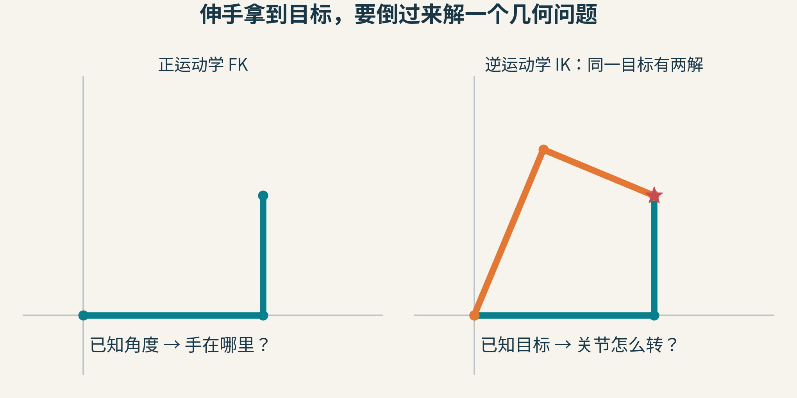
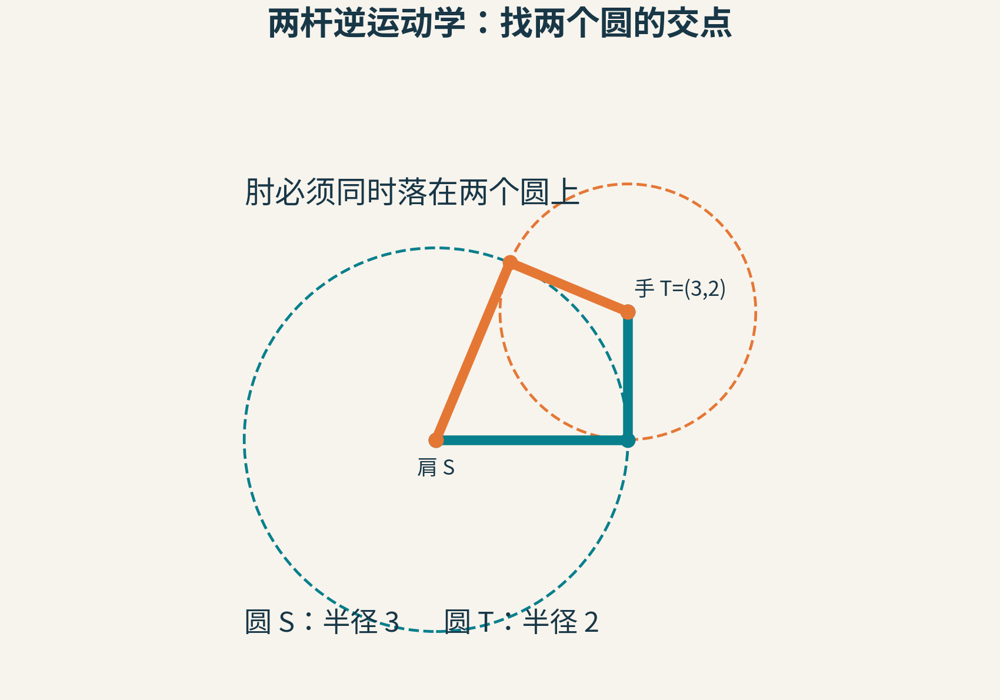
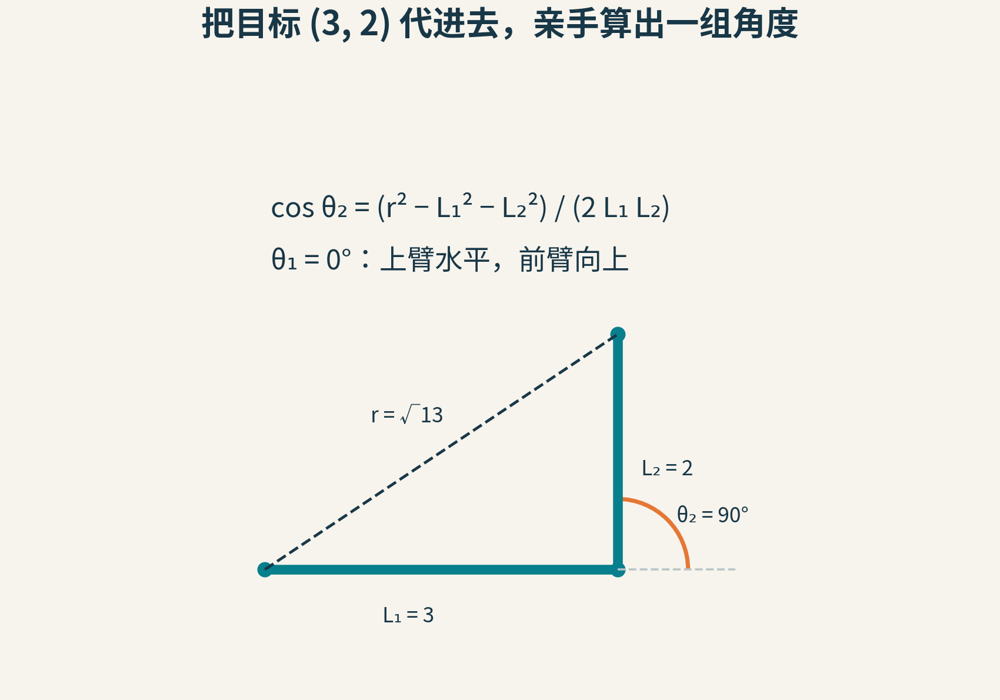
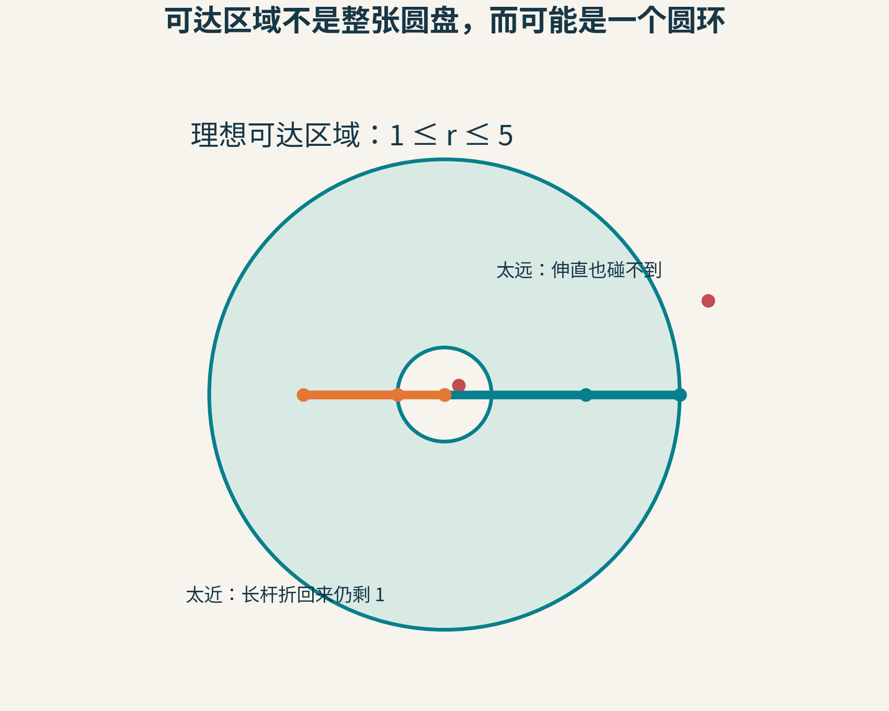
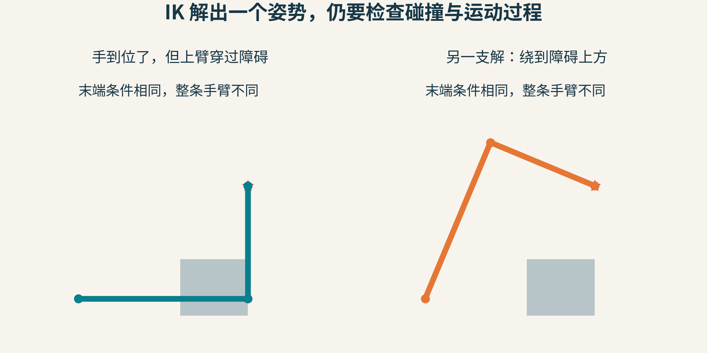
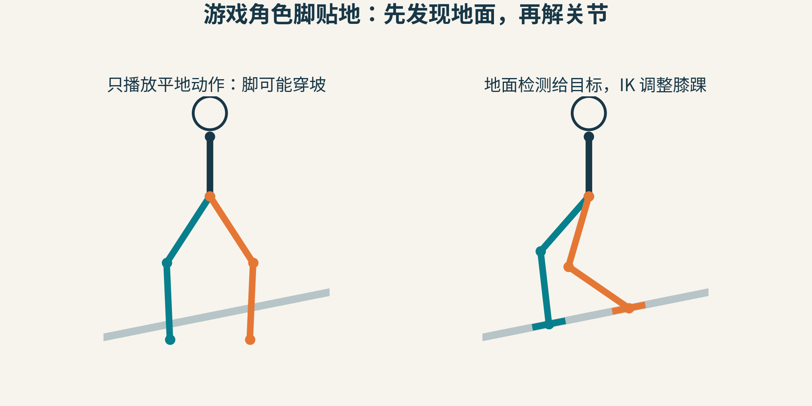
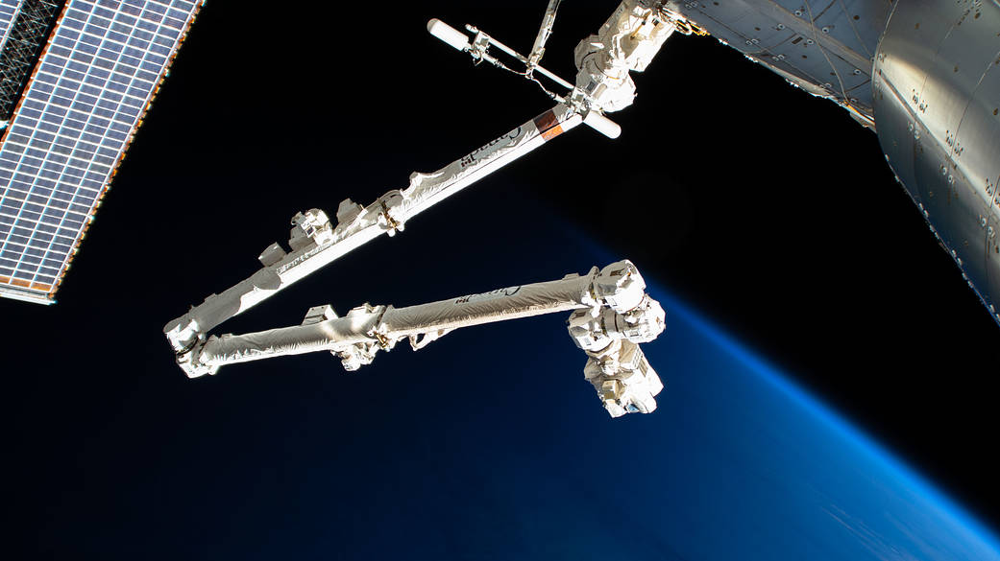

# 手知道要去哪，关节却不知道怎么转：从两根杆理解逆运动学

游戏角色伸手抓门把手。门把手的位置已经知道，角色的上臂和前臂长度也已经知道。问题是：肩膀和肘部各该转多少度？

直接把手的位置改成门把手的位置，会把手臂拉长，甚至与身体拆开。我们真正需要的是一组关节角度：既保持每根骨段的长度，又把末端送到目标。

这就是逆运动学，Inverse Kinematics，简称IK。



图1：左边给角度、求末端，是正运动学FK；右边给末端、求角度，是逆运动学IK。绿色与橙色手臂长度相同，手也到达同一点，却采用不同姿势。

我们先只研究平面上的两根理想刚杆和两个能转动的关节。这个小模型已经足够解释IK最重要的三个特点：可能多解、可能无解，即使有解，也可能不是你想要的解。

## 顺着算很容易，倒着算多了一个选择

把肩放在原点。上臂长L₁，前臂长L₂。规定肩角θ₁从水平向右的方向开始量，逆时针为正；肘角θ₂表示前臂相对于上臂延长方向转过的角度。

这个约定很重要：θ₂=0表示两杆伸直，θ₂=90°表示前臂相对上臂转过四分之一圈。它不是三角形内部的肘角。

只要知道角度，就可以沿两段向量相加：

x=L₁cosθ₁+L₂cos(θ₁+θ₂)

y=L₁sinθ₁+L₂sin(θ₁+θ₂)

为什么前臂写θ₁+θ₂？因为肘部的旋转是在已经旋转过的上臂基础上发生的。肩膀转动，会连带移动肘部和手；肘部转动，只改变它后面的那一段。

这也是为什么复杂角色不能把每个关节都当成互不相关的点。关节连成一条链，前面的动作会影响后面。

反过来，已知x、y，要从这两条式子里找角度，看起来有些麻烦。但先画两个圆，事情就清楚了。

## 肘部藏在两个圆的交点上

固定肩S和目标T。

肘E必须离肩恰好L₁，因此它在以S为圆心、L₁为半径的圆上。肘还必须离手恰好L₂，因此它也在以T为圆心、L₂为半径的圆上。

同时满足两件事的位置，就是两个圆的交点。



图2：本例肩S=(0,0)、手T=(3,2)，杆长分别为3与2。两个圆的两个交点，对应两种弯肘方式。圆是辅助线，不是关节必须沿着走的路线。

这个图比任何求根公式都更早告诉我们答案的形状：圆有两个交点，就可能有两组解；相切时，两组解合到一起；不相交，就无法在保持杆长的同时到达目标。

因此，IK不是一台对任何输入都吐出唯一角度的计算器。它首先是一道有几何条件的问题。

## 亲手解出目标(3,2)

设L₁=3、L₂=2、目标T=(3,2)。肩到手的距离r满足r²=x²+y²=13。

肩、肘、手形成一个三角形。由余弦定理，并注意我们用的是“相对于上臂延长线的肘角”，可以得到：

cosθ₂=(r²−L₁²−L₂²)/(2L₁L₂)。

代入数字：

cosθ₂=(13−9−4)/(2×3×2)=0。

所以θ₂有两个常见分支：+90°与−90°。接着求肩角：

θ₁=atan2(y,x)−atan2(L₂sinθ₂, L₁+L₂cosθ₂)。

这个式子并不是凭空冒出来的。第一项是“肩朝向目标”的角度；第二项是在上臂自己的坐标系中，“整个肩到手向量”偏离上臂的角度。把后者扣掉，才是上臂应当朝向哪里。

atan2会同时看横、纵两个分量，保留目标在第几个象限的信息。如果随手换成atan(y/x)，不仅x=0时麻烦，还可能把左上方与右下方弄混。

对于θ₂=+90°，两项都是atan2(2,3)，因此θ₁=0°。上臂水平伸出3，前臂向上伸出2，刚好到(3,2)。



图3：一组解是(θ₁,θ₂)=(0°,90°)。肩—手虚线长√13；橙色圆弧显示肘角是相对上臂延长线测量的。

对于θ₂=−90°，第二项改为atan2(−2,3)，得到θ₁约67.3801°。把两组角度分别代回正运动学，两次都得到(3,2)。这是很实用的检查习惯：逆着求完，再顺着算一次。

下面的最小版本会拒绝明显不可达的点，返回两组角度。代码用弧度，展示时才转换为度。

```python
import math

def two_link_ik(x, y, l1, l2):
    if l1 <= 0 or l2 <= 0:
        raise ValueError("杆长必须为正")
    r = math.hypot(x, y)
    if r == 0 and l1 == l2:
        raise ValueError("完全折叠时有无穷多肩角，需另定姿势")
    c = (r*r - l1*l1 - l2*l2) / (2*l1*l2)
    if c < -1 - 1e-12 or c > 1 + 1e-12:
        return []
    c = max(-1.0, min(1.0, c))  # 只修正浮点微小越界
    answers = []
    for sign in (1, -1):
        q2 = sign * math.acos(c)
        q1 = math.atan2(y, x) - math.atan2(
            l2 * math.sin(q2), l1 + l2 * math.cos(q2))
        answers.append((q1, q2))
    return answers
```

在相切、伸直等位置，两个返回项可能表示相同姿势，真实程序可合并。这里特意没有对所有输入强行夹紧c：否则一个本来够不着的目标，也可能被悄悄包装成“求解成功”。

## 太远够不着，太近也可能够不着

两杆完全伸直，最大距离为L₁+L₂。反向折叠，最小距离为|L₁−L₂|。在关节可自由转动、没有障碍的理想平面模型中，位置可达条件是：

|L₁−L₂|≤r≤L₁+L₂。

本例就是1≤r≤5。目标距离肩0.5并不比距离4更容易：长杆折回后，还剩下一段长度差，手无法再靠近。



图4：绿色圆环才是本例的理想位置工作空间。红点分别演示太远与太近。实际关节转角限制会继续裁掉其中一部分。

如果游戏希望角色尽量伸手，可以把不可达目标投影到圆环边界，返回“最近可达点”。但要把结果报告为近似到达，而不是声称已经抓住原目标。还可以移动肩部或身体，让问题重新变得可达；这已经改变了求解条件，需要更大的动作系统参与。

另一个值得特别处理的位置是两杆完全伸直。此时，上下两条解支相遇，手沿某些方向的一点变化可能需要关节作出很明显的角度调整。数值方法也会在这类奇异位置附近变得敏感，不能只凭“这一步求出了角度”就保证下一帧稳定。

## 两个正确答案，为什么只有一个像样？

把一个障碍放进来。绿色姿势的手依然准确到达目标，但上臂穿过了箱子；橙色姿势则从上方绕开。



图5：原创几何示意，灰块表示障碍。末端位置正确，不足以证明整条机械臂安全。

真实系统还会遇到更多条件：肘关节只能向一侧弯；手腕必须朝向门把手；角色不能把手臂穿过胸口；上一帧用的解支，下一帧不该突然翻到另一支。

一种常见选择策略，是在满足关节范围和碰撞约束的解里，选与上一帧关节角度最接近的那一组。还可给“肘尽量朝某个方向”一个偏好，三维角色里常通过肘部或膝部的提示方向控制弯曲平面。

但这仍不是完整的动作规划。起点与终点两个姿势都不碰撞，不代表在它们之间直接插值也安全。IK回答“可以摆成什么样”，路径规划还要回答“怎样从现在走到那里”。CMU的机械臂实验把逆运动学与避障运动规划放在同一任务里，正是因为两者必须协作。

## 游戏里的脚贴地，先要知道地面在哪里

IK不会凭空理解坡度。游戏通常先用射线或其他场景查询找到脚下接触点和地面法线，再把接触点交给IK。求解器据此调整大腿与小腿，脚掌方向则需要另外跟随地面朝向。



图6：左侧直接使用平地动作，脚会穿入斜坡；右侧根据两个接触目标调整腿部，再调整脚掌方向。示意图只解释几何链路，不是游戏引擎实测，也不表达完整人体约束。

还要处理髋部高度：如果两只脚都要求够到更低的台阶，腿长不足时不能靠IK无限拉伸。常见做法是适度移动骨盆，再给每条腿解局部问题。为了避免脚被小石子或检测噪声带得抖动，还要限制调整速度，在原动画与IK结果之间平滑混合。

这样看，角色的自然感来自一串合作步骤：动作提供意图，场景查询提供目标，IK提供关节姿势，约束和时间平滑再过滤不合理变化。

## 从纸上两杆到真实机械臂



图7：国际空间站的Canadarm2，NASA原图编号iss062e055099。这是真实多关节设备，形状让“关节串成一条链”变得直观；它不是本文两杆模型的实物验证。照片来源：NASA。

两杆模型能用三角形直接解出来。更多关节、三维位置和朝向同时受约束时，解析解可能难找，解也可能更多。工程上常使用迭代方法，从当前姿势逐步减少末端误差。

例如循环坐标下降CCD：先固定其他关节，只转动靠近末端的一个关节，让“关节到手”的方向朝向“关节到目标”；再处理上一个关节，重复多轮。另一类方法使用Jacobian，估计每个关节微调会怎样移动末端，再组合成下一步调整。

这些方法带来通用性，也带来新的取舍：每帧能迭代多久？遇到关节极限怎么办？误差已经很小但姿势难看时，要不要换一个起点？数值求解未收敛，不能自动解释成几何上无解。

逆运动学这个思想横跨机器人与动画，但不要把它当作力学。求到角度并没有计算电机需要多大扭矩，也没有保证角色站得稳。速度、加速度、重力、接触力与控制系统，还在后面的课程里等着。

## 用两条纸板做一个小实验

剪两条长度3和2的纸板，用图钉当肩和肘。先在纸上标出(3,2)，试着摆出两种解。随后：

1. 把目标移到(6,0)，再移到(0.5,0)。分别是哪一种不可达？
2. 在某个位置放橡皮当障碍。两组数学解中，有几组还能用？
3. 让目标沿一条小圆慢慢移动，始终尽量保留上一时刻的姿势。在哪里最容易突然翻肘？
4. 给肘规定只能在0°到150°之间转动。原来的圆环还能全部到达吗？

这些实验会把IK从一个“神奇动画按钮”变成你能检查的几何过程。手知道要去哪只是第一步；一条关节链怎样合理地到达，才是真正有趣的问题。

资料：[CMU逆运动学实验](https://www.cs.cmu.edu/~16311/current/labs/lab09/index.html)、[CMU两杆正逆运动学示例](https://courses.ideate.cmu.edu/16-375/f2026/text/python/lecture-samples/two-link-ik.html)、[CMU机器人运动学讲义](https://www.cs.cmu.edu/~16311/ppp/Kinematics_final.pdf)。本文采用从正x轴量肩角的约定，与部分课程从负y轴起量不同；公式及数字为本文独立推导与运行结果。

图片来源：图1—6为本文原创教学示意；图7见[NASA原始图页](https://www.nasa.gov/image-article/international-space-stations-57-7-foot-long-robotic-arm/)，按其[图片使用指引](https://www.nasa.gov/nasa-brand-center/images-and-media/)用于事实性教学。
