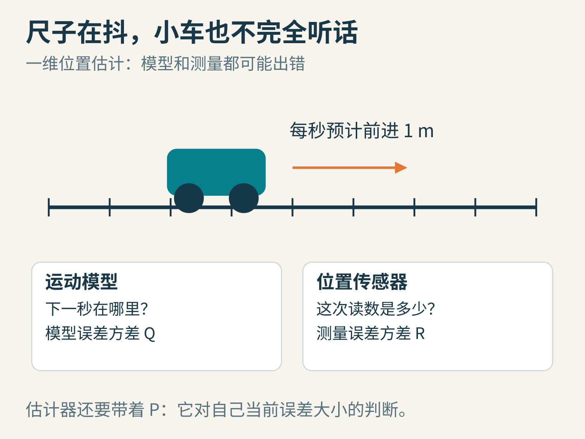
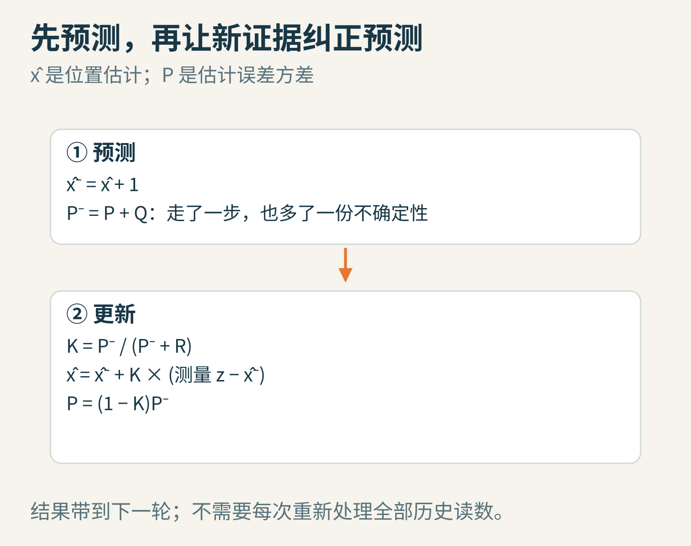
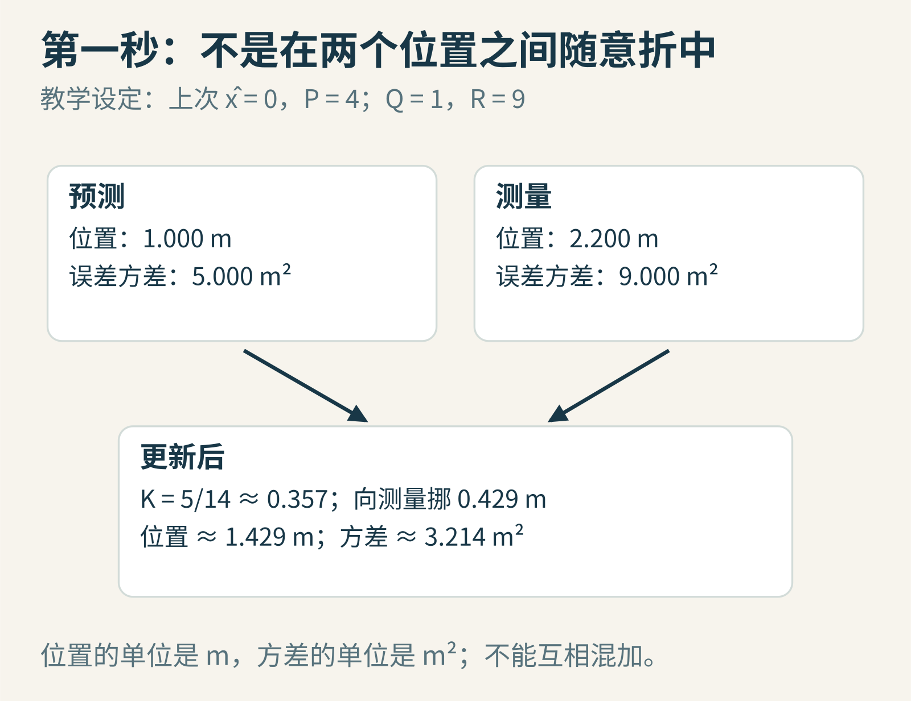
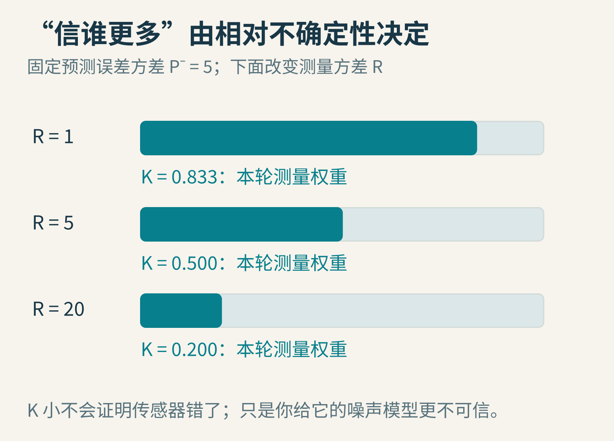
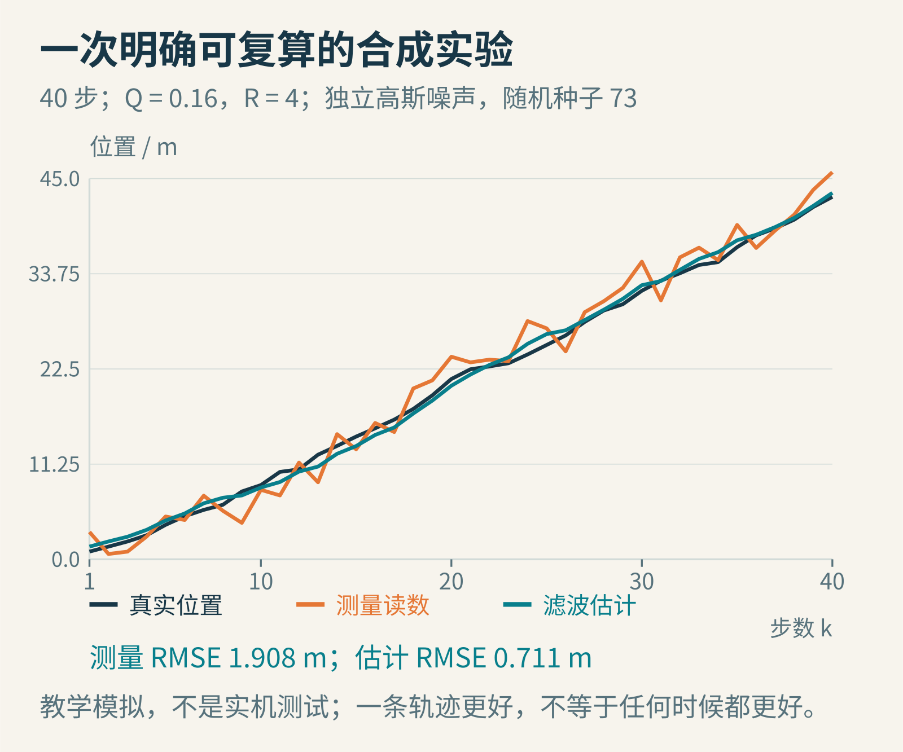
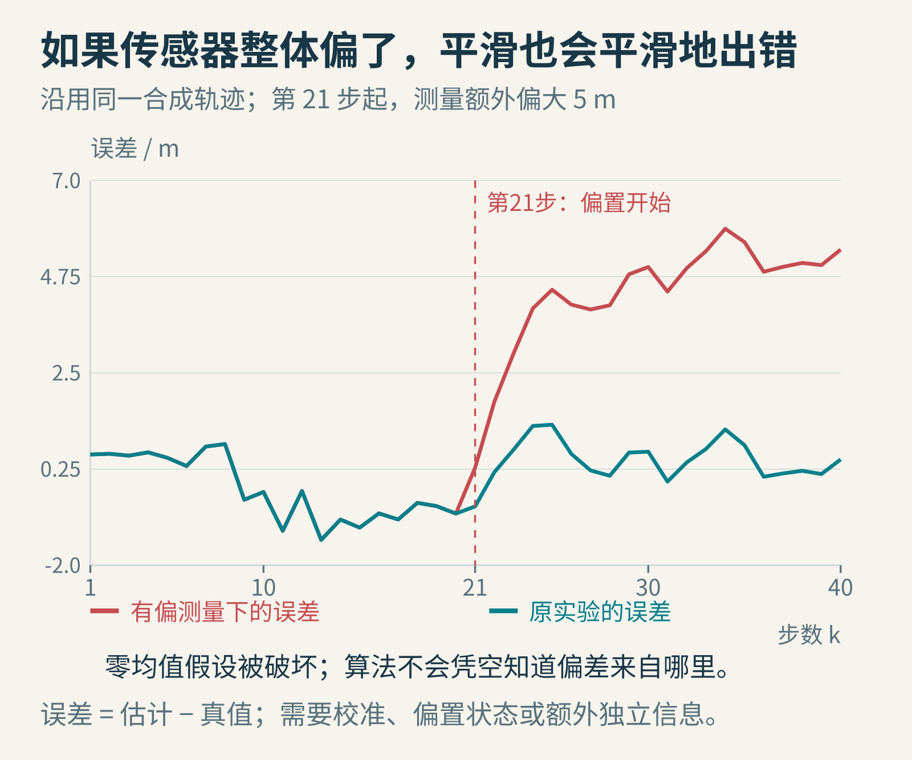

# 两把不准的尺子，怎样量得更准？亲手算一次卡尔曼滤波

一辆小车在直轨上前进。电机告诉你：“我大约每秒走一米。”位置传感器却不停跳动：这一秒像是走多了，下一秒又像是倒退了。

你会信谁？

完全信传感器，位置会抖；完全信运动模型，只要轮子打滑、速度改变，估计就会越走越偏。把两者简单平均也不总合理：精密尺和粗糙尺，应该各占一半吗？

卡尔曼滤波给出的思路是：**同时保存一个估计，以及对这个估计有多不确定；先根据运动规律预测，再用新测量修正。**

它不是一种把任何数据都变漂亮的平滑滤镜。它是一套有明确假设的状态估计方法。下面先做一个能用计算器核对的一维例子，再看那些假设究竟在保护什么。

图1：模型误差Q、测量误差R、估计误差P，谈的是三件不同的事。小车为原创情境示意。

## 第一步：把“位置”和“位置读数”分开

设小车真实位置是x，但我们不能直接看见它。传感器给的是z：

`z = x + 测量噪声`

算法手里的位置估计写作 `x̂`，读作“x帽”。帽子提醒我们：这是猜测，不是真值。

只报“它在10米”还不够。同样是10米，有的估计误差通常只有几厘米，有的常常差两米。所以还要带一个数P，表示估计误差的方差。

方差的直觉是“平方误差的平均尺度”。若标准差是2米，方差就是4平方米。P越大，意味着模型认为当前估计越不确定。它并不是“本次错误一定等于多少”，也不是随意填的信心百分比。

我们为例子作以下明确假设：

- 每秒更新一次，预计位置增加1米。
- 实际位移相对这1米的偏差，均值为0，方差Q=1平方米。
- 传感器误差均值为0，方差R=9平方米。
- 过程噪声、测量噪声以及初始估计误差相互独立，各时刻的噪声也独立。
- 初始估计 `x̂=0` 米，初始误差方差P=4平方米。

真实应用中，独立性可在某些结论里放宽为相应的不相关条件；这里采用更直观、较强的独立假设。若噪声间存在已知相关性，需要相应的模型与公式，不能直接照搬本例。

## 第二步：先预测，不急着看测量

过了一秒，按运动模型，小车应当从估计的0米到1米：

`x̂⁻ = x̂ + 1 = 1`

上标减号表示“本轮测量进来之前”。它不是负数，也不是减法。

那不确定性呢？原来的位置误差已经存在，新走一步又加入了过程误差。在这个独立噪声、单位状态转移系数的例子里，方差相加：

`P⁻ = P + Q = 4 + 1 = 5`

请注意，预测位置在向前走，预测方差也在增大。模型没有用“我算出了一个数”伪装成“我因此更确定”。

图2：每轮只需带着上次的估计和不确定性继续走。这种递推结构，适合不断到来的测量。

如果暂时没有新测量，也可以只做预测。只要过程噪声仍然存在，长时间“盲走”通常会让位置越来越不确定。没有证据的时候，不确定性增长本身就是有价值的输出。

## 第三步：传感器说2.2米，要向它挪多少

现在读到 `z=2.2` 米，预测是1米，两者差1.2米。这个差叫**创新**或测量残差：新证据与旧预测之间的差别。

我们要算一个增益K，决定接受这次纠正的多少。在本例中：

`K = P⁻ / (P⁻ + R) = 5 / (5 + 9) = 5/14 ≈ 0.3571`

然后更新位置：

`x̂ = x̂⁻ + K(z − x̂⁻)`

代入数字就是：

`x̂ = 1 + (5/14) × 1.2 ≈ 1.4286 米`

不是跳到2.2，也不是简单取1.6这个中点，而是向测量方向移动约0.4286米。因为我们给传感器的误差方差9，大于预测的误差方差5，算法更偏向预测。

更新后的方差为：

`P = (1−K)P⁻ = (9/14) × 5 ≈ 3.2143 平方米`

图3：更新后方差比预测方差小，表达的是在模型假设下融合独立信息的收益；它不是算法查看真值后给自己打的成绩。

这里有个细节：更新后方差比初始4还小，但不是每一轮的后验方差都必须小于上一轮的后验方差。中间预测新增的不确定性可能很大。正确的局部比较，是这一次更新前后的P。

## 为什么恰好是这个权重

先暂时忘掉小车，只想两份针对同一时刻的估计：预测值的误差方差是P⁻，测量的误差方差是R。

用权重K组合：

`新估计 = (1−K) × 预测 + K × 测量`

如果两份误差都无偏，而且相互独立，新误差方差就是：

`V(K) = (1−K)² P⁻ + K² R`

平方来自“把误差缩放K倍，方差会缩放K²倍”。没有交叉项，则依赖于误差不相关。

想让V最小，对K求导并令其为0：

`−2(1−K)P⁻ + 2KR = 0`

整理得到 `K=P⁻/(P⁻+R)`。若还没学导数，也可以选几个K代进去算，观察方差怎样在某个位置达到最低点。

当P⁻很大而R很小，旧预测不可靠、新测量可靠，K就接近1。当R很大，K变小。K不是“一次调好永远不变”的按钮，它随着本轮P⁻变化。

图4：权重反映输入给算法的噪声模型。把R填小，不会真的让传感器变精密，只会让算法更相信它。

## 第二秒再算一次，递推才真正发生

上一轮结果变成这一轮起点：`x̂≈1.4286`，`P≈3.2143`。

再预测一秒：

- 位置：`x̂⁻≈2.4286`
- 方差：`P⁻≈4.2143`

这次传感器读到1.8米，比预测小。增益为：

`K≈4.2143/(4.2143+9)≈0.3189`

更新后：

`x̂≈2.4286 + 0.3189×(1.8−2.4286)≈2.2281 米`

方差约为2.8703平方米。

你会发现，虽然模型预测一直向前，测量仍能把估计往回拉。但这里“往回拉”指相对于预测值调整，不等于算法断言小车真的倒车。

这两轮数字已用本地脚本计算核对。你也可以在纸上继续第三轮，设测量值是3.4米；务必同时更新位置和方差，不要只更新位置、却忘了改变下一轮的权重依据。

## 让它跑40步：看见结果，也看清实验身份

现在换一组更适合画图的参数：每秒预计前进1米，Q=0.16，R=4，初始P=1。我们用随机种子73，实际生成40步独立高斯过程噪声和测量噪声，跑同一套一维公式。

图5：这是由明确数学模型生成的教学数据，不是某款传感器或真实机器人性能测试。

这一次，测量位置的均方根误差RMSE约为1.908米，滤波估计约为0.711米。RMSE的算法是：每一步先算估计与真值的差，平方，求平均，再开方。

结果表明，在这条轨迹、这组较匹配的模型下，融合估计比直接使用测量更准确。但它不证明每一步都更准，也不保证换一组真实数据仍是相同比例的提升。

更容易忽视的原因是：我们特意使用符合线性运动与噪声假设的过程，并给滤波器相同的Q与R；初始真实位置固定为0，而初始P取1，是保守的不确定性设定。这个实验用来解释工作机制很好，用来宣称产品性能就不够了。

## 高斯分布到底起了什么作用

“卡尔曼滤波要求高斯噪声”是常见简写，但需要拆开理解。

在线性模型、正确的一二阶统计量和合适的不相关条件下，标准卡尔曼递推可以得到**线性估计器中的最小均方误差解**。噪声不高斯，并不意味着公式突然完全失去价值。

如果进一步假定初始状态和噪声联合高斯，线性变换和条件更新会让后验仍是高斯。此时均值与协方差足以描述整个后验；卡尔曼估计还与条件均值一致，在均方误差意义上不只局限于线性估计器的比较。

反过来说，非高斯分布可能包含均值与方差无法概括的结构，例如明显的双峰。一个估计值和一个P，可能掩盖“左边或右边都可能，但中间反而不可能”这样的情形。更一般的方法，可能需要保留更复杂的概率分布。

## 最危险的错误：很平滑，但稳定地错

继续沿用刚才的合成轨迹，只修改一个条件：第21步起，传感器读数额外增加5米。滤波器并不知道这件事，仍假设测量误差均值为0。

图6：红线仍可以很平滑，却逐渐出现系统性偏差。平滑度不是准确度。

为什么模型没有救它？因为模型说的是“每秒增加约1米”，并没有持续提供一个可靠的绝对位置锚点。一个整体偏移的轨迹，也可能符合这种速度规律。

可能的处理办法包括校准传感器、把偏置加入待估计状态，或引入独立的绝对位置来源。但增加“偏置状态”也不是自动解决：如果现有测量无法区分位置偏移与传感器偏置，就存在可观测性问题，仍需要更多信息。

其他常见边界也类似：

- 把同一来源加工后的两份数据当独立传感器，会重复计算证据，使P过小。
- 真实噪声存在持续相关性，却按每步独立处理，方差传播就不对。
- 偶发巨大离群值可能强烈拉动普通更新，需要检查残差、稳健方法或异常模型。
- 物体突然加速，而Q仍设得极小，算法可能固执地追随旧模型。
- 状态或观测关系非线性时，不能直接把一维线性公式原样套上；扩展卡尔曼等变体也有各自近似与失败条件。

## 1960年的价值：把历史压缩成可以带走的状态

鲁道夫·卡尔曼在1960年发表《A New Approach to Linear Filtering and Prediction Problems》。其核心贡献之一，是以状态空间与递推形式处理线性估计问题。它让不断到来的数据可以逐步处理，而不用每次从头携带所有原始测量。

图7：Rudolf E. Kálmán，2007年。ETH-Bibliothek Zürich，Bildarchiv，馆藏号HK_04-01925，摄影者未注明；[CC BY-SA 4.0](https://creativecommons.org/licenses/by-sa/4.0/)。本文使用完整原尺寸照片，未修改；不是1960年论文发表时的现场。

在二维或三维跟踪中，状态可以同时包含位置和速度；P不再是一个数，而是协方差矩阵。对角线描述各分量的不确定性，非对角线描述误差之间怎样共同变化。例如位置和速度误差的相关性，会影响一次位置测量如何帮助修正速度。

机器人定位、导航和目标跟踪都能遇见这类问题。但具体系统是否适用，最终取决于运动模型、观测模型、噪声、时间同步、可观测性和数值实现，而不是有没有写上“卡尔曼”三个字。

最后给你三个探索任务：

1. 固定第一次预测P⁻=5，分别令R=1和R=20，算出新位置，解释为什么结果靠向不同一侧。
2. 把过程噪声Q设为0。若真实小车速度突然改变，滤波器可能出现什么迟滞？再考虑P初始也设为0会怎样。
3. 让两把尺子都多报5米。它们彼此一致，能证明真实位置正确吗？你需要哪种额外证据？

卡尔曼滤波最值得学习的，并不是一条神奇权重公式，而是一种诚实的计算习惯：**每次给出判断，也把判断依赖的模型和不确定性一并带上。**

图片来源：原理图与两组可复算合成实验为本文原创；[卡尔曼肖像原页](https://commons.wikimedia.org/wiki/File:ETH-BIB-Kalman,_Rudolf_E._(1930-2016)-HK_04-01925.jpg)，ETH-Bibliothek Zürich，Bildarchiv，CC BY-SA 4.0。延伸阅读：[Särkkä的《Bayesian Filtering and Smoothing》作者公开版，第4章](https://users.aalto.fi/~ssarkka/pub/cup_book_online_20131111.pdf)、[MathWorks的卡尔曼滤波说明](https://www.mathworks.com/help/control/ug/kalman-filtering.html)。
