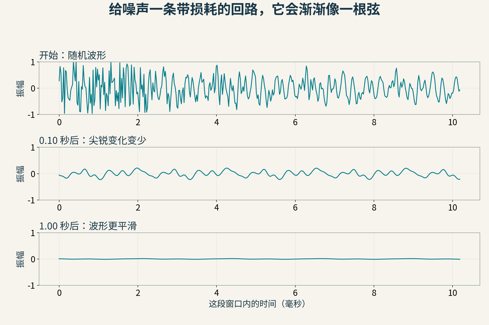
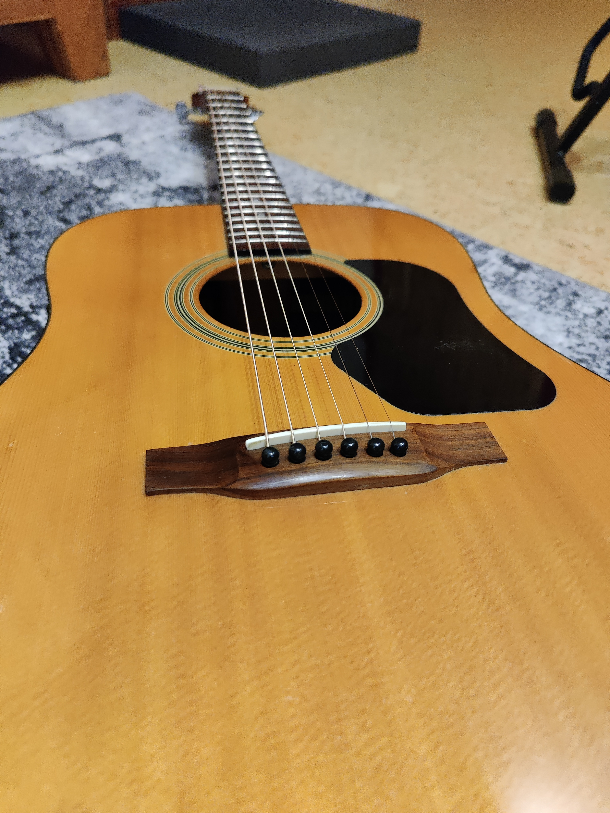
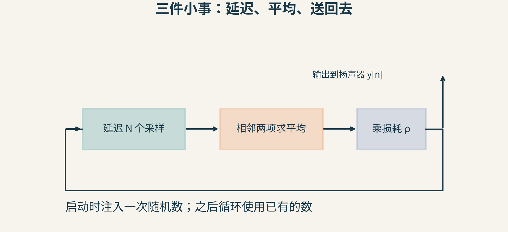
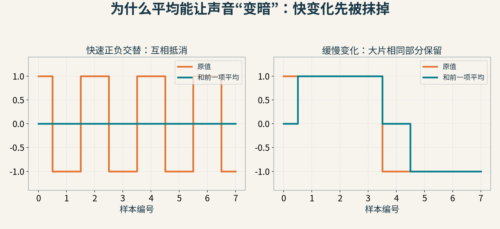
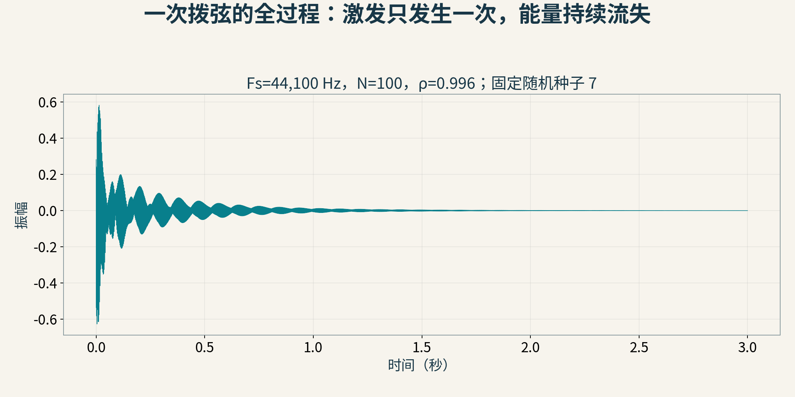
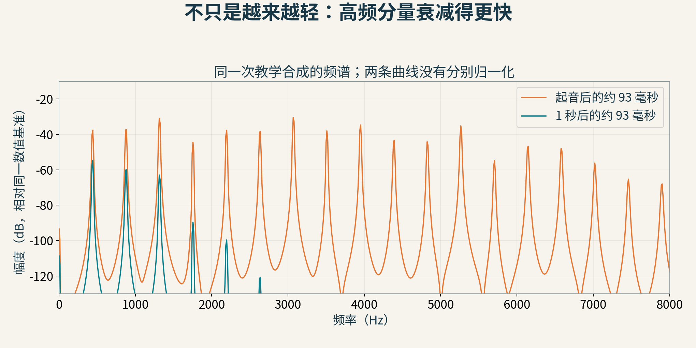
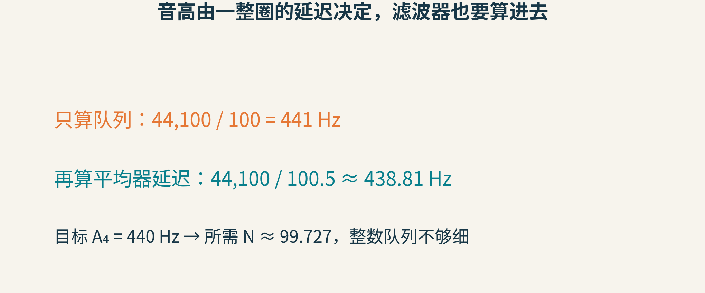

# 把一小段噪声放进回路，为什么会听起来像拨弦？

如果让电脑合成吉他声，你可能会先想到录下一把吉他，或者把琴弦切成成千上万个小段，逐段模拟它们怎样振动。

Karplus–Strong算法给出了一个很短的入口：先准备一小段随机数，让它不断绕圈；每绕一圈，稍微平均一下，再送回去。

令人意外的是，这样做能产生相当有拨弦特征的声音：起音带着粗糙的明亮感，随后越来越圆润、越来越轻。



图1：本文实际合成的波形，三个窗口采用相同振幅刻度。随着时间推移，快速起伏减弱，总振幅也衰减。这是数字教学模型的输出，不是实录琴弦振动。

可以先[听一声本文合成的拨弦](plucked-string-demo.wav)，再回来拆开它。音量先调低：这个文件是3秒、44.1kHz、单声道的原创合成示例。

## 电脑播放的声音，先是一串数

扬声器需要随时间改变位置。数字音频用一串采样值描述这种变化。采样率Fₛ=44,100Hz，表示每秒提供44,100个值。

如果一个模式每100个采样重复一次，一秒大约重复441次，基本重复频率就是441Hz。这里的频率与“每秒播放多少个样本”不同：采样率是刻度有多密，音高相关的周期是波形重复得多快。

现在随机生成100个值。只播放一遍，它短得像一个小噪声片段。如果不停原样循环，这个片段就从“不规则的一次事件”变成了“规则重复的复杂波形”。

这一步很关键：循环的内容可以很复杂，但重复时间是有规律的。于是频谱会出现与这个周期有关的谐波结构，听感有了音高，而不是永远只剩嘶声。

不过，原样循环也有问题：它会一直维持同一音色和响度，缺少拨弦之后自然衰减的过程。

## 真正的弦不只是重复，它也不断损失能量



图2：Walden D310e吉他的真实照片，可以辨认琴弦、琴桥和共鸣箱。摄影：Elmschrat，2023年；[CC BY-SA 4.0](https://creativecommons.org/licenses/by-sa/4.0/)，原图未改动。基础Karplus–Strong回路只抓住部分振动特征，并未完整模拟这件乐器。

拨动真实琴弦后，扰动会传播、在边界反射，并通过多种机制损失能量；琴体又会改变声音的辐射和频谱。不同振动模式的衰减速度并不相同，所以音色也会随时间变化。

Karplus–Strong没有从头详细求解所有机械过程。它用一个极省计算的回路抓住两件事：周期性的反馈，以及高频比低频损失更快。

回路里有三个部件：延迟、平均、衰减。



图3：本文采用的回路形式。输出y[n]经N个采样延迟，再做两点平均并乘损耗系数ρ，形成新的输出；开始时用一小段随机数据提供初始能量。

“延迟N个采样”可以先理解成一条长度固定的传送带：今天出来的东西，是N个时刻前送进去的。它提供回路的主要周期。

平均器则把相邻两个值加起来除以2。ρ是略小于1的系数，让每次反馈再损失一点幅度。注意，ρ并不等于“每播放一个样本都把整段声音缩小一次”；它作用在绕回来的反馈量上。

## 用四个数，看一次回路怎样更新

先把ρ设为1，暂时只研究平均。本文使用的递推式为：

y[n]=(y[n−N]+y[n−N−1])/2，n≥N。

前N个值是初始片段，并约定y[−1]=0。

把N缩小到4，初始片段设成[1,−1,0.5,0]。于是：

- y[4]=(y[0]+y[−1])/2=(1+0)/2=0.5
- y[5]=(y[1]+y[0])/2=(−1+1)/2=0
- y[6]=(y[2]+y[1])/2=(0.5−1)/2=−0.25
- y[7]=(y[3]+y[2])/2=(0+0.5)/2=0.25
- y[8]=(y[4]+y[3])/2=(0.5+0)/2=0.25

现在，原先尖锐的跳变已经开始被抹平。后续又会使用刚产生的新值，变化一圈圈传下去。

这个四数例子用来手算，不适合作为正常音高的乐器。真正的示例使用100个初值，并每秒输出44,100个样本。

## 为什么“平均”会使高音成分消失得更快？

把两种波形放在一起比较。

第一种每一步都在+1、−1之间交替。这是非常快的变化。相邻两项平均后，恰好变成0。

第二种连续好多步都是+1，再连续好多步都是−1。这种变化较慢。除了转折附近，大部分相邻项相同，平均后仍然保留原值。



图4：橙色是原值，绿色是与前一项的平均。平均器更容易抵消快变化，因此是一个简单低通滤波器。

如果愿意再深入一点，对频率f的正弦分量，这个平均器的幅度比例为|cos(πf/Fₛ)|。低频时这个值接近1，高频时更小；在Fₛ/2处，正负每个采样交替，刚好被完全抵消。

例如，f=0.1Fₛ时，一次通过的幅度比例约0.951；f=0.4Fₛ时则约0.309。只通过一次或许还不够明显，但这是反馈回路：同一个频率成分会一遍遍经过滤波器，小差别不断累积。

这解释了拨弦听感的关键部分：不仅响度下降，明亮、尖锐的成分还比低频成分更快减弱。



图5：本文示例的完整3秒输出。N=100、ρ=0.996，固定随机种子7。曲线是模型的离散采样显示，不代表真实吉他的衰减常数。



图6：同一次输出的两个4096样本窗口，分别从0秒和1秒开始，使用Hann窗计算频谱。两条曲线采用同一幅度基准，没有分别放大归一化；高频峰值的衰减尤其明显。

如果只给整个波形乘一个随时间减小的音量系数，所有频率会一起缩小，音色不一定发生这种变化。回路里的低通作用，才让“变轻”和“变暗”同时发生。

## 100个样本，音高为什么不是准确的441Hz？

到这里，很容易写下f=Fₛ/N，然后宣布音高算完了。这个近似漏掉了平均器本身的延迟。

两点等权平均不仅改变幅度，也改变相位。对这里的低频工作区，它相当于额外引入约半个采样的相位延迟。因此，对本文明确采用的递推形式，基频近似为：

f₀≈Fₛ/(N+0.5)。



图7：Fₛ=44,100、N=100时，只算队列得到441Hz；计入平均器延迟得到约438.81Hz。它靠近标准A₄的440Hz，但并不完全一致。

为什么仍写近似？因为实际回路还有损耗、可能存在其他滤波器，严格振荡模式要由完整反馈系统决定。换一种循环缓冲区索引或平均相邻项的方式，还可能改变你代码里“N”对应的总延迟。应当先把递推式写清，再谈调音公式。

若目标是440Hz，由这个近似式反推，N≈44,100/440−0.5≈99.727。可是数组长度只能是整数。高音时队列更短，相邻整数长度带来的音高跳变更明显。

扩展算法因此会使用分数延迟滤波器，例如合适设计的全通滤波器，在不简单增加整格队列的情况下微调相位。调整平均器权重也会同时影响衰减与相位，所以“改音色”和“改音准”往往需要一起考虑。

## 一段能跑的最小合成器

下面保留全部输出，优点是直接对应公式、容易检查；实时系统可换成循环缓冲区，减少内存。

```python
import numpy as np

fs, N, seconds = 44100, 100, 3
rho = 0.996
rng = np.random.default_rng(7)
y = np.zeros(fs * seconds)
y[:N] = rng.uniform(-1, 1, N)
y[:N] -= y[:N].mean()

for n in range(N, len(y)):
    older = y[n-N-1] if n-N-1 >= 0 else 0.0
    y[n] = rho * (y[n-N] + older) / 2
```

本文的波形、频谱与WAV都来自这次实际运行。去掉初始片段的均值，是为了减小直流偏置；输出保存为音频时还乘了0.7并转换成16位整数，避免音量过大。播放归一化和内部反馈参数不能混为一谈。

有三个很容易踩的实现坑：

- 每一轮都重新填噪声，会持续注入能量，效果不再是一次拨弦后的自由衰减
- 平均时错读已覆盖的数组元素，会悄悄换成另一条递推式，音高与衰减都可能改变
- 把反馈增益随意调到大于1，可能让某些成分增长，导致溢出、失真或刺耳输出

所以第一次实验最好低音量播放，并先检查数值是否有限、峰值是否越界。

## 这不是1983年突然从天而降的魔法

Kevin Karplus与Alex Strong在1983年发表《Digital Synthesis of Plucked-String and Drum Timbres》。原文回溯说，基础的相邻采样平均办法由Strong在1978年12月提出；论文讨论了它的音色、衰减、实现和变化形式。

当时计算资源有限，一种主要依赖加法、平均和短存储的算法具有特别的吸引力。同年，David Jaffe与Julius O. Smith发表扩展工作，进一步处理调音、衰减与演奏表现。Smith后来的物理音频教材又把它放进数字波导合成的框架中解释。

这个历史很有意思：一个非常简短、听起来有效的递推过程，后来可以从波传播和滤波器角度得到更深的解释。好的工程点子有时先以“这居然能工作”的形式出现，再逐渐长成系统理论。

不过，基础算法仍然只是一种有拨弦特征的声音模型。它没有完整覆盖琴体共鸣、拨弦位置、弦的刚度、不同琴弦的耦合、品丝接触和演奏细节。噪声初值也不是手指真实拉弦形状的精确记录。把它称为“像拨弦”，比宣称“已经模拟了一把完整吉他”更准确。

## 把下一次聆听变成实验

1. 固定其他参数，把N从100改成200。音高大约怎样变化？衰减速度会不会也改变？
2. 把随机初值换成平滑正弦。周期还在，但起音的“拨一下”感觉是否变弱？为什么？
3. 固定N，比较ρ=0.99与0.999。记录衰减，再低音量试听。哪一个更长？
4. 用相同初值比较“只有整体音量衰减”和“回路低通衰减”。闭眼能否听出音色变化的区别？

一小段噪声并没有变成一根真的弦。它在回路里被赋予了重复、记忆和不同频率的损耗。音乐感，就是从这些很朴素的结构中逐渐长出来的。

资料：[Karplus与Strong的1983年原论文](https://users.soe.ucsc.edu/~karplus/papers/digitar.pdf)、[Ben Lynn的算法推导](https://xenon.stanford.edu/~blynn/sound/karplusstrong.html)、[Julius O. Smith的物理音频教材章节](https://www.dsprelated.com/freebooks/pasp/Karplus_Strong_Algorithm.html)、[扩展算法章节](https://www.dsprelated.com/freebooks/pasp/Extended_Karplus_Strong_Algorithm.html)。

图片来源：图1、3—7及音频为本文原创计算；图2见[Elmschrat原始照片及授权页](https://commons.wikimedia.org/wiki/File:00_Walden_Acoustic_Guitar_D310e_body.jpg)。
