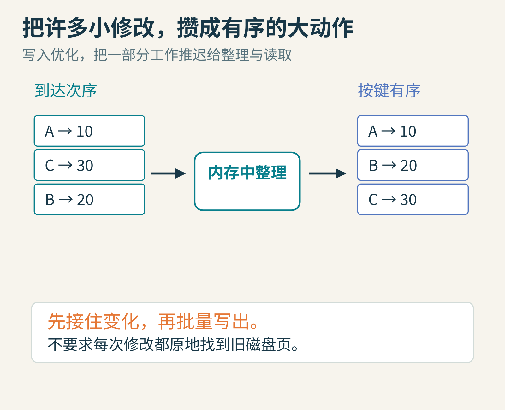
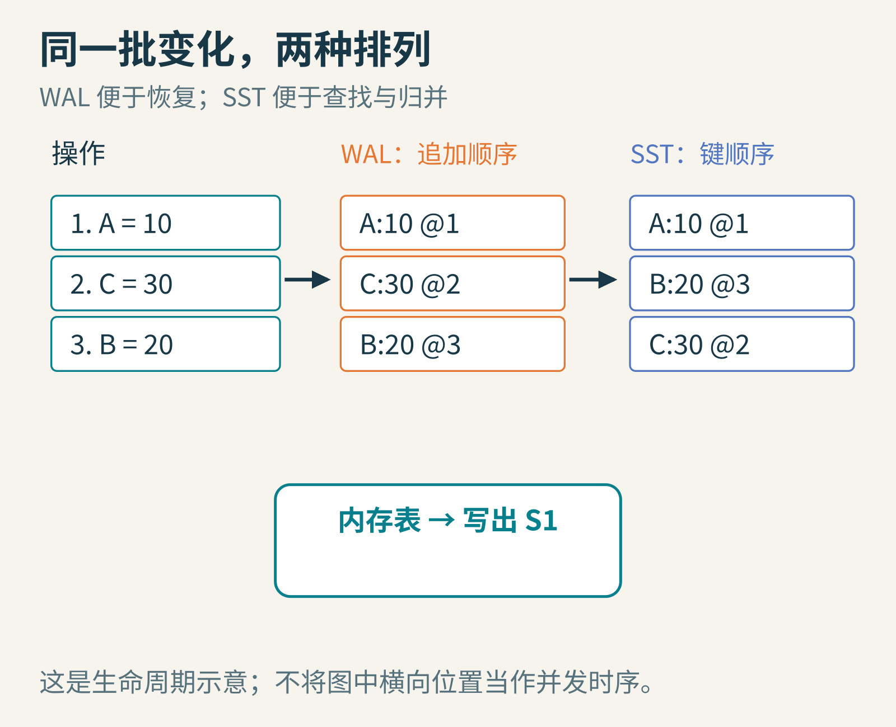
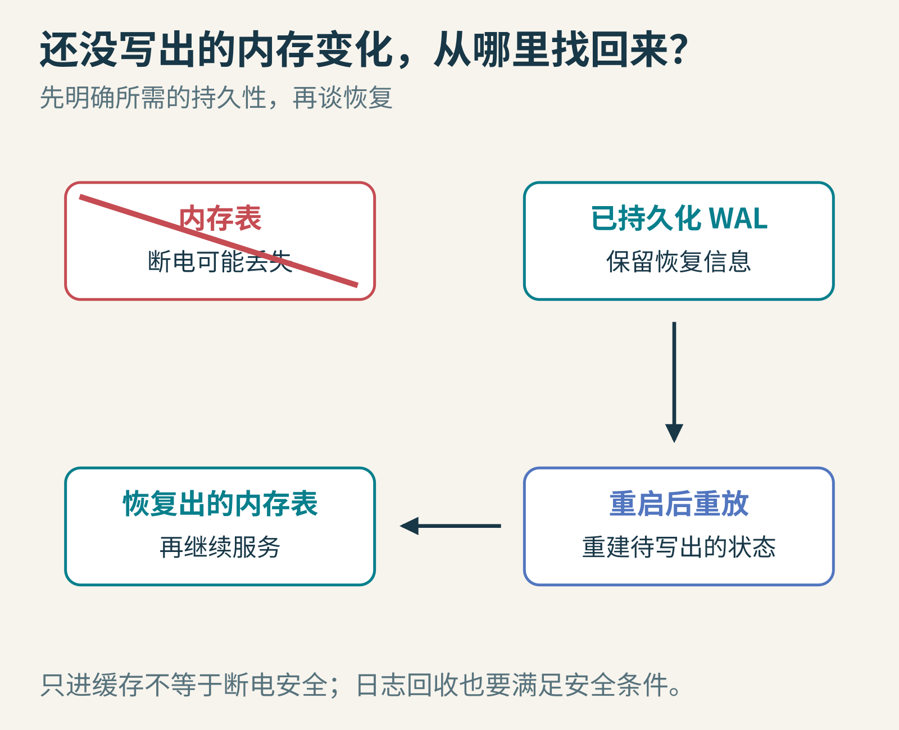
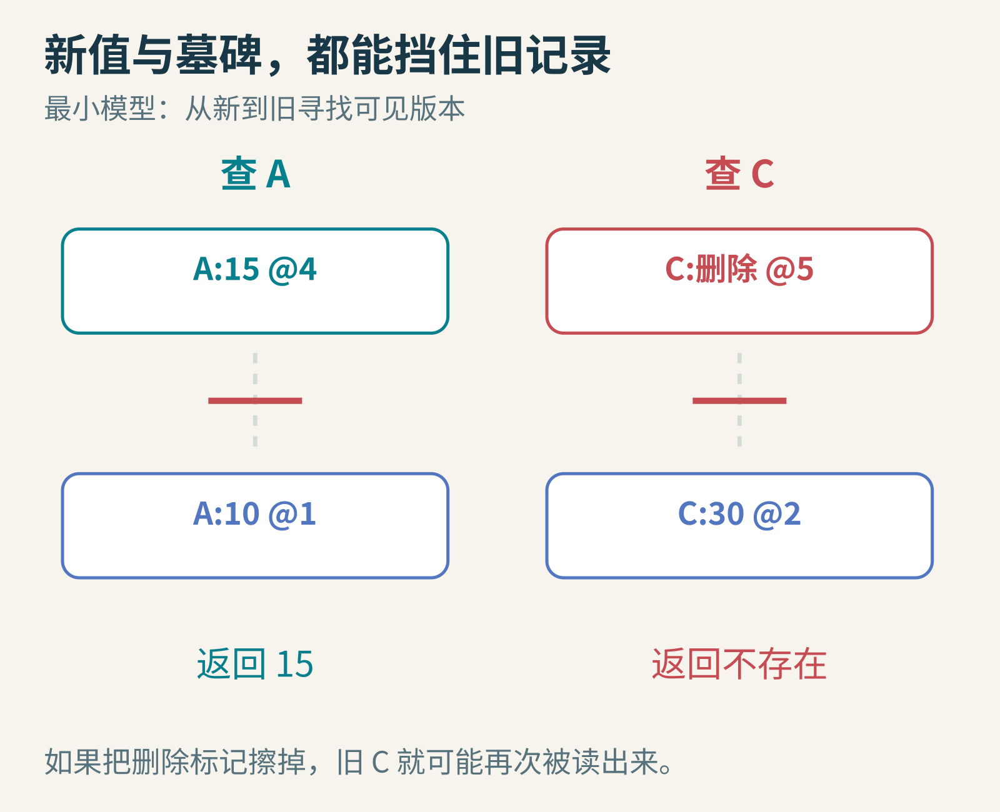
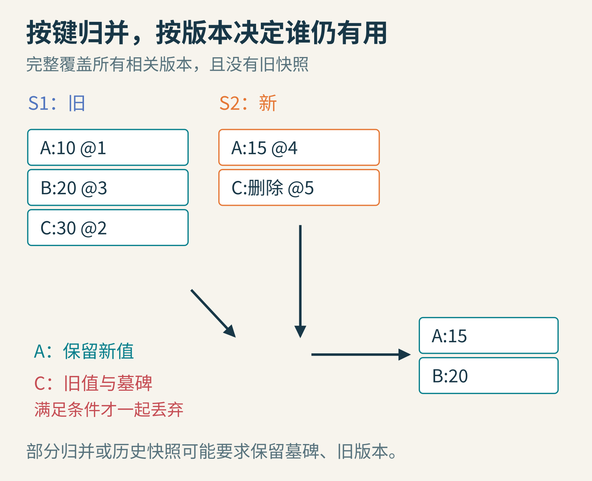
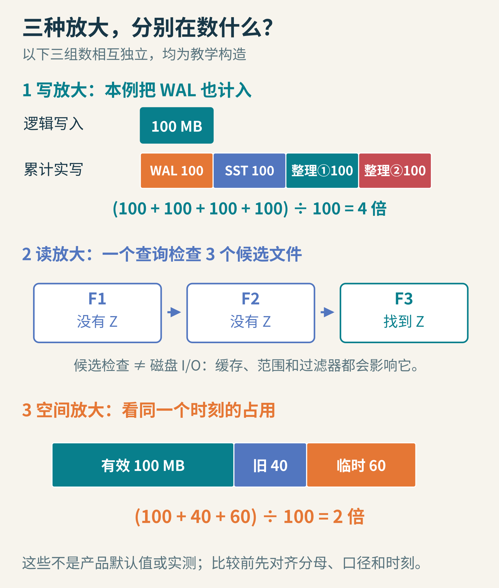

# 数据库为什么先记小本本，过一会儿才整理？走进 LSM 树

你负责记录社团成员的积分。名单按姓名排好，每来一次加分，就找到那个人、擦掉旧数字、写上新数字。只有几十人时，这很自然；如果每秒来几万次修改，而完整名单远大于内存呢？

另一种办法是：先把变化记下来，凑成一批，再有顺序地整理。

这就是理解 LSM 树的一扇门。LSM 是 Log-Structured Merge-Tree 的缩写。它把许多细小的修改，组织成较大的批量写入和归并。代价是：你不能再假设每个键只在一个地方出现。



图1：原地修改和批量整理的教学类比。真实数据库还要处理缓存、并发、崩溃恢复和存储设备特性。

## 1. 先跟着五次操作走一遍

我们建立一个只存“姓名→积分”的小数据库。操作依次是：

1. `put(A,10)`
2. `put(C,30)`
3. `put(B,20)`
4. `put(A,15)`
5. `delete(C)`

给每次操作一个递增序号，记为1—5。序号帮助我们区分同一个键的先后版本；这里不是在设计跨机器的全球时钟。

最初，前三条进入内存中的 memtable。为了教学，假定每三条就触发一次写盘。写出的文件按键排序，所以文件 S1 是 `A:10@1、B:20@3、C:30@2`。

注意两种顺序已经分开：操作发生顺序是 A、C、B；文件里的键顺序是 A、B、C。排序让后面的查找和范围扫描更方便。



图2：WAL 按到达顺序追加；SST 按键有序。图中只画一份内存表的生命周期，实际系统可让新表接收写入，同时由后台写出旧表。

SST 可以理解为“有序的、写出后通常不再原地修改的数据文件”。不同系统的完整名称、文件格式和索引布局有所不同；这里关心的是它的有序性与不可变使用方式。

## 2. 内存断电会消失，怎么办？

只有 memtable 显然不够。前三条还没写出 S1 时，机器一断电，内存内容就可能丢失。

因此，许多 LSM 系统会同时使用预写日志 WAL：在把一批操作视为具备所需持久性之前，先按约定把恢复所需的信息记录到日志。重启后，可以重放日志，重建没来得及写出的内存状态。

但“写进日志”也有层次：只到进程缓冲、到操作系统缓存，还是已经按要求同步到持久存储？这影响断电后的保证。[RocksDB 的 WAL 文档](https://github.com/facebook/rocksdb/wiki/Write-Ahead-Log-(WAL))说明了相关配置，不能把“采用 LSM”直接等同于“任何返回成功的写入永远不会丢”。



图3：日志保护的是尚未安全进入持久数据文件的变化。图中只说明恢复思路，不代表所有配置都有相同的断电保证。

当对应数据和必要元数据已经安全落盘、恢复不再依赖旧日志后，系统才能回收它。过早删日志和永远不删日志，分别带来丢失风险和空间问题。

## 3. 更新不覆盖旧页，读取怎么找最新值？

第四条 `A:15@4` 留在新的 memtable。此时查 A，应该返回15，而不是旧文件 S1 中的10。

一个最小模型可以从新到旧查：先查内存表，再查最近生成的文件，再查更旧的文件。第一次找到的有效版本就是答案。工程实现通常还会用文件键范围、块索引和过滤器，减少无用读取；多层文件之间的优先级也不能简单等同于文件创建时间。

现在查 C。第五条是删除，可旧文件里还躺着 `C:30@2`。如果只是从新 memtable 里移除 C，读取一回头，又会把旧的30找出来。

所以删除也需要留下记录，通常称为 tombstone，墓碑标记：它的意思是“截至这个版本，键已删除”。读取遇到它就返回不存在，而不是继续向旧文件寻找。



图4：A 的新版本挡住旧值；C 的墓碑挡住旧值。墓碑不是“什么都没有”，它恰恰是一条有意义的信息。

## 4. 归并：把许多本小册子整理成更少的大册子

新 memtable 后来写成 S2，里面有 `A:15@4、C:删除@5`。查询每次都翻很多册子会越来越慢。后台因此把有序文件归并：

- 比较各输入文件最前面的键；
- 输出最小的键，推进对应指针；
- 同键出现多个版本时，按读取语义处理新旧关系。

在这个不保留历史快照、且已经覆盖所有相关旧版本的简化例子里，最终只需留下 `A:15、B:20`。



图5：这里允许丢弃 C 的墓碑，是因为例子中所有旧 C 都已进入本次整理，且没有历史读取需要它。只整理一部分文件时，这个条件未必成立。

如果更深一层仍藏着旧 C，就不能轻率删除墓碑，否则旧值可能“复活”。如果读者持有较早的快照，旧 A 也可能仍然有用。因此，压实整理不是简单的“同名只留最后一个”；它还要尊重快照、版本可见性和输入范围。

## 5. 用二十行代码做一台纸上数据库

下面实际运行过的示例只验证版本选择与删除语义。它全部在内存中，既没有真的写磁盘，也没有实现 WAL、并发、故障恢复或高效归并。

```python
# 每条为：键、序号、值；None 专作删除标记
s1 = [('A', 1, 10), ('B', 3, 20), ('C', 2, 30)]
s2 = [('A', 4, 15), ('C', 5, None)]

def compact_all(files):
    newest = {}
    for file in files:
        for key, seq, value in file:
            if key not in newest or seq > newest[key][0]:
                newest[key] = (seq, value)
    return [(key, value) for key, (seq, value)
            in sorted(newest.items()) if value is not None]

assert compact_all([s1, s2]) == [('A', 15), ('B', 20)]
```

这里用字典后排序，方便看清逻辑；真正利用多个已排序输入的归并算法，可以用多路指针或堆逐步输出，不必把所有键塞进一个大字典。代码名字中的 `all` 很重要：它假定所有相关版本都在眼前。

## 6. 为什么越整理，反而写得更多？

假设应用写入100 MB，而数据先写日志，再写 SST，之后又在几次归并中被重写。存储设备实际接收的写入量可能大于100 MB。它们的比值叫写放大，具体统计时必须说明是否包括日志和设备内部写入。

同样，查一个键要看多个候选文件，会产生读放大；旧版本和临时归并文件同时存在，会产生空间放大。三种开销不是随便按一个按钮就能同时最小化的。



图6：三组相互独立的教学例子。写入100 MB逻辑数据，计入WAL后的累计写入为400 MB，写放大为4；一次查询检查3个候选文件，不等于发生3次磁盘I/O；某时刻100 MB有效数据，加40 MB旧版本与60 MB临时数据，共占200 MB，空间放大为2。工作负载、缓存、过滤器和存储设备都会改变真实结果。

[RocksDB 的 compaction 文档](https://github.com/facebook/rocksdb/wiki/Compaction)比较了 leveled 与 tiered 等策略。可以先抓住直觉：更积极地把重叠数据整理干净，往往让读取更省事，却可能重写更多已有数据；允许更多有序段共存，能少做一些重写，却把工作留给读取和空间回收。

后台整理跟不上前台写入时，系统还可能限速甚至暂停部分写入。把磁盘灌满，再期待数据库“自己慢慢整理”，通常不是好计划：整理本身也需要空间和 I/O 预算。

## 7. 它来自什么历史问题？

Patrick O'Neil、Edward Cheng、Dieter Gawlick 和 Elizabeth O'Neil 的[原始 LSM 论文](https://dsf.berkeley.edu/cs286/papers/lsm-acta1996.pdf)研究了高插入率历史记录的索引成本，正式发表于1996年。论文从内存组件与磁盘组件、批处理和归并出发；当时磁盘寻道成本是重要背景。

本文讲的 memtable、不可变 SST 与现代压实策略，是帮助理解后续 LSM 系统的一套常见模型，不能把今天所有实现细节倒写成1996年论文的原样设计。[RocksDB](https://github.com/facebook/rocksdb/wiki/RocksDB-Overview)是可继续阅读的现代实现之一。

SSD 没有机械磁头，批处理、缓存局部性和写放大的问题仍然存在，只是成本模型变了。LSM 也并非所有查询都优于其他索引：大范围扫描、点查、更新频率、延迟稳定性和设备寿命，需要一起考虑。

## 留给你的小实验

1. 在 S1 中再放一个很旧的 `C:99`，只整理 S2 时就删掉墓碑，会发生什么？
2. 给读取加一个“只能看序号不超过3”的快照条件，A 应返回多少？为何旧版本不能立即删除？
3. 你愿意为了更平稳的查询延迟，多花多少后台写入和磁盘空间？把答案写成可测量的目标，而不是“越快越好”。

理解 LSM，关键不是记住层数。它是在问：能不能把眼前必须完成的小动作，改造成一批更划算的大动作，又把延迟整理留下的账算清楚？

图片来源：图1—6为本文原创教学示意；人物、记录、文件和操作序号均为构造例子。
