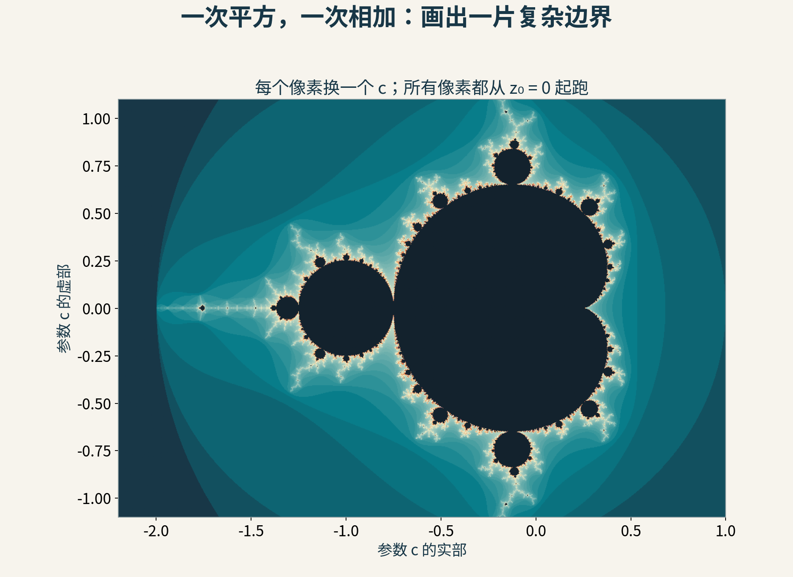
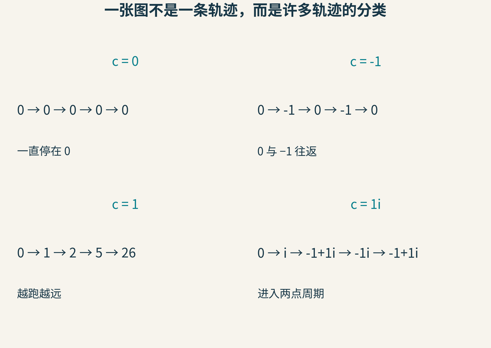
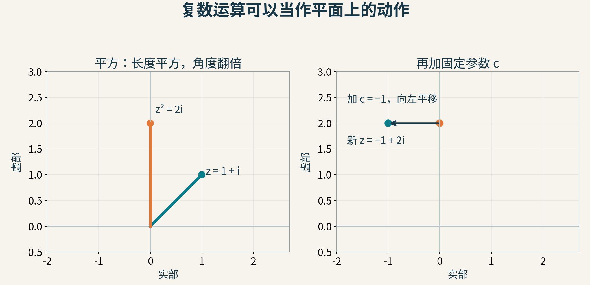
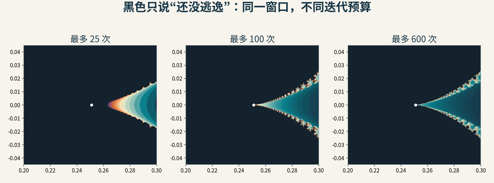
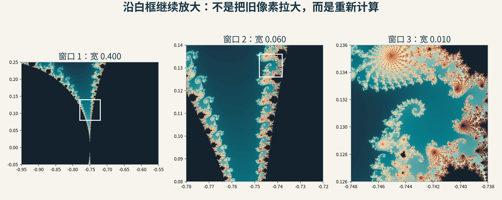
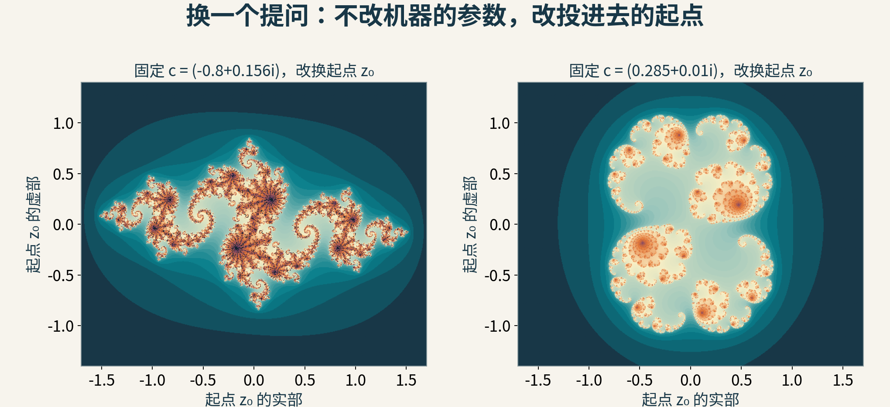
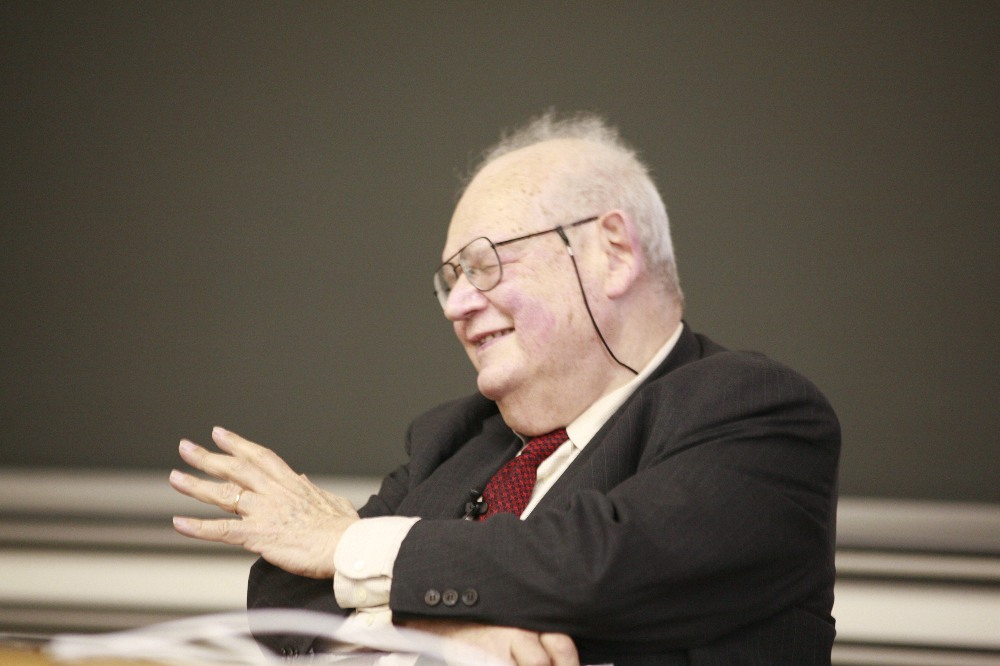

# 一行公式，为什么能长出看不完的边界？走进 Mandelbrot 集合

假设有人给你一张地图：中央像一颗歪歪的心，左边接着圆球，边缘伸出卷须。把卷须放大，里面又有分叉、螺旋和小小的“心”。你大概会猜，这背后藏着一套很长的绘图规则。

实际上，生成下面这张图的主要动作只有两个：平方，再加一个数。



图1：本文计算的参数平面。彩色表示在500次以内逃逸的参数，颜色按逃逸步数映射；深色表示本次计算尚未发现逃逸。它是一幅数值探索图，不是集合边界的精确描边。

神奇之处还不只是“简单规则画出复杂花纹”。更值得追问的是：图里的每个像素究竟代表什么？所谓无限放大，是程序不断制造细节，还是我们逐渐看清一个早已由公式确定的对象？

## 先造一台反复工作的“小机器”

机器有一个固定参数 c。每放进一个数 z，它就输出 z²+c。再把输出送回输入口，接着算。

我们统一从 z₀=0 开始，因此得到：

z₁=c；z₂=c²+c；z₃=(c²+c)²+c；……

先别急着看平面，拿普通实数试试。

- c=0：0、0、0、0……一直不动
- c=−1：0、−1、0、−1……来回循环
- c=1：0、1、2、5、26……迅速变大

前两种轨迹始终待在某个有限范围里，第三种则逃向无穷远。Mandelbrot 集合收集的，就是那些使这条从0出发的轨迹始终有界的参数 c。

请留意主语：集合里的成员是 c，不是运行中不断变化的 z。我们要测试很多台参数不同的小机器，每台都从同一起点出发。



图2：四次独立实验。c=i 时，轨迹先经过0和i，随后在−1+i与−i之间往返；有界不要求静止，也不要求从第一步就开始循环。

“有界”也不等于“每次都变小”。一条轨迹可以跳来跳去，只要存在一个固定的大圈能永远装下它，就符合定义。

## 多出的一个方向，来自复数

如果 c 只允许是实数，我们只能沿一条数轴涂色。要得到地图，就把 c 放进复平面。

复数 a+bi 可以看成平面上的点(a,b)：横坐标是实部，纵坐标是虚部。这里 i²=−1。不要把 i 想成一种神秘物质，它只是让两维坐标也能进行特定乘法运算的记号。

例如，把 z=1+i 平方：

(1+i)²=1+2i+i²=2i。

它从(1,1)变成(0,2)。如果 c=−1，再加上 c，就平移到(−1,2)。



图3：一次迭代可以拆成两个平面动作。平方使到原点的距离平方、方向角翻倍，再加 c 则把结果平移。

这个几何解释帮我们看见两种竞争：平方可能把点推得更远，平移又可能把它拉回来或换个方向。某些参数让轨迹稳定下来，某些让它周期循环，某些让它最终逃走。参数只差一点点，长期命运也可能不同。

地图的复杂边缘，就藏在这些命运交错的地方。

## 一个像素怎样获得颜色？

现在可以写出绘图计划。对每个像素，我们先按照图幅范围算出它代表的 c，再把 z 清零。反复执行 z←z²+c，记录轨迹是否逃逸。

困难是：“一直有界”说的是无限多步。电脑不可能为了一个像素等到永远。

好消息是，对这里规定的二次迭代、从0出发的轨迹，有一个非常好用的逃逸判据：一旦某一步 |z|>2，就能确定这个 c 不属于集合。|z|表示点到原点的距离，等于√(实部²+虚部²)。实际代码比较实部²+虚部²>4，就不必每次开平方。

为什么2是有用的门槛？先考虑 |c|≤2。当 |z|>2 时，下一步的距离至少为 |z|²−|c|，不小于 |z|²−2，而这个值大于 |z|。越过门槛之后，平方的力量会持续压过平移，轨迹不会被拉回。如果 |c|>2，第一步就到达 c；从这一步开始也能用同样的增长估计证明它逃走。

于是，一个最小绘图器可以这样做：

```python
def escape_steps(c, limit):
    z = 0j
    for step in range(1, limit + 1):
        z = z * z + c
        if z.real * z.real + z.imag * z.imag > 4:
            return step
    return None  # 在预算内没有发现逃逸
```

返回3的意思是第三次更新后越过门槛，不是“离集合边界有3个单位”。把快逃逸、慢逃逸的点涂上不同颜色，就出现了包围深色区域的彩色条带。色带是我们选的可视化方式；集合本身并不自带蓝色或金色。

## 最容易误读的黑色：暂时没逃，不是永远不会逃

测试 c=0.251，会发生一个很有教育意义的故事。

它前几十步看起来相当安分。本文运行上面的计算，在第97次更新才第一次得到 |z|>2。如果程序只算25次，就会把它涂成“未逃逸”的深色；算100次，结果才改变。



图4：同一个参数窗口分别计算25、100、600次，白点标记 c=0.251。深色区域缩小，表示一些慢逃逸的点终于被识别出来，并非数学集合发生了变化。

因此，可靠的说法有明显的不对称性：

- 看见逃逸，可以判定在集合外
- 有限次没有逃逸，通常只能说目前未排除

对于 c=0、−1、i 等特殊点，我们能直接写出永远重复的轨迹，从而证明它们在集合内。有些内部区域还可以用解析条件判定。但“程序算了很多次”与“数学上证明永远有界”，是两件不同的事。

这也解释了为什么漂亮图片不能自动成为数学证明。图片很适合发现问题、形成猜想、检查算法，却仍受有限分辨率、迭代上限和数值精度限制。

## 放大时到底发生了什么？

对一张普通照片放大，最后会看到方块，因为原照片只存了有限像素。分形浏览器不必停在旧像素上：它缩小复平面的取样范围，为新的每个像素重新计算轨迹。



图5：沿白框依次进入更小的窗口，宽度从0.400变为0.060，再变为0.010。三个窗口各自重新取样，最多迭代850次，图中的细节来自计算，不能据此断言未分辨部分的精确形状。

这里的“无限”属于数学对象的尺度结构，不属于电脑的内存。我们可以继续提出更细的取样问题，但现实机器有代价：需要更多迭代，更精细的数值表示，也需要避免把浮点舍入误差画成“新发现”。

还有一个常见误会：分形不意味着每一小块都和整体完全一样。Mandelbrot 集合中的形态有复杂的重复与关联，许多局部结构会扭曲、缠绕，不能把它简化成一张图无限机械复印。

你在放大时既会遇见熟悉感，也会遇见新结构。这种“相似却不是简单复制”，正是探索它有趣的地方。

## 这幅地图还可以成为另一类图形的目录

到这里我们一直固定起点0、改变参数 c。现在反过来：选定一个 c，让起点 z₀在平面上变化，再问哪些起点的轨迹有界。

得到的黑色区域称为该参数对应的填充 Julia 集合，它的边界是 Julia 集合。注意两幅图的坐标意义已不同：Mandelbrot 图里的位置代表参数，Julia 图里的位置代表初始状态。



图6：同一迭代公式的另一种实验。图中改变的是起点，参数分别固定为−0.8+0.156i与0.285+0.01i；最多计算400次，深色仍表示未检出逃逸。

可以把 Mandelbrot 图想成许多动力系统的“参数索引”，每一点背后对应一整套起点的命运。这个角度让它不再只是壁纸，而是一种整理长期行为的方法。

## 一位擅长“用眼睛思考”的数学家



图7：Benoît Mandelbrot，2007年3月14日于EPFL。摄影：Rama，使用[CC BY-SA 2.0 France](https://creativecommons.org/licenses/by-sa/2.0/fr/)；保留完整画面与原分辨率，为文件限制轻压缩，图片继续适用该许可。

复数迭代的历史早于现代电脑，Mandelbrot的1980年论文也明确回溯了Fatou与Julia的工作。他的重要贡献之一，是把计算机图像变成探索复杂几何的工具。IBM的历史资料介绍了他利用计算资源发现不同尺度下的结构关联的研究路线。

值得注意的是，他1980年的论文使用了另一种二次迭代写法，而不是本文直接采用的 z²+c。它们属于能够通过变量变换相联系的二次映射研究。把历史论文的参数符号、图片方向直接抄到现代绘图器里，反而容易混淆。

所以，理解一段算法史，不只是记住“某人在某年发明了某张图”。更有价值的是看到研究方法的变化：把公式交给计算机，把计算结果变成可以观察的图，再让观察提出新的数学问题。

## 三个可以继续追的问题

1. 把 c 设为−2，手算前五步。轨迹会到达距离2的位置。为什么逃逸条件写“>2”，不能随便改成“≥2”？
2. 给未逃逸点用深灰，给通过解析证明的内部点用另一种颜色。这样一张图会比单纯黑白图多传达什么信息？
3. 在同一窗口中分别增加像素数和迭代次数。前者改善空间采样，后者改善慢逃逸识别；两者造成的变化能分辨出来吗？

一行公式没有偷偷储存一整座图案库。它定义了一个长期过程，而复杂边界来自无数个过程结果的分界。真正值得惊讶的，是我们用很短的规则提出了一个可以不断深入、却无法靠一张截图彻底回答的问题。

资料：[Mandelbrot 1980年原论文](https://people.math.harvard.edu/~ctm/home/text/others/mandelbrot/mandelbrot_set/mandelbrot_set.pdf)、[IBM：Fractal geometry](https://www.ibm.com/history/fractal-geometry)。本文算例、复数推导与数值图为独立教学计算。

图片来源：图1—6为本文原创示意与数值可视化；图7见[Rama原始照片及授权页](https://commons.wikimedia.org/wiki/File:Benoit_Mandelbrot_mg_1792.jpg)。
