# 一张数字表，怎样长出海岸线？沿着方格走的 Marching Squares

想象你做了一张游戏地图。程序给每个网格交点写了一个高度：0、2、6……现在海水涨到高度3，你想画出水与陆地相遇的那条线。

看数字表，山确实在中间。但海岸线在哪？总不能把每一个高点都用直线随意连起来：那样可能画出一条穿过山顶的路，而不是海岸。

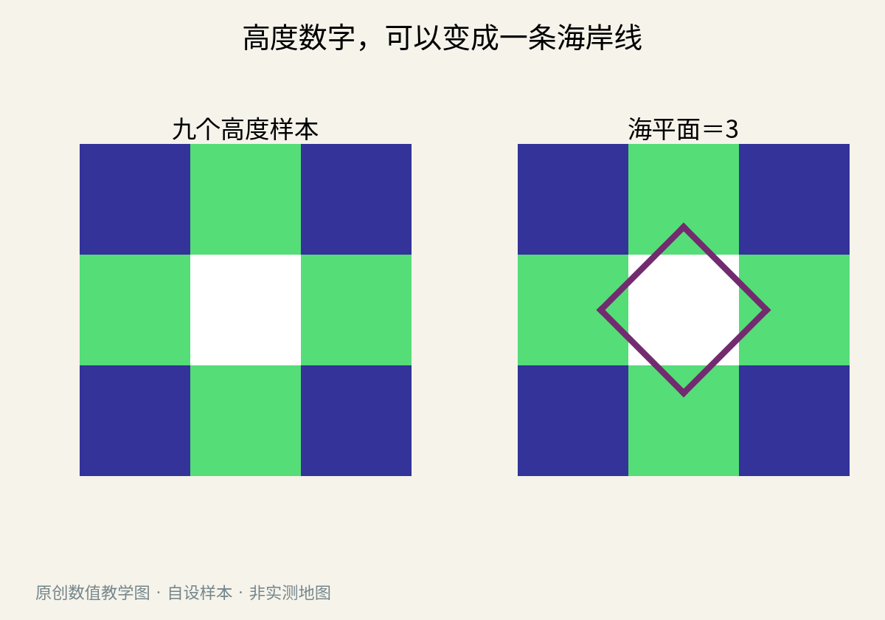

今天的主角叫 **Marching Squares**，常译作“行进方格”或“移动正方形”。它一格一格查看相邻四个样本，先在格子边缘找到等值位置，再把这些短线接成轮廓。地图的等高线、温度场的等温线、图像中的某个亮度边界，都能用同一种思想来理解。

我们不用一开始就背16种情况。先把一个格子走通，再让一整片海岸浮出来。

## 我们知道的是样本，不是整个世界

下面是一张3×3的教学高度表。横向叫x，向上叫y，相邻交点间距为1。中央高度6，四个正对方向的邻居高度2，四角高度0。这不是实测地形，所有数值都是为了方便手算而设定。

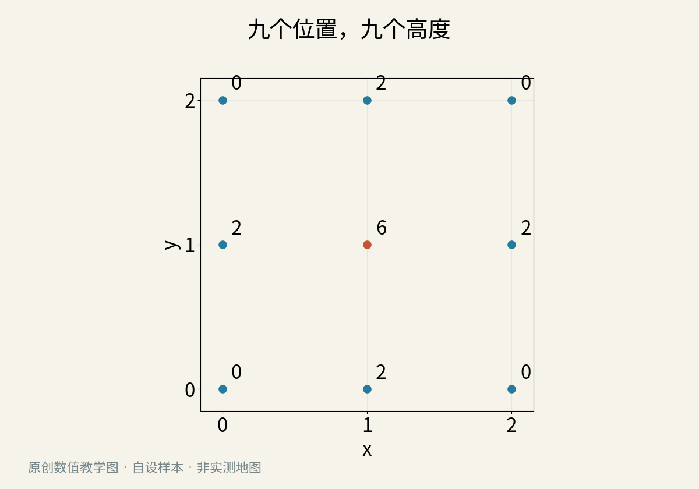

海平面是3。高于3的地方叫陆地，低于3的地方叫水。刚好等于3的地方，就是我们想提取的等值线。

先注意一件重要的事：九个样本只告诉我们九个位置。两个样本之间是什么样，并没有自动给出。为了继续计算，必须选择一个模型。

本篇在每条网格边上采用**线性插值**：沿边走的比例是多少，高度就在两端之间变化同样的比例。它简单、可复算，但不是对真实地表细节的保证。

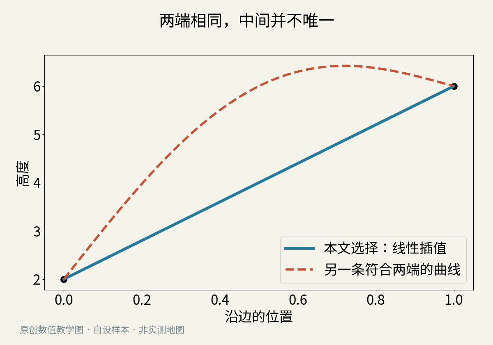

这解释了为什么“画得平滑”不等于“恢复了没采到的山谷”。算法能够认真处理手里的信息，却不能凭空知道样本之间藏着什么。

## 把镜头拉近到左下角的一格

这格四角按逆时针命名：左下A=(0,0)，高度0；右下B=(1,0)，高度2；右上C=(1,1)，高度6；左上D=(0,1)，高度2。

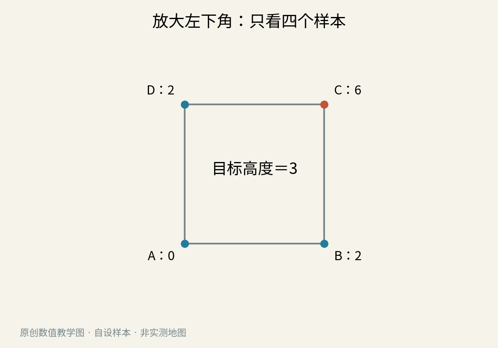

只比较四角与3的大小，我们得到：A低、B低、C高、D低。高低分类还不知道精确交点，但已经告诉我们：边BC和边DC一端低、一端高，它们会穿过高度3；另两条边两端都低，在线性插值下不会穿过3。

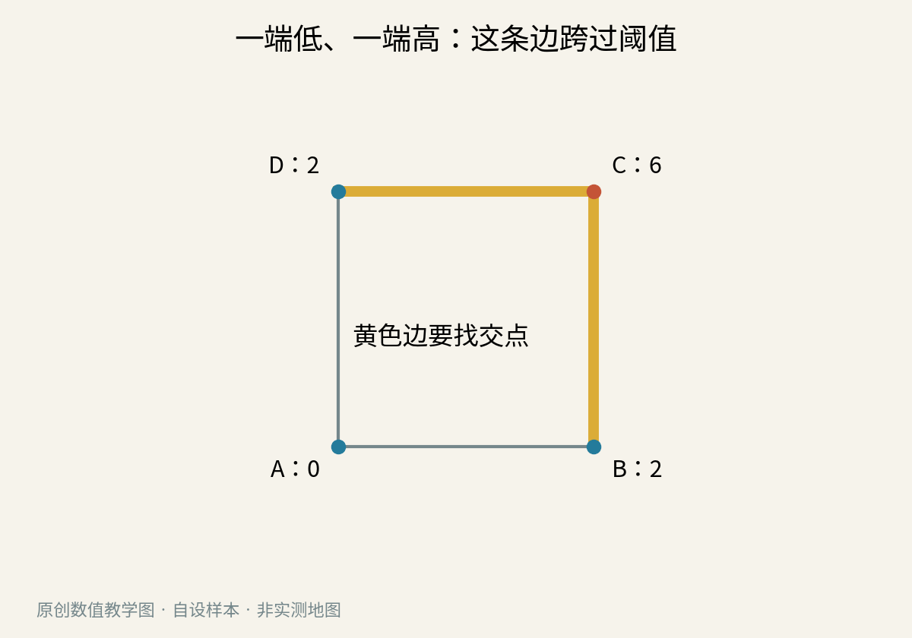

这里说“不穿过”，靠的是刚才的线性模型。如果真实边中间隆起一座窄山，两端都低也可能跨过海平面。这种小细节没有出现在样本里，当前模型就看不见。

## 交点不是一定在边的正中间

沿BC从高度2走向高度6，要先走过4个高度单位中的1个，才能到3。所以比例是：

t＝(3−2)÷(6−2)＝1/4。

B是(1,0)，C是(1,1)，因此交点为(1,0.25)。

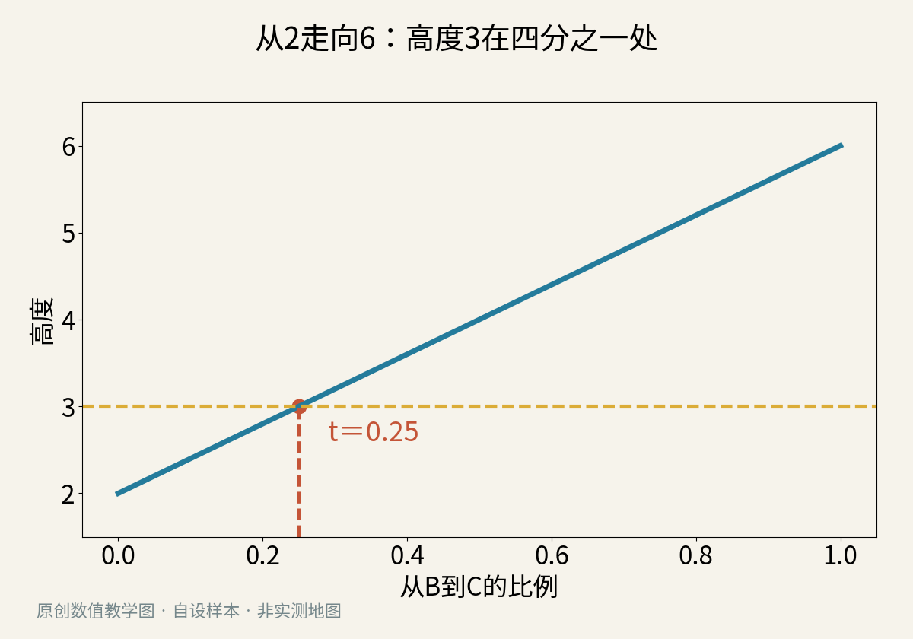

沿DC也一样，从(0,1)走向(1,1)，交点为(0.25,1)。把这两个点连接，得到本格中的一小段轮廓。

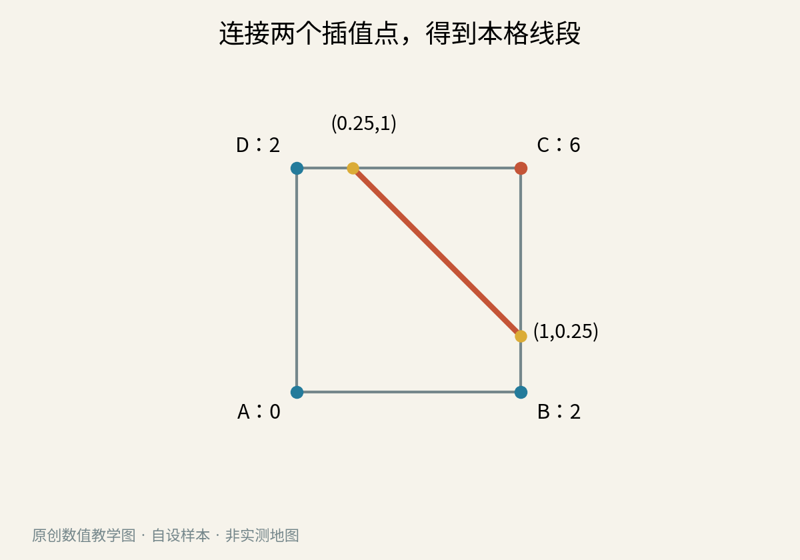

一般公式是t＝(目标值−起点值)÷(终点值−起点值)，位置则是“起点＋t×(终点−起点)”。这里的两个“差”要分清：前一个差算高度比例，后一个差算空间位移。

还有一个容易忽略的边界：**交点在线性边模型下是准确的；格子内部那条直线通常只是近似。**即便格内采用双线性插值，等值曲线也未必是直线。常见Marching Squares输出折线，用短线段近似内部曲线。

## 让其他格子也交出自己的那一段

对右下、右上、左上三格重复同样的操作。四格给出四条线段，拼成一个菱形，围住高于3的中央区域。

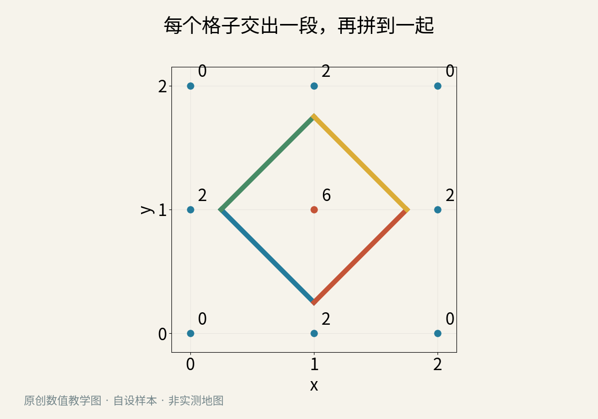

最终四个顶点是(0.25,1)、(1,0.25)、(1.75,1)、(1,1.75)。它们不是四个原始采样点，而是从采样值推出来的亚网格位置。

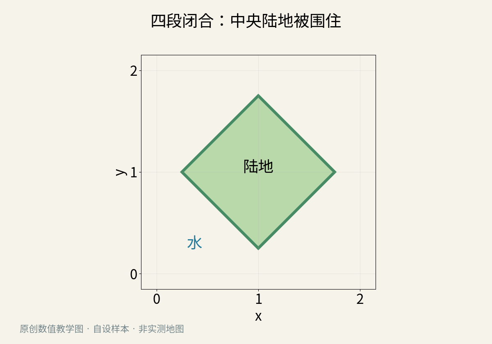

“行进”发生在这里：程序不需要先看懂整座岛，只要系统地访问每个格子，再把相邻格子的公共端点接好。

可以给每条网格边一个稳定编号，例如“第r行第c列的水平边”。两侧格子引用同一个边编号，就引用同一个交点。这样比把两个浮点坐标拿来问“是否完全相等”更可靠，也避免重复计算。

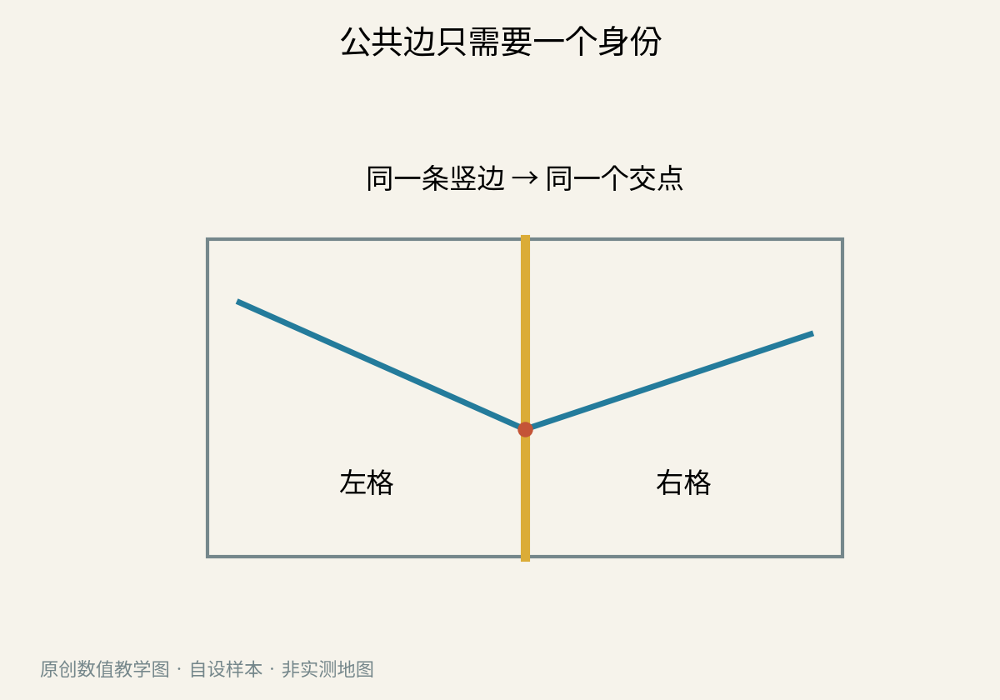

## 16种情况，从哪里冒出来？

每个角只有高、低两种分类，四个角就是2×2×2×2＝16种。可以让A、B、C、D分别占1、2、4、8这四个二进制权重：高于阈值的角把自己的权重加进编号。

当前只有C高，所以编号是4。旋转图形会得到相似情况，但程序的查表编号必须服从同一套角顺序，不能从另一份教程抄一个表，却保留自己的角编号。

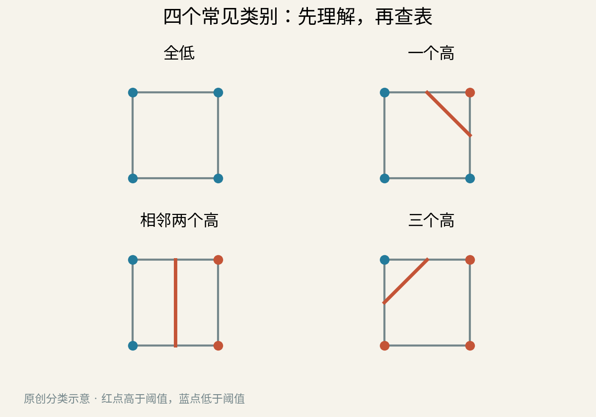

全低和全高都不用画线。一个角高，画线把它切出来；三个角高，等价于切出那个低角；相邻两个角高，线穿过格子，把两侧分开。

剩下一类最值得停下来：高角恰好在对角线两端。

## 一个格子里，竟然有两种合理接法

假设左下与右上高，右下与左上低。四条边都有交点。现在四个端点可以成对连接，但有两种不同的连接方式。

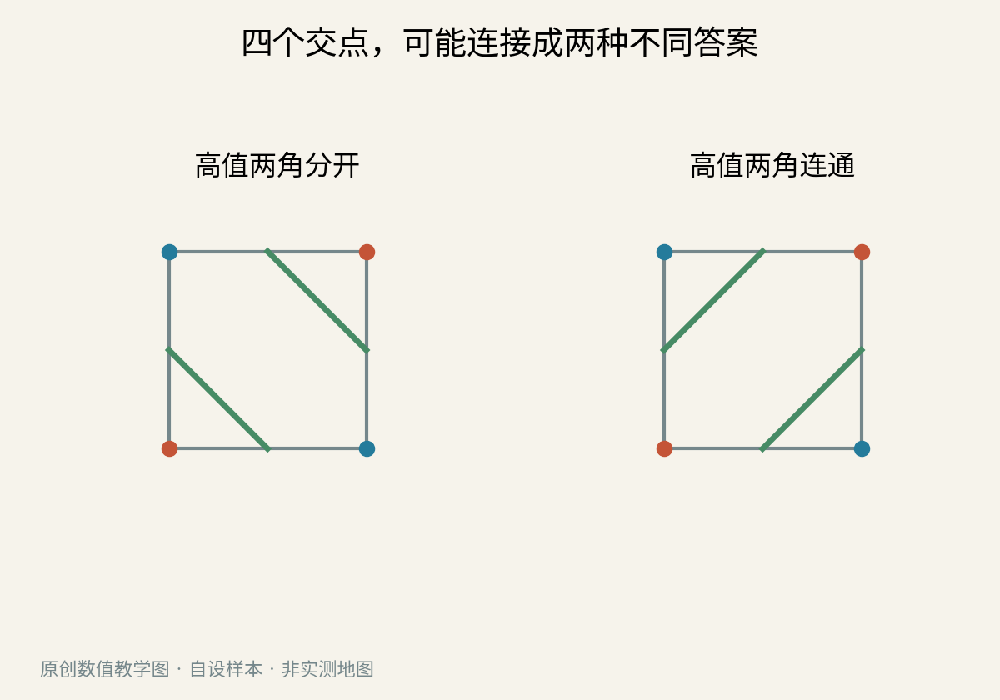

一种把两个高角各自圈在一边，高区域断成两块；另一种让高区域从中间相连，低区域分成两块。二者不只是线条略有不同：它们对“这两片陆地有没有连通”给出了相反答案。

这叫**歧义格子**。四个高低标签不足以决定连通关系。如果只保存了高低位，原来的数值差距已经被丢掉了。

在图像处理中，一种办法是明确采用连通约定：让高值区域或低值区域中的一方可以沿对角方向连通。scikit-image 0.21的`find_contours`提供`fully_connected='low'`或`'high'`，默认选择低值一侧充分连通。这是一个清楚的接口决定，不表示从四个角恢复了唯一真实地形。[官方接口说明](https://scikit-image.org/docs/0.21.x/api/skimage.measure.html#skimage.measure.find_contours)

## 若保留了高度，能不能作更有根据的判断？

可以，但仍然要说清格内模型。先把所有角值减去阈值，目标等值线就变成“值等于0”。令四角A、B、C、D的相对值分别为a、b、c、d。

双线性模型在单位格内写成：

f(x,y)＝a(1−x)(1−y)＋bx(1−y)＋cxy＋d(1−x)y。

不要急着害怕它。先沿底边和顶边分别做一次横向线性插值，再把这两个结果沿竖向混合，就得到这个式子。

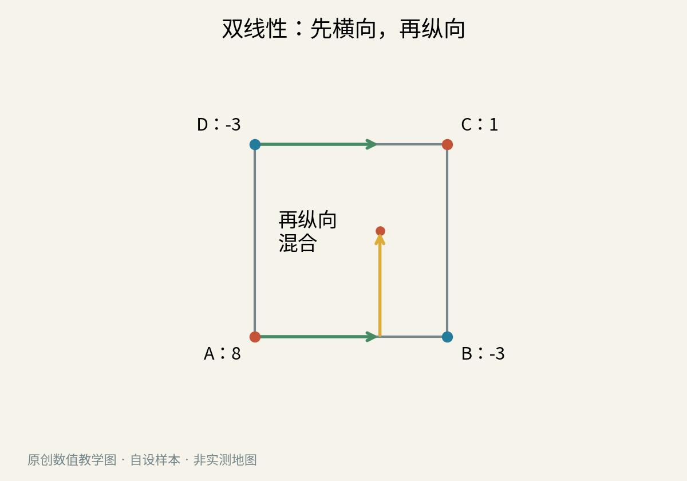

对高值位于A和C的交错格子，一个很有用的判断量是Q＝a×c−b×d。Q为正时，高值两角在双线性模型中相连；Q为负时，它们分开。Q为零是退化边界，需要单独定义处理。这个结论只在我们刚才固定的角顺序、符号格局和模型下使用，不能见到任意四个数就套上同一句话。

这种用插值模型解决歧义的思路，与Gregory Nielson和Bernd Hamann在1991年发表的 **Asymptotic Decider** 工作直接相关。那篇论文处理的是三维Marching Cubes中的歧义，格子面的双线性插值是关键部分。[作者的论文目录](https://web.cs.ucdavis.edu/~hamann/pubs91.shtml)

## “看看格子中心”为什么有时会判断错？

看一组特意挑选的相对高度：a=8，b=−3，c=1，d=−3。格子中心的双线性值是四角平均，等于0.75，确实高于0。

如果只看中心，就可能宣布“高值应该连起来”。但Q＝8×1−(−3)×(−3)＝−1，给出的是高角分离。

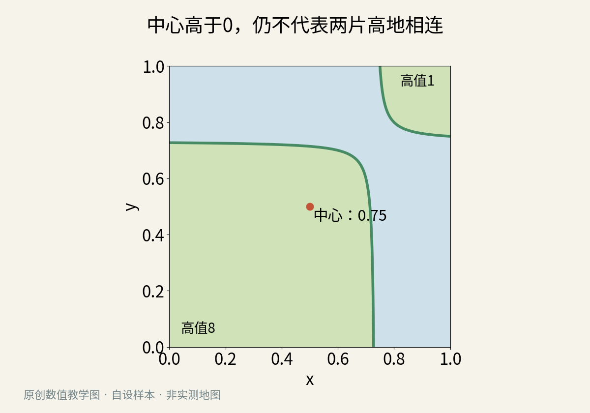

问题在于，决定两片区域能否连通的狭窄位置，不保证正好位于格子的几何中心。在这个模型里，鞍点位于(11/15,11/15)，其值为−1/15。中心高，并没有把那道低鞍部填上。

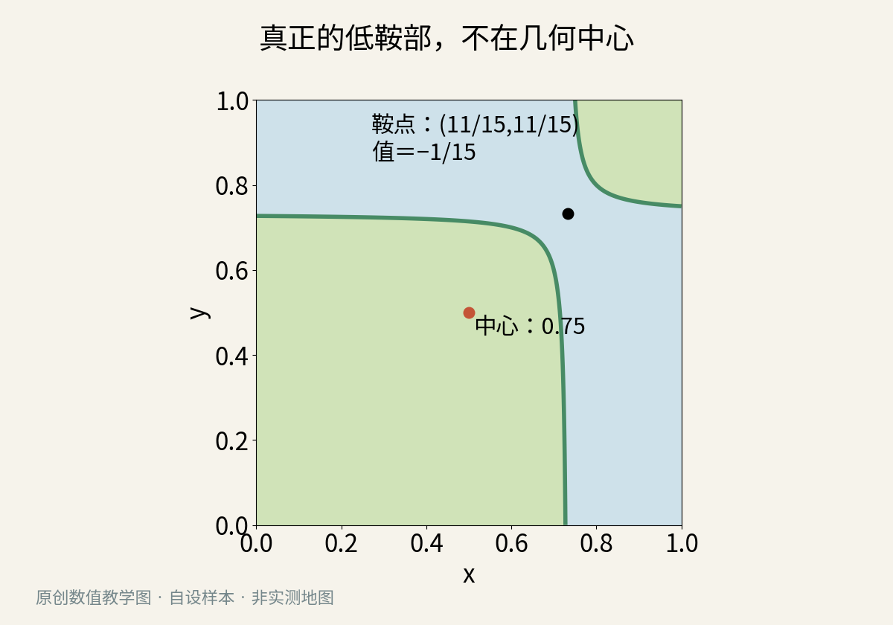

这也是科学计算里一个很有意思的转折：一张“看起来差不多”的轮廓图，可能会给后续算法传递错误的连通性。判断一座岛还是两座岛，远不只是美术细节。

## 轮廓必须闭合吗？先看看地图边缘

如果等值线从数据范围里走了出去，它就会在边界终止。提取结果可以是一条开放折线，不必硬把首尾接起来。

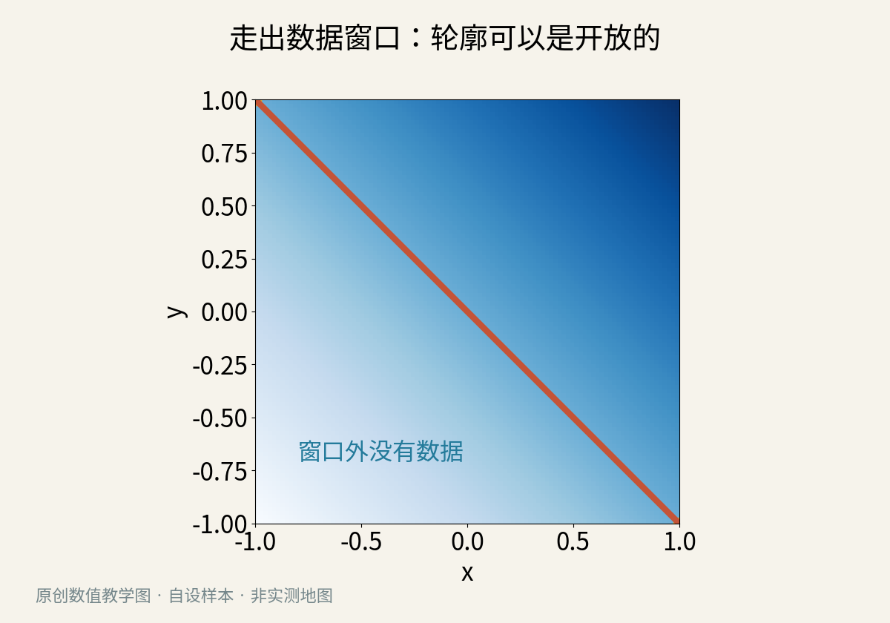

缺失值与掩膜也会造成开放轮廓。把它强行闭合，就等于替没有数据的地方编造了一段边界。

下图来自scikit-image官方轮廓示例，是其公开代码对合成数值场提取0.8等值线的真实示例输出。它同时展示了内部闭合轮廓和走到画面边缘的开放轮廓，并不是显微照片或真实地形。

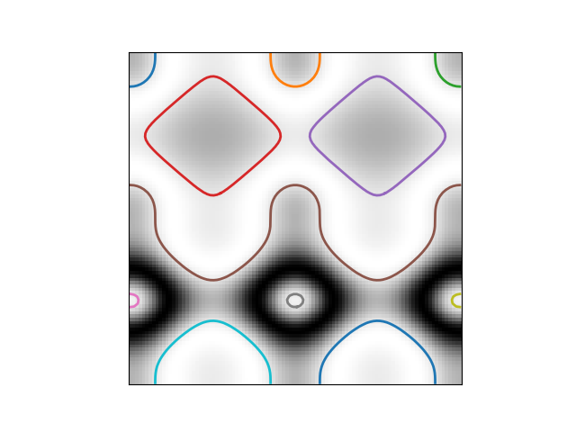

这篇示例的输入由正弦、余弦和指数构造。它提醒我们，Marching Squares处理的是二维数值场；“海岸线”只是一个容易想象的入口。[示例与完整代码](https://scikit-image.org/docs/0.21.x/auto_examples/edges/plot_contours.html)

## 从方格到立方体，思想相通，麻烦也升级

1987年，William Lorensen与Harvey Cline发表Marching Cubes论文，用三维采样数据构造表面。[原论文](https://www.cs.toronto.edu/~jacobson/seminar/lorenson-and-cline-1987.pdf)二维方格边上的交点，在三维里变成了立方体边上的交点；短线段升级成三角形片。

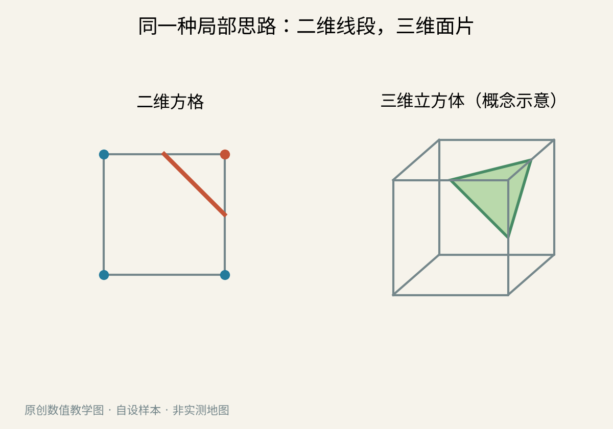

这里不把“方格版”的全部历史硬归给某一个人，也不把三维算法说成“把16改成256就结束了”。三维还涉及面与体内部的歧义、相邻单元的一致性、法线，以及网格质量。1991年的工作正说明，查表后面仍有需要仔细维护的几何前提。

## 亲手画出这个小岛

下面只用Python标准库，实际执行过。为了保持短小，它只处理本篇3×3高度表里每格恰好有两个交点的情况；遇到歧义格子会明确拒绝，不能把它当作完整通用库。

```python
H = [[0, 2, 0], [2, 6, 2], [0, 2, 0]]
level = 3
segments = []
for y in range(2):
    for x in range(2):
        corners = [(x,y), (x+1,y), (x+1,y+1), (x,y+1)]
        hits = []
        for k in range(4):
            p, q = corners[k], corners[(k+1) % 4]
            u, v = H[p[1]][p[0]], H[q[1]][q[0]]
            if (u > level) != (v > level):
                t = (level-u)/(v-u)
                hits.append((p[0]+t*(q[0]-p[0]),
                             p[1]+t*(q[1]-p[1])))
        if len(hits) == 2:
            segments.append(hits)
        elif hits:
            raise ValueError("需要明确的歧义处理")
print(segments)
```

输出四条线段，端点正是前面那四个位置。试把海平面改成4：沿2到6的边，现在走到一半，中央陆地缩小了。再改成1：海水更低，陆地伸得更远，轮廓形状也随跨越的网格边变化。在这个有限窗口里，高度1的轮廓会分成四段开放曲线，从窗口边缘离开；不要擅自把它们闭合。

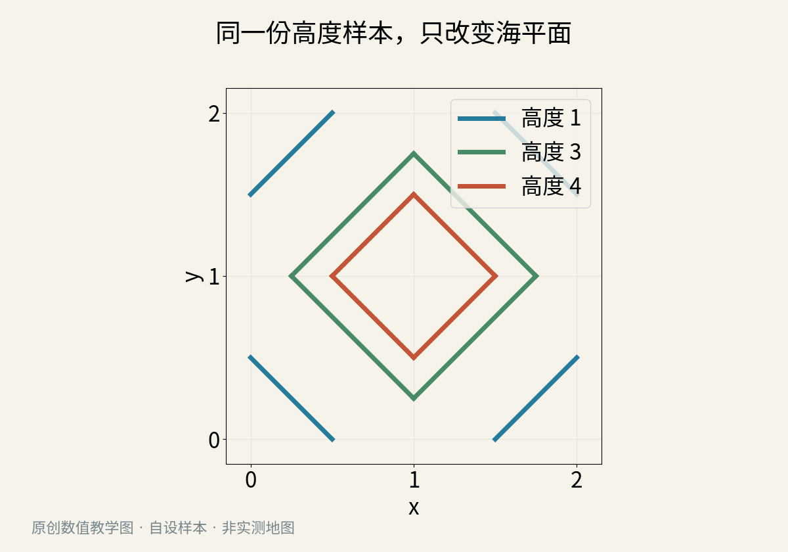

但如果阈值恰好等于某个样本，要统一决定“等于”属于哪一侧，消除重复交点和零长度线段；整条边都等于阈值时，还需要边归属约定。本例特意选3来避开这些退化情况，工程代码不能假定永远这么幸运。

至此，我们从九个数字走到了一条可复算的轮廓。最值得带走的不是16个图案，而是一条工作顺序：**先说明样本之间怎么变化，再找边交点，再决定连接方式，最后尊重数据边界。**

海岸线不是数字表里早已藏好的矢量文件。它是数据、插值模型与连通规则共同构造出来的答案。

图片来源：18幅原创教学图使用自设数据生成；scikit-image示例图来自上述官方页面，© scikit-image team，按BSD-3-Clause保留原文件与完整许可。全部真实来源、范围与代码见sources.md。
