# 路明明已经堵死，最大流为什么还要画一条“倒着走”的边？

假设你要给一个运输网络排计划：货物从 s 出发，经中转点 a、b，送到 t。每条线路每小时最多运一单位货物。暂时不考虑旅行时间、车次和装卸，只研究长期稳定的运输速率。

下面这张图很小，只有四个点、五条单向通路。箭头决定方向，数字 1 是容量上限。

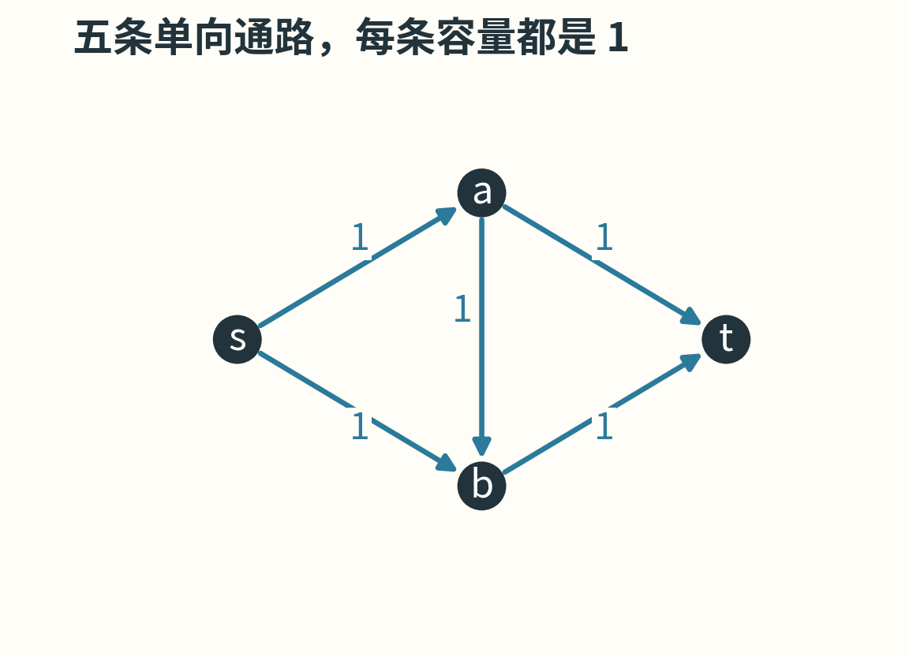

你一眼可能已经看出：上面走 s→a→t，下面走 s→b→t，两路一起，每小时能运两单位。

但电脑不一定第一眼就选到这两条。如果它先找到 s→a→b→t，安排了一单位，会发生什么？

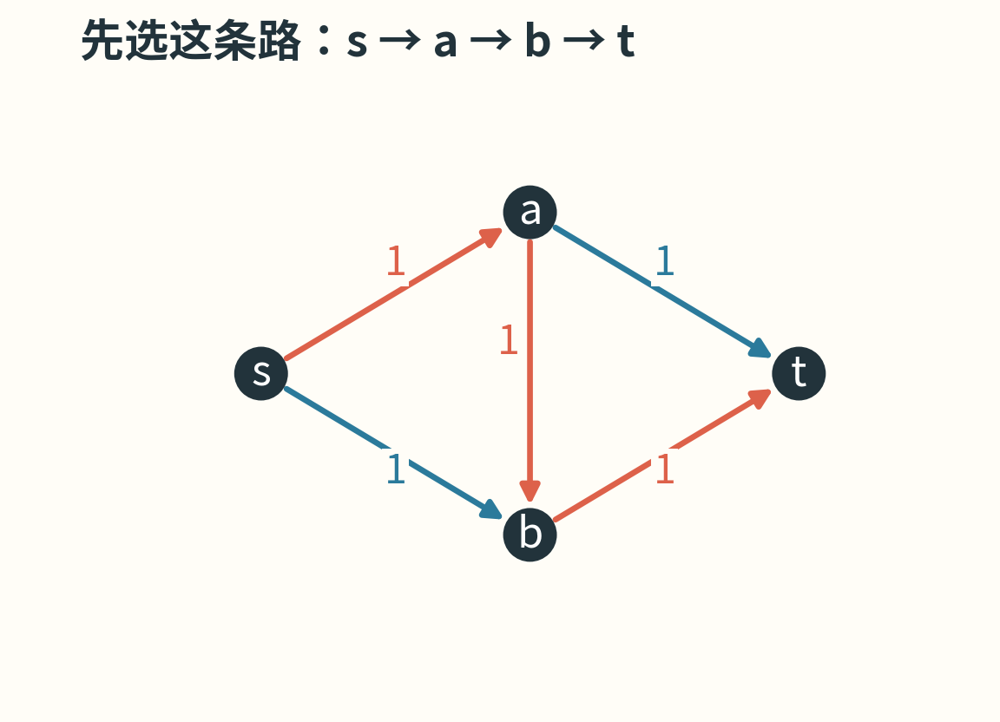

沿途三条边全部占满。现在从 s 还能走到 b，从 a 还能走到 t，却没有办法把这两段接起来。

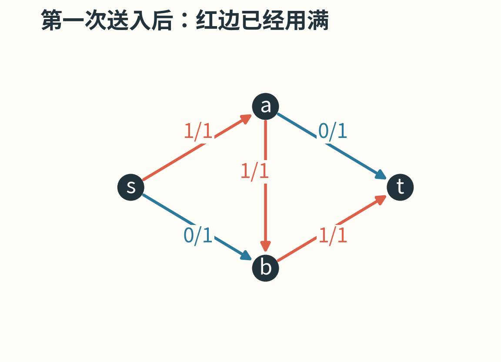

图中“1/1”表示已经安排 1、容量上限 1；“0/1”表示还没使用。红边都是第一次路线用到的边。

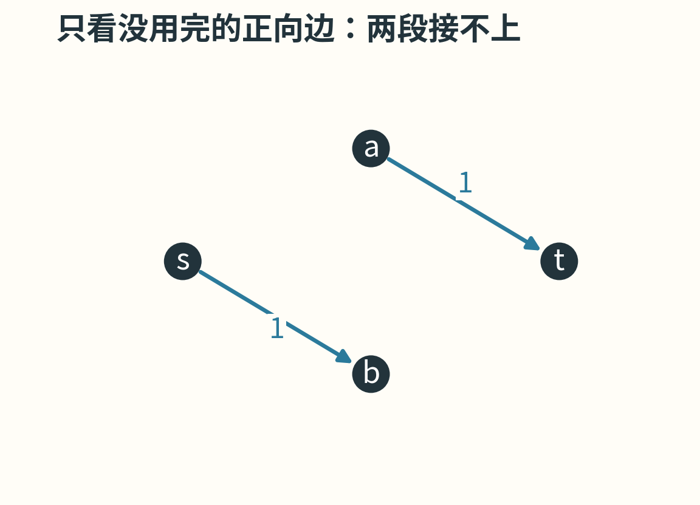

如果算法只认“还没用满的原方向线路”，它就会宣布：最多一单位。可我们开头已经看见两单位的方案。

问题不是缺了一条道路，而是把先前的决定当成了永远不能修改的承诺。

## 先分清两件事：修订计划，不是让火车倒回去

最大流求的是一个最终安排：每条边承担多少流量，合在一起能从起点送出多少。算法中间的一次“送入”，可以理解为往计划表里增加流量，不必理解成真实货物已经发走。

第一次给 a→b 安排了 1。为了修订这份计划，我们必须能把它减回 0。于是算法增加一条 b→a 的反向边，容量为 1。

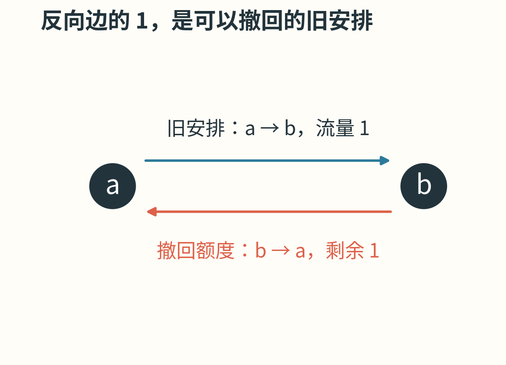

这条红色箭头不声称现实里存在 b→a 的铁路。它表示：之前从 a 到 b 的一单位安排，还能撤回。

这个解释非常重要。如果你的任务真的是给已经发出的列车调度，涉及时间、占线和车辆位置，就必须建立更完整的模型。不能把数学上的撤回，冒充现实中的瞬间倒车。

## “剩下多少”有两个方向

对于一条容量 c、当前流量 f 的边：

- 正向还能加 c−f
- 反向还能撤 f

这两个数一起描述了还能怎样修改计划。

初始时 f=0，全部容量在正向，反向为零。第一次占用后，某条容量 1 的边变成 f=1，正向剩零，反向多出 1。

把所有正向剩余和反向撤回额度画在一起，就是剩余网络，也常叫残量网络。它与原图使用相同节点，但边描述的是“现在还能怎样改”。

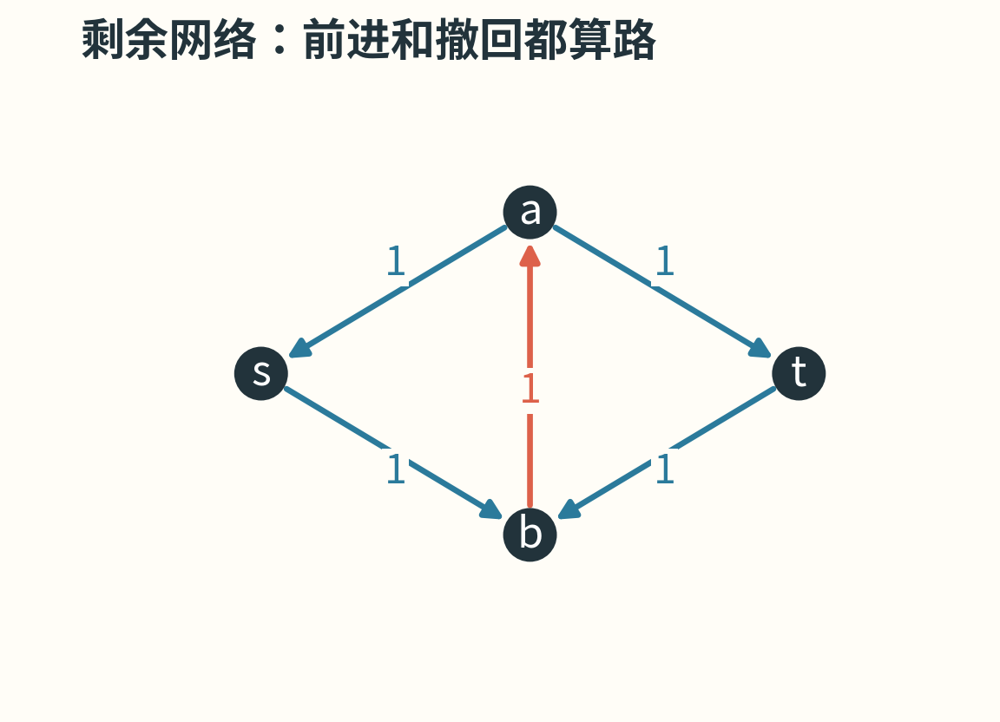

这张图里，a→s 和 t→b 也出现了。它们同样来自第一次安排的撤回额度。算法并不是只给“看上去用错”的中间边开特权，而是对每条使用过的边一致地记账。

零额度的边没有画出，因为它们现在不能提供改动。新的关键通路终于连起来了：s→b→a→t。

## 一次看起来倒着走的路，怎样多送出一单位？

沿着 s→b→a→t，每条剩余边都还有 1。整条路最多增加多少，取决于最紧的那条边，也就是沿途额度的最小值。这次最小值为 1。

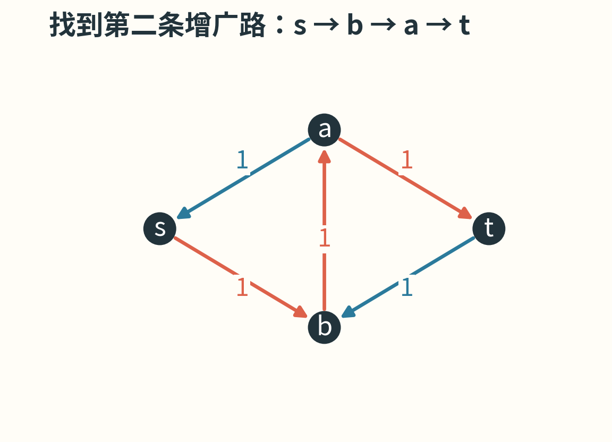

这样一条从 s 到 t 的剩余通路叫增广路。它不一定是一条现实中全程可通行的路线，而是一组能够共同提高总流量的计划修改。

逐条翻译这次修改：

1. s→b 是原方向，增加 1
2. b→a 是撤回方向，把原来的 a→b 减少 1
3. a→t 是原方向，增加 1

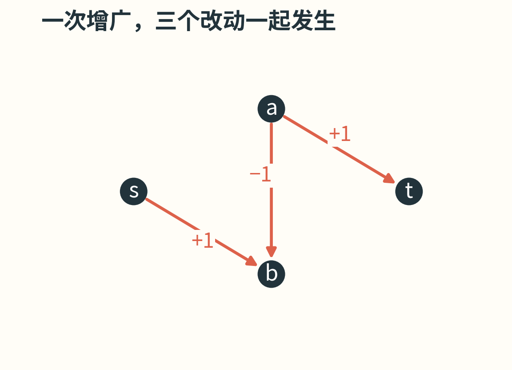

现在把所有修改合回原图。

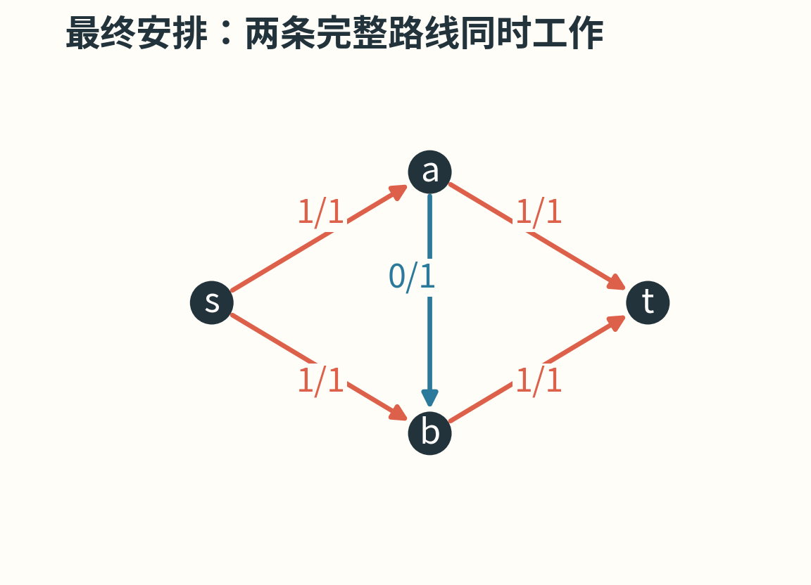

a→b 变回 0。上路 s→a→t 承担 1，下路 s→b→t 承担 1，总量变成 2。没有任何原始单向边真的承载负流量，也没有超过容量。

这不是“撤回一单位，所以白忙一场”。撤回的是一段内部安排，同时两处新的连接把旧路线拆开、重新接成了两条路线。

## 中转点为什么不会凭空多出货物？

流必须满足两个条件。第一个是容量条件：每条原始边的流量不能小于零，也不能超过容量。

第二个是守恒条件：除了起点 s 和终点 t，每个中转点流入多少，就必须流出多少。中转点不是无限仓库，也不能凭空制造货物。

看看最终的 a：来自 s 的 1 没变，原先流向 b 的 1 被取消，改为流向 t 的 1。流入仍是 1，流出仍是 1。

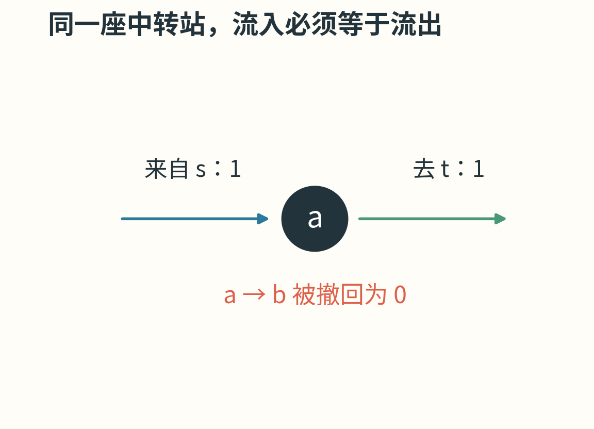

对 b 也一样：来自 a 的 1 被撤销，换成来自 s 的 1；流向 t 的 1 保持不变。

沿完整增广路一起调整，正是在保持这些中间节点守恒的同时，增加源点的净流出和终点的净流入。只单独改一条内部边，通常会破坏守恒；不能把一条增广路拆成互不相关的提交。

## 找到两单位，还不等于证明它最大

假如有人说可能还有第三条巧妙路线，你怎样回答？继续试更多路径，最多证明自己还没找到；我们需要一个无论路线怎么绕都无法超过的上界。

把 s 单独放一边，其余三个点放另一边。任何从 s 到 t 的流，都必须穿过这道边界。跨出去的只有 s→a、s→b，两条容量都是 1，总共只有 2。

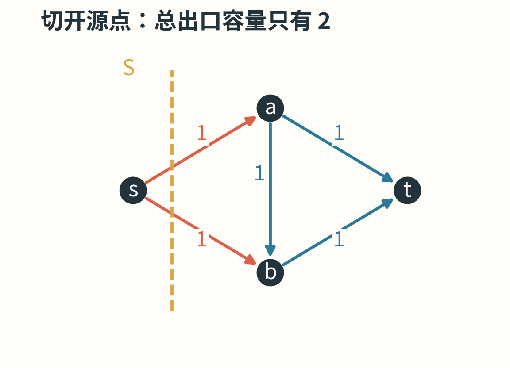

这种把源点与终点分在两边的划分叫割。割的容量是从源点所在那一侧，指向另一侧的原始边容量之和。这里必须注意方向，不是把所有穿过虚线的箭头都无条件相加。

我们已经构造出流量 2，而这道割证明所有方案都不超过 2。

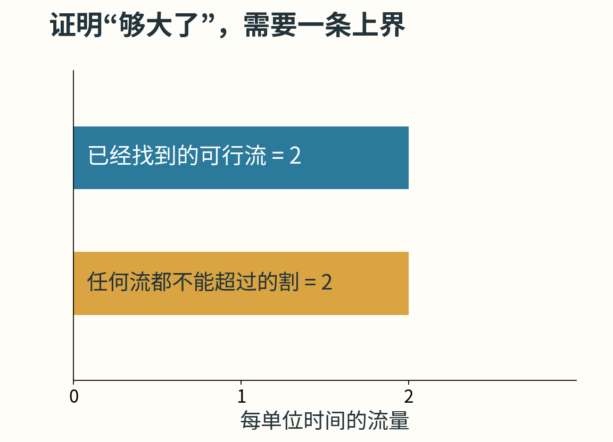

上下两条证据碰在一起，答案才被钉住。这就是最大流与最小割之间最漂亮的关系：一边给出“至少能做到多少”，另一边给出“最多只能做到多少”。

一般情况下，当剩余网络里再也找不到 s 到 t 的通路，可以从 s 出发，标出仍然到得了的全部节点 S。t 不在其中。

为什么这会给出证据？原图中从 S 指向外面的边必须已经用满，否则对应的正向剩余边还允许走出去。反过来，从外面流入 S 的原始边必须没有流量，否则它的撤回边又会让我们从 S 走出去。

所以这道割上没有可以挤出的余地，割容量恰好等于当前净流量。“没有增广路”于是变成一个可以证明最优的条件，而不是搜索程序的失望声明。[MIT 关于流与割的讲义](https://courses.csail.mit.edu/6.854/20/Notes/n06-flow.html)

## 代码里，那两行一减一加究竟在做什么？

每条边都与自己的反向边配对。沿一条剩余边使用 delta 后，当前方向少掉 delta，配对方向增加 delta：

```python
g[u][j][1] -= delta
g[v][reverse_index][1] += delta
```

这两行无须特别问“我现在走的是原边还是反边”。原边使用后，会产生撤回额度；撤回以后，又恢复原方向的可用额度。同一套更新就能处理这两种情况。

完整可运行的 [Python 3 实验](examples/experiment.py) 用邻接表保存“终点、剩余额度、配对边位置”，用深度优先搜索寻找正额度通路。输入就是正文的四节点图。运行后前几行是：

```text
s -> a -> b -> t + 1
s -> b -> a -> t + 1
maximum flow: 2
```

随后打印原图各边流量，依次是 s→a:1、s→b:1、a→b:0、a→t:1、b→t:1。本地已实际运行，并检查最终流量与这些值一致。

选择深度优先，是为了让这个例子真的先走到那条需要修订的路线。若用别的搜索顺序，程序可能一开始就找到上下两路，不经过中间边，结果仍应是 2。

实现时不要用“终点节点相同”代替配对关系。如果原图本来同时含 a→b 和 b→a，或者允许平行边，每条原边仍需要自己的撤回记录。正文代码用反向边下标明确配对，避免把物理反向边与撤回额度混在一起。

## 一条铁路问题，怎样变成算法语言

L. R. Ford Jr. 与 D. R. Fulkerson 的《Maximal Flow Through a Network》于 1956 年刊于《Canadian Journal of Mathematics》。论文开头把问题追溯到 T. Harris 提出的铁路网络容量问题：连接两座城市的线路各有容量，稳定状态下最多可以通过多少流。[原论文](https://www.cs.yale.edu/homes/lans/readings/routing/ford-max_flow-1956.pdf) · [期刊元信息](https://doi.org/10.4153/CJM-1956-045-5)

这不是要给某一列火车找最快路线，而是在约束下安排整个网络的流量。1956 年论文证明了最小割定理，并讨论特定平面网络的计算办法。今天讲授的通用“剩余网络加增广路”写法，应当与这一历史论文的具体表述区分开，不能把现代邻接表代码倒写成当年的程序。

这个问题后来走出了铁路。因为很多“安排”都具备类似结构：某个选择用掉容量，重新分配时，又需要保留撤回的可能。

## 让任务换个搭档，为什么也会出现反向边？

换一个明确的新例子：甲可以做 X、Y 两项任务，乙只会做 X，每个人最多做一项，每项最多安排一人。

如果先把 X 交给甲，看起来乙就无事可做。

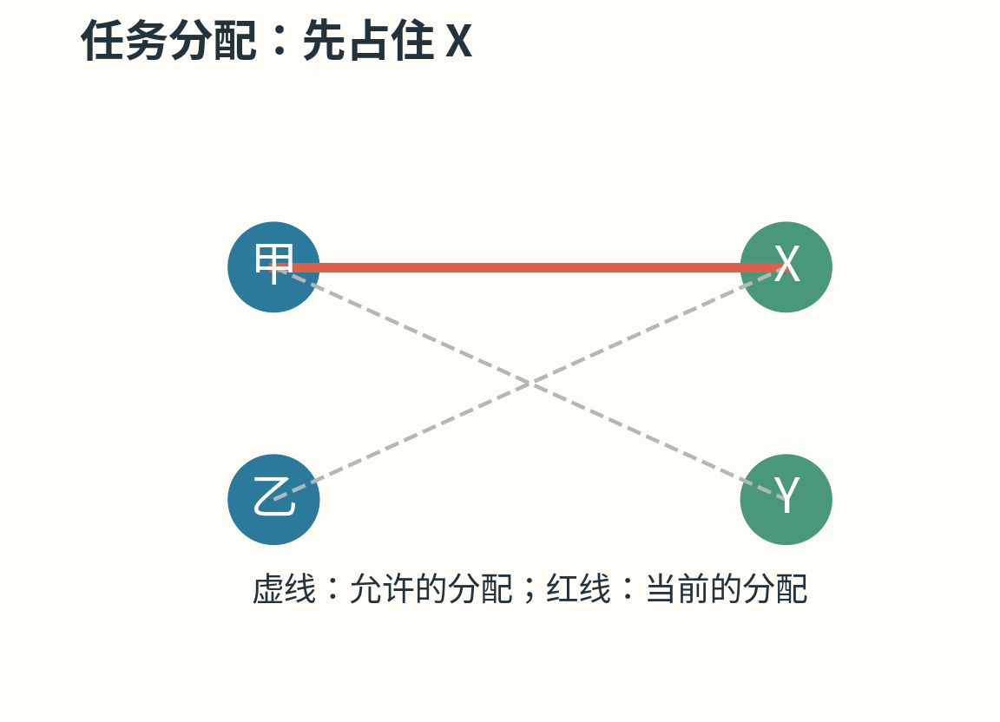

但我们可以撤回“甲做 X”，改成“乙做 X，甲做 Y”。两个任务都有人做。

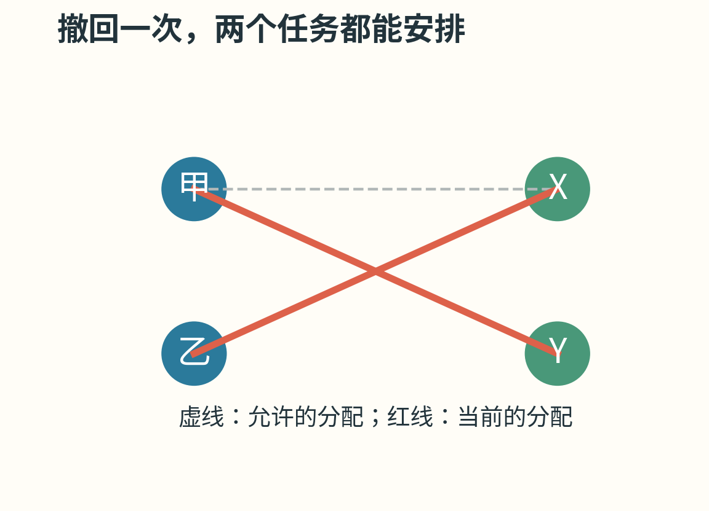

把人员和任务接成有容量的网络，就能用最大流描述这个匹配问题。沿交替路线取消旧配对、建立新配对，与刚才取消 a→b 的流量是同一种思想。

反向边的价值因此不只在“水怎么流”。它让局部选择保留可修订性，避免一个眼下合法的决定永久挡住更好的整体安排。

## 有反向边就够快了吗？还没有

回到四节点图，只改容量：四条外边都变成 M，中间 a→b 仍是 1。

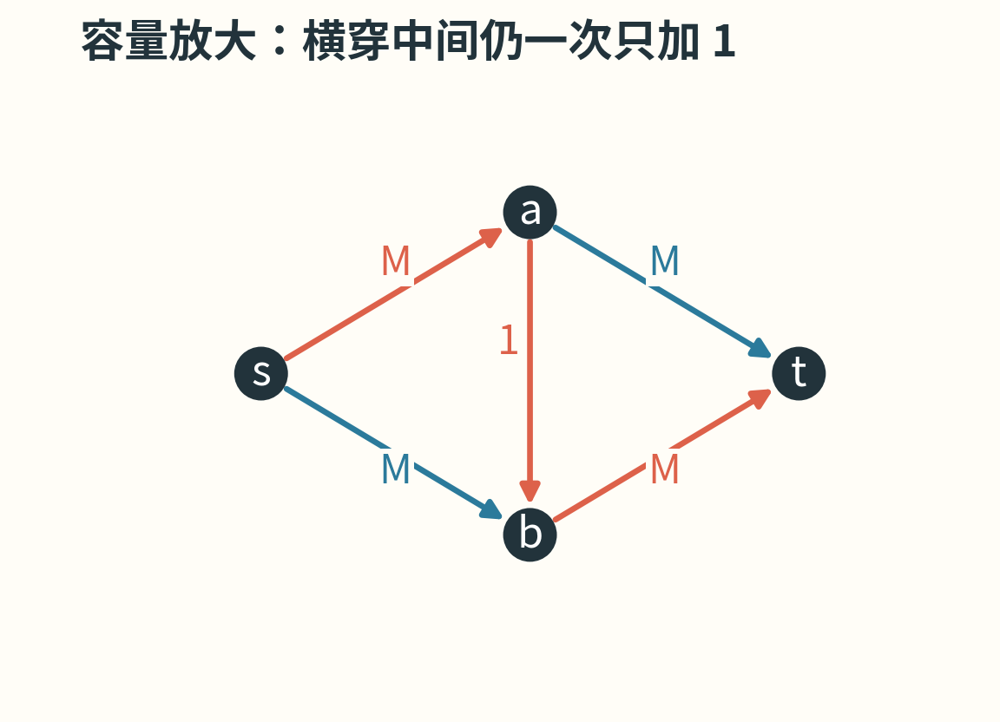

如果每次都穿过中间那条容量 1 的边，或者它的撤回边，算法可以每次只增加 1，来回修订，做 2M 次才完成。

如果先走 s→a→t，再走 s→b→t，每次增加 M，两次就结束。

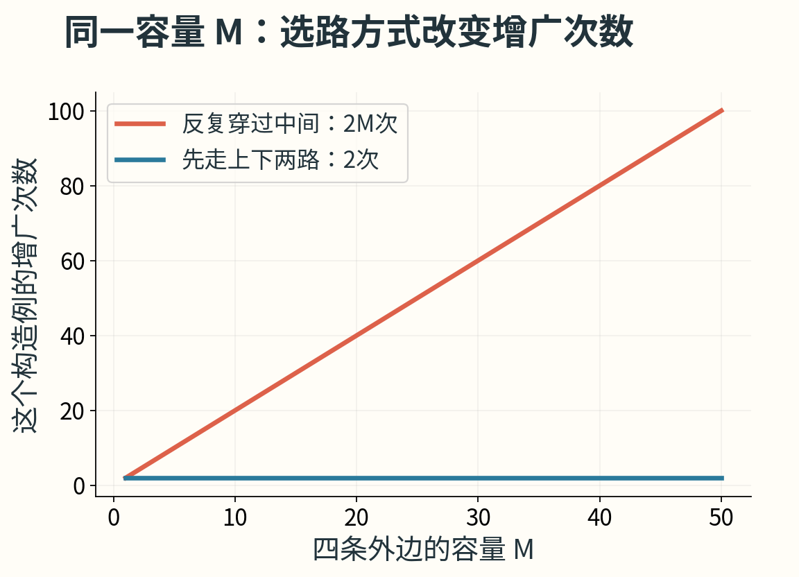

同一个正确框架，不同选路规则的效率可以差很多。这个图按构造计算增广次数，不是机器耗时测试。

当容量是非负整数，每次成功增广至少增加 1，所以基本方法会在有限步结束。但“有限”不等于“够快”：如果 M 很大，次数就可能很大；用二进制写下 M 又只需要少量位数。

更有针对性的办法会规定选路策略。比如用广度优先搜索选择边数最少的增广路，得到 Edmonds–Karp 算法，其经典时间界是 O(VE²)。这里“最短”指经过的边数，并不是运输距离或费用。[MIT 最短增广路讲义](https://courses.csail.mit.edu/6.854/21/Scribe/s7-blockingFlows/unit-capacity.html)

一般实数容量还会带来更细的终止问题；不合理的选路在某些无理数容量构造里甚至可能无限继续。实际浮点实现又必须处理舍入和接近零的剩余额度。本文的整数小实验避开了这些数值问题，并没有替它们提供通用解决方案。

最后回到开头每条边容量都为 1 的四节点图，再做一个改动：删去 a→t，其他都不变。先猜最大流是多少，再运行代码删除对应边。你应该能找到一个容量为 1 的割，解释为什么反向边也造不出第二单位。

它能撤回旧承诺，却不能凭空创造容量。这恰好是算法里“灵活”与“守约”能够同时成立的地方。

图片来源：全部为本文原创教学网络图与计算示意，节点、容量、流量和选路条件均在正文说明。历史与机制参考 [Ford、Fulkerson 原论文](https://www.cs.yale.edu/homes/lans/readings/routing/ford-max_flow-1956.pdf)及 [MIT 网络流讲义](https://courses.csail.mit.edu/6.854/20/Notes/n06-flow.html)。
