# 远处的地板为什么在闪？Mipmap 把纹理提前变成一摞“小抄”

把游戏里的相机慢慢向后退。脚边的黑白地砖还很安静，远处却可能冒出一道道并不存在的条纹；相机稍微一动，条纹又换了位置。

地板没有变，贴在地板上的图片也没有变。变化的是：屏幕留给每块地砖的格子，越来越少了。

这篇文章要认识的 **Mipmap**，是一组提前计算好的、分辨率逐层降低的纹理。它让渲染器在远处直接读取已经汇总过的细节，而不必每次都从大图里临时求平均。我们先让一个错误真实地发生，再看看这摞“小抄”怎样救场。

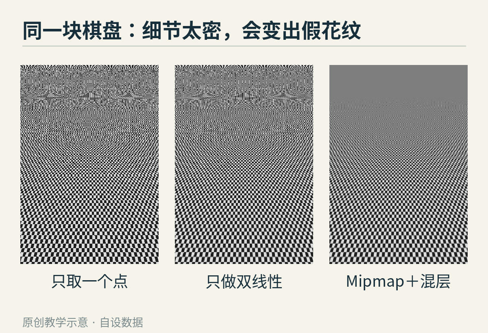

这是本文程序实际生成的教学图，不是某款游戏的截图。三列使用同一纹理和同一投影；区别只在如何取纹理颜色。远处第三列变灰，不意味着原图里真的有一块灰地板。

## 一格像素，凭什么代表一大片地板？

先分开两个容易混淆的词。**像素**是输出图像里的格子；**纹素**是纹理图片里的格子。它们都可以存颜色，但处在两张不同的网格上。

一张有512×512个纹素的贴图，可以贴到一块只占20×20个屏幕像素的地面上，也可以被放大到整个屏幕。纹素不会自动与屏幕像素一一配对。

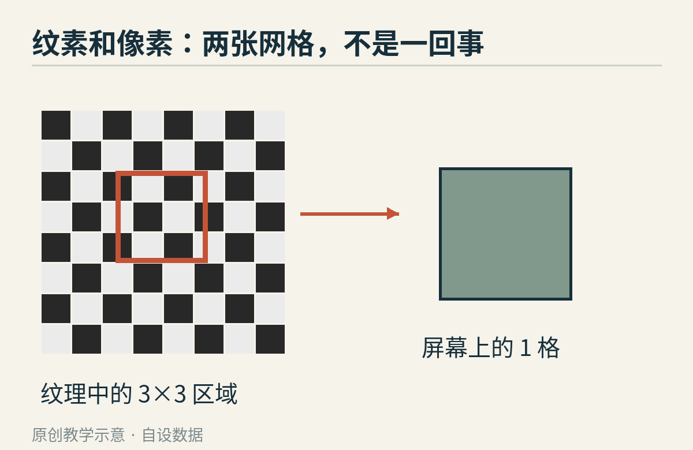

红框代表一个像素映射回纹理的大致覆盖区域，常叫“纹理脚印”。它是一个区域，而不是一个没有面积的小点。

一个朴素办法是：从区域中央挑一个纹素，把它的颜色送给屏幕像素。近看时，这个代表也许还算公道；远看时，代表周围可能有几十、几百个纹素，它们的意见全被忽略了。

现在把问题压成一条黑白相间的纸带，黑记0，白记1。屏幕每一格对应纸带上两格。如果总从黑格取样，输出就是一片黑；把取样起点往右挪一格，输出突然全部变白。

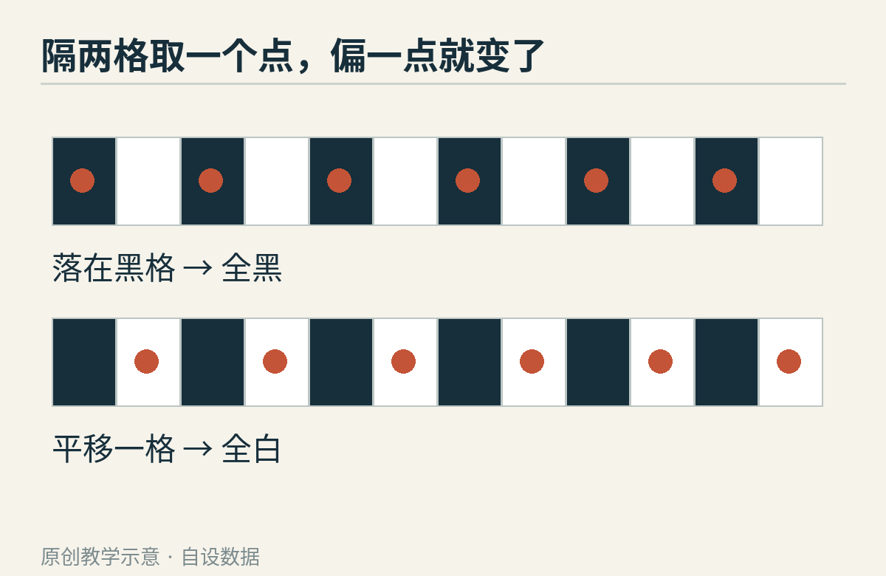

两次观察面对的都是黑白各半的纸带。冒出来的“全黑”和“全白”，是取样方式制造的低频假象。这就是**混叠**的一种：原来密集的变化，被稀疏样本误装成了另一种变化。连续移动时，假花纹不断换相位，于是看上去在闪。

这和三角形轮廓上的阶梯不完全是同一个问题。几何边缘可以没有锯齿，三角形内部的密纹理仍然会闪；提高几何覆盖采样质量，也不自动解决所有纹理取样问题。

## 已经开了“双线性”，为什么还不够？

双线性过滤做的事情，可以想成让取样位置附近的四个纹素按距离投票。离哪个更近，哪个权重更大。它能让放大后的颜色过渡更平滑，不必总是跳到最近的那一格。

但四个邻居，未必代表一个大区域。

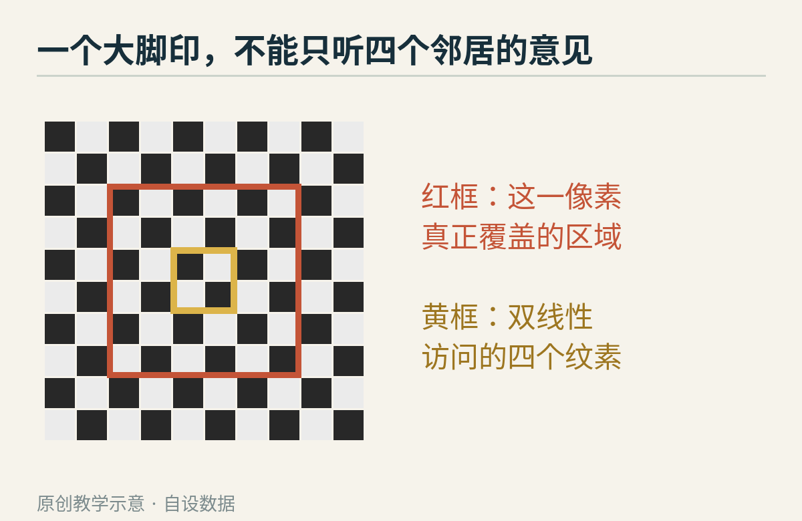

黄色小框里的四格即使平均得再精确，红色大框里其余的格子仍然没有参与。真正该问的，已经不是“这个点附近是什么颜色”，而是“这个区域整体应该给出什么颜色”。

一种直接办法是：把红框里的纹素都取出来，按覆盖程度加权平均。它能更接近我们想要的区域颜色，却也可能很贵。远处一个屏幕像素，反而需要读很多纹理数据。

这里出现了一个值得反复使用的算法思路：如果许多查询都会问相似的“大范围汇总”，能不能提前把汇总结果存下来？

## 在画面生成之前，先把细节收拾好

1983年，Lance Williams 在《Pyramidal Parametrics》中讨论了纹理缩放时不断变化的采样窗口，并提出多分辨率的预过滤表示。论文解决的不是“怎样把图随便缩小”，而是怎样以可负担的成本，在不同观察尺度之间保持较稳定的图像。[原论文](https://users.cs.northwestern.edu/~ago820/cs395/Papers/Williams_1983.pdf)

这条路的关键，是把部分工作从“每个像素、每一帧”移到“准备纹理的时候”。我们用一个极小的例子走一遍。

先把4×4棋盘分成四块2×2小方块。每个小方块里有两个黑格、两个白格；如果数值代表线性光量，平均就是(0＋1＋1＋0)÷4＝0.5。把每块的平均值写进新图，对应位置只留一格。

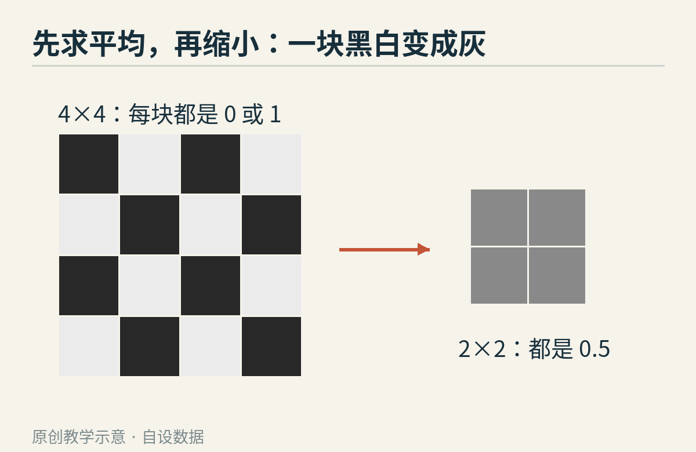

**预过滤**发生在丢掉分辨率之前：先让一个区域共同决定代表值，再减少格子。直接隔行隔列扔掉数据，得到的也许仍是一张小图，却没有完成同样的工作。

不是所有纹理都会一缩就变成均匀灰色。换成下面这个4×4教学图，四块2×2区域分别有1、4、1、2个白格，平均就是0.25、1、0.25、0.5。大致的明暗结构被留下，最细的黑白变化被汇总。

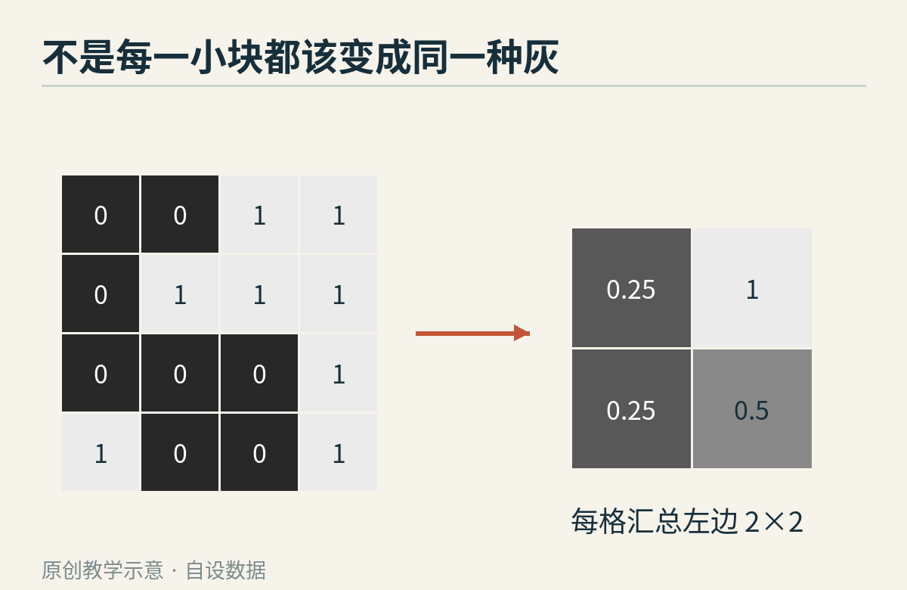

这时读者可以自己检验一个重要性质：新图四个数的平均是0.5，原图16个数的平均也是0.5。对于这个均匀分块、线性平均的小例子，整个图的平均值没有变。保留平均值，并不等于保留全部形状和细节。

把同样的过程反复做下去，8×8变4×4，4×4变2×2，最后变1×1。最高处只剩下全图的一个汇总值。把各层想象成摞起来的方片，就有了“金字塔”的样子。

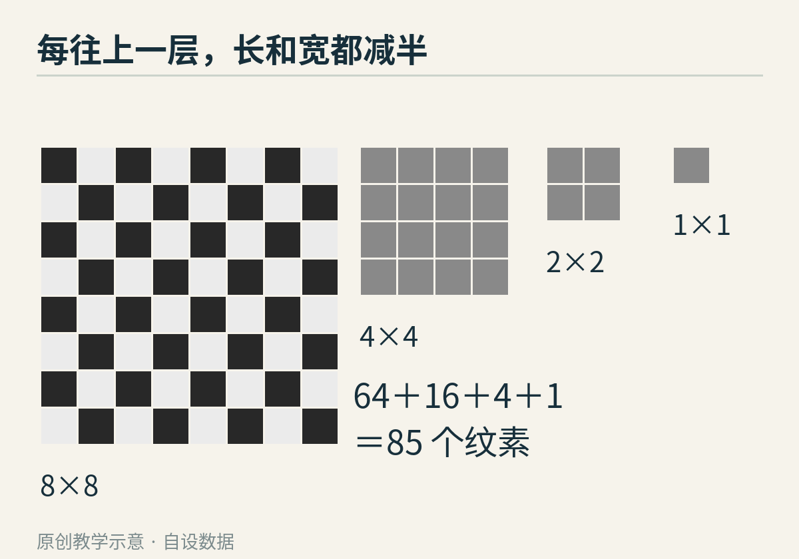

本文用2×2方框平均帮助理解，实际制作工具可能采用别的重建滤波、边界处理和材质专用规则。Mipmap指的是这类多尺度表示；它没有规定所有纹理都只能用本文这一个平均程序。

微软文档里的危险标志，是另一种直观例子。下面保留该页的三张原图：64×64、128×128和256×256，依次显示不同层级承载的细节。[微软原页](https://learn.microsoft.com/en-us/windows/uwp/graphics-concepts/texture-filtering-with-mipmaps)

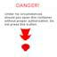

64×64层：很小的画面不需要先读取最精细的版本。


128×128层：尺度增大之后，有空间保留更多边缘信息。

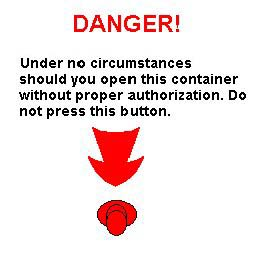

256×256层：三张图均为微软文档原文件，未把低分辨率版本放大后充作高清图。

## 存一摞图，会不会吃掉几倍内存？

一个有趣之处是：长和宽同时减半，面积会变成原来的四分之一。

以8×8为例，原图64个纹素，后面各层分别16、4、1个；总共85个，额外21个。增加的比例是21÷64，约32.8%。

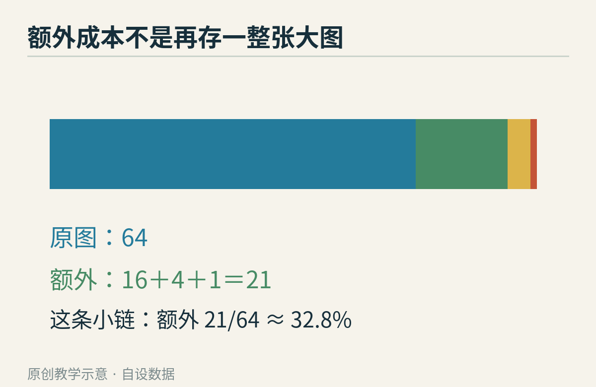

对边长为2的幂、每个纹素格式相同的二维正方形纹理，链越长，额外纹素数量越接近原图的三分之一：1/4＋1/16＋1/64＋……趋近1/3。

这并不是说任何纹理资源的实际显存开销都恰好增加33%。块压缩的最小块、内存对齐、数组层、立方体面和实现元数据，都可能改变字节账单；长条纹理的链也不能直接套正方形面积比。这个三分之一，是一个有条件的纹素数量结论。

而“多存一点”换来的，是大范围查询能够转到更小的一层上。原图里一块8×8区域，在第3层附近就有机会由很少的纹素近似代表。

## 该读哪一层？距离只是线索

“近处用大图，远处用小图”很好记，但还不够准确。同一块地板，在相同距离下，正对着看和几乎贴着地面看，纹理脚印会很不一样。

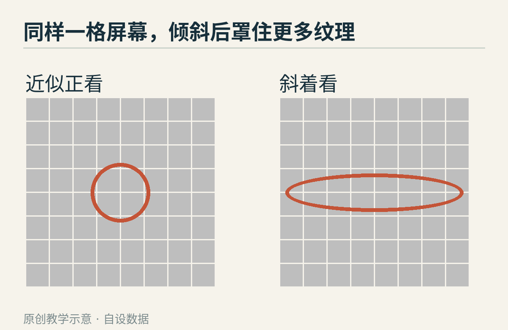

一个更直接的量是：**屏幕往旁边走一个像素，纹理坐标走了多少个原始纹素？** 把它概括成尺度ρ。ρ约为1，表示一个像素对应一个纹素左右；ρ约为8，表示一个方向上已经跨过约8个纹素。

在常见的近似里，选层数λ约等于log2(ρ)，这里log2表示以2为底的对数。别急着把它当成必须背下来的公式：因为每上一层，纹理的线性尺寸减半，所以ρ每翻一倍，就应该向上走一层。

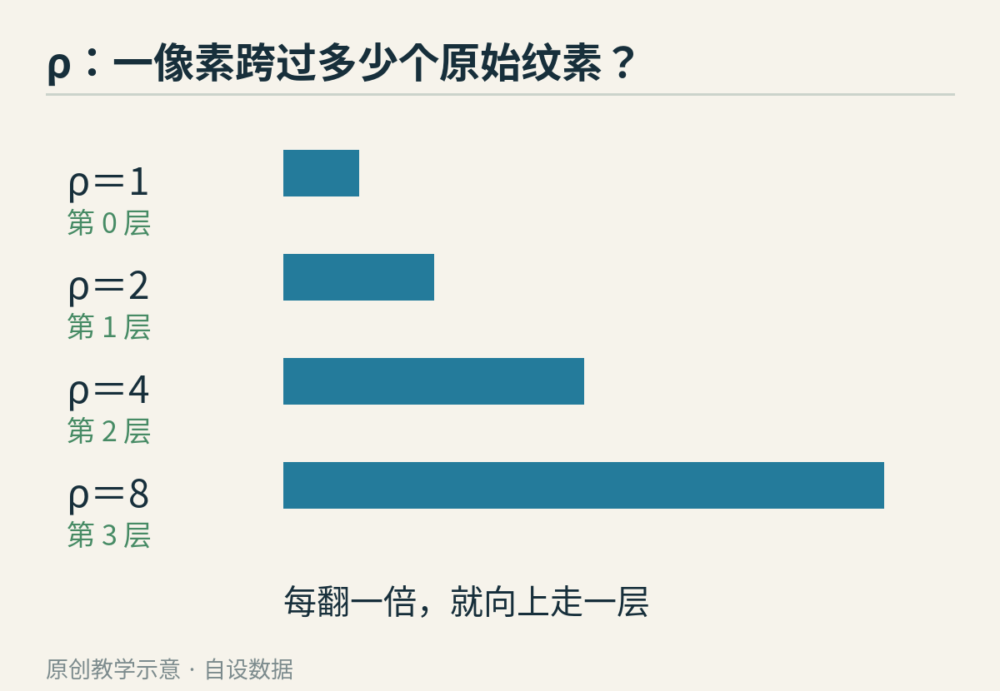

比如ρ＝4，走两层；ρ＝8，走三层。ρ在4和8之间时，需要一个介于第2层与第3层之间的尺度。

真实图形接口根据纹理坐标对屏幕坐标的变化估计细节层级，再结合偏置、上下限、采样器设置等规则。本文的单个ρ压缩了二维脚印的信息，是理解用的近似，而不是所有GPU必须逐字执行的统一公式。形式化定义可以继续看[Direct3D功能规范的纹理采样章节](https://microsoft.github.io/DirectX-Specs/d3d/archive/D3D11_3_FunctionalSpec.htm)。

## 两层之间怎么办？再做一次插值

假如相机向后退时，程序先完全使用第2层，到某个阈值突然完全换成第3层，你可能在画面中看到一条过渡带，或者察觉纹理突然变糊。

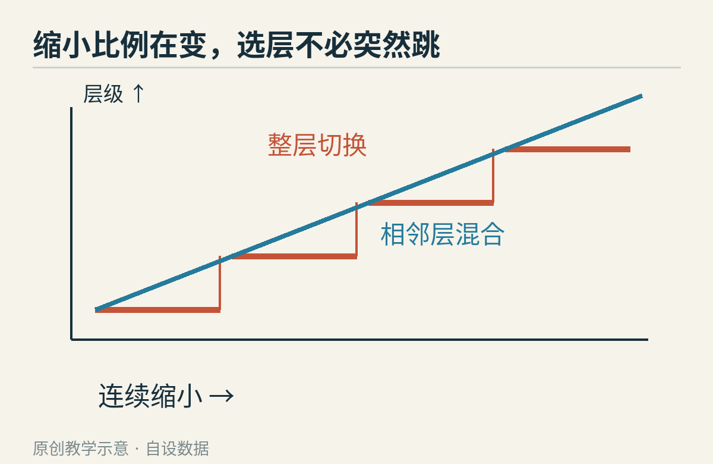

**三线性过滤**常用的办法，是在两个相邻层分别做双线性查询，再按小数层级混合两次结果。“三”可以从纹理的两个坐标方向，加上层级这个方向来理解；不是去三张任意贴图里各取一个点。

假设λ＝2.25：我们已经从第2层朝第3层走了四分之一，于是第2层占75%，第3层占25%。如果同一位置在两层查询出的线性灰度分别是0.4和0.6，结果就是0.75×0.4＋0.25×0.6＝0.45。

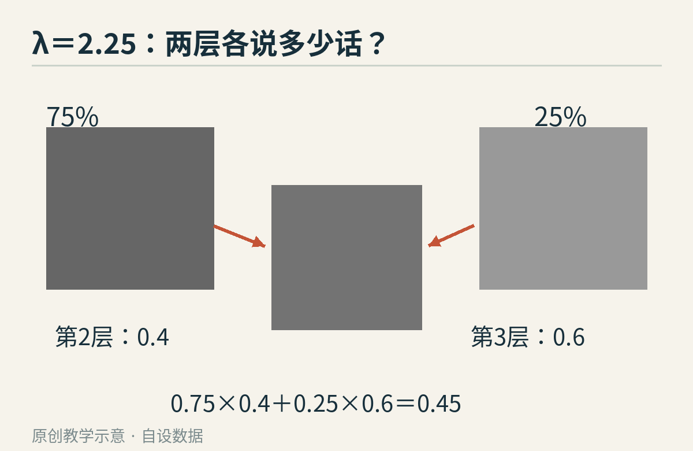

注意顺序：这两次双线性查询，是在各自预过滤过的层上进行的。它不再是始终到原始大图里只问四个邻居。

混层改善了尺度过渡，但没有把所有问题消灭。被预过滤汇总掉的细节，不会因为一次插值重新出现；滤波的形状也仍然可能不适合当前的脚印。

## 为什么斜着看地面，还是可能发糊？

把一个很长、很窄的脚印，用一个能罩住它的方框代替。方框在长方向上够用了，但在短方向上也平均了许多本不该混进来的纹素。

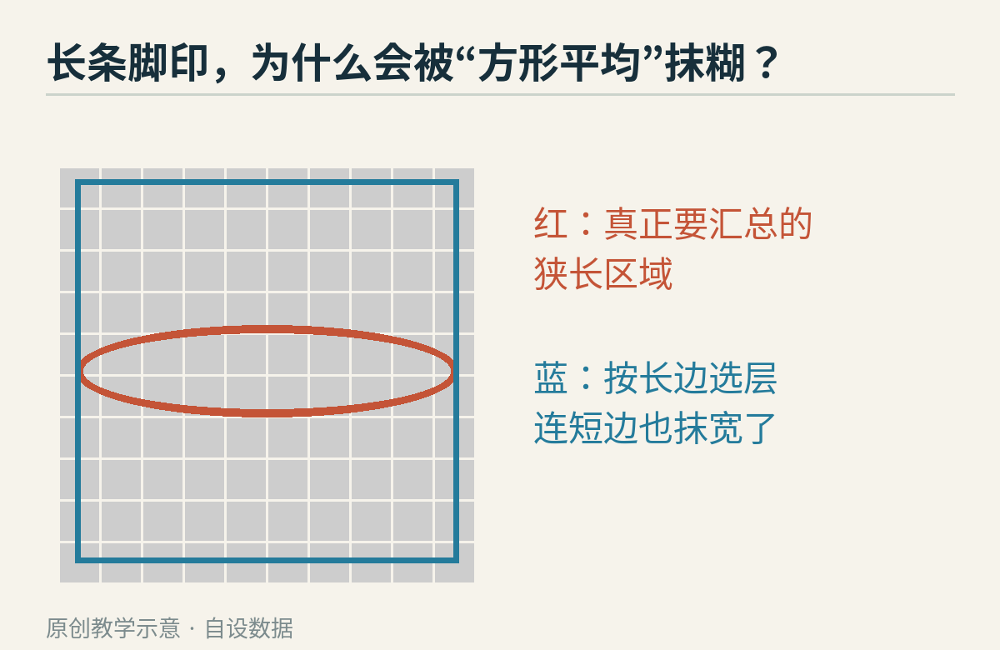

这就是普通Mipmap配合各向同性过滤，在倾斜表面上容易损失细节的原因之一。所谓“各向同性”，在这里是把不同方向大致按同一种尺度处理。

**各向异性过滤**则允许不同方向有不同的有效过滤宽度。直觉上，可以沿脚印的长方向多取几次较窄的样本，而不是把短方向也一起抹宽。

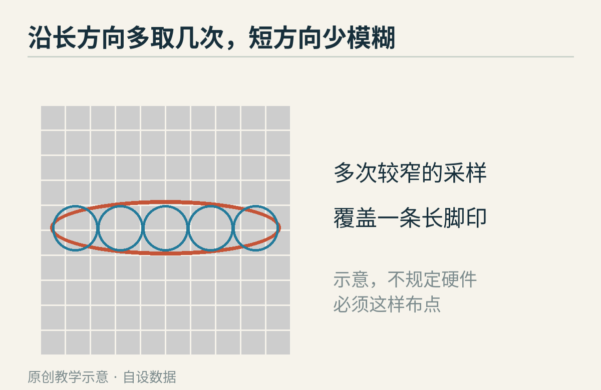

图只是说明“适应脚印形状”这个原则，并不规定显卡必须使用图中的五个采样点。硬件实现、质量限制和最大各向异性设置会影响实际结果。各向异性过滤也常建立在Mipmap之上，两者不是互斥开关。

如果想看到更完整的算法，《Physically Based Rendering》介绍了椭圆加权平均EWA：把过滤区域看作椭圆，让贡献按位置加权。它还展示了三线性与EWA的渲染差异。[图像纹理章节](https://www.pbr-book.org/4ed/Textures_and_Materials/Image_Texture)

## 缩小之前，还要知道这些数字代表什么

到这里，“每四个数求平均”很诱人。但图像里不只有一种数。

第一种容易踩坑的是颜色编码。屏幕常用的sRGB数字并不与线性光量成正比。在编码值上直接把黑0与白1平均成0.5，结果会比“平均光量”更暗。线性光量0.5重新编码为sRGB，数值约为0.735，对应8位值约188，而不是128。

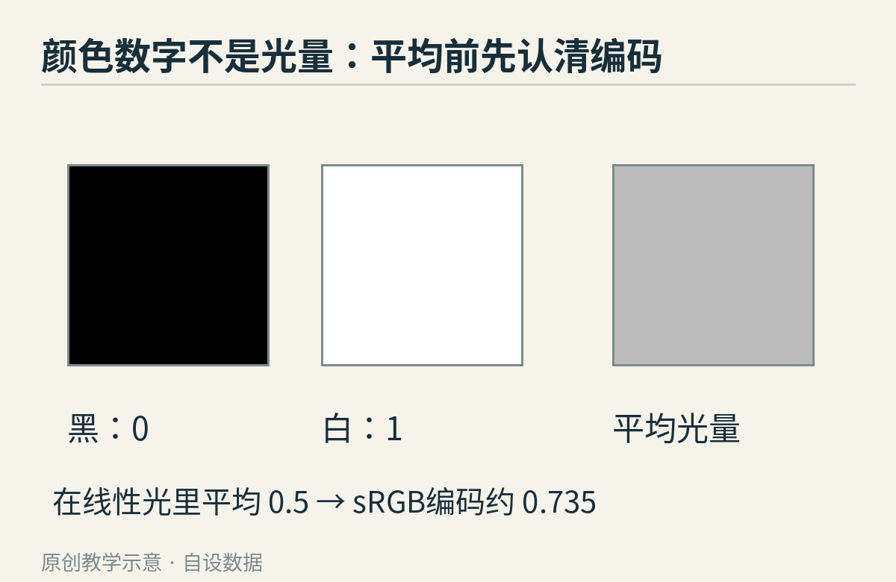

这不是让所有纹理都统一做sRGB转换。颜色贴图、法线贴图、粗糙度贴图和深度图的数据语义不同。法线是在表达方向，平均之后可能还要重新归一化；数据贴图通常不该被当成显示颜色去套曲线。[微软DirectXTex的过滤选项](https://github.com/microsoft/DirectXTex/wiki/Filter-Flags)区分了sRGB输入、输出等处理。

第二种问题是透明度。设一块2×2区域里只有一个格子的透明度是1，其他是0；普通平均会得到0.25。如果材质规定“透明度至少0.5才画出来”，这一层里整片叶子就可能消失。

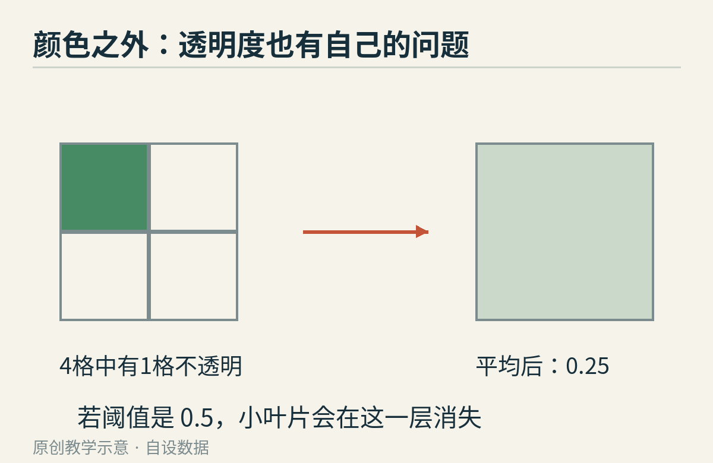

所以有些工具提供保持透明覆盖率的额外处理。它调整的是某种测试阈值下的覆盖行为，不是凭空恢复已经丢失的叶片轮廓。[DirectXTex的覆盖率处理](https://github.com/microsoft/DirectXTex/wiki/ScaleMipMapsAlphaForCoverage)

第三种是纹理图集：为了便于组织资源，许多小贴图被放进同一张大图。如果缩小时的滤波跨过分区边界，蓝色岛屿的边缘可能混入旁边黄色沙漠的颜色。增加合适的边缘填充、为层级准备正确的边界，或者采用纹理数组等组织方式，都是需要按项目条件考虑的办法。

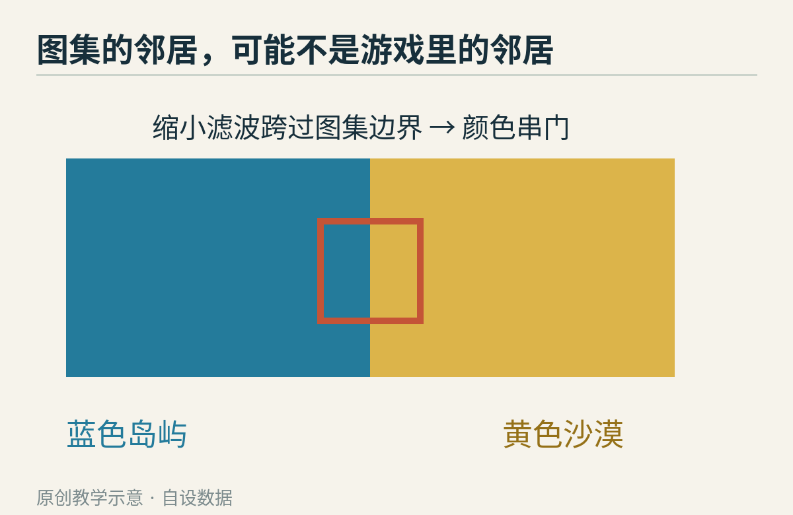

同一套“先汇总后取样”的思想，必须听从数据的含义。能对颜色做的平均，未必适合对方向、遮罩或者编号照搬。

## 用二十行程序，把错误和修正都做出来

下面的Python 3例子只用标准库。它不模拟GPU，而是把最初那条黑白纸带缩短一半：一种办法隔格取点，另一种办法先平均相邻两格。代码已经实际执行。

```python
stripe = [0, 1] * 8

def point_sample(data, phase):
    return data[phase::2]

def box_reduce(data):
    return [(data[i] + data[i + 1]) / 2
            for i in range(0, len(data), 2)]

print("起点0：", point_sample(stripe, 0))
print("起点1：", point_sample(stripe, 1))
print("先平均：", box_reduce(stripe))

level = stripe
while len(level) > 1:
    level = box_reduce(level)
    print(len(level), level)
```

两种点采样分别输出八个0、八个1；先平均输出八个0.5。继续构建这条一维链，长度依次为8、4、2、1，数值都保持0.5。

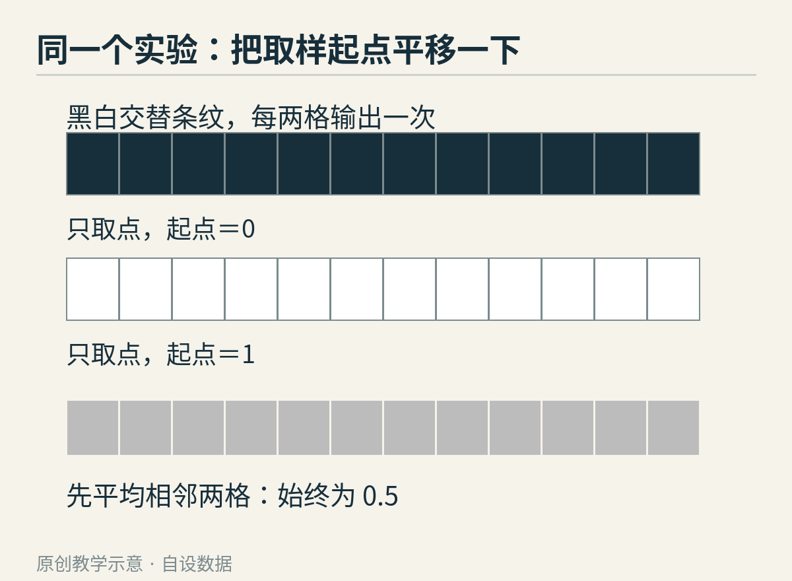

这是**一维**数组实验，它的额外存储比例不适用前面的二维正方形三分之一结论。二维每层剩四分之一，一维每层剩二分之一；把图形里的几何关系带进计算，才不会错用记忆里的比例。

可以继续改三件事：

- 把纸带改成“0、0、1、1”重复。第一层会留下什么结构？第二层呢？
- 用[0,0,0,1]重复。最后的平均应该是0.25，还是0.5？先在纸上算，再运行。
- 不减小图片，只平移取样起点。哪些细节是真的在动，哪些是采样相位制造的跳动？

开头的透视棋盘及本文原创图，也附有[生成程序](examples/generate_figures.py)。它是可检查的合成教学渲染，不是显卡性能测试，更不能据此推出某款游戏能提高多少帧。

Mipmap最值得带走的，并不是一个过滤选项的名字。它提醒我们：当答案必须压进更少的格子，直接挑几个代表会让细节撒谎；提前按尺度汇总，再让查询选择合适的尺度，往往能同时改善稳定性与查询成本。

下一次远处的地板又开始闪时，先别急着给它换一张更大的贴图。更大的图片会带来更多细节，也可能带来更多当前像素根本装不下的变化。

图片来源：18幅原创教学图由本文自设数据与程序生成。3幅危险标志图来自[Microsoft Learn原页](https://learn.microsoft.com/en-us/windows/uwp/graphics-concepts/texture-filtering-with-mipmaps)，© Microsoft，依据[文档仓库许可](https://github.com/MicrosoftDocs/windows-dev-docs/blob/docs/LICENSE)以CC BY 4.0使用，原文件未改动；不表示微软为本文背书。历史与原理另参阅[Williams 1983年论文](https://users.cs.northwestern.edu/~ago820/cs395/Papers/Williams_1983.pdf)、[PBRT图像纹理章节](https://www.pbr-book.org/4ed/Textures_and_Materials/Image_Texture)及正文链接。
