# 两个人同时改数据库，为什么还能各自读到完整快照？

假设你在开发一款多人在线游戏。玩家遇到卡关、外挂或服务器异常时，要有管理员处理，所以值班系统有一条很朴素的规则：**任何时候，至少留一人在岗。**

数据库里只记两个人：管理员 A 和管理员 B。每人一行，`on_duty` 表示是否在岗。我们用 1 表示在岗，用 0 表示离岗。

问题来了：一边有人交班、请假，另一边的页面又不断查询值班名单。数据库正在变化，查询要怎样才能读到一份完整名单，而不是“刚好读了一半，另一半已经被别人改了”的拼接结果？

更奇怪的是，同一时刻，两个事务可能读到不同的名单，而且两份都符合数据库的快照规则。

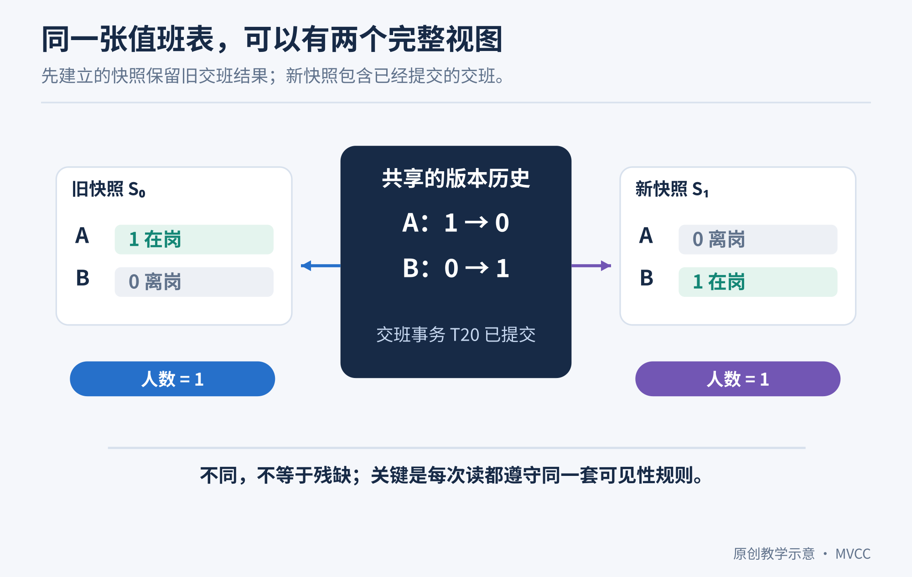

图 1：不同读者可以选中不同版本。数据库不必让所有人每一刻都看见同一个最新结果。

这篇文章要拆开的，就是 **MVCC，多版本并发控制**。它是一类数据库处理并发读写的办法：暂时留下数据的旧版本，再给每次读取一套“哪些版本可以看见”的规则。

我们会始终围绕这张值班表走下去：先看一次完整交班，再看两人同时请假。前半程解释快照为什么有用，后半程则会遇到一个更深的陷阱：**每个人都读得完整、检查得认真，最后仍可能无人值班。**

具体行为以 [PostgreSQL 18 的事务隔离文档](https://www.postgresql.org/docs/18/transaction-iso.html)为准。PostgreSQL 是一种常用的关系型数据库；其他数据库也可能使用 MVCC，但相同隔离级别名称不一定意味着完全相同的实现与行为。下文图示是原创教学示意，数值和业务均为构造例。

## 1. 先别谈版本：一场交班最怕读到什么？

先把状态设成：A 在岗，B 离岗。

现在由 B 接班，最终应该变成 A 离岗、B 在岗。应用可能发出两条更新：

```sql
BEGIN;
UPDATE duty SET on_duty = false WHERE name = 'A';
UPDATE duty SET on_duty = true  WHERE name = 'B';
COMMIT;
```

这里的 **事务**，就是数据库把一组操作作为一个工作单元处理。`COMMIT` 表示提交；如果事务中止，它的这些修改不会作为成功结果留给其他事务。

上面是说明步骤的 SQL，不是已经在数据库中执行过的实验。此刻先看业务：在第一条更新完成、第二条还没执行时，事务内部暂时是 `[A=0, B=0]`。

如果值班页面恰好在这个间隙查表，就会宣布“没人值班”。可这次完整交班的起点和终点明明都有人。页面把一个尚未完成的中间动作，当成了正式结果。

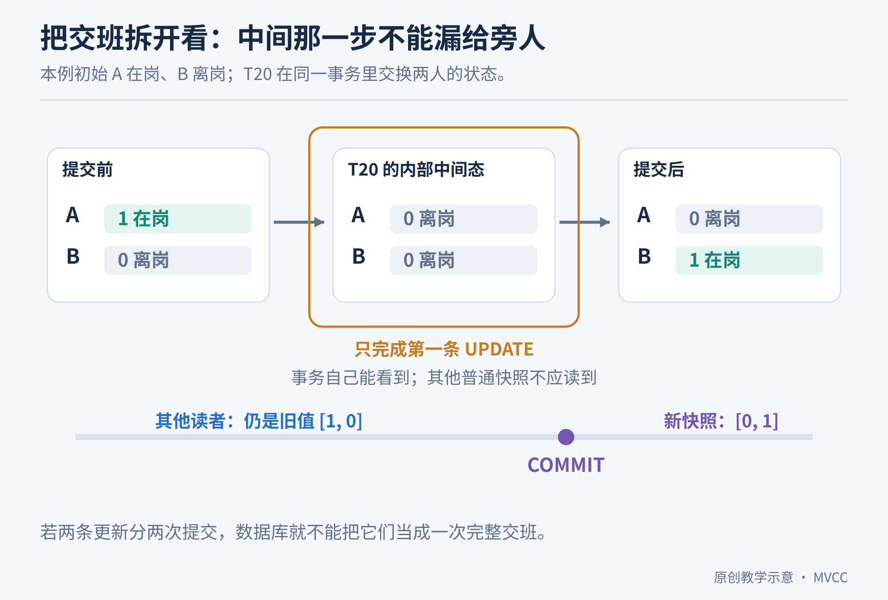

图 2：把两条更新放进同一个事务，才给数据库留下“一次交班”的边界。事务不会自动知道哪两次独立提交原本属于同一件事。

这已经引出两个不同要求：

- **提交时要作为一个整体生效。** 不能把这次交班的一半当成成功、一半当成失败。
- **读取时要有明确视角。** 查询跑到第二行时，不能随意换到另一个时刻去取值。

第一个要求涉及事务的原子性；第二个要求涉及隔离性。MVCC 主要帮助解决后者，并与事务的提交机制配合。

这里的“完整”，也需要说清：它不是要求一次查询把整座数据库的所有行都返回。你仍然可以只查询一个人，或者只统计人数。它说的是，查询所依据的可见性规则必须一致，不能随手把未完成事务的半套修改拼进结果。

如果应用把 A 离岗和 B 上岗分别提交，`[0,0]` 就真的成为一次已提交状态。MVCC 无法替应用把两笔独立事务重新合并。这是第一条边界：**数据库能保护你划出来的事务，不能替你猜出没有划出来的业务整体。**

## 2. 正在写的东西，为什么不一定要让读者等？

一种直观办法是：正在交班时，把整张值班表锁住，别人暂时别读；查完名单后，别人暂时别改。

这种“排队后再动手”的思路能解决一些冲突，但把所有读写都拦在同一道门前，会让长查询与频繁更新互相牵制。实际数据库的锁策略可以细得多，当然不都像整表大锁这么粗糙。

另一种直觉是给每个读者复制一整份数据库。复制完成以后，读自己的副本就不怕别人改了。

但一份数据库可能很大。为了查询几十行，就复制整座数据库，显然没有抓住问题的最小代价。

MVCC 把想法转了一个方向：**不为每位读者造一座数据库，而是在共享存储里保留必要的行版本。**

仍然是 A 的那一行。业务上你觉得 `A=1` 被改成了 `A=0`，但 PostgreSQL 的行版本机制允许旧版本暂时留下，新版本另行产生。B 的变化也是如此。

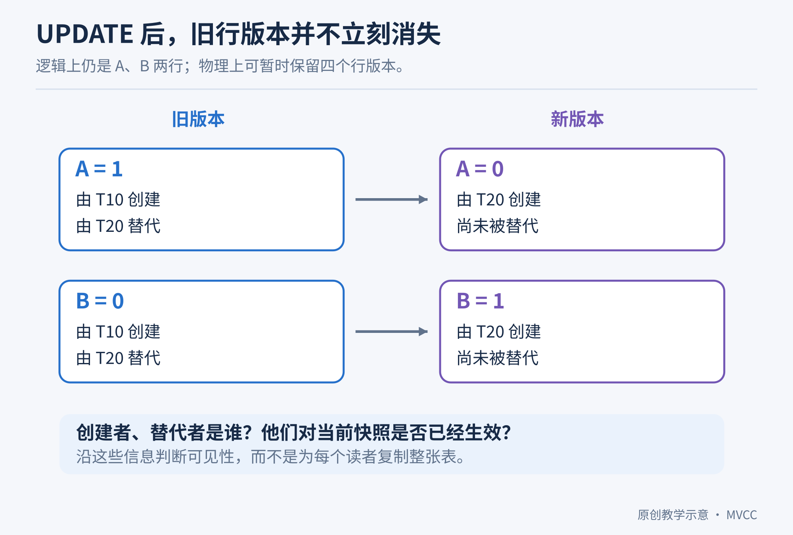

图 3：两条逻辑行，可以暂时对应四个物理行版本。箭头表示更新关系，不表示所有版本必定按这种几何位置存放。

图中用 T10 表示创建初始数据的事务，用 T20 表示交班事务。这些编号只是教学标识，后面再讨论真实事务编号的细节。

读者如果需要交班前的世界，就取 A 的旧版本和 B 的旧版本；需要交班后的世界，就取两个新版本。

于是，写者能够继续推进，某些读者仍能读旧数据。旧读者不是“读错了”，也不是在访问一个随机过期的缓存；它是在使用数据库为它规定的视角。

这就是 [PostgreSQL 对 MVCC 的介绍](https://www.postgresql.org/docs/18/mvcc-intro.html)强调的核心收益：普通读取与写入之间，不必因为争抢同一个数据版本而彼此阻塞。

不过，“普通读取”很重要。带 `FOR UPDATE` 的锁定读取、更新同一行、修改表结构等情况另有锁与冲突规则。**MVCC 不等于无锁，也不等于所有操作永远不等待。**

## 3. 快照怎样避免把 A 的新值和 B 的旧值拼起来？

只留下旧版本还不够。

如果程序对每一行都问“现在最新的是哪一个”，它仍然可能先取到 A 的旧值，然后别的事务提交，再取到 B 的新值。版本虽然都存在，选择规则却不统一。

所以还需要 **快照**。

先把快照想成一张读者拿到的通行规则：哪些事务的效果已经被纳入，哪些还必须排除。查 A 时用它，查 B 时仍然用它。

对外部读者而言，T20 在这个快照里要么已经提交并且可见，要么还不可见。不能查 A 时认为它已经生效，查 B 时又认为它还没生效。

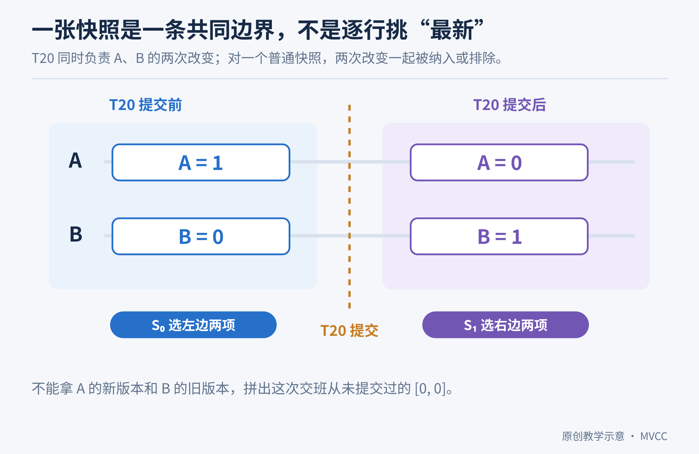

图 4：一致性来自共同的选择边界。图中的竖线是一次提交边界，不是要求数据库为整张表保存一张真实照片。

把选择过程翻译成两道问题，会更容易理解：

1. 创建这个版本的事务，它的效果对我可见吗？如果还不可见，这个版本就不能读。
2. 如果它后来被另一个事务替代或删除，那个改变对我已经可见了吗？如果还没生效，旧版本可能仍然是我要读的那个。

例如，旧版 `A=1` 是 T10 创建的，后来被 T20 替代。某个快照包含 T10，却不包含 T20。那么对这个快照来说，A 已经存在，但 A 的离岗还没有发生，所以要继续读到 1。

另一个快照同时包含 T10、T20，便知道旧版 A 已被替代，应转而读取新版 `A=0`。

注意，这不是“哪个版本号最大就读哪个”。**版本的可见性，取决于版本信息与快照规则共同作用。**

PostgreSQL 的每个行版本有一些系统信息。[系统列文档](https://www.postgresql.org/docs/18/ddl-system-columns.html)里，`xmin` 表示创建该行版本的事务身份，`xmax` 与删除、替代该版本的事务有关。

但不要把它简化成“`xmax` 非零，这行就一定不能读”。改变可能尚未提交，也可能已经回滚；实际判断还涉及事务状态及内部标志。图里“由谁替代”的标签是帮助理解的抽象，不是可以直接照抄的完整 PostgreSQL 可见性算法。

这也解释了为什么应用通常只需要写查询，而不需要自己遍历旧版本。选出当前语句应该看到的行，是数据库的工作。

## 4. 快照真的只是一个时间戳吗？

“给每个事务一个编号，只看编号比自己小的数据”，听起来很省事。但它漏掉了一个事实：**先开始的事务，不一定先完成。**

设想有两个事务：T40 先开始，运行很慢；T41 后开始，迅速提交。现在某个读者建立快照 S。

这时，T41 的效果已经可以看见，T40 的效果却还不能看见。编号小的反而要排除，编号大的已经能纳入。

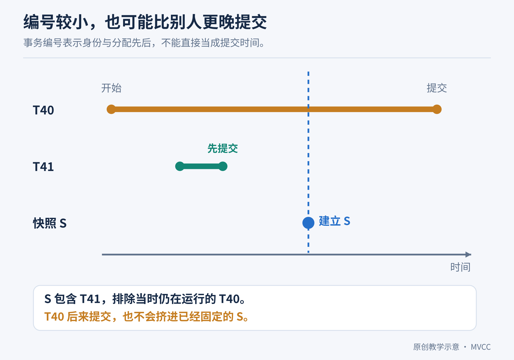

图 5：这是两条互不妨碍的事务时间线，用来解释身份顺序与提交顺序的差别。图中时间没有按真实耗时比例绘制。

再往前想一步：S 建立以后，T40 终于提交了。如果 S 是一张需要继续保持的快照，后面的读取能不能突然把 T40 加进来？

不能。否则 S 的世界就变了。

因此，快照需要表达的不只是“到哪个编号为止”，还包括“建立快照时，哪些相关事务仍在运行”。PostgreSQL 的[事务 ID 与快照信息接口](https://www.postgresql.org/docs/18/functions-info.html#FUNCTIONS-INFO-SNAPSHOT)提供了观察这类边界与活动事务集合的方式。

一个教学化的判断是：

- 在边界之后才发生的事务，不纳入这张快照。
- 建立快照时尚在运行的事务，也不因为后来提交就自动被纳入。
- 边界之前已经成功提交、满足可见性条件的改变，才构成快照看到的基础。

这三句不是实现规格。真实系统还需要处理自己的写入、子事务、事务编号回卷等细节。此处最值得保留的直觉是：**快照描述一组事务的可见性关系，不一定是一张贴着墙上时钟时间的照片。**

其他 MVCC 数据库可能借助提交时间戳、撤销记录等方式组织这些信息。本文不把 PostgreSQL 的具体存储方式推广成所有系统的唯一做法。

## 5. 一个事务里查两次，为什么结果还会变？

现在能提出一个更精确的问题了：数据库会给每一条查询一张新快照，还是让整个事务一直使用同一张？

这正是隔离级别的重要区别。

### Read Committed：每条普通查询，重新看一次已提交世界

**Read Committed，读已提交**，是 PostgreSQL 的默认隔离级别。

对这里讨论的普通 `SELECT` 而言，它在语句开始时取得快照。查询执行期间别人提交的新变化，不会半途被塞进这个查询；但下一条查询可以拿到更新的快照。

例如，一个事务内：

1. 第一次查询，看到 `[A=1, B=0]`。
2. 另一个事务完成交班并提交。
3. 第二次查询，看到 `[A=0, B=1]`。

两次都读得完整，但读的不是同一时刻的版本。

### Repeatable Read：后续查询沿用原来的外部视角

**Repeatable Read，可重复读**，在 PostgreSQL 中采用快照隔离的方式实现。

快照在事务内第一条非事务控制语句开始时建立，后续查询继续使用它。因此，单独执行 `BEGIN`，并不等于那一刻已经拍好了数据快照。

在我们这个“查询、别人交班、再查询”的例子里，两次都会看到 `[A=1, B=0]`。后来提交的交班暂时不会出现在这个事务的外部视角中。

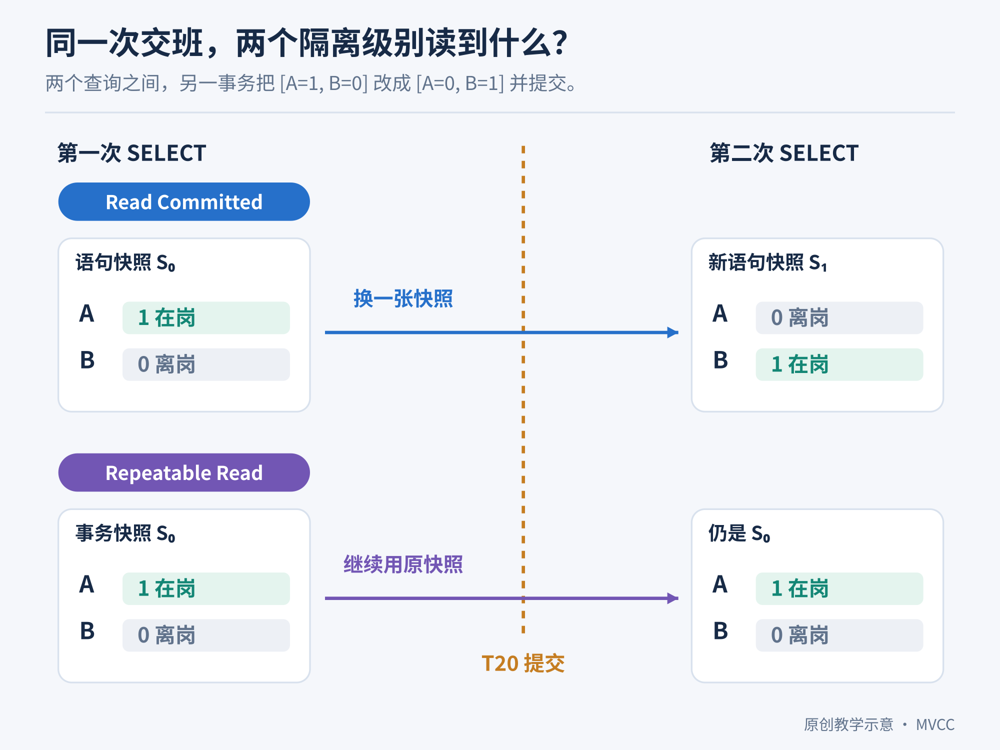

图 6：两种级别都可以提供语句所需的完整视角；差别在于，下一条语句是否换快照。本图的读取事务没有自行修改数据。

这不是“越旧越正确”，而是任务需要不同。

一次独立的“现在谁在岗”查询，希望下一次刷新能看见新交班，读已提交很自然。如果要分多条查询生成同一份值班报告，第一部分和第二部分不应因为中途交班而对应两个世界，固定事务快照就有意义。

有时人们把三个异常名称背成表格，却没有把它们对应到读者实际做的事。可以这样理解：

- **脏读**：把别人尚未提交的改变读进来。本文的 PostgreSQL 普通快照读取不会这样做。
- **不可重复读**：第一次读 A 在岗，第二次再读同一个 A，却因别人已经提交的修改而变成离岗。
- **幻读**：重复执行同一条件查询，符合条件的记录集合因为其他已提交事务而变化。例如“所有在岗管理员”的名单多了一位新加入者。

PostgreSQL 的可重复读也阻止这里所说的幻读。这比 SQL 标准对同名级别规定的最低要求更强。所以，看到别的资料写“可重复读仍允许幻读”时，需要先看它说的是标准下限、哪种产品、哪种读取方式，不能直接搬来解释本例。

还有一条容易被省掉的边界：上面“语句开始时的完整快照”描述的是普通 `SELECT`。PostgreSQL 的读已提交更新语句在等待并发更新后，可能重新检查目标行的新版本；复杂条件更新不能机械套用普通查询的全部直觉。后面会回到这个区别。

## 6. 我刚把自己改成离岗，为什么还能在固定快照里看见？

从这里开始，仍然用同一张值班表，但进入“两人同时请假”的场景。**把初始状态重新设为 `[A=1, B=1]`：两个人都在岗。**

A 开启一个可重复读事务，查询人数，得到 2。随后 A 把自己的记录改为离岗，再查一次。

它会不会因为坚持旧快照，仍然看到自己在岗？

不会。一个事务可以看到自己前面语句已经完成的修改，即使还没有提交给其他事务。

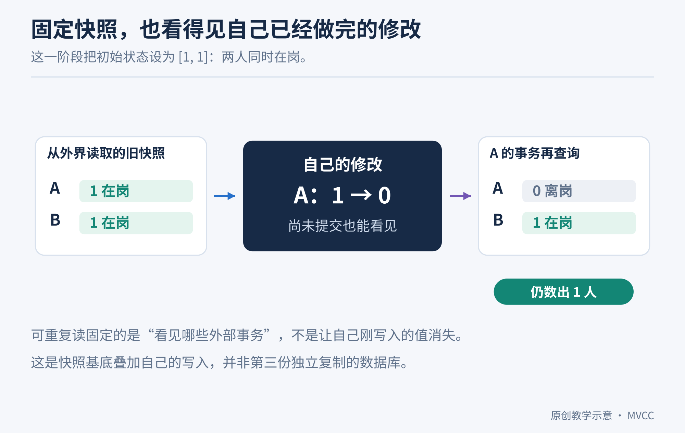

图 7：对当前事务而言，结果是固定的外部快照，再叠加自己的修改。固定快照不是把自己刚做的工作也隐藏掉。

所以，“可重复读”不能被理解为“同一个查询无论我自己做了什么，永远返回相同结果”。

它保护的是外部并发事务不会随意闯进这个事务的读取视角。你自己添加、删除、更新的数据，当然会影响你后面的查询。

这个细节马上会变得关键。因为它让 A 看见“自己已离岗，B 还在”；同时，也可能让 B 看见“自己已离岗，A 还在”。两个人都觉得有人兜底。

在揭开这个陷阱之前，还得先排除一个误解。

## 7. 有旧版本了，两个人就能随意写同一行吗？

不能。

读旧版本解决的是“我能依据什么读取”，不自动解决“谁有权把同一行改成什么”。

如果 U 与 V 都先建立了快照，随后都要更新 A 的同一条记录，PostgreSQL 仍然会处理写写冲突。后来的更新可能先等待前一个事务结束。

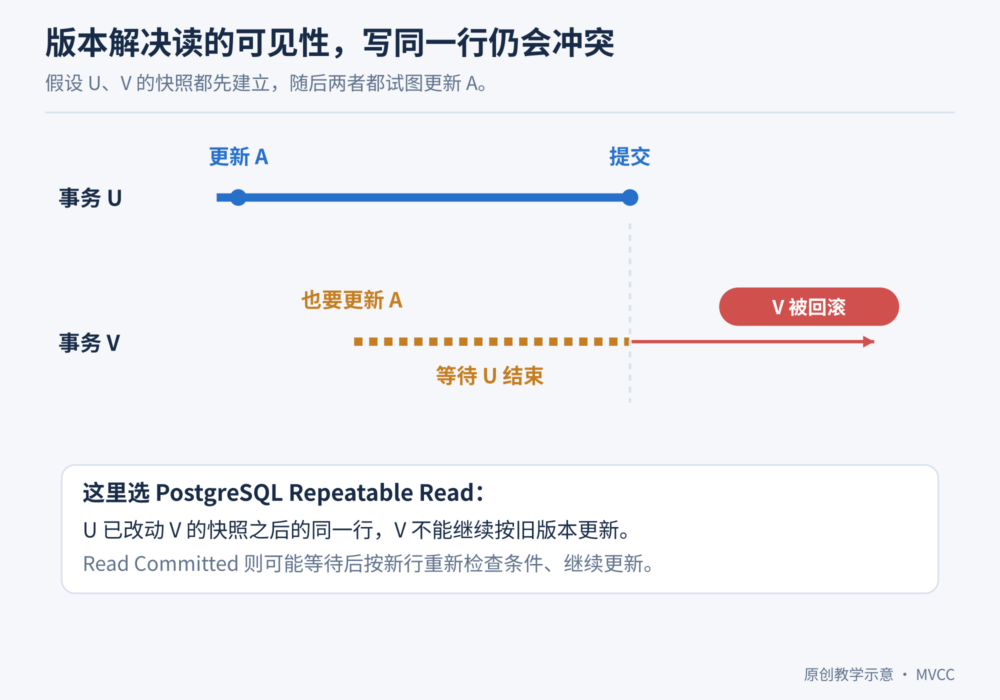

图 8：多版本并没有让同一条逻辑行的冲突消失。本图假设 U 提交了实际更新，而 V 的旧快照早已建立。

在 PostgreSQL 的可重复读里，如果前一个事务确实提交了发生于后者快照之后的行更新，后者不能照着那张旧快照继续更新该行，会遭遇序列化失败，需要重试整个事务。

读已提交的路径不同：等待结束后，数据库可能拿到更新后的目标行，重新检查 `WHERE` 条件，再决定是否继续更新。[官方隔离级别文档](https://www.postgresql.org/docs/18/transaction-iso.html#XACT-READ-COMMITTED)详细说明了这种行为。

因此，不要把“两个并发修改”全部装进同一个抽屉：

- 两个人改同一行，有直接的写写冲突。
- 两个人改不同的行，行级写冲突可能根本不会发生。
- 但不同的行，可能一起参与同一条业务规则。

值班问题危险的地方，恰好落在后两句。

## 8. 两个人各改各的，为什么还是把规则改坏了？

我们给请假功能写一段看起来很合理的程序：

```text
开始事务
读取当前在岗人数
如果人数大于 1：
    把自己的 on_duty 改为 false
提交事务
```

单独运行这段逻辑，没有问题。两人都在岗时，A 可以走；只剩一人时，最后一个人不能走。

现在让 A、B 使用可重复读，同时执行它。

第一步，A 读取自己的快照，看到 `[1,1]`，数出 2。

第二步，在 A 提交以前，B 也读取自己的快照，仍然看到 `[1,1]`，也数出 2。

第三步，A 判断“超过一人，我可以请假”，只修改 A 的行。

第四步，B 做出相同判断，只修改 B 的行。

最后，两人提交。由于写的是不同的行，这条执行路径没有那个“大家抢着更新 A”的直接写写冲突。

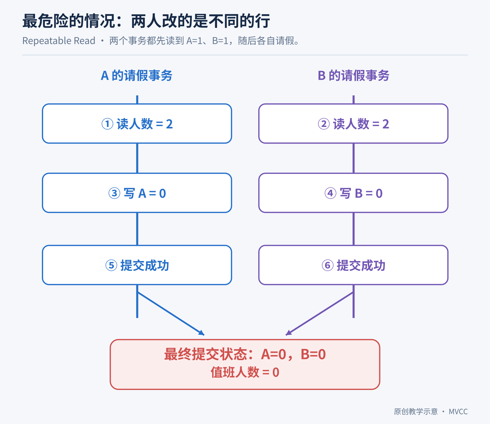

图 9：沿编号跟一遍：①②先读，③④各改不同记录，⑤⑥都提交。结果并没有违反“按各自快照读取”的规则，却破坏了业务要求。

现在看数据库：`[A=0, B=0]`。无人值班。

这类现象叫 **写偏差，write skew**。可以把它理解为：两个事务依据彼此兼容的旧读取，各自写下看似合法的结果，但这些写入合并以后，不再满足共同约束。

它不是脏读，因为谁都没有读取对方尚未提交的新值。

它也不是把某个写入弄丢了。A 的离岗保存成功，B 的离岗也保存成功，恰好是“两笔都成功”造成了问题。

它甚至不要求同一事务前后读到变化。每个人的外部快照都可以从头到尾很稳定。

如果两人各自在自己的更新之后、提交之前再数一次，还可能出现更迷惑的现象：

- A 看见自己的新值 `A=0`，以及快照中的旧值 `B=1`，数出 1。
- B 看见快照中的旧值 `A=1`，以及自己的新值 `B=0`，也数出 1。
- 等两人都提交后，新事务看见 `[0,0]`，数出 0。

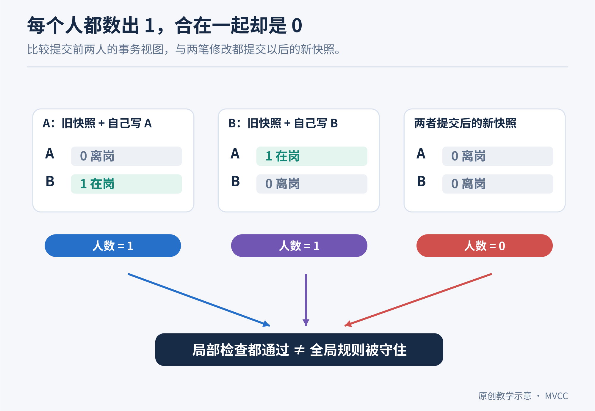

图 10：这里的左、中两份事务视图是提交前的可见结果；右侧最终状态由提交后的新事务观察。图把它们并列展示，便于比较。

因此，“更新以后再查一次，只要还有一人就提交”在这个固定快照场景中也救不了规则。新的查询仍然没有获得对方并发修改的完整信息。

我们终于触到题目中“完整快照”的真正边界：**一次读取内部完整，不等于多个事务联合执行后的业务结果一定正确。**

## 9. 怎么证明这个结果真的有问题，而不只是看起来奇怪？

可以不急着引入新术语，先做一个很小的穷举：如果两个人按顺序请假，会怎样？

只有两种顺序。

**A 先，B 后。** A 数出 2，离岗；B 随后数出 1，留下。最终 `[0,1]`。

**B 先，A 后。** B 数出 2，离岗；A 随后数出 1，留下。最终 `[1,0]`。

无论怎么排，最后都留着一人。

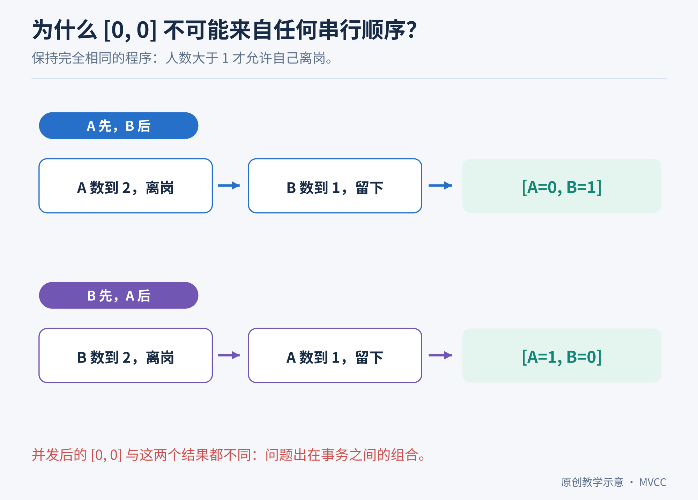

图 11：程序没有换，初始值没有换，只把执行方式改成“一人彻底完成以后，另一人才开始”。

而刚才的并发结果是 `[0,0]`，两种串行顺序都解释不了它。

这就把 **可串行化，Serializable** 的核心意思说出来了：成功提交的并发事务，其效果应当能够解释为这些事务按某种顺序，一个接一个执行。

“可串行化”不意味着数据库只能一次运行一个事务。它约束的是结果及相应的读写关系，要能找到一个等价的串行解释；底层仍然可以并发处理很多工作。

还有一个前提不能省略：如果应用的程序本来就是“无条件让自己离岗”，那串行执行也会得到 `[0,0]`。再强的隔离级别也不会凭空补出“至少留一人”的业务判断。

Serializable 能帮助你的是：当正确的业务逻辑单独执行能够维护规则时，避免并发交错把这份正确性破坏掉。参与这条规则的相关事务都要纳入相容的保护方案；只升级一个入口，同时留下能绕过检查的写入路径，并不能守住规则。它不是让数据库自动猜测所有业务规定。

## 10. 不看最终人数，能不能从依赖关系提前发现危险？

回头看 A 的判断：“我可以离岗，因为我读到 B 还在。”

B 的写入恰好会改变 A 读取过的这个事实。如果要保留 A 读到旧 B 的结果，串行解释就需要让 A 排在 B 的改变之前。

也就是，A 在 B 前。

对称地，B 读到 A 还在，A 的写入又会改变这个事实。要保留 B 的旧读取，就需要 B 在 A 前。

结果成了：A 在 B 前，B 又在 A 前。

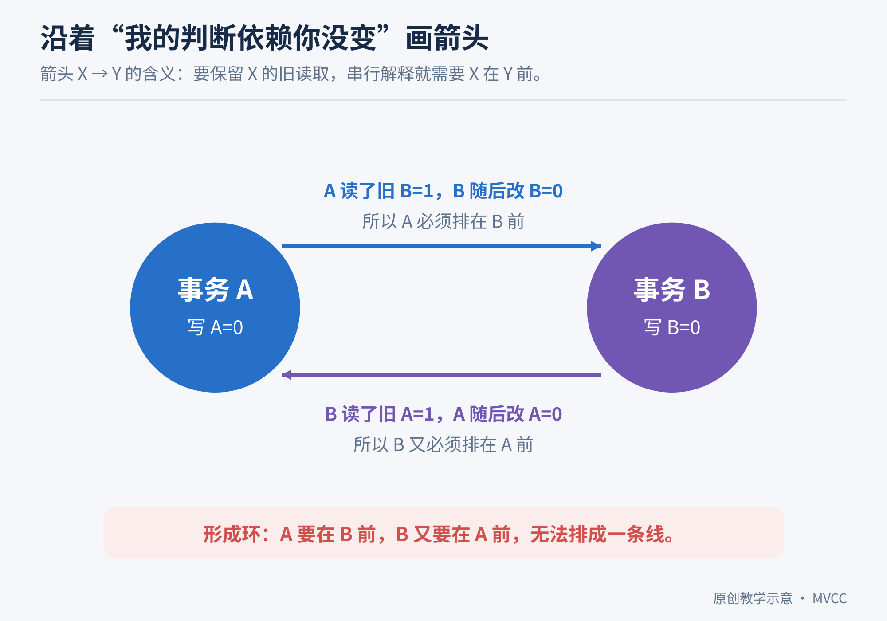

图 12：这两条箭头不是消息传递，也不是“谁等待谁”的锁图，而是串行解释所要求的先后关系。成环后无法排成直线。

这种“读过旧值，而另一个事务写了会改变它的内容”的关系，通常叫读写反依赖。现在你不必记住名字，只要看清箭头为什么必须这样画。

PostgreSQL 的 Serializable 建立在快照隔离基础上，额外跟踪可能导致序列化异常的依赖条件。这种方式称为 **SSI，Serializable Snapshot Isolation，可串行化快照隔离**。

它会记录“这个事务读过什么范围”。因为危险不只来自修改已经读到的行，还可能来自插入一条新记录，使先前“满足条件的记录不存在”之类的判断失效。

官方文档把相应机制称为谓词锁。在 PostgreSQL SSI 中，这类用于跟踪读取的锁不是让写者站在门外等待的那种锁，而是帮助系统识别依赖的记录；它们本身不引入额外阻塞。普通行锁等既有冲突行为仍然存在。

也别把图 12 当成 PostgreSQL 源码逐步执行的原样图。它是解释“为什么本例没有串行解”的模型。实际 SSI 检测危险依赖结构，有跟踪开销，也可能保守地中止事务；不能据此声称它每次都要先画出整张完整依赖图，或者所有中止都对应一条已经完成的具体环。

## 11. Serializable 遇到这两份请假，会做什么？

如果两个请假事务都使用 Serializable，仍然都先读到人数 2，再分别修改自己的行，数据库就不能允许它们以这个结果双双成功提交。

一方可能成功，另一方会因为序列化失败而中止。具体哪一个失败、在更新还是提交阶段发现问题，不应写成应用依赖的固定顺序。

我们在图中选一种可能：A 成功，B 失败。

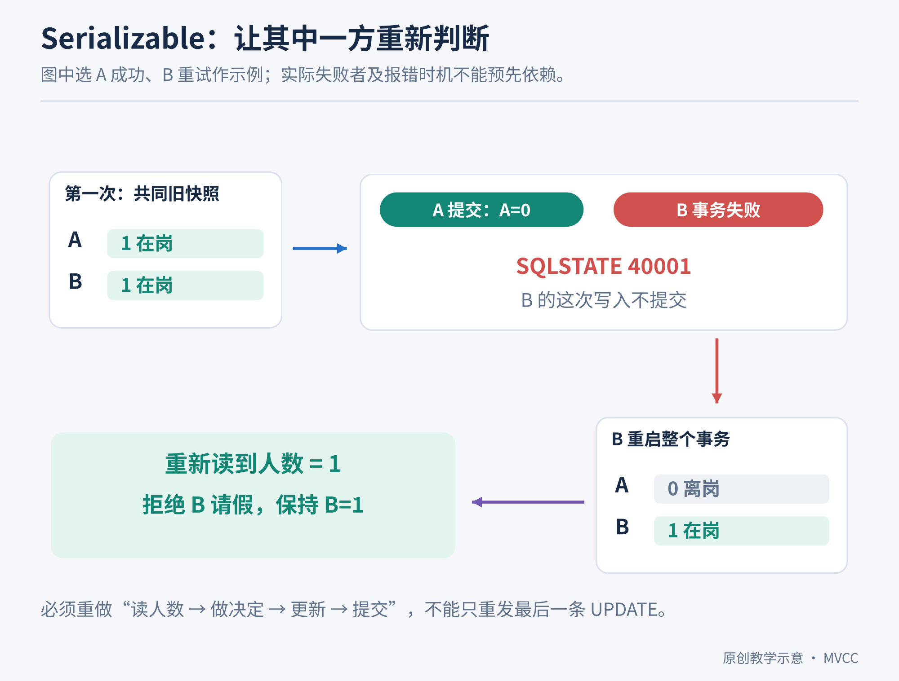

图 13：关键动作在下半部分。重试以后读到新的事实，业务决定必须跟着重新计算。

这时应用不能对 B 说“提交失败，我帮你再发一次 `UPDATE B=0`”。那相当于保留旧决定，只补做最后一刀，绕过了保护机制。

正确的重试单位是整个事务：

1. 结束失败的事务。
2. 开启新事务。
3. 重新读取人数。
4. 根据新结果重新决定是否允许请假。
5. 如果允许，再更新并尝试提交。

新事务看见 A 已经离岗，人数为 1，于是 B 留下。重试并不保证“这次一定还能完成原先想做的业务动作”；它保证的是用新的事实重新作决定。

PostgreSQL 用 SQLSTATE `40001` 表示序列化失败。[官方重试说明](https://www.postgresql.org/docs/18/mvcc-serialization-failure-handling.html)明确要求重新执行整个事务，包括决定发什么 SQL、写什么值的应用逻辑。

这也解释了为什么数据库不能替所有应用透明地重发几条语句：它可能并不知道你先前拿查询结果做了哪些计算。

实际应用还应限制并发争抢、避免无限忙重试，并给失败请求设计合适的重试与返回策略。但不要把“固定重试三次”误当成可串行化的定义；重试次数是应用策略，正确性要求是不能把失败事务的中间结果当成成功事实。

尤其要留心数据库之外的动作。如果事务尚未提交，就已经给管理员发送“你已成功离岗”的通知，后面数据库回滚并不能把对方看过的消息收回来。可以把待发送通知与业务变更一同记进数据库，提交后再由发送流程处理，并设计去重。事务边界不会自动延伸到邮件、推送或任意外部服务。

## 12. 不升级隔离级别，能不能用一把小锁守住规则？

可以，但需要锁对对象，且把前提说完整。

只锁“自己的行”不够。A 锁 A，B 锁 B，两人仍然互不相遇，而共同规则依旧可能被破坏。

一个容易讲清的方案，是为这个值班组增加一条共同的守卫记录。所有会让这个组减少值班人数的代码，都先锁同一条记录，再检查人数、做修改。

这里选 **Read Committed** 来解释这条协议，并要求“锁住守卫行”与“读取人数”是前后两条语句。

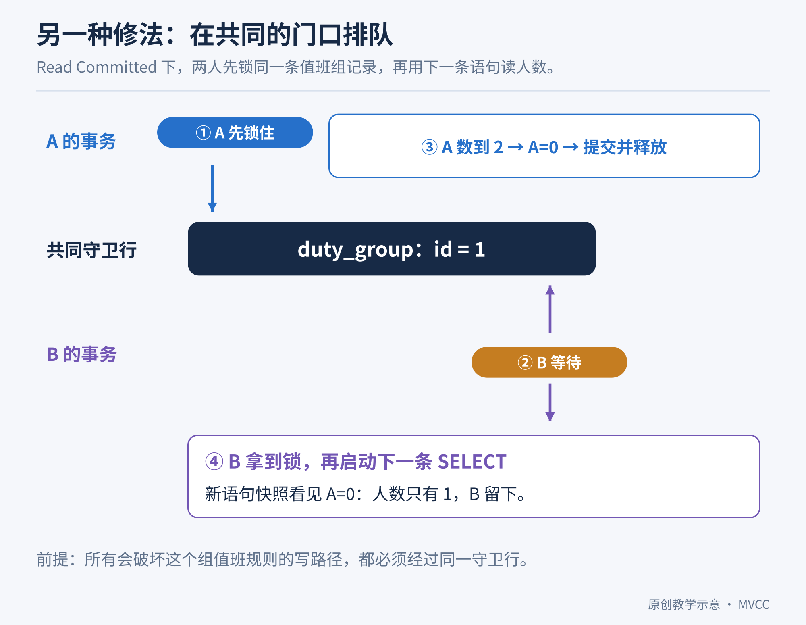

图 14：冲突点被有意集中到一条共同记录上。B 等待结束以后，新启动的计数语句才能看见 A 已提交的离岗。

教学 SQL 可以写成这样的轮廓：

```sql
BEGIN ISOLATION LEVEL READ COMMITTED;

-- duty_group 中事先存在 id=1 这一行。
SELECT id FROM duty_group WHERE id = 1 FOR UPDATE;

-- 这是拿到锁之后才开始的另一条语句。
SELECT count(*) FROM duty WHERE on_duty;

-- 应用检查上面的结果；只有大于 1 才继续：
UPDATE duty SET on_duty = false WHERE name = 'A';

COMMIT;
```

这段 SQL 展示锁协议，没有在本文环境执行；条件分支由应用完成。实际表还要有值班组标识，计数和修改都应限定在被锁住的那个组，本文只有一个组，所以省略了该列。

它为什么成立？

A 持有守卫行锁时，B 卡在第一条 `SELECT ... FOR UPDATE`。A 检查、修改、提交后释放锁，B 才继续。B 的下一条计数语句取得新的读已提交快照，于是看见已经离岗的 A。

这里有三条硬前提：

- 所有可能破坏规则的入口都遵守同一个协议，包括别的服务、后台操作和删除记录的路径。
- 锁在业务检查之前获得，且保持到事务结束。
- 读取规则与隔离级别匹配。不能把这段流程随手改成固定旧快照，再假定“等过锁以后一定刷新了全部数据”。

第三条尤其容易漏。可重复读事务的外部快照不会因为等待一个锁而自动刷新；有些冲突会报错，有些协议必须额外设计。锁的存在本身，不是正确性的证明。

[PostgreSQL 的显式锁文档](https://www.postgresql.org/docs/18/explicit-locking.html)还提醒，多个对象的锁顺序不一致可能导致死锁。所以，把业务冲突具体画出来，往往比到处加 `FOR UPDATE` 更重要。

还有人会问：能不能给每一行加个 `CHECK`，要求至少一人在岗？问题在于，这条规则跨越多行。PostgreSQL 的普通 `CHECK` 约束不能用来可靠维护依赖其他行的检查；[约束文档](https://www.postgresql.org/docs/18/ddl-constraints.html#DDL-CONSTRAINTS-CHECK-CONSTRAINTS)专门说明了这个边界。可以重新设计数据模型或采用其他约束、锁与事务方案，但不能把跨行问题假装成一行里一个布尔表达式。

## 13. 能不能打开两个窗口，亲手观察一次？

可以。下面给出按 PostgreSQL 18 文档规则构造的复现步骤，**本文未连接 PostgreSQL 执行这些 SQL，所以以下结果是机制推演，不是实测日志。** 请在独立的练习数据库里使用。

先在一个会话里建表并初始化：

```sql
CREATE TABLE mvcc_duty_demo (
    name text PRIMARY KEY,
    on_duty boolean NOT NULL
);

INSERT INTO mvcc_duty_demo VALUES
    ('A', true),
    ('B', true);
```

接着打开两个数据库会话，按下面的编号交替操作，而不是把一个窗口全部执行完再切另一个。

**① 窗口 A：**

```sql
BEGIN ISOLATION LEVEL REPEATABLE READ;
SELECT count(*) FROM mvcc_duty_demo WHERE on_duty;
```

**② 窗口 B：**

```sql
BEGIN ISOLATION LEVEL REPEATABLE READ;
SELECT count(*) FROM mvcc_duty_demo WHERE on_duty;
```

此时两次计数按推演都为 2，所以接下来是在执行“人数大于 1 才允许离岗”的分支。

**③ 窗口 A：**

```sql
UPDATE mvcc_duty_demo SET on_duty = false WHERE name = 'A';
```

**④ 窗口 B：**

```sql
UPDATE mvcc_duty_demo SET on_duty = false WHERE name = 'B';
```

**⑤ 窗口 A，随后窗口 B，各自执行：**

```sql
COMMIT;
```

最后，在一个新的事务视角里检查：

```sql
SELECT name, on_duty FROM mvcc_duty_demo ORDER BY name;
SELECT count(*) FROM mvcc_duty_demo WHERE on_duty;
```

按本例条件推演，两行都是 `false`，计数为 0。练习表没有触发器或额外保护协议，两次更新针对不同主键。

要比较 Serializable，先确认两个旧事务都已结束，在单独事务中把两行重设为 `true` 并提交，再把两边的 `BEGIN` 改成 `BEGIN ISOLATION LEVEL SERIALIZABLE`，按同样节奏交错。

这次不能期望相同的两笔离岗都提交成功。如果某一会话在更新或提交时报序列化失败，结束失败事务，再开启新事务重新计数，不要沿用上一次的 2。

练习的目标不是背下哪一个窗口必定报错，而是观察：**系统拒绝了哪组不能同时成立的决定，重试为什么改变了其中一人的判断。**

## 14. 不装数据库，也能把所有小型交错算一遍

SQL 的真实行为需要在真实数据库中观察。不过，写偏差的逻辑还可以用一个更小的本地模型验证。

配套的 [snapshot_model.py](snapshot_model.py) 只模拟这件事：两人都从已提交状态建立自己的快照，人数大于 1 就在自己的待提交区写入离岗，提交时合并各自写入。

核心函数如下：

```python
def run(events):
    committed = {'A': 1, 'B': 1}
    snapshots, pending = {}, {'A': {}, 'B': {}}
    for event in events:
        who, step = event.split('.')
        if step == 'read':
            snapshots[who] = committed.copy()
        elif step == 'write':
            if sum(snapshots[who].values()) > 1:
                pending[who][who] = 0
        elif step == 'commit':
            committed.update(pending[who])
    return committed
```

这里为了让模型容易观察，真的复制了只有两个整数的 Python 字典。**这是模拟快照内容的方法，不代表 PostgreSQL 会给每个事务复制整张表。**

对每个人保留 `read → write → commit` 的内部顺序，允许两人的三个步骤任意交错，总共有多少种六步排列？

可以从六个位置里选三个给 A，剩下三个给 B，得到组合数 `C(6,3)=20`。配套脚本枚举全部 20 种，而不是随机挑几次。

该模型已在本地运行，输出为：

```text
A then B: {'A': 0, 'B': 1}
B then A: {'A': 1, 'B': 0}
Order-preserving schedules: 20
Schedules ending with zero on duty: 18
```

为什么是 18？在这个特意缩小的模型里，只有“ A 三步全部结束，B 才读取”和完全相反的那种顺序，能让第二个人读到只剩一人的状态。其他排列中，两人都在对方提交离岗以前取得快照，因此两人都会决定离岗。

这个数字不是“真实系统有 90% 的概率出错”。我们没有测量事务耗时，也没有定义线上请求如何到达，更没有理由认为这些排列在现实中等概率出现。

它只是一个有限模型的穷举结果：在这个很小的事件空间里，异常不是必须精确撞上某一个神秘微秒才可能发生。

模型也没有实现 PostgreSQL 的锁、行存储、可见性算法、SSI、崩溃恢复或网络行为。它验证的是业务反例与交错推导，不能替代前面的数据库实验。这一区分很有价值：**算对一个模型，和测过一个真实系统，是两种不同的证据。**

## 15. 旧版本一直留着，数据库不会越堆越大吗？

会有这样的压力，所以 MVCC 的故事还没有结束。

当 A 的状态多次变化，旧版本可能逐渐累积。新查询只需要当前版本，但一个仍然活着的旧快照，也许还要读取很早以前的 A。

如果数据库只因为某个版本“不最新”就立刻删掉，那个旧读者下一次查 A 时，就再也拼不出自己的世界了。

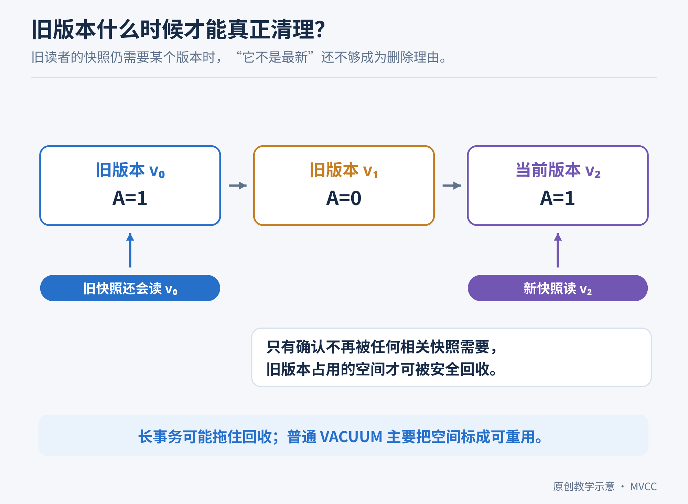

图 15：旧版本何时可回收，要看是否仍可能被相关事务需要。图没有承诺中间版本 v₁ 会立刻被单独删除，实际回收还受到系统安全边界与实现策略约束。

PostgreSQL 用 `VACUUM` 及自动清理机制处理不再需要的行版本、空间重用等维护任务。[官方说明](https://www.postgresql.org/docs/18/routine-vacuuming.html#VACUUM-FOR-SPACE-RECOVERY)明确指出，更新和删除通常不会立即移除旧行版本，因为其他事务仍可能看见它们。

因此，长事务不仅占用一个连接。它所持有的老快照可能拖住某些旧版本的回收，让系统需要保留更多历史负担。

设想一个后台导出任务开着事务，查询一批数据后，就把事务晾在那里，等人去吃完午饭再回来。业务上它“没有继续工作”，数据库却不能轻易假定它不再需要那张快照。

这也是为什么事务通常应该短而明确：进入、读取、计算必要结果、修改、提交；不要把等待用户输入或长时间外部操作随意塞进里面。

普通 `VACUUM` 主要把不再需要的空间标成以后可以重用，通常不会立刻让操作系统看到表文件大幅缩小。`VACUUM FULL` 是更重的重写与压缩操作，涉及额外空间和更强的锁，不能把它当成“看见旧版本就随手执行”的无成本按钮。

到这里，MVCC 的代价也清楚了：少一些读写互相等待，代价并没有凭空消失，而是变成版本保存、可见性判断、垃圾回收，以及更严格隔离时的依赖跟踪与事务重试。

## 16. 快照还不是什么？

有了机制图，再补几条边界就不容易混淆了。

**它不是任意时间的永久备份。** 旧版本会被回收，普通事务快照也有生命周期。想恢复昨天被误删的数据，需要单独设计备份、日志归档或历史记录方案。

**它不是一份必然最新的界面。** 固定快照越稳定，就越可能暂时不包含别人的新提交。要“随时刷新到最新”和要“长任务始终基于同一视角”，本来就是不同需求。

**它不自动覆盖数据库外部世界。** 同一事务里的数据库查询、一次第三方 API 调用、一个本地内存变量，不会因为程序把它们写在一起，就共享同一张数据库快照。

**它也不是对所有数据库对象和所有命令毫无例外的时间冻结。** 例如 PostgreSQL 的序列有特殊事务语义；`TRUNCATE` 和某些表重写操作也有 MVCC 限制。这篇文章一直围绕普通表上的行读取与更新，没有把它推广为所有操作的无条件承诺。需要使用这些特殊操作时，应查[相关限制](https://www.postgresql.org/docs/18/mvcc-caveats.html)，而不是继续套用值班表图示。

还有一条最容易把工程讨论带偏的混淆：MVCC 是机制家族，隔离级别是对事务行为的承诺，业务正确性是应用要守住的规则。三者有关，但不能互相替代。

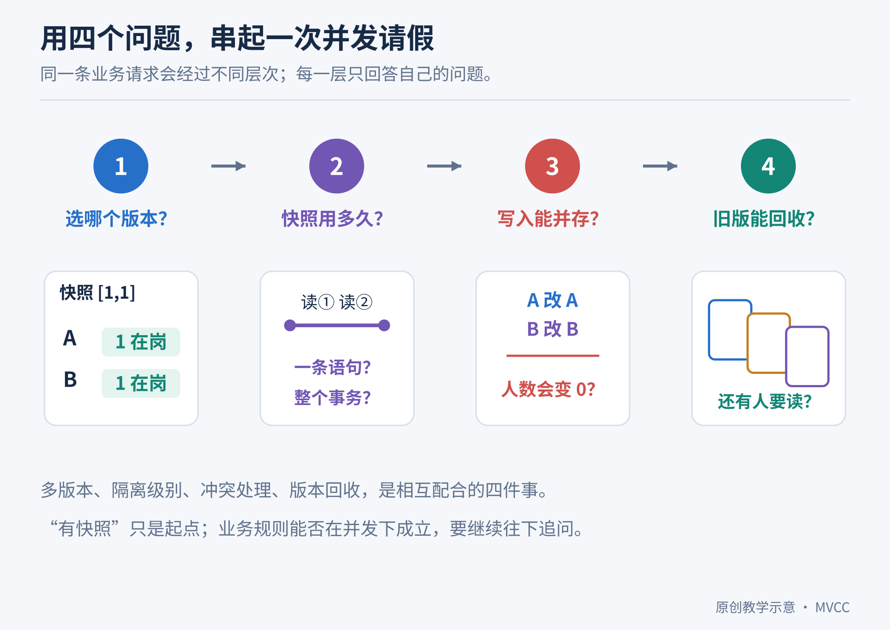

图 16：同一个请求里有四个问题。知道数据库“用了 MVCC”，还没有回答后三个问题。

## 17. 最后改三个条件，看看你的直觉会怎样变化

可以先不看下面的提示，沿着值班表自己推一遍。

**问题一：把两人请假改为 Read Committed，就自动安全吗？**

提示：如果两条计数查询都在任何离岗提交之前执行，它们仍然都可以得到 2。每条语句更新快照，不等于“先读后写”的业务检查获得了原子保护。

**问题二：两个人都在更新以后，再数一遍人数，可以补救吗？**

提示：在本例的可重复读下，自己的写入可见，对方的并发写入仍可能不可见。重新画图 10，就会得到两个人分别数出 1。重查不等于换了能证明共同规则的新视角。

**问题三：把值班状态放进同一条逻辑记录，或者增加同一条守卫记录，为什么可能改变结果？**

提示：你改变了冲突发生的位置。原本分散到两条行上的决定，现在可能通过同一个更新点或锁定点相遇。但“可能有帮助”还不是完整方案：仍要检查所有入口是否遵守协议、条件何时检查、等待后读的是什么版本、失败是否重试。

如果愿意继续动手，可以给配套 Python 模型增加一个共同守卫：一个事务取得守卫之前，另一个事务不能进入读取步骤。再枚举合法交错，看 `[0,0]` 是否还存在。这里模拟的是自己定义的锁协议，不要把它直接叫作 PostgreSQL SSI。

回到最初的问题：两个人同时修改数据库，为什么还能各自读到完整快照？

因为数据库留下了必要的历史版本，让不同读者依据各自明确的可见性规则取值。正在变化的是共享数据，稳定的是某次读取所遵守的边界。

但更值得带走的是第二个问题：**读得完整以后，这些决定能不能一起成立？**

MVCC 让我们有办法看见一个稳定的世界。可串行化、合适的锁协议，以及正确划定的事务与业务规则，才继续回答：当很多人同时行动时，怎样避免把那个世界一起改坏。

进一步阅读：

- [PostgreSQL 18：事务隔离](https://www.postgresql.org/docs/18/transaction-iso.html)，比较普通读取、并发更新与 Serializable。
- [PostgreSQL 18：行版本的系统列](https://www.postgresql.org/docs/18/ddl-system-columns.html)，了解逻辑行背后的版本身份。
- [PostgreSQL 18：序列化失败的处理](https://www.postgresql.org/docs/18/mvcc-serialization-failure-handling.html)，重点是重试完整事务及其决策逻辑。
- [PostgreSQL 18：日常 VACUUM](https://www.postgresql.org/docs/18/routine-vacuuming.html)，继续追问旧版本、空间重用与维护成本。

图片来源：本文 16 幅图均为原创教学示意；机制依据 [PostgreSQL 官方并发控制文档](https://www.postgresql.org/docs/18/mvcc.html)。图示不是数据库界面截图或实测时间线。
