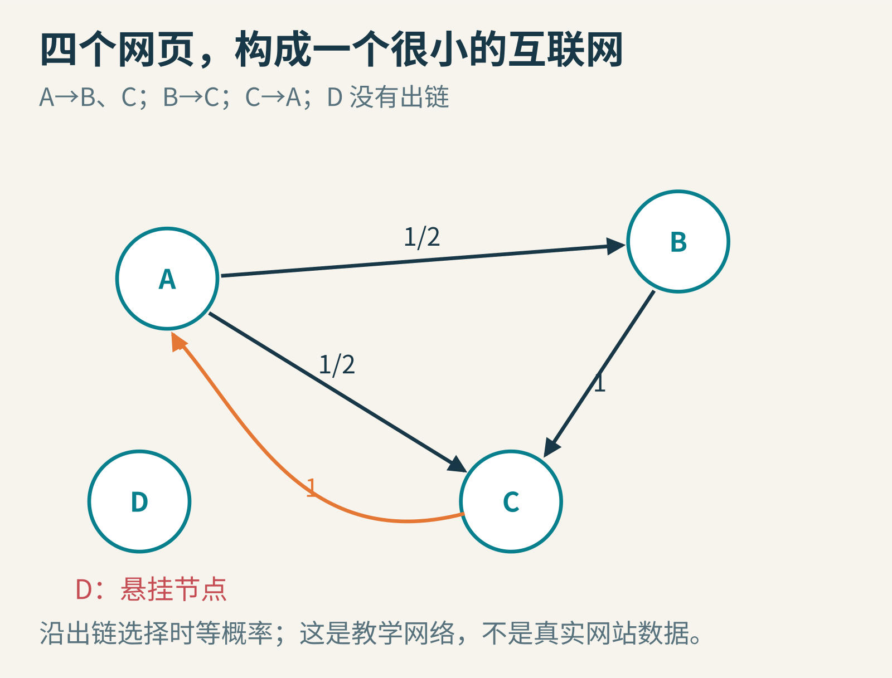
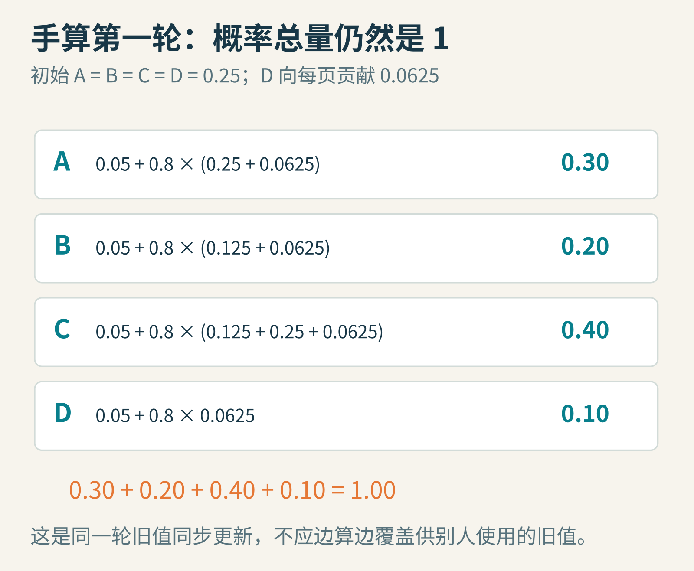
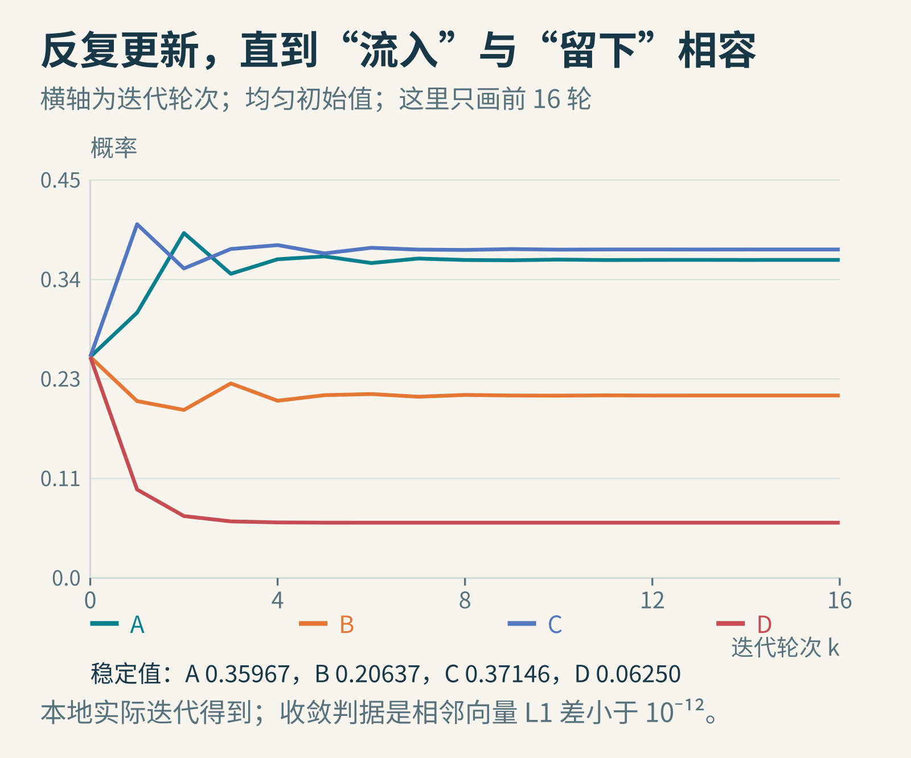
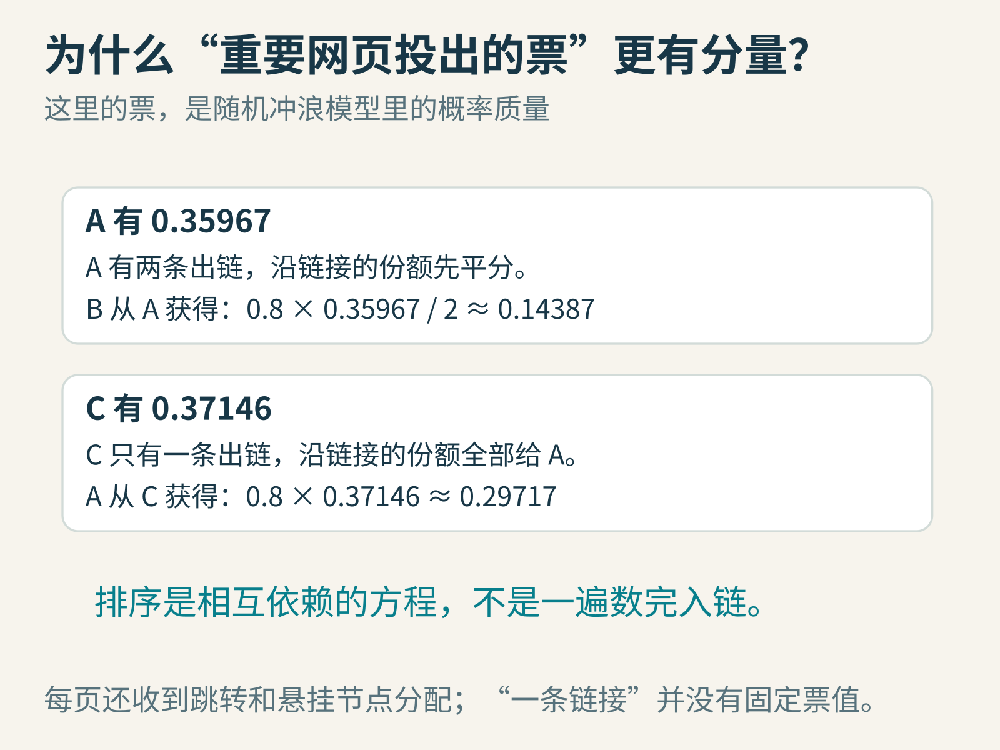
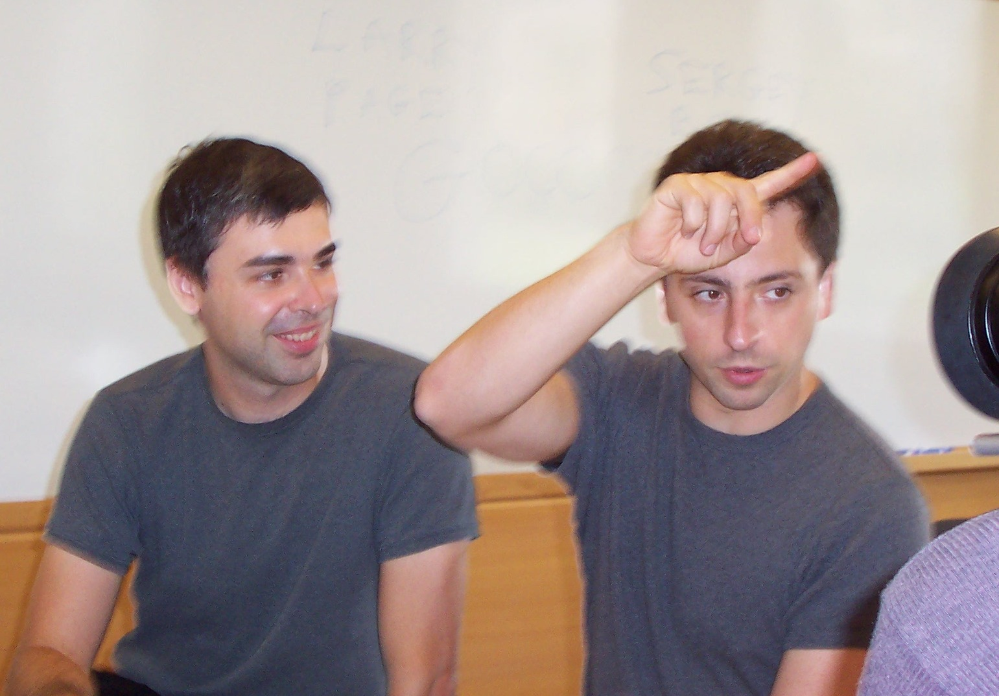

# 网页的“重要性”怎样绕一圈算回来？跟随机冲浪者理解 PageRank

有四个网页。A链接到B和C，B链接到C，C链接回A，D没有任何出链。

如果让你给它们排个顺序，你也许先数入链：C被两页指向，A和B各被一页指向，D没有。看起来很容易。

但现在补一个问题：一条来自重要页面的链接，是否应该比一条几乎没人访问的页面链接更有分量？

如果回答“应该”，麻烦马上出现了：**你需要先知道谁重要，才能算出谁重要。**

PageRank把这个看似循环的定义，变成了可以反复计算的概率流动。理解它不需要一上来背矩阵公式，先陪一个总在点链接的人走几步就够了。

## 第一步：把互联网缩小到四个点

先只考虑链接结构：一个网页是一个点，链接是有方向的箭头。A链接到B，不表示B也链接回A。



图1：这是为本文设计的教学网络。D是“悬挂节点”，即没有出链的页面。

我们想象一位非常简单的冲浪者。他到A时，等概率选择A的两条出链，因此一半去B，一半去C；到B时只能去C；到C时只能去A。

这不是真实人类浏览习惯的完整模型。真实用户会看标题、记住访问历史、用搜索框、关闭浏览器。模型故意只保留少量规则，好让我们弄清楚链接结构本身会造成什么结果。

想象很多这样的冲浪者同时出发。某一时刻有30%在A，20%在B，40%在C，10%在D。把四个比例写成向量，就是一份概率分布；它们加起来必须等于1。

## 为什么不能永远只点链接

第一个问题在D：没有链接，下一步怎么走？如果把到达D的概率直接丢掉，下一轮总和就小于1，冲浪者莫名消失了。

第二个问题是陷阱。如果一群页面只互相链接、不链接外部，只沿链接的人可能永远留在里面。

第三个问题是周期。如果只有A→B、B→A，所有人一开始在A，那么整群人会在A和B之间来回切换，分布不会逐轮稳定下来。

一个常见处理是加入**随机跳转，teleportation**：每一步先做选择，有概率d沿链接走，有概率1−d跳到另一个按指定分布抽取的页面。

本文取d=0.8，跳转目标在四页中均匀选择。也就是说，每页每轮都能从跳转分支收到 `0.2/4=0.05` 的基础概率。

对D，我们也明确规定：当“沿链接”分支遇到没有出链的页面时，将这部分概率均匀分给四页。于是D的整份概率都仍有去处。


图2：先修补没有出链的转移，再混入随机跳转。每一份概率都分配出去，才能维持总量为1。

在这个有限网络、0<d<1、跳转对每页都有正概率的设置下，我们得到唯一的稳定分布；从任意初始概率分布反复更新，都能收敛到它。这不是“任何有向图随便迭代都行”，而是我们补上的规则提供了关键条件。

## 第二步：手算第一轮

一开始平均分：A、B、C、D各0.25。

先分配D。它没有出链，因此0.25均分成四份，每份0.0625。注意这是“沿链接转移”里的份额，稍后仍要乘0.8。

A收到来自C的0.25，以及D分来的0.0625，再加跳转：

`新A = 0.05 + 0.8 × (0.25 + 0.0625) = 0.30`

B收到A的一半，即0.125，再加D与跳转：

`新B = 0.05 + 0.8 × (0.125 + 0.0625) = 0.20`

C收到A的一半0.125，以及B的全部0.25：

`新C = 0.05 + 0.8 × (0.125 + 0.25 + 0.0625) = 0.40`

D没有任何页面链接进来，但仍收到跳转和自己参与均匀分配的一份：

`新D = 0.05 + 0.8 × 0.0625 = 0.10`



图3：A和B虽然各只有一条入链，第一轮就已经不同。这来自指向它们的页面如何分配出链份额。

最后检查总和：0.30+0.20+0.40+0.10=1。归一化检查很重要：如果算成0.9，别急着“除一下总和修正”，先找是不是漏了悬挂节点、乘错阻尼或用了不一致的新旧值。

## 第三步：让刚算出的结果继续流动

第二轮旧值变成A=0.30、B=0.20、C=0.40、D=0.10。此时D对每页的贡献是0.025，而不是继续用第一轮的0.0625。

所以：

- 新A：`0.05+0.8×(0.40+0.025)=0.39`
- 新B：`0.05+0.8×(0.15+0.025)=0.19`
- 新C：`0.05+0.8×(0.15+0.20+0.025)=0.35`
- 新D：`0.05+0.8×0.025=0.07`

A上升，C回落。不要以为“一个点的重要性必须每轮单调增加”。这些数正在相互调整，直到流入方式与当前分布一致。



图4：图线来自本地实际计算。横向从第0轮到第16轮，颜色对应A、B、C、D；图中的稳定值使用更严格的停止条件计算。

本例最终约为：A=0.35967，B=0.20637，C=0.37146，D=0.06250。C略高于A，B居第三。

为什么D不是0？因为随机跳转让它持续被访问。为什么A高于B？C只把沿链接的份额交给A，而A把自己的份额分给B和C。不是所有入链都具有同样的分量。



图5：所谓“重要页面的一票更重”，可以精确到概率贡献；页面出链越多，每条出链分到的份额通常越少。

## 稳定分布不是一句口号，还能直接验算

设稳定时四个数是a、b、c、r。这里用r代表D的概率，避免和跟随概率d混淆。

D的方程最简单：

`r = 0.05 + 0.8×r/4`

解得r=0.0625。于是每页从跳转加悬挂分配得到的公共部分，恰好为：

`0.05 + 0.8×0.0625/4 = 0.0625`

剩下三个方程是：

`a = 0.0625 + 0.8c`

`b = 0.0625 + 0.4a`

`c = 0.0625 + 0.4a + 0.8b`

把第二式代入第三式，再代入第一式：

`a = 0.1525 + 0.576a`

所以 `a=0.1525/0.424≈0.3596698`，另外两项随之得到。这和迭代结果吻合。

这个小推导解释了循环定义为什么不必令人绝望。许多科学模型都把相互依赖写成方程组。困难在于是否存在解、是否唯一、能否高效求出，而不是“定义绕了一圈”本身。

## 一份没有黑箱的小实现

下面代码直接使用邻接表，没有构造满是0的大矩阵。仍然只是教学实现，不是分布式网页排序服务。

```python
links = [[1, 2], [2], [0], []]  # A、B、C、D
n = len(links)
damping = 0.8
rank = [1 / n] * n

for iteration in range(1000):
    nxt = [(1 - damping) / n] * n
    for src, targets in enumerate(links):
        destinations = targets or range(n)
        share = damping * rank[src] / len(destinations)
        for dst in destinations:
            nxt[dst] += share
    change = sum(abs(a - b) for a, b in zip(rank, nxt))
    rank = nxt
    if change < 1e-12:
        break
else:
    raise RuntimeError("没有在给定轮数内达到停止条件")
```

对本文网络，按相邻向量L1差小于10⁻¹²的条件，实际运行48轮停止。L1差就是把每个分量变化的绝对值相加。

这个阈值是我们的数值停止规则，并不直接声称“每项距离精确解都小于10⁻¹²”。在有收缩性质的模型里，可以进一步从相邻迭代差推导误差界。

注意代码用`nxt`单独装新结果。若算完新A就立即覆盖旧A，让后面的B使用新A、C却混用别的旧值，就已经换成了另一种更新程序，不能再声称逐轮结果等于前面的同步计算。

大图中悬挂节点很多时，上面逐个向所有页面分配的做法还会浪费时间。可以先汇总悬挂节点的总概率，再统一均分一次。稀疏链接决定了大规模实现的存储和通信形态。

## 这个想法怎样走进搜索引擎

1998年，Sergey Brin与Lawrence Page发表[《The Anatomy of a Large-Scale Hypertextual Web Search Engine》](https://research.google/pubs/the-anatomy-of-a-large-scale-hypertextual-web-search-engine/)，介绍早期Google的结构，包括利用链接计算PageRank的思路。



图6：Larry Page与Sergey Brin，2003年。摄影Ehud Kenan；[CC BY 2.0](https://creativecommons.org/licenses/by/2.0/)，本文使用Commons原文件，未再修改。不是1998年论文发表时的照片。

它的重要之处之一，是把网页之间的指向关系当作一种有用信息：页面怎样描述自己是一回事，其他页面怎样连接它，又提供了另一种线索。

但早期论文已经不只讲PageRank，还讨论文本、锚文本和搜索系统结构。把整个搜索引擎缩成“先算一个分数再排序”，会错过检索的其他部分。

读原论文的公式时还要注意尺度：有的写法把总分规范成1，有的使用与页面数成比例的分数。本文一直采用总和为1的概率版本，因此均匀跳转项是 `(1−d)/N`。不能拿另一种尺度的常数项直接拼进来，却仍要求总和为1。

## 它擅长什么，又不能替你判断什么

PageRank计算的是给定网络和跳转规则下的结构分量。基本版本本身不知道你搜的是“火山”还是“吉他”，也不理解一篇文章的事实是否正确。


图7：一个分数解决一种建模问题，不能自动代表所有意义上的“好”。

改变跳转分布，可以让某些页面更容易被随机访问，得到个性化的结构排名。改变d，也会改变“跟着网络走”和“重新出发”的比例。d不是一个可以解释所有互联网行为的自然常数。

链接还可能被操纵、购买、批量制造。模型本身不具备自动识别诚意的能力。今天Google的[排序系统说明](https://developers.google.com/search/docs/appearance/ranking-systems-guide)也把链接分析放在更广泛的多种系统之中；原始PageRank不等于当前Google全部排序算法，更不能据此预测某个网站今天的具体名次。

更深一层的边界是：模型依赖你给它的图。抓取漏了页面、把重复链接怎么算、是否纳入某些链接、怎样处理删除和重定向，都会改变输入。漂亮的线性代数并不会替你解决数据采集的定义问题。

试做三个小变化：

- 给D增加一条指向A的链接，重新算第一轮。D不再是悬挂节点，会发生什么？
- 把d设为0。是否立刻得到均匀分布？这说明链接信息还剩多少作用？
- 只保留A↔B，不加入跳转，从`[1,0]`开始迭代。观察不收敛的周期，再加入20%均匀跳转，比较发生了什么。

理解PageRank最好的收获，也许不是学会评价网页，而是学会一种更普遍的看法：**相互依赖的影响，可以化为守恒的流量；反复更新，可以寻找一个全局自洽的状态。**

图片来源：网络、概率分配与迭代图为本文原创；[Page与Brin合照原页](https://commons.wikimedia.org/wiki/File:Google_page_brin.jpg)，Ehud Kenan，CC BY 2.0。延伸阅读：[1998年原论文](https://research.google/pubs/the-anatomy-of-a-large-scale-hypertextual-web-search-engine/)、[Google排序系统介绍](https://developers.google.com/search/docs/appearance/ranking-systems-guide)。
