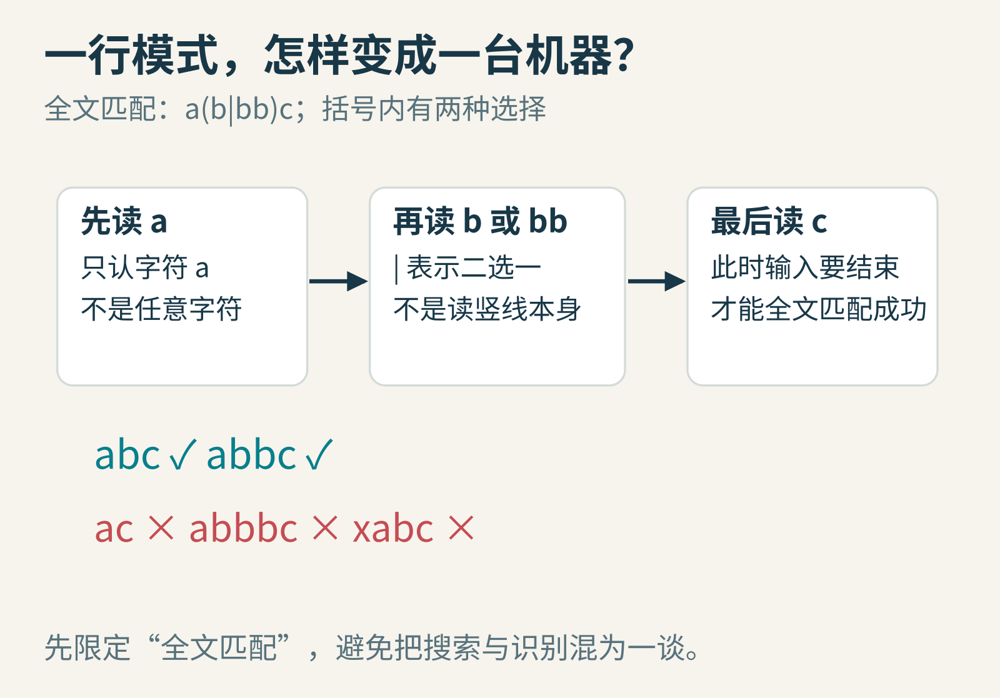
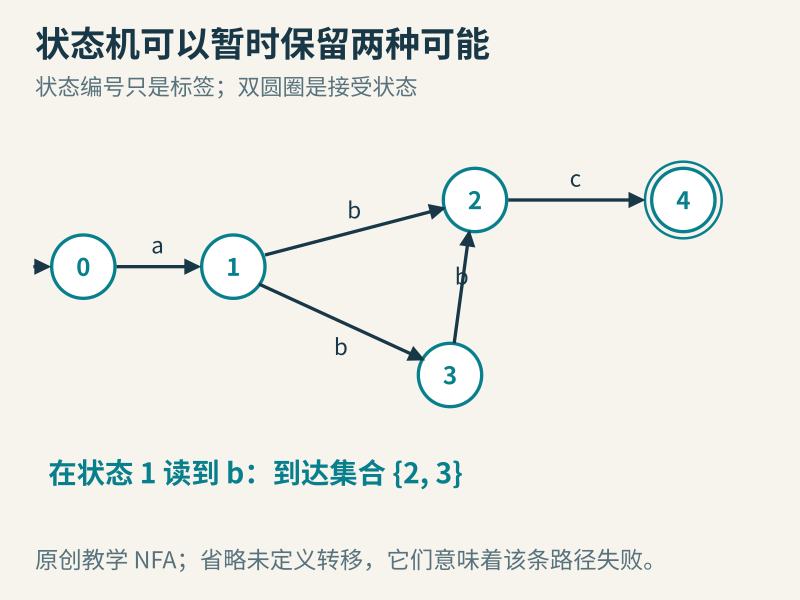
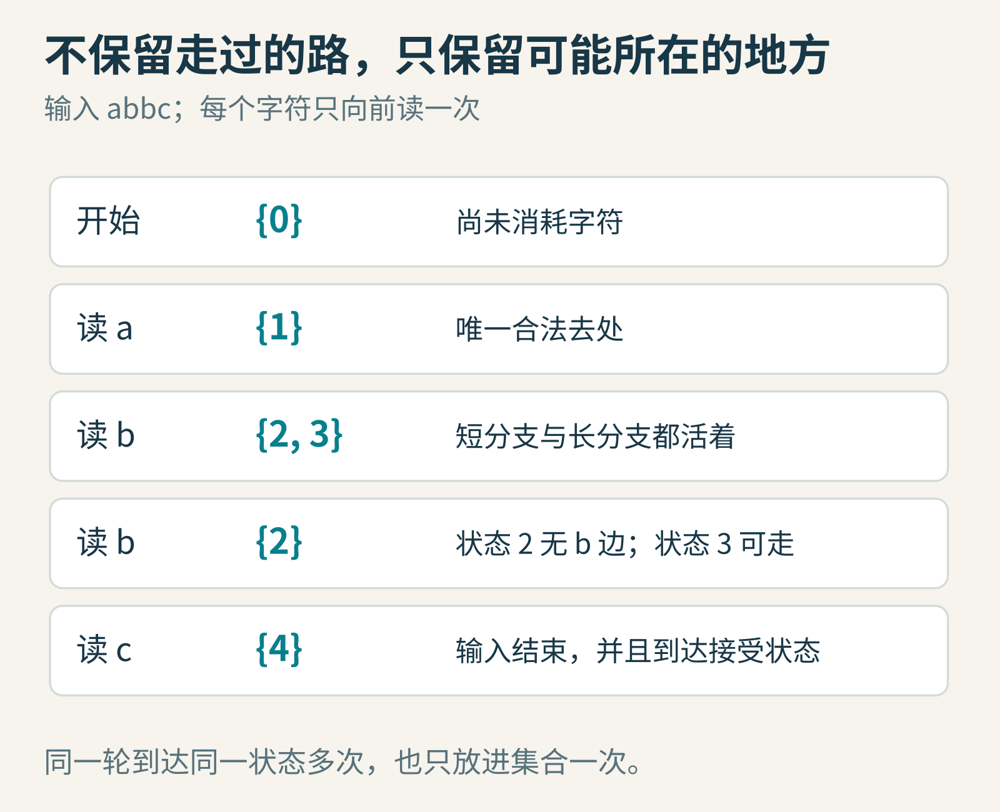
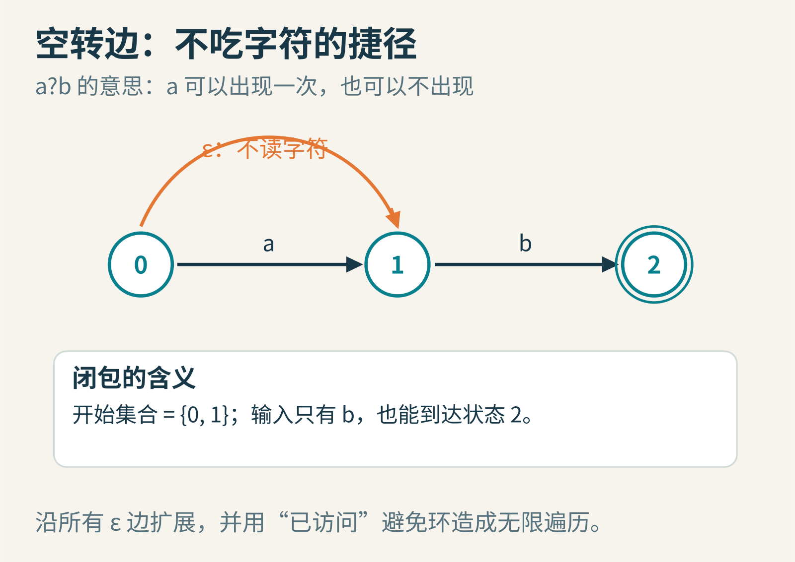
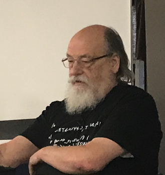
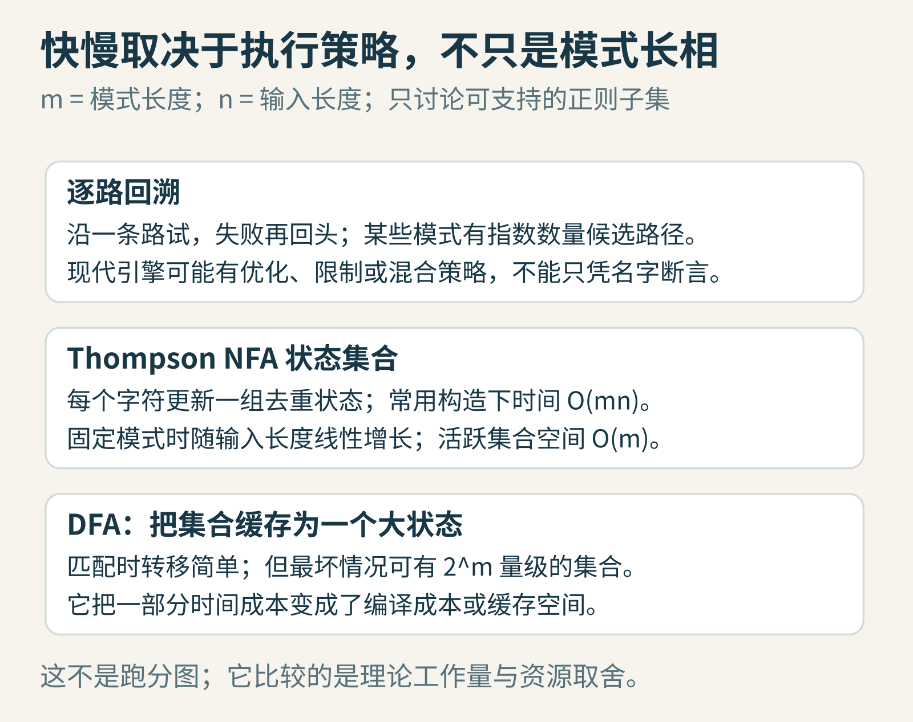
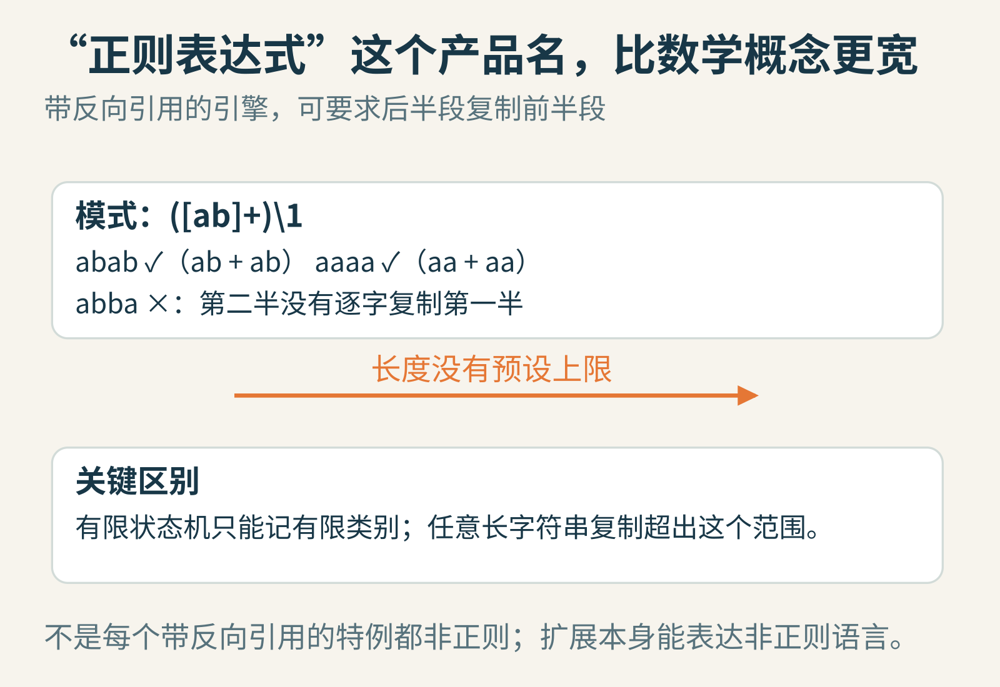

# 一行正则，为什么能让程序卡住？把符号拆成一台小机器

假设你在给游戏编辑器写资源筛选器。文件名规则不过几行，用户输入也不长，按理说应该瞬间结束。可是，换一个模式，程序竟然开始长时间占用处理器。

问题不一定在于字符串太长。也可能在于：**这行看起来很短的规则，给匹配器制造了太多条“也许能成功”的路。**

要理解这件事，我们先不背语法表，也不从复杂的邮箱校验开始。只造一台能认出两个单词的小机器，再看它为什么可以做到“不回头”，以及为什么某些同样叫正则表达式的功能会让这条路走不通。

## 先约定：我们到底要认出什么

本文的小模式是 `a(b|bb)c`。

它要求先出现一个 `a`，中间出现一个或两个 `b`，最后出现一个 `c`。因此 `abc` 和 `abbc` 成功，`ac`、`abbbc` 失败。竖线是“或者”，括号负责分组。

这里做的是**全文匹配**：整个输入都必须符合规则。若用“搜索子串”的接口，`xabc` 里可以搜出 `abc`，那是另一种问题。很多初学者第一次调试正则时，混淆的正是这两个接口。



图1：先把模式解释成一份清楚的约定，再讨论机器怎样执行。图中勾叉都以全文匹配为前提。

还有一个重要转念：正则表达式不是一段用来“修改文本”的命令。它首先描述一类字符串。寻找、替换、提取分组，是工具围绕这种描述提供的操作。

## 把“还差什么”画成状态

假设你刚读到 `a`。你无需记住整个过去，只需知道：接下来允许出现什么？

这就是状态的作用。下面给机器的几个状态编号：0 是起点；读过 `a` 到1；2表示已经有足够的 `b`，可以等 `c`；3表示走了较长分支的第一个 `b`，还需要再读一个；4是接受状态。



图2：状态1有两条同样标着 `b` 的出边。它不是画错了，恰恰是故事开始的地方。

机器读一个字符，就沿相应标签的箭头走一步。假如当前位置没有对应箭头，这条尝试就失败。到达双圆圈还不够，全文匹配要求输入恰好也读完。

在状态1读到 `b` 时，应该去2还是3？

如果下一个字符是 `c`，去2比较好；如果后面是 `bc`，去3比较好。但当前这个字符并不会告诉我们未来。具有这种分支的机器叫**非确定有限自动机，NFA**。

“非确定”不是说它随机决定答案。它的数学定义很明确：只要存在一条路径，能读完输入并到达接受状态，就接受。问题是，普通计算机怎样实现这个“存在”？

## 第一种办法：先猜一条，不行再回来

你可以先选去2。若后面的字符对不上，就返回分叉点，试去3。这叫回溯。

对我们这个例子，回溯毫不吓人，最多比较几个字符。问题出现在许多分支嵌套、重复，而且很晚才发现失败时。

想象模式里有若干个“这个 `a` 要也行，不要也行”，后面又要求一串 `a`。每个可选位置都产生一种分配选择。单看某一次选择很便宜，但若许多选择组合都必须被排除，工作量会爆炸。

更常见的危险直觉是：同一段输入能被多个重复部分以许多种方式瓜分，而最后一个字符才暴露失败。诸如嵌套重复的模式，值得格外警惕。

但别把这个解释误读成“所有回溯引擎在所有模式上都很慢”。它们在许多实际任务中表现很好；具体实现还可能提前排除不可能的路径、识别特殊模式、设置步骤或时间限制。这里讨论的是**一种执行策略的最坏情况风险**，不是给所有软件贴永久速度标签。

## 第二种办法：把两种可能一起保留下来

在状态1读到 `b`，我们不猜。直接记录：现在可能在2，也可能在3。

于是机器维护的不是一个位置，而是一个**状态集合**。下一字符到来时，让集合里的每个状态都前进一步，把到达的新状态合并、去重。

拿输入 `abbc` 走一遍：

1. 尚未读字符：集合是 `{0}`。
2. 读 `a`：0可以走到1，得到 `{1}`。
3. 读第一个 `b`：1同时能走到2和3，得到 `{2,3}`。
4. 读第二个 `b`：2没有 `b` 出边，淘汰；3能走到2，得到 `{2}`。
5. 读 `c`：2走到4，得到 `{4}`。输入也结束了，成功。



图3：所谓“同时”，是逻辑上同时保留可能性。单核处理器用一个普通循环就能完成，不需要为每条路创建线程。

如果输入是 `abc`，第三步仍为 `{2,3}`，但接着读 `c` 时，是状态2活下来，状态3被淘汰。机器不必提前知道哪条分支最终正确。

这儿最关键的优化不是“猜得更准”，而是：**如果多条历史路径已经到达同一状态，并且只关心能否接受，那么这些历史可以合并。**

机器需要保存的是“接下来允许做什么”，不是“我刚才到底怎么走来的”。过去的路可能很多，当下不同的状态却只有有限个。

## 用不到二十行，亲眼看见这个过程

下面是固定识别本例的 Python 教学代码。它不是完整正则解析器，也没有捕获组、Unicode规则或搜索起点处理。

```python
edges = {
    0: {"a": {1}},
    1: {"b": {2, 3}},
    2: {"c": {4}},
    3: {"b": {2}},
    4: {},
}

def accepts(text):
    active = {0}
    for ch in text:
        active = {
            dst
            for state in active
            for dst in edges[state].get(ch, set())
        }
    return 4 in active
```

本例已经实际运行核对：`abc`、`abbc` 返回真，`ac`、`abbbc`、`abb` 返回假。注意最后一个：读到 `abb` 时集合非空，却没有接受状态。这说明“还没失败”不等于“已经成功”。

你可以加一行打印 `active`，再试 `abbbbc`。只要集合变空，后面读多少字符也不会重新生出路径。这时可以提前返回失败。

## 问号和星号，怎样装进图里

我们的图直接画出了两条 `b` 路径。自动编译一般模式时，还常用一种不消耗字符的边，写作 ε。

以 `a?b` 为例，`a?` 表示 `a` 可有可无。机器既可以读一个 `a` 再走，也可以走一条 ε 捷径，直接去等 `b`。



图4：从起点沿所有 ε 边能到达的位置，要一起放入初始集合；这种扩展叫 ε 闭包。

因此，初始状态并非永远只有“起点一个”。每次读完字符后，也要再把能够空转到达的位置加入。若图中有环，闭包遍历必须标记已访问状态，否则程序会在“不读字符”的循环里原地绕圈。

普通字符、串接、二选一、重复，都能由小片段组合。Ken Thompson 在1968年的论文中给出了经典的正则搜索方法；后来常说的 Thompson 构造及状态集合模拟，就把这类数学结构变成了实用程序。Russ Cox 的[详细讲解](https://swtch.com/~rsc/regexp/regexp1.html)展示了这条思路，也讨论了不同实现的性能差别。



图5：Ken Thompson，2019年。摄影 A.C.Diller，原始文件为裁切肖像，本文未再修改；[CC BY-SA 4.0](https://creativecommons.org/licenses/by-sa/4.0/)。照片不是1968年的历史现场。

## “线性时间”到底相对于什么

把模式长度叫作 m，把输入长度叫作 n。采用常见的 Thompson 构造时，状态和边的数量随 m 线性增长。每读一个字符，最多处理一轮与模式规模成正比的状态及边，因此一个基本上界是 **O(mn)**。

若模式固定，m可以看成常数，运行时间随输入长度n线性增长。这就是常说的“线性时间正则匹配”。

但如果你一边把输入加长，一边也把模式加长，m和n同时变大，就不能还只写一个O(n)。同样，不受限制地接受用户提交的超大模式，也会带来编译和内存成本。



图6：算法复杂度说明增长趋势，不直接等于某台电脑上的毫秒数；这里没有拿示意图冒充跑分。

还有一个聪明办法：把出现过的整个状态集合视为一个新的“大状态”，下次遇到相同集合和相同字符，直接复用计算结果。这就接近确定有限自动机DFA的思路。

代价是：m个状态可能有大量不同的子集，最坏情况下状态集合的组合数会指数增长。预先构造全部DFA可能很占空间；按需构造与缓存，则需要管理内存预算。

所以真正的工程并非一句“DFA永远最好”。它是在可预测的匹配时间、编译时间、内存与功能之间选择。比如[RE2 的官方说明](https://github.com/google/re2)明确强调输入长度方向的线性时间保证，同时也谈到内存预算与不支持的功能。

## 一个名字相同、能力却不同的边界

很多语言的“正则”支持反向引用。例如在支持该语法的引擎中，`([ab]+)\1` 可以要求后一段逐字重复前面捕获的字符串。

`abab` 能分成 `ab` 加 `ab`；`aaaa` 能分成 `aa` 加 `aa`。而 `abba` 不能分成两个相同的、非空的 `a/b` 字符串。



图7：核心困难不是记住“读过几个字符”，而是记住任意长的内容，并在后面逐字核对。

在只使用有限个状态的前提下，机器无法对任意长度都保存这样的前半串。这个扩展能描述数学意义上的非正则语言。

准确的说法是“反向引用扩展突破了正则语言的表达边界”。并不是每个含反向引用的具体模式都非正则，例如只在有限几个固定单词间选择的特例，仍可能被有限状态机描述。

RE2不支持反向引用，并不是忘了实现一个小功能，而是它的功能选择服务于性能保证。当然，其他引擎也有合理需求：提取组、复杂文本规则、与既有语法兼容，都可能比统一的最坏情况保证更重要。

## 下次写正则时，先问四个问题

第一，调用的是搜索还是全文匹配？规则的边界是否真的清楚？

第二，输入和模式是谁提供的，长度有没有限制？不可信输入遇到容易回溯爆炸的模式，可能成为拒绝服务风险。

第三，确实需要反向引用、环视等特性吗？不同特性的理论性质也不同，不能把所有高级语法一概视为非正则；应查看目标引擎实际支持什么、怎样执行。

第四，这个任务适合用正则吗？固定格式的编号很好处理；有嵌套结构、错误恢复需求的语言，通常值得交给专门解析器。模式不是越短越好，容易审查和稳定运行同样重要。

留三个小实验：

- 修改上面的边，让机器只接受 `abbbc`。你需要增加哪个状态？
- 用纸片模拟 `abc` 和 `abbc`。纸片放在活跃状态上，每读一个字符移动一轮，体会“保留可能性”如何替代“重走历史”。
- 尝试把每个活跃集合命名为一个DFA状态。记录哪些集合真的到达过，哪些理论上可能的子集从未出现。

理解正则的一个好标志，不是会背多少元字符，而是看见一段规则时，能问出：它需要记住怎样的过去？这些过去能否合并？如果不能，代价会在哪里出现？

图片来源：机制与执行图为本文原创教学示意；[Ken Thompson 肖像原页](https://commons.wikimedia.org/wiki/File:Ken_Thompson,_2019.jpg)，A.C.Diller，CC BY-SA 4.0。延伸阅读：[Russ Cox](https://swtch.com/~rsc/regexp/regexp1.html)、[RE2](https://github.com/google/re2)。
