# 数据还没来完，怎样公平地抽出两条？

假设你在观察游戏服务器的日志。记录不断到来，你想随机留下两条，稍后人工检查。麻烦是：你不知道今天最终会有多少条，内存也不允许先把所有日志保存起来再抽签。

如果只留最早的两条，会漏掉后面的时段。如果总留最新两条，抽到的其实是一个短短的尾巴。我们想要的是另一种保证：无论数据流在哪条记录后停止，已经到来的记录都能组成一个公平的样本。

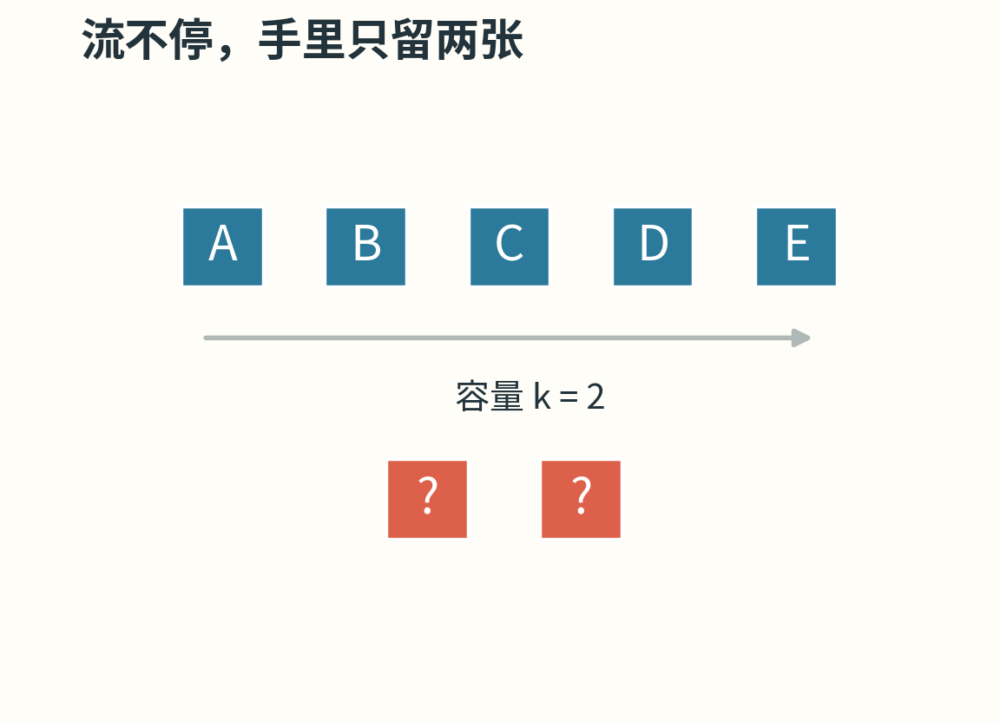

图中的 A、B、C、D、E 是五次不同的到达，不是五种日志类型。流可以在 E 后结束，也可以继续到很久以后；程序事先不知道。

这里假定停止位置不是通过反复查看当前随机样本、等它符合心意才决定；那样会引入选择偏差。

解决这个问题的一类方法叫水库抽样。这里的“水库”就是固定数量的存储格子。我们不把整个河流装下来，而是在每次新水经过时，认真决定是否替换库里的一点水。

## 先试一个很像公平、却不公平的办法

把问题缩到只留一条。A 到来时先留下；以后每来一条就抛公平硬币，正面换成新记录，反面保留旧记录。

每次决定都是一半对一半，好像谁也没有受到偏爱。但让数据恰好在 D 后结束，D 只需要赢最后一次硬币，留下概率是 1/2。

C 必须先赢自己的硬币，再躲过 D，概率是 1/2×1/2=1/4。B 要一路躲过 C、D，概率是 1/8；最初直接进入的 A 也要躲过 B、C、D，概率是 1/8。

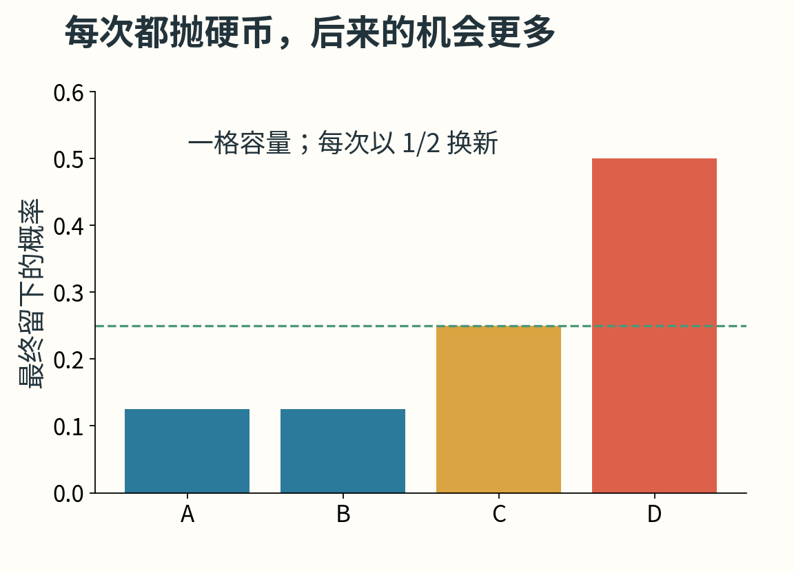

横轴是到达顺序，纵轴是最终留下概率。绿色虚线 1/4 是四条记录公平抽一条时应有的水平。公平的硬币，并没有自动组成公平的算法。

问题出在旧记录经历的淘汰机会更多。要补偿它们，新记录越晚到，换入机会就必须越小。

## 一格水库：第 i 条，以 1/i 的概率进来

A 是第一条，概率 1 进入。B 是第二条，以 1/2 换入。C 以 1/3 换入，D 以 1/4 换入，E 以 1/5 换入。

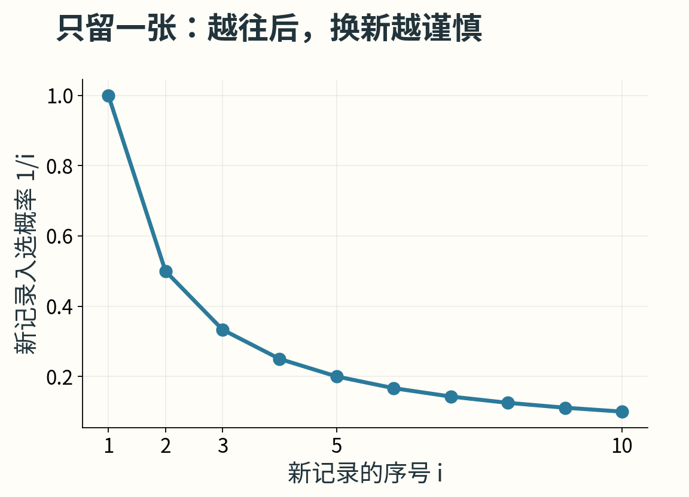

这不是因为越晚的数据越不重要，而是因为旧数据之前已经经过多次淘汰。我们比较的是“此刻最终在库里”的概率，不是“到达那一刻被接纳”的概率。

检查 A 到 E 之后还能留下的机会：

1 × (1−1/2) × (1−1/3) × (1−1/4) × (1−1/5)
= 1 × 1/2 × 2/3 × 3/4 × 4/5 = 1/5。

中间的分子、分母逐个抵消。C 的机会也一样：先以 1/3 进入，再乘 3/4、4/5，得到 1/5。E 刚到，只需要自己的 1/5。

早来的记录更容易进入，却更难活到最后；晚来的记录更难进入，却少受几次淘汰。两者恰好抵消。

## 恢复两格，先把 A、B 装进去

前两条直接保存，没有理由在格子还空着时丢弃它们。

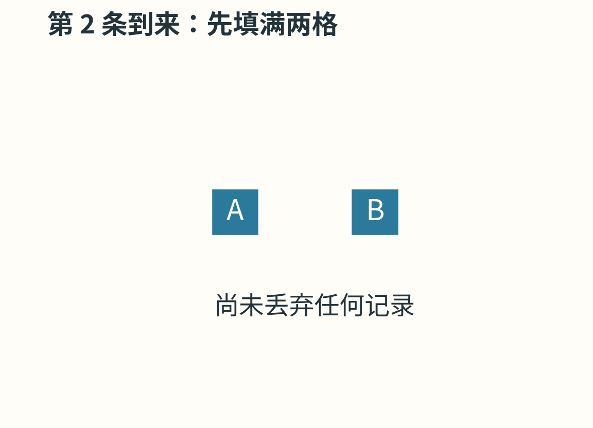

C 到来时，我们需要从 A、B、C 中留两条。可以准备三张等可能的签：

- 抽到 1，用 C 替换第 1 格
- 抽到 2，用 C 替换第 2 格
- 抽到 3，不换

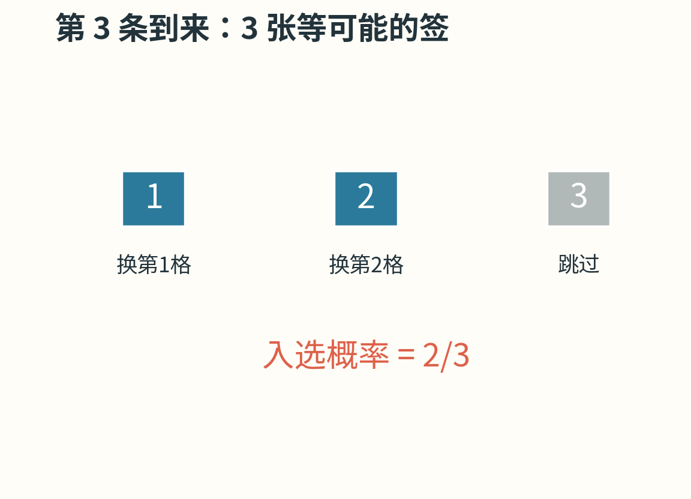

C 有两张签能进入，所以入选概率是 2/3。进入后替换谁，也被这同一次抽签公平决定了。

最终可能是 BC、AC、AB，每组概率都是 1/3。

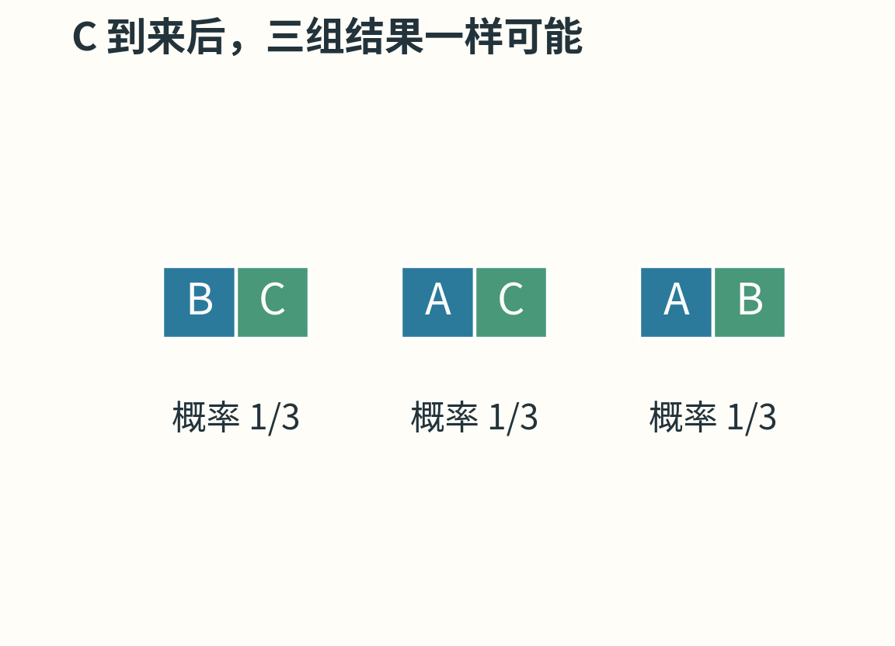

这比“每条记录概率相同”还强：每一种两条记录的组合，都有同样机会。为什么要在意组合？因为两条记录单独看都公平，并不保证它们能自由地搭配。一个总把固定伙伴一起选中的方法，单项概率可以相同，组合却很偏。

## D 到来，不要重新发明算法

只把抽签范围从 3 扩到 4。签 1、2 仍然分别替换两格；签 3、4 都代表跳过。

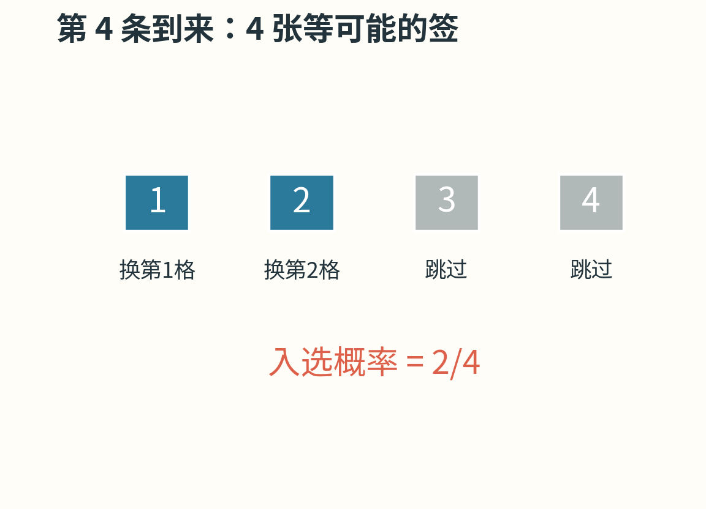

D 入选概率是 2/4。注意：程序不必知道被淘汰的那条记录去了哪里，也不必保留前三条的全集。它只保留当前两格和“已经看过四条”这个计数。

轮到 E，抽签范围扩大到 1 至 5。两个签位负责换入，剩下三个签位负责跳过。

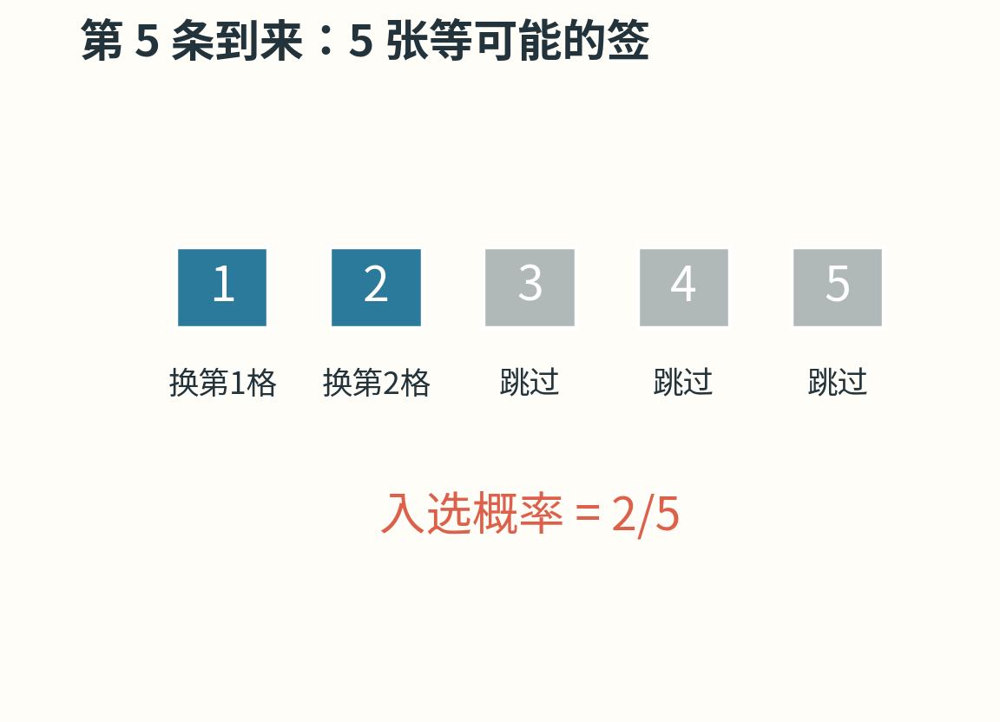

假如 C 来时抽到 2，D 来时抽到 4，E 来时抽到 1，一次完整轨迹就是 AB→AC→AC→EC。

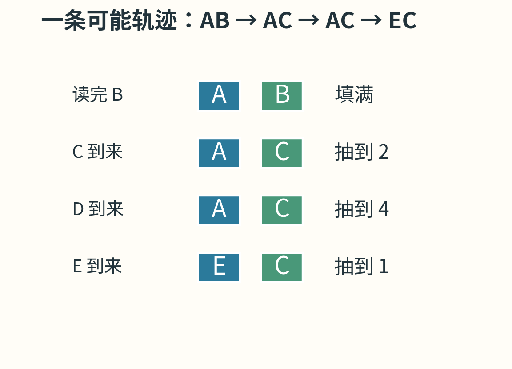

这是为手算明确指定的一条可能抽签轨迹，不是“算法每次都该得到 EC”。随机算法的正确性不体现在某个固定答案上，而体现在不同答案出现的分布。

## 老记录会不会吃亏？再算一次

假设处理完四条后，每一条在库里的概率都是 2/4。现在 E 到来，考虑某条已经在库里的老记录。

它会被替换，必须抽中“它所在的那一格”。五张签里只有一张满足，因此它躲过替换的概率是 4/5。

于是老记录的最终概率为：

2/4 × 4/5 = 2/5。

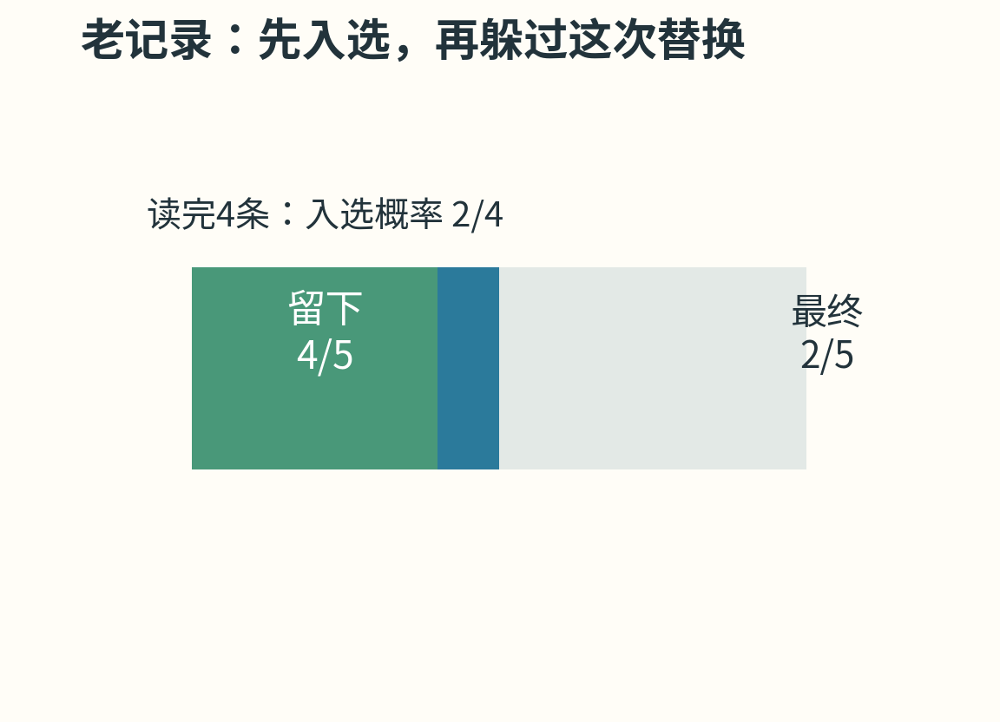

图中蓝绿区域合起来表示上一刻的入选概率 2/4，绿色部分是再乘 4/5 后的 2/5。它与新来的 E 恰好相同。

把四、五换成一般序号：容量 k，第 i 条到来前，老记录入选概率为 k/(i−1)；这一轮存活概率为 (i−1)/i；相乘就是 k/i。新记录则直接以 k/i 进入。

这个“假设上一轮已经公平，证明下一轮仍公平”的方法叫数学归纳。前 k 条全部留下是起点，之后每步都保持保证。它不需要提前知道最终总数。

## 单条公平还不够，十种组合也要公平

五条里选两条，共有 AB、AC、AD、AE、BC、BD、BE、CD、CE、DE 十种组合。

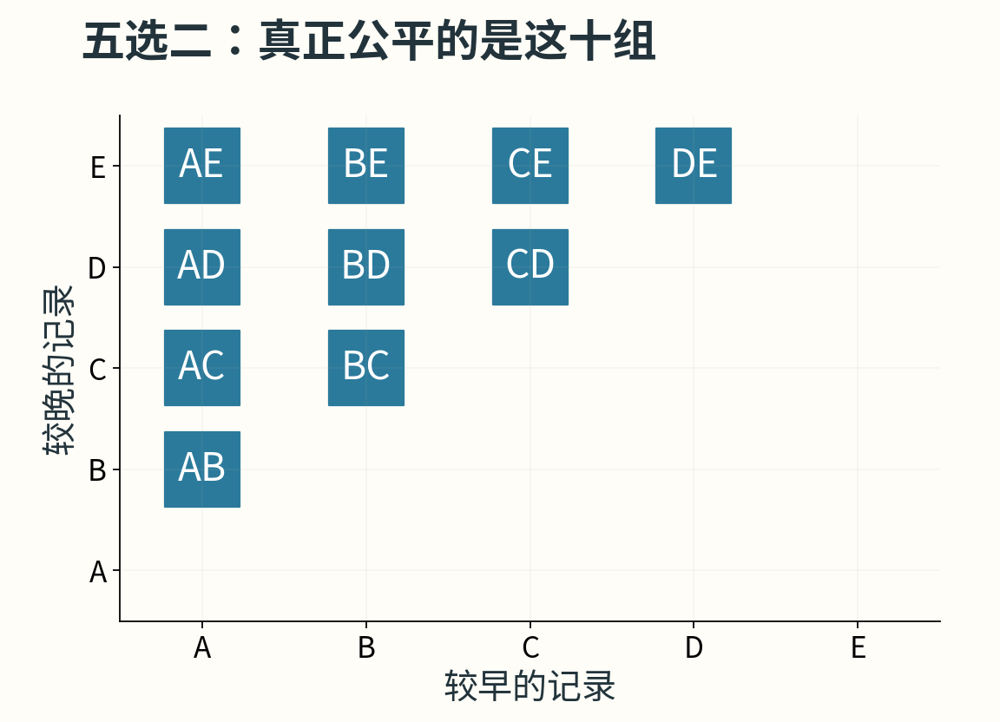

我们挑两类检查。第一类不包含最新的 E，例如 AB。读完 D 时是 AB 的概率为 1/6；E 来时抽到 3、4、5 中任何一个都保持原样，概率 3/5。因此最终 AB 的概率为 1/6×3/5=1/10。

第二类包含 E，例如 AE。读完 D 时，库里必须是 AB、AC、AD 之一。这三种各有 1/6 概率；随后必须用 E 换掉 A 的伙伴，各有 1/5 概率。所以总概率是 3×1/6×1/5=1/10。

其他组合没有特殊地位，同样分成这两类。这个思路也能推广到任意容量：分别数“最终样本含最新项”和“不含最新项”的来源，就能证明所有等大小子集等概率。

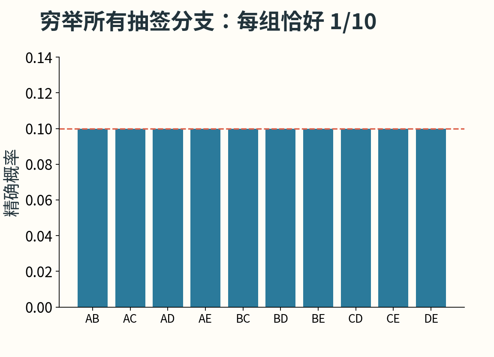

这幅图不是随机试一万次的近似结果。我们让程序枚举 C、D、E 到来时所有等可能的抽签分支，用分数累计，十组都恰好是 1/10。它验证了这个有限输入；上面的归纳推理说明方法为什么能继续推广。

## 十几行代码，最容易错的是一个边界

下面是完整的 Python 3 实现。i 从 1 数起，而列表位置从 0 数起。randrange(i) 返回 0 到 i−1，所以 j<k 就对应刚才的前 k 张有效签。

```python
import random

def reservoir(stream, k, rng):
    if k < 0:
        raise ValueError("k must be nonnegative")
    result = []
    for i, item in enumerate(stream, 1):
        if i <= k:
            result.append(item)
        else:
            j = rng.randrange(i)
            if j < k:
                result[j] = item
    return result

rng = random.Random(2026)
counts = [0] * 10
for _ in range(100_000):
    for item in reservoir(range(10), 3, rng):
        counts[item] += 1
print(counts)
```

实际运行输出为：

[29801, 30003, 29968, 30041, 29861, 30033, 30062, 30022, 29987, 30222]

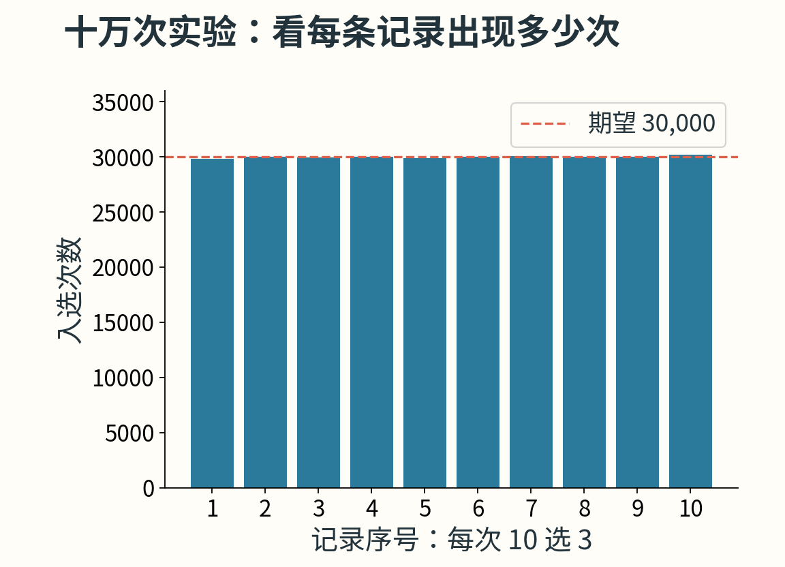

这里每次从十条中抽三条，做十万次，所以每条出现次数的期望是 30,000。总计出现次数必须正好是 300,000；实际数值围绕期望上下波动。不要为了让柱子一样高去修改随机结果，有限实验本来就不该强迫完全相等。

固定种子让这次实验可复现，并没有把伪随机数变成安全抽奖所需的不可预测随机源。涉及对抗者、奖品或审计时，随机源、种子管理和流程本身还需要另外设计。

## 1985 年的论文，也在问“能不能少做一点”

水库抽样常与 Jeffrey S. Vitter 的 1985 年论文《Random Sampling with a Reservoir》一起出现，但不能因此把本文这套 Algorithm R 全归给他。

Vitter 在论文第二节明确把 Algorithm R 归于 Alan Waterman；NIST 的算法条目也说明 Knuth 将其归功于 Alan G. Waterman。Vitter 这篇论文的主要贡献包括更快的 Algorithm Z，以及对跳过记录的分析。[原论文](https://www.ittc.ku.edu/~jsv/Papers/Vit85.Reservoir.pdf) · [NIST 算法条目](https://xlinux.nist.gov/dads/HTML/reservoirSampling.html)

历史里的问题和今天的日志很接近：记录只能顺序经过，提前数一遍总数可能代价很高。不同的是，原论文讨论过磁带、磁盘，以及CPU与输入输出的不同成本；那里的性能数字不能直接拿来当今天服务器的基准。

看看两格水库：第 i 条真正换入的概率是 2/i。越到后面，大多数抽签都只得到“跳过”。

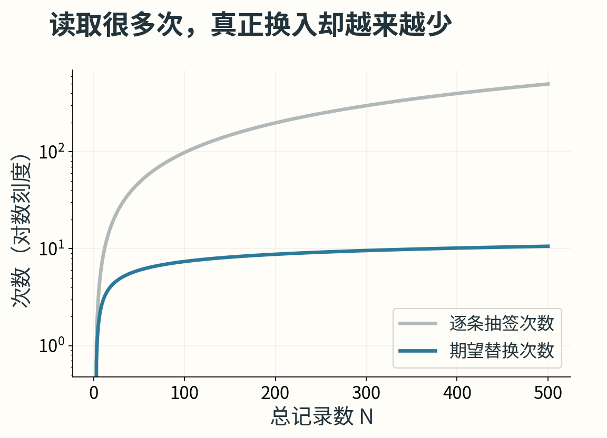

灰线是逐条决定的抽签次数 N−2；蓝线是各次换入概率之和，也就是期望替换次数。纵轴使用对数刻度。图只比较操作计数，没有测量CPU时间。

这自然引出更进一步的问题：能否直接随机决定“跳过多少条”，而不为每条单独抽签？更快算法正是在这一层减少工作。但如果真实输入接口仍要求一条条读取，省下抽签并不等于省下所有读取成本。

## 它节省了存储，也留下了清楚的边界

算法处理 N 条记录，直观实现用 O(N) 时间和 O(k) 个记录的空间，外加计数与随机数生成状态。空间不会随 N 一起存下全部记录。

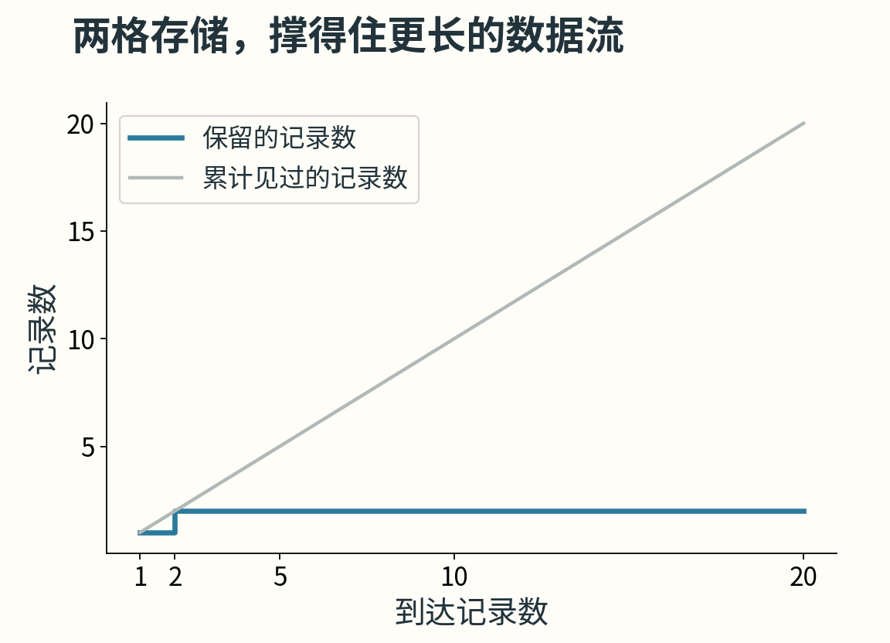

不过“记录数固定”不表示字节数绝对固定：一条日志可能特别长，计数器所需位数也随总数增长。复杂度通常按固定大小记录和机器整数模型讨论。

还有三个值得亲手检查的边界。

第一，按记录抽样不等于按不同值抽样。如果输入是“红、红、蓝”，容量为一，两条红色记录各有 1/3 机会，最终红这个值有 2/3 机会。

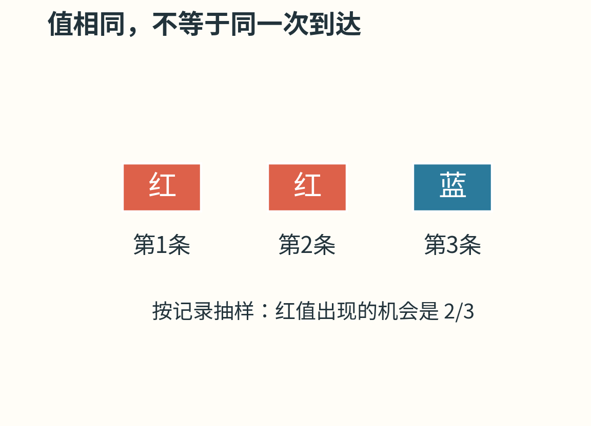

如果你想让红、蓝两种值各占一半，就需要先明确“不同值”这个抽样单位。不能悄悄把去重当成普通水库抽样已经解决的部分。

第二，全历史样本不等于最近窗口样本。一条很久以前的记录仍可能留下，算法没有承诺它会在十分钟后自动过期。

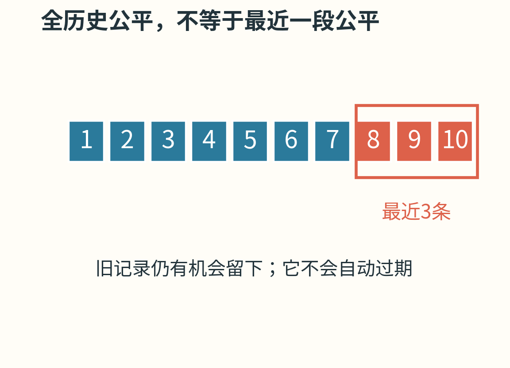

第三，两台服务器各自公平，不代表把两份水库拼起来再均匀抽就公平。如果一台看过两条、另一台看过一万条，两边样本不能在合并时被当成代表同样多的原始记录。合并需要保留各自处理量并使用正确的加权方法。

也别忘了输入少于 k 条时根本抽不出 k 条不同记录。上面的函数会返回实际见过的全部记录；这是明确的接口行为，不是偷偷补重复项。

现在可以做一个小实验：把代码里的 randrange(i) 改成 randrange(i+1)，先预测谁会占便宜。多出来一张“跳过”签，意味着老记录更难被换掉。再把它运行十万次，看看靠前的记录是不是被保护了。

真正值得记住的不是“水库”这个名字，而是那条一直被维护的约定：每次新数据到来，旧样本被淘汰的风险和新数据进入的机会，都必须经过同一套概率账本。

图片来源：全部为本文原创教学图。图12来自有限输入的精确分支枚举，图13来自实际运行的伪随机抽样实验，其余为明确条件的数学或数据流示意。方法和历史参考 Vitter 的[原论文](https://www.ittc.ku.edu/~jsv/Papers/Vit85.Reservoir.pdf)及 [NIST](https://xlinux.nist.gov/dads/HTML/reservoirSampling.html)。
