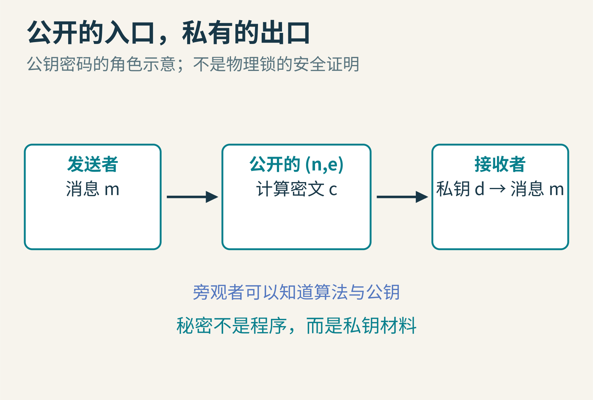
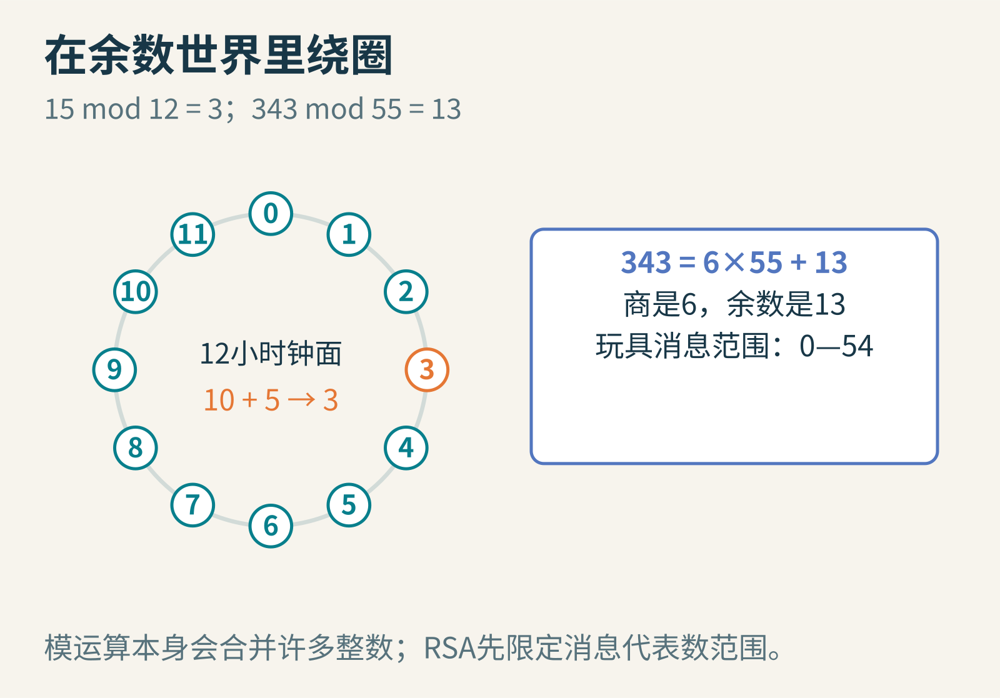
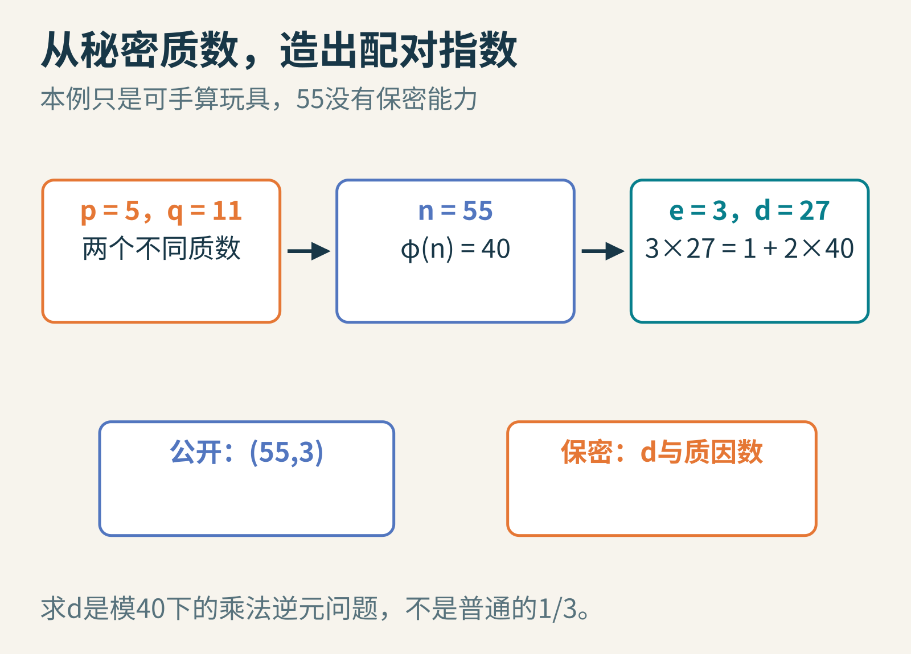
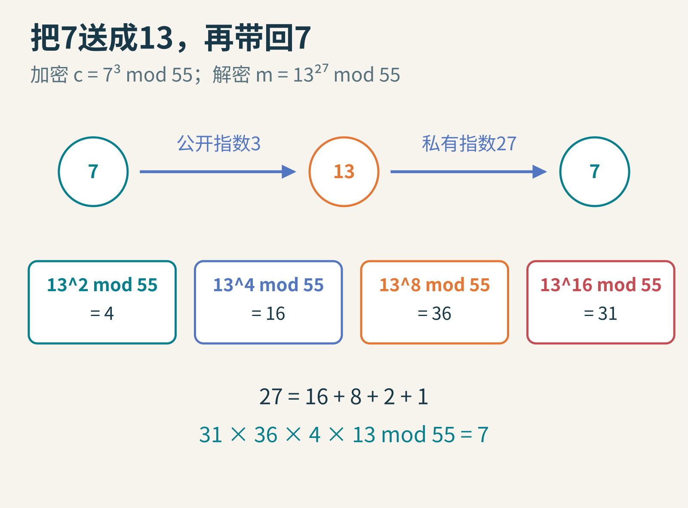
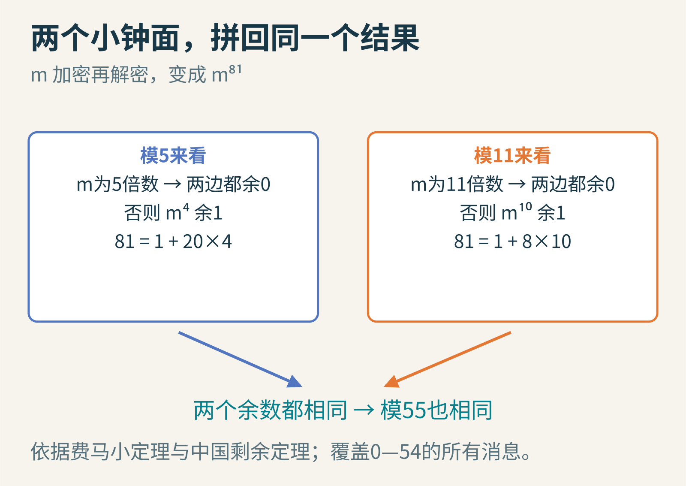
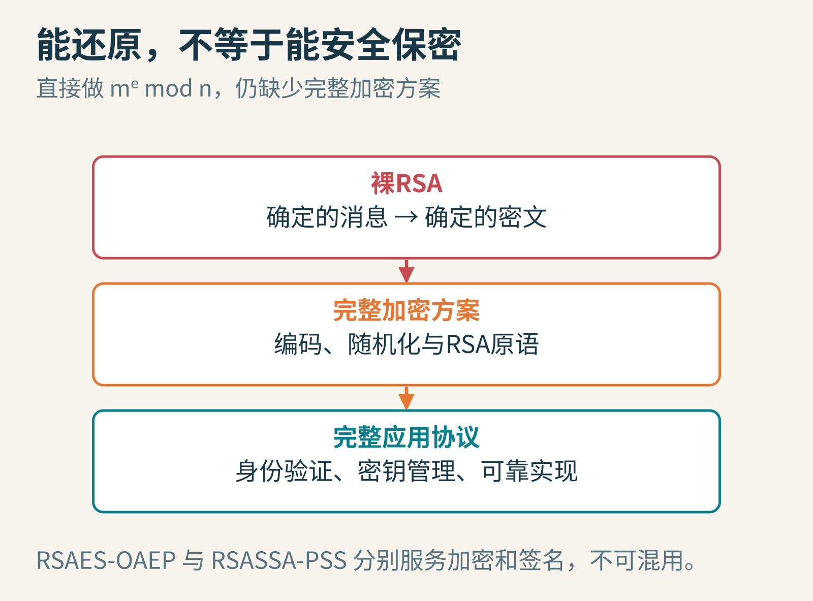
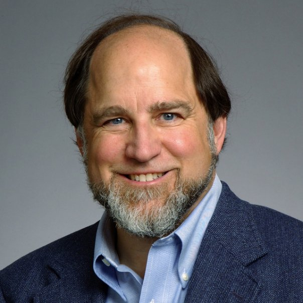
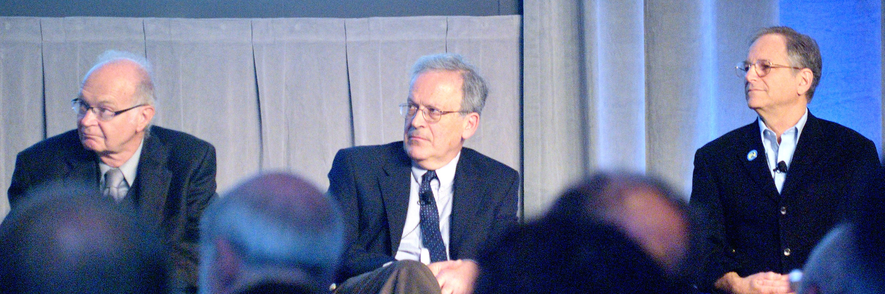

# 公开一把钥匙，为什么仍能保密？用55这个小整数走进RSA

如果你想把一张纸条锁进箱子，先把锁交给所有人并不奇怪：任何人都能把箱子锁上，只有拿着钥匙的人能打开。

可数字世界里没有金属锁。加密是一串公开的计算步骤，别人可以复制程序，也可以反复尝试。怎样让“所有人都能算的正向操作”，仍然需要某份秘密才能轻松倒回来？

RSA给出了一种著名的数学构造：让公开钥匙与秘密钥匙使用不同的指数，却通过整数除法里的余数联系起来。我们先造一个只有55那么大的玩具，再看真正的安全边界在哪里。


图1：公钥允许别人给你加密；私钥用于解密。这里的锁只是直觉类比，不表示数学已经证明“别人绝对打不开”。

## 余数世界里的数字会绕圈

12小时制的钟面上，10点再过5小时，落在3点。我们没有说10+5等于3，而是说15除以12余3。记为15 mod 12=3。

RSA也在类似的余数世界里做乘法和乘方，只不过“钟面”通常大得多。模55时，7³=343；343=6×55+13，所以7³ mod 55=13。

取余会不会直接把信息丢光？一般而言会。例如模55，7和62都变成7。因此RSA首先规定，送入这层数学变换的消息代表数 m 必须落在0到n−1之间。真实消息如何编码成这个范围内的整数，是完整加密方案的一部分。


图2：模运算把整数折回固定范围。本文玩具的消息代表数限制为0—54，不是把任意长文本直接当成一个小整数。

## 先在秘密的一侧造好机关

选择两个不同的质数 p=5、q=11，乘起来得到 n=55。

在0到54里，与55互质的数共有 (5−1)(11−1)=40 个。这个数量记为 φ(n)。互质的意思是两数没有大于1的公因数，例如7与55互质，5与55则不互质。

接着选公开指数 e=3。因为3与40互质，能找到一个整数 d，使 e×d 除以40余1。这里 d=27，因为3×27=81=2×40+1。

于是可以公开 n=55、e=3，把 d=27以及原始质数 p、q保密。这不是实际密钥生成方案，只是为了让每一步都能手算。


图3：知道p、q，很容易得到φ(n)，再求出d；公开的部分只有(n,e)。图里的数字极小，任何人都能迅速分解55。

为什么要先选质数再相乘？乘法很容易，而从足够大的乘积反过来找出那两个质因数，被认为在合适参数下很困难。知道因子的一方掌握了额外结构，能够构造这对指数。

但不能把这段话倒过来误读成定理：“解密RSA已经被证明与分解大整数完全等价。”分解 n 确实提供了一条破坏RSA的方法；一般RSA问题与整数分解之间的关系，不能用一句完全等价概括。

## 把7寄出去，再把13变回来

现在想发送消息代表数7。发送者只用公钥：

c=7³ mod 55=13。

接收者用私钥：

m=13²⁷ mod 55=7。

这一步看起来像魔术，因为27次方很大。其实计算时不用先造出那个巨大的整数。每次平方都取余，保留较小的余数即可：

- 13² mod 55=4
- 13⁴ mod 55=16
- 13⁸ mod 55=36
- 13¹⁶ mod 55=31

27=16+8+2+1，因此把相应余数相乘，再模55，就得到7。这是平方乘法的思想，指数的二进制表示帮助我们减少工作量。


图4：计算中不断取余，不改变最后的余数，却避免保存完整的巨大幂。箭头上的指数是运算，不是把数字重复相加。

以下教学程序在 Python 3 中运行过，不仅检查7，还检查了0到54全部55个消息代表数都能往返。

```python
n, e, d = 55, 3, 27
c = pow(7, e, n)
print(c, pow(c, d, n))
print(all(pow(pow(m, e, n), d, n) == m
          for m in range(n)))
```

输出依次为13 7与True。Python的三个参数版本 pow(a,b,n)计算的是a的b次幂模n。这个实验确认了这组小参数的结果，不是对任意参数的证明，更不是安全测试。

## 为什么这两个指数能把数字送回原地

先看与55互质的消息。欧拉定理告诉我们，m⁴⁰ mod 55=1。加密再解密等于把 m 取81次方，而81=1+2×40。因此：

m⁸¹ = m×(m⁴⁰)²，在模55的世界里就回到m。

不过，我们刚才检查的55个数还包括5、10、11等不互质的情况。只引用欧拉定理，证明还缺了一块。

可以把大钟面拆成模5和模11两个小钟面。对模5而言，若m是5的倍数，原数和它的81次方都余0；否则由费马小定理，m⁴余1，而81除以4余1，因此m⁸¹与m有相同余数。模11也类似，因为81除以10余1。

两个不同质数互质。一个数同时与m具有相同的模5余数、模11余数，就与m具有相同的模55余数。这是中国剩余定理在这里发挥的作用。


图5：同时保住模5与模11的余数，就保住了模55的结果。这个证明也覆盖消息代表数与55不互质的情况。

这一层数学解释了正确性：持有配对指数的人为什么能还原。安全性是另外一个问题：没有秘密的人，要付出多大代价才能做到同样的事？

## 为什么这段程序绝不能直接拿去保护秘密

第一个原因很明显：55=5×11太容易猜。真实RSA使用大得多的整数，还依赖恰当的质数生成、随机数质量和参数选择。

第二个原因更隐蔽：即使把 n 换得很大，直接做 c=mᵉ mod n 的“裸RSA”仍不是完整安全的加密方案。相同消息会得到相同密文；当消息空间很小，例如只有“同意”和“拒绝”两种，旁观者可以分别用公开钥匙加密候选项来比较，根本不必求出私钥。

它还具有可被利用的代数结构：两个密文相乘，模n后对应消息乘积的加密。这不是适合一般消息保密的自由功能，而是安全方案必须仔细处理的性质。


图6：裸RSA是数学核心。完整加密方案还要处理编码与随机化；实际应用又需要身份验证、协议和可靠实现。

[RFC 8017](https://www.rfc-editor.org/rfc/rfc8017.html)定义了RSAES-OAEP等加密方案和RSASSA-PSS等签名方案。它们不是在公式外面随便补点零，而是具有明确结构和安全目标的编码方法。

生产系统应使用维护良好的密码库和合适协议，不能把本文小程序改几个数字就上线。这里也没有生成或处理任何真实用户密钥。

## 签名和加密，方向相似，目的不同

加密关注“谁能读”；数字签名关注“这份消息是否由持有相应私钥者签出、内容有没有改变”。验证签名时用公钥，但这不意味着签名让消息保密。

把签名简化成“拿私钥加密原文”，会把数学原语与完整签名方案混为一谈。真实RSA签名涉及消息散列、签名编码和验证规则；PSS就是一种规范化方案。

公钥还有身份问题。某人递来一把公钥，并说“这是老师的”，你怎样确认？如果钥匙本身被替换，后面的计算再正确也无法补救。这需要证书、已验证的指纹或其他信任机制。RSA解决了一部分问题，没有包办整个安全世界。

## 三个姓氏背后，是一条研究接力

RSA取自Ronald Rivest、Adi Shamir、Leonard Adleman三人的姓氏。他们1978年的[原始论文](https://people.csail.mit.edu/rivest/pubs/RSA78.pdf)把这一构造用于公钥加密与数字签名，也明确承认Diffie和Hellman提出的公钥密码思想对其工作的启发。


图7：Ronald Rivest的2015年肖像。Ronald L. Rivest提供，CC BY-SA 4.0，未修改。


图8：Adi Shamir在2018年英国皇家学会入会活动中。The Royal Society／Duncan Hull，CC BY-SA 3.0，未修改。


图9：2012年的讨论活动，左起Donald Knuth、Leslie Valiant、Leonard Adleman。摄影orcmid，CC BY 2.0，未修改。这是后来活动的真实照片，不是RSA诞生时的现场。

一个有趣的继续方式，是把 p、q改为7和11，自己找一对满足条件的 e、d，再检查每个消息代表数。随后，故意让 e与φ(n)不互质，看看为什么“找到逆指数”这一步卡住。

这时，公开钥匙不再只是一个隐喻。你已经亲手看见：余数、质数与指数，如何共同搭出一扇能往返的数学门；也看见“能往返”和“足够安全”之间，还隔着严肃的工程与证明。

图片来源：图1—6为原创教学示意；[Rivest](https://commons.wikimedia.org/wiki/File:Ronald_L_Rivest_photo.jpg)，Ronald L. Rivest，[CC BY-SA 4.0](https://creativecommons.org/licenses/by-sa/4.0/)；[Shamir](https://commons.wikimedia.org/wiki/File:Adi_Shamir_Royal_Society.jpg)，The Royal Society／Duncan Hull，[CC BY-SA 3.0](https://creativecommons.org/licenses/by-sa/3.0/)；[Adleman所在讨论活动原页](https://commons.wikimedia.org/wiki/File:2012-06-16_Three_of_the_Algorithmic_View_of_the_Universe_panelists.jpg)，orcmid，[CC BY 2.0](https://creativecommons.org/licenses/by/2.0/)，未修改。
