# 车轮明明向前转，录像为什么能让它倒着走？

假设有一只轮子，上面只画一根带蓝色端点的辐条，方便认出同一个位置。轮子每秒顺时针转七圈，摄像机每秒只拍八张照片。

把前四帧排在一起，你会看到下面的画面。

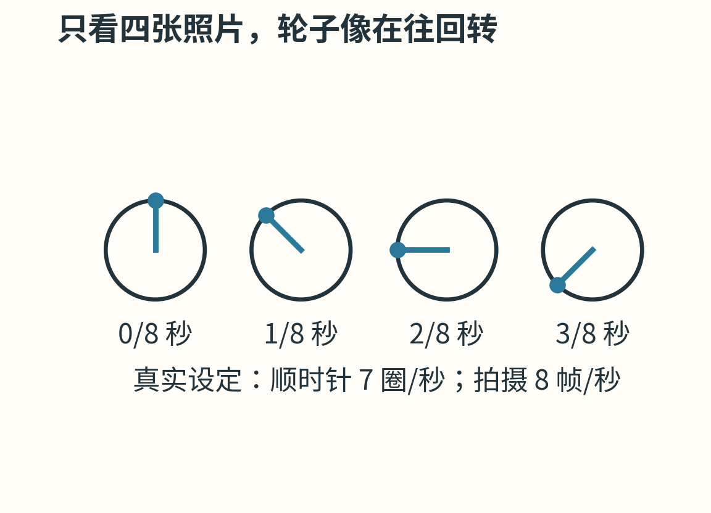

蓝色标记从上方逐步往左走，看起来像在逆时针转。轮子没有收到倒车命令，摄像机也没有把帧顺序弄反。

真正被丢掉的，是两次拍摄之间发生了什么。

## 315 度与负 45 度，照片只留下同一个终点

两帧相隔 1/8 秒。真实轮子在这段时间里转过 7/8 圈，也就是顺时针 315°。

但同一个终点也可以通过逆时针 45°到达。照片只记录标记落在哪里，没有写下它在中间绕了哪条路。

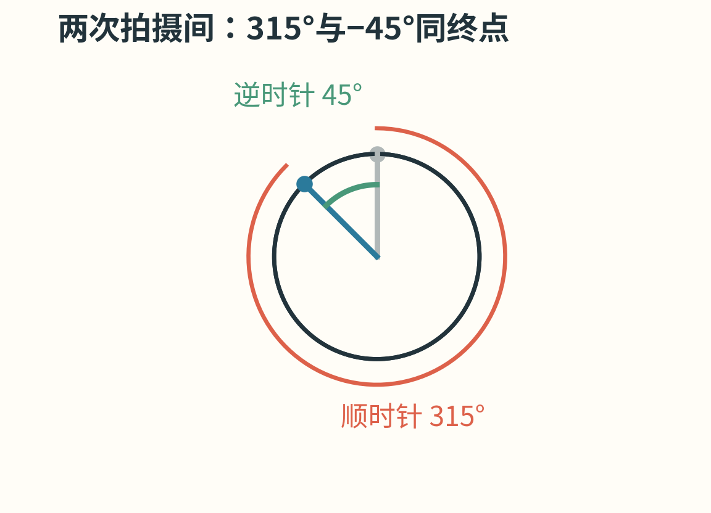

每两帧都发生同样的歧义：顺时针走七小格，与逆时针走一小格，最后落在同一处。于是“每秒顺时针七圈”和“每秒逆时针一圈”可以留下完全一样的帧序列。

这是时间采样产生的混叠：不同的连续变化，经过离散观察，变成了无法区分的记录。

真实车轮通常有许多相同辐条，外观本身还会重复，曝光也会造成模糊。我们特意用一个可识别标记，先把形状重复这些额外因素拿掉。图中的七圈、八帧是教学设定，不是从一段汽车录像里量出的转速。

想看真实拍摄演示，可以打开 Pixelmaniac pictures 的[转盘录像](https://commons.wikimedia.org/wiki/File:The_wagon-wheel_effect.ogv)。那段实验标注使用24帧/秒，和本文的八帧模型不是同一组条件。

## 把轮子换成声音，问题仍然存在

麦克风把空气压力变化转换成电信号。数字记录不能在每个连续时刻都存一个数，而是在一系列时刻读取幅值。每秒读多少次，就是采样率。

为了让数字好算，先不用声音的千赫兹单位。我们仍然每秒采八次，采样时刻是0、1/8、2/8……秒。

假如只把测到的数画出来，你真正拿到的是这些黑点。

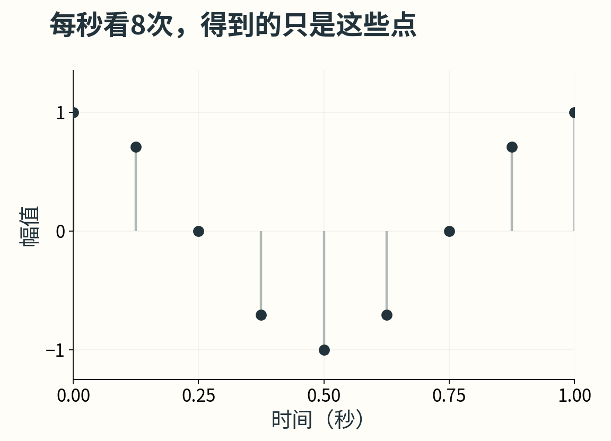

图中画到1秒，两端都标了点；最右边的点已经是下一秒的起点。黑点之间没有自动附带曲线。你可以用线连起来，但那条线是你补画的，不是测量设备在时间缝隙里留下的证据。

我们给这组点准备两个不同的候选来源。第一个是1 Hz的余弦，也就是一秒完成一次起伏：

x1(t)=cos(2πt)。

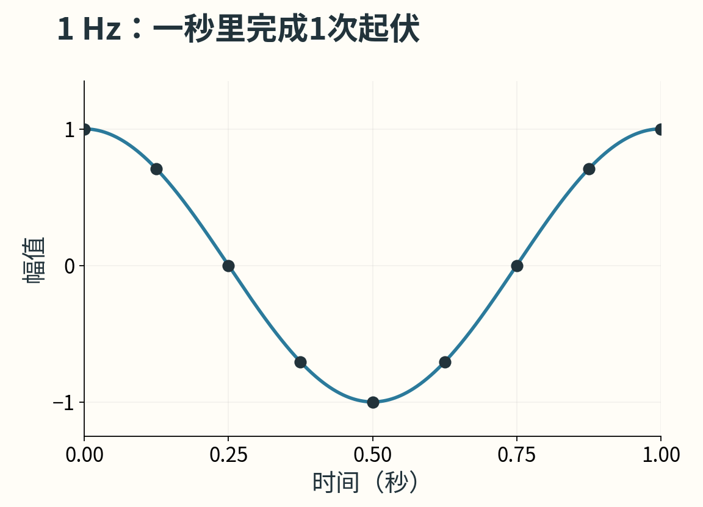

第二个是7 Hz的余弦，一秒完成七次起伏：

x7(t)=cos(2π×7t)。

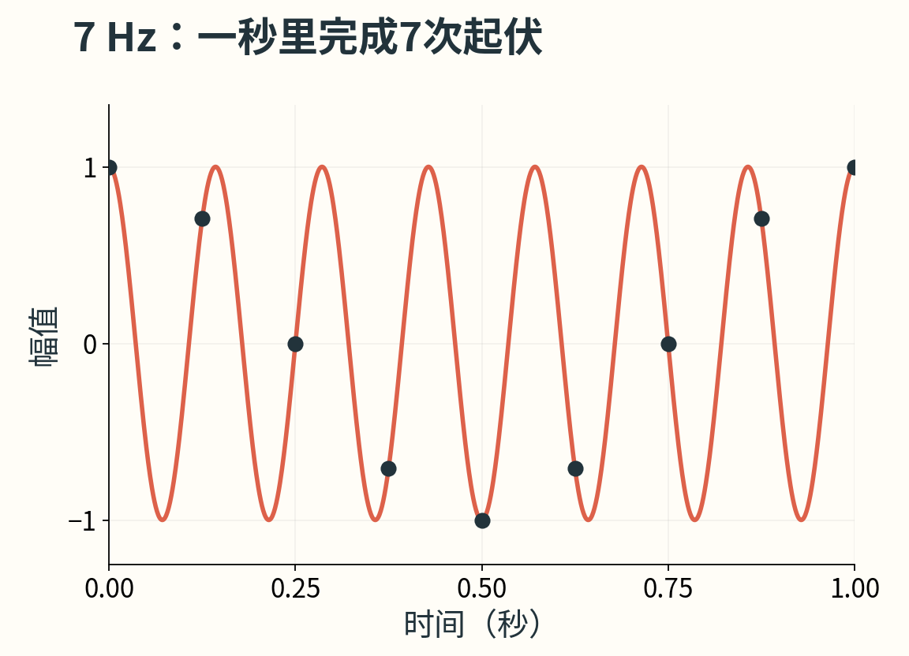

红线比蓝线忙得多。但仔细看黑点，两幅图竟然没有差别。

## 这不是画图巧合，可以把每个数算出来

第 n 次采样发生在 t=n/8。慢曲线的值是 cos(2πn/8)，快曲线的值是 cos(2π×7n/8)。

因为7n/8=n−n/8，快曲线的相位可以写成2πn−2πn/8。整整 n 圈不改变余弦值，余弦对正负角又相同，所以它恰好等于 cos(2πn/8)。

也就是说，对每个整数 n，两者的样本都一样。不是这一秒碰巧相同，继续采下去仍然相同。

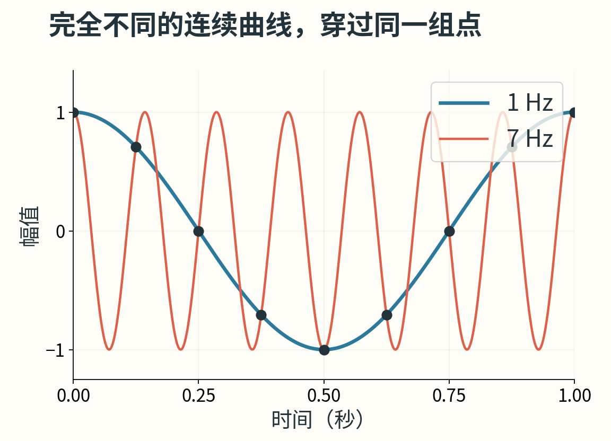

只看第1/8秒：慢曲线转到45°，快曲线转到315°。余弦读的是单位圆的横坐标，两点的横坐标都是约0.707。

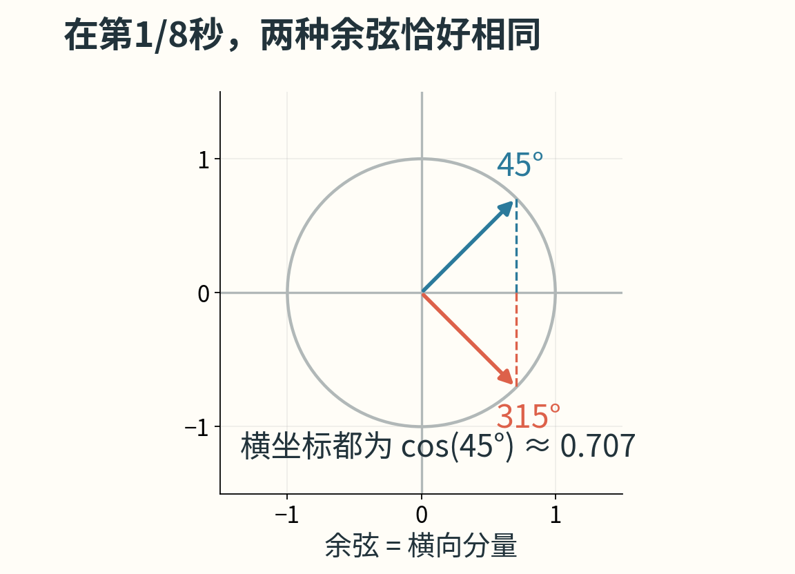

从 n=0 到7，两组样本都是：

[1, 0.707107, 0, −0.707107, −1, −0.707107, 0, 0.707107]。

下面的 Python 3 标准库代码可以直接验证。

```python
from math import cos, pi

slow = [cos(2*pi*n/8) for n in range(8)]
fast = [cos(2*pi*7*n/8) for n in range(8)]
print([round(x, 6) for x in slow])
print([round(x, 6) for x in fast])
assert max(abs(a-b) for a, b in zip(slow, fast)) < 1e-12
```

实际运行通过。浮点计算可能显示“-0.0”或最后几位微小误差，那是数值实现的细节；数学上的样本相等来自刚才的周期关系。

轮子的故事和这段余弦演算并非每个符号都一一对应：完整轮子位置有二维朝向，而余弦只读一个投影。但两者都利用了“间隔之间多绕整圈，离散记录看不出来”这个缺口。

## 数据已经一样，后面的聪明算法还能分开它们吗？

假设你拿到这八个数字，完全不知道真实输入可能含多高的频率。

你无法仅凭它们判定原来是1 Hz还是7 Hz；9 Hz、15 Hz等候选，也可以与同一组样本兼容。计算能力再强，也不能让完全相同的输入自动携带不同的历史。

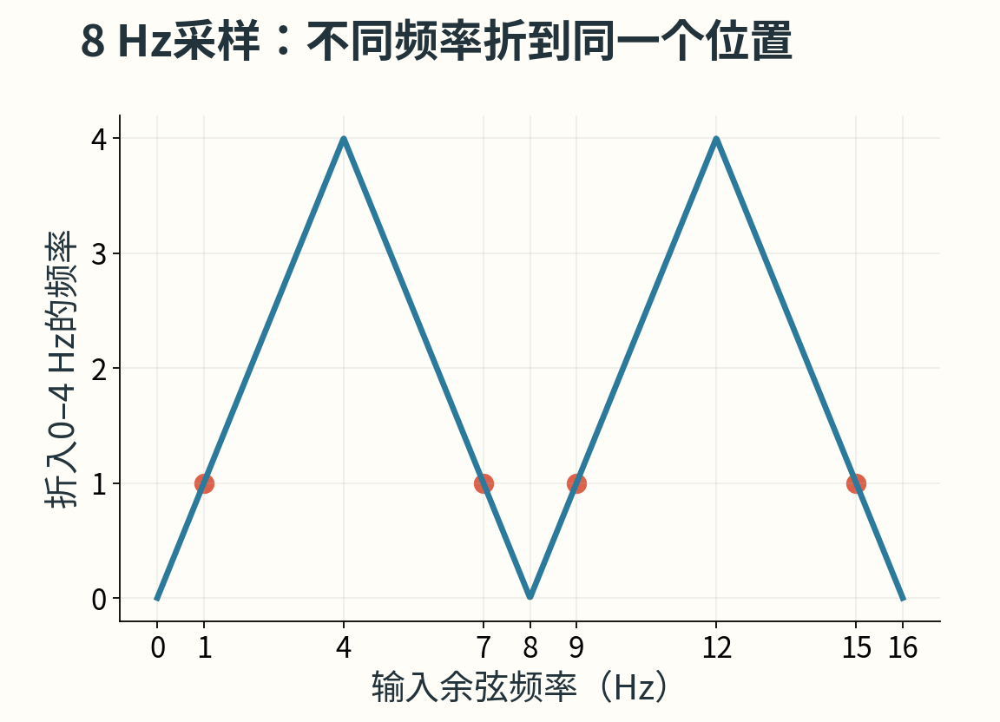

这张图把输入余弦频率映射到0至4 Hz内的等效频率位置。红点1、7、9、15都落到1。图只说明频率位置；对一般有相位的正弦分量，折叠时还要正确处理相位和符号。

这也解释了为什么“录完以后再把高频删掉”不一定能救回来。7 Hz已经以1 Hz的样本形式混进来了，你若在数字结果中删1 Hz，也会同时删掉真正想要的1 Hz。

后处理当然可以利用额外知识去猜，比如知道声源只会发某几个音，或者视频里车身明确向前。但那是加入新约束，不是从原样本里挖出了它从未保存的证据。

## 采样定理给出的不是魔术，而是一份条件

如果我们事先知道输入不包含某个上限 B 以上的频率，并以高于2B的频率均匀采样，那么在理想条件下，就能避免这里的基带混叠歧义，并从完整样本序列重建这种带限信号。

“带限”就是说可出现的频率范围受到限制。比如明确规定输入只允许0至3 Hz，而采样率8 Hz，那么7 Hz候选已经被规则排除了。没有这项限制，黑点自己不会赶走红线。

通常把采样率的一半称为奈奎斯特频率。在这里，它是4 Hz。但不要把“至少两点就足够”当成不带前提的口令。

让输入恰好是4 Hz正弦，仍在0、1/8、2/8秒采样。每次可能恰好撞上过零点，整串数字都是零。

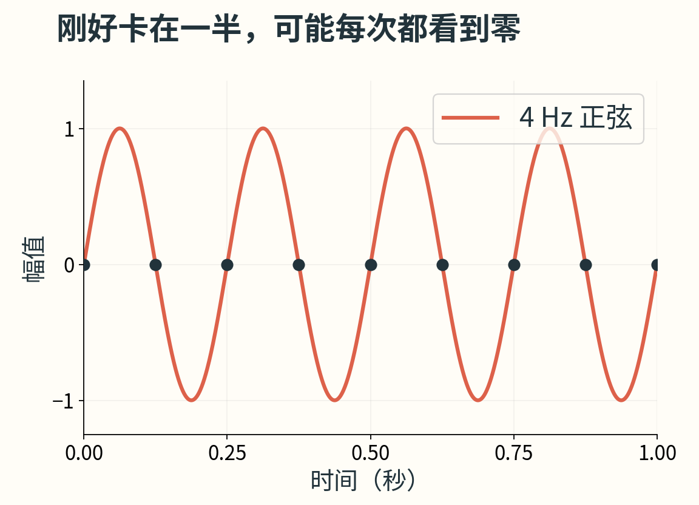

它与真正的零信号就无法区分。这个边界例强调了相位、频带端点及信号类别的条件。本文采用“最高频率严格低于采样率一半”的表述，避免把端点情形当成无条件保证；实际滤波器还需要额外余量。

理想重建也不是拿尺子把相邻点连成折线。折线通常只是显示方式，未必等于原本的连续信号。

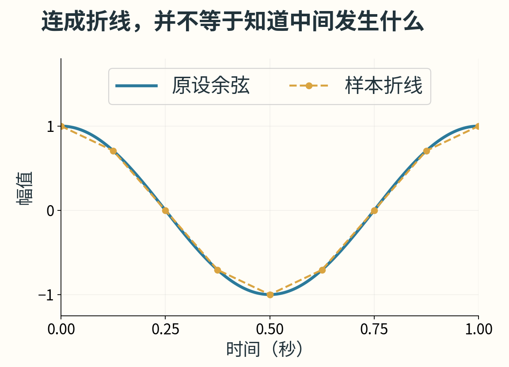

而且严格的理论讨论使用完整样本序列与理想带限、精确样本等条件。实际录音只有有限长度，还有噪声、时钟误差和滤波误差；有限窗口边缘怎样处理，也是工程问题的一部分。

## 声音进入数字世界之前，要先把门口管好

设输入同时包含我们想保留的1 Hz和不想保留的7 Hz。每秒采八次之前，需要先衰减会折回低频的那部分。

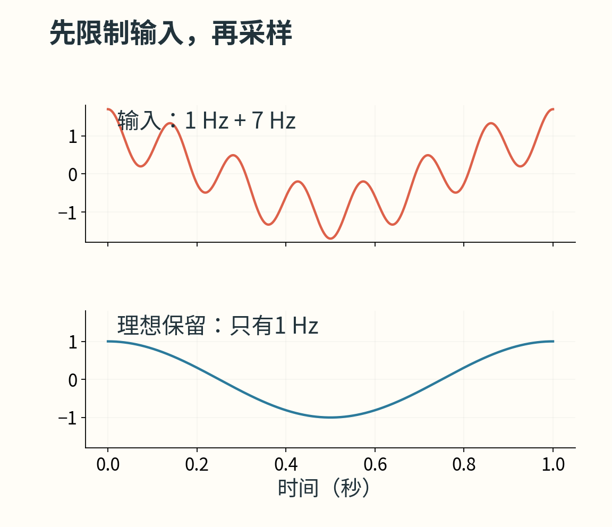

上图是一个明确构造的理想示意：从1 Hz加7 Hz的输入，只保留1 Hz。它没有模拟某一款真实滤波器的电路响应。

模拟输入进入模数转换器之前，常使用抗混叠低通滤波器。低通意味着低频较容易通过，高频被压低。[Analog Devices 对输入滤波的说明](https://www.analog.com/en/resources/faqs/FAQ_antialiasing_filter.html)

现实滤波器不能在某条频率线上瞬间从完全通过变成完全阻断。它需要过渡区，阻带衰减也有限。所以采样率通常不能只贴着“想保留的最高频率的两倍”来设计。

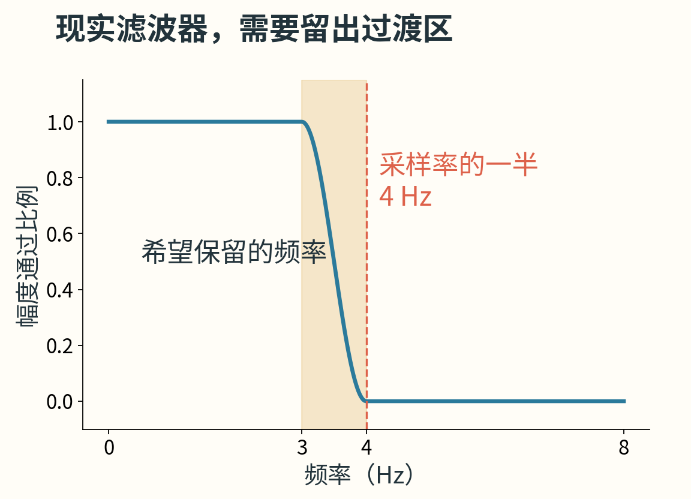

图中蓝线只是说明过渡带的一条自建曲线，不是产品测量。抗混叠滤波器的目标是把潜在的折叠污染降到允许的误差范围，而不是宣称所有真实输入都能被完美切割。

数字世界里主动降低采样率，也面临同一个问题。比如手里已有每秒48,000点，想变成每秒8,000点，不能一般性地直接每六点留一点；应先按新的频带要求做数字低通，再降采样。

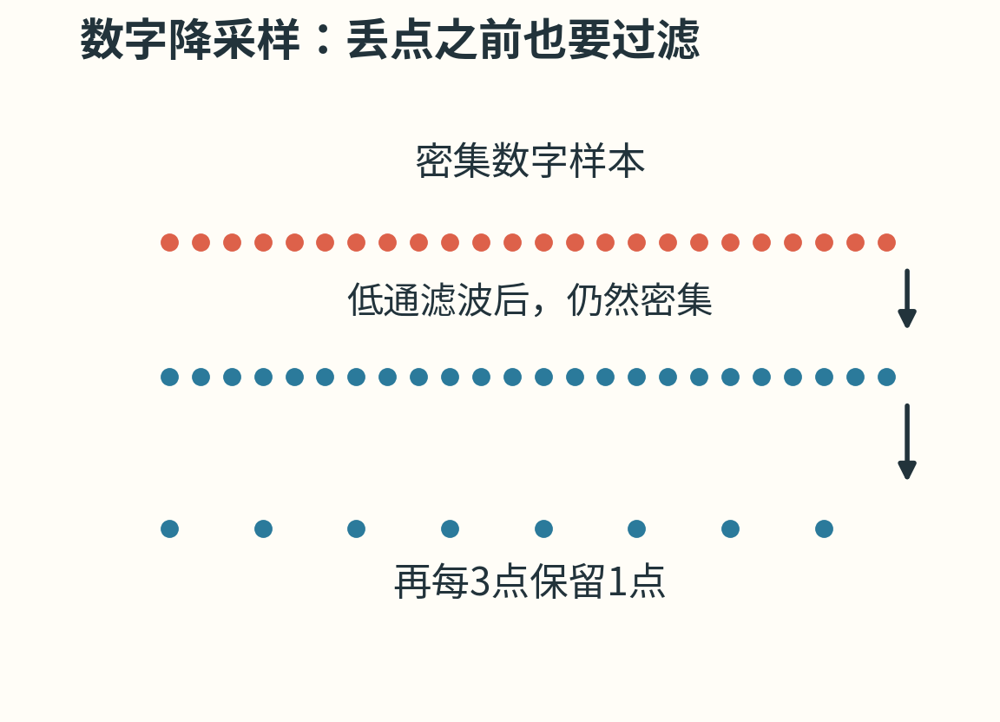

这张流程图为了看清间距，画的是每三点留一点；下面的声音实验使用每六点留一点。变化的是比例，先限制带宽再减少采样的理由相同。

## 把1和7都乘一千，就能听见它

我们生成一个7,000 Hz的余弦，以48,000 Hz保存，接着故意跳过滤波，直接每六个样本留一个，并把输出标为8,000 Hz。

在新的采样率下，7,000 Hz会对应1,000 Hz的样本序列。图里把一秒缩成几毫秒，关系与刚才完全相同。

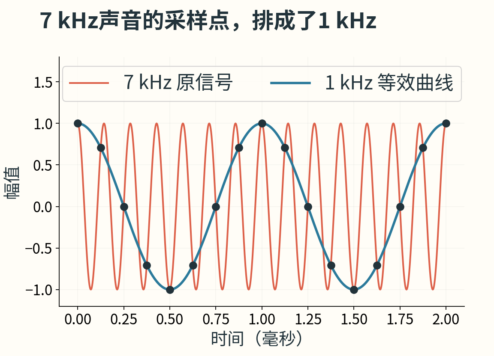

随文的 [完整实验程序](examples/experiment.py) 只用Python标准库，生成一秒的合成声音，使用同样的约四分之一峰值幅度，并在开头和结尾加10毫秒淡入淡出，避免突变点击声。

它输出三份文件。先把播放音量调低，再比较：

- [7 kHz原始合成音，48 kHz采样](assets/original-7khz-48k.wav)
- [跳过滤波后降到8 kHz的结果](assets/aliased-7khz-8k.wav)
- [直接生成的1 kHz参考音，8 kHz采样](assets/reference-1khz-8k.wav)

本地执行确认：后两份文件的16位PCM样本数组逐项完全相同。这个结论不依赖你使用哪种耳机、是否能清楚听到7 kHz；数据比较本身就能检验。

这不是用麦克风实录，也没有测量声卡电路。它是一个真实运行的数字合成与降采样实验，专门把错误发生的条件控制住。

## 那就多拍一点、多采一点？可以，但也有范围

把前面的8 Hz提高到16 Hz，1 Hz与7 Hz在新加进来的观察时刻就不再相同。

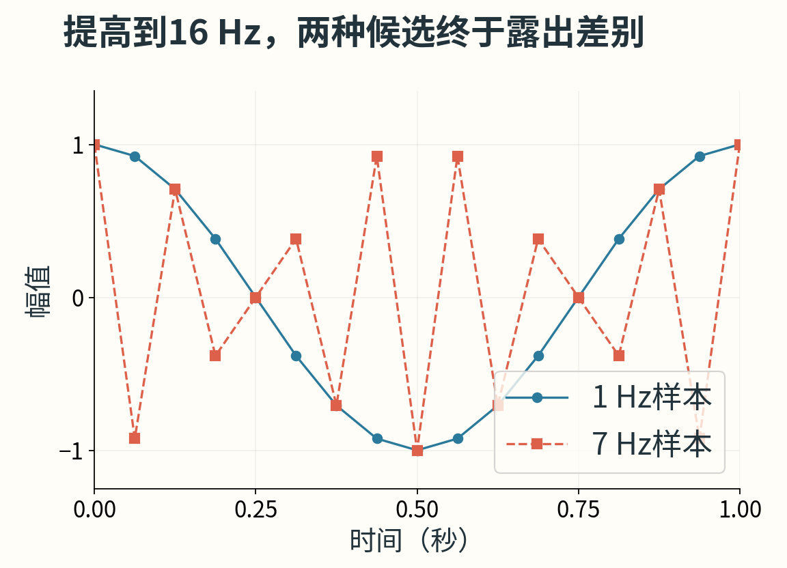

比如第1/16秒，1 Hz余弦约为0.924，7 Hz余弦约为−0.924。这次中间多看的一眼，正好把它们分开。

提高采样率会扩大可以无歧义处理的基带范围，但不会使任何任意快的输入都安全。输入频率若还能不断增长，仍然可以找到新的混叠候选。

另一种常被混淆的“提高精度”是增加位深。采样率决定多久看一次，位深涉及每次看到的幅值如何量化。把幅值记得更精细，不会自动补上时间间隔里的观察。

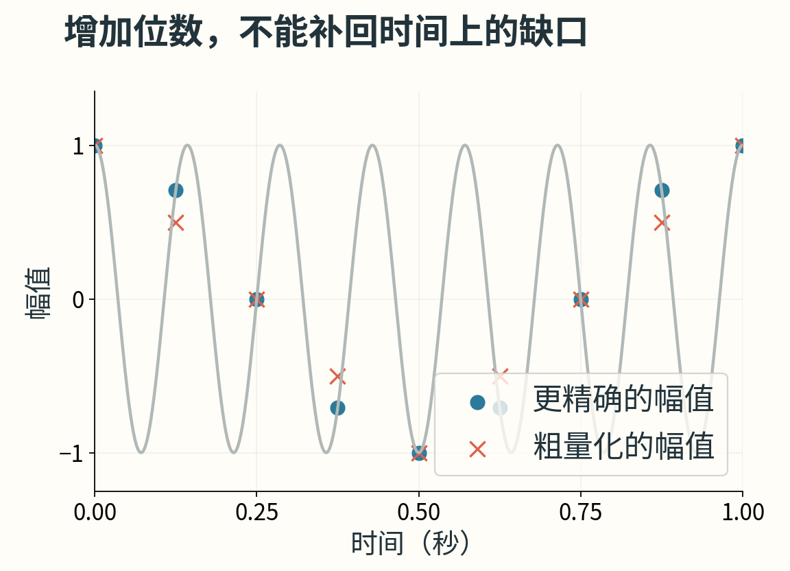

图中的红叉采用故意很粗的幅值量化；蓝点更精确，但两组仍然只在相同的时间点出现。即使每个蓝点记录无限多位小数，1 Hz与7 Hz的数学歧义仍然存在。

## 一个老定理，仍在提醒我们先检查观察方式

Shannon 在1949年的《Communication in the Presence of Noise》第二节给出采样定理与重建讨论，也说明相关数学形式和通信思想已有前人工作，提及 Nyquist 等人的贡献。不能把一个广泛发展的思想压成“某人忽然发明两倍采样”的神话。[1949年原论文](https://fab.cba.mit.edu/classes/S62.12/docs/Shannon_noise.pdf)

它和快速傅里叶变换回答的是不同问题：这里追问记录本身有没有歧义，而FFT讨论的是既定离散数据的一项变换怎样算得更快。更快的计算，不会替代采样之前应该满足的条件。

车轮和音频都是随时间观察的例子。照片里的细条纹也会有空间采样问题，但那里的间隔是像素在空间中的距离，不能把帧率直接拿去当空间分辨率。本篇到这里不换进另一套纹理滤波问题。

最后改一个条件：仍然每秒采八次，把7 Hz改为6 Hz。先用周期关系预测它会与哪种低频余弦相同，再把代码里的7改成6，比较样本。

你会发现，关键问题一直没有变：我们看到的点，到底排除了哪些世界，又还允许哪些世界存在？

图片来源：16张正文图均为原创教学示意或明确参数的信号计算结果。转盘录像仅链接 Pixelmaniac pictures 的[公共领域原作](https://commons.wikimedia.org/wiki/File:The_wagon-wheel_effect.ogv)，没有把录像参数写成本文模拟参数。信号原理参考 [Shannon 原论文](https://fab.cba.mit.edu/classes/S62.12/docs/Shannon_noise.pdf)及 [Analog Devices](https://www.analog.com/en/resources/faqs/FAQ_antialiasing_filter.html)。
