# 给光源装一台“相机”：阴影贴图怎样知道哪里照不到光

你站在路灯旁边，看得见箱子，也看得见箱子后面的一块地面。那块地面却在阴影里。原因并不是玩家看不见它，而是光源到它之间被箱子挡住了。

换一个视角，问题突然变简单：如果我们把眼睛放到光源的位置，能直接看见的表面，就有机会受到这盏灯的直接照明；被其他表面挡住的地方，就在它的阴影里。

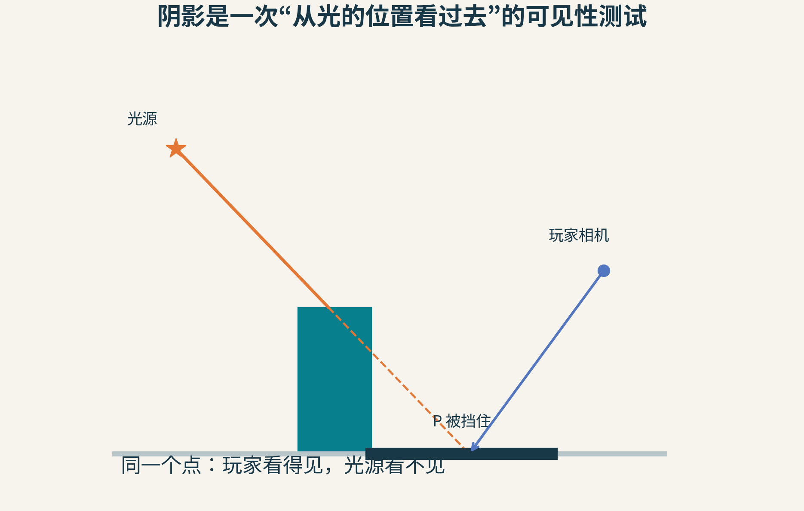

图1：玩家相机看得见地面上的P，光源却被箱子挡住。阴影贴图把“这盏灯照得到吗”转换成从光源方向观察的可见性问题。

阴影贴图，Shadow Mapping，就沿着这个思路工作。它不是把一张黑色轮廓贴在地板上，而是给光保存一份“每个方向最先遇到谁”的记录。

## 一张图，存的不是颜色，而是最近深度

想象光源的位置装了一台只记录距离信息的特殊相机。对于它图像中的每个小格，保留最靠近光的那层表面。后面的表面不用继续记录，因为光已经被前面挡住。

这些小格叫纹素texel，可以理解成纹理里的像素。纹素保存的数是深度，而不是“这个地方是阴影”的标签。

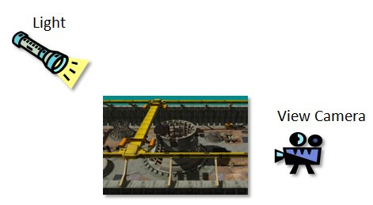

图2：微软文档中的示例场景同时有光源视角与观察相机视角。本文所有标明“微软”的原图均由Microsoft提供，使用[CC BY 4.0](https://creativecommons.org/licenses/by/4.0/)，完整画面未改动。

严格说，深度缓冲里存的数不一定是以米为单位的直线距离。透视投影常把空间位置变换成非线性的深度值。初学时可以把它想成“远近刻度”，实现时却必须保证比较双方用的是同一个投影、同一套刻度。

拿世界空间距离去比较投影后的深度值，就像拿摄氏温度直接与华氏数字比大小，数字都有意义，比较却错了。

## 第一遍：让光拍一张深度照片

第一遍渲染不为玩家生成最终彩色画面，只从光的视角处理场景，把最近表面写进深度纹理。

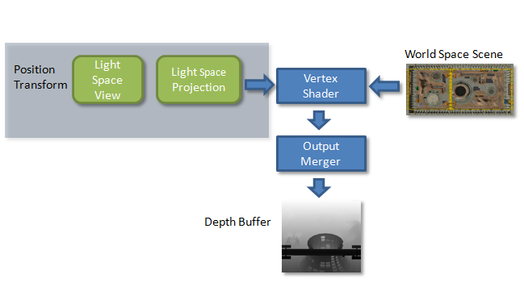

图3：微软原图展示第一遍。物体经过光的视图与投影变换，写出从光看去的深度缓冲。

“光相机”只是一个计算上的说法。聚光灯可以用类似透视相机的投影；平行光常用正交投影；向四面八方照明的点光源，常需要覆盖多个方向，例如六个立方体贴图面。不同光源的覆盖方式不同，核心问题仍是记录它首先遇到的表面。

如果物体或灯动了，这份记录可能要更新。如果灯和遮挡物不变，某些场景也可以复用它。缓存何时失效，是工程系统的职责。

## 第二遍：玩家看到的每个点，都去查光的记录

第二遍从玩家相机正常渲染。对于当前要着色的表面点P，程序做两件额外的事：

1. 把P变换到光的投影坐标，找到它对应的纹素位置(u,v)
2. 算出P在同一套光投影中的深度d，与纹素存的最近深度D(u,v)比较

如果P明显比最近表面更远，前面就有遮挡物；如果它就在最近那层，则没有被这份记录判为遮挡。

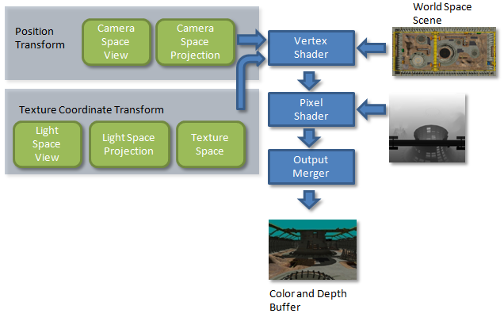

图4：第二遍既需要玩家视角的位置，也需要光视角的位置。两种坐标承担不同工作，不能拿屏幕像素位置直接查阴影贴图。

以常见的“越远深度越大”约定为例，可以写成：

如果d>D(u,v)+b，就判为被遮挡。

b是稍后要解释的偏移量bias。假设贴图存0.40，当前点是0.65，b=0.01，那么0.65>0.41，这个点在阴影中。若点的深度为0.405，它就不会被这次比较挡掉。

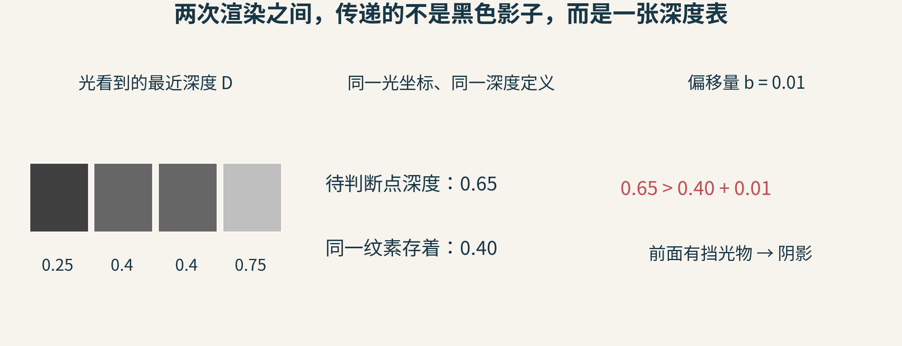

图5：原创数字示例。右侧0.65与0.40对应同一光方向、同一深度定义；小偏移不是为了把远近关系随意改写，而是给离散误差留容差。

在透视投影下，齐次坐标还需要正确除以w，再把横纵坐标映射到纹理范围。不同图形API的深度范围、y轴方向，以及是否采用反向深度，都会影响实现细节。本文不把上面的比较方向当成所有API通用的代码。

还有个容易漏的问题：P落在光相机的覆盖范围外怎么办？此时贴图根本没有提供可靠记录，需要明确的边界策略；不能把“没采样到”随意解释成一定亮或一定暗。

## 第一类坏影子：小小的纹素，被拉成大方块

玩家相机与光相机的位置不同，所以两张图的采样分布很少恰好重合。光贴图中的一个纹素，可能覆盖玩家画面里的很多像素。

那些像素查到几乎同一份深度结果，阴影边缘就显得像台阶。

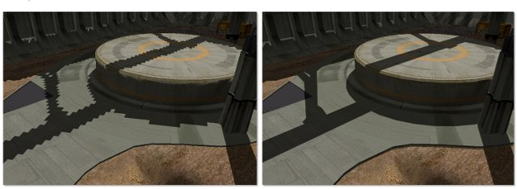

图6：微软示例中的透视走样对比。左侧多个屏幕像素共用少量阴影纹素，边缘更粗。

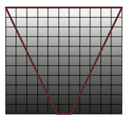

图7：微软示意图把两种采样网格放在一起。观察相机近处需要更多画面细节，而均匀分配的光空间纹素未必把精度花在这里。

再想象一束光几乎贴着地面擦过去。一个很小的光方向范围，会在地面上对应一条很长的区域。即使离玩家不近，也会因为表面朝向产生投影走样。

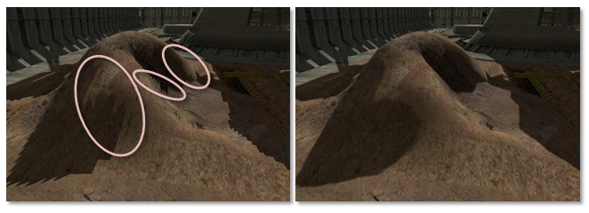

图8：光线与接收表面接近平行时，采样被拉长。这与单纯“屏幕分辨率太低”不是同一问题。

提高阴影贴图分辨率有帮助，但代价是更多存储和处理，且未必解决严重掠射角问题。另一条路线是重新分配有限样本：把需要精度的地方照顾得更好。

这也是级联阴影贴图的出发点之一：把玩家视锥按距离分成几段，分别分配阴影图，避免远景与脚边细节争夺同一张图的全部精度。它增加了多张图之间的接缝、切换与稳定性问题，不能只理解成免费多开几张高清图。

## 第二类坏影子：表面把自己误当成遮挡物

理想世界中，一个直接被照到的点，在贴图里查到的应该就是它自己的深度。现实中，贴图只有有限纹素，深度也只有有限精度。

斜面上同一个纹素覆盖的区域，本来就包含不同深度；两遍渲染计算和采样的位置又可能稍有差异。于是第二遍算出的d比第一遍存的D大一点点，表面就错误地把自己判进阴影。

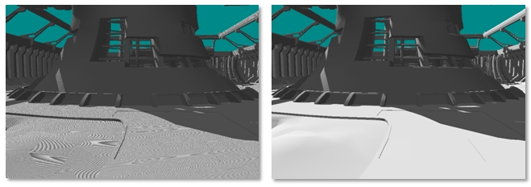

图9：这种条纹、斑点或摩尔纹常被称为shadow acne。它不是材质突然长了花纹，而是深度比较产生的错误自阴影。

加一点bias，可以让轻微的数值差不被误判成真正遮挡。斜得厉害的表面更容易遇到问题，因此还会用与坡度有关的偏移，而不是到处加同一个常数。

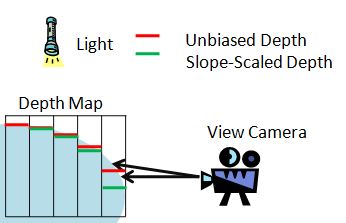

图10：微软原图比较未加偏移与按斜率调整的深度。一个纹素内的真实表面有坡度，单一采样值不能完全代表所有接收点。

但bias不是万能补丁。调得太大，会把真正略靠后的点也判为没被遮挡，阴影便与物体底部脱开。

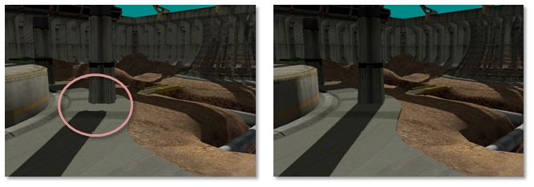

图11：Peter Panning现象让物体像浮在地面上。增大bias可能减少斑点，同时增加这种漏光，两个问题存在取舍。

所以，看到坏阴影就一直增大bias，常常只是把一种错误换成另一种。更好的顺序是先核对坐标和深度约定，再检查覆盖范围与精度，然后才调偏移与过滤。

## 把有限精度花在真正需要的空间里

假设阴影图宽度固定为1024个纹素。若横向覆盖1024米，每个纹素约对应1米；如果只需覆盖128米，同一张图就能提供约0.125米的采样间距。这里用的是理想正交投影教学数字，不是某个引擎实测。

范围包得过大，会把大量纹素浪费在玩家看不到、也不会影响当前阴影的区域。

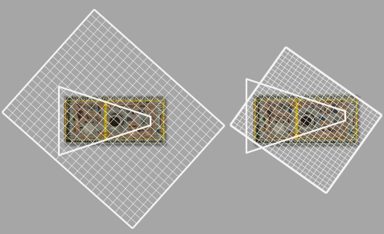

图12：左侧较松的范围覆盖了更多无关区域；右侧把更多纹素用于目标区域。

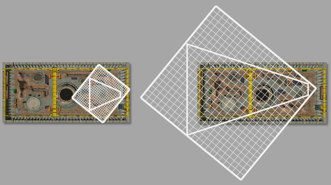

图13：进一步把观察视锥转换到光空间，可用其范围设计更合适的正交投影。但“越紧越好”仍有前提。

还要考虑深度方向的近远范围。范围太松，会浪费深度表示的精度；裁得太紧，又可能剪掉真正挡光的物体。尤其要记住：投影到玩家可见地面的阴影，可能来自玩家视野以外的物体。

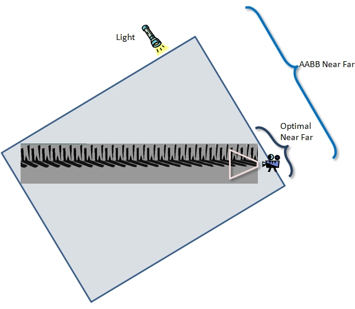

图14：用整个场景包围盒估计近远范围很方便，但有时把与当前区域无关的深度也算进来。

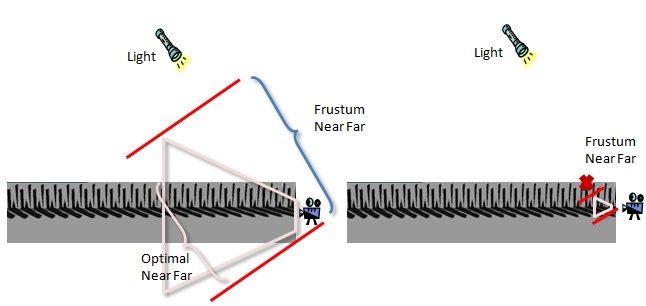

图15：只看玩家视锥又走向另一端：既可能仍然包得太松，也可能漏掉视锥外的重要投影物。

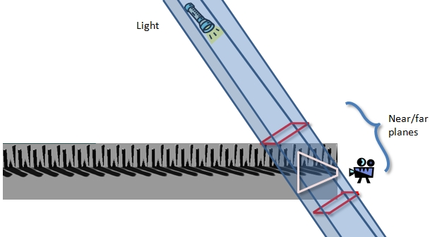

图16：微软示例通过光空间横纵覆盖范围与场景包围几何相交，再估计相关深度范围。重点是同时照顾接收阴影的区域与会向它投影的物体。

你不必第一次写阴影就实现复杂裁剪，但应当明白为什么这些范围参数不能胡乱填一个很大很安全的数。范围与精度，是同一笔预算的两面。

## 第三类坏影子：相机一动，边缘就闪

静止截图可能很好，移动时阴影边缘却不断明暗跳变。原因之一是光投影为了跟随玩家，每帧都轻微改变。世界中的同一条边，不停落在纹素网格的不同位置，采样结果随之变化。

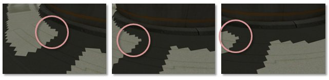

图17：微软以不同相机位置的示意说明边缘明暗跳变；单张静态图本身不能播放真实闪烁。

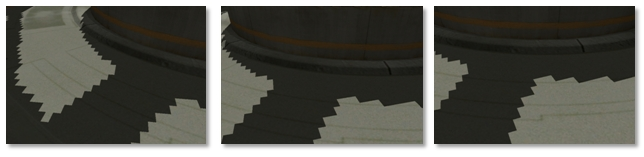

图18：在合适的平行光、正交投影配置下，保持尺度稳定，并让投影位置按世界空间纹素大小对齐，可以减少这种游动。

例如横向覆盖128米、宽1024纹素，纹素步长为0.125米。与其让光投影原点每次移动0.001米，可以让它按0.125米的网格对齐。这样减小亚纹素漂移，但需要留边界余量，不能因为取整把重要几何裁掉。

这不是取消了所有时间变化：物体真正运动、级联范围改变、光方向改变，仍会带来新的采样变化。解决的是一类由投影网格漂移产生的不稳定。

## PCF不是先把深度图模糊一下

阴影的硬比较会输出0或1，边界很容易显得生硬。Percentage-Closer Filtering，简称PCF，会在附近取多个样本，分别比较，再平均比较结果。

假设待判断点深度为0.60，bias=0.01。周围九个深度里有三个0.40、六个0.80。比较后，前面三个样本挡住它，后面六个让它可见。平均可见性就是6/9≈0.667。

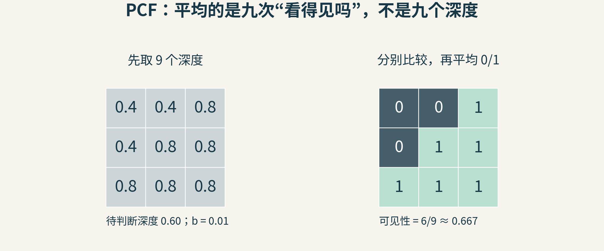

图19：原创PCF算例。左侧是深度，右侧是每次比较后的可见性。本文用1表示未遮挡、0表示遮挡；有些代码用相反约定，名称应保持一致。

如果先把九个深度平均，结果约为0.667，再只比较一次，就会得到一个完整的“可见”，而不是三分之二。这说明“比较后平均”与“平均后比较”是不同运算。

PCF可以让边缘过渡更平滑，但它并不自动成为真实面光源产生的软阴影模型。滤波范围过大还会丢失接触细节、增加漏光风险。要模拟随遮挡距离变化的半影宽度，还需要更多信息和方法。

## 还有一种问题，藏在模型本身

如果遮挡物薄得像一张纸，或者尖边附近两层表面非常接近，bias能容忍误差的空间会变小。只渲染背面有时能缓解自阴影，却也可能让薄物体失去应有的阴影。

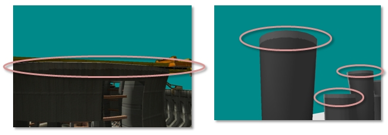

图20：微软示例中的尖边附近，前后深度差很小。几何结构、剔除方式与偏移参数必须一起考虑。

透明物体、半透明树叶、多层透射也超出了“每个方向只记最近一层不透明表面”的基础模型。树叶可借助透明度裁剪参与深度绘制，但真正的彩色透射、体积遮蔽等效果需要扩展方法。

这时不应该继续只拧同一个参数。先问“我保存的信息够回答这个问题吗”，往往比继续调数更有效。

## 一个1978年的想法，为什么还能解释今天的困难？

Lance Williams在1978年的《Casting Curved Shadows on Curved Surfaces》中提出了这条重要路线：利用可见表面计算，从光的方向得到深度信息，再判断遮挡。

它有力量，是因为把阴影问题复用了已有的可见性工具。但一旦把连续场景存进有限分辨率的图像，覆盖、采样、精度与过滤这些问题就随之而来。

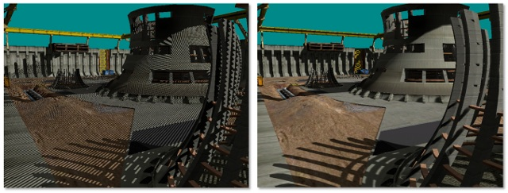

图21：微软文档的综合对照。右侧的改善来自多种技术配合；不能把它当成“只改了一个bias参数”的单变量实验，也不是本文自测。

看懂基本两遍流程以后，再看锯齿、黑斑、悬浮、闪烁，你会发现它们并不是四个互不相关的怪病。它们都在提醒我们：光与玩家用不同的采样网格观察同一个世界，而有限的记录必须谨慎解释。

## 给自己的阴影实验写一份排查顺序

1. 先显示光的深度图，确认遮挡物确实进入了覆盖范围
2. 只用一个不透明方块和一个平面，核对坐标变换、w除法与比较方向
3. 固定相机，分别改变分辨率与bias，区分采样不足和深度误差
4. 移动相机，检查投影范围是否每帧抖动；静态截图通过还不够
5. 最后加PCF，比较“先比较再平均”与“先平均深度”的差别

阴影不是在地上补一块黑。它是一场跨视角的查证：玩家看到了这个点，那么，从光那里出发，真的能到达它吗？

资料：[Microsoft：Common Techniques to Improve Shadow Depth Maps](https://learn.microsoft.com/en-us/windows/win32/dxtecharts/common-techniques-to-improve-shadow-depth-maps)、[GPU Gems：Shadow Map Antialiasing](https://developer.nvidia.com/gpugems/gpugems/part-ii-lighting-and-shadows/chapter-11-shadow-map-antialiasing)、[伊利诺伊大学课程中的阴影贴图与1978年论文记录](https://courses.physics.illinois.edu/cs418/fa2025/text/textures2.html)。

图片来源：图1、5、19为本文原创教学示意；其余18图来自上述[Microsoft原文](https://learn.microsoft.com/en-us/windows/win32/dxtecharts/common-techniques-to-improve-shadow-depth-maps)，© Microsoft，按[文档仓库CC BY 4.0许可](https://github.com/MicrosoftDocs/win32/blob/docs/LICENSE)原样使用，不代表Microsoft背书。
